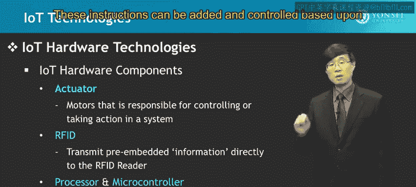
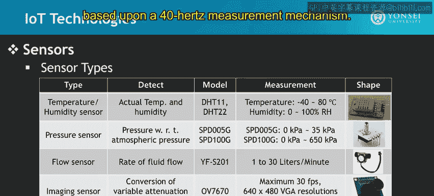
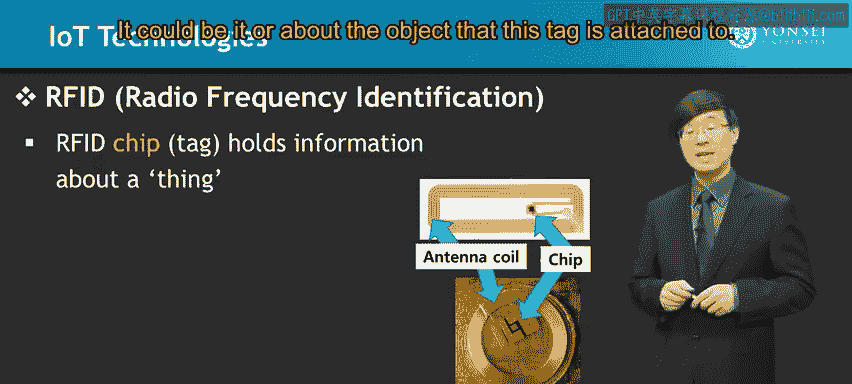
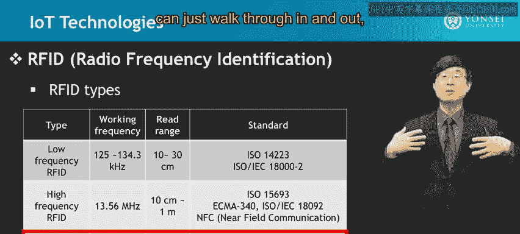
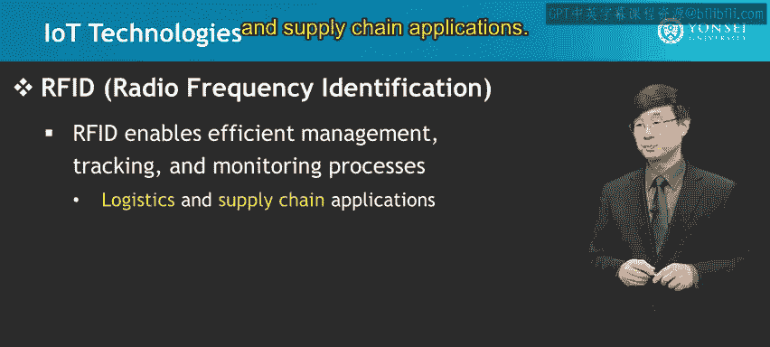

# 延世大学《新兴技术从智能手机到物联网再到大数据Emerging Technologies From Smartphone to IoT to Big Data》 - P87：15_2.2 物联网技术（第3部分）.zh_en - GPT中英字幕课程资源 - BV18hpFewEcG

Yeah。🎼Yeah。In the ecosystem of IoT， IoT hardware platforms take charge of collecting， storing。

 and processing data on the connection of the internet。

IT hardware components include sensors which detect events and changes in near physical environments such as temperature。

 image， infrared， gases， and humidity。As well as actuators。

 these are motors or switches or something that has a responsible。

 controllable unit where you decide you want to shut something down or open something up。

 this can help you both physically and electronically。

RfiID is another domain these are tags that are attached where when you have an RFID reader coming close enough to charge up the tag。

 that's when an immediate response of whatever information was in the RFID unit will be delivered to the reader this is of course used in logistics control and it's used in various places。

 including ID tags for people and machines and robots and drones as well。In addition。

 there are processors and controllers which connect sensors and actuators to the internet。

 this operates corresponding to specific operations and instructions。

 and these instructions can be added and controlled based upon artificial intelligence if needed and programmed equipped。

Sensor types， let's take a brief look at what type of sensors they have。The type， detect， model。

 measurement， and shape are the categories that we're looking at。Number one。

 temperature and humidity definitely you're looking at the models in which you can detect these units。

 the typical range for temperature is from minus 40 degrees Celsius to 80 degrees Celsius that's a very large wide dynamic range。

Humidity from zero to 100%， so that's like from totally dry to rainy。Pressure sensors。

The typical range that we're looking at can be either about atmospheric pressure measuring。

 or it could be about industrial device or fluid level or other type of pressure measurements。

In range that we're looking at from  zero kilopacal to 35 kilopacal。

 or looking at it going up to a range of 650 kilopacalals that has a much larger dynamic range based upon what the application is。

Flow sensor， the rate of fluid flow， this could be from the range of maybe one to about 30 lits per minute。

Based upon gauges that look like that。Then we have image sensors where this will deal with the conversion of variable attenuation of images into the signal。

So the range that we're looking at， if we're looking at an image sensor。

 then having 30 frames per second with a 640 by 480 VGA resolution which is resulting in a 0。

3 megapixel image could be provided， of course there are much lower data rate image sensors and of course there are also much higher resolution image sensors as well as in terms that there are like high definition CCTVs so what are you looking at and what type of sensing information also is there augmented reality based image processing added to this or not will be another factor in making a decision so looking at the frames per second the FPS having up to 30 maybe going down to as low as 10 or 8 middle ranges about 20 frames per second。

 these are typical numbers that you will see。😊，Ultrasonic sensing。

The presence of an object by ultrasonic wave detection in the range of about 2 to 400 centimeters non contact measurement and the measurements are based upon a 40 Htz。

Measurement mechanism， these are the typical sensor devices。

Actuator types need to be looked at in further detail。

 We have electrical actuators which convert energy to mechanical torque。

And mechanical linear actuators which convert rotary motion into linear motion。

You can definitely tell what you want to do with this from as closing a door， opening a door。

 as well as other gauges basically such that you can control the environment of flow of air。

 gases and fluids。There are also hydraulic and pneumatic actuators which convert fluid。

 liquid or gas， compression to a mechanical motion typical motion types include linear， rotary。

 oscillatory， and others。Then RFfiID devices， which you see right here。

 there is a coil and a chip inside。Now they do not have a battery as you can see。

 so when the RFID reader comes close enough and sends an energy pulse or an RF pulse that is enough to turn this on。

 then these antenna coils will be charging the chip and the chip will be able to look at its information and turn it on to send that information of its identification to the RFID reader。

 and that is the exchange process。So the RFID chip holds information about a thing。

 it could be it or about the object that this tag is attached to。

RfiID chip is attached and transfers data to the reader。

The antenna is used to receive energy from the reader and it's used to operate and send its information back to the reader as well。

 so the antenna is a charging unit as well as a wireless reply sending unit。

The RFID tag transmits its information back to the reader。

In which we need to take a look at some RFID types。And in terms of working frequency。

 readrange and the corresponding standards。Low frequency RFID is in the range of 125 to 134。

3 kilohertz。The range of detection and charging and information exchange can be from about 10 to 30 centimeters。

 and the ISO standards are listed here。High frequency RFID， these operate at 13。56 megahertz。

 which is where the name of type high frequency comes from。With these higher frequencies。

The read range becomes 10 centimeters to1 meter。So the range is extended significantly the standards that support this are the ISO and ECMA standards。

 in addition， this is where the NFC near field communication category goes into。

Then you have ultra high frequency RFID in the ranges of 860 to 960 megahertz。

With this higher frequency， you can have up to a range of 12 meters。So you can see places where have。

 they have a large gate and multiple employers。That have RFID IDD tags around their necks or in their pockets can just walk through in and out。

 and the overall gate will be exchanging information with the RFID tags to provide access information to a region to see who's coming in and who's coming out。

These type of things are based upon the ISO standards that you see written here。

RfiID enables efficient management， tracking and monitoring processes。

 logistic and supply chain applications。

RFID research and development R&D focuses on these things， stream of data support， chip design。

Energy uses optimization。Automatic meter reading， home automation applications。

 vehicle and transportation applications。

