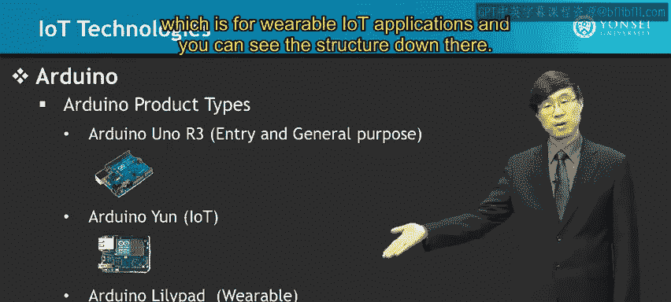
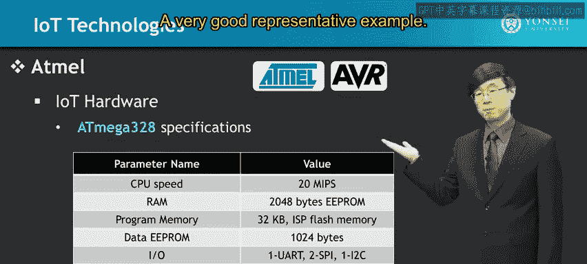
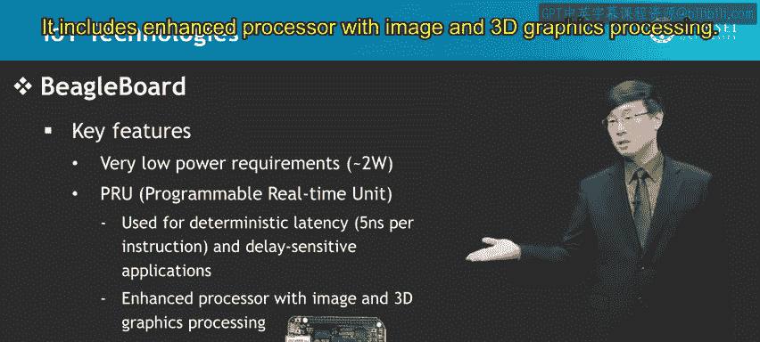

# 延世大学《新兴技术从智能手机到物联网再到大数据Emerging Technologies From Smartphone to IoT to Big Data》 - P88：16_2.2 物联网技术（第4部分）.zh_en - GPT中英字幕课程资源 - BV18hpFewEcG

Yeah。🎼Yeah。Processors and microcontrollers that support IoT technology have the IoT device platforms in which processors and microprocessors that work with hardware software sensors and interfaces In addition network modules need to work all together Of course the brain。

 the CPU， the central processing unit is based upon the processor and microcontrollers they're the brains。

So overall， when you look at hardware interfaces that connect users to sensors to actuators。

 all of these， the user device， the sensor module， the actuators all need。

Microcontrollers and processors， and they all need interfaces that are supporting their drivers。

That are going to support the input and output units。

Operating systems need to be running on the processors and microcontrollers to support software interface and to control the hardware resources。

As in terms of power， memory， file input output， and various other operations。

Arduino is a open source microcontroller and hardware device。

You may also refer to Arduino as an open source Arduino hardware and software project。

So think of the terminology as interactive or exchangeable between these concepts。

Single board microcontroller and kit is basically what you get from Arduino and because of its flexibility and easy to deploy。

 easy to build， easy to program， they are so popular。Now。

 the Arduinino board circuit design and the IDE integratedrated development environment。

 these are available on the Arduinino website。User specific programs can be developed and uploaded using the IDE。

 so you use a USB connection to an Arrduino board。We will now take a look into Arduinino product types。

Ardubino Uno R3， this is an entry and general purpose type circuit board that you can see that is a single board computing system。

Then we have Arduino Yuun， which is for IoT based specific applications。Then there's the lily pad。

 which is for wearable IoT applications， and you can see the structure down there。

Going into further details， what type of hardware processor is this using Well atm AVR。

 which is one of the products that we were looking at in terms of IoT hardware and terms of mega AVR。

 the A mega these were adopted as Arduino physical computing platforms。

 and we've already looked at the different levels of entry level， IoT and wearable。

And the board types that are there among these typically the at me 328 P and the 328。

 the 328 these are representative modules that we can take further look into looking into the at mega 328 specifications。

 you can see the values of the CPU speed as in terms of MIPS， 20 MIPS。

 this is millions of instructions per second， so an instruction is basically an instruction command that needs a separate process within a processor unit。

 this can deal with up to 20 million instructions per second。The overall Ram。

And the programable memory， which is flash memory here。Then the data EE Prom。

 as well as the input output interfaces。The timers。The temperature range。

And the operating voltage range are listed here。And you can see what is being used in IoT hardware。

 what are the popular numbers that makes attractive IoT systems in terms of their processor units are listed here。

 a very good representative example。

Then looking into the at mega 328p module， you can see that this supports low power consumption mode and other specifications are typically the same it adopts the mainline adubinino and adubinino un systems operates at 1 megaherz at 1。

8 volts and look at the overall current levels， the milliamps。

 the microamper levels so the power low power mode power is what the voltage 1。

8 multiply to the current these numbers， and if these numbers are so small， the voltage is 1。

8 which is relatively small as well then these small current values you multiply that to the voltage。

Then you get the power and automatically you can see what low power levels you can use on these devices。

Low power means， number one。That the battery life will be extended very long。

 Low power means that the device typically will have very little radiation heat and other type of components。

So if it has less heat emission， then you can make compact designs and tightly packaged units and the device will not overheat itself because the power consumption is low。

 in addition， it will have a very long lifeline you charge it at once and it will go on and on and on so now you know why the low power feature is so attractive in the 180 mega328P modules。

Rasspberry Pi developed by the Raspberry PiI Foundation in the UK。

 developed as a low cost single board computer to promote basic computer science skills in schools as a university professor such an attractive mode。

 then this supports general computation and basic web server functions。The specifications。

 as in terms of hardware， include a broadcom system on chip SOC。A arm CPUU on on cheap GPU and。

Rasspian O， operating system software。The product series include the main line。

 the Raspberry Pi3 Model B， it runs at 1。2 gigahertz arm cortex CPU based microcomputer for general IOT functionality。

Then there's a subl， the Raspberry pi 0 W， which has a smaller size and restricted IO and。

GPIO capabilities。The bele board。Well， this is an open source singleboard computer produced by Texas Institutes。

 one of the major hardware developers and processor developer companies。

 fully functional basic computer。Supports various operating systems， including Linux and Android。

 definitely attractive， especially Linux and Android is what is on your smartphone。

 your smart tablet。So it includes advanced features and a little bit more expensive than other single board computers。

 but considering the additional operating system features and more advanced functional operation capabilities。

If you need it， it becomes a very attractive option。Bleboard key features。

 looking into the beagle bone black， well， some very low power requirements。Up to about2 wt。

And it has what we call PRU programmable real time unit， used for deterministic latency。

 like five nanoseconds per instruction and delay sensitive applications， very attractive。

 It includes enhanced processor with image and 3D graphics processing。

