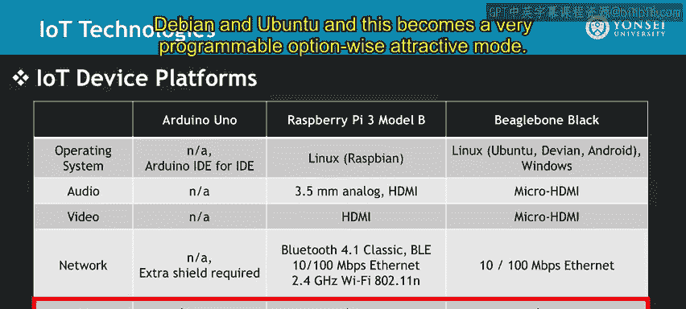

# 延世大学《新兴技术从智能手机到物联网再到大数据Emerging Technologies From Smartphone to IoT to Big Data》 - P89：17_2.2 物联网技术（第5部分）.zh_en - GPT中英字幕课程资源 - BV18hpFewEcG

Yeah。🎼Oh。

Now we compare the three that we were discussing about。

Starting off with the three will be the Arimino youo， the Raspberry Pi 3 Model B。

 and the bele bone black。Category is this we'll be looking at the category structure。

 the system on chip SOC and central processing unit CPU will'll be looking at memory。

 input output modules and size， and there's more on the next page。

 but first let's go through these specifications。Category wise。

 these the Arduino Uno is a microcontroller， and the other two are single board microcomputers。

SOC and CPUU category。The Arduinino uses a 60 MHz at mega 328。

 and we've already looked at that module。 The Raspberry pi3 model B uses a Brocom SOC and an arm cortex CPU。

 which is at 1。2 gigHtz。And the architecture is based on a quad corere unit。

The bele bone black is based on a arm cortex A8， and it has a single core unit。

Then we go to the memory units， typically you can see SRAM and also LPDDR2 and micro SDHC support units。

That are used in the raspberry Pi and similar units are used， but the bele bone black has the DDR。

 the megabytes， 512 megabytes， DDR 3 technology included as well。

 so you can see some options and differences which are quite different in memory scope。

Then you have the input output。In the Arduino Un， you have 14 digital GPIO interfaces and you have six 10 bit analog inputs。

When you go to the Raspberry Pi3 Model B， it has 40 digital GPIO units and 4 USB 2。0 interfaces。

The Beagobone Black has 69 GPIOs and it has four UAt， serialre and eight PWM modes。Size wise。

 look at this Overall， the smallest one is the Arduino genome， and it has the smallest structure。

 as in terms of dimensions。😊，And also the weight is the lightest then when you look at it in terms of weight。

 then the belebone black is lighter than the Raspberry pi3 Model B and when you look at the dimension of the size。

 they are somewhat similar between the Raspberry Pi3 model B and the Bealebone black There are more features that we need to look into which lead to this page。

 operating system， audio video network and price。These are so important features。Operating system。

 the Arduino Uno uses the Arduino IDE。And we've already talked about that。

 The Raspberry Pi 3 Model B uses Linux。That's the recipient。That is a very attractive option。

 then comes the Bealebone black， which is this UniX and Windows when it comes to UniX。

 it is the Ubutu， the Devviian and the Android these options are very attractive just looking at the Linux based but also the windows are included。

Then we have audio。In which the Raspberry Pi 3 Model B has a 3。

5 millimeter analog and HDMI interface， then the Bealebone black has a micro HDMI。

Having the HDMI interfaces compared to the Arduino you know not having one is a big difference。

 and one of the determining factors， which one we will use。Then the video interfaces yet again。

 the Arduo you know， if you want video support， you need to have a separate unit supporting it whereas the Raspberry Pi3 Model B has HDMI and the Beale bone black has micro HDMI interfaces this is very useful however。

If you want HDMI and video support， evidently the Raspberry P3 Model B and the Bealebone black become attractive。

But what if you don't need audio and what if you don't need video and you just want to create a small lightweight？

Low energy consuming IoT module， then you evidently can find where the auto in a un will be an attractive mode。

 however， if you want audio and video support， then evidently the Raspberry Pi3 Model B as well as a bego Mo black will definitely become your primary options in selection。

Are there any other critical selection options Yep and that's the networking this is probably maybe the one of the most important determining factors in selecting a mode the art in a un know typically as you can see here。

Is not that fully capable of wired or wireless ethernet or other options。 However。

 the Raspberry Pi 3 Model B， this is one of the most significant determining factors on why people will select this module。

 Bluetooth 4。1 BLE。Also， ethernet connections and 2。4 gigHz w-fi with based upon 80 to the 11 n。

 Oh my this is so attractive。 If you want to use this。

 then this becomes your attractive component these specifications alone tell you that the Raspberry pi3 model B is why you would select it if you're looking at your smartphone to become its remote controller and monitor because your smartphone has Bluetooth。

 your smartphone has BLE， your smartphone has wi-fi So automatically your smartphone can be a remote controller and monitor and even a data interface collector for your Raspberry pi3 Model B if that is your selection mode and that is one of the reasons that it is so popular。

😊，Then comes the bele bone black， which is connectable to wired ethernet。

 both the 10 base T and the 100 base T supporting both 10 megabs per second and 100 megabs per second becomes its option。

 So in a desktop or development environment where you can put it on your table in front of you and program it。

 these ethernet connections becomes so useful and so attractive。 So that is why it is so popular。

 And when it comes to 10 base t and 100 base t ethernet connections。

 supporting both 10 megabs per second and 100 megabs per second ethernet。

 both the raspberry pi3 model B and the belebone black have this connection supported inside。

 So overall， when it comes down to network connectivity。

 the raspberry pi3 model B is the most popular selection option。 when you look at pricewise。

 that's where the advantage of the raspberry pi3 model B is shown。😊，Because。

You can see that the Arduino uno and the Raspberry Pi3 model B don't have a significant difference in cost one is about $30。

 2995 for the Arduino uno， but for the Raspberry Pi3 model B， it's about $35 now。

 but then again you get all these different。Data interfaces， both wireless and wired。

 and also you get audio and video interfaces as well。

 So that is what makes the Raspberry Pi3 model B so popular。 But then on the other side。

 the Beaco bone black has a cost of $55， but it has significant。😊。

Processing capability at higher cost it supports audio and video in addition， in addition。

 the operating system， which becomes your development platform， supports both windows。

Linux based upon Android， Dvian， and Uuntu， and this becomes a very， very programmable option wise。

 attractive mode。

These are the references that I use and I highly recommend them to you。 there's more to come。

 This was just a tip of the iceberg in terms of IoT technology so hang in there and I'll see in the next lecture Thank you。

😊。

