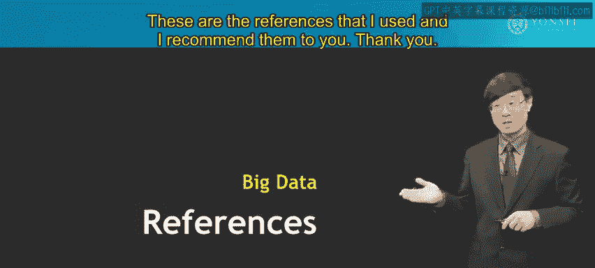

# 延世大学《新兴技术从智能手机到物联网再到大数据Emerging Technologies From Smartphone to IoT to Big Data》 - P8：7_2.3 大数据的4V特性 2.4 大数据的应用方式.zh_en - GPT中英字幕课程资源 - BV18hpFewEcG

어。🎼Yeah。🎼Big datas， for Vs。Big datas， big challenges， can be categorized into four Vs。

 and they are number one volume based on data size， number two， variety based on data formats。

Number three， velocity based on data streaming speeds， and number four。

 veracity based on data trustworthiness。When you look into the data size。

 the first thing that you can see is that the amount of data that is going to be created by 2020 is up to the level of 40  zabytes。

 which is tremendously large。In addition， we have 2。5quitillion bytes of data are created every day。

 and this is actually growing。6 billion people have mobile phones。

 and this number is also increasing。In addition， 100 terabytes of data， at least。

 is stored by most US companies。And also，966 petabytes was the approximate storage size of the American manufacturing industry in 2009。

 And evidently， this size of data is growing， growing exponentially。

When we look at variety data formats， 150 exabytes was the estimated size of data for healthcare through the world in 2011。

In addition， more than 4 billion hours each month are used in watching YouTube。😡。

30 billion contents are exchanged every month on Facebook。

200 million monthly active users exchange 400 million tweets every day。

 and these numbers on Facebook and Twitter are increasing。Looking at velocity。

The data streaming speeds，1 TB of trade information is exchanged during every trading session at the New York Stock Exchange。

100 sensors are installed in modern cars to monitor fluid level and pressure。

 as well as to assist automated driving and accident prevention。18。

9 billion network connections were estimated in 2016。Next， we will look at veracity， data。

 trustworthiness。One out of three business leaders have experienced trust issues with their data when trying to make a business decision。

3。1 trillion a year is estimated to be wasted in the US economy due to poor data quality。

These are the four big challenges that big data systems are faced with。As mentioned。

The volume is too large。 You cannot move it。 You cannot collect it in one place and then analyze it because the volume is just too large。

 You have to analyze them in a distributed manner， using not one computer。

 but a cluster of computing systems。In addition， the data formats are too diverse。

 There are so many new mobile apps and also new data types and also new information symbols that are created every day that are used。

 So therefore， the data types are growing and growing and growing。

 and in order to make a data system to analyze the characteristics of all these systems。

 you need to have an engine that continuously learns and grows and is able to include new information。

On the other hand， the velocity of the data， data is created in real time。

 especially because now we're using a lot of mobile devices and on the smartphones。

 a lot of video data， social networking information is being created， uploaded。

 and then it's being exchanged in not just the point to point， person to person way。

 it's being multicasted and broadcasted in various ways。So therefore。

 the streaming data amount size is actually growing tremendously。 And then in addition。

 the data types that are coming in because we have such a wide variety of data。

The data that we receive into the system to analyze。How trustworthy is it。

What reference do I have to analyze this。And all of these things are what big data is faced with。

 And we'll see how these systems work to extract useful information and use this information for accurate decisions throughout this course。

We are now going to look into how big data is being used。Walmart has a data warehouse。

It stores approximately four petabytes of data。And it records every single purchase that is conducted。

The data analysis structure is focused on evaluating the effectiveness of pricing strategies and advertising campaigns。

Seeking for improvement methods in inventory management and supply chains is critical for Walmart。

 So therefore， extracting this information is the focus。

One of the main technologies that a lot of data is being used to analyze is for recommendation systems that are based on big data。

This is using simple elements on data analysis。 What users made purchases in the past。

Which items do they have in their virtual shopping cart？Which items did customers rate and like。

What influence did the rating have on other customers to make a purchase。

A company that would use this type of information down to its very details， is Amazon。Amazon。

 com's recommendation system is worldwide famous。Item to item。

 collaborative filtering algorithms are used。Where personalization of the online store is customized to each customer。

So therefore， each customer's store is based on the customer's personal interest。 For example。

 for a new mother， well， the store will display baby supplies and toys on the offfront and other things that the mother。

 the new mother， may be interested in right next to it。Ctibank has a bank operation in 100 countries。

Big data analysis on the database of basic financial transactions can enable global insight on investments。

 market changes， trade patterns and economic conditions。

Many companies work with Citibank to locate new stores and factories throughout the world。

Product development and sales。 Here is an example that I'm going to show you to give you a little bit more insight on what could be done。

 Let's think about smartphones。 We all have smartphones。

 Then how is the marketing strategy related with smartphones。Can benefit from big data engines。

 For example， Well， smartphones take a significant amount of time and money to manufacture。

In addition， a certain smartphone is only popular for a certain limited amount of time。

 and also the certain features that are on that phone may be more attractive in certain regions。

To maximize sales， a company needs to manufacture just the right amount of products and sell them in just the right location。

 This way， they will be able to maximize their profit。

Too much will result in leftovers and a big waste for the company。 However。

 too less will result in a lost opportunity for growth and profit。

That is why big data can be used to help find how much should be placed where。😡。

But then why is this so difficult？ Well， it's difficult because of the 4 v factors， In addition。

 how am I going to implement this， How am I going to actually extract all this important information。

 The information size is tremendously large。 How am I going to find just the key parameters and the key values for those parameters from the tremendous amount of data that I actually have。

And then do this quick enough in a way such that I extract the information that is most helpful to me。

This is a challenge that we have in big data systems， and we will continue on to look at Hadjuop。

 Spark and storm systems to figure out actually how it is really done。

These are the references that I used， and I recommend them to you。 Thank you。

