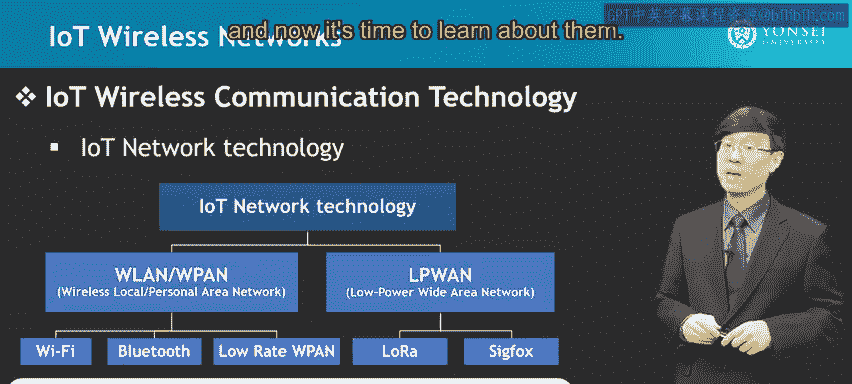

# 延世大学《新兴技术从智能手机到物联网再到大数据Emerging Technologies From Smartphone to IoT to Big Data》 - P90：18_3.1 物联网无线网络.zh_en - GPT中英字幕课程资源 - BV18hpFewEcG

Yeah。Yeah。In this module， we'll study about IoT networks， starting off with IoT wireless networks。

The IoT network architecture can be represented in this type of a form where you can see various communication components are connected to some type of building that is connected to the internet。

However， in the front end where a lot of the IoT technologybased devices that we interface as users are basically connected to either a mobile communication network。

 which you see right here， a cellular network， and in here， most likely it would be like 2G， 3G。

 3G or 4G or maybe even 5G in the near future。Technologies based upon 4G would be LTE。

 long term evolution technology and long term evolution， LTE advanced LTEA technology。Of course。

 this is one major component， especially because our smartphones have Wifi and Bluetooth connectivity。

 and these enable IoT direct access for many， many cases。Looking into that。

 you can see exactly Bluetooth technology This is called a wireless pen network as in terms of wireless personal area network。

 which is a small area network， basically trying to enable wireless connection of objects that have these modem modules inside that I can directly access within something like a room。

 something in my personal area， something in my direct reach of a room。😊，In addition。

 we also have wireless land technology， which is represented by a bigger。

 a wider blue cell that you see right here， wireless local area network instead of a personal area network this is local area network is larger it may incorporate the range of a couple of personal area networks and the representative technology of this is w-fi now Bluetooth and wi-fi are so important so I'm going to focus on the details of these two protocols in the following module which is about wi-fi and Bluetooth alone this is because they are the primary connections onto your smartphone in addition they are the widelyliest used protocols in the world along with mobile communication like the big three you can think of them that way mobile communication。

 Wii-fi and Bluetooth and because of that we're going to dedicate some separate module and lectures to that。

In addition， we also have in the wireless personal area network。

 the small range network that we use like in Bluetooth， other modules such as ZigB。

 as well as Sixlow Pan technology and several others actually exist。

 we'll be focusing this lecture on those together in addition about wide area network connectivity technology together in this lecture。

😊，Weable IoT networks， as in terms of wearable devices that have IoT connectivity。

 some connectivity would be the wireless connections that enable us to the cellular network to us through a smartphone or a smartwatch these typically would be something like mobile communication LTE or 3G communication。

And in the future，5G mobile communication。But the connections of our devices that are connecting to our smartphone would be something of。

 like in the form of Bluetooth or Zig B，6low pen or other technologies。Going into the details。

 wearable devices can be used to detect biometric information from sensors and IoT modules in our shoes。

 watch， glasses， belt and Pacer as well as other devices these type of devices could be sending information to our smartphone and our smartphone could be connecting it to the cellular network。

In addition， there are some cases where these devices may be equipped with a special type of wireless technology that directly connects us to the wide area network。

Now， we'll talk about that very soon， but first， we'll go over the details of these type of wireless pan and wireless LA technologies。

Smart devices can collect information from the wearable devices and communicate with the control center。

And if it's about medical information， the medical center。And through all of these connections。

 we definitely need a wireless connectivity， which may be of one segment or multiple segments as in terms of a wireless LA to a mobile communication protocol or a wireless pan to a wireless LA protocol。

 as in terms of from Bluetooth。😊，And then using wfi connecting to an access point that will connect us to the internet or using Bluetooth to connect your smartphone and having mobile communication connect to the internet。

Either way， we will be connected to a control center and if it's biomedical information。

 then it will be connected to a medical server to monitor our health conditions and provide us with important decisions and alert signals。

 and in some cases， for example， if you have an heart attack。

 then it will provide you with emergency response and help， something like calling an ambulance。

 for example。Wifi is a wireless LAN， wireless local area network technology that is based upon the IEEE 802。

11 standards。The IeEE stands for the Institute of Electrical and Electronics Engineers。

It is one of the world's largest professional membership society。

 and it is a society for electrical and electronic engineers。In this group。

 because of the characteristics of its participants。

 they actively do a lot of research and development。

 in addition they do standardization and this is one of their flagpo accomplishments it is the 802。

11 standards 802。11 you will see the 802 stands for local area networking technologies and 11。

11 stands for the wireless land specifics in which we have Wi-fi technology defined。

Wifi devices are your smartphones， smart devices， laptop computers。

 PCs and many more some smartwaes may have just Bluetooth。

 but some smart watchtches will have Bluetooth and Wifi together it's based upon how and what type of design and their purpose。

Application areas include everything simply， from homes to school to computer labs to office buildings。

 like I said， everything just simply speaking。Wifi devices and access points As have a wireless connection range about 30 meters when you're indoors what do you mean by indoors being indoors means that there are walls there's doors。

 there's a ceiling， there's a floor and in these doors， walls， floors and ceiling。

 there are metal material， there are other materials inside which block radio frequency propagation。

And that is why when you go indoors， the propagation range of your signal is limited by the surrounding room and the building environment。

Now， therefore， the range of wF， of course will be extended if you go outdoors。

And we will go and talk about this in much more detail in the following module。

 however here we'll stick to some of the details that we have listed in which Wi-fi data rates are based upon protocol type。

11 A can achieve up to 54 megabits per second， 11 B can go up to 11 megabits per second。

11 G can go up to 54 megabits per second。11 n can go up to 150 megabits per second。

 11 A can go up to 866。7 megabits per second， extremely high， isn't it， but then again。

 even higher is 11 A protocol can go up to 7 gigabs per second。😊。

Now there's two factors that you need to consider in terms of determining what will be your data rate。

 one component you need to think about is that how close am I to the access point or to the base stationation or to other users the reason is because the farther you are away the less data rate you will get。

The second factor is how many users are sharing the network。

 because if you have many users surrounding you that are connected to the same access point。

 then this。These data rates that you see right here will be shared among with them。

Bluetooth technology。Bluetooth is a wireless pen， personal area network technology。

 This is different from Wifi， which is a wireless local area network technology。

 A wireless local area network is larger。And this is a personal area network， which is shorter。

 smaller。This replaces cables as in terms of connecting many different types of devices。

 in terms like you may have been using your wireless headset and it most likely will have Bluetooth technology in other words。

 if it was not a wireless headset from your smartphone or your MP3 player to your headset。

 you would need a cable， you would need a wire connection。However。

 you can use Bluetooth to replace that cable， replace that wire connection between your smartphone and your headset。

And that is basically what Bluetooth is about In addition。

 connecting printers to your local computer， your local PC or your laptop or tablet PC。

Typically replacing shortrange distant devices as in terms that your personal area could be defined something like when you're in a room and you see all the objects there that are almost in reachable distance。

 you stand up and you reach your hand， you go there a couple of steps and you can touch that device that is typically considered your personal area network whereas a local area network would be like the room that you're in and a couple of surrounding rooms。

 maybe even the room on the upper floor and the lower floor could be sharing an access point that is connected to the wireless local area network that is also connected to the internet。

So your local area network is larger than your personal area network。

Bluetooth's standard pan range is usually about 10 meters， however， higher standards。

More advanced standards like Bluetooth 4。0 and higher， in some cases， based upon the setting。

 they could reach up to like 50 meters。

Bluetooth low energy。 This is also in Bluetooth 4。0。 This provides reduced power consumption。

 which is where it gets its name L E， low energy。😊。

And cost while maintaining a similar communication range。Bluetooth protocol types and data rates。

 for example， you can see Bluetooth 2。0 with EDR enhanced data rate can go up to 2。

1 megabits per second。Plut 2 3。0 with HS can achieve up to 24 megabits per second。Pluetooth 4。

0 can go up to 25 megabits per second。And Bluetooth 5 can go up to 50 megabits per second Further details about this。

 I will go over in the next module， which is about Wi-fi and Bluetooth because these are of course。

 more frequently used and more important and they're on your smartphone they're on your smartphone tab So you need to know more about them because you are using them more frequently and we'll go into further details in the next module。

😊，Looking at the overall scope of what is in IoT networking technology， Well。

 looking at it over there， there is wireless la and wireless pan， and in those we have wfi。

 Bluetooth， low rate wireless pan。Also， there is a LPW A N。

 which is short for low power wide area network。Protocols such as Laura and SigFox follow into this range。

 and this basically uses low power signals in a specific way such that you are directly connecting to a far away access point or base station and you directly connect to the internet through that access point or base station。

So it is a wide area network because although the data rates are low and the signalss are low power in here in LP1。

 still you connect directly over long distances and that is why it's called a wide area network and you get direct access to the internet。

Standards and protocols that you may have heard of include these for the wireless La and wireless pan。

 we have Wi-fi， Bluetooth， Zigbig，6low pan， and these are all very famous and also for LP1n we have Laura and SigFox under these logos。

 you may have seen them and now it's time to learn about them。

These are the references that I used， and I recommend them to you。 Thank you。

