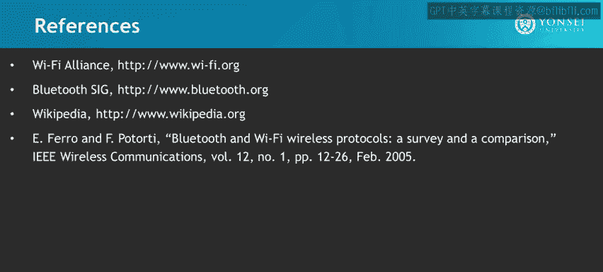

# 延世大学《新兴技术从智能手机到物联网再到大数据Emerging Technologies From Smartphone to IoT to Big Data》 - P91：19_3.2 ISM频段.zh_en - GPT中英字幕课程资源 - BV18hpFewEcG

Yeah。Yeah。The ISM band， we're going to study about the ISM band because it is so important。

Because IoT networks use the ISM Ben so frequently。Therefore。

 knowing the characteristics and what bands actually include and among the ISM bands。

 which bands are more important， you need to know this。The ISM frequency band。

Is short for the industrial， scientific and medical ISM basis upon these words of the acronyms。

 so they are meant for industrial applications， scientific applications and medical devices such that we have a band that people can develop new technology use short range communication techniques to implement devices and devices communicating with each other。

 however， not for every case you go to the government and ask for a license to use this frequency band because that would be too cumbersome that would be too much of a burden for the government and also it would be a huge difficulty in development and research time for the developers as well。

 so to save this problem there are some radio frequency bands。

That internationally are used for these purposes without a license。However。

 without a license doesn't mean you can use it anyway Oh no。

 there are strict regulations in the devices so in any country when you're going to develop a product that is going to use the ISM band。

 of course you need to get former approval from the government such that this device is following the local rules。

 the local policies of the government as well as the international policies that set upon so in terms of international the ITu international telecommunication union has radio regulations。

 Article5 and correspondingly footnotes， 5。1385。150 and 5。

280 these are the standards that specify the frequency band， the spectrum。

 the transmission power regulations and various other characteristics so once again。

 just because it's an unlicensed。and you are given approval to use it does not mean you can use it anyway。

Devices operating in the 2。4 gigertz range， this is probably the most popular。

ISM band that is around。 and why is it， It is because Wifi uses it。

 Bluetooth uses it and also devices that use the modems that are using the iE 802 dot 15。t 4。

 which include Zigby 6 low pan。In addition， cordless phones。As well as amateur radio equipment。

 microwave ovens。And baby monitors all use this。Now。

 the good thing is that this frequency band is so useful that so many technologies are using it。

The bad thing is that this band is so useful that so many devices are using it and finding a way to effectively share it is the difficulty。

 so your advantage becomes your disadvantage as well， it's based on how you look at it。😊。

A little bit more on that。 Well， devices using the ISM band will experience various types of interference。

As in terms that the same protocol and product types will interfere with each other， well。

 Wifi devices will interfere with other Wifi devices and they will need to share the channel resources effectively。

 some cases if they are not sharing it effectively and properly。

 they they will interfere with each other。Other protocols and prototype types will interfere with each other what I mean by that is that in the 2。

4 gigHz range Wi-fi devices will interfere with Bluetooth devices and these will interfere with Zigbe devices they they will interfere with each other and in some cases make communication impossible so you need to consider interference due to other protocols and other active networks that are sharing the same frequency band。

In addition， radiation from other machines and equipment。For example。

 there may be a leaky microwave oven， a microwave oven that is not perfectly sealed when you turn it on to heat up food or other material well。

 then in that case， because it's radiating a 2。4 gigertz signal and that is leaking out into the environment naturally if you have a w-fi device or Bluetooth device working in that range。

 your microwave oven will interfere with the communication。For further details on the ISM band。

 we'll take a look into the frequency range， the bandwidth。

 as well as center frequency and availability， these are all critical components in determining which ISM band should be used for product development。

Starting off with the frequency range at the 6 megaHtz。You can see that the frequency ranges from 6。

765 mehertz to 6。795 megahertz， the bandwidth is for 30 kilohertz。

 and this is subject to local acceptance Well that means that subject to local acceptance means that based upon the local government。

 this frequency may or may not be used。Now， this is very important because there are cases where you bring a device that is using an ISM band。

And you're thinking that it's safe to use in another country。

 they take it into that country and they turn it on， but it may be used by the fire department。

 or it may be used by the police department or by the military in either way you do not know。

 so it is dangerous and you should not take a device。

 a wireless device that operates in your country or another country。

 take it to another country and just turn it on and use it。 you cannot do that。

 you need to check local regulations。Now， so therefore。

 this frequency range is not always going to be permitted just because it says I am S span。

On the box and on the device does not mean that it is a ISM bat that is approved everywhere in the world。

The next ISM band to look at is at the 13 megahertz range from the frequency of 13。553 to 13。

567 megaherz。And it has a bandwidth of 14 kilohertz。Most interestingly。

 it has availability specified as worldwide。 This is worldwide。 So is this。 And also at the bottom。

 we have another worldwide at the 2。4 gigahHtz。😊，Now。

 written as worldwide means that it is considered to be worldwide accepted as an ISM B。So therefore。

 products that are developed to use these frequencies under the category of availability specified as worldwide become most attractive。

This is why in these worldwide frequency bands， most of the products， as in terms of Wifi， Bluetooth。

 RFID and nearfield communication NFC modules will operate in these bands that you see specified as worldwide now for the frequency ranges listed here。

 as well as some on the following page， you will see further details。Then at the 26 mehertz range。

 there is a bandwidth of 326 kilohertz reaching from the range of 26。957 all the way up to 27。283。

And for that， megatz range， this is also a worldwide available ban。At the 40 meHtz range。

 we have a worldwide ISM band that is with a band with of 40 kilohertz。

The next one is at 433 megahertz range， and it has a significantly wider bandwidth at 1。74 megahertz。

And it is centered here， although it is only restricted for local acceptance。

 meaning that if you want to use it， you have to check your local government policies。

Then there's this right here， the 900 mehertz range reaching from 902 megahertz to 928 megahertz。

 it has a bandwidth of 26 megahertz。And this is。Restricted for local acceptance。Now。

 many countries use this frequency band for ISM based operations and it is a very popular frequency band because this band has very good penetrating characteristics。

 meaning that this signal will go through solid walls and have a far reach very effectively In addition。

 the bandwidth is 26 megahertz which is sufficiently large for high data rate communication。

In addition， the band itself is at the 900 meHz range， which means that the antenna can be small。

 That is why this ISM band is very， very popular。The next one is probably the most popular ISM bed at the 2。

4 gigertz range， reaching from 2。4 gigHtz to 2。5 gigahtz。Overall， it's 100 megahertz of a range。

 which is very wide of a bandwidth。Now in here， one of the characteristics is that there are so many devices that are using this frequency band。

 as I mentioned in the former pages， that is why it is worldwide， however。

 it is also highly populated。Why is it so populated。

 Why are there so many devices using this frequency band numberumb one。

 it's worldwide to start off with number two， the single propagation characteristics at the 2。

4 gigertz range are very good signals will propagate through walls and solid objects very well In addition。

 the wide bandwidth of 100 megahertz that is shared for multiple users this is wide enough to give a broadband data rate a high data rate to multiple users simultaneously。

The next worldwide is the 5 gigHtz range one at 5。7 to5 gigertz to 5。875 gigahertz。

It has a bandwidth of 150 megahertz， and this range is at a high frequency。

 such that you can use it for higher data rate communication access。

 and that makes this very attractive in addition to being worldwide available。

Then we have a 24 gigertz frequency range and it reaches from 24 gigertz up to 24。250 gigertz。

 The bandwidth is very wide， It is at 250 meHtz of a range and it is worldwide access This is also very popular for wireless personal area networks for extreme broadband access。

However， singles that go up and beyond 10 gigaherz like this one right here at 24 gigahHtz when the single goes above 10 gigahHtz it starts to behave like light which means that it will not penetrate through solid objects so if you have a direct access with the base station or access point。

 you will get extremely broadband high data rate services， however。

 if there's something that's blocking the line of sight。

 the direct line of communication creating a shadowing effect then you may get nothing at all。

 so it's either all or nothing when it goes for signals that at are this high of a frequency range。😊。

This is also another reason why the ISM bands of 2。4 gigahHtz and the 5。7 to 5。

8 gigahHtz are so popular， it's because the shadowing effects are not there。

 however they provide very high data rate services due to their high bandwidth and also they have good signal characteristics。

In addition， even at a higher data rate， at a higher frequency is the 61 gigahHtz frequency range ISM band。

 the bandwidth is 500 megaHtz。However， this is also limited to local acceptance。

 you have to check the local government and see if they permit this。

Then at even a higher band is the 122 gigahertz range and you see that the bandwidth reaches 1 gigahHtz which is truly significantly wide。

 however， this is also limited to local acceptance along with this frequency range which has a bandwidth of  two gigertz reaching at the 244 reaching up to the 246 gigahHtz range。

Now， once again， local acceptance regulations must be followed。These are the references that I used。

 and I recommend them to you。 Thank you。

