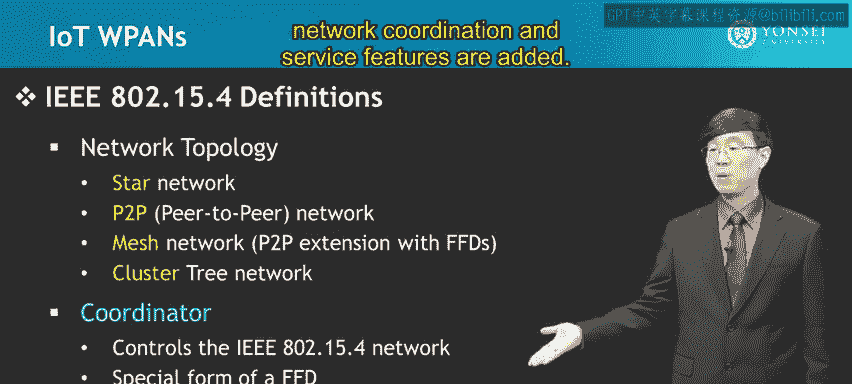
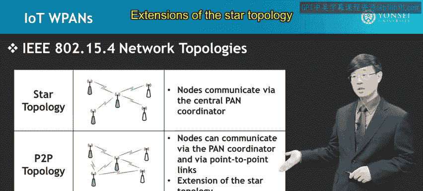
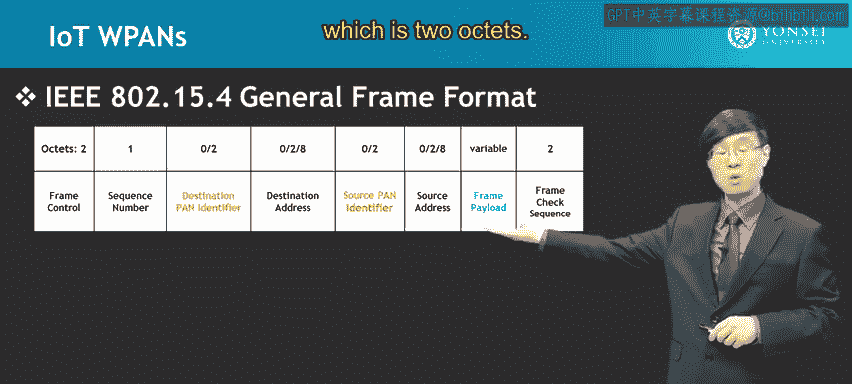

# 延世大学《新兴技术从智能手机到物联网再到大数据Emerging Technologies From Smartphone to IoT to Big Data》 - P92：20_3.3 物联网WPAN（第1部分）.zh_en - GPT中英字幕课程资源 - BV18hpFewEcG

Yeah。Yeah。IoT wireless personal Are networks， IoT WPants is what we will study now。

The most popular modem spec is the iEE 802。15。4 standard， and it is used for low cost， low speed。

 low speed means low speed data rate。Which means that the data rates are not going to be that high。

And low power are the typical characteristics。 Once again， this is a wireless pan。

 wireless personal area network。That is why typically we're talking about low power is very important。

IEE 802。15。4 applications include ZigB。6 low pan， which is short for IPV 6 over low power Do pan。

Wireless heart， where heartRT stands for Highway Accessible Rem transducer。

And also Mibi Microchip Wi Pro， and also RF4 CE， which is radio frequency for consumer electronics。

As well as the ISA 100。11A。These device types typically are two where we have a full functional device and a reduced function device。

Typically， a full function device has full functionality。 that's where it gets its name。 It can send。

 receive route data， and form clusters。It can serve as the pan coordinator。

 meaning that for a personal area network， it is a coordinator node that manages controls。

 access and network overall connectivity， it is a critical component feature function that needs to be operated such that the network can expand in its overall multi-op connectivity。

Reduced functional device has， of course， just reduced functional capabilities。

 reduced as in terms that it doesn't have all of what the FFD will have。

It can only communicate to FFDs。And cannotnot serve as a pen coordinator。

 serves the role of a simple sensor or switch， and it does not have functional routeability。

Networking topology wise， you can have a star network， a peer to peer network， a mesh network。

 If you're going to use this， you need peer to peer extensions with full functional devices。And also。

 one of the full functional devices need to be serving as a pan coordinator。

Then also cluster tree networks。Coordinator。This controls the IEE 802。15。4 network。

 it is a special form of a full functional device and typical FFT functions and network coordination and service features are added。

Looking into some details of the network topologies， start topology here。

 where the notes communicate through the central pan coordinator that is located in the middle。Now。

 the ones that have the blue color are the FFDs and the ones that are just white are the reduced functional devices。

 the re function devices are just listed in white。And as you can see， this is what we have。

Then we have P2 P topology， where node can communicate through the pan coordinator and through point to point links。

Extensions of the ST topology are enabled through the P2P topology。

Over there， you can see looking at the network topology above and below。

 you can see that there is an additional connection between a FFD and RFFD。

 a full function device and a reduced function device are connected there at the bottom。

 So this is what this specification is talking about in addition。😊。

Cluster tree topology if you're going to grow a network， if you have many IoT devices。

 then this is definitely what you need to use and cluster tree topologies are very attractive。

 especially for wireless sensor networks and IoT networks that have a lot of nodes。

In the world we're moving into， which is hyperconnectivity IoT devices。

Even looking at the 5G mobile communication standards in which we have a  one kilometer by one kilometer square area。

In which we have 1 million devices that can be supported in an area。

 obviously a cluster tree topology would be very attractive。It may be even necessary。

 meaning that there's no other way to support all these nodes。

Cluster tree topologies are similar to stars， though RFDs are only allowed to connect as the outermost branches to the cluster tree。

 The diagram shows that the full functional devices connect to the coordinator。

 which is one of the FFD devices。And this will connect to multiple end devices through that structure。

And that is how this network is formed。Looking at some of the general frame formats that are used for i802。

15。4 and because of the function that we were just talking about。

 having a coordination of multiple clusters connected into a tree format having a coordinated node in control and management of the network。

 I just want to show you a couple of components in the frame structure over there is a frame control field。

 which is two octs。 An oct is a byte so that means that it's two bytes up front which has a structure like here It has 16 bits because one byte is one oct is8 bits so two octs is2 bys which is 16 bits。

 That's why the bit number fields are numbered from 0 to 15。 Those are your 16 bits。

Now， looking at here， I want you to notice that there is a source address and a destination address。

 but next to them in orange， you see the source pan identifier and the destination pan identifier over there。

These are included in so in other words， it's not only source and destination address they're also talking about the source and destination pan address identifiers so when you do this type of cluster networking in a tree format your packet may go out of your pan go through the cluster tree coordinator to connect to another pan in order to do that。

 not only do you need to know their address。Source and destination address。

 you need to know their source and destination pan ID。

 which is what is included right here in orange Where does my data go。

 Where does my IPV4 or IPV6 packet go， Where does my TCP IP packet go that is right here what you see as frame payload however。

 because these are for wireless pen applications。Not all sizes of IPV 4 and IPV 6 packets can be included because once again。

 the packet size has a limited structure of。The maximum frame has to be less than 127 octs， 127 bys。

 That puts a restriction on how large the frame payload can be。

The maximum frame header is limited to 25 octaves， 25 bytes。In addition。

 I want you to look at the control frame header enrich rate you see is once again just twoocts right down here。

 you will see that security enabled there's a flag and structure to control that There's also intra pan you see right there In pan and In pan means that this is going to be used for the pan area wireless pan intra communication features you can go outside of your pan。

 which is intra pan and then of course you'll need to use your destination and source pan IDs as well as the source and destination addresses。

That's what you have up here。But if it's internal within your pan， then of course。

 you flag it using that over there， which has intra pan， and then you operate in that type of a mode。

 So within your pen， you can use something like a star network where you're centered of the star。

 which is your full function device will relay you to another device， or if it's a P2 P。

 you can directly communicate。

