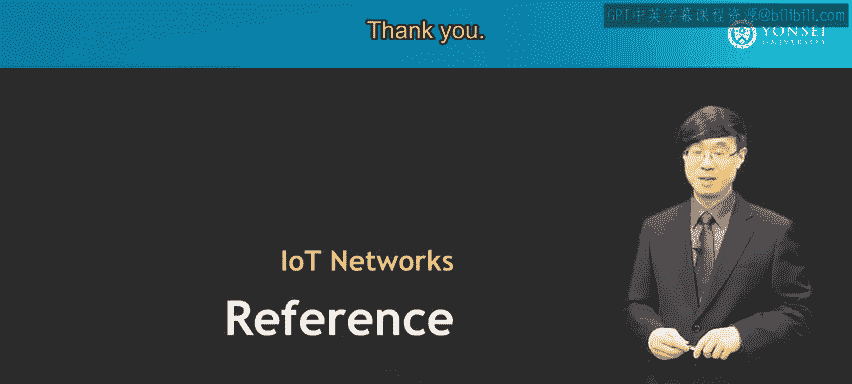

# 延世大学《新兴技术从智能手机到物联网再到大数据Emerging Technologies From Smartphone to IoT to Big Data》 - P93：21_3.3 物联网WPAN（第2部分）.zh_en - GPT中英字幕课程资源 - BV18hpFewEcG

Yeah。Yeah。Zigby is a very popular protocol， it is supported by the Zigby Alliance。

And it uses the iEE 802。15。4 protocol， but it adds on higher layer protocols。

And it supports low power radio communications。Where the physical layer。

 as in terms of the radio frequency modem and the Mac medium access control functions。

 these are specified by the 802。15。4 protocol。However， ZigB provides the upper layers。

 the application layer and the network layer， these two on the top are what the ZigB protocol add on and once again the ZigB protocol is made by the Zigb Alli and that's on top right here so it uses the medium access control。

 which is multiple users sharing the network that coordination function as well as the physical modem which connects to the radio frequency channel down there is used of course in ZigB。

Zigby works well in isolated network environments。And typical topologies include star， mesh。

 cluster T， or hybrid networks。The star network is a basic and most common topology。

The mesh and PTTP can provide high reliability through multiple routes between nodes。

The cluster T network is a combination of a star and P2P topologies。Where do these come from。

 these are of course available because the IioE 802。15。4 protocol enables these functionalities。

Six low pen。 This is IPV 6 over， low power wireless personal area network。

This is an IETF internet Engine Task force standard that uses the 802。15。4 pan technology。

It supports IPV6 packets over。Wireless pens that are based on 802。15。4。IPV6 packets。

 what advantages do these packets provide？This enables IPV6 IoT wireless network support so if a device is already IPV6 protocol base。

 then6low pan becomes a very attractive option low power design aspect included。

 which is very good for low power consumption， meaning that the IoT device battery can go on for a long time。

The true advantages are that you can directly connect to an IPV6 internet。What does that mean？

What are the advantages of that， Numb one， you can use IPV6 security。

 the high level protection security of that， such as IP security， IP set， IP based encapsulation。

 authentication。Access control， firewall protocols， and others。IPP6 naming， addressing， translation。

 lookup， discovery， these type of functions are all included。

Six low pan characteristics include small packet size that support 16 bit short or IreP 64 bit extended Mac addresses。

And low data rates of 20，40， 250 kilos per second。Star or mesh topology using full function devices and reduced function devices of the Ito 2。

15。4 protocol。In addition， good for low power， battery operated nodes。

 and this low power is in its name，6 low pan， the low stands for low power。

And these devices are relatively low cost， which is very attractive in their deployment and product purchasing。

Then comes heterocompression， which is critical in。WP techniques。So looking at6 little pen。

 IPV6 and packet sizes。Well， the IPV6 has a minimum packet size or 1，280 octs。The IEE82。15。

4 has a maximum transfer unit， which means that the maximum size of an IP packet that can be inserted into it is limited to 127 octves。

 127 bytes， so evidently there is a huge mismatch of like more than one10th of a degree of a mismatch here。

The IPV6 header has a big header， which is mainly because it uses IPV6 addresses which are 128 bits each for the source and destination。

 and that makes the IPV6 header very large， 40 octaves， 40 bytes。So。

 and that is just the minimum header。The IPV6 header can have many additional options added to it such that it has additional features that are provided and some of those features we already talked about as in terms of IP security or other features that are added on。

Now， so that is why we need to compress the IP address and other fields。

 so if you can derive some of the field characteristics from other fields in the header。

 then the ones that you can derive， you want to compress them。

 which means that you do not send them or maybe send them just once at the beginning。

 save them and then for the following packets that have the same repeated fields in the header。

 you just do not send them， you have a compressed format that you skip sending them because you ready send them once。

And these type of techniques are what we mean by header compressionpress。

So compress the prefix of the link local address。Completely ammit the 128 bit IPV6 address if it can be provided from the link layer address。

 so if you already know the link local address，Then and you know what it maps to as in terms of IPV6 address。

 then you don't need to send the IPV6 address when you send the link layer address automatically at the receiving end。

 then they will match it and reconstruct the entire complete IPV6 packet。

Compress common header such as TCP， UDP， and ICMP。These are the references that I used。

 and I recommend them to you。 Thank you。

