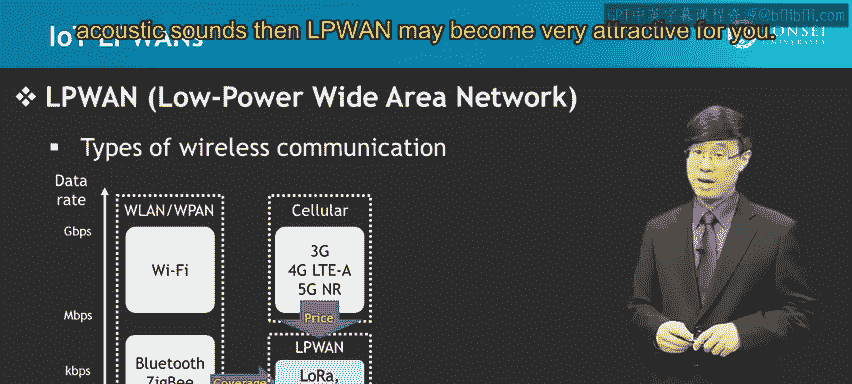

# 延世大学《新兴技术从智能手机到物联网再到大数据Emerging Technologies From Smartphone to IoT to Big Data》 - P94：22_3.4 物联网LPWAN（第1部分）.zh_en - GPT中英字幕课程资源 - BV18hpFewEcG

Yeah。Yeah。IOT， LP Ws。LP WN stands for low power wide area network automatically from the name。

 you can see that wide area means that the coverage is going to be very long and the overall range of the network is going to be very wide In addition from the name you can see that it's low power。

 which means that it's very energy conservative。Wireless communication technology designed for long range communication at low power。

 and because of its long range and low power， naturally low bit rates。

 low data rates will be the overall application。Typical LPW types include Laura based networks and UNB Ultra narrowband networks。

 which include Sboxox and NB IOT， which is a protocol in mobile communications。

 especially standardized by the 3GPP standardization group。Why do we need this？

What purpose does it serve？Well， let's take a look at this right here where we have the data rate is a vertical axis and the horizontal axis is the communication range When we talk about wireless LA and pen。

 they of course will have a limited communication range because they are local area network and personal area network。

So naturally they have a limited range and that's why they're on that side。

 but although they have a limited range， their true advantage is that they can support a high data rate。

 that is why they go up the vertical axis， which is the data rate axis。

 and it exceeds even the gigabits per second range， which is listed above there。

Then mobile communication protocols such as 3G， 4G， as in terms of LT and LTA。

 as well as 5G and our new radio communication based systems。

 they have a wide range because they are cellular communication based technologies in addition they support a high data rate。

But then again， when you think of the price of using cellular communication。

 is there something cheaper when you think of the overall coverage of wireless pan and wireless LA。

 especially focusing on wireless pan for IoT devices。

 sending metric information from sensors which are not that high of a broadband data rate access such as sending files using wireless La。

 or sending video streams using wireless LaN or Wi-fi-based techniques。

 typically they would be lower data rate， but you may want something that has a wider range of services than WP。

 but it has also the characteristics where it's cheaper than mobile communications。

In typical systems like that， that is where LP when comes in to be extremely attractive。

So what would need something like this， what range Well， just for an example。

 what if you are doing environment sensors， IoT devices， Well。

 you have a big forest or you have mountains to cover and you want to be able to detect if there's a fire or if there's a certain weird object or material in a certain range that is changing the temperature or。

Lesing out some type of gas。And or is irregularly bright or dark compared to the surrounding environment。

 then if your sensors are capable of detecting these type of things， along with acoustic sounds。

 then。LP1 may become very attractive for you。

Looking into further details， here are some strong points， the pros and the weak points， the cons。

 So let's do a pros and cons comparison based upon。

What we have is wireless local area network and wireless personal area network， which are over there。

 and then we have right in the middle LP1， which is our target system that we're looking at right now。

 and we have our mobile communication cellular network。Going into the details。

 what are their true advantages， their pros， Well， their strong points are for wireless land and wireless pan well established standards。

 well known。 Also， they are so well established。 they are on every smartphone。In addition， for LP1。

 well， low power consumption， low cost， this is how they become so attractive。

Mobile communication networks， high data rate and well sufficient coverage。

But looking into their weak points， their cons， Well， wireless land and wireless pen。

 they consume a lot of energy。 and so their battery life is limited。And also the network costs。

 you need to have sufficient investments， access points， electricity。

 and also you need to support a lot of surrounding facilities for them because the range is not that long and that means that after a certain range。

 they will need an access point or a Bluetooth master device to connect to a wire network and the wire network needs switches and routers and other things to connect so you have to have sufficient infrar。

But comparing that to low power when， low data rates， and they are emerging standards。

 so you probably may not have heard of them。And that is why they're less popular。

 and because they're less popular， that's why they're not on smartphones or other smartwatches yet。

Then comes cellular networks Now this is of course。

 because of the high data rate and your roaming capability that is well supported all of the diverse applications are there。

 but at the same time you are paying a sufficiently large cost to use them your usage cost is high but then again the network service provider。

 your mobile operator they're paying a lot of money as well that's why they're asking you to pay a lot of money as well each month and that is that why because you need to connect all the base stations on the towers on the buildings in various facilities where there is a lot of blockage and a lot of infra then you need to add on multiple femto cells small indoor base stations here and there connect them all together。

And then you also need to have your mobile communication wire network infrar all connected together。

 connected to the internet。This takes money In addition。

 the frequency band that is used by cellular operators。

 this is normally auctioned off from the government frequency band。

 and that is extremely expensive so therefore even though they support low data rates and they're emerging standard and they're not on smartphones yet because they are low power and they can consume a battery over a long period of time。

 so the Io devices even though they battery operated， they have a long lifeline。

 and also they are very cheap and they are low cost and they are connectable over long ranges make them very attractive。

😊，This is why Laura and SigFox as LPWN protocols are emerging in the IoT market and various applications to use them are being found in addition。

 of course， there are various ways to connect Laura and Sigboxox2， Bluetooth Wifi and ZigB。

 wireless Panin LAN protocols， in addition， connect them to mobile communication protocols as 3G4G。

 LT LTA and 5G networks。

