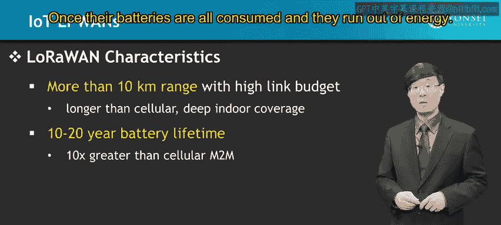

# 延世大学《新兴技术从智能手机到物联网再到大数据Emerging Technologies From Smartphone to IoT to Big Data》 - P95：23_3.4 物联网LPWAN（第2部分）.zh_en - GPT中英字幕课程资源 - BV18hpFewEcG

🎼Yeah。So let's look into Laura。And also， you will see it under Laura Wan， as well as just Laura。

 and the symbol is like this， pretty cool。Wireless modulation technology that can support long range。

 Laurara communication links。A single gateway or base station can cover an entire city or hundreds of square kilometers in area now of course。

 some cities are huge， so therefore we cannot say that every city is coverable。

 but a lot applications do exist where sufficient size areas are coverable。😊，In addition。

 it uses a protocol called CSS， which is chirp spread spectrum， radio modulation。

It uses licensed free， unlicensed radio frequency bands app 169 megahertz， 433 mehertz。

 868 megahertz in Europe， and the 915 megahertz range in North America。

The standards that we'll look at。This defines the network communication protocol as in terms of medium access control Mac。

 which you see right up here。And the overall system architecture。The version 1。

1 was released in October of 2017， so it's a new protocol。

 and this is naturally why Laura is very attractive as IoT applications for the current state and it will get even more attractive。

 which is why I'm introducing it in this class。In addition， look at deep overall structure。

 you see where a sensor node would have that stack of an architecture。

 including the processor and the pi PHY physical layer at the bottom。

 which is the modem and antenna and the RF circuit unit。The processor controls the application。

 the Laura W structure， the hell， which is the hardware abstraction layer and the SPI。

 which is the serial peripheralial interface。Then connecting to a wireless gateway or host。

 meaning that it's a gateway is saying that it has router capabilities， IP routing table inside。

 then packet forwarding capabilities， as well as HL and SPI and USB， interactive connectivity。

 backhall IP stackack protocol included， of course， it needs a modeM。

And there will be the network server， which is a server logic unit。

 it includes the Laura WN technology and backhall IPSt protocol to support Internet connectivity。

 TCPI and UDP。And that will serve the network server in specific terms。

 Laura will be the technology that will connect the physical modem of the sensor to the wireless gateway host。

And that range， although it's a short， double sided arrow， which says Laura。

 that right there could have a distance of maybe kilometers to tens of kilometers。

 So don't underestimate it just because it's a short arrow。 This is only a block diagram。

 In addition， Ethernet LT E A 4G mobile communication。

 Wi-fi and other technologies will be connecting the backhaul IP step supporting both IP， TCP， UDP。

 ICMP and other internet protocol application network functionalities。😊，Of course。

 we have our encrypted， secure mechanism， which will all of this working together to support application to our server logic。

 communication is encrypted and secured， and this overall is a scope of the system architecture of Laurara or Laurara Wan。

The key characteristics。More than 10 kilometers in range with highlink budget very attractive of course longer than cellular really what does cellular do Well cellular stations as in terms of base stations having a range of typically about maybe up to about5 kilo or shorter typical ranges are about 1 kilom and when you go to mobile base stations from a macrocell to smaller cells like a microce。

 a nanocell， a picoce， a femtoil， then you're talking about very。

 very very small networks in which a femtocell in mobile communication is like a wireless pan range like a Bluetooth communication range or a Zigb communication range that's small so overall when we say that it's a 10 kilometer range or more wow that's a huge structure that's a very large domain。

Which has a very wide range。However， of course， that does not mean that your city will fit into that range。

 of course， bigger cities have much， much larger。Areas that they cover。The battery lifeline。

The attractiveness of having it as low energy， low power consuming。 Well。

 that is where you get this from 10 to 20 years of a battery lifetime。

That is about 10 times greater of a lifeline than cellular M2M systems。So looking at this。

What is attractive， even though their initial deployment may cost some money？But then again。

 you do not need to replace them for 10 to 20 years。And after 10 to 20 years。

 you don't need to go out there and replace their battery。

 typically by that time there will be new technology。

 you just replace them when once their batteries are all consumed and they run out of energy。

Low data rate from 0。3 to 50 kilobs per second。 Now， if there's a drawback。

 then this would be it that the data rate is very low now， however。If you think of it， number one。

 there may be many， many devices that are there surrounding in the environment。In addition。

 they are not sending data files， they're not sending multimedia video files either。

 they're just sending what they sense in the local area and reporting it along with their location to the mainframe。

 backha IP network， which is connected to the Laroan server that is monitoring something。

 monitoring maybe an ocean coastside， monitoring maybe a military zone， or a territory bound。

 monitoring maybe a forest or a jungle or other facilities and locations as well as campus sites。

So overall， you integrate the low data rate and once again， if you're covering a wide area。

That means that you're going to have many， many sensors。

Because only a single sensor can sense for a limited range。

 so if you're talking about a circle that has a 10 kilometer range and you consider how many nodes you need to put on the perimeter or near the edge of that area to protect it or if you're going to evenly distribute your sensors throughout that area range。

 then you need to have many， many， many sensors。That is why even though one sensor has a low data rate。

 if you combine all the sensors that you're talking about。

 the comprehensive data rate of the overall structure will be very high。

 and that is where this design is focused on。The A Laura Alliance is where the standardization is conducted and companies like Cisco。

 IBM， SeTch， Swisscom， curlling， and others are leading this effort。

