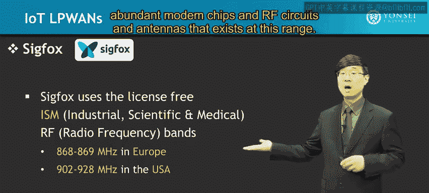
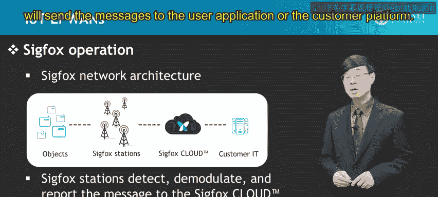
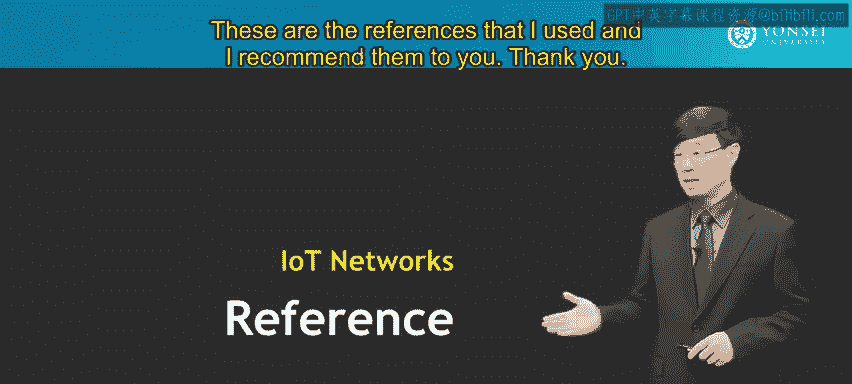

# 延世大学《新兴技术从智能手机到物联网再到大数据Emerging Technologies From Smartphone to IoT to Big Data》 - P96：24_3.4 物联网LPWAN（第3部分）.zh_en - GPT中英字幕课程资源 - BV18hpFewEcG

Yeah。Sick f。This is a LP1N technology that uses UN B， Ul narrowband modulation。

It is suitable for low data rate， lightweight devices based on IoT services。

The typical structure of the modulation is DBPSK。And it is at low bit rates Overall。

 the high base station receiving sensitivity is required。

Small and lightweight messages are what are transferred over SigF networks。

With a uplink maximum of 12 octs for payload， that's 12 by。

Ulink means that the sensor nodes are sending to the overall SigF base station access point。

Their packet sizes are limited to 12 octaves， 12 bytes。And that is for the payload。

 meaning that the overall packet is going to be larger， however。

 the information that you can put into a packet， which is the payload。

 that is limited by 12 octs of a size。In addition， downlink Max is8octs for payload What is downlink downlink is from the LP1。

 the SigF basetation or access point， the master node sending it down to the sensor devices that has even a smaller packet size where the payload of course is smaller at eightocts。

8 bytes。And it has a 14 octves for the hitter。So looking at this right here。

 the maximum of 140 transmissions per day with a data rate of 100 bits per second is typical what the service is thought about。

Sick Fox uses license free ISM band and。The ranges that are used are the 800 MHz range in Europe and the 900 MHz range in the United States。

 These frequencies are ISM band frequencies in which their frequency characteristics are very well penetrable through solid objects。

 Number two， they are at sufficiently high frequencies。Such that their antenna sizes can be small。

 meaning that the SigFox devices do not have to be large。In addition。

 at these ranges there are other single propagation characteristics that make them very attractive。

 in addition， other devices that can connect to them can be easily designed because there are abundant modem chips and RF circuits and antennas that exist at this range looking into the S Foxox operation the network architecture we have S Foxox objects that means that they're objects but they have S Foxox modem chips on them then there's S Foxox stations。

 these are the base stations access points that are picking up signalss from these objects that have these six fox modems on them then there's a sixF cloud and the cloud itself is a trademarked item that you see with that symbol and customer IT applications。

Then。Each SFox device and station has a unique Sigboxox ID where the ID and its signature are transmitted for authentication of each device in terms that each device has an ID and a signature and that is transferred through the SFox stations to the SigFox cloud and that is where once again authentication is conducted and this is done on for each device。

 each device is identified and it is authorized individually。

The objects that sense data will send their data to the Sbox station。

 and the stations will send directly to the Sickbox cloud。

When the objects send their signal to the Sbox stations。

 then the Sbox stations will detect these signals， demoulate the signals。

 and report the messages to the Sickbox cloud。The cloud will push the messages。

 will send the messages to the user application or the customer platform。

 and this is how service is conducted。

These are the references that I used and I recommend them to you， thank you。

