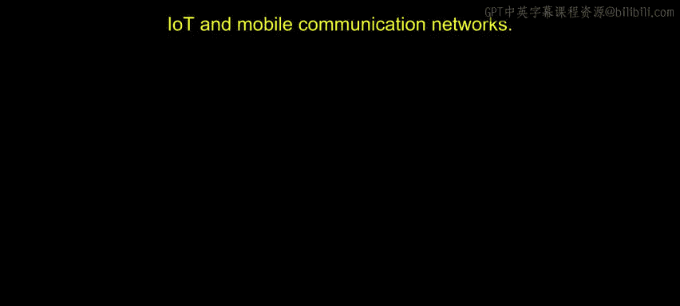
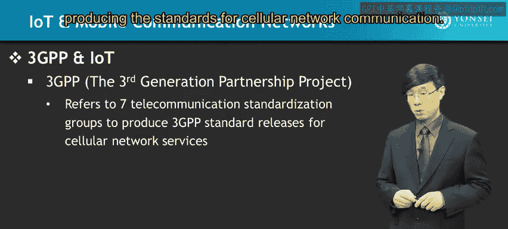
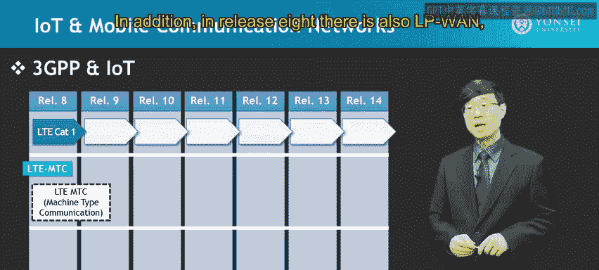
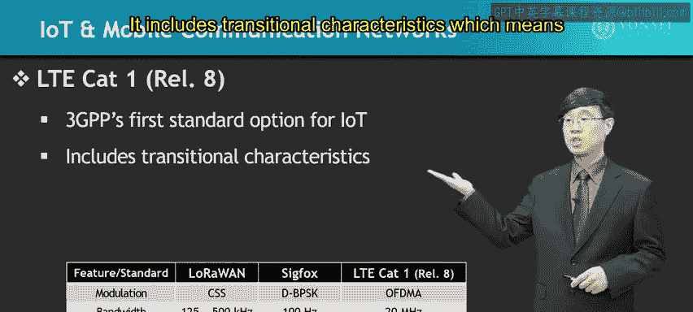
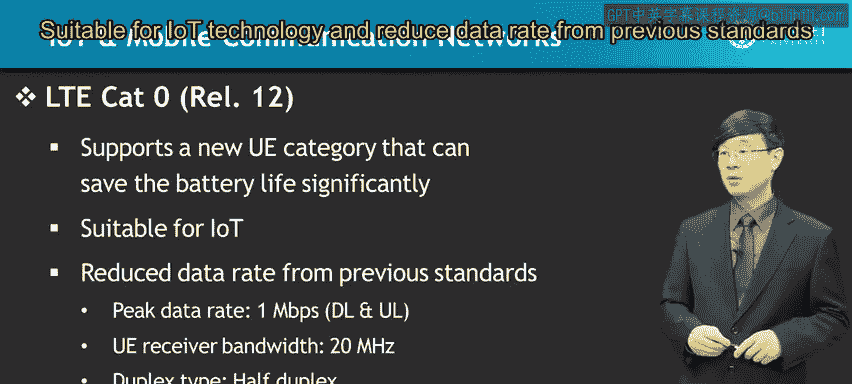

# 延世大学《新兴技术从智能手机到物联网再到大数据Emerging Technologies From Smartphone to IoT to Big Data》 - P97：25_3.5 物联网移动通信网络（第1部分）.zh_en - GPT中英字幕课程资源 - BV18hpFewEcG

Yeah。Yeah。IoT and mobile communication networks this is a very important topic because IoT and mobile communication technology are merging together and especially in future mobile communication technologies。

 there are many new things that are included in the original architecture and design such that IoT services and applications can be supported in a perfect way。

😊，For example， in 5G mobile communications already。

 there is machine type communication which supports IoT in various ways。In addition。

 there are network slices in which the overall 5G mobile communication network is divided into specific IoT application targets。

Considering all of this， naturally， IoT and mobile communication networks need to be studied together。

Overall， the standardization group that is leading this is the 3GPP。

 this is the third generation Partnership project， and there are groups which are the seven telecommunications standardization groups that are producing the standards for cellular network communication。

 these are the seven groups that are participating in the 3GP activities。

Radio access， quality of service， core transport network。

 network services and security are the main focuses that are included。

3 GPP standards are structured as releases and release  eight and following standards are what include IoT based support。

Looking at release8， we have LTE long termm evolution。

 which is the fourth generation mobile communication standards， Cat one Cat is short for category。

You can see the evolution structure here。In there， there is LTE MTTC。

 which is short for machine type communication。 This is talking about IoT service applications that are being supported。

In addition， in release 8， there is also LPW， low power wide area networking technology。

 the specifications of how to integrate that are also included in releasease 8 of the 3GPP mobile communication standards。

Then there is GSM MTTC， which is global system for mobile communication based MTTC。

 and in this standard， this is another mode of mobile communication and cellular technology。

 a very popular GSM mobile communication and cellular technology that is going to be used to support IoT applications。

Looking at how the standards evolved， you can see that from the LTE CA1 standards。

 they are merging and supporting LTE MTTC standards。

 and the evolution continues on to eventually become the LTE CAAT M1。Which is the E M TC standard。

 This is now reaching into release 14 and beyond， which is a fifth generation mobile communication cellular standard。

In addition， on the LP W。Side you have the NBC IoT and the NLTE protocols combining into the NIoT standards。

 which are also leading into release 14 and beyond for fifth generation mobile communication cellular technology In addition。

 on the GSM MTC domain from its evolution we have the EC GSM IoT technologies and these three technologies that are leading into fifth generation standards are what's going to enable fifth generation mobile communication cellular networking technologies to effectively support IoT- based various service applications。

Looking at LTcat1 in release 8， what was in there， you can see the standards in this table。

 which include the modulation， as well as the peak data rate。

 as well as the maximum output power and power efficiency and comparing this to Laura Wan and SigVox。

 you can see the differences right here。Some of the major things that you can see is that the power efficiency is。

Low when it comes to LTcat1， however， these devices are connected to your smartphone。

 which has a sufficient battery supply and also wireless charging technologies in addition added in current as well as future modes。

 and also they are supported by base stations。In addition， however。

 the overall bandwidth usage and the maximum output signal power ranges their characteristics are more than what you see used by Laura Wn and Sick Fox。

In addition， the overall data rate， as in terms of its peak service range。

 are what are shown over here。The 3GP first standard option for IoT is the LT CA1 in release 8。

 it includes transitional characteristics， which means that higher data rate than later 3GP IoT standards and peak data rates are between the range of 10 megabits per second to 5 megabits per second。

 respectively four downlink and nolink。

Now， what does this mean Well， at the beginning， at this time。

 it was hard to predict what would be needed to support IoT applications。

 So some of the data rate values that you see right in here are a little bit too high。

Meaning that the following standards， they would reduce the data rates and they would have advantages in power consumption and other service modes。

 so these numbers are relatively high for what we see now as a IoT based support standard。

In addition， the UE receiver bandwidth is 20 megahertz。

Then looking into the NIMTC and the SIMTC standards in release 10 and 11， well。

 this here is for network improvement for MTC in release 10 base specific requirements for MTC to make the network more suitable for MTC。

And congestion and overload control for IoT networks are included in here。

Then the SI MTC is system improvement to MTC in release 11。

Devicicee triggering high reachability from the app server to the MTTC device is what is the main focus of its evolution。

 and of course， this is very important。Tggering requests through SMS。

And this is only through LTE possible support is another option that is included in here。

Cat zero of LTE， which was included in release 12。 Well。

 this supports new UE category that can save the battery and extend the lifeline of the UE the UE is short for user equipment。

 which could be like your smart， your smartwach， your laptop computer。

 your smart tablet computer as well as various other devices all together in mobile communication technology based upon LTE of fourth generation and fifth generation standards。

 we call that altogether user equipment and for short UE。

Suable for IoT technology and reduced data rate from previous standards。

 typically comparing it to releasease aid， which were set a little bit too high。

The peak data rate is at 1 megabit per second for downlink and oblink。

 and the UA receiver bandwidth is at 20 megahertz。 The duplex type is half duplex。

