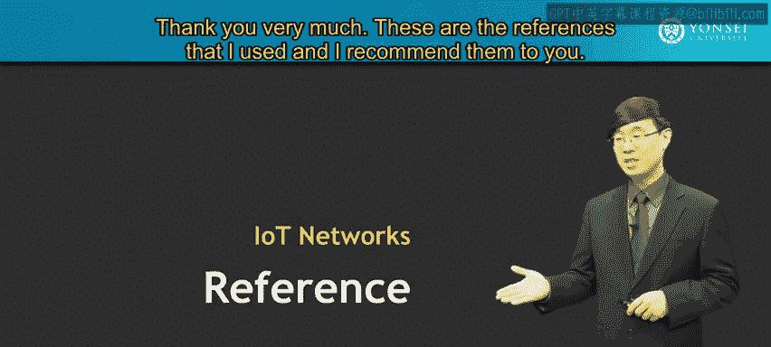

# 延世大学《新兴技术从智能手机到物联网再到大数据Emerging Technologies From Smartphone to IoT to Big Data》 - P98：26_3.5 物联网移动通信网络（第2部分）.zh_en - GPT中英字幕课程资源 - BV18hpFewEcG

Yeah。Yeah。LT E CA M1， which is EMTC based on release 13。

 Okay now we're getting serious now we're jumping into the domain of fifth generation mobile communications。

 preparing a standard in which enhanced MTTC， this focuses far more on reduction of cost for LT IoT networks。

And one of the things that happened during that period of evolution from release 8， 9，10，11。

 12 and 13， where we are right now， through that period。

 it is seen that the cost effect has to be reduced in order to make it more attractive。

 such that it will be more attractive to include it into various devices because there are other standards in which we've already studied from wireless land。

 wireless pan as well as our wireless wide area networking techniques that we've seen before that are low power consuming。

Well， compared to those devices， we need to make this cheaper such that it is attractive enough to be competitive and included into various devices。

The peak data rate is going to be approximately around 1 megabit per second or lower。

 the UE receiver bandwidth will be set upon in the range of about 1。08 megahertz， modulation ODMA。

 and the UE transmit power will be around about 20 DBM。

 which are for the new devices or 23 DBM for former devices。

This will allow a lot more IoT traffic to fit into the same LT network bandwidth。

 meaning that much more can be supported in a limited range。

And also it's compatible with the existing LT network， meaning that if you really have an LT network。

 this feature could be added on effectively without too much of tweaking and adding more equipment。

 that makes it even more attractive。Looking at the release 14 enhancements。

 now this is true state of the art reaching way into the preparation O。5G。

 fifth generation mobile cellular technology。The EMTC enhancements include support for position tracking。

For now that you know your position like location based services， LBS can be supported。

 very attractive support for multicasting group message delivery， Of course this is very useful。

As well as high data rates are also supported， larger maximum channel bandwidth up to like5 megahertz can be supported。

Support for VOLTE voice over LTE， using typical IP packets over the LTE network to support these type of data in which the overall usage is very flexible and you can use various compressing techniques。

NB IoT based upon release 13 of 3GP。This is also known as LTE CA M2 or LT Cat N B1。

 Partners include Huawei， Erickson， Qualcomm and others。The effort is to reduce cost。

And the peak data rate is set upon the targets of 250 kilobits per second for downlink or for uplink 250 or 20 kilobits per second。

The UA receiver bandwidth is set upon 180 kilohertz， and the modulation scheme is OFDMA。

They are trying to remove gateways and doing that， sensor data can directly be sent to the main server。

 no need to aggregate or do format transformations。And this reduces not only the processing time。

 speeding up the sensing information directly to the server for additional control。

 but also it simplifies your network architecture， making it simplerr to deploy these networks once again。

This will reduce the cost， meaning that you don't need an aggregator。

 you don't need a format transformer， you don't need gateways that many。

 So overall the cost is reduced， making it more attractive。Now， cost is very important， of course。

 because if you cannot afford to deploy the number of sensor nodes and the network infra given within your budget。

 you will have to find something that you can deploy with this budget。

 and that is where even though it may not be your most preferred option， the cheaper option。

 most likely will be selected if it fits your budget。

 that is why lower cost is critical in making your protocol widely spread and widely adopted。

NBIoT here， this supports three modes of operation。

There's a standalone mode which utilizes a standalone carrier。

 it uses a GSM carrier and it's not compatible with the LTE band The GSM carrier is a second generation protocol where the LTE band is a fourth generation protocol standard。

The guard band， this utilizes unused resource blocks in the LT carriers gar band so you look at where is empty based upon the overall frequency used map structure that is included when the information is sent out from the base station。

 you see where is going to be used， look at the map structure。

 and then if there's an empty spot then let's use that is what the target of this application is about。

 very wise， isn't it？Then there's Inbed， which is normal LT band that is used for MBBIoT support。

Looking at release 14 NB IOT enhancementments， and this once again is reaching wide into fifth generation mobile communications。

 5G。Looking at it， support， position tracking for location based services。Support for multicast。

 you see a resemblance to the former standards that we were talking about as they reach。Release 14。

Also mobility and service continuity enhancements， evidently you need that because you're going to be roaming around for various cases。

In addition， power consumption and latency reduction。

 you do want to reduce the amount of delay that the network is experiencing and of course you want to reduce the power consumption once again。

 you're competing with devices that are saving their energy with extremely low data rates。

But their battery lifetime is going into the range of1s or 20 years and to make your products attractive。

 you definitely need to accomplish that as well， so here you see power consumption reduction and latency reduction are both target specs that are included into the design to enhance NBIoT in release 14。

One of the things you can see is that it's now defining new UE power classes， for example。

 the 14 TBM1 which is significantly lower， making this smaller will save energy and of course will extend the lifeline of your IoT device if it's using this protocol。

Then we have EC GSM IoT， which was in release 13。This is a succeeding standard of GSM in a form of IoT。

 and this stands for extendedend coverage GSM， that is where the EC GSM comes from。

The IoT features for ECGSM include a peak data rate of 474 kilobit per second。

2 2 megabits per second， corresponding to downlink end of Li。

 a UE receiver bandwidth of 200 kilohertz modulation based on TDMA FTMA and UE transmit power at 23 dBM or 33 dBM。

And also， a long battery life up to like 10 years of operation is what is expected。

Then we have massive MTC， MMTC。Here， as you can see， the IT 2020 standards。

 this is the true 5G standard。And this defines MMTC as one of the 5G usage scenarios in which it combines EMTC。

 N B IoT， and EC GSM IoT into the 5GMMTC massive MTTC standard。

The key requirements include wide area coverage using the frequency range of 694 to 790 mehertz。

 and it's designed for connected cars and fleet services。

The connection density is1 million devices in a one square kilometer area。

And this is required for smart cities and smart metering。Naturally。

 you can see the diverse applications of where this can be used。

 and this is a major leading component technology in the future of IoT based systems。

So overall we covered IoT networks in this lecture module and we studied about various components using them together to form an overall IoT network we studied more on the wireless technologies and the wired technologies using like Ethernet and other techniques are of course very important however focusing more on the wireless components。

 I hope you understand more on IoT networks and among these techniques probably the most widely used will be Wi-fi and Bluetooth and since there's so much information to share on that that is the next module。

 thank you very much。😊，These are the references that I used and I recommend them to you。

