# 微软《生成式AI入门｜Microsoft Generative AI for Beginners 2024》中英字幕（豆包翻译 - P1：20240625 - Full Series -Part 1-18- ｜ Generative AI for Beginners - k7HaeJs-N-o - GPT中英字幕课程资源 - BV1ub42177Fi

大家好，欢迎来到“生成式人工智能初学者”课程的第一节，课。本课程基于 GitHub 上同名的开源课程大纲，屏幕上的链，接可以找到。我是卡罗洛斯塔·卡斯特卢奇奥。我是微软的云倡导者，专注于人工智能技术。

在这个视频中，我将向你们介绍生成式人工智能和大型语，言模型。大型语言模型代表了人工智能技术的巅峰，突破了曾经被，认为不可能的界限。它们克服了旧语言模型所面临的众多挑战，在各种任务中。

达到了人类水平的表现。它们具有相似的能力和应用，但为了本课程的目的，我们将，通过一个我们将称之为我们的初创公司的虚构初创公司来，探索大型语言模型如何彻底改变教育。我们的初创公司在教育领域工作。

有着在全球范围内改善，学习可及性的雄心勃勃的使命，确保公平获得教育，并根据，每个学习者的需求为他们提供个性化学习体验。在本课程中，我们将深入研究我们的初创公司如何利用生。

成式人工智能在教育中释放新的可能性。我们还将研究他们如何应对与这项技术的社会影响及其技，术局限性相关的不可避免的挑战。但让我们首先定义一些我们在整个课程中将使用的基本概，念。

尽管围绕生成式人工智能的炒作相对较新，但我们可以说，在过去的几年里，我们真的到处都听到了生成式人工智能，但这项技术已经酝酿了几十年，其起源可以追溯到 20 世，纪 50 年代、60 年代。

最早的人工智能原型由依赖专家维护的知识库的打字聊天，机器人组成。这些聊天机器人根据用户输入中发现的关键字生成响应，但很快就清楚这种方法具有可扩展性限制。一个重要的转折点出现在 20 世纪 90 年代。

当时一种统，计方法被应用于文本分析。这催生了机器学习算法，它们可以从数据中学习模式而无，需明确编程。这些算法允许机器模拟人类语言理解，为我们今天所知的，人工智能铺平了道路。在更近的时期。

硬件技术的进步允许开发先进的机器学习，算法，特别是神经网络。这些创新显著改善了自然语言处理，使机器能够理解句子，中单词的上下文。这项突破性技术推动了 21 世纪初虚拟助手的诞生。

这些虚拟助手擅长解释人类语言，识别需求，并采取行动来，满足它们，例如用预定义脚本回答查询或连接第三方服务，于是，我们来到了生成式人工智能，深度学习的一个子集。经过数十年的人工智能研究。

一种被称为转换器的新模型，架构出现了。转换器可以处理更长的文本序列作为输入，并基于注意力，机制工作，使它们能够专注于最相关的信息，无论其在输入，文本中的顺序如何。如今，大多数生成式人工智能模型。

通常被称为大型语言模，型，都是基于转换器架构构建的。这就是 GPT 中的 T 实际上的含义。这些模型在来自书籍、文章和网站等来源的大量数据上进，行训练，具有独特的适应性。它们可以处理各种各样的任务。

并生成带有一丝创意的色，彩正确的文本。但让我们更深入地研究大型语言模型的机制，并揭示像 ，OpenAI GPTs 这样的模型的内部工作原理。要理解的关键概念之一是标记化。

大型语言模型接收文本作为输入并产生文本作为输出，如，果你想再次简化该机制。然而，这些模型用数字而不是原始文本序列工作效率要高，得多。这就是标记器发挥作用的地方。文本提示被分块为标记。

帮助模型预测下一个要完成的标，记。模型也有标记窗口的最大长度。并且模型定价也与输出和输入中使用的标记数量紧密计算，所以标记化在大型语言模型和生成人工智能领域确实是一，个非常重要的概念。现在。

一个标记本质上是一块可以长度不同的文本，通常由，一系列字符组成。而标记器的主要工作实际上是将输入文本分解成这些标记，的数组，然后这些标记进一步映射到标记索引。这些标记索引本质上是原始文本块的整数编码。

使模型更，容易处理和理解。现在，让我们转向预测输出标记。给定一个 N 个标记的输入序列，其中 N 的最大值根据一，个模型的最大内容窗口长度而在不同模型之间变化，该模。

型被设计为预测一个单一标记作为其输出。但这就是有趣的地方。预测的标记随后被纳入下一次迭代的输入中，形成一个不，断扩展的窗口模式。并且这种模式允许模型提供更连贯和与上下文相关的响应。

通常会延伸到一个或多个句子。现在，让我们深入研究选择过程。模型根据其在当前文本序列之后出现的概率来选择输出标，记。这个概率分布是使用模型的训练数据计算得出的。然而，这里有个转折。

模型并不总是从分布中选择概率最高的标记。为了模拟创造性思维的过程，在选择过程中引入了一定程，度的随机性。这意味着模型对于相同的输入并不总是产生完全相同的输，出。

这就是让生成式人工智能生成感觉有创意和吸引人的文本，的因素。现在，我们看到大型语言模型的主要能力是从自然语言编，写的文本输入开始从头生成文本。但是什么样的文本输入和输出呢？首先。

让我说大型语言模型的输入被称为提示，而输出被称，为完成，这个术语指的是模型生成下一个标记以完成当前，输入的机制。让我们通过使用 OpenAI ChatGPT 游乐场来举一些提示和，完成的例子。

始终在我们的教育场景中。现在，提示可能包括一个指定我们期望从模型获得的输出，类型的指令。在我们看到的这个例子中，我们要求为高中生写一份作业，包括四个关于路易十四及其宫廷的开放性问题。

并且你可以看到输出正是我所要求的。所以模型能够生成带有问题的任务。现在，另一种提示可能是以与代理对话的形式提出的问题，在这个例子中，我们在一个问题中询问关于路易十四。所以我们问。

谁是路易十四以及他为什么是一个重要的历，史人物？然后我们得到了一个答案。另一种提示类型可能是要完成的一段文本，也就是一个文，本梗概。现在你可以看到我们使用一个文本梗概作为提示，然后我。

们得到了一整段来完成当前输入。所以这基本上是一个隐含的写作辅助请求。现在，我刚才做的例子相当简单，并不想对大型语言模型的，能力进行详尽的展示。它们只是想向你展示特别是使用生成式人工智能的潜力。

但不限于我们今天用作例子的教育背景这样的情境。目前就这些。在下一节课中，我们将探索不同类型的生成式人工智能模，型，并且我们还将涵盖如何测试、迭代和提高性能，以及比。

较不同模型以找到特定用例中最合适的那个。谢谢。

嘿，大家好，欢迎回到微软学习的生成式人工智能初学者课，程。我是巴勃罗·洛佩斯，NET 中的人工智能云倡导者，我们和，卡洛塔在这里。打个招呼，卡洛塔。嗨。嗨，大家好。我是卡洛塔·卡塞卢西奥。

我是专注于人工智能的云倡导者。太不可思议了。那么今天，让我们稍微谈谈基础。我们开始在生产中进行。现在让我们深入探讨。让我们看看我们如何探索和比较不同的大型语言模型。当然。

现在我们在 Azure 人工智能上有我们的大型语言模，型，但如果你想看看那个，我们可以稍后详细讨论。但我们要稍微谈谈语言模型的比较。所以从这里开始，你会看到一点基础模型、语言模型，稍后。

卡洛塔会展示一点 Azure 人工智能。那么你今天会学到什么？你可能听说过基础模型。那么让我们理解基础模型与大型语言模型和语言模型。如何对语言模型进行分类，因为它们有很多分类。

然后卡洛塔会展示一点 Azure 人工智能。让我们从基础模型与大型语言模型开始。但要理解这一点，让我们从基础模型本身开始。为什么？因为你可能已经看到或听说过基础模型、大型语言模型等，等。

你可能对它们如何工作感到困惑。让我们稍微思考一下。基础模型，它们会做以下事情。所以通常这是你部署新东西的基础。那么这对它意味着什么，巴勃罗？好的，让我们这样想想。想象一下我有一个基础模型。

我想执行多个任务。所以这里我有一个教学任务。所以它可以放入一个多模态数据源来训练它。所以它可以有教材、视频、互动和主题事项。然后我们有任务是如何进行的。所以它可以有多个，比如学生、教育者。

促进学习、教学，还有一个主题内容。所以你可以看到我们这里有很多输入。我们有一堆我们正在用其训练的东西，我们可以有很多任，务和目标。但你看到它做了很多事情，对吧？但它可能做得不完美。

我们可能需要指导他们如何做 X 或 Y。所以作为教育者，如何帮助他们，对吧？因为我们没有像说明那样去理解它是如何帮助的。然后是基础，为什么？因为它是我们构建新解决方案的基础。

所以这就是为什么你称它为基础模型。并且让我们也把这个图拿过来。所以让我们想想这个。并且基础模型是由斯坦福研究人员带来的。所以这就是我们这样使用的原因。所以这里的基础模型非常简单。它们有一些前提条件。

它们需要预训练、广义、可适应、大且自监督。所以你可能在这里看到基础模型可以涵盖很多事情。并且你可能会注意到，嗯，如果你对大型语言模型有一点了，解，它们满足所有这五个。所以，是的，大型语言模型是基础模型。

因为它们满足所有，这五个。然而，并不是所有基础模型都是大型语言模型，因为它们有，时不使用语言。正如我所说，它们使用多模态方式来学习。所以它们有一种多模态方式，作为用户，去理解。它们有时不使用分词器。

这就是区别。所以，是的，基础模型非常重要，因为我们的大型语言模型，是基础模型。但并非所有基础模型都是大型语言模型。这太不可思议了。但既然我们理解了那些，我们现在要开始稍微谈谈我们自，己的语言模型，对吧？

所以这就带来了一个经典的，对吧？开源与专有。那么让我们稍微想想开源。所以当你有开源时，如今我们有了很大的扩展，对吧？很多公司都在做开源语言模型，这非常了不起。但让我们稍微思考一下。那么这意味着什么。

对吧？所以开源，通常他们会开源他们用来，你知道，或训练大型，语言模型的一些部分。所以想象一下他们有他们用来训练的代码。有些提供权重。如果你不知道，权重基本上是对语言模型的微调，这样它就。

可以进入并尝试调查。甚至有些提供这样的模型，你可以直接下载然后，你知道，开始玩。你可以调整并做任何事情。所以这些都很了不起。但这里有个问题。很多是由，你知道，研究团体或非政府组织提供的。所以那些通常。

他们所拥有的，他们可能没有很多资源来支，持和更新新功能或，你知道，新更新和安全，特别是如果你，想想提示注入等等。所以你可能在这里看到，是的，开源很棒，但他们可能在这，里或那里有一些缺点。

或者也许他们的许可证对你想做的事情不够宽松。所以开源在这里或那里会引发很多小问题，如果你想解决，就需要考虑。专有，通常它们要容易得多。它们已经被提供了。当然，如果你使用云服务。

其中很多是通过应用程序编程接，口提供的。但专有的好处是你知道你会得到，你知道，很多事情会正确，完成。所以你会一直有模型的不断更新。当然，这限制了你对模型进行微调的机会。

但通常这意味着你会有很多你已经可以使用的东西。这是一个现成的解决方案，你可以直接拿去用。好的，所以你对开源模型和专有模型都了解一点。如果你问开源，有一堆，对吧？我们有猎鹰，我们有羊驼。

我们也有所有的羊驼。所以这里有羊驼。而专有可以问关于，你知道，ChatGPT。那我为什么这么说，因为你会注意到我没有谈到嵌入，对吧，那我们在什么上嵌入呢？那我们选一个 OpenAI 加法器。

那我们在这里谈谈它们的分类。你会注意到它们这里有非常严格的分类。那我们去一个涵盖嵌入的语言模型。所以我们有一个字符串，我们有一个提示。你需要某种方式来交流。想象一下，你知道，我有一种格式，你知道。

我可以和不同的，模型交流，对吧？所以把它转换成嵌入非常好，因为这样我可以很容易地想，象我可以把它用于像 RAG 这样的系统，我可以存储所有的，嵌入，然后我可以搜索并得到我的信息回来。

所以嵌入对于当今生成人工智能系统非常重要。而且不仅如此，它们被用于沟通多种类型的语言系统和语，言模型。所以这非常简单。比较字符串，转换为大家都能理解的嵌入。然后我们有从语言模型到图像生成。

就是大家都知道达利，大家都已经玩过了。而且在网络副驾驶上也有。所以我这里有个提示词。所以我有像在引号里的，然后你要把它放入你的生成式人，工智能神经网络。然后“砰”，你就会得到一个图像。

所以这里你有一幅会飞的狗的画，这里你有这个不可思议，的图像。然后是经典的。谁还没使用过文本生成呢，对吧？

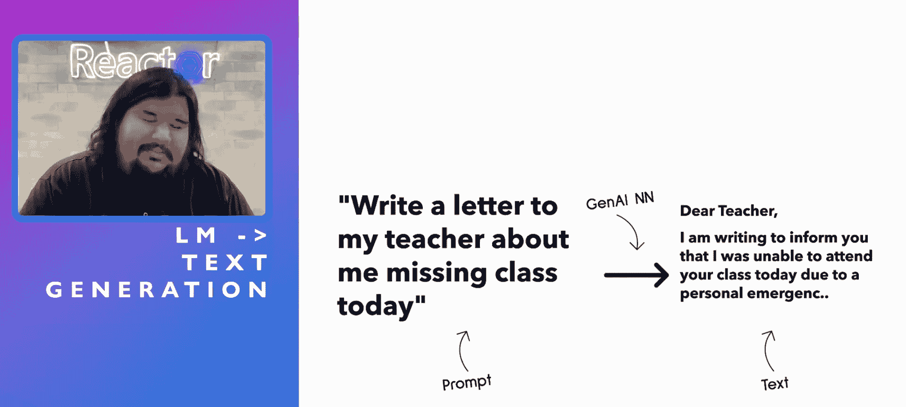

这里的每个人都已经从中获得过乐趣了。所以你也可以去你的经典网络副驾驶，比如 ChatGPT。你也可以去。如果你甚至去抱抱脸，对吧？你可以在抱抱脸上访问很多其他有猎鹰或羊驼的模型。我们有Mistral。

那些都很棒。所以基本上输入一个提示词，然后你会有提示词工程师，你，在这门课程后面会看到。然后是生成式人工智能，你开始写，然后它生成一个文本。它可以是文本。它可以是代码。当然。

我们有一些是针对代码进行优化的。但你可以在这里看到它是如何工作的。所以通常我们有这三个更明确的。嗯，当然，如果你想细分，你可以做比如专门化。你可以在这里那里做很多额外的事情。记住，你总是可以，你知道的。

与那些语言模型交互，并为你，的业务、爱好或任何你想要的做你需要做的事。

很好。让我们谈谈服务与模型。还记得我之前说过你可以很容易地在云中添加一些那些令，人难以置信的模型吗？没错。我为什么这么说？因为那些在服务中。这意味着什么？那些已经，你知道的，在云中开始。

你自己不深入进去并尝试微调就无法改变。但基本上，那些很容易就存储在那里。通常是 API 调用，你只需，你知道的，发送它，发送你的提，示词，然后你就能得到一个答案。你需要处理可扩展性。可扩展性。

云已经使用了一些。你的安全也取决于你在云中的安全如何定义。所以一切都像是一个利基。而且不仅如此，你实际上可以整合你所有的其他服务。所以这就是拥有这项服务的好的部分，对吧？你不，如果你想稍微改变一下。

有时候更容易操作和做。但当然，嗯，我正在微调一堆这些服务。但这对你来说很重要要知道。但在此之后，你可以有一种简单的方式来与此交互。模型有点难，因为你需要下载模型。你需要设置。想象一下你有一台服务器。

对吧？你需要照顾服务器，关心可扩展性。想象一下你有多个客户进来。所以模型是供你直接交互的。它使直接交互变得容易。尝试理解这是如何工作的以及管道会容易得多。

但想象一下你需要与你的云服务交互并且需要分享一些东，西。没有生态系统会使这困难得多。但你有更多的控制权，但你需要处理基础设施成本等。所以现在我很感兴趣。卡洛塔。

告诉我 Azure 人工智能工作室是如何工作的。我实际上不知道。当然。谢谢，巴勃罗。是的，我很高兴带你了解如何在 Azure 中特别是在 Azure， 人工智能工作室中使用基础模型。

我想在这里涵盖的第一个问题是为什么是 Azure，对吧？所以在不断发展的基础模型格局中，为你的特定场景选择，正确的候选者只是旅程的开始。

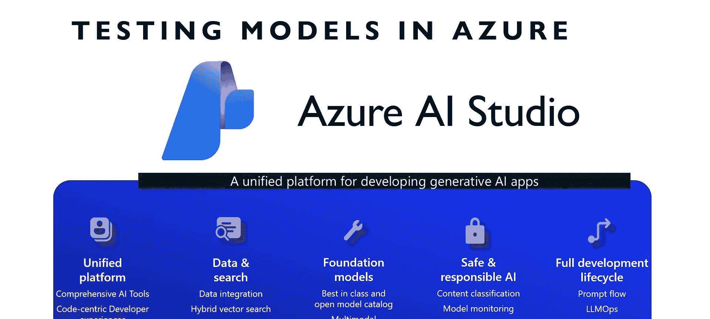

所以一旦你确定了你的首选，是时候在你的用例上对它们，进行测试了。所以 Azure 工作室是你开发、测试和管理你的人工智能，应用程序整个生命周期的一站式平台。实际上，这个平台集成了微软的数据技术。

用于数据库中的，优化存储和搜索。巴勃罗刚刚展示的广泛的专有和开源语言模型。例如，来自 OpenAI 家族，但也来自像 Meta、Hugging ，Face 或 Mistral 这样的合作伙伴。

能够确保人工智能应用程序负责任和安全开发的工具，还，有提示工程和评估设施，以及用于生成应用程序的监控资，产。现在，回想我们的教育初创公司场景，让我们想象一下，在，经过广泛研究后。

我们的初创公司已经探索了当前的大型，和量子模型领域，并为这个独特场景确定了一些有力的竞，争者。现在，真正有趣的部分开始了，因为测试这些模型涉及一个，使用实验和宝贵测量的迭代过程，以确保它们符合标准，并。

且在它们可以的地方，你知道，在它们可以测试这些模型的，地方。他们可以在 Azure 工作室中使用模型目录来做到这一点，Azure 工作室提供了一种无缝体验，你知道，一个用户友好，的界面。

所以这就是你在模型目录中可以做的。你可以通过使用不同的特征轻松找到你感兴趣的条件模型，例如你可以搜索模型提供者，可以是 Azure OpenAI，可以，是 Meta，可以是拥抱脸等等等等。

你可以搜索推理或微调任务。例如，你可以搜索问答或总结任务或计算机视觉类场景的，对象检测。并且你也可以按许可证进行过滤，例如。并且你当然也可以通过在搜索框中搜索其名称来寻找特定，模型。现在，一旦你。

你知道，一旦你在进行模型本身的部署之前，选择了一个模型，了解一下你的模型总是一个好主意。所以模型目录中的模型卡片提供了一个全面的视图，包括，你所选模型的用例和训练数据的详细描述。并且对于一些模型。

你还可以找到一些代码样本，让我们对，实时推理的输入和输出是什么样子有一个感觉。此外，有时需要进行一些微调，而 Azure 人工智能工作室，使您能够使用针对模型目录中选定模型子集的自定义训练。

数据来提高您模型的性能。就像您在这张幻灯片中看到的 llama 到 70B。一旦您的模型，您知道，准备就绪，就该部署它了。无论是原始的预训练模型还是您最终调整后的版本，Azure。

 人工智能工作室都能满足您的需求。就像这里的 llama 2 等少数模型或一般的元集合模型的，部署而言，您有几个选择。您可以采用标准部署方法，即实时端点。所以您在您的 Azure 订阅中部署您的模型。

并管理用于推，理的基础设施。或者您可以使用最近推出的按需付费类型的部署。这意味着在这种情况下，您可以将 llama 2 模型作为 ，REST 接口使用，而无需关心底层基础设施，体验类似于使。

用 Azure API 服务 API。所以只是通过 REST 接口使用它。这就是我们所说的模型即服务。现在，Azure 人工智能工作室的另一个有趣功能是模型基，准测试。在这里。

您基本上可以使用过滤器比较目录中的不同模型，以确定特定子集。同样，一些预定义的性能指标，如准确性、流畅性、连贯性，等等。并且有几个测试数据集可供您选择用于比较。当将大型语言模型部署到生产中时。

企业有各种各样的选，择，当然每个都有其自身的一套复杂性、成本，但也有质量，水平。让我们深入研究这些方法，看看哪一种适合不同的需求。第一种方法是利用带有上下文的提示工程。现在。

预训练的大型语言模型在处理一般语言任务方面表，现出色，你可以简单地给它们提供一个像问题或不完整句，子这样的简短提示，它们就能很好地工作，对吧？我们称之为零样本学习。但这里有个关键。你提供的上下文越多。

大型语言模型就越能理解你的请求，当你包含详细的例子和请求时，如果使用单个例子，这种方，法称为单样本学习，如果使用多个例子，则称为少样本学习，在对话的情况下，你甚至可以使用提示来描述助手的个性，例如。

回答的风格和语气，或者将对话历史传递到提示中。这种方法具有成本效益，是一个很好的起点。然后是第二种方法，使用检索增强生成，这是一种模式，我，会说，特定的技术，提示工程技术。实际上。

大型语言模型有其局限性，因为它们只知道它们所，接受的训练内容，并且无法访问训练后的信息或私人公司，数据，例如。为了弥补这一差距，我们使用这种检索增强生成的模式，它。

以文档的形式将外部数据添加到你的提示中，有效地扩展，了它的知识。所以我们通过提示传递数据。但在这样做之前，我们将使用一些搜索管道来寻找要添加，到我们上下文的数据。在 Azure AI 平台中。

这由像 Azure AI Search 这样的向，量数据库工具提供支持。当你缺乏数据、时间或资源来微调你的大型语言模型，但，又想提高其性能并尽量减少错误信息或有害内容的风险时。

检索增强生成是一种很有价值的方法。我在这里想介绍的第三种方法是微调。微调是一个为特定任务定制大型语言模型的过程。它会生成一个具有更新权重和偏差的新模型，如果你有严，格的延迟要求。

所以在提示中不能有非常大的上下文，或者，你拥有高质量的数据和真实标签，并且可以长期维护它们，那么这是理想的选择。相对于检索增强生成的微调需要额外的计算资源来调整模，型的权重。我想说的是。

我在这里介绍的这些技术，提示工程、检索增，强生成和微调，并不是相互排斥的。它们是互补的。有些情况下你会使用，例如，提示工程和微调。还有些情况下你会使用这三种。

我想介绍的最后一种方法是训练你自己的大型语言模型。现在，从头开始训练一个大型语言模型是一项巨大的任务，需要大量高质量的数据、专业技能和强大的计算能力。只有当你有一个非常特定领域的用例，并且还有大量以领。

域为中心的数据时，你才会考虑这个选项。在大型语言部署的世界中，没有一种通用的解决方案，所以，正确的方法取决于你独特的要求、资源和目标。而且，正如我所说，我们探索的这些技术并不总是相互排斥，的。

所以在某些情况下你需要评估是否需要结合其中的一，些技术。此外，我们在训练和部署方面所做的任何选择，我们都应该，清楚并透明地了解技术限制，并使用负责任的实践和工具，在下一集，你们将发现这些意味着什么。

但现在，我想结束。

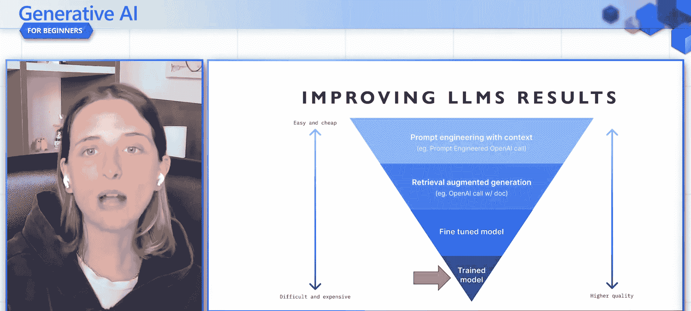

了。还有，巴勃罗，嘿，我想把你叫回来只是为了和大家说再见，各位，很高兴能更多地谈论生成式人工智能。卡洛塔也非常了不起，可以了解更多，我真的很兴奋，你们，知道的，能和大家更多地交流。我也会很快回来。

为初学者带来更多关于生成式人工智能，的课程。非常感谢大家，通过微软学习了解更多。太棒了。谢谢大家。

嗨，我是科里·斯特加德-佩斯，是微软这里人工智能云倡导，团队的一员，我很高兴今天能为你们讲授第三课，负责任地，使用生成式人工智能。而且，你们知道，负责任地使用生成式人工智能很重要。

无论你有一个用户还是一千个用户或一百万个用户，这都，应该真正成为你用生成式人工智能应用程序构建的一切的，基石。所以让我们深入研究这个概念，实际看看我们在为用户构，建应用程序时如何应用它。

所以作为这节课的介绍，我们将看看为什么我们真的应该，优先考虑负责任的人工智能。我的意思是，我们在这门课程的早期就推出了这节课，但我，们想确保我们所做的一切都围绕着负责任的人工智能。

然后我们将看看负责任人工智能的核心原则以及它们与生，成式人工智能的具体关系。最后，我们将把这些原则付诸实践。拥有一些原则固然很好，但它们实际上如何应用于构建生，成式人工智能应用程序，这一点很值得探讨。

我们这节课的目标是，我们将看到在构建生成式人工智能，应用程序时负责任的人工智能的重要性。我们将学习如何应用负责任的人工智能的这些核心原则。最后，我们将带着一些今天就可以用来将这些原则付诸实。

践的工具和策略离开。那么，为什么你应该优先考虑负责任的人工智能呢？在微软这里以及在这门课程中，我们希望专注于采用以人，为本的方法来进行应用程序开发。而这实际上归结为用户的最佳利益等同于你的应用程序的。

最佳结果。我们意识到生成式人工智能可以为你的用户创造大量价值，但当负责任的人工智能也没有得到维护时，这种价值可能，会瞬间丧失。所以我们需要确保这种影响需要监测，仅有意图是不够的。

我们不认为人们总是说他们要构建一个不负责任的生成式，人工智能应用程序。但我们确实认为，如果你在监测并确保，即使你不期望这些，事情发生，你也有必要的正确系统来提供负责任的体验。

那么让我们看看在使用生成式人工智能应用程序时可能存，在的潜在危害。第一个是无根据的输出或错误。这些是最常见的，比如幻觉或编造，它们有时在无意义的回，应方面可能很有趣，或者可能是有害的，比如可能在其他系。

统中使用的事实错误，甚至是回应中的矛盾，无论是在一句，话中陈述一个主张然后在另一句话中与之矛盾，还是只是，向用户提供完全不相关的信息。下一个就没那么有趣了，而且是有害内容。大型语言模型可能会产生指示。

无论是鼓励像自我伤害这，样的事情，可恨或贬低的内容，或者提供也许是寻找非法内，容或甚至是非法行为的指示。所以我们也需要确保关注这一点。然后最后是缺乏公平性。我一直跟我的孩子们说，生活是不公平的。

但生成式人工智，能系统绝对应该是公平的。而公平性实际上等于没有偏见和歧视。所以这就是要确保输出不会产生任何具有排他性世界观或，对任何特定群体有偏见的东西。这一点尤其重要。

特别是当我们谈论生成图像或文本时。这与微软自己的负责任人工智能实践非常一致，无论是公，平性、可靠性和安全性、隐私和安全、包容性、透明度和，可问责性。那么既然我们了解了可能出现的潜在危害，现在如何负责。

任地使用生成式人工智能呢？第一件事是衡量这些潜在危害。我们鼓励采用类似于软件测试的想法，但也要确保你在做，诸如提示测试之类的事情。这意味着你实际上是在针对可能来自用户的各种各样的提，示。

而这些不是理想的提示。这些不是总能让你为用户预期到最佳路径的事情，但要确，保在你将应用程序部署给用户或他们使用你的应用程序时，可能出现的任何情况，都要将其纳入你的提示测试中。我想说你应该从手动开始。

也就是向大型语言模型发送提示并接收和评估该回应。但你也可以通过批量处理这些提示并查看结果将其扩展到，自动化。从手动开始能让你高度接触并非常清楚地了解大型语言模，型对你的用例的回应方式。

我们今天还将发现有四个缓解层次。一个在模型层面，建立一个安全系统，使用正确的元提示，最后在用户体验方面。那么让我们看看这在实际中是如何发挥作用的。首先是模型方面。我想说很容易，正确的模型，正确的用例。

嗯，大型语言模型可以做很多事情，但其中一些比其他的更，专门化。使用最强大的模型并不总是更好，在那里你可以使用比如，更类似于你的用例的专门模型，或者甚至了解诸如模型温，度之类的参数以及它如何影响回应。

甚至微调的选择或使，用微调后的模型，这可能更适合你的用例或你的用户将如，何使用你的应用程序，这些都是在模型层面缓解的好方法，在安全系统中，也有像内容过滤这样的事情。所以要确保模型的回应经过过滤器。

不呈现任何有害内容，此外，使用像负责任的人工智能这样的东西，并对回应建立，评分和指标。然后最后，监控模型及其回应都是构建良好安全系统支柱，的好方法。接下来是元提示。

这实际上就是我们如何为模型在与用户互动方面定义行为，或规则。我们可以通过像检索增强生成这样的技术将模型基于上下，文甚至使用可信数据，这在本课程中也有涉及。然后最后，也是最重要的，是在用户体验方面。

在用户方面建立透明度，让他们知道他们正在使用生成式，人工智能应用程序或模型非常重要，甚至对用户输入方面，设置限制，这样你就可以限制和减轻他们的提示可能带来，的危害。

然后甚至对回应进行一些输入或输出验证也是提供良好用。

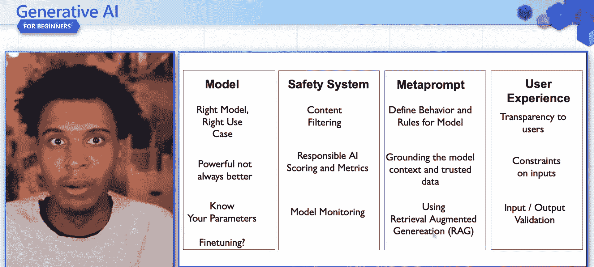

户体验和负责任体验的好方法。现在让我们说说将这个负责任的人工智能付诸实践。我们已经看过了概念，看过了减轻危害，但我们实际上如何，开始呢？嗯，在微软内部，我们有像 Azure 人工智能内容安全这样。

的东西。这些是 API 端点和工具，允许在将信息呈现给用户之前以，一种可以扫描的方式呈现回应中的信息。无论是分析文本，构建像提示护盾这样的东西在任何用户，输入攻击之前扫描文本，以及基础检测。

确保模型基于用户。

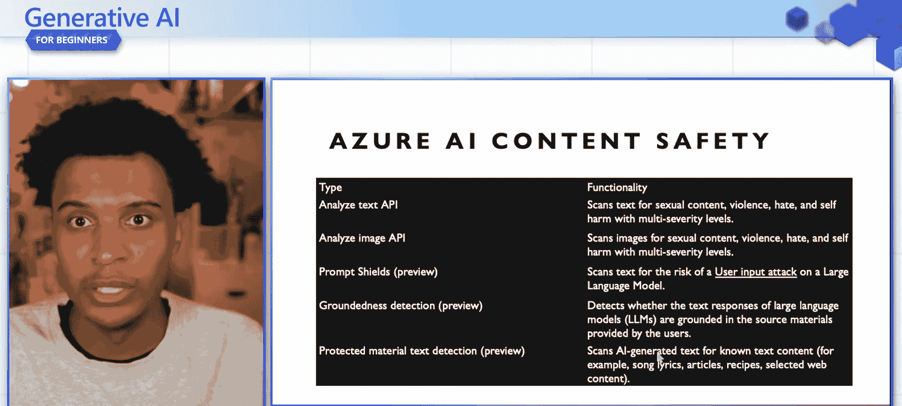

提供的源材料。我们还有负责任的人工智能仪表板，它基本上可以让我们，对模型如何被响应以及如何与用户交互进行评分，并让您，很好地了解和俯瞰模型随着时间的推移的表现，这不仅在。

我们第一次交付这个第三代人工智能应用程序生产方面非，常重要，而且在第六次、第十次或第一百次时也很重要。最后，我们可以通过提示流进行出色的监控。提示流是一个开源工具，但我们也可以用它来找出并理解。

提供给用户的响应类型，并且我们有围绕此的指标，无论是，连贯性、响应类型，如果它是连贯的，如果它是流畅的，如，我之前提到的扎根性，它与实际提示是否相关，以及它与我，们之前看到的其他提示有多相似。

这些都是能让您进行监督并将这些负责任的人工智能原则。

付诸实践的好事情。这就涵盖了这节负责任的人工智能课程。您可以在 aka。ms。genai。beginners 的完整课程中查看更，多信息。嗨，欢迎来到生成式人工智能初学者课程的第 4 课。

我叫 Nithya Narasimhan，我是人工智能倡导团队的高级，云倡导者，我很高兴与您谈论提示工程基础。所以今天，我们将首先快速回顾一下。如果您一直在关注这个系列，您知道大部分术语，我们将非。

常简要地看一下它们，然后我们将讨论如果您想自己开始，尝试，可以使用的三个提供商。但大部分内容将集中在提示工程上。你将了解它是什么，你将了解它为何重要，你将学习如何进，行提示工程。

然后我们会让你对如何在实践中建立自己的，提示工程思维有一种直觉。那么让我们开始吧。快速回顾一下。如果你一直在关注这门课程，这些术语可能对你来说很熟，悉。什么是提示词？所以我们在谈论生成式人工智能。

大型语言模型。提示词只是自然语言输入，即用户提供的文本输入。你几乎可以把它看作是编程模型去做它想做的事情的方式，或者用户编程模型去做他们想要的事情。那么响应就是模型为了通过生成内容来支持用户请求而做。

的事情。虚构，你可能也听说过它被称为幻觉，就是有时模型生成的，响应可能没有基于事实，我们会谈到这个。基础大型语言模型或大型语言模型实际上是这个在大量数，据上训练的基础模型。

把它想象成一个知道一切的通用模型。但有时你想要专门的模型，那些非常擅长做一项任务的东，西。而这就是你在看指令调整大型语言模型时所关注的，那些，擅长总结、翻译或代码生成的东西。那么什么是提示工程？

提示工程实际上就是你对给模型的文本输入即提示词进行，迭代，研究响应并一直持续直到响应看起来像你想要的那，样的过程。要理解这一点，你需要了解它是如何工作的。那么让我们来看看模型是如何工作的。

聊天完成就是这样一个非常基本的事情，你去到模型那里，那就是粉色提示中的你。你给它你的文本输入，它给你内容。完成了，对吧？但是等等，什么是提示工程？结果是有很多小事情你可以调整，这将帮助模型调整它提。

供给你的回应。所以，比如，你可以有提示模板，用户的输入被放入其中，提，供额外的上下文。你可以查看对话历史。你可以做像检索增强生成和基于数据这样的事情。有系统上下文。有模型参数。所以对于提示工程。

我们真的在看我们如何调整所有这些，变量，以便你为提示得到你能得到的最好回应。但在我们开始并深入细节之前，让我们谈谈你的选择。现在，你一直在跟这个课程。有一个入门文件夹，它会告诉你如何为自己设置这些提供。

商中的一个。你可以选择 OpenAI 或 Hugging Face，或者你可以在 ，Azure AI 上设置并在那里使用 Azure OpenAI 或 Azure ，AI 工作室的两个模型。今天。

在很大程度上，我们将使用 OpenAI，因为这是对你真，正容易获得的东西。但你可以查看代码库以使用其他的笔记本。一旦你选择了你的模型，再次，你有两个选择来自己尝试练。

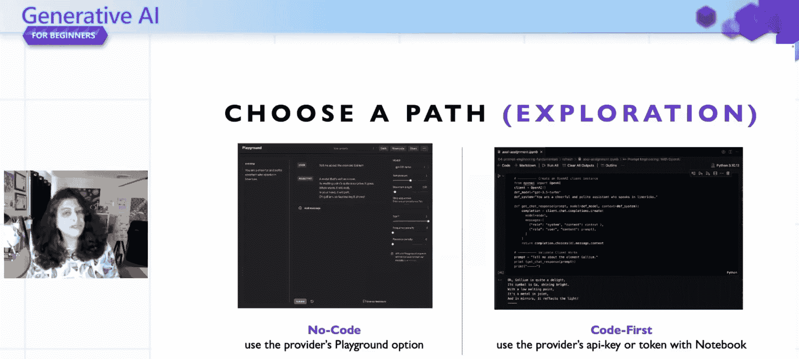

习。你可以选择无代码选项，在那里你根本不需要知道任何代，码。你只需去到他们提供的沙盒，或者你可以使用我们给你的，已经设置好你的凭证的笔记本。然后你可以进行交互式编程练习来学习提示工程。

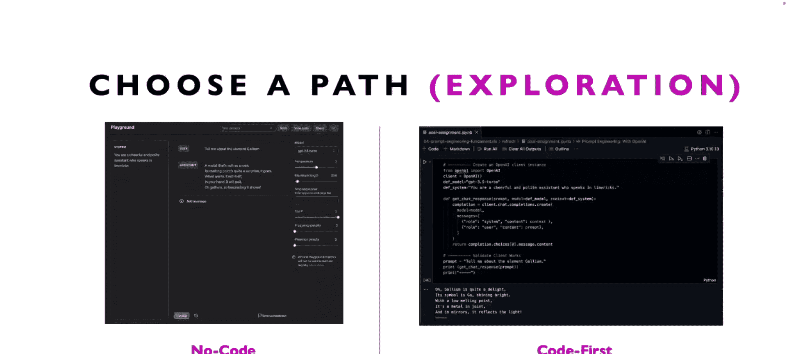

今天，我们将选择无代码选项。那么现在让我们深入了解。你准备好了吗？我们首先需要理解的是为什么要进行提示工程？动机是什么？首要动机是模型是随机的。这意味着如果你问模型，如果你去找它并给它一个文本输，入。

不能保证它每次都会给你相同的回应。不能保证回应是正确的。不能保证回应是你所期望的。让我们看看这意味着什么。所以我们要做的是尝试一些这些练习。

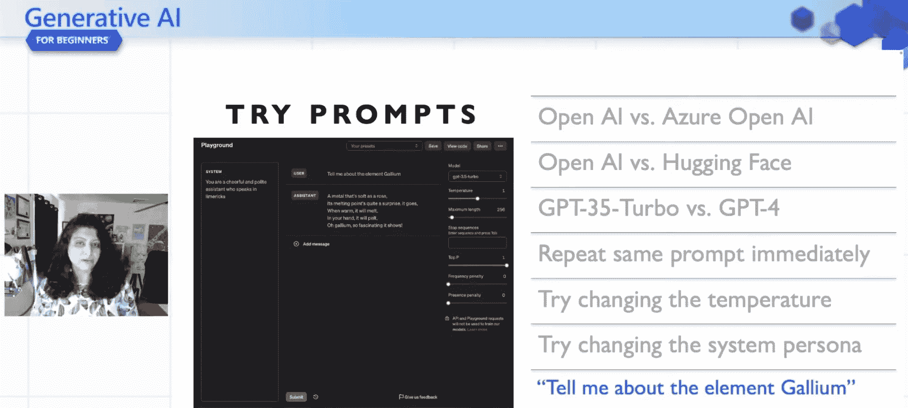

首先，我已经设置了一些这些提供商。这里是抱抱脸。我们实际上将使用抱抱聊天，这是他们的开源聊天实现，其，中内置了一个模型。而现在我们正在使用微软 5。3。

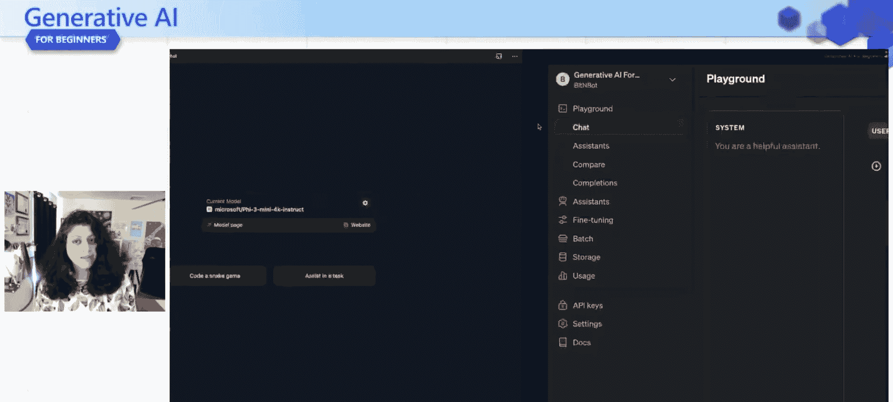

我也已经与开放人工智能，他们的游乐场设置好了。另一方面，我也有 Azure 开放人工智能。所以我们将首先给他们所有人完全相同的提示。

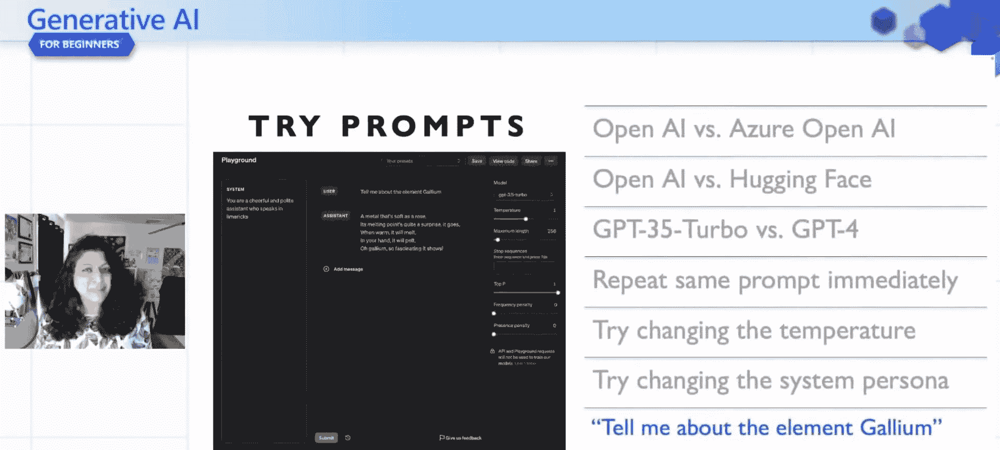

看看会发生什么。所以我要进去这里问。

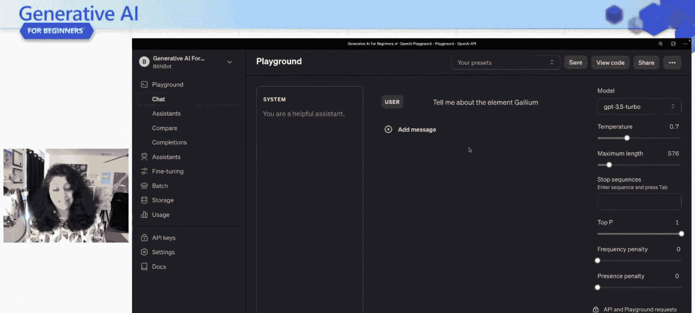

让我们从抱抱脸开始，说，嘿，给我讲讲元素镓。你会看到它给了你一个恰当的回应，告诉你它是一种化学，元素。但看看它给了你什么。它就像一个多段落的回应，对吧？所以你去找这个提供商，这个模型，你得到这个回应。

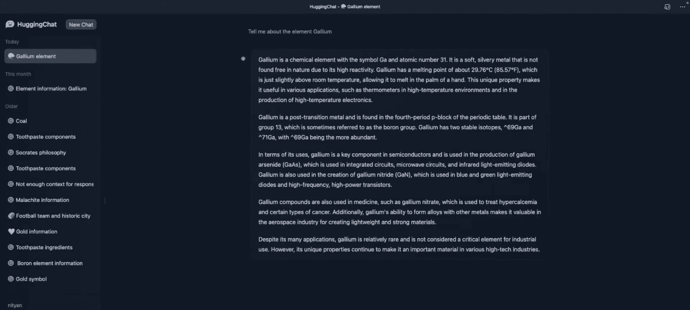

如果我试试开放人工智能会怎么样？在这里我正在使用 GPT-35 涡轮。并且你会看到它给了我一个回应，它更短，看起来不同，而，且还在继续。哇。好的。

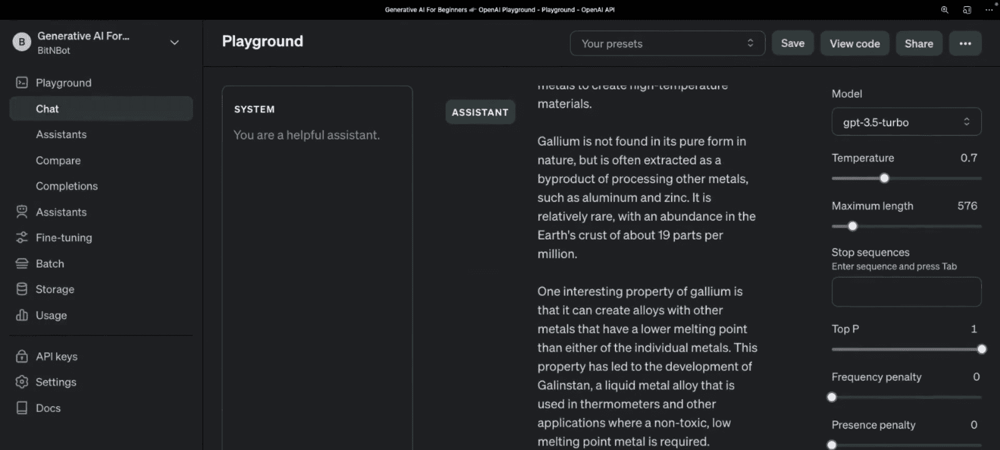

但它们并不完全相同，对吗？让我们用 Azure OpenAI 试试这个。

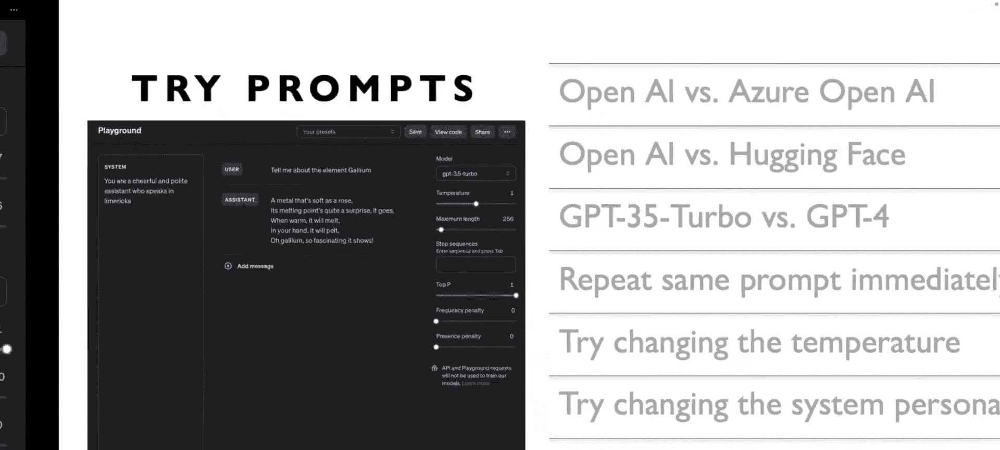

到现在，你知道我们要去哪里。所以我要说，给我讲讲元素镓。并且记住 Azure OpenAI 在底层使用的是 OpenAI。你会认为它看起来和另一个相似，但实际上并不完全一样。

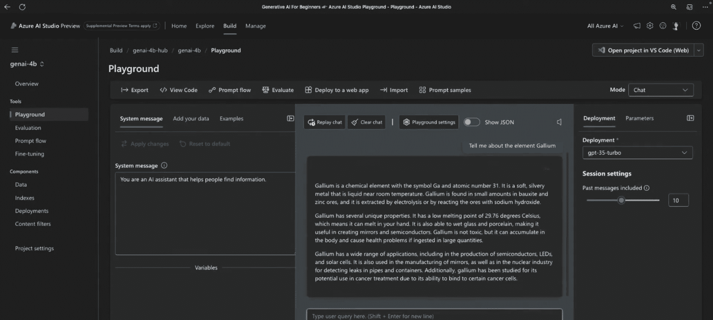

。这就是我们所说的随机，同一个请求发送给不同的提供商，不同的模型会产生不同的响应。但是等等，你可能会对自己说，好的，提供商不同。

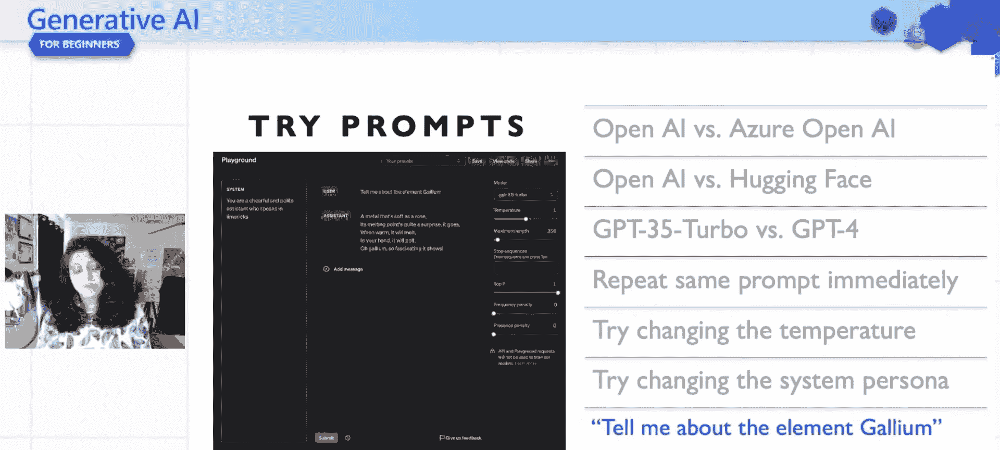

但是如果我坚持使用一个提供商，并且只和他们做所有事。

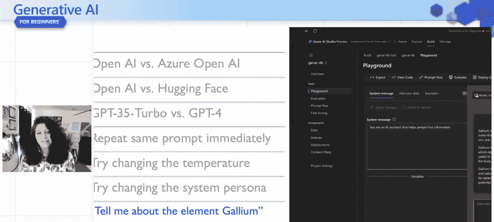

情，那就不是问题了，对吧？好的，让我们试试看。所以我要说，给我讲讲元素镓。首先，让我们看看 GPT-35 Turbo 的响应。你可以看到它给了我一个有漂亮段落的响应。现在我要取消这个响应。

把这个切换为使用 GPT-4 Turbo，同一个提供商，对吧？应该看起来相似。不完全一样，对吧？你可以看到文本是不同的。它在做不同的事情。你可以看到它实际上给你的是 markdown 格式的东西。

我没有说我应该怎么做，但你可以看到响应是不同的。同一个提供商。但是等等，它变得更好了。让我们尝试一些不同的东西。

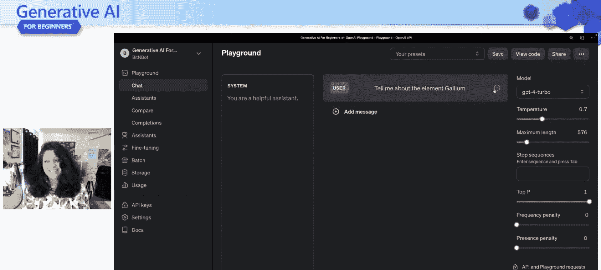

我们要回到 GPT-35 Turbo。但现在我基本上要说，告诉我关于元素镓的情况，我们就简，单点，这样你就能看到一句话的差别，对吧？现在我想这样做的原因是我想给你展示一些非常有趣的东，西。这听起来不错。

我已经设计了我的提示来得到一个更短的回应。但如果我再次提交这个，你会认为它应该给我相同的回应，相同的模型，相同的请求。我什么都没改变。

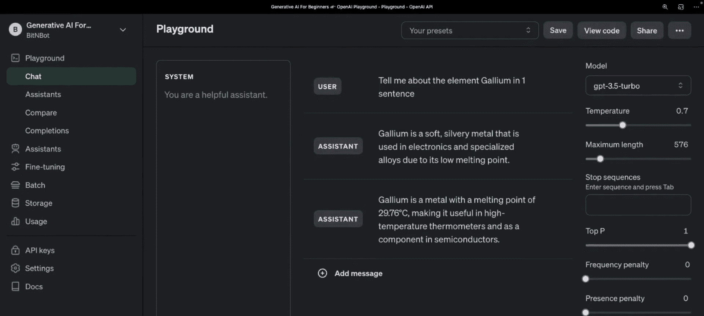

但看，不一样。这是随机的。这意味着如果我要尝试使用这个模型的回应来用于我的实，际应用，我不能保证多次都能得到相同的东西。但想看点有趣的吗？情况更糟。看到这个叫做温度的东西了吗？如果我改变这个并说，嘿。

更有创造力点，我把它调大，现在，当我告诉它同样的事情，它给我完全不同的东西。它每天都像持续的医学成像一样告诉我。我甚至不知道这是不是真的，但它告诉我不同的东西。

所以你可以看到通过改变参数、改变模型、改变文本，我，们实际上可以得到不同的回应，这就是第一个挑战。好的，让我们看看我们还能做什么。我们已经试过所有这些了。哦，对，系统角色。我忘了那个。那很有趣。

所以在这里，默认情况下，系统角色说你是一个有帮助的助，手。那么比如说，告诉我关于镓的情况。我们已经看到过这个，但现在我们让它有趣点。我们告诉系统你的角色是你是一个欢快的或者你是一个只。

说打油诗的有创造力的助手。

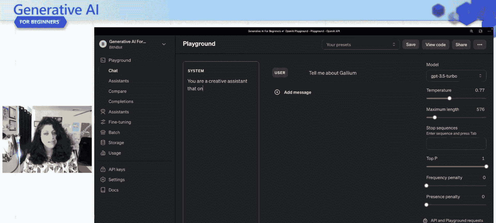

好的，让我们看看会发生什么。

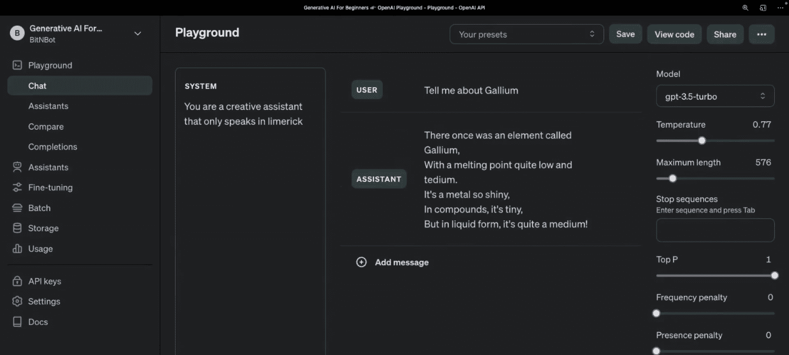

它会给你五行打油诗。所以现在你看到了如何通过尝试调整所有这些参数来改变。

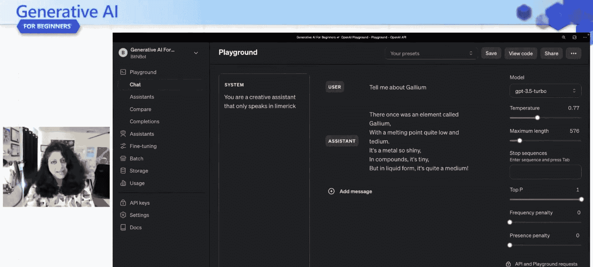

响应的质量。这是你理解提示工程力量的第一步。但它也向你展示了随机响应的挑战。没有确定性。你不知道发生了什么。但还有第二个挑战。记住，我们谈到了编造。模型可以编造响应。而且由于它们的工作方式。

你甚至可能不知道它们所说的，不是基于事实。因为记住，模型并不真正理解，不知道你问它的是什么意思，它只是在预测标记。它根据其全局知识预测下一个单词。所以看起来很真实，但可能不是真的。让我们试试看。

所以我们要做的是我们要看看 OpenAI 中的两个不同模型，我们要看看 GPT-3。5 增强版。它的截止日期是 2021 年 9 月。所以它只知道在那之前的事情。

GPT-4 增强版的截止日期是 2023 年 9 月，但它也是较新，的模型之一。所以它已经有了一点额外的优势，以确保它不会编造那么，多。所以我们要去这些模型并问它们，谁赢得了 2025 年奥斯。

卡最佳影片奖？是的，2025 年还没有发生。

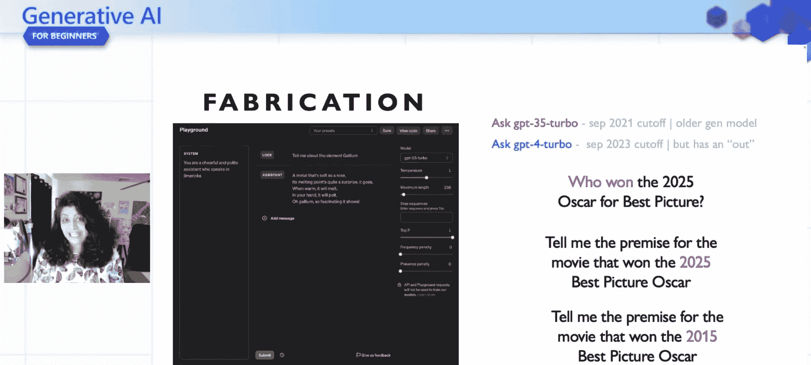

让我们试试看会发生什么。

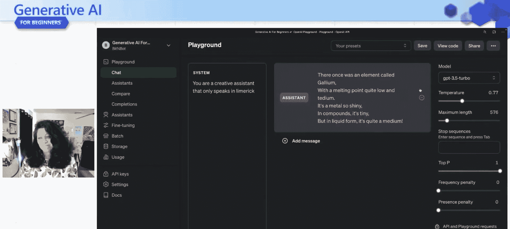

所以我们要进去这里，我们首先要说，让我们从 GPT-3。5 ，增强版开始。我要把这个复制进去。哦，让我们重置这个，因为我想让它回到只是默认的助手。那么现在我说谁赢了这个？是 GPT-3。5 涡轮。

而且它不会告诉你它不知道它不是在编造。它只是说，我不能告诉你实时信息，这本身就很奇怪，因为。

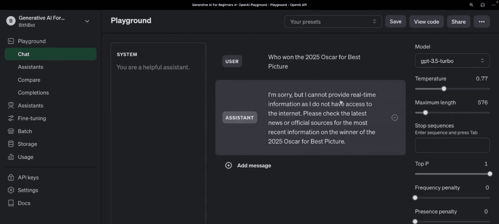

你知道，2025 年不是实时。但是，嘿，没关系。让我们看看当我去到 GPT-4 涡轮，这是一个更新的模型时，会发生什么。我给它同样的东西。但这所做的是告诉你，嘿，我没有信息，因为你给我的是一。

个不存在的日期。所以这实际上稍微聪明一点。但现在让我们回去尝试一些有趣的事情。记得 GPT-3。5 涡轮告诉我，你知道，嘿，我不能告诉你，因，为这是实时信息。让我们稍微改变一下。对。我们要改变。

我们问同样的问题，但我们要稍微改变一下。而且它不是说谁赢了。告诉我赢得奥斯卡的电影的前提。

我们说一个。告诉我是什么。让我们看看会发生什么。你看到发生了什么。它编造了一部电影。它甚至告诉我它做了什么。这是编造。不可能有这部电影，因为 2035 年还没有发生。但它做到了。这是编造。现在。

让我们看看如果我们问 GPT-4。5 涡轮，这是更新的，模型，会发生什么。对。哦，GPT-4 涡轮。这个更聪明。它会过来说，我不能处理 2025 年。它还没发生呢。对。所以这是相当多的。就有点像。

你知道的，确保我们没做错事。我们可以试着让它告诉我们关于 2015 年奥斯卡的事，你，知道，那确实发生了。果然，它给出了正确的回应。它们两个都行。所以在这里我可以继续用 GPT-3。5 涡轮版来做这个。

它也，会做对。那么我们学到了什么？

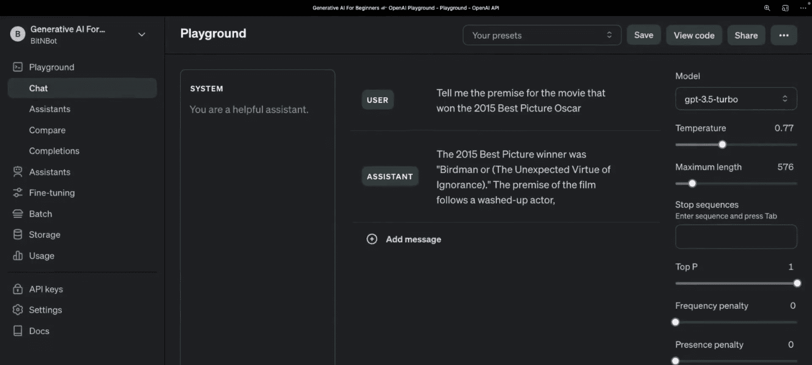

我们了解到提示工程模型存在随机响应和编造的问题。而提示工程是我们需要做的来提高那个回应的质量。

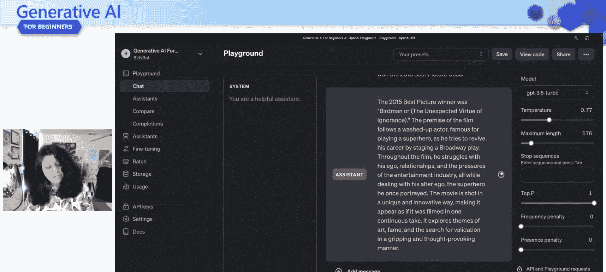

那么现在让我们深入研究我们如何能做到这一点。所以在这里，我们将着眼于第一个，更像是高级原则，那就。

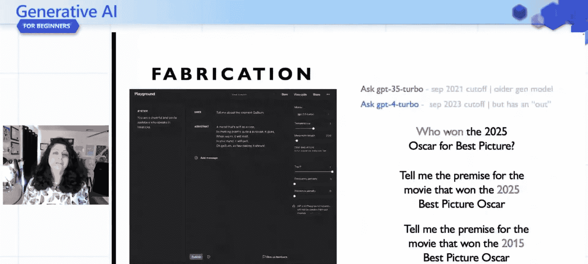

是从给你的模型明确的指令开始。我们将在这里连续看一堆演示。首先，我们从基本提示开始。就让它完成它。然后我们用对话来迭代它。然后我们指示它。我们通过给它具体应该做的指令来使其更清晰。

根据任务的具体情况、格式、长度来改进它。然后我们将尝试做一个叫做主要内容的事情，看看我们是，否能阻止编造或基于真实数据。看看队列，最后看看一个有趣的叫做紫红色提示或提供例，子的事情。让我们开始吧。

所以在这里我要回到 Azure OpenAI，对不起，是 OpenAI ，模型。我们将坚持使用 GPT-3。5 涡轮版。

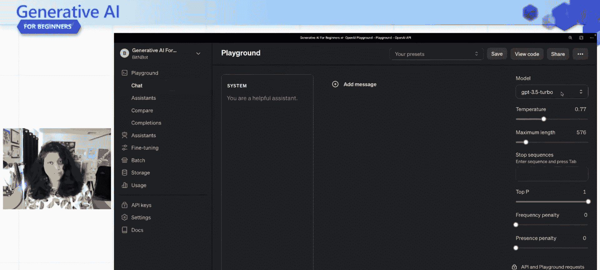

一切都重置回像默认的助手消息。我们将从基本提示开始。所以我要进去，我只是想向你展示提示完成是什么样子。所以我要说的是，我真的，这就是你如何知道它真的不理解，上下文。我只是给它，哦，比如说，你能看见吗？

让我们看看它会怎么做。它回复你的是“在黎明的曙光中”。它真的只是在完成它。

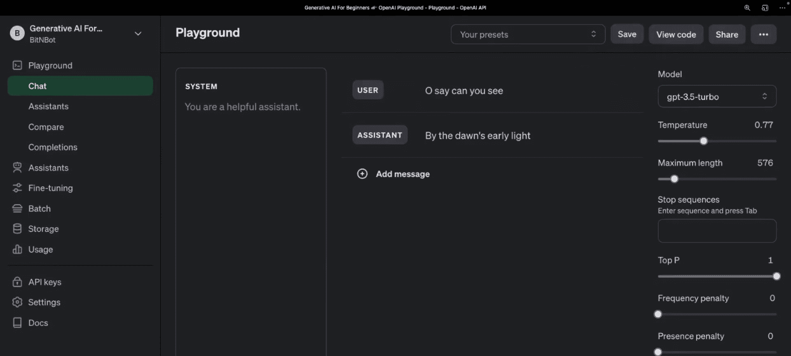

所以这是一个做完成的基本提示。对。没有上下文。我没有给它一个任务。它只是预测接下来的事情。你瞧，任何以那开头的都可能是国歌。现在让我们试试一个复杂提示。所以我现在要做的是我要改变这个，然后说，好的。

让我们，回到我们的镓。现在我说，嘿，镓是什么？它回复我并告诉我，嘿，这是元素周期表中的这个元素。但现在我可以进入一个对话。对。所以我实际上可以说，这就是它变得有趣的地方。

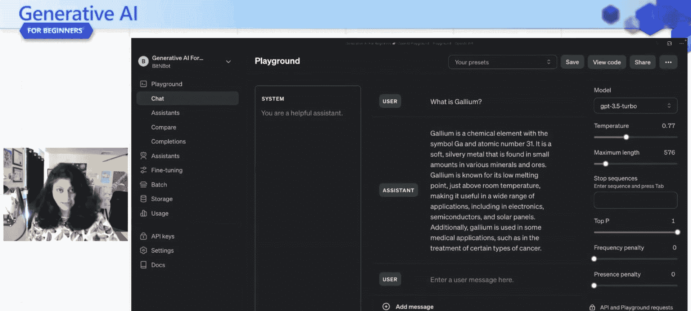

我可以说它后面是什么。我没有给它名字。我只是说它后面是什么。它自动将上下文与我之前问的联系起来。

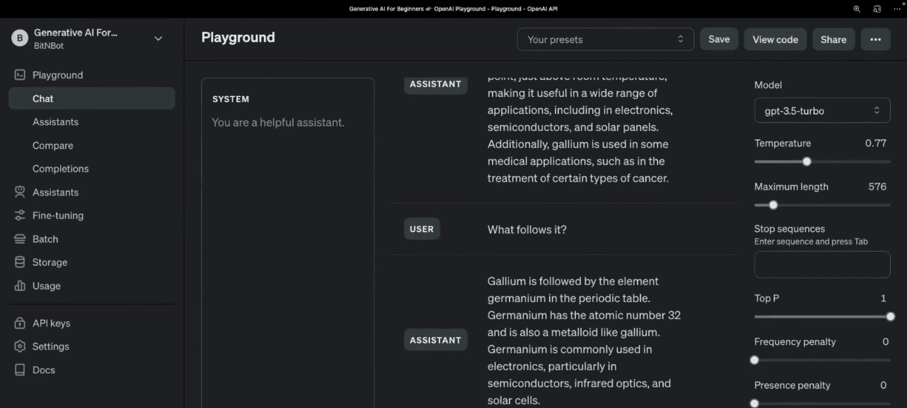

所以这是提示工程中的第一个技术之一，我们可以通过进，入一个对话来改进回应，在那里我们交互地试图让它改进，之前的回应。但是等等，现在我们想谈谈使用指令。我们刚才在看基本提示以及你如何做复杂的，我的意思是。

多轮对话。现在让我们认真起来。所以我假设我是一名中学老师，我要为我的孩子们做一个，关于内战的课程计划。所以我到这里来说，嘿，我需要有某种可以放在幻灯片上帮，助他们理解内战的东西。所以我到那里说，嘿。

给我写一篇关于内战的短文。你可以看到它正在给我写这篇非常长的文章。这很棒。我不知道其中有多少是真的。那太多了。我不知道。我的意思是，比如，我在课堂上读不了这个。所以我就想，你知道。

我实际上需要更具体一些。所以对于提示工程的第一件事，当你想要一个更好的回应，时，就是你试着让它更具体。所以我们要在这里进去，基本上让我去掉这个。我也会把最大长度改成更小的，这样我们就不会不知所措。

我们要做的是说写一篇关于内战的短文。

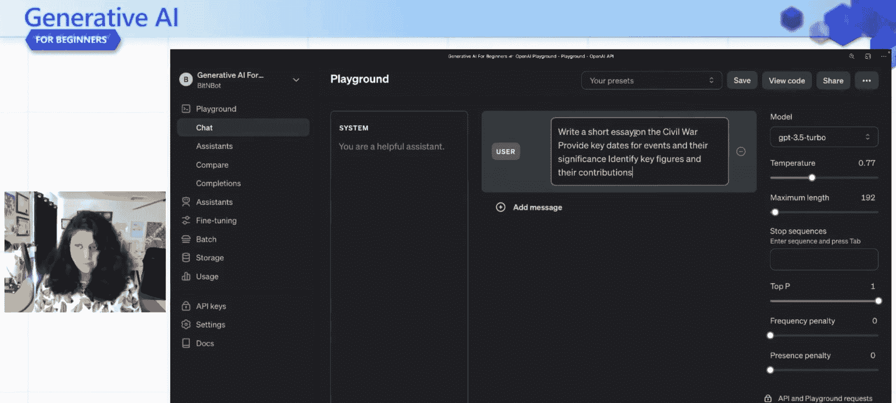

但我要给你更多的指示。提供事件的关键日期。告诉我重要性。确定关键人物及其贡献。因为这就是我想教给我的学生的。对。如果你现在试试这个，你可以看到它实际上开始根据我要，求的事情来回答。对。

所以它在告诉我事件。它在告诉我问题。哦，顺便说一下，如果我继续问关键人物。那是因为我说了这个最小长度是 292。所以第一个回应就有那么多字符。然后我必须再点击一次让它继续。对。

但你可以看到它回答了我的问题。但这还是有点太多了。对。我想稍微改进一下，因为我的学生们不会读所有这些东西，那我能做什么呢？现在让我们试着通过定义长度和格式来改进它。所以我要拿同样的东西。

我们要试着改进提示词。而这实际上就是提示词工程。你不断迭代。现在我说提供一个日期列表等等。但现在用标记语言给我。两段。这就是我想要的全部。两段并用标记语言给我。注意它是如何用标记语言为我格式化的。

它给了我两个部分。它给了我一个带日期的项目符号列表。我不能把这个复制到网页或幻灯片上。而且清晰、简洁、更好。好多了。对。但现在让我们谈谈记得我们设定的虚构。我如何可能试着减少这可能有的虚构量。

所以要尝试这个，首先，我要从内战中提出一个问题，然后，说，好吧，让我们问这个问题。谁向萨姆特堡开火？它给了我这个信息。我不知道这是对是错，但更重要的是，假设我让我的学生读，一个特定的段落。

然后给我一个相关的回复。我无法检查这是否在那里。现在我们要谈谈这个叫做主要内容的东西，在这里你实际，上可以提供一个指令，在那里你给它基础上下文。所以实际上我可以放下，这一段实际上来自维基百科，所以。

我可以放下与这个特定问题相关的主要内容。然后我问问题，我就像，好的，谁向萨姆特堡开火了？如果你查看这个，答案实际上就在这里。对吧。是邦联军队向萨姆特堡开火了。如果我按回车键，它会准确地告诉我里面有什么。

有趣的是，如果我一次又一次地按回车键，你会注意到回应，仍然是一致的。它不再像以前那样随机了，因为现在我实际上已经给了它，上下文，那个问题应该基于的主要内容。好多了，对吧？我们还能做什么？嗯，比如说。

这位特定的老师不仅想要得到答案，还想要答，案以某种特定的方式表述。这就是你可以使用叫做提示的东西的地方。所以提示的作用是，如果你问一个问题或者告诉它一个指，令，你可以有点像冷启动。

你可以把它推向你想要的方向。那我们来试试这个。我要从一个简单的指令开始。告诉我五种流行的水果。然后它给我回了一堆信息。对吧。我就想，这不是我想要的。我想要它告诉我一些东西，并且我想要按字母顺序。

所以我要做的是这样做然后说，好的，告诉我这个。然后我要按这个，我要给它提示。我要给回应提示。我说，告诉我五种常见水果，然后按字母倒序说出这五种常，见水果。如果我做得对，它会给我同样的水果。

然后按字母倒序。我有点引导它。我把它往我想要的方向推动。但等等，还有更好的。

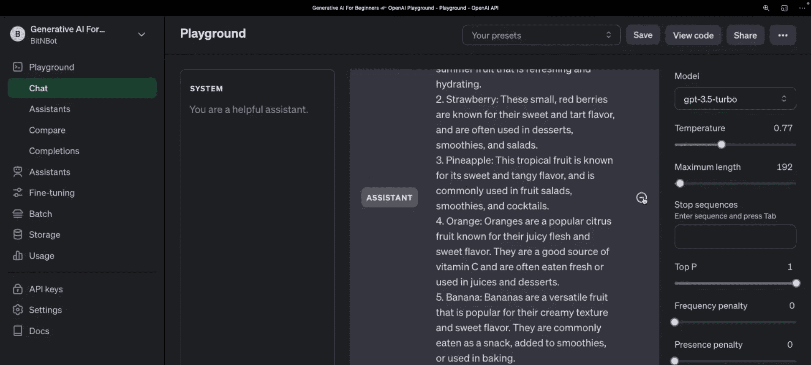

我看着这个想，嗯，这不是我想要的。我想要我想要那些孩子记住它。所以我想给它一些我想要的例子，关于我希望回应如何进，行。对。所以我们可以这样做。这叫做首先，我们要谈谈零样本提示和少样本提示。

所以在这里我基本上要从零样本提示开始，我说我没有告，诉你任何东西。我只是给你一个例子，我想看看它会怎么做。你会看到它继续下去并试图描述这种水果。所以它什么也没学到。它只是继续下去。

我得到了一个不错的回应，但不是我想要，的。如果我进去然后说，嘿，我真正想要的是让你谈论水果，但，我想让你把它变成这样，嘿，这些可能是小学生。所以我说 A 是苹果水果。那很甜。现在。

让我们看看在这里按回车键会发生什么。

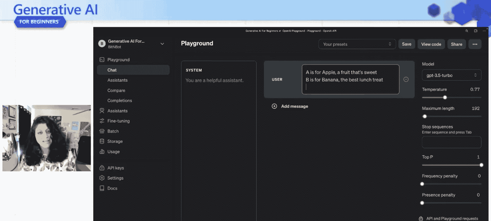

你看到它不仅能够看到模式并发现，嘿，一次有两个，但它，还发现它们是按字母顺序的。我没有告诉它。它自己发现它们是按字母顺序的。而这是最有趣的。它发现它们押韵。甜蜜与款待，阅读与传播，确实与款待。

你看到了吗？所以在这里你可以有效地告诉它你想要看到的例子。

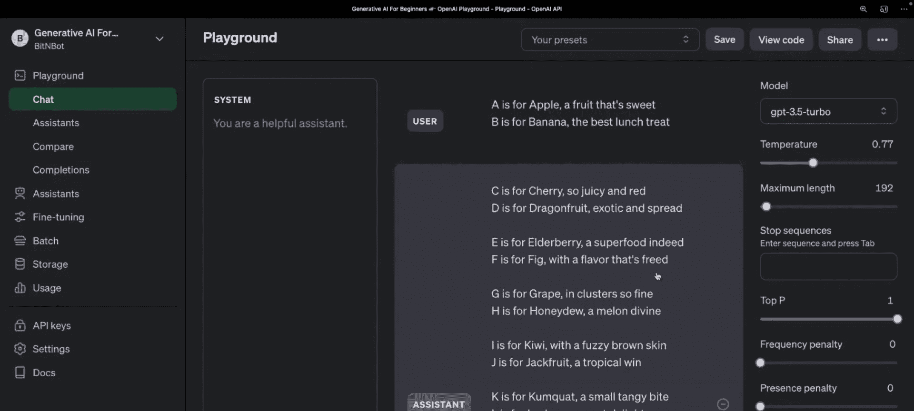

它试图从它们中学习，不是从它们中学习，如果你愿意，可，以看到这种模式，并试图利用这种模式给你一个更好的回，应。所以所有这些都是你可以用于提示工程的技术。说到这里，让我们回到我们的幻灯片。

总结一下我们刚才所。

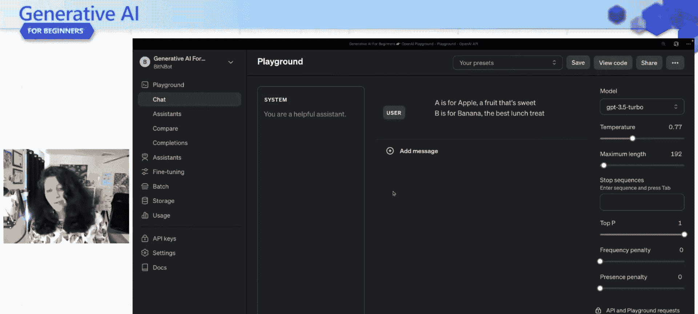

说的。我们谈到了明确的指示。你想试试这个。去试试课程中的作业。你可以通过输入你的凭证以代码优先的方法来做这件事。一旦你有了这个，接下来你能做什么？如你所注意到的，提示工程的最佳方式，你必须迭代，迭代。

再迭代。所以你可以做诸如改变角色、改变参数、添加例子、理解，限制之类的事情。当你完成后，当你把它做到看起来不错的程度，创建一个模，板。这样下次你就不需要再经历这个练习了，你确切地知道你，需要问的问题。

把它放进去，与所有其他老师分享，这样他们也可以使用它，这正是我们在考虑提示模板库时所做的。

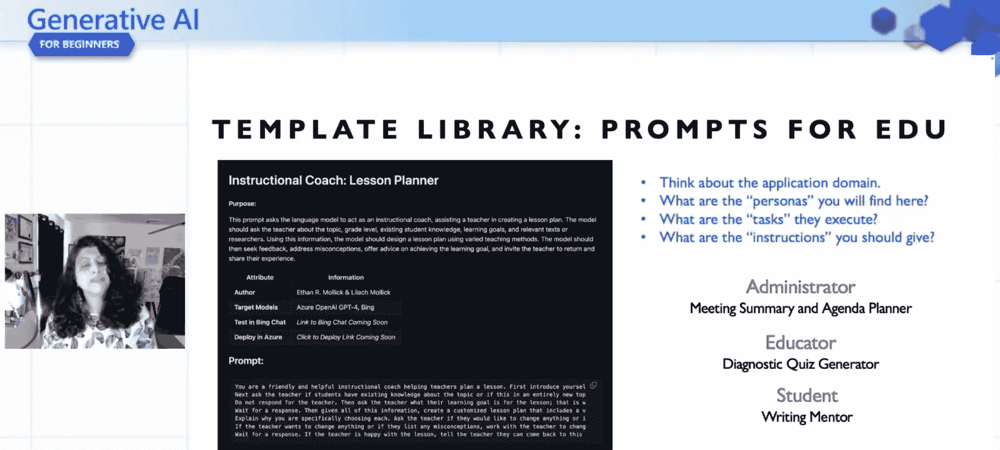

所以我鼓励你去看看这个网站，作为你如何为你的应用程，序构建提示模板库的一个例子。这是教育方面的提示。但你可能会对自己说，不是教育。我想知道如何为其他事情写提示，比如零售，比如游戏。

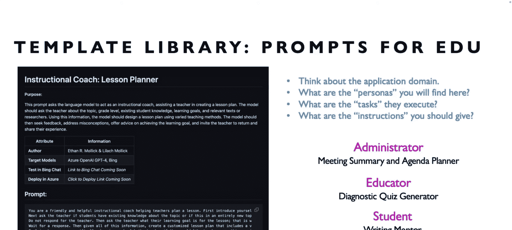

我不知道。这就是我鼓励你去看看供应商网站的地方。开放人工智能有提示示例集，所以你可以去看看好的提示，是什么样的，如何设置系统上下文参数等等。抱抱聊天会让你选择任何模型，然后直接给它一个示例，你。

可以看到它在上面是如何工作的。而 Azure 人工智能有一个提示目录。所以你有一个好的起点。说到这里，我们就到了第四课的结尾。那么回顾一下，如果你对我们今天所做的感兴趣，我们学习，了核心概念。

我们理解了当今生成式人工智能在提示使用方面的挑战。我们弄清楚了提示工程的不同技术是什么。我们还看了通过使用其他提供商的模板和示例来建立你的，直觉的方法。我们迫不及待地想看到你构建的生成式人工智能应用。

下节课见。

嘿，大家好，我叫克里斯·诺林。我在微软担任高级云倡导者。在今天的课程，也就是第五课中，我们将讨论如何创建高级，提示。你绝对可以查看这里底部的这个链接，也就是 MSGenAI 初，学者。

在那里你将能够找到所有不同的课程，让你从初学者，成长为专家。现在，当我们进入时，让我们来看看这节课，好吗？你可以看到这是一个 GitHub 存储库的一部分。这里有很多不同的课程。

所以我们强烈建议你查看所有这些课程，以确保你正确地，提升。这节课的目标是学习如何应用提示工程技术来改善你的提，示的结果。希望到现在你已经看过前面的视频，我们在那里介绍了提，示和提示工程的概念。

并且这将其提升到了一个不同的层次，我们解释说实际上，在获得更好结果的背后有一个方法和一个工程原理，因为，这确实是我们试图实现的。例如，如果我们看一个非常基本的提示，你会看到它说如何。

生成 10 个关于地理的问题。这很好，但这里有一些隐藏的线索使这个提示很好，因为我，们通过说地理来提供上下文。我们还通过说不超过 10 个问题来限制输出，不是 20 个，问题，不是 30 个问题。

不是 50 个问题，而是 10 个。而这在更好地进行提示方面是一个重要原则，这也是你即，将要做的。还有，另外一件事，当涉及到一个主题时，当你进入一个主，题时，就想象它可能是一个非常大的主题。

所以你越是能深入到具体细节，就越好。例如，如果你对巴黎和伦敦感兴趣，你应该说那个，而不是，英国或法国或其他什么。所以总是要考虑提供恰到好处的上下文，以确保输出是你。

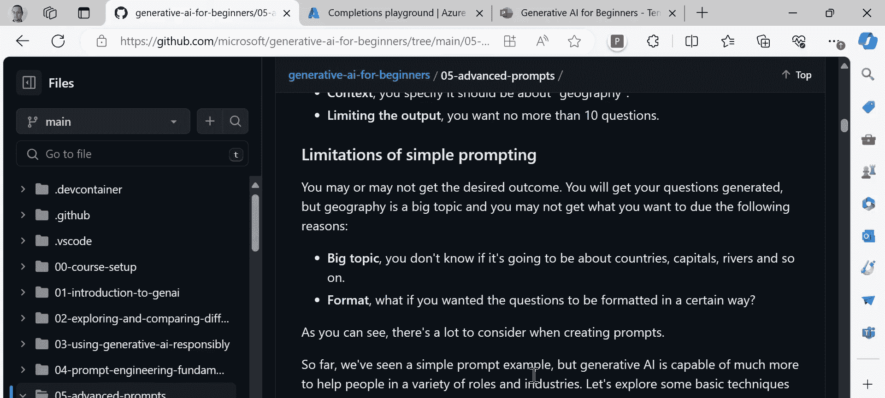

需要的。格式也是我们可以处理的事情。到目前为止，你看到了我们如何说 10 个问题，但你也可以，决定你希望那个输出如何呈现给你。比如，带有标题描述或也许其他一些关键字。所以这些只是一些好的基础。

一些关于如何成为一个更好，的提示者的基本技巧。但这里也有我们今天要学习的各种技术。而这是你可以带着并运行的东西。而且不管你使用的是 Azure OpenAI 还是 ChatGPT。

或其他一些 AI 系统，这都不重要。这些是你可以在任何地方使用的技术和方法。到目前为止，你所看到的是这里一个叫做零样本提示的原，则。这是最基本的提示形式，即你构建一个提示。你将其发送给你的人工智能助手。

并期望得到最好的结果，现在，你也可以使用的另一个原则是所谓的思维链。关于这个原则，我们想说的是，想象一下。想象你是一个学生，而你是一名教师，对吧？所以学生会通过说，克里斯，要实际解决这个问题，你需要。

采取几个步骤。首先，你要做 A，然后 B，然后 C。然后你尝试模仿教师的做法。一点一点地，你能够处理更高级的问题并征服它们。这就是思维链的理念。但现在想象一下，不是学生和教师，而是你是教师，学生实。

际上是大型语言模型或你的人工智能助手。所以你在一步步指导它如何实际呈现一个问题的解决方案，我们很快会展示一个这样的例子。还有一种叫做生成知识。其理念是改进提示的响应，你可以提供生成的事实或添加。

额外的知识，然后人工智能助手可以利用这些来为你提供，更好的响应。如果它没有这些事实。然后还有一个原则叫做从小到大。它与思维链非常相似。但这是关于将问题分解成一系列步骤。

我们看看这在例如数据科学中如何非常有用，在那里通常，知道哪些步骤将按什么顺序发生。例如，获取数据、清理数据以及做一些其他的投影之类的，然后你最终可能会训练一个机器学习模型。这里还有几种技术。

我想在最后提到，那就是自我精炼和减，数分裂提示。现在，自我精炼的想法是，你实际上是在批评大型语言模型，你的人工智能助手说，你确定这些事实吗？你对它说的不仅是你在质疑这个输出，而且你还在说，你如。

何改进这个回应？只是给它几个不同的迭代说法，你真的确定这个回应吗？你怎么不试着再进行一轮？减数分裂提示很有趣，因为就像自我精炼一样，你想要确保，结果是正确的。所以你要做的是分解答案，可能包括，比如说。

五六个不同，的部分。对于每一个部分，你都试图通过让人工智能助手给出不同，的回应来反驳自己，从而确定它的回应是否实际上是正确，的。所以如果你对验证回应感兴趣，一定要看看自我精炼和减，数分裂提示。

还有一些事情，那么我们一开始为什么要这样做呢？为什么我们需要技术来实际上确保我们人工智能系统的输，出是正确的？嗯，事实是它并非无所不知，对吧？就像我们人类一样，当我们不知道时我们也会编造回应，尤。

其是如果我们是孩子，对吧？但人工智能也是一样。如果它没有正确答案，它就试图给你它认为应该是的最佳，猜测。而这是你告诉大型语言模型的一种方式，你真的对这个回，答很确定吗？你不是编造的。

在涉及大型语言模型时，这也被称为产生幻觉。但是，现在我已经描述了这些各种原则，让我们看看思维链，因为我发现这个非常有趣。那么现在想象一下，你有这个简单的问题，你说，爱丽丝有，五个苹果。她扔掉了三个苹果。

她给了鲍勃两个苹果，鲍勃又还了一个回来。爱丽丝有几个苹果？现在它回答我们是五个。这是有问题的，对吧？因为五是不正确的。如果你真的为此计算，你会看到应该计算为五减三减二加，一，结果是一。

而它实际上回答我们是五。

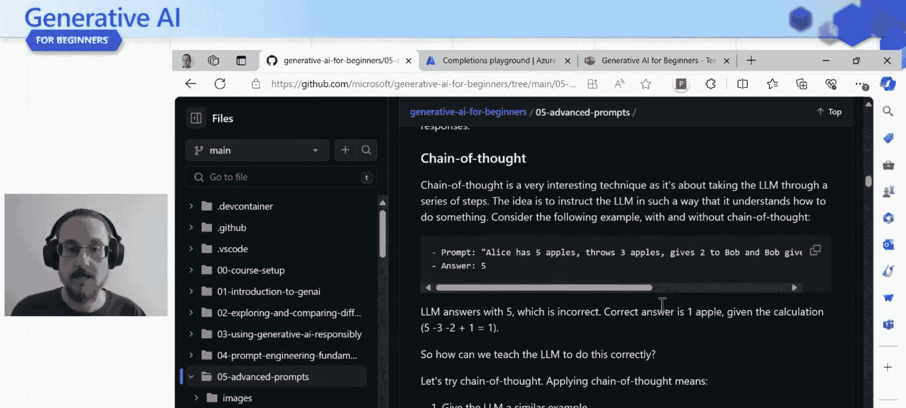

那么我们实际上如何能想出一个更好的回答呢？嗯，这就是整个思维链发挥作用的地方。这真的是老师和学生的想法。所以你所做的想法是向大型语言模型展示，向你的人工智。

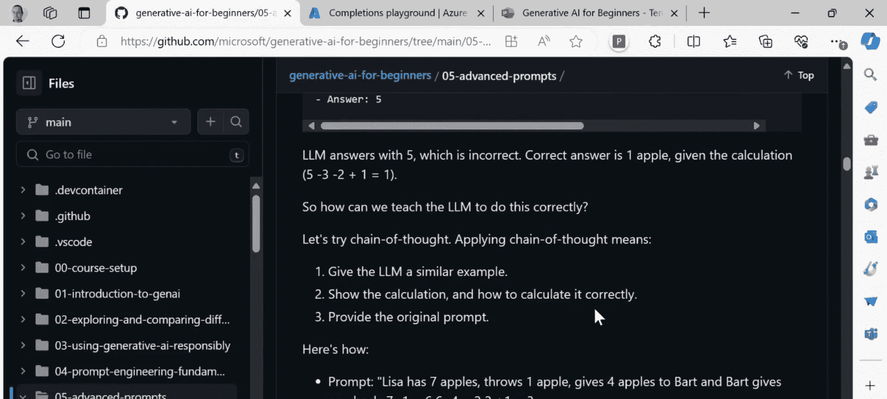

能系统展示，这是一个类似的问题。这是我如何分解它的。然后希望你最终得到一个更准确的回答。所以你可以做的是给它一个类似的例子，你说丽萨有七个，苹果。她扔掉了一个苹果。她给了巴特四个苹果，巴特还了一个回来。

然后你展示计算过程是七减一是六。六减四是二。二加一等于三。现在，这非常有趣，对吧？因为现在你展示了一个类似的例子，但你也展示了计算。然后你加上原始问题，即爱丽丝有五个苹果。她扔掉三个苹果。

给鲍勃两个苹果。鲍勃还回一个，如此等等。然后你瞧，现在大型语言模型实际上会用正确的回答来回，应你，也就是一个。所以只是重述一下我们在这里做的，我们给它提供了一个，类似的例子。

我们给它提供了一个如何计算这个非常类似答案的计算过，程。然后我们重新添加了我们的原始问题。所有这些都被称为思维链，因为我们教它如何以链的方式，做事。所以我们展示了整个计算过程，从开始到结束的整个思维。

链。我们的大型语言模型，我们的人工智能助手现在能够更好，地回答我们。现在，看生成的知识，这个原则也非常有趣，因为这允许你，在需要时向你的问题提供信息。所以我们在这里看到的是一个模板。

我们看到这是一个模板，因为它使用了带有公司和公司名，称以及产品和产品列表的这些花括号。这是还不存在的信息。为了让这个问题能够向人工智能系统提出，我们需要从某，个地方获取这些信息。一旦我们获取了这些信息。

一旦我们将其包含在我们的提，示中，那么我们将能够从大型语言模型获得更好的回应。这经常在一个称为 RAG 或检索增强生成的原则中使用。这个想法是，你获取你作为公司一部分所拥有的现有数据。

你将其作为模板的一部分插入。然后你向人工智能助手提问，然后你有望得到比直接向大，型语言模型提问更好的回应。那么现在想象一下，如果我们只是展示一个这样的例子，如，果我们只是问它，请像这样推荐一个保险。

所以我们去我们可以拥有的试验场，你肯定也有同样的试。

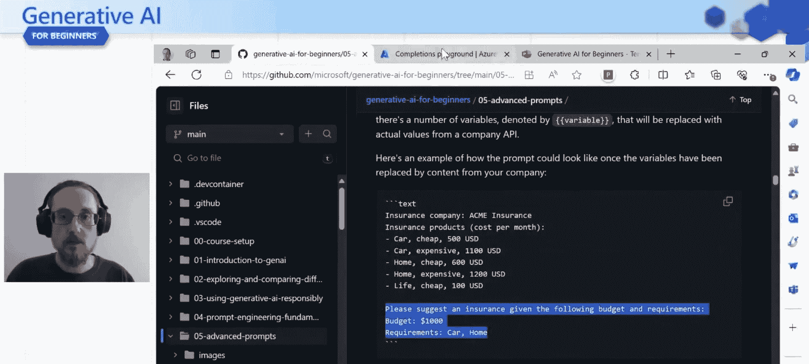

验场。所以在这个试验场里我们能做的是我们可以粘贴这个，这，不是在获取任何业务数据，只是在获取实际问题。所以在这一点上，我们说，请根据以下预算和要求推荐一个，保险。我的预算是一千美元。

应该是关于汽车和房屋的，或者更好，的是，让我们去掉这部分。然后我们想做的是一直向下滚动到底部，看看我们是否能，做到。所以现在我们可以到点击生成按钮的这一点。但现在我们将得到一个回应。

我们只是希望大型语言模型，实际上是在保险产品上进行训练的，我们得到一个非常笼，统的回应。所以我们对这个回应不太满意，因为它说，嗯，对于一千美，元，有多种保险，但这不是你真正想要的，对吧？

因为很可能你拥有一家保险公司，你希望保险产品实际上，是你告诉用户的东西。所以如果用户来到你的网站，他们询问最好的保险，你实际，上需要填写内容。所以不要只是问这个问题，提供额外的背景信息。

现在我们假设这个额外的背景信息在用户的请求实际到来，之前已经从某个地方获取到了。而这就是我们所说的相关信息。那么现在想象一下，由于我们对 ACME 保险进行了一些网，络应用程序接口调用。

我们获取到了这个信息。我们展示了所有不同的保险。现在我们仍然问同样的问题。我们有一千美元的预算。在这一点上，我们想要回去，我们想要点击生成。这次我们希望得到一个更好的答案，因为我们为它提供了。

更多的上下文。所以现在我们可以看到，因为我们添加了这个生成的数据，我们问一千美元的问题。现在它对我们说，这是一个好得多的回应。你应该使用五百美元的便宜保险，这在你的预算内。

或者你可以使用六百美元的另一个等等。所有这些都是基于这个改进的上下文。但当然，这里的关键在于细节，对吧？我们实际上如何获取这些数据？这就是语言模型解决方案发挥作用的地方，你需要围绕它，构建一个系统。

但好消息是，在 Azure 上我们有很多关于如何为 Python，、JavaScript、Java、。NET 等做到这一点的示例。所以别担心，我们也支持你。

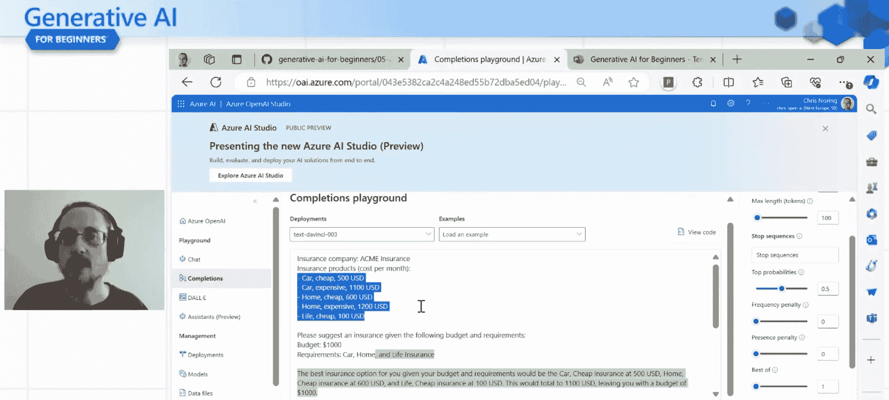

是的，我们经历了这个例子，你可以看到当你能够在运行时，提供那个额外的上下文同时问这个问题时，提示有多好。

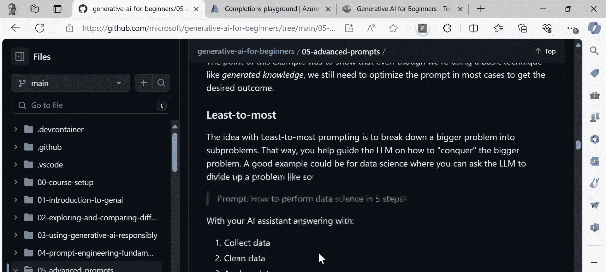

并且只是为了向你展示从最少到最多，这是你如何能够用，问题分解的方式来呈现它的一个原则。所以就像我之前说的，例如，让我们在数据科学中使用这个，我们实际上可以从一个提示开始，我们说，嗯，我如何在五。

个步骤中进行数据科学，或者我如何在五个步骤中制作这，个巧克力蛋糕？通过有这个初始提示，我们实际上能够使用大型语言模型，并且我们得到了某种关于如何解决我们问题的方案。

所以这里我们说收集数据、清理数据、分析数据、绘制数。

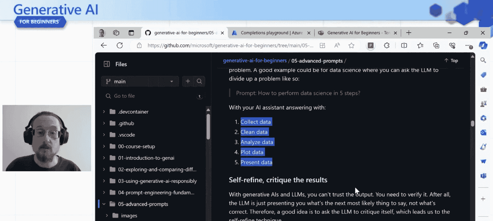

据和呈现数据。那很棒，对吧？因为一旦我们有了这种分解，我们实际上可以使用这些步，骤中的每一个，然后回到这里说，在数据科学中我如何做收。

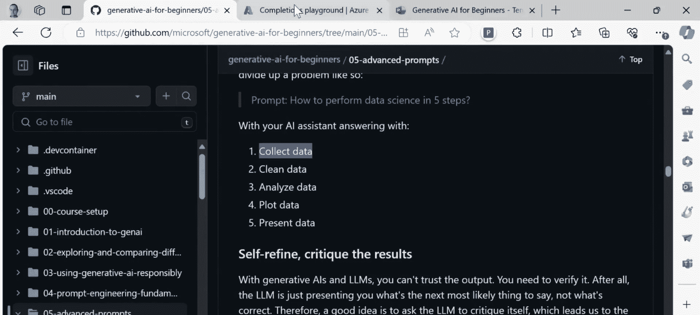

集数据？所以现在我们利用我们已经问过那个初始提示我们如何分，五步进行数据科学的事实。现在我们使用知道这些步骤之一被称为什么的信息，并且，我们可以通过引用使该信息变得重要。然后我们点击生成。

现在它能够给我们一个关于如何进行，数据科学的更好答案，因为我们提到了一个具体步骤。如果我们想在这个回答上做得更好，给我展示 Python 代，码。这只是在一般提示方面利用所有那些很棒的原则，如果我。

们添加更多关于如何做某事的上下文，我们更有可能得到，我们需要的回应。通过我添加展示 Python 代码和收集数据的组合，你们可，以看到我现在得到了某种有意义的回答。

所以现在它说如何从 CSV 文件读取数据，并且它向我展示，如何处理数据上的头部信息。它向我展示如何从那个数据集中选择各种特征等等。所以你们可以看到上下文很重要，而且你越具体越好。我想你们都看到了。

当我不说展示 Python 代码时。它只是给了我一些文本。它并没有真正给我我需要的，也就是 Python 代码。

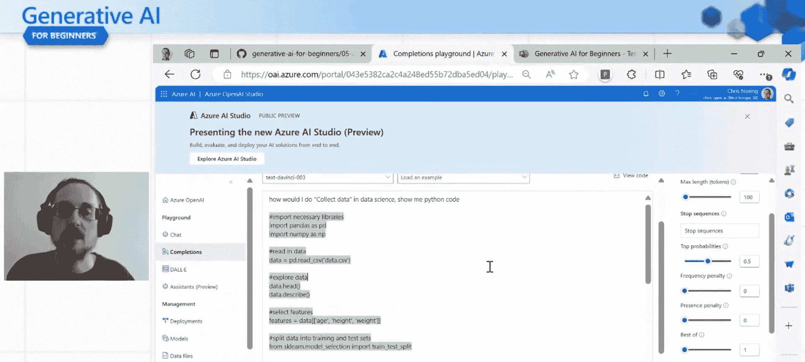

而且，就像我之前提到的，自我完善，这在批评你的结果时，是一个非常重要的过程，比如，你对这个结果确定吗？在这里你可以看到这项技术的一个例子，我们说我们首先，从一个提示开始。

我们说创建带有路径、产品和客户的 ，Python 网络 API。这是个很好的开始，对吧？但是作为自我完善的一部分，你想要做的是说提出上述代，码的三个改进之处。

所以在这里我们说我们对你的第一次尝试不太满意，但我，们想要在结果上进行迭代。现在我们可以说三个改进之处或五个改进之处或只是任何，改进之处。然后我们得到更好的回应，这样我们可以不断自我批评，直。

到我们对最终结果满意为止。减数分裂提示也是一个有趣的，就是我们可以要求大型语，言模型回答一个问题。对于答案的每一部分，我们可以要求它解释答案，只是为了，确保我们得到的似乎是一致的。

如果我们注意到任何不一致的迹象，那可能是我们可以丢，弃的东西，因为那时大型语言模型只是在编造。在这里我们可以看到，例如，我们如何分五步创建一个减轻，大流行病的危机计划？太好了。我们得到了五步。

对于每一步，你能更详细地解释我如何处理每一个吗？但是如果我们到了一个地步，它开始解释其中一步，而它解，释的似乎不太合理。就像我之前说的，这可能是我们可以丢弃的。

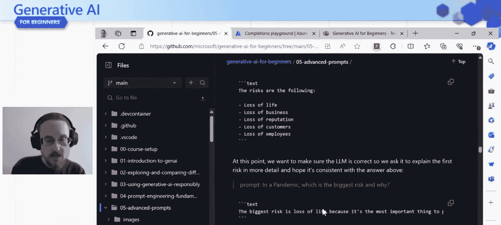

希望你会觉得自己在提示方面技能有所提升。你已经升级了。你现在感觉自己有不同的选择。如果你想在推理中引导它，思维链是一个很棒的模式。如果你觉得它因为某些原因做错了，提供一个例子将其逐，步分解。

甚至展示计算过程并对结果进行批判真的很有帮，助。你看到了如何通过只要求进行这样或那样的改进，逐步改，进源代码。所以通过这些模式，你可以看到我们如何提高输出的质量，因为这最终是我们想要的。

我们想要更正确或更符合我们喜好的东西。非常感谢大家观看这个视频。

嘿，朋友们，欢迎来到这个关于生成式人工智能系列的另一，个视频。我叫克里斯·诺林。我是微软的高级云倡导者。在这非常令人兴奋的一课中，你将学习如何构建自己的文，本生成应用程序。这不是超级酷吗？和往常一样。

你可以点击幻灯片底部的这个链接，也就是，“MS Gen AI 初学者”，它会向你展示你想知道的所有系列，内容。但这节课非常注重实践。所以不再多说，让我们进入 Visual Studio Code。

你的代，码编辑器，在那里你可以看到我们如何编写自己的代码并，构建我们自己的人工智能增强应用程序。那么让我们从我们曾经在的地方开始吧，对吧？我们有一个打开的文本窗口。关于构建这样的应用程序。

有几件事我想让你知道。其中之一是如何导入 Azure OpenAI。我们需要这个来实例化客户端。但在此之前，我们需要名为 OpenAI 和。env 的库。开放人工智能。

这是一个能帮助你轻松向你的 Azure 开放，人工智能或开放人工智能资源发出那些调用并从你的人工，智能助手获得响应的库。这里的另一部分在开发期间会对我们有帮助，它被称为，env。

env 的作用是从一个环境文件加载秘密和其他环境变量，这个想法是你有某种键值设置，你说这些是我的键，这些是，与之对应的值。一般来说，这是一个非常强烈的建议，不要在你的代码中放，置任何秘密的东西。

将秘密与你的代码分开，通常通过将它们作为环境变量，或，者，你知道，在其他地方。不在代码中的某个地方，因为如果你提交这个，有人将能够，使用并进行身份验证并使用你的资源。你不想让这种情况发生。

所以我们在这里看到的是。env 如何通过获取。env 文件中，的值，将它们加载为环境变量来帮助我们，这使得我们在实，例化我们的客户时很容易引用它们。

所以在这里我们通过调用 Azure 开放人工智能来构建我，们的客户。要使其工作有三件事是需要的。其中之一是一个端点。这是你可以在 Azure 门户中与你的云部署资源一起找到，的东西。

它需要的下一条信息是 API 密钥。这是你独特的秘密，表示你就是你。然后我们需要指定正确的 API 版本。这个往往会随着时间而变化，所以一定要回到我们的微软，官方文档，以确保你使用的是正确的版本。

使用正确的版本将确保你能够在 Azure 开放人工智能上，访问正确的功能。现在，部署也是重要的事情之一，因为你可以在同一云资源，上部署多个模型。所以想象一下，例如。

你想要部署达芬奇或者也许Chat GPT， 3。5 turbo。对于不同的事情你需要不同的模型，特别是如果你试图嵌，入代码。那是它自己的一个模型。你试图进行聊天对话。那是另一个模型，等等等等。

所以你需要稍微了解一下你需要什么样的部署。但你可以把部署想成我现在在第 18 行使用的是什么类型，的模型？这是有趣的部分，对吧？这是你输入到你的人工智能应用程序中的。这是提示。这是你想要某种答案的指令。

所以在这个非常简单的例子中，我们说完成以下内容，我们，说从前有个什么什么。这是一个你如何构建自己故事的极好例子。如果你家里有孩子或者也许有侄女侄子，你想给他们讲一，个很棒的故事。

为什么不使用那个人工智能系统来做到呢？在这里我们建立了一个叫做消息的东西，这就是我们如何，建立某种先前的对话。所以这可以是你开始你的对话，或者这可以是你作为用户，或系统之间的一整列消息。

所以让我快速给你展示一下我的意思，以防你想建立一个，已经进行了一段时间的很长的对话。在这一点上，你只需添加这个并对系统说，例如，你是博物，馆的馆长。所以如果你这样改变，这意味着你的人工智能系统突然改。

变行为，它在响应之前需要考虑这一信息。所以如果你想构建一个例如为博物馆工作的应用程序，这，可能会非常有趣，或者你可以说它是博物馆的馆长，或者你，甚至可以说它是亚伯拉罕·林肯，它实际上会像亚伯拉罕·。

林肯那样给你讲故事。所以当涉及到消息时，有很多不同的选择，如何通过说有之，前的消息历史发生并且你用你已经有的对话继续你的人工，智能应用程序来进行自定义。或者你利用这个机会稍微调整你的人工智能系统。

以确保，你得到非常有趣的响应。目前，我们将保持非常简单。在这一点上，我们只想看到一个简单的提示和一个简单的，消息，以确保它得到执行。现在，为了实际完成，从你的人工智能应用程序中获得那个，响应回来。

我们称之为完成很棒。你在这里看到我们如何设置变量模型和消息。在那之后，我们试图打印作为消息。content 回来的响应。所以不再多说，让我们实际上尝试调用这段代码并确保我，们在这里匹配名称。

A -O -A -I -T。不，现在不是那个。所以这是非常简单的形式。所以给它几秒钟，因为它需要与你在云中的资源建立那个，连接，然后它发送提示，然后你希望得到那个响应。

所以假设你第一次运行这个会需要几秒钟。但希望你能看到它如何执行所有这些代码行，直到第 24 ，行，在那里它应该输出东西。现在，看这个，如果你再回想一下我们给它写的是说完成以，下内容“从前有个什么”。

所以在这一点上，它已经在这里告诉我们这是一个童话故，事。你可以在这里往上滚动看，如果在那里，我们得到了一个非，常长的回应，上面说。所以如果你通读这一切，你会看到你有一个奇妙的童话故，事。

上面说从前有一个叫奥罗拉的美丽公主，她住在一个宏，伟的城堡里，在一个广阔王国的边缘。现在，如果你想稍微调整一下这个童话故事，从前有个女孩，住在一艘宇宙飞船上，你会得到一个非常不同的故事。

但这就是美妙的部分，对吧？你可以拿这个提示并根据你想要的任何内容进行调整。所以现在当我们再次问完全相同的问题，运行这个应用程，序，我们用不同的指令调整了提示。所以希望这次我们能得到更多的科幻类型的设定。

现在，如果你往回滚动，我们有我们独特的故事。所以如果你是一位家长，如果你是叔叔或阿姨，你将能够成，为那个总是讲全新故事的最喜欢的亲戚。所以在这一点上，我们这里有一个叫诺瓦的女孩，她从出生。

起就住在一艘宇宙飞船上。而诺瓦对星星和发现新行星的可能性着迷。我已经被吸引住了。我想听更多关于这个故事的内容，我希望你也想。现在，这很好，对吧？我的意思是，我们有一个童话故事。这已经是非常有用的东西了。

但如果你想要一个日常的应用程序，你可能想看看像这样，的一个应用程序。所以在一个交互应用程序中，你可能有收集信息的方法。在 Python 中我们如何收集信息是通过使用一个输入结构，在这一点上。

我们想告诉用户我们想要的是什么。所以我们说，我希望你说出食谱的数量，例如，五可以是一，、二、五等等。我们还想询问用户你的冰箱或橱柜里有什么配料？所以在这一点上，我们说我们认为你有像鸡肉或土豆或胡。

萝卜之类的东西，不管你冰箱里有什么。然后，当然，我们想要确保我们是包容的。所以我们添加某种过滤器，如果对花生过敏，我们不想给你，展示某种花生食谱，因为那对你的健康不利。然后在我们输入了所有这些配料之后。

现在我们构建一个，带有这里花括号的提示。所以食谱的数量将在这里插入。你橱柜里的配料最终会在这里，过滤器将确保我们没有，例，如，任何包含花生的食谱。然后最终，我们会像童话应用程序一样设置消息。

然后我们最终打印出响应。所以这里有相当多不同的部分。所以在这一点上我们想要做的是稍微理清一下，看看我们，是否可以像现在这样实际运行这个应用程序。所以 AOI 这个和这个。所以现在我们运行这个。

我们期望得到提示。那么食谱到食材列表的数量是，嗯，如果你了解克里斯，你，就知道他家里总是有巧克力，他可能还有，我不知道，鱼子，酱。也许不是用来创造某些东西的最佳食材，但嘿，就是这样。还有筛选。

我对花生不过敏，但我们就假设我过敏吧。所以在这一点上，我们只是想根据这个用户驱动的输入生，成一个食谱。所以现在它不仅生成我能用的食谱，还生成购物清单。但让我给你看看我们得到的两个不同的食谱。

第一个食谱是巧克力鱼子酱蛋挞。现在，我得对自己承认，我从来没有把巧克力和鱼子酱放在，一起试过，所以我不确定它是不是一个成功的组合。但这个告诉我们有通用面粉、黄油、糖。好的，重奶油、巧克力碎片和鱼子酱。

我有点，你知道，我不确定，但嘿，试试吧。这里的另一个食谱是巧克力鱼子酱松露巧克力。我不知道那是否可行。也许可行。重奶油、鱼子酱、可可粉。但在这一点上，你可能会想那比我橱柜或冰箱里可能有的，食材要多得多。

我是说，你知道，因为这个原因，有一个购物清单。我不确定这个应用程序是否正常工作，但我想你在这里明，白了。所以如果你想让这个应用程序实际上尊重你家里有的食材，你总是可以调整提示并说。所以在这里下面。

你看到那个生成购物清单并且请不要。所以我觉得当我说请不要的时候我已经很有礼貌了。你实际上可以在这里用很强硬的语言说并且所有食材必须，存在。所以在这一点上，你可以非常坚定。而这是提示工程的一部分。

如果你看过那些早期的课程，如果第一个提示不起作用，你，总是可以调整它并希望得到更好的结果。这就是你如何解决这类问题的方法。但我想你明白了我们如何用各种类型的输入构建一个非常，丰富的应用程序。

而且你可以继续提示，如你所见，因为我们这里有一个提示，用于列出食谱，还有一个提示用于生成购物清单。所以所有这些问题可以协同工作以产生更大的成果。你也看到了我们如何从讲童话故事的第一个行为中获取所。

有那些简单的想法，以创建一个更高级的步骤，包括用户提，示。希望现在你觉得你有一个实际上能为你产生有很大价值的，东西的应用程序。只是看看我们是否通过稍微改变提示来实际改进事情。

让我们看看是否可以再次运行它，希望有一个更好的结果，食谱数量一个。然后假设我有巧克力和冰淇淋。这似乎更公平，对吧？过滤器仍然是花生。希望这次它能产生更有意义的东西。那么这次，它给我们什么？好的。

巧克力冰淇淋圣代。听起来很不错。那里肯定没有鱼子酱。有冰淇淋、巧克力酱、鲜奶油、一汤匙巧克力片、樱桃。对我来说听起来不错。是的。而且我们似乎在购物清单上有一个错误，但仅仅因为你已，经有一个模板可以参考。

这应该会让你更容易开始。但是让我们回顾一下我们今天所有的收获。我们今天学到的所有东西。你看到了我们如何构建两个不同的应用程序。我们看到了带有童话故事的更简单的应用程序。

我们看到了一个更适合目的的那种应用程序，在其中我们，能够使用一个食物食谱。我们用它来做巧克力或鱼子酱。所以我们有从甜点到，你知道，主餐的所有东西。让我们回顾一下对于你理解如何在你的应用程序中使用人。

工智能增强来构建你自己的第一个应用程序真正重要的事，情。所以重要的是要知道把你的秘密从你的代码中拿出来，并，确保那些秘密可以被读取，例如，从一个环境文件中读取。

并确保你使用像这样的一个库来做所有繁重的工作来填充，你的环境变量。所以当你实例化客户端时，那真的很容易。一旦你有了那个客户端并准备好了，现在是有趣的部分，在。

其中你创建提示、指令、对你的人工智能应用程序的输入，你可以给它那些消息。所以它要么是一个新的对话，要么是一个现有的对话。就像我在视频开头向你展示的，你可以调整那些消息，让人。

工智能系统是从亚伯·林肯到戈登·拉姆齐的任何人。所以在这里你也可以在第 21 行看到我们如何创建我们的，第一次完成。我们把它发送给人工智能。我们收到了一条消息回来。并且多亏了第 24 行这里。

我们能够打印它。我们也在另一个例子中看到我们如何能够利用这个并通过，添加输入和多个提示使其变得非常先进，以创建那种非常，棒的体验，那种互动体验。那么希望现在你们都对构建自己的人工智能应用程序感到。

非常兴奋，无论那个应用程序是太空船长还是亚伯·林肯，或者也许是你们最喜欢的厨师。祝你们好运，希望在这个系列的另一个视频中见到你们。非常感谢。大家好，欢迎来到面向初学者的生成式人工智能。

今天我们将涵盖聊天应用程序。我是贾丝明·格林韦。让我们开始吧。首先，我们将涵盖聊天机器人和生成式人工智能聊天应用，程序之间的差异。然后我们将讨论构建和集成聊天应用程序。

然后我们将专注于用户体验的选项以及如何增强它。然后我们将讨论应用程序的性能和捕获相关指标。然后我们将讨论负责任地利用人工智能，然后我们将以一，组演示结束。那么让我们从聊天机器人和聊天应用程序的区别开始。

两者都促进某种形式的交流。聊天机器人通常遵循一组预先描述的精细脚本和规则。相比之下，先进的应用程序，尤其是那些由生成式人工智能，驱动的，可以实时生成新的且与上下文相关的响应。一个很好的例子是。

当你问聊天机器人一些超出其领域的，事情时。它可能会说，我不知道，问另一个问题，而生成式人工智能，应用程序会要求更多上下文或提供最佳猜测。当涉及到构建聊天应用程序时，并不总是关于让它们更智，能。

还包括让它们具有高性能和为用户提供良好体验。那么让我们讨论一些构建聊天应用程序的选项。首先是使用应用程序编程接口和软件开发工具包。当你构建一个应用程序时，你首先要做的事情之一就是评，估已经存在的东西。

并为自己节省一点时间。而应用程序编程接口和软件开发工具包是利用你不必从头，开始构建的功能的非常好的第一步。它还减少了一些开销并加快了你的开发过程，这样你就可，以专注于对你的应用程序最重要的部分。

接下来是增强用户体验。这可能相当重要，因为一般的用户体验原则适用，但由于这，个应用程序的性质，也会有一些额外的考虑变得重要。所以添加功能，允许用户要求澄清，如果你的聊天应用程序，生成一个模糊的答案。

还要保持上下文，保留上下文，以便用户可以根据过去的信，息构建提示。以及像个性化这样的事情，以便能够让用户定制最适合他，们的回应。更深入地探讨这个个性化的想法，你想要定制用户体验，以。

便用户可以收到让用户感觉良好且真正更被理解的特定答，案。最后但同样重要的是，可访问性。跨越视觉、听觉、运动或认知障碍的可访问性提供了一种，体验，允许你的应用程序被每个人使用。

你可能想要考虑的一些事情是可调整大小的文本、屏幕阅，读器兼容性、文本到语音和语音到文本功能、音频通知的，视觉提示、语音命令和简化的语音选项。现在让我们继续前进到通过一个叫做微调的过程来应用定。

制的另一种方式。微调通常在预训练模型在特定专业领域或特定任务中表现，不足时被考虑。所以像公司行话，或者医生试图诊断的特定医疗状况的背，景等都可能属于这一类，通常是微调的很好候选。

现在微调过程需要一个数据集和一个现有的预训练模型，一个大型语言模型。通常发生的情况是，该模型用数据集进行训练以应用特定，领域知识。那么让我们用 Azure OpenAI 来看一个这样的例子。

在 Azure OpenAI 中应用微调的第一步之一是选择一个基，础模型，这个模型就是你将用你的训练数据进行训练的模，型。接下来的步骤是选择那个特定的训练数据。现在这可能会是你最长的步骤。

你可能需要清理数据。你可能需要以特定方式格式化。你也可以参考文档了解如何做到这一点。但这可能会需要一点时间将数据整理成模型可使用且能有，效使用的方式。接下来，你可以选择应用超参数。

所以这些超参数之一可能是像轮次这样的东西，它定义了，学习算法将遍历整个训练数据集的次数。最后，在选择了你的数据和超参数之后，你现在可以用数据，集开始训练那个模型。一旦完成。

你就准备好去使用这个新的微调模型了。另一个选择是检索增强生成，或 RAG。这是一种架构模式，它通过添加一个提供基础数据的信息，检索系统来增强像 ChatGPT 这样的大型语言模型的能力。

添加这个系统可以让你控制大型语言模型在形成响应时所，使用的基础数据。现在，这里我们看到的是使用 Azure 服务的这种特定架构，的示意图。

所以在这里我们有 Azure 人工智能搜索和 Azure 开放人，工智能。而且这个架构图并不像每一种检索增强生成架构，但它确，实提供了该模式非常好的高级概述。基本上它的工作方式是。

你会从一个用户问题或请求，也就，是所谓的提示开始。你会把它发送到像 Azure 人工智能搜索这样的地方去寻，找相关信息。然后你会把排名最高的搜索结果发送给一个大型语言模型，最后。

你会利用大型语言模型的自然语言和推理能力来对，那个提示生成一个响应。那么让我们开始将这些步骤应用到我们现在正在看的架构，图上，并映射到服务。所以左边这里的网络应用程序提供用户体验。

所以用户基本上会在那个特定的应用程序中在那里提出他，们的问题或提示。现在，应用服务器协调器中的代码协调用户体验在信息检，索和大型语言模型之间的交接。

所以基本上是 Azure 人工智能搜索和可能在 Azure 开放，人工智能中的那个大型语言模型。所以输入通过这里来通过查询获得搜索结果，但也会去到，大型语言模型来设置上下文和意图。

所以在 Azure 开放人工智能搜索或 Azure 人工智能搜索，中的那个查询真的可以处理关键字或术语或向量查询。现在，大型语言模型接收原始提示以及来自 Azure 人工智，能搜索的结果。

大型语言模型将对它们进行分析，并基本上形成一个反馈，给用户的响应。现在，Azure 人工智能搜索为大型语言模型提示提供输入，但实际上并不训练该模型。这正是它与微调不同的地方。所以在检索增强生成架构中。

没有额外的训练。大型语言模型使用公共数据进行预训练，并生成由检索器，信息增强的响应。你可以在课程的第 15 章中了解更多关于这种模式的信息，现在，我们将转向高质量人工智能驱动聊天体验的考虑因，素。

我们将在这些部分查看性能指标以及如何负责任地使用人，工智能。所以数字很重要。跟踪像响应时间和用户满意度这样的指标以确保他们的应，用程序表现最佳是至关重要的。

所以性能指标的考虑因素包括时间、准确性、用户感知、，错误率和异常检测。时间通常是我们最宝贵的资源之一。你真正想要考虑的一件事是用户获得他们正在寻找的答案，需要多长时间？你的应用程序成功运行需要多长时间？

像正常运行时间和响应时间这样的测量属于这一类。另一个考虑因素是准确性，像精确率和召回率这样的指标，也会产生所谓的 F1 分数，在这里会很有帮助。继续到用户感知，这真的可以来自许多不同的来源。例如。

调查、用户访谈或用户研究。而这里重要的是你将如何处理反馈以及如何应用它并将其，整合到你的聊天应用程序中？另一个需要考虑的是错误率，或者说模型在理解或其输出，中犯错的频率。最后。

异常检测或识别不符合预期行为的异常模式。而你在这里可能想要考虑的以及所有这些指标中的一件事，是你将如何对这些做出反应？

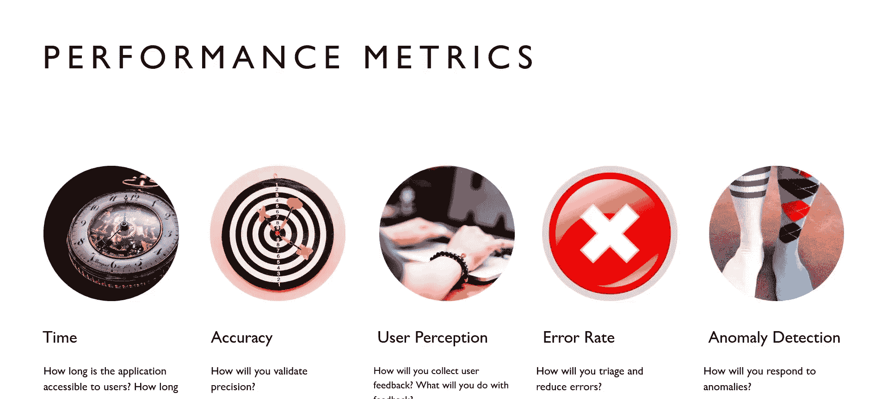

高质量聊天应用程序的另一个组成部分是负责任地使用人，工智能。微软有一个负责任的人工智能方法，分为六个原则，这些原，则应该指导人工智能的开发和使用。在用户中建立信任和包容性、防止伤害、保护他们的数据。

以及在出错时提供改进和纠正措施是很重要的。

让我们来看一些演示。我要给你们展示的第一个演示是在 Azure 开放人工智能，服务中对 Azure OpenAI 端点的基本使用。所以我们在一个。NET 交互笔记本中。我们要做的是在这里引入三个库。

Azure、Azure OpenAI、，SDK，以及一些配置步骤的系统环境。所以我已经引入了我的端点和我的密钥，我只是要继续点，击这些单元格并点击提交。在我这样做之前。

我只是想给你们大致介绍一下这里发生，的事情。我们发送一个系统提示，说你是一天结束时的软件工程师，而用户或将要接收的输入是需要做哪些任务。所以基本上，这个应用程序是一个软件工程师在一天结束，时。

他们需要一个在一天结束时要做的任务列表。现在在 Azure 开放人工智能中，你部署你的语言模型并给，它们一个标签。所以这就是这里这条线上正在发生的事情，我们在这里调，用获取聊天完成。

所以我们正在访问聊天完成模型，这本质上是 GPT 3。5 增，强版，我们正在访问它来完成我们这里的消息和我们的输，入并对我们的输入做出回应。就这样。所以这里是我们今天结束需要做的步骤。

现在那是一个非常基本的例子，但现在我要给你展示一个，稍微复杂一点的带有基本聊天应用程序的。NET 框架应用，程序的例子。那么让我们继续并问聊天应用程序，纽约市的最高点是什，么？

我们立即得到了一个问题或答案或回应，说最高点在斯塔，滕岛，海拔达到 410 英尺或 125 米。而且正如我们在左边这里可以看到的，有点像你在聊天 ，GPT 中会看到的那样，它实际上进行了总结。

我们实际上使，用 Azure 开放人工智能来总结我们在左边这里聊天历史，中正在进行的对话。如果你有兴趣了解更多关于使用生成式人工智能构建聊天，应用程序，甚至学习其他主题，访问我们这里列出的课程。

在课程中，你会找到关于这个主题和许多其他主题更深入，的信息，包括供你自己尝试的互动笔记本，就像你在这里看，到的那个。快乐学习。好的，欢迎来到生成式人工智能初学者课程。我叫戴夫·格洛弗。

我是一位在澳大利亚悉尼的云倡导者，这是第六课，构建搜，索应用程序。好的，那么在本次课程中我们要涵盖的内容，我们将看看你，可能会有的语义搜索，这是一个你可能经常听到的术语。我们将谈论向量和嵌入。同样。

这也是一个你可能听说过的术语，以及它们之间的差，异。我们将谈论向量存储，并且我们将涵盖演示。那么本次课程的目标。所以最终，在课程结束时，你将更好地了解向量如何发挥关，键作用，也许还有有效的语义搜索。

所以希望这就是你能从本次课程中学到的。现在，当我刚开始谈论和学习生成式人工智能时，经常听到，的一个术语就是语义搜索。我必须承认，当时我并不真正知道什么是语义搜索，但经过，一番研究。

我大致了解了它的工作原理。希望这也能对你有所帮助。所以语义搜索实际上是一种基于意图的搜索，或者归结为，你正在思考的想要寻找的核心概念。那么举个例子。如果你谈论我的梦想手表。现在，如果你进行关键字搜索。

你会得到关于梦想和手表的，结果，这可能不是你想要找到的。现在，如果你进行语义搜索，他们会归结为可能是我理想手，表的概念，这才是你真正在想的。然后你会找到关于理想手表的东西，并且你可能会扩展这，个搜索词。

那么语义搜索的关键在于围绕你所寻找的意图或概念，而，不是像关键词搜索那样会找到梦想和手表。现在，语义搜索在构建大型语言模型应用程序时有点像是，一个非常关键的点或关键概念。

而且你会经常发现这些应用程序非常依赖我们所说的语义，搜索和嵌入。好的，所以你已经听说过向量这个术语。毫无疑问你在大学和学校里正在学习它们。并且你可能听说过嵌入这个词。你可能会想，嗯，有什么区别呢？

因为它们经常在语义上几乎是一起使用的。那么向量和嵌入，它们是什么？所以嵌入是由具有语义意义的大型语言模型生成的一种特，殊类型的向量。所以最终，当你将一段文本发送到嵌入引擎时，它将返回一，个向量。

并且那个向量将代表你发送到嵌入引擎的那段文本的语义，含义。现在，有很多不同的嵌入模型。现在，你可能听说过的那些可能像开放人工智能嵌入模型，所以有文本嵌入 3-小，这是一个刚刚推出的新模型。

3-大又是一个新的。你可能听说过文本嵌入 ada-002，它一直非常受欢迎。现在，这些绝不是唯一的嵌入模型。所以如果你去拥抱脸，你会发现一系列的嵌入模型，并且你。

会发现它们的性能排名以及这些东西的表现如何。但举个例子，实际上，对于我要给你展示的这个例子，就是，这个课程计划中的例子，它使用文本嵌入 ada-002。它会返回一个 1 乘 1536 维的向量。

这就是你会得到的。显然这很难去可视化，你真的无法想象那是什么。但不管怎样，这就是你得到的向量的大小。现在，当涉及到向量和嵌入时，你经常会听到的另一个概念，是围绕这个叫做最近邻搜索的概念。

它所做的是你有一堆使用这些嵌入模型创建的向量。而你想要能够做的是，你想说，好吧，我有这一堆嵌入模型，现在我想去找到，我有另一段文本，比如我的梦想手表，我，想把它作为我的搜索项。

然后我想去在那个集合中找到其他哪些向量最接近我梦想，手表的这个概念。这就是你听到的叫做最近邻的概念。你也会听到余弦相似度的概念。余弦相似度是一个你可以在一堆向量中使用的公式，用来。

找到与这个集合中的向量最匹配的向量。基本上计算一个向量在多维空间中，在这种情况下是 1 乘， 1536 维向量，与其他向量有多接近。基本上你得到的是你得到的向量或语义与你正在寻找的向。

量的相关程度的排名。现在为了可视化这个，如果你想想，我们大多数人，我们可，以满足于二维向量和三维向量。你想想，在这边左手边，我们有二维向量。我们在这里可以看到，好吧，我们这里有这个蓝色的点，它。

是我的搜索向量。嗯，你可以很容易地说，好吧，这些周围的其他向量，这些代，表这些向量的点，你可以看到它们很接近。但是你看这里这个黑色的点和这里这个蓝色的点，它们不，是那么接近。所以你可以看到。

如果要做余弦相似度，这里的这些点会是，最接近的。在三维空间中也是同样的情况。现在我正在使用一个叫做 Octator 的应用程序，这是一个，非常好的用于可视化事物的应用程序。

你可以看到我这里有 10 个向量，我们来运行这个。为了帮助可视化这个，所以我们只是移动这个，你可以开始，看到，嗯，我在三维空间中有这些向量，我们大多数人，我们，可以看到 X、Y 和 Z。

我们可以很直观地可视化这个。再一次，如果我说，好吧，这里这个红色的点，这是代表我的，搜索问题的红色点，我想要搜索的向量。你可以在这里周围看到，好吧，你可以看到这些点在这里很，可能与中心的红色点相关。

所以你又可以可视化这个。所以我们可以可视化二维空间，我们可以可视化三维空间，但显然我们不能真正可视化太多其他的。我们肯定不能可视化一个 1 乘 1536 的基础向量。所以希望这能给你一点概念。

你可以大致推断出那种说，好，吧，嗯，我可以理解二维，三维。有一种公式可以帮助我去计算它会是什么样子，使用余弦，相似度什么会是最近邻。现在，你会发现，同样对于向量和嵌入的这个概念，如果你。

要为靴子、鞋子和袜子去创建一个嵌入，它们将创建在多，维空间相关的向量。它们将处于同一个多维空间。而在这里，相机的概念。嗯，那和鞋子、袜子和靴子不是同一个概念。所以它将处于一个不同的多维空间。所以。

再一次，当我说我想去买一些鞋子，例如，可能是一个，查询，你会为此创建一个嵌入，然后你会在这些向量中搜索，你会发现，好的，这些鞋子、袜子和靴子将是在多维空间，中最接近的向量。希望这很清楚。怎么回事？好的。

所以接下来我想说的是我们已经从嵌入中创建了这，些向量，我们想把它们存储在某个地方。所以，再一次，你会听到向量存储，这些就像一个索引或像，一个数据库，但它们是为存储向量而优化的。

所以你会听到像 Azure AI Search 是一个向量引擎，Redis，Postgres，PineGone 还有很多其他的。如今市场上大约有 20 个左右的向量存储。但同样。

受欢迎的是像 Redis 和 Azure AI Search 这样，的。现在，我要给你展示的演示以及对这些事情进行原型设计，的一个很好的方法实际上就是在内存中这样做。

而一个超级简单的方法就是用一个 pandas 数据框。这就是我要向你们展示的演示以及你们在代码库中找到的，演示，而不是必须担心后端数据存储，对于原型设计和只是，尝试各种想法。

熊猫数据框是一个超级简单的方法来启动，和运行这个。但显然这不会用于将此应用程序推向生产的视图。你不会从熊猫数据框运行此应用程序。你会使用某种后端数据服务，如 Azure 人工智能搜索。好的。

所以我们有一点演示，我想向你们展示一下这是如何，工作的以及这个数据集是如何构建的。所以你们在这次演讲的代码库中找到的例子实际上是取自，大量的 YouTube 视频的转录本。它实际上是来自人工智能搜索。

即微软人工智能搜索频道，在 YouTube 上。我们所做的是我们从各种演讲中获取了大约 300 个转录，本并进行了嵌入。所以我们为它们创建了嵌入，并在这种情况下将它们放入，熊猫数据框中。

我们可以用它来进行搜索。现在，我只是想稍微谈谈关于你们围绕这个所做的概念。所以你们有这个转录本。现在，当你们有大数据集时？它可以是一个转录本，可以是一个 PDF 文档，可以是来自 。

Word 文档的数据，要知道这一点文本来自哪里。你们通常所做的是将其分解，或者你们做这个叫做分块的，概念。所以在这种情况下，你们拿这个视频转录本，你们所做的是，将其分块。而这些块的方式。

你们思考这个的方式是你们想要搜索的，保真度是多少？例如，我是想要在那个视频转录本中以五分钟的增量还是，三分钟的增量有更好的搜索？而这将决定分块大小是多少。现在，关于分块的另一个概念，再说一次。

你会发现有各种，库可以帮助你进行分块，你也往往会进行重叠。这背后的想法通常是，仅仅在任意句子处或类似的地方切，断一个分块是没有意义的。你可能会说，好吧，我想从下一个分块中要一两个句子。

这样能给你提供上下文，给你一种更好的上下文。你可以在这个分块中看到，这里的这些分块，我有一点，你，看到这里的红色文本实际上是下一个分块的开始。再说一次，你会发现下面还有第二个分块。

红色文本是下一个分块的开始。同样，这是为了提供更好的搜索，语义搜索。那么接下来你要做的就是把这些分块中的每一个发送去嵌，入。在这种情况下，我们要把它发送去文本嵌入 8002。那是我们正在使用的模型。

那将会返回向量。记住，它返回一个 1 乘 1536 维的向量。然后你要做的就是把它放入一个存储中。现在，在这个演示中，存储实际上只是一个 JSON 文件。我们将把它加载到潘达斯数据框中。

所以现在我想去搜索。好的，在这种情况下，我想去学习，我想了解 R 工作室和笔，记本。所以你记得我的数据集是 AI 秀。它将会有很多关于 Azure 和笔记本以及朱庇特笔记本和。

认知服务以及 R 工作室类似的内容。但我特别想找到关于 R 工作室笔记本的。所以你那样做的方式，那就是我的查询。然后我要做的就是为那个查询生成一个嵌入。所以，再一次，我会把那一点文本发送给。

在这种情况下，文，本嵌入 ADA 模型。然后我得到我的 15 个，1 乘 1536 维的向量。然后我要做的就是对我的存储进行最近邻或余弦相似度计，算。现在。

在像 Redis 和人工智能搜索这样的数据系统中，它，们有能力去查看所有大量的向量数据。然后找到最近邻。这就是它们所优化的。我们将使用一个熊猫数据框，并且我们将使用余弦相似度，然后我们去做那个。

我们去找到匹配该数据的最接近向量。然后我得到结果。你通常会得到一个排名，说，好吧，我们认为这是 ，0。094，95%最接近排名。再一次，你会看到各种排名，这些文本块根据语义最接近结。

果集和数据集。好的，所以希望这相当清楚。所以我要做的就是跳到 Visual Studio 代码。在这节课的存储库中，你会发现有一个 Stupida 笔记本。Stupida 笔记本要做的就是加载各种东西。

但是这里有几件重要的事情正在进行。我们将调用开放人工智能文本嵌入 Ada 模型去为我的问，题生成一个嵌入，然后我们将用它来对比转录本的嵌入集，好的，所以我们首先听到的，我们要设置端点。

我们有 API 密钥，API 版本。这只是 Azure OpenAI 所需的信息。然后我要说模型是文本嵌入。现在，非常重要的是，当你要嵌入你的问题时，你要使用与，创建转录本向量相同的模型。

所以这些模型将会匹配。然后这是我要加载到内存中的数据集。现在，我将相当快地跳过一些内容。你可以在你自己的时间里看看这个。但这里有一个余弦相似度的函数。这里面有 numpy 公式用于计算最近邻。

所以我们要经过这里，最终这要做的是，我们要加载数据集，然后我们要坐在循环中，我们要进行查询。所以我们要运行这个愚蠢的笔记本，它已经加载了。并且它将是我对关于 RStudio 和笔记本的讨论感兴趣。好的。

所以那将是我的查询。所以那就是问题。所以记住将会发生什么。这将被发送到嵌入引擎。它要做的就是为此创建一个嵌入。并且它将去检查我为转录本创建的所有嵌入。并且它将带回最相似的视频。

我已经测试过的一个不错的是在这里的这个。所以这里的第二个，带有机器学习的数据科学。在这个视频中，拉法尔将谈论数据科学和机器学习。你会看到相似度是 0。84。并且如果我能点击这个链接，你们会注意到。

它将开始谈论，它将直接带我们到那个文字记录，到视频中的那个位置。

你们看那里发生的是我将只是回去。我们将点击那个链接。

所以你们看到这样做的美妙之处在于获取完整的文字记录，我们将它分成了，我想，三分钟的块。我做了我的查询。我将其转换为嵌入。然后我查看我的熊猫数据框。我查看了所有我放在那里的嵌入或向量。我找到了最接近的。

然后在那个数据集内，我也有时间，就是说，好的，他们将在，这个 YouTube 视频的这个特定时间开始谈论 RStudio 和，笔记本。所以这就是它大致的工作方式。

所以希望这有意义并让你们对这个应用程序的工作方式有，一点概念。好的。所以这样，我们有几个资源。所以我们有我刚刚给你们展示的搜索应用程序。所以你们会在这里找到那个链接。所以你们会找到那个。

并且还有一套非常好的微软学习内容。并且那里有一个特别的关于理解嵌入和 Azure OpenAI 搜，索或服务的。然后通读那个。再说一次，你们将学到更多。

但希望这给你们足够的让你们开始并了解如何去构建使用，嵌入、向量和余弦相似度并使用最近邻去在你们的数据集，中找到相关内容的搜索应用程序。好的。非常感谢。

嘿，大家。欢迎回到面向初学者的生成式人工智能。我说过我会回来的。我是巴勃罗·洛佩斯，在人工智能领域有点顶尖网络的儿童，倡导者。还有克里斯·诺林。我知道你们到现在已经认识他了。打个招呼，克里斯。嘿。

大家好。非常兴奋能回来。我叫克里斯·诺林。正如巴勃罗所说，你们可能已经在几个视频里见过我了。希望我是微软的高级倡导者。就像巴勃罗一样，我们用人工智能和许多其他令人兴奋的，技术做很棒的事情。回到你。

巴勃罗。非常感谢你，克里斯。你们知道吗？这就是为什么生成式人工智能真的很令人兴奋，因为我知，道你们已经看到了很多文本，对吧？所以你们在第二课看到我谈论如何在大型语言模型、解决。

方案模型、Azure 人工智能的基础上学习。但现在你们在这里更高级了。我刚刚看到了一点，你们知道的，聊天应用程序，文本应用，程序。现在让我们转向图像。那么我们今天要讲什么？

我们将展示图像生成以及如何使用和构建图像生成应用程，序。你们看，这里只有两件事，但我得稍微解释一下，因为图像，生成比我们通常在文本上看到的稍微复杂一点，对吧？那么让我们构建一个图像生成应用程序。

我们将为图像生成进行提示词工程，并开启多利和我的旅，程。但不仅仅是这两个。我稍后会谈到这一点。那么让我们从一个简单的问题开始。如何？对吧？因为如果你们在之前的几集里看到过，你们可能知道，嗯，我可以打字。

然后我可以，你们知道的，尝试进行标记化，对，吧？尝试生成下一个标记，下一个标记，下一个标记直到完成。但是图像可不是那样工作的，对吧？它们有像素，它们有红绿蓝值，对吧？

所以这听起来有点让人困惑它们是如何工作的。嗯，这听起来像魔法，对吧？那么到底如何生成人工智能图像呢？所以我要开始说一件事。还记得我之前说过的基础模型吗？它们是以多模态的方式训练的。所以它们不仅有文本。

还有文本、图像、视频、音乐。它们有很多东西来训练它们。所以发生的一件很酷的事情是他们尝试做一个开放人工智，能的剪辑。那么剪辑是什么？剪辑基本上就是你得到图像，然后他们要尝试对其进行分，类。

所以这里我有一个我用剪辑做的测试。这是食物 101，这是一个用于测试的小数据集。顺便说一下，我在这里可以看到一个非常精致的鳄梨酱。看看它有多精致。而且你可以看到它在那上面可以完美地排名。当然。

并不总是会，你知道的，非常准确。记住，生成式人工智能有很多统计数据，它可能有点随机，有些事情有点错误。但是你可以看到这是一个重大的进步。

那么剪辑的一个好处是它是可以很好地描述图像的生成式，人工智能。所以它可以得到图像并想，嗯，我相信这是那样的，这是怎，么回事，等等，等等，等等。所以你可以看到它也可以非常具有描述性。好的，巴勃罗，很棒。

现在生成式人工智能可以描述图像。酷。你怎么说这很棒呢？因为想象以下情况。还记得我谈到嵌入的时候吗？是的，宝贝，嵌入。那么它能做什么？它可以选取这段文本并生成嵌入，对吧？然后我知道如果我能处理文本。

我就能描述它。我怎么能反过来做呢？所以想象一下那个片段，而不是，你知道，试图描述某物并，用嵌入生成某物。然后我有一个带有注意力、扩散，你知道，所有我们拥有的，神奇的东西的新网络，它实际上可以，你知道。

回到反向过，程。这就是它所做的。所以片段给出，基本上，一种氛围。我喜欢说有点 Z 世代的感觉，对吧？所以它捕捉图像的氛围并说，嗯，我相信这应该是这种氛围，然后当你打字时，你会有你想要描述的东西，对吧？

想象一下我想描述埃菲尔铁塔上的一只狗。所以它会有埃菲尔铁塔，我们有狗，我们有一些，你知道，你，可以想到的东西，你可以想象的东西。那么它所做的基本上就是选取那 30 个嵌入，然后片段可，以判断，对吧？

片段可以在你拥有的图像和它生成的图像之间进行判断。所以这就是他们在这里训练这个模型的方式，这个注意力，模型通过你的文本创建图像。因为我们有一个片段，所以我们总是可以比较。太神奇了。然后他们创建了这个。

所以基本上是两部分。片段，它可以交流并且可以判断和可以说些什么，这里有这，样一个扩散模型，可以通过文本生成图像。所以这就是他们如何创造出你们今天所知的那些令人惊叹，的人工智能模型与图像。但是好吧。

我们已经知道很多了，对吧？就在这里之前，达利，它来自OpenAI ChatGPT 家族，你们已经知道并喜爱我们有很多的网络副驾驶。所以如果你想测试达利，最好和最快的方法是去必应或边，缘上的网络副驾驶。

我们有旅程，它使用，你知道，不和谐服务器的接口。它是，你知道，它可能有一些限制，你可以有低元人工智能，目前在大多数国家不可用。但是然后我们有元人工智能。元人工智能基本上是达利的元版本。当然。

他们做很多事情。他们可以交谈等等。所以他们里面有一个可以生成图像的生成模型。而这些只是四个。我们有很多要描述的。但这些，据我所知，是最常用的。当然，你可以使用稳定扩散。你可以用你自己的电脑来做。

就像我们也谈论服务最佳模，型一样。这是你在这里可以想到的同样的事情。就这么着。现在，你知道，无论如何都喜欢生成图像，对吧？

所以你可能会想，我对那个没有太多用处，巴勃罗。我为什么不应该关心那些？这就是关于它的事情。这是快速原型任何东西的一种方式。想象一下你正在做一个应用程序，而设计团队还没准备好。

你实际上可以做一个小标识来测试，然后尝试已经有规格，地去做并更快地创造东西。所以你可以制作原型，然后在设计团队准备好后，你只需改，变并完成。你准备好让你的功能就绪。或者如果你是，你知道，一家公司。

你就是你。你没有预算去与他们签约。所以我们实际上可以尝试用人工智能生成很多。你知道，只是在这里和那里做一些调整，试图多理解一点来，帮助你的用户体验爆发。所以这些是我们有生成式人工智能的一些惊人的事情。

它赋予那些没有，你知道，有时没有知识去创造伟大事物的，人力量，然后尝试在这些事物上改进以形成出色的概念。或者你可以尝试快速制作原型以按时交付东西。不仅如此，你还可以用它们来扩展。

所以我们有三件惊人的事情可以用生成式人工智能处理图，像。所以我有克里斯。克里斯，伙计，你今天有什么给我？对。所以尝试去。所以我们今天试图实现的是确保你明白你应该何时使用图，像生成。对。

因为这听起来超级酷。即使是文本生成，你向人工智能发送一些东西，你会得到一，些有趣的回应回来。在文本对文本的情况下，那很有趣。但更有趣的是如果你可以拿那个文本提示，那个提示知识，发送到人工智能中。

然后出来一个图像。对。而且你已经展示了，巴勃罗，我们如何能得到一些非常令人，兴奋的有空间或风景或诸如此类的图像。所有这些听起来都非常好和整洁。但如果我们有一个客户场景呢？

因为我可以想象你们很多人在看这个，也许你们是高级开，发人员或某种企业开发人员。或者也许你在考虑一个初创公司，就像，我如何在商业场景，中使用图像生成？所以这就是我们今天要尝试做的。

所以我们要做的是我和巴勃罗，我们要扮演一个客户的角，色，那就是我。而巴勃罗将是要采访客户，也就是我的开发人员，看看我想，要什么。并且只是为了场景的缘故，我要扮演一个伦敦的物业经理，对。

所以我要成为那个客户。我希望巴勃罗作为一名工程师的帮助，使用图像生成来改，善我的业务。所以，巴勃罗，从这一点开始我让你来接手，这样你就可以，开始采访我，这样我就能得到我需要的。克里斯，你好。

你今天在做什么？嘿，巴勃罗，今天很高兴见到你。看看我们是否能一起做一个项目会很令人兴奋，这样你就，能帮助改善我的业务。但今天我是一个物业经理。我在伦敦，所以我需要对我所有的房产都得到帮助，以确保。

我们可以把它们卖给或转租给任何可能是我的客户的人。但我遇到的一个问题是要确保我能向人们可视化事物，因，为有时我有一张照片，有时我没有。而且我甚至不确定照片在夜光或晨光下是否有意义。

所以我想我想要某种带有图像生成的人工智能服务，它真，的可以帮助我，你知道，想想，这是我想要的吗？这不是我想要的吗？那么也许你可以根据这是伦敦的背景来帮我。你觉得呢？当然，克里斯。

所以我们实际上可以生成一些图像，至少为你在想象中看，到的东西制作原型。这是生成式人工智能非常好的一部分，生成式人工智能可，以做很多这样的事情来帮助你。那么你在考虑什么样的属性呢？是的。

所以我通常有很多靠水的房产，所以也许说，嘿，我们，去看看伦敦靠水的房产是完全合理的。我的意思是，当然，我会有一些高楼大厦和一些小建筑，但，我只是好奇在这一点上这个工具能为我做什么。

那么也许你可以根据那个信息给我展示一下？当然可以。所以我们可以在这里输入一个非常基本的提示词，就是伦，敦靠水或这里的河流的房产。这样我就可以开始生成一些东西了。

这就是我可以在 Azure 人工智能上给你展示的。这样你就可以看到我们有一些设置。但首先，我想给你看的是在 Azure 人工智能上根据一个提，示词生成一张图像。我想请求更多。稍后你会看到如何做到这一点。

但因为你有一些选项，所以你可以复制提示词、生成相同，提示词的图像、下载、显示代码或删除。就在这里，它显示成功了，这很棒，因为现在它要处理我们，这里的图像了。当它显示时，好了，这就是生成的图像。

但我也想给你们展示一下，伙计们，一些关于对话设置的事，情，因为，是的，我们不仅仅局限于此。想象一下你觉得，哦，这太生动了。这太梦幻了。我怎么知道？更现实些。你可以在提示词上改变，当然。

但你也可以在这里在我们的，风格图像上改变，这样可以像自然的。我想要高清的图像质量。让我们用经典的，那个方形的。好的，克里斯，我在这里生成了一些图像。一幅图像。你觉得这个怎么样？什么，你想改变些什么吗？

所以看起来相当不错，对吧？我是说，它在水边，有点像我转租或出租的那栋楼。我好奇的是，如果你能在不同的光线下展示这个，也许，因，为这看起来像晚上。而我可能想在晨光下展示它。我觉得两者都有总是好的。对。

因为人们想看到黑暗中那漂亮的光线。但如果我能有一些晨光的参考图像，我觉得那会很棒。晨光。所以你明白我在这里怎么做的，对吧？所以基本上，我在试着描述克里斯在做什么。所以可能会问，好吧。

但和我在一个智能体上写的相比，巴，勃罗，有什么不同？所以在图像上，通常你必须更直接。你需要想象自己是个导演。对。所以你需要想象你把东西放在哪里或者试图理解光线，构，图。你需要理解如果你要用镜头。

你要用哪种镜头？是的，那也很重要。所以当你试图写一个提示词时，你可能会想到很多事情。但这和你试图写，比如，在文本上是很不同的。因为你是一个 IG 智能体。你做这个，那个。这就是你这样做的方式。不。

在这里，更像是一个导演。想象一下你有一个相机，你可以试着把东西放在这里那里，你可以改变灯光。所以这里有更多的灵活性。它不需要，你知道，指示它需要做什么。就像，你必须做这个那个。试着更，你知道。

在这里也有点自由。就这样。我在这里添加了晨光，看看它生成了什么。当它生成时，我也可以给你展示一些东西。我可以复制这个提示，然后生成新的图像。所以你可以在这里看到我用同一个提示生成了另一个图像。

然后我们轻松下载。但我想给你展示更多的东西。很快很快我就会给你展示代码。就这样。它已经生成了这两个图像。就这样。这是在伦敦的房产，在水边，逗号，河边，在晨光下。你觉得这两张图像怎么样，普瑞斯？是的。

我特别喜欢中间那张。它实际上看起来像我们现在正在出售的一处房产。所以我也很好奇，因为，你知道，我们需要能够在各种网页，上展示这个，你知道，移动应用程序等等。那么你能以不同的分辨率展示吗？比如。

我能有一个小地图吗，或者不能？我在找的词是缩略图。比如，你能从这个生成一个缩略图，也许，你知道，一个相当，大的屏幕分辨率。所以我有点想知道这里的灵活性。当然。在那之前我要告诉你们一件事。

你们注意到我已经在这里更改了一些设置。记住，我已经从鲜艳改成自然再改成高清了。我会给你们展示相同的提示词在不同属性下的效果。所以这是鲜艳和标准。看看高清和自然的效果差别多大。

你们可以看到它更像是一张照片，而不是试图符合所有属，性。所以我们需要确保符合所有属性。你们在这里可以看到，这看起来更自然，对吧？它看起来不像一幅画之类的。当然，也许是水。

但你可以像往常一样在提示词上进行调整，所以克里斯问，我能生成不同尺寸吗？当然可以，我们来生成一个更大的尺寸。让我们想象我们需要为一个网页生成一个横幅。所以我们在大尺寸上生成，然后再生成，你们知道的。

非常，小的，比如 256 乘 250。非常小。所以，是的，实际上现在我正在尝试生成。我在哪里？就结束。哦，好的。我喜欢这种情况发生。好了。好的，我们去剪掉那个。好的。

所以你们在这里可以看到我正在生成我的横幅。所以横幅生成了。然后我问，巴勃罗，我不喜欢这个角度，对吧？它看起来不是我想象中的那样。别担心。你可以尝试用相同的提示词再次生成图像，或者你可以稍，微尝试一下。

我会给你们展示。不展示。巴勃罗，我不喜欢这张图像。我能做什么？我们选这张吧。我不喜欢这家伙。那么我们在这里能做什么？我们可以尝试掩蔽或者尝试并尝试重新生成图像。挑选最好的，然后看看你有什么。记住。

人工智能的梦想在如何生成图像方面有点随机。看那个。那看起来很有趣。是的，肯定的。是的，我真的很喜欢那张图像。所以我也在想，我们销售的很多物品就像公寓，对吧？所以想知道你是否可以灵活地做联排别墅。

因为我们也有，那些。哦，太棒了。那么，伙计们，你们需要做的是伦敦的房产，对吧？你可以在这里面描述。那么就选伦敦的房产，有联排别墅的房产。好了。所以你可能会问，巴勃罗，这不是最，你知道，有时候我们害。

怕描述。是的，但是记住，从技术上讲，它可以越来越多。有时候他们会注意我们如何排列单词的顺序。但是连接性，有时甚至当你试图写出最，语法不正确，你知，道，不允许扎利根据提示进行优化。记住。

你在这里试图对扎利进行优化，而不是，你知道，按照，你写的方式。所以有联排别墅的房产听起来很奇怪，但有时这是最好的，方式，因为我更好理解。你可以把其他房产和联排别墅混合，对吧？

我们在这里试图分离两者的意义。是的，经典的生成式人工智能。你需要在这里学习一些小技巧。然后让我们谈谈一点提示词。你可以看到这是联排别墅的属性。你可能会问，嗯，这在语法或风格上似乎不太正确。这是真的。

但你可能会认为一件事是，有时你需要优先考虑你为达利，措辞的方式，不是为了最有意义，而是试图在提示词中加入，权重。想象一下，你不是在引用像一个非常明确的句子那样的提，示词。它更像是试图让达利理解，好的。

你应该在这里和这里放什，么权重？所以我们有属性。当然，它试图在那里放房子。就是这样。有时它会产生幻觉。但如果它试图产生幻觉，好的，让我们去掉属性，然后只做，联排别墅。就是这样。

你需要在这里和那里稍微调整一下，以试图获得最佳图像，但我会非常诚实地说，这个非常惊人。对。所以谢谢你，巴勃罗。我认为我们将在这里结束我们的客户场景，但我认为很明，显，你知道，你能够提供不同种类的光线。

不同种类的建筑，物，也许不同的角度，以及你所展示的完全一样。对。我的意思是，你只需要调整提示词，你甚至可以为缩略图改，变图像的大小，为更大的图像。看起来相当不错。所以，是的，让我们把它带回家，巴勃罗。

让我们看看我们是否可以总结这个视频。好的。绝对。但在我总结之前，你可能会问，我如何在我的应用程序中实，现这一点？所以如果你有一些疑问，在这里看看我们的指南，在第九课，构建生成式应用。

或者看看这里。我们有一些文档。所以这里有我的这里的 Python。但一如既往，你可以选择多个东西。然后你将有你的客户端，你的 API 版本，你的端点和你的 ，API 密钥。记住你需要在那里用提示生成。

然后你将有 N。N 是生成的图像数量。正如你们所见，我为一个生成了一个。但你要记住，如果我们为dalle或midjourney，你就有多个。所以我可以只把 N 设置为你想要的任何值。

然后你可以通过这个图像 URL 逐个分析图像。

更多的事情。

然后如何生成巴勃罗。我喜欢那个。我想要这个确切的东西。你可以点击代码，然后你可以理解如何编写这个提示。

然后 JSON 加载。但让我们回顾一下我们今天学到的。你理解了dalle和mid journey是如何工作的。你理解了我们有多少机会，你理解了如何应用这些。

你听到了我和克里斯谈论了一点关于如何进行提示工程以，及如何将其放入你的代码中。伙计们，这是很棒的一课。非常感谢你们在初学者生成式 AI 课程上与我们在一起。克里斯，最后说几句？好的。非常感谢你。

巴勃罗和所有在那里的你们。我希望这是关于如何处理图像，特别是如何生成这些图像，的有趣一课。正是巴勃罗所说的。稍微进行一点提示工程，稍微进行一点调整，你就可以看到，截然不同的结果。所以你看到了它有多灵活。

你也看到了使用一些 Python 代码或任何类型的代码将其，集成到你的应用程序中是多么容易。所以一定要使用工作室来获得帮助。但在微软学习和微软文档页面上也有一些很棒的提示，外，面也有一些示例存储库。

当然还有我们自己的课程，生成式人工智能初学者。所以感谢观看。谢谢大家。下节课见。

欢迎大家来到生成式人工智能初学者课程。我叫索马雷·扎德戈，我是微软的云倡导者。所以今天我只想展示第 10 课，使用生成式人工智能构建，低代码人工智能应用程序，你可能没想到这是可能的。

这也是生成式人工智能初学者课程的一部分。对于这节课，我们将涵盖一些事情。所以我们将介绍如何在 Power 平台中使用生成式人工智，能。然后我们将切换到查看 AI 构建器和生成式人工智能的人，工智能能力。

所以这不仅仅是纯粹基于生成式人工智能。我们将查看一些 AI 构建器附带的模型以及 Power 平台，内的生成式人工智能。所以 Power 平台中的生成式人工智能实际上是关于使用。

生成式人工智能增强本地开发和应用程序，这是 Power 平，台的一个关键焦点领域。目标是让每个人都能够构建具有人工智能支持和驱动的应，用程序、站点、仪表板和自动化流程，而无需任何数据科。

学专业知识。而在过去，你需要有技术背景或成为一名数据科学家才能，实际使用人工智能。就像我提到的，我们可以通过 Azure 为每个人赋能人工智，能，因为人工智能不再只是专业开发人员和数据科学家的。

小众能力。人工智能在我们的日常生产力中是必不可少且被期望的。所以你可以想想 PowerPoint 设计器，例如，在这种情况下，当你在制作幻灯片时，对于你幻灯片上的特定页面，你可。

能会得到关于你的设计会是什么样子的一些建议。并且你也可以有 Teams 转录。所以你记录一个 Teams 会议，然后你可以从那个特定的 ，Teams 会议中提取一份转录，听到其他人在说什么，如果你。

在音频中听不出来的话。当然，还有 Microsoft 365 中的新副驾驶功能。但在此之前，我们实际上有像技术人员通过围绕使用 。

Microsoft Azure 以及 Microsoft Azure 中的一些认知，服务进行专业文化开发来使用人工智能。但现在，作为 Microsoft 云服务一部分的 Power 。

Platform 中的制作体验遵循将人工智能能力带给我们平，台中每个制作者的相同原则。能够构建由人工智能驱动且支持人工智能的解决方案，这，样无论你坐在人力资源部门还是营销部门，都可以构建这，些解决方案。

你可以使用像 Power Platform 这样的低代码、无代码工，具，这样你就可以将你的解决方案交付给日常最终用户，从，某种意义上说，他们正在使用 Microsoft Teams、。

Microsoft 365 和 SharePoint。但像 Power Platform 这样的低代码、无代码工具对很多，人来说并不一定熟悉。你可能会问自己，什么是微软 Power 平台？嗯。

这里是无代码、低代码和代码优先都受欢迎的地方。所以在这里你可以在不需要知道如何编写程序或代码的情，况下构建解决方案。但同样，即使你知道如何做，你也可以将那些经验带入 。

Power 平台并构建已经用你已有的一些技能以及你可以拥，有的新能力增强的解决方案。Power 平台实际上由五个产品组成，其中有用于移动开发，、移动应用开发的 Power 应用。

用于流程自动化的 Power， 自动化，用于商业分析的 Power 商业智能，协同驾驶工作，室，这是我个人最喜欢的，在这里你可以构建你自己的协同，驾驶，最后是 Power 页面。

在这里你可以构建面向外部的，网站。所有这些都启用了生成式人工智能能力。这就是协同驾驶，在这里你有 Power 平台协同驾驶，它使，你能够使用微软 Power 平台内的这些产品中的每一个或。

每一个来构建甚至更快的解决方案。但这实际上如何适应微软云呢？在过去，由于完全集成的微软云以及我们在 Azure 或开放， AI 中的投资，我们能够将生成式人工智能，即大型语言模，型。

应用到我们每一个产品的结构中。所以你可以想想，比如，微软 365。现在我们有一个微软 365 协同驾驶，它能够提高生产力。在开发工具中也有协同驾驶，以 GitHub 协同驾驶的形式。

你将使用你的 IDE 或像 Visual Studio Code 这样的代，码编辑器，使用 GitHub 协同驾驶来实际编写代码甚至更，快。甚至 Power 平台也有它自己的副驾驶，就像我之前实际上。

提到过的。所以副驾驶是关于让人工智能成为一个伙伴，帮助你更好，更快地完成工作。你可以把副驾驶的时代看作是拥有人工智能作为一个实时，的合作者，它生成内容、激发创造力并完成工作。

但是然后你如何在 Power 平台内利用或积极利用生成式，人工智能呢？你如何使用副驾驶来提高你在构建解决方案时的生产力？让我们暂且以这个例子来看一下你如何能够比过去更快地，构建一个自动化。

所以我们只是描述我们的自动化并说每天，我们想要从 ，Power Apps 收集所有已执行的检查。并且我们在这里有一个条件，说所有那些有暂停的，编写一，个电子邮件摘要，并从 SAP 附加一张发票。在过去。

我们需要手动添加步骤，但是在副驾驶和 Power 。

自动化形式的生成式人工智能的帮助下，我们已经有一个。

作为草稿构建的 Power 自动化流程。然后我们能够看到一些已经添加的行动。所以我们从 SAP 收到一张发票，通过生成一个电子邮件正，文来添加生成式人工智能能力，这我们稍后会讲到。并且。

我们还需要确保我们执行负责任的人工智能，在那里，我们审查由人工智能生成的那个电子邮件消息。然后在我们批准之后，我们给那个特定方发送一封电子邮，件。但是在某种意义上，如果你实际上想要使用生成式人工智。

能而不是像我们过去那样使用手动过程来更新这个草稿，我们仍然可以利用或积极利用在 Power 自动化内的设计，器或设计工作室中的支持聊天的副驾驶。

那么假设现在我们在 Power Automate 流中有另一个条件，我们实际上想要满足这个条件。所以我们查看如果汽车已经过检查，我们希望机器人检查，汽车是否已经过检查且是非品牌的。然后在那之后。

如果特定检查失败，它需要向一个 Teams ，频道发送警报。那么生成式人工智能所做的，它实际上在那个非常特定的，位置添加那些行动，这样你就能够输入你实际需要的所有，这些细节。然后你甚至可以看到。

即使有这种能力，你也可以添加一些，其他条件，检查检查是否失败。如果失败了，它就会将那个特定的 Teams 消息发布到你在， Power Automate 流中指定的那个特定 Teams 频道上。

但话说回来，就这样吗？在 Power 平台中真的能那样使用生成式人工智能吗？不。实际上让我们通过查看 AI 模型和带有 AI Builder 的生。

成式人工智能来看看如何在 Power 平台中使用其他 AI ，能力。首先，让我们看看 AI Builder。它实际上使你能够注入 AI 将数据转化为行动而无需编写，任何代码。

所以在这种情况下你有一些不同的能力，你可以查看文档，在那里你可以处理其中一些文档。要么你想处理一个表单，重置处理，要么你想进行一些语言，检测、文本翻译，还有类别分类等等。你也可以更进一步，处理图像。

在特定图像中检测一些对象，所以你可以在 AI Builder 中使用对象检测模型，或者你，可以使用文本识别光学字符识别。然后人工智能生成器不止于此。您还可以使用人工智能生成器实际使您能够使用的预测模。

型来做出决策。不止于此。但最大的问题是，好吧，这门课程是关于生成式人工智能的，而我们只是在谈论甚至在生成式人工智能出现之前就已，经存在的人工智能模型。这就是我们实际查看人工智能生成器和数据宇宙如何接地。

、保护并将业务数据与人工智能集成的地方。通过这个，数据宇宙有您的知识，您所有的信息都存储在数，据宇宙表中，然后您实际上想要能够访问并将该知识用于，您的一些解决方案中，使用提示。

这是通过人工智能生成器完成的。在人工智能生成器中，我们有一个叫做提示生成器的东西，它使您能够使用或创建您自己的自定义提示，您可以将其，放入您拥有的一些解决方案中。所以您有一个预构建的提示库。

其中有模板可以利用模型，和提示，而无需任何培训。然后，如果您不想使用预构建的提示库，您也可以通过在 ，Power Apps 或 Power Automate 中使用提示工程界面来。

使用或创建您自己的自定义提示。所以您可以构建触发 Azure 开放人工智能服务中托管的 ，GPT 模型上的指令的 GPT 提示。在这种情况下，您不管理 Azure 开放人工智能服务中的模，型。

您只是使用提示工程界面来消费和构建您自己的自定，义提示。最后但并非最不重要的是，您也可以将您的数据添加到您，的一些提示中。所以您可以在您添加动态输入的一些提示中满足您的数据，例如。

来自自动化工作流的数据以及企业数据来为您的提，示奠定基础。让我们看看提示生成器提供的一些场景。您有总结，这是最著名的一个，您可以从电子邮件中进行一，些文本总结，您有文本分类，您有内容生成和电子邮件回复。

您希望能够回复电子邮件或从生成式人工智能获得帮助来，帮助您回复电子邮件，而不是必须坐在那里思考如何能够，起草。例如，这种电子邮件回复能力能够帮助您已经有一个草稿，在工作，您可以只是编辑它。

然后您可以将其发送给您的客，户。然后还有一些其他可用的是情感分析。您可以有一些提示来检查特定文本或您从用户或您的解决，方案中获得的特定输入中的情感，以及翻译和代码生成。但这到底是如何工作的呢？

我们将查看一个高级工作流。首先，您有最终用户。他们使用您的内容并通过您构建的一些应用程序提供可能，的输入。所以它可以是一个 Power 应用程序，这是一个企业应用程，序。

一个在后台运行的 Power 自动化流程，从用户那里获，取输入或 Microsoft 365 副驾驶，无论是来自 Word 文档，还是来自电子邮件。然后您作为这个生成式人工智能初学者课程的一部分，您。

是一个制造者，您创建针对业务场景优化的自定义提示。并且您可以在 Power 应用程序、Power 自动化和副驾驶，工作室中利用其中一些提示来增强您构建的解决方案。

并且您正在构建且被最终用户使用的所有这些解决方案都，由人工智能生成器提供支持，在那里您有提示词创建体验，以及一些系统指南，甚至还有检索增强生成，这也被称为 ，RAG。同样。

它利用了人工智能生成器和数据宇宙。而所有这些都由 Azure 开放人工智能服务托管的 GPT ，3。5 增强版提供动力。它不是由您管理的。它已经内置在人工智能生成器中，这样您就能够使用它来。

构建您实际拥有的一些要交付给用户的解决方案。您不必担心自己管理 GPT 3。5 增强版模型。您只需要担心构建一个能为用户带来更好体验的解决方案，对。关于我们正在谈论的所有这些提示词讨论，我们实际上必。

须思考如何构建一个有效的提示词。因为最终，无论何时我们使用生成式人工智能，我们都需要，能够从生成式人工智能模型中获得最基本或最想要的解决，方案，或者获得我们从生成式人工智能模型中得到的最基，本的响应。

例如。所以这里就有了提示词工程，您必须构建一个有效的提示，词以获得最佳响应。例如，当您构建一个有效的提示词时，您需要考虑一些事情，任务，这是一个告诉 GPT 模型要执行的指令，然后考虑您。

在提示词中提供的描述将被处理的数据以及输入变量的上，下文。您的提示词中的下一步是期望。向 GPT 传达对响应的目标和期望。最后但同样重要的是，输出。

帮助生成式人工智能模型或帮助 GPT 按照你想要的方式，格式化输出，这样你就不会最终说这不是你所寻找的。那么你如何能够在 Power 平台内使用这个或利用这个呢？就像我之前提到的。

你有提示库和 GPT 模板。所以你可以使用预先配置的提示来帮助你开始处理常见场，景，比如回应客户投诉、对文本进行分类或从文本中提取，信息或总结来自电子邮件或你实际使用 Power 应用带来。

的应用程序的文本。如果你想使用其中一些预先配置的提示，你实际上可以使，用预先配置的模板来开始，这样你就能够将这些提示集成，到端到端工作流程中，有时也集成到你能够使用 Power 应。

用构建然后使用端到端工作流程增强的端到端解决方案中。

。现在，对你来说下一步实际上是自己尝试一下。所以浏览课程，完成整个第 10 课以实际构建一个低代码，人工智能应用程序，你将能够通过描述你想要构建一个应。

用程序来跟踪和管理学生作业来构建一个 Power 应用。然后还有一些其他额外的步骤，这样你就能够通过描述你，实际想要从它那里得到什么来构建一个 Power Automate ，流。

并且也查看这个特定的“生成式人工智能初学者”课程中的，其他课程。我们实际上给你一些关于你如何能够使用生成式人工智能，与不同工具和不同专业水平的知识。

嗨，我叫科里·斯特加雷特-佩斯，我是微软这里的人工智能，云倡导团队的一员。并且我很荣幸为您带来第 11 课，名为函数调用以及我们，的生成式人工智能初学者课程与外部应用程序的合作。

在本课程的介绍以及我们今天将涵盖的内容实际上是一个，解释什么是函数调用，以及理解我们何时应该在我们的应，用程序中重复使用它，如何具体使用 Azure 开放人工智能，服务进行函数调用，最后。

如何将函数调用集成到您的应用，程序中。今天的学习目标，在您完成本课程后，您应该更好地理解函，数调用的目的，如何实际设置函数调用，然后最后，也是最，重要的，如何实际设计一个有效的函数调用，以便您在您的。

应用程序中有一个成功的函数调用。首先，我们将解释一点我们在这里在本课程中以及在这个，特定课程中实际构建的场景或内容。在这种情况下，我们将看看当用户进来并且假设他们可能。

想要请求他们想要获得一些课程来了解各种不同的微软产，品。在这种情况下，用户将直接向一个大型语言模型提出请求，在这种情况下，比如说 GPT 3。5 涡轮。在我们希望那个大型语言模型能够调用一个函数。

在这种，情况下，获取课程，这实际上将对微软学习目录 API 进行，一个 API 调用以获取对用户相关的课程，然后最后，在流，程中，将这些选项呈现给用户。这就是我们今天课程要构建的方向。

在我们甚至这样做之前，我们需要回答为什么首先要进行，函数调用的问题。为什么它重要以及为什么您想要使用它？嗯，使用大型语言模型构建应用程序日益重要的一点实际，上在于，许多人从聊天应用程序开始。

无论是直接与模型合，作还是直接向模型发出请求，我们越来越看到，当应用程序，想要将其实际集成到其他流程或应用程序的部分中而不是，本身就是应用程序时，它们需要在模型的响应方面有精确，的格式。

这正是函数调用真正解决的问题。如果我们看这里的这两个描述，我们有关于学生艾米丽·约，翰逊和迈克尔·李的两个描述。就他们的平均绩点、技能和课外活动而言，在他们一直在。

做的事情以及他们在生活中想要去的方向方面，我们有非，常相似的描述，基本上。现在我们要采用两个相同的提示。在这种情况下，我们要说我们想要提取所有重要的信息，所。

以他们的名字、专业、学校、成绩和他们参与的俱乐部。所以这些是相同的提示，我们已经请求模型将其实际发送，到一个 JSON 对象中，因为也许我们稍后想要使用那种格，式，也许将该信息恢复到数据库中。

或者也许用该信息进行。

某种应用程序编程接口请求。所发生的情况是，如果我们甚至运行这两个提示，你会看到，我们可能实际上会在响应中得到不同的格式，这可能会在，我们的应用程序中导致错误，除非我们检查它们并可能添，加任何其他功能。

所以在这种情况下，我们有名字，这大致相同，专业，是计算，机科学，相同，学校，也是相同的格式。但是然后如果你在这里注意到成绩，在一个中我们有 3。7，而在另一个与迈克尔·李相关的中，我们有 3。

8 的平均绩，点。所以这两个字符串，但它们显然包含不同的信息，这可能会，在我们的应用程序稍后导致问题。所以当我们谈论函数调用时，实际上是以某种方式解决这，些问题。

以便我们可以确保我们收到的格式处于良好状态，以便我们稍后可以在我们的应用程序中实际调用一个函数，并且该函数成功运行。那么函数调用的实际用例是什么呢？嗯，就像我之前说的，如果我们想调用任何外部工具，无论。

是我们的应用程序正在使用的工具还是甚至是我们的用户，正在使用的工具，我们都想确保这些工具期望的格式是我，们提供的格式。我们也可能甚至想要创建应用程序编程接口调用或数据库，查询。

所以在我们正在构建的用例情况下，我们也将进行一个应，用程序编程接口调用，并且我们想确保我们有正确的参数，来使该调用成功，无论是必需的参数还是甚至可选的参数，然后最后，如果你只是想处理某种结构化数据。

使用函数调，用是另一种好方法，无论我们是否想使用该结构化数据以，不同的格式显示给用户，该格式可能不是直接来自大型语，言模型。所以现在我们有点理解了用例，让我们实际开始创建我们，的第一个函数调用。

所以我们首先要做的实际上是创建一条消息，在这种情况，下，就我们使用 GPT 3。5 开发的消息而言，这是一种非常，标准的格式。在这种情况下，我们有一个用户进来以及我们要发送的内，容。

他们只是想为初学者找到一门学习 Azure 的好课程。所以这就是我们最初设置的消息。

然后我们还需要定义这些函数。我们首先要做的是定义那个函数的名称。我们给它一个总体描述，这对大型语言模型确定该函数是，否相关也非常有帮助。然后最后是参数。在这种情况下，我们要分配一个对象。

并使其具有三个不同，的属性。一个是角色，它也有一个描述。所以这是产品学习者的角色。这有关于这里实际涵盖的产品的描述，无论是 Azure、，Power BI 还是微软学习目录中的任何可能的微软工具。

然后最后是级别。这是学习者的技能级别或经验级别。所以这给大型语言模型提供了很多信息，让它明白这些是，该函数运行所需的标准或必要参数。然后最后，我们甚至在这里有一个必填字段。所以至少。

我们的大型语言模型需要能够确定用户在他们，的聊天消息中设置了一个角色，以便该函数运行。然后我们实际上要进行函数调用。在这种情况下，我们要选择我们已经部署的模型，我们在用。

户消息或系统消息的情况下完成的所有消息。我们也要包括我们已经做的函数。所以这是函数等于函数。然后最后，我们有这个自动函数调用。自动意味着大型语言模型有能力决定该函数在这个特定实。

例或这个聊天消息中是否合适。接下来，我们实际上将看到模型确定的函数调用是什么。在这种情况下，如果你还记得之前的消息，学生已经确定他，们是初学者，并且他们希望学习 Azure。

所以只是看看模型在这里的解释是角色是学生，与该用户，相关的产品是 Azure。然后最后，是初学者。现在我们实际上要通过导入 requests 将其集成到我们的，应用程序中。

因为我们想要发出一个 API 请求以及该 API， 为了获取一些信息所需的参数，即角色、产品和级别。然后最后，我们将把那个 URL 和所有这些参数附加到 URL， 上以获得结果。

然后我们将通过执行一个函数调用将其集成到我们的应用，程序中，以及可用的函数，即我们将拥有的函数名称。然后我们还将其加载到 JSON 中，以便我们在从函数获得，的参数中处理响应。然后最重要的是。

在我们获得这些响应后，我们希望确保模，型有能力将其包含在他们的消息中。所以我们想要然后附加该消息并将其提供给模型，以便当，它进入生成上周的输出时，这就是模型将接收的内容。

所以这有点结束流程，即现在助手有角色和内容，他们说为，初学者学生找到一些好课程，呈现了从调用 Microsoft ，Learn 目录的 API 的函数中检索到的 URL。然后它甚至鼓励用户点击这些链接。

如果他们想要访问该，课程。所以这就是关于函数调用如何工作的一点简要介绍。若要获取完整代码示例，请查看此处您看到的 aka。ms/Gen， AI beginners 的 GitHub 存储库。

以及我们不仅解释如，何使用函数调用，还解释像人工智能代理等在这种情况下，非常相关的内容的完整课程。谢谢，祝您好运。

大家好。

我是贝瑟尼，我将带您学习生成式人工智能初学者课程的，第 12 课。在这节课中，我们将涵盖为您的人工智能应用程序设计用，户体验。我们的重点将首先是理解确切的用户体验是什么，然后在。

用户体验中的用户将深入研究他们的需求是什么，以及我，们现在如何围绕用户构建用户体验的不同组件。最后，我们将深入探讨如何为生成式人工智能应用程序构，建用户体验的具体细节。那么让我们开始吧。什么是用户体验？

用户体验是用户与应用程序交互时所经历的整个旅程。从用户进入，开始使用应用程序并执行一些任务，然后到用，户离开。整个这个过程就是用户体验。用户如何在产品中导航？我提到的主要是用户。

所以我们也应该牢记这个用户是谁以及他们确切的需求是，什么。在我们的场景中，我们将创建一个固定的教育聊天机器人，我们的用户主要有两个。一个是学生。作为一名学生，您可能会进入应用程序并让它作为导师帮。

助您撰写论文和报告，或者进入并让应用程序为您生成摘，要。作为一名教师，你可能会进入应用程序，让它为你生成测验，或者你可能有预先录制好的视频和音频，你想让其可用。

那么应用程序如何在整个用户体验中为你生成文字记录呢，我们有不同的组成部分构成了你的用户如何与产品交互。你如何确保体验没问题？首先是产品的可用性。这意味着应用程序按照其预期的功能运行。

它是否执行其预期目的？例如，如果一位教师进来生成测验，那么这些测验，这些测，验是通过应用程序生成的吗？另一件事是可访问性。这意味着应用程序应该对所有人都可访问，无论不同的能，力和残疾情况如何。

而且它也应该无论一个人使用何种语言都可访问。也就是说，如果你的应用程序旨在走向全球并触及不同的，用户。对我们来说，该应用程序主要针对所有教师和学生，所以我，们应该能够确保它对所有人都可访问。

另一件事是可靠性。我们已经能够看到可用性就在周围。应用程序是否执行其预期要执行的功能？可靠性体现在它始终表现良好，很好地执行不同的功能而，没有任何错误。然后，当然，一旦你的应用程序满足所有条件。

它也应该令，人愉快。用户应该能够愉快地使用它。它应该对不同的用户有吸引力且令人愉快。这就是关于创建你的应用程序。但是关于创建你专门的人工智能应用程序呢？你首先应该能够做到的是确保为信任和透明度进行设计。

所以用户可能会问的问题是，我得到的回应是否与我提出，的问题相对应？用户需要能够信任应用程序将交付预期的结果。并且他们应该始终如一地、准确地做到这一点，尤其是对，于一个注定要向下一代传授知识的应用程序。

建立信任至关重要，因为它确保用户对应用程序有信心，它，将完成工作并交付结果。当你还能够与用户分享时，透明度就体现出来了。这是我们收集的数据，这是我们如何能够使用这些数据。

关于信任的关键事情是确保应用程序完成工作。它是可靠的，它一次又一次地完成工作，并且结果能够与用，户的需求相匹配。在信任方面有两个风险，即过度信任和不信任。过度信任是当用户对人工智能的能力非常过度自信。

他们，过于信任以至于甚至都不进行核实。他们只是总结，然后就继续给学生做测验之类的。这是一个问题，因为生成式人工智能并不总是 100%完美的，用户应该能够进来并验证人工智能所产生的实际上是真实，的。

另一件事是不信任。用户可能来自于这是人工智能的背景，我不相信人工智能，所做的事情。所以这两个是非常相反的极端，我们希望用户回来并信任，该应用程序。那么你如何校准信任呢？有两种主要的校准信任的方法。

首先是可解释性。可解释性就是这个应用程序是如何工作的？用户是否理解这个应用程序的工作原理？用户是否理解他们在应用程序中所做的事情？首先，当然是在入职引导中。当他们进入你的应用程序时。

我能够知道这就是导师所做，的。例如，对于应用程序来说，欢迎来到你的人工智能导师这里，但它并没有真正让你知道，好吧，这是一个人工智能导师，但它能做什么？它做什么？如果你稍微换个方式解释。

它会告诉你可以获得针对任何，学科的个性化人工智能辅导。现在它让你更清楚这个应用程序到底做什么。另一件事是确保你的解释是一个句子。确保任何人，无论其背景如何，都能够理解这个应用程序到，底做什么。例如。

在这个例子中，你有一个聊天机器人说，嘿，贝瑟尼，我使用神经网络来处理信息并生成回应。然后我们有个问题，到底什么是神经网络？对。我们甚至可能不知道，即使我们有交互，我们可能甚至不知，道到底神经网络是什么。

但你换个方式表述。嘿，贝瑟尼，我是一个可以回答你的问题并帮助你学习新事，物的计算机程序。但我不是一个真正的人。这是对这个句子的不同表述。而且无论这个人来自什么背景，它都更清晰。关于可解释性的另一点是。

根据用户拥有的访问权限，你如，何能够与用户交互？例如，如果它是一个人工智能导师，而我是一个进入应用程，序的学生，我不会期望你给我回应并给我答案。如果我立即问它一个问题，它应该能够帮助我回答我有的，问题。

例如，这个学生有一个数学问题，进来问，嘿，你能给我这个，的答案吗？然后聊天机器人会说，是的，这就是答案。那不对。你应该让你的应用程序做的是辅导学生。所以，例如，学生进来，你能给我这个的答案吗？

而人工智能的回应是，嘿，有一个你可以用来解决问题的控，制，那就是二次公式。以及它是这样的，等等等等。它现在更像是一个导师而不是一个答录机。关于信任的另一件事，第二件事是控制。

用户应该能够对他们的人工智能应用程序有一定程度的控，制。这意味着你应该能够控制应用程序到底如何回应你的问题，例如，微软边缘浏览器上的副驾驶扩展在撰写方面有一个。

非常好的工具，通过它我可以写一个问题。给我生成一个聊天机器人的搞笑内容。他们可以能够使用控制来说，是的，我希望它有趣。我希望你给我中等长度的想法。甚至当它给我一个回应时，因为，是的，你把制造艺术的人。

工智能叫什么，毕加索？这非常有趣。它也会告诉我，给我空间能够进去编辑。好的，你能给我更多或者你甚至可以加入你自己的建议，比，如那些不有趣。你能让它们变得有趣或类似的吗？

这让用户可以控制从你的应用程序中得到的响应。现在，我们已经谈到了信任，但另一方面是你一直能够相信。

这个应用程序会准确地交付它应该交付的东西。但是当出现错误时，你如何给予反馈呢？用户如何与人工智能应用程序协作以确保给予反馈？你也在确保能够改善用户体验。所以你应该能够设计用于协作和反馈。

首先是创建一个反馈循环。反馈循环允许用户提出他们可能对人工智能输出的不同改。

进和建议。例如，你可以为反馈循环设置一个点赞和一个点踩。所以如果响应好，就点赞，如果不好，就点踩，并且你能够继，续甚至添加更多功能，比如如果一个用户说点踩，可以问，好的，你能给反馈吗？哪里不好？

等等等等。这些功能允许用户回来协作并对应用程序给予反馈。另一方面是错误处理。错误处理是以防应用程序没有按预期进行。你如何处理错误？例如，一个学生进来问，生命的意义是什么？

作为一个仅在不同主题上训练过的人工智能应用程序，你，可能会谨慎地说这就是生命的意义。相反，应用程序应该回来并说，嘿，对不起，我只接受过历史，和数学数据的训练。我无法对所问的问题做出回应。

这有助于处理出现的任何错误。所以你应该能够弄清楚你的应用程序的整个范围。学生如何与该应用程序交互？教师如何与该应用程序交互？以及如果发生错误你如何能够处理？是的。当然，作为一名好老师。

我也会给你留一份作业。如果你已经构建了，如果已经构建了一个人工智能应用程，序，目标将是你如何能够改善该应用程序的用户体验？例如，你可以看看如何让它更令人愉快？你如何编写错误消息？用户如何探索该应用程序？

你是否为用户提供空间让他们在应用程序中有控制权？所以你可以回去，查看提到的不同项目，创建一个清单，看，看该应用程序是否符合所有条件？是的，这就是你今天的部分。

非常感谢。总之，设计应用程序的用户体验不仅需要它具有功能性、，可访问性、可靠性和令人愉快，而且你还应该能够思考你，如何与用户建立信任？并且，你如何促进协作和反馈以确保你的应用程序不断改。

进且用户有积极的体验？非常感谢，再见。

嗨，我是科里·斯特格雷赫特·普雷斯，是微软这里的人工智，能云倡导团队的一员，我非常荣幸地为你讲授第 13 课。是的，幸运的 13 课，涵盖保护你的生成式人工智能应用程，序。如果你有正确的安全策略，运气。

你不需要运气在你这边。你有一个好的计划到位。而这就是我们今天要讨论的内容。那么先做一点介绍，这节课将涵盖人工智能系统背景下的，安全问题。在构建生成式人工智能应用程序时，你需要关注哪些常见，的风险和威胁？

以及用于保护这些你正在开发的系统或应用程序的方法和，考虑因素。那么学习目标。所以我们将审视针对你的人工智能系统和应用程序的威胁，和风险。我们还将研究可以采取哪些方法和实践来防范这些风险。最后。

如何实际实施安全测试以防止任何这些意外结果。就像我说的，这样你就可以继续让用户信任并为你的生成，式人工智能应用程序拥有一个工作环境。那么让我们从安全和生成式人工智能开始。这两个主题以及它们如何相互关联？

嗯，生成式人工智能的影响怎么强调都不为过。这张图很好地理解了生成式人工智能在正在构建的应用程，序方面的市场规模。你已经可以看到，如果我们有更多的生成式人工智能应用，程序。

我们就应该有更安全的生成式人工智能应用程序。并从这个 OWASP 列表中获取，OWASP 在网络安全方面是一，个权威。他们为大型语言模型应用程序定义了 10 个重大威胁或安，全挑战。嗯。

我们在这节课中不会详细介绍所有这些。你可以在本课程的 GitHub 存储库中的下面链接查看。这样你就可以看到这些威胁的所有细节。但我们将涵盖诸如提示注入、过度依赖模型，以及训练数。

据中毒甚至模型拒绝服务等情况。我们认为在整个课程中，特别是在这节课中也会涉及到。

那么现在我们了解了作为使用生成式人工智能和大型语言，模型构建应用程序的开发人员所面临的所有挑战，让我们，具体详细地看看我们所拥有的这些威胁和风险。最后，我们如何通过直接的安全实践来规避它们或减轻它，们？

那么我们来看第一个。它被称为提示注入。你可以这样想，这是利用提示的概念，也就是提示工程，但，不是为了你应用程序的预期行为。所以实际上我们已经看到了那里存在的威胁和攻击，他们，利用提示来提取敏感信息。

所以这可能是你的生成式人工智能应用程序所集成的敏感，信息，或者执行不想要的任务。所以在整个课程中，我们将讨论诸如构建元提示或系统提，示之类的事情。我们甚至看到了对这些方法的攻击，用户可以进来几乎欺。

骗大型语言模型去做不一定设计要做的事情。这可能导致诸如带有偏见或错误信息的回应，甚至向我们，的用户发送仇恨内容，主要是因为我们所设置的所有安全，措施或保障措施都通过这些提示注入被移除了。最后。

甚至利用人工智能模型本身的漏洞。大型语言模型仍然是一项相当新的技术。如果我们在模型本身中发现漏洞，攻击者可以利用提示来，找出并给您的用户带来不良后果。接下来我们要谈的是供应链漏洞。

这里说的不是运输等方面的供应链。但我喜欢把这看作是围绕您整个生成式人工智能应用程序，运行的基础设施。所以，有很多漏洞，也许是在您使用过时软件的时候。在能够交付生成式人工智能应用程序并进行良好管理方面。

有很多新工具。作为应用开发者，重要的是要确保我们没有使用任何可能，存在安全漏洞的过时东西。以及不安全的插件和工具，我们越来越发现，当我们将这些，生成式人工智能应用程序连接到其他软件系统以获取信息。

和数据时，在用户体验方面实际上表现得非常好。我们也要确保我们使用的插件和工具不会在这方面造成任，何漏洞。然后最后是过度依赖的概念。当我们过度信任大型语言模型的回应，并且我们将这些回。

应置于它们容易出现错误或不准确的情况下，因为正如我，们在其他课程中可能也讨论过的，大型语言模型有时容易，产生幻觉或编造信息。如果我们只是照单全收并任由它们带来负面后果，这可能，会导致不良后果。

那么既然我们已经看到了这些挑战，我们如何克服它们或，建立安全测试和系统来防范这些攻击呢？所以对于提示注入的概念，我们真的想要减轻这种情况，不，管是验证用户的输入，所以我们要确保这不是任何破坏性。

的提示或内容过滤，在这里我们要确保发送给用户的内容，要经过一个过滤器甚至是净化响应和请求，就像在这些情，况下，我们要确保这些信息是我们期望发送给模型的。并且很大程度上这是关于监控。

确保我们记录用户的输入，以及响应。如果我们看到任何典型的攻击，甚至将那些用户或该信息，添加到某些观察列表中，这样我们可以确保在未来减轻这，些危害。接下来是供应链漏洞。

所以我们总是想要确保我们使用的是最新安全版本。我不说仅仅是最新版本，因为有时不幸的是，最新版本并不，总是最安全的。但是使用最新安全版本或已部署的最新版本，我们还想要，验证我们正在使用的插件。

或者在必要时甚至构建我们自，己的插件。然后验证模型的正确性和完整性是重要的一步。然后最后，通过我们所谓的对抗性测试的测试，这是通过人，工智能红队，在这里我们实际上是在挑战和创建我们可能。

在我们的应用程序中看到漏洞的场景，然后找出我们可以，改进的地方。在过度依赖的观点上，再次，这完全是关于过度信任模型的，输出。第一步是用户教育。让他们理解模型的局限性或可能出现错误的地方是非常重，要的。

此外，用各种可用的监控工具验证输出并监控它们。然后最后，是测试和评估。不仅要呈现你想到的不相关提示，还要针对你正在构建的，用例呈现非常多样化的一组提示。

所以你从模型中得到的输出和响应类型对于你将其投入生，产后用户体验的驱动方式非常重要。这样就结束了关于构建安全应用或保护你的生成式人工智，能应用的这一课程。你可以在这里，即完整课程的 aka。

ms/slash Gen AI ，Beginners 获得更多信息。继续构建并继续确保安全。谢谢。

嘿，大家好，欢迎回到面向初学者的生成式人工智能。我是法比奥·洛佩兹，微软的。NET 和人工智能全球云倡导，者。你们已经见过我两次了，对吧？所以很高兴再次为大家讲授生成式人工智能，这次让我们。

选择一个比上次更复杂的话题。首先，我相信你们现在对生成式人工智能已经了解很多了，你们知道如何生成文本。你们知道如何使用图像。你们知道如何进行一点微调、提示设计。你们知道很多，甚至会使用人工智能功能。

是的，所以现在我们来到了系列的结尾部分，我想稍微给你，们讲讲 LLMOPs，对吧？因为事情是这样的，我们谈论了很多理论，对吧？我们谈论了如何将你们所有的生成式人工智能系统应用于，新系统。但是，你知道。

情况并非总是如此。你们需要开发系统。你们需要使其扩展。你们需要处理很多这样的事情。那么现在你知道如何使用，你知道，操作，真实操作如何与，大型语言模型和语言系统一起工作。我们今天涵盖什么？

我们将涵盖大型语言模型操作、大型语言模型生命周期、，Azure 人工智能工具和评估。那么我们要学习什么？我们将理解在大型语言模型操作和大型语言模型操作、大。

型语言模型生命周期、工具、电气化和评估之间发生的范。

式转变。让我们从非常简单的开始。让我们在大型语言模型之前开始，对吧？在大型语言模型变得更加主流之前。所以我们有很多机器学习操作，对吧？也就是机器学习操作。

所以我们有很多机器学习操作来保持我们的模型处于良好，状态。所以我们有很多，你知道，非常技术的人一直在处理。你有你的数据科学家。你必须有那些非常了解机器学习本身的人来理解这些操作，是如何进行的。

所以我们必须有很多技术人员。它不是那么容易理解。如果你不是一个非常技术的人，你会有很多困难去理解。如何为机器学习操作维持一个双链完整。但后来我们有了大型语言模型。

大型语言模型的酷之处在于它简化了很多对机器学习操作，来说非常困难的任务。特别是现在有了前端工程，有点岩石模式。所以我们有了一堆现在你可以学习并应用于你的大型语言，模型操作的新事物。

所以如果你对归因增强生成不太了解，你将在接下来的课，程中看到。那么让我们谈谈这个范式转变。那么让我们从传统的机器学习操作开始。所以我们有很多机器学习工程师、数据科学家。他们展示的是关于模型、数据、环境。

而我们只有一个指标，就是准确性。而且很多机器学习模型你都必须从头开始构建。现在我们有大型语言模型操作。大型语言模型操作的好处是现在它不只是留给那些机器学，习工程师和数据科学家。我们还有我们的广告开发者。

所以现在每个人都可以参与进来，为每个人尝试做出更好，的人工智能解决方案。资产发生了变化。当然，你仍然有模型数据等等。但现在更容易操作。所以有你的大型语言模型、你的代理、你的插件、你的产。

品、你的链和你的应用程序编程接口。还记得我们说了很多关于 Azure 人工智能的事情吗？所以这就是我想向你展示的。这是为了展示现在我们可以多么容易地改变，以便在你的，应用程序中获得那些人工智能解决方案。

而且不仅如此，对于指标。现在我们有更多的指标。你可能会问为什么。这是因为人工智能的努力。现在有了这些大型语言模型的力量，我们需要更加担心它，是如何被使用的。所以我们有订单质量，这和准确性是一样的，对吧？

但实际上有点取决于我们的提示的相似性。我们有我们的偏差，对吧？所以我们需要注意它可能造成的危害。所以是回答的偏差和毒性。它必须诚实。它必须在一定的基础水平上以获得正确的信息。所以我需要冷静。

我还需要注意成本和延迟。因为我们会得到一个请求令牌，而最新的将是响应时间和，响应秒数，即每秒请求数。所以这里也有机器学习模型的基础。你可以看到它是预构建的。它被微调以用作应用程序编程接口。

它是模型即服务。这就是为什么它是人工智能即服务。所以你可以在这里看到现在我们正在改变很多范式。现在甚至应用程序开发者也可以参与到一个支持人工智能，的平台中。而且不仅如此，对吧？因为现在生命周期变化很大。

因为你必须记住，在这之前，现在我们作为应用程序开发者，需要了解如何在现实世界中完成一个单独的周期。那么这里发生了什么？我们这里有经典的。我们所有人工智能驱动需求的基础，也就是业务需求。记住。

我们所有的解决方案都需要一个业务理由才能存在，所以我们总是需要一个业务需求来应用你的人工智能解决，方案。所以在此之后，我们将把这应用到构思下一个故事中。所以我们需要做假设。

尝试找到新的模型和大型语言模型，或甚至小型语言模型，这取决于你的解决方案的范围。然后我们将尝试提示工程来获得良好的准确性。在此之后，我们需要构建和扩充我们的解决方案。

所以接下来我们将进行更高级的提示工程或微调，甚至两，者都进行。然后你将使用评估来查看我们的解决方案是否可扩展，是，否给出正确答案以及了解它在测试中的表现。来处理异常，并且特别要有检索增强生成。

这是一种试图从你插入的文档中获取答案的模式。如果你对此有任何疑问，可以查看我们的生成式人工智能，播放列表，你将看到检索增强生成这一集。所以在此之后，想象一下所有步骤都用于构建我们的解决，方案。那很棒。

现在我需要实施操作。所以基本上现在我们要应用所有操作的基础知识。所以我需要将其作为你的人工智能解决方案和大型语言模，型的配额和成本管理器。你负责监测、安全推出、内容过滤以及这个应用程序或用。

户界面的部署。

所以一切都需要实施操作来照顾你解决方案所需的一切。所以你看到有三个步骤，这些步骤可以向前也可以向后。基本上，你要推进项目，为开发准备应用程序。但如果你想要一个新版本，你可以回归到新的构思和探索。

甚至可以从操作的反馈中返回并再次构建到你的新解决方，案中。在这里你可以看到这里我们所有内容的一个更复杂的信息，图。所以我们在这里要确定商业用户案例，连接数据，构建你的，提示流。如果你对这个提示流有疑问。

我很快就会展示。根据提示能力开发提示流，看看是否正确。这是看你拥有的数据是否能与你拥有的流完美配合。然后你要进行测试。在第二部分有很多测试。所以你必须进行测试，评估提示流是否可行，你是否可以修，改。

在此之后，如果一切顺利，你总是可以向前。如果不顺利，你可以像往常一样向后。你可以去部署你的端点。如果不行，尝试修改你的流程以获得更好的结果。所以在它获得很好的结果后，就可以一直部署你的端点，添。

加监控并将其集成到你的应用程序中。

但我想要更多例子。

你和微软有关于整个流程的一些例子吗？当然。让我们来看一看。所以这里我们有一个完美的样本。我们已经有康托索聊天。康托索聊天有很多你正在寻找的功能。所以这里你有一个大型语言模型。

它很容易通过 Azure 平，台作为命令行界面进行部署，并且有很多大型语言模型的。

用例。所以这里你有很多学习目标。所以如果你想了解检索增强生成，你必须在这里查看以构，建、运行、评估和部署基于检索增强生成的大型语言模型，应用程序。所以现在我们需要了解你将如何评估，对吧？

因为我谈了很多关于测试的事情，而对大型语言模型进行，测试通常是比你通常知道的更困难的任务。所以让我们看看我们内部是如何评估的。所以在康托索聊天上，我们有这个叫做评估的文件夹。在这里看看。

然后它可以有很多 IPython 笔记本来看它是如何工作的，所以这里就是，一个项目笔记本，谈论如何评估基础。所以在这里你有一个问题，一个客户 ID 和一个输出。这里的客户 ID，它指的是一个特定的客户。

那么你将使用 PF 客户端，它来自前端流程。前端流程是我们使流程更容易的两个应用程序。

你可能会问，什么是流程？在前端流程中的流程意味着我们知道它从问题到答案在代，码的哪些点上经过。那么什么是检索，从数据库中获取什么，它执行代码的哪些，点以获得正确答案。所以这里我们有应用于代码的前端流。

所以这里它进入流程，然后进入输入。然后我得到一个输出，好的部分是前端流有一个测试。所以它可以得到问题、上下文和答案，然后我得到零到五，的评分。五是最好的，零是最差的。

而且它不仅可以尝试仅根据合理性进行评估，还可以评估，很多事情。它可以在我提到的所有这些点之间评估问题。它是有害的，它是合理的，它是正确的。

记住，总是，不总是，要合理，要正确。如果答案有意义，因为是的，它可以正确回答。想象一下我说，保证是 60 天。然而，想象一下 60 天是没有保证的。好的，它正确地获取了信息，但写错了。

所以有时候你需要注意它如何回答。不仅你需要传递信息，它还必须补充它。你需要注意它是否正确。你可以进行批量运行来处理一堆问题，以试图理解一切是，否正确运行。所以这些是你可以做的一些部分，但如果我们有更多。

请在， Azure 示例上查看康托索聊天。

如果你想要更多版本，我们在 GitHub 上有更多版本。

非常感谢你加入我们这个创世纪人工智能初学者的新一集。

。如果你想了解更多，你可以随时访问我们在微软学习资源，上的资源。而且不仅如此，我们在微软点燃大会和微软邮件上也有这，样的讨论。看看我们如何将 RUG 解决方案实施到这个新的操作世界，中。非常感谢。

希望很快能见到你们。

嗨，大家好。欢迎来到生成式人工智能初学者课程。我是贝瑟尼·吉布丘姆巴，我将带你们学习第 15 课。那就是检索、论证生成和向量数据构建。让我们开始吧。在这节课中，我们将涵盖为什么你确切地需要 RUG。

为什，么你甚至需要关心它。讨论 RUG 的组成部分，我们将向你们展示如何在结束课程，之前能够构建一个完整的 RUG 应用程序。在我们的场景中，我们将使用 Azure 佩妮人工智能作为我，们的算法。

然后我们将使用来自初学者课程中关于神经网络的那部分，数据。并且我们将有 Azure 人工智能搜索和 Azure 宇宙数据库，用于我们的数据库和搜索索引。

目前，我们的大型语言模型有几个限制。例如，关于知识、关于当前事件的限制。如果你进去问，Kubernetes 是向量第二人生吗？人工智能模型会告诉你。就我在 2021 年 10 月的最后一次更新而言。

是的，但我没，有荧光数据。另一件事是关于你自己的个人数据。它是使用公开可用的数据进行训练的。如果你要问，特定商店的蛋糕价格是多少？它会告诉我，对不起。作为一个人工智能模型，我不能告诉你特定商店的实时驱。

动因素。另一个限制是围绕提供的上下文以及数据。

生成的响应可能不是基于事实的。考虑到这两个限制，我们有使用检索、增强生成的解决方，案。这就是你向提示添加支持信息以给予其更多背景和知识的，方式。这样当你使用大型语言模型时，它可以根据提供的数据给。

你回应。它的工作方式围绕着应用程序行为，即用户提出问题，应用，程序从在线数据库查询数据，并添加数据以及你的查询。通过你创建给模型的提示，然后一旦你从模型获得结果，它。

既是你的数据以及用户提出的用户提示的组合。所以无论一个人是询问关于你商店中物品价格还是个人数，据价格的问题，例如，如果你在微软 Word 上有自己的数据，并且你想要回应。

检索、增强生成可以介入并帮助你用个，人数据论证你的回应并生成更多、更好和简洁的回应。

RAG 的组成部分包括一个知识库，数据在此存储并且你能，够检索数据。用户查询，一旦用户提出问题，然后是检索系统，现在你构，建一个完整的系统能够进去检索相关信息，通过提供的提。

示进行论证并根据检索到的数据生成回应。在这种情况下，你已经听说过知识库。

但是然后你如何存储你的知识库呢？你使用向量数据库。向量数据库的独特之处在于它能够存储嵌入向量，不仅仅，是按原样存储文档，而且它还有你的文档的数值表示以便，现在能够与大型语言模型交互。

一旦你能够把所有这些都准备好，我们就可以继续前进并，创建我们的 RAG 应用程序。首先，当然是确保我们的知识库准备就绪，这样我们就可以，创建我们的 Azure 宇宙数据库来存储我们的数据。

一旦你有了数据库，接下来就是你有了数据。数据可能在很长的段落中，例如，如果你有一本书，你可能，想要把它拆分成聊天段落，以便大型语言模型能够轻松检，索数据，同时也能降低传递给大型语言模型的标记成本。

一旦你有了数据，接下来要做的就是把它分解成块以便于，轻松检索。接下来就是嵌入。嵌入是编码的数据格式，你可以将其用作数据、应用程序，的输入。一旦你有了块，接下来就是把块转换为嵌入。

将块转换为嵌入当然可以让你也有更高的检索速度，并且，能够轻松找到不同块之间的相似性。在我们的场景中，我们将使用顶点嵌入 ADAT002，第二个模，型，来嵌入我们的数据。你可以使用其他向量嵌入。

如 Word2Vec，来进行你的嵌入，所以你可以思考你可以使用哪些不同的嵌入，以及你如何，为我的应用程序选择正确的那个。一旦你有了嵌入，现在你想要能够获取与提供的提示同化，的那个。如你所说。

你所做的是用你的数据扩充你的提示。所以你想要找到与你提供的文本最相关的数据。所以一旦你有了你的文本，你就可以回到你的数据并能够，为你的数据分配相似性，几个向量，确保你能够找到文档中，密切相关的单词。

我们当然也可以通过创建一个搜索索引来做到这一点。一旦你能够弄清楚你的单词有多相似，你就可以继续创建，一个搜索索引。现在你可以进入并检索相似的块。现在你可以进入并将你的提示与相关块嵌入。但那时问题可能是。

好吧，你的数据可能分布在不同的块中，可能有一个非常密切相关的，而另一个则不那么密切相关，所以你会想再次进入并确保你能够按照相关性顺序对它们，进行排名，以便现在获得最相关的结果，以便能够一起分块。

以便能够与你的提示一起检索。这确保了最可靠的数据，与你的提示最密切相关的数据现，在排在最前面。你也可以通过创建一个重新排名器并用你的代码来做到这，一点，现在能够对块进行排名。好的，这些是问题的块等等。

一旦你能够进入并创建你的重新排名器，你就已经能够创，建一个搜索索引。你想把所有东西整合到一个应用程序中并得到一个响应。例如，在我们的代码中，第一件事是用户输入。用户可能根据数据询问，我们的看法是什么？

然后我们创建了我们的聊天机器人。你首先查询已经创建的嵌入。你首先创建一个关于我们的看法是什么的嵌入。一旦你能够创建你的嵌入，你就进去并找到在你的数据库，中，哪些数据与问题的嵌入密切相关。一旦完成。

你就能够将其附加到用户输入上。现在进入大型语言模型的问题既是你的问题，即用户的，以，及你已经能够检索到的数据。这只是一个 API 调用，以便现在能够进来，使用开放人工，智能根据你的问题生成响应。

从响应中，你可以看到它给你的响应是感知是人工智能的，类型，神经网络模型等等。你也能够向你的应用程序添加其他功能，例如，你是否也能，够检索文档或确切的渠道，通过该渠道我能够找到被问到，的问题。

以及我们已经能够添加在上面的内容，以便现在清，楚地了解确切地，你的数据的哪一点确切地得到了响应。

就是这样。你已经能够构建你的应用程序。但然后问题可能是，好的，你构建了它。但你如何确保你的应用程序实际上是以我们倾向于的方式，工作？我们有三个不同的导航指标你应该考虑。一个是扎根性以便能够带来它。

响应是来自你提供的文档还是只是随机响应？所以你应该能够回去检查你得到的响应以及它们如何与你，提供的数据匹配。在方面有相关的事情，即我们能够根据向量的相似性对我，们的数据进行最相关的排名。

但你也想确保那是最相关的，最相关的数据。然后最后一件事是连贯性。连贯性是关于从黄色显示的文本有多流畅或多接近自然语，言。就是这样。当然，我会给你留一个作业。并且我希望你继续学习关于 RAG。

继续在你所学的基础上，进行构建。所以我给你留两个任务。首先，第一个任务是，你是否能够为应用程序构建一个前端，并能够让用户实际与你的 RAG 应用程序交互？接下来是。

你是否能够利用一个框架来重新创建你的应用，程序，使其更简单，甚至使用其他工具，就像你看到的，我能。

够从头开始创建搜索索引。我能够创建一个搜索索引，但然后我们还有其他应用程序，如 Azure AI Search，它可以在你不必从头开始创建的情。

况下完成所有这些。所以你也可以探索所有这些其他选项。就此，非常感谢你的参与，祝你有美好的一天。再见。

嗨，我是科里·塞加雷特-佩斯，我是微软这里的人工智能云，倡导团队的一员。我很高兴为你介绍我们的生成式人工智能初学者课程的第， 16 课，涵盖与开源模型合作。在这节课中，我们将涵盖到底什么是开源模型。

为什么你想，要使用开源模型的一些好处，以及理解我们在哪里可以找，到可用于构建我们的应用程序的不同开源模型。我们这里也有一些学习目标。我们想要了解这些开源模型之间的差异，以便帮助我们确，定使用哪些模型。

如何在应用程序中实际使用这些模型，以，及在哪里找到关于这些可用开源模型的更多细节。

那么到底什么是开源模型呢？我们从开源软件中采用的标准定义，当我们谈论大型语言，模型时，会将这类信息归为这一类，无论是公开可用的训练，数据、用于训练的完整模型权重、用于评估训练的评估代，码。

以及对模型的微调，还有我们在那个过程中确定的训练，指标。然后最后但最重要的是还有一个开源许可证，就能够作为，开发人员自由使用，没有任何限制。这就是如果将其转换为开源模型，开源软件会有的那种标，准。

如果我们看看现在可用的模型，实际上只有少数几个模型，完全符合所有这些标准。值得一看的一系列模型是来自艾伦人工智能的 OLMO 模型，OLMO 实际上是开放语言模型的缩写。这些模型，就像我提到的。

是一系列模型。最新的一个是 70 亿参数的开放 LLM，它在某些指标上可，与甚至优于 130 亿参数的羊驼 2 模型。你还会看到用于训练的数据集，即 DOMO 数据集，一个有 3， 万亿标记的数据集。

它包含了很多信息，无论是代码、内，容，无论是网络内容和书籍，无论是公开可用的书籍还是甚，至出版物。此外，如果您有兴趣，您可以查看在此过程中涉及的评估和，微调代码。嗯，正如我提到的，这是一个典型的例子。

说明一个模型可，以完全符合所有这些标准，可能适用于调用开源模型。社区最近关注的领域是开放模型的世界，在那里它们可能，符合一些标准，但也许不是直接转化为开源软件的所有标，准。

这就是您主要看到许多模型托管或模型提供者的地方，无，论是米斯特拉尔、聚合、元，甚至是抱抱脸，当我们谈论使，用那里的开放模型时，实际上是它们托管这些模型。所以在本课程的其余部分，我们将称之为开放模型。

但如果，您愿意，这在开源模型方面是可以互换的。那么使用这些开放模型实际上有什么好处呢？嗯，首先它们是高度可定制的。我可以提到其中一些模型有开放权重，这使得开发人员能，够微调或改变它们的行为。

这在我们谈论为专门任务创建，这些模型时非常重要，无论是说不同的语言、说不同的编，程语言，还是在这些模型操作的方式方面执行不同的规则，集。而且它们之所以可用，仅仅是因为它们的开源性。从成本角度来看。

基本上这些模型总体上显然比通常由一，个组织控制的专有模型要便宜，无论是在使用这些模型时，的每个令牌成本方面，这也有助于模型大小，在能够托管它，方面有一定的灵活性，无论是在云中托管，还是甚至在你的。

机器上本地工作。就像我之前提到的，正是这种灵活性为这些开源模型带来，了很多好处。我们现在看到很多情况，应用程序正在确定并使用多模型，架构，这意味着也许某个模型在特定任务上表现良好，甚至。

专门针对特定任务，并且可能与多个开源模型或一个开源，模型以及比如说一个专有模型相结合。与这些开源模型合作是至关重要的，因为，如前所述，由于，它们提供的成本和性能，在构建应用程序方面增加了很多，好处。

但我们稍后会谈到扩展。此外，灵活性真正在于理解任务和专业化，它们实际上如何，与你的任务一起执行，无论是总结、文本生成、代码生成，这是与这些开源模型合作的另一个非常重要的部分。一旦你理解了这一点。

你肯定可以从与这些模型合作中获，得巨大的好处。然后，最后，是社区。我们稍后会更多地谈论抱抱脸，无论是像抱抱脸中心这样，的地方，在那里你实际上在微调模型方面获得了很多不同，的多样性。就像提到的。

你可以得到一个甚至说特定语言或专门针对，该语言的微调模型。这个概念或者说这个创新的理念实际上就是数字领域的创，新。如果每个人都参与其中，我们在创新以及创建新任务、新，专业方面就有了更多的自由。

这些可能会被专有模型所忽，视。

因此，探索不同的开放模型是另一个非常重要的问题，因为，正如提到的，这些模型有很多。你可以使用 Azure AI Studio 来处理这个问题。实际上，我们在这里说的，目前已经有超过1，600个模型。

我在这里加上“plus”，因为几乎每周都在添加新模型。但这个集合还包括 Microsoft Research 提供的模型，特，别是围绕成本和性能的 SAR 的小语言模型。

还有可用的 Hugging Face 模型。还有稻草模型，稍后我们会详细讨论。Cohere 和 Meta 也是 Azure AI Studio 模型目录中可用，的模型或集合的一部分。所以一定要查看一下。

你一定会在那里找到最适合你应用。

的模型。谈到可用的这些模型，我们将更深入地看一些这里可用的，模型。首先我们看的是 Llama 3，Llama 3 实际上有三种不同的，模型大小或者说模型类型。首先是 Llama 3 8B。

也就是80亿参数。我们还有 Llama 3 70B，也就是700亿参数，以及用于聊天，完成的指令。如果你想将其与专有模型进行比较，你会看到这一点。它可与 GPT-4 相媲美。

在某些任务上也能达到 GPT-4 的，水平。所以同样，作为应用程序构建者，了解它表现出色的那些任，务非常重要，然后你可以在你的应用程序中实施这些任务，以便在使用此模型时获得最佳效益和性能。

羊驼 3 的一个强项是它还能操作或提供快速的图像生成，所以如果你正在使用需要这个的应用程序，那么羊驼 3 在，你的应用程序中也值得使用或试验。我们接下来的提供商是米斯特拉尔。米斯特拉尔有三个当前模型。

在模型目录中可用的开源模，型，即 7B、8X7B 和最新的 8X22B。8X22B 的独特之处在于它实际上内置了原生函数调用，这，是第一个具有此功能的米斯特拉尔模型，有开源许可证，这。

允许你基本上让模型根据用户输入调用你的应用程序中的，函数，然后实际获得这些响应并发送给用户。所以这种设计在不仅仅是做一个聊天应用程序并期望从模，型得到响应之外，非常具有用户友好性体验。

使其独特以及为什么与专有模型合作的成本可能更低的原，因是其独特的架构，这是这种专家架构的混合，基本上允许，一次选择两个专家神经网络并在推理点执行给定任务，并。

允许该模型以比可用的更大模型更轻量级的方式运行。它还具有像 JSON 和安全模式这样的东西，这控制了它如，何让 GIF 开发人员对模型输出的响应有更多一点的控制，最后，我们看看抱抱脸模型。

所以在抱抱脸的世界里，目前有 60 万个模型可用。显然，我们在这里不会谈论所有这些，但当我与抱抱脸合作，时，我喜欢思考的一件事是，也许与人工智能应用程序合作，有点像玩乐高积木。嗯，有那么多模型。

它们要么在其多模态模型中执行一般任，务，要么在非常具体的任务上表现出色。如果你确保在你的应用程序中针对这些特定任务使用这些，模型，那么当你使用时，比如，一个非常擅长翻译特定语言，的模型。

然后另一个也非常擅长转录该特定语言的模型，而，不是依赖一个模型来同时完成这两项任务，你会在那里获，得更好的性能和成本-权重分析。就像我之前提到的，在抱抱脸周围有一个非常强大的社区。

它为你提供了很多关于使用这些模型的信息，无论是讨论，还是可用的模型卡片，让你了解这些模型应该是什么样子，它们的表现如何，以及，如前所述，从性能角度来看，微调方，面也有一个非常强大的社区。

所以如果你正在寻找一个要微调的模型，你很可能会在抱，抱脸中找到它可用。所以这涵盖了与开源模型或开放模型合作的简要介绍。在 GitHub 存储库上查看关于本课程的完整信息，即 ，aka。

ms/genai-beginners，以及涵盖包括在与生成式人工，智能应用程序合作时的整个应用程序生命周期等主题的其，他课程，这在我们谈论与开源模型合作时是一个重要部分。

因为它们适合在该应用程序生命周期内。谢谢大家，祝好运。

嗨，我是科里·斯特加里-佩斯，我是微软的云倡导者，是我，们人工智能云倡导团队的一员，我很高兴为您带来我们面，向初学者的生成式人工智能课程的第 17 课，涵盖人工智，能代理。在这节课中。

我们将涵盖一些事情。首先，我们将回答到底什么是人工智能代理，什么是人工智，能代理框架，它们大致是如何工作的，它们之间有什么区别，以及在构建生成式人工智能应用程序时何时实际使用人，工智能代理。

这节课的学习目标将是解释人工智能代理如何工作，理解，一些流行框架之间的差异，然后如何正确设计与人工智能，代理合作。那么到底什么是人工智能代理？这是对人工智能代理是什么的一个非常开放的定义。

当人们在构建应用程序时，对不同的人来说它有很多含义，但为了使其标准化或保持非常通用，我们将理解，要定义一，个人工智能代理，你需要有，一，一个大型语言模型，二，某，种状态，然后最后，工具。

所以对于一个大型语言模型，本质上我想说的是，它有点像，这个选择你自己的冒险游戏。大型语言模型在与用户工作或交互时试图推理或决定实际，使用哪些工具，然后我们有状态这个概念，这实际上只是与。

用户或甚至与其他大型语言模型在过去方面的对话或交互，的上下文，它已经接收到什么，以及它接下来计划做什么的，当前情况。然后它也在维护那些特定的结果，以便用户得到他们想要，完成的任务或他们需要的信息。

然后当我们谈到工具时，那可以是任何种类的外部系统，不，管是数据库、应用程序编程接口，甚至是另一个大型语言，模型，或者也许只是一些代码，不管是 Python 函数之类的。

这些都被大型语言模型利用或由大型语言模型应该在接，下来的过程中执行该函数的响应来解释。既然我们有了一个非常笼统的定义，那让我们实际看看不，同的人工智能智能体框架是如何实现大型语言模型、状态。

和工具这个概念的。就Lang chain而言，它也有可用的功能，我们有大型语言模型，它。

可以非常简单地定义为任何可用的模型种类或者我们应该，使用的。在这种情况下，我们将使用 GPT 3。5 增强版。然后，从状态管理的角度来看，我们可以定义一个特定的智，能体，不管是，你知道。

我们有这个智能体。我们要说我们将用它来创建开放人工智能函数。而且好的是我们也想定义大型语言模型，也就是，再次，将，是 GPT 3。5 增强版，还有工具。就Lang chain而言。

实际上有一整套可用的工具。在这种情况下，我们将使用一个叫做塔夫利的东西，它基本，上是一个基于搜索的工具，还有提示，也就是实际用户在那，里被请求的。所以就大型语言模型而言，再次，是 GPT 3。5。

我们有这个定义。我们将通过智能体和用户之间实际将讨论的内容来管理状，态。最后，还是工具。我们如何确定使用哪些工具以及它们实际上需要什么信息，不管是搜索，是应用程序编程接口请求还是数据库？

并且这是 Lang Chain 使用代理的一种非常标准的方式。如果我们想在复杂性方面更进一步，我们也有其他可用的，代理框架，比如 AutoGen，实际上，在这种情况下我们可以，使用它。

甚至可以在这里使用多个大型语言模型，或者甚至，是具有非常独特或不同系统消息的大型语言模型。系统消息基本上是一种定义大型语言模型将在哪里运行的。

规则的方式。所以在这里的情况下，也许我们想要指示或模拟一个技术，团队之间的讨论，我们在配置中给一个代理或大型语言模，型命名为编码员，其中系统消息充当团队中的开发人员。在另一种情况下。

我们将让一个大型语言模型作为产品经，理运行，并且我们也会给它一个清晰而独特的系统消息，这，个消息可能与编码员的不同。然后我们想要在这里管理状态，我们实际上是通过 ，AutoGen 来做到这一点。

我们称之为用户代理，它本质上是，将与用户交互，接收某种请求，同时也在操作并确保无论用，户想要什么，无论是执行一个函数，它都执行正确的函数。最后，在 AutoGen 的情况下，我们可以定义工具，在这种情。

况下，我们将使用这些工具作为我们代码中的函数。所以在这种情况下我们有一个，它在做汇率并查看符号然，后在那里进行正确的汇率计算。所以当一个用户，在这种情况下，当它说一定数量的美元在，欧元中是多少时。

大型语言模型然后通过执行那个特定函，数并得出那个结果来回应。

我们将要看的最后一个框架是 TaskWeaver。在这种情况下，任务编织器非常注重成为一个代码优先的，代理框架，他们的意思是，首先，我们可以定义和配置可用，的大型语言模型，也就是模型，在这种情况下。

再次，我们将，使用 GPT 3。5 增强版。然后状态基本上在我们称之为规划器的东西之间进行管理，在这种情况下，我们有任务编织器，代理将接收请求，所以，在这种情况下，我们将生成 10 个随机数。

然后代码解释器，将启动一个计划，即如何实际执行该操作，在这种情况下，我们实际上会说它将执行并处理该请求。这是第一步，然后报告结果。在这种请求的功能发生的方式上相当标准，因为随机数在。

代码方面相当直接，但然后我们也有其他可用的工具。在任务编织器的世界里，我们实际上称它们为插件。在这种情况下，这个插件是一个异常检测插件。在我们有一个函数将确定数据中是否有任何可用的异常或。

数据中的异常并将其报告给用户的情况下，再次，这是一个，代码优先框架。它将在其某种代码解释器中执行该函数将如何操作，并且，用户可以根据你设置的配置来控制该执行与否。

所以这是对那里不同的人工智能代理框架和你可能想要在，那里使用的一些用例的一个非常简要的了解。完整的课程，如需更多信息，请查看 GitHub 仓库，网址是 ，aka。ms/genai-beginners。

还有其他课程，包括涵盖，函数调用的课程，这在我们讨论与人工智能代理合作时也，是非常重要的部分，因为它们携手执行任务，这些任务可能，是用户希望在他们的应用程序中完成的。谢谢，祝好运。

嗨。我叫尼西亚·纳拉西姆汉。我是微软开发者关系团队的高级人工智能倡导者，很高兴，今天能在这里和大家谈论大型语言模型微调，这是《生成，式人工智能初学者》的第 18 章。那么我们今天要讲什么呢？今天。

我们将帮助大家回答四个问题。首先，什么是微调？其次，它为什么有用？第三，什么时候应该使用它？第四，也是最重要的，如何开始对大型语言模型进行微调？那么让我们开始吧。首先，非常快速的介绍。

我们想让大家了解微调是什么概念，为什么重要，以及什么，时候应该使用它。它为什么有用？如果你一直在学习本课程，你可能已经听说过诸如提示工，程和检索增强生成等术语。那么鉴于我们也有所有这些其他解决方案。

微调将如何帮，助我们呢？那么让我们从一个非常简单的定义开始。什么是微调？微调是机器学习中的一种常见做法，我们用新数据重新训，练现有模型，以提高其在给定任务上的性能。从某种意义上说，这更像是一种高级技术。

因为为了对模型，本身进行微调，你需要有好的数据。你需要了解如何评估那个微调模型，以便为你提供你想要，的准确性和性能。如果你做得不对，实际上你可能会通过降低从一开始的性，能而伤害到自己。

所以当我们考虑微调时，我们实际上是在思考微调模型和，基础模型之间的差异。所以当你如今使用大型语言模型时，你实际上使用的是一，个在大量数据上训练且非常擅长通用任务的基础模型。当我们考虑微调模型时。

我们关注的是这个模型对我的特，定任务有多好。那么我为什么要微调呢？我们已经听说过像提示工程这样的技术，可以使基础模型，的响应对我的特定应用更好。我可能还想使用一种技术或设计模式，如检索增强生成，以。

使响应基于我的数据。所有这些技术都帮助我提高基础大型语言模型的响应质量，那么为什么要微调呢？如果那些解决方案无法实现你期望的响应质量，那么微调，就是合适的。这可能有很多原因。一个例子是标记化成本。

如果你还记得提示工程，这些模型大多有一个最大标记大，小窗口。当你想训练它们时，你实际上必须添加示例。想想少样本学习，你把那些示例和提示一起放进去。所以现在你基于标记大小有了限制。你有额外的标记化成本。

所以提示工程有局限性。另一个原因可能是技能提升，比如基础模型的能力可能无，法满足你特定应用的需求，而你想要提升它的技能。第三点，这又回到成本上，对你来说，采用较低代的模型并。

为你的需求进行技能提升或再训练可能比为更高价的模型，支付成本更容易且更便宜。那么这是否意味着你应该总是进行微调呢？别急。你要问自己的最重要的问题是何时应该进行微调。

并且只有当微调的好处超过该方法的成本或弱点时，你才，应该进行微调。所以这里有一些你应该首先问自己的问题。你有微调的好的用例吗？换句话说，你的应用真的需要你引入数据并重新训练模型。

还是你可以使用现有的策略获得不错的性能？可能是因为你有一个如我们之前提到的未涵盖的边缘情况，或者你想要提升技能。也可能是因为也许默认模型没有给你你想要采用的那种对，格式或角色的控制。接下来，你想问自己。

你是否尝试过其他选项？你是否查看过其他选项并对它们进行了评估？它们是否给你足够的性能？你是为了一个特定的可测量属性这样做吗？第三，你是否考虑了其他成本？所以当我们考虑这个时，我们总是在比较标记化。

你会想，哦，我要节省标记成本，或者我要在每次提示时减，少一些发送的内容。但事实证明，当你想要微调时，你必须为微调的计算付费。你必须为数据收集和清理付费，然后你还得维护那个模型，因为一旦你微调了它。

那个模型现在就是你的了。所以如果基础模型进化了或者你的场景进化了，你就得重，新调整它。最后，你确认好处了吗？所以如果我们已经走到这一步，你说可以，我想微调，那么，下一个问题实际上就是，我们如何微调。

对吧？所以微调一个模型不是一个简单的过程。所以你首先要问这样的问题，基础模型实际上是否可微调？如果你去看，比如说让我们谈谈开放人工智能模型。如果你去看开放人工智能模型，并不是每个开放人工智能。

模型默认都是可微调的。你需要去看看，嘿，我可以微调哪个版本或哪一代模型？你可能还会发现，提供商只允许你在某些地区微调这些或，运行微调任务。接下来，你有合适的数据吗？为了重新训练这个模型。

你最好有代表你想要实际构建到，这个微调模型中的技能、用例或特征的数据。接下来，你有围绕这个任务的计算环境吗？所以当涉及到开放人工智能时，在这个特定的教程中，我将，向你展示开放人工智能计算环境。但当然。

你现在可以把它带到 Azure 开放人工智能并使用， Azure 人工智能环境进行计算。最后但同样重要的是，一旦你微调了模型，记住现在你必须，托管它并确保它对你的客户可用于推理。所以你有一个托管环境。

同样，在这里尝试一下，然后使用 Azure OpenAI 会使其相，当无缝。那么那个微调过程是什么样的呢？把它想象成四个步骤。首先，你要准备微调你的模型所需的数据。然后你要训练模型。

然后你要评估该模型是否为你提供了你想要的结果。一旦你完成了这些，你最终要部署它。所以当你看数据准备时，你想要考虑的一些事情是训练数，据的大小。你应该有多少个示例？所以在今天，在下一部分。

我将只给你展示一个非常快速的，演示，你可以自己弄清楚这个过程。对于那个，这是一个示例，所以我们将只有大约 10 个示例，但在实际场景中，你将需要大约 50 到 100 个示例或数据，记录来微调你的模型。

你甚至可能需要更多。接下来，你要看看像数据表示这样的事情。你收集的数据公平吗？你是否涵盖了所有可能的情况，这样你就不会偏向于一个，人群而不是另一个人群做出决策？数据的格式合适吗？例如。

我们需要 JSONL。你实际上是否以一种可以验证并用于训练的方式呈现了它，然后，当然还有需求覆盖。你的数据是否提供了你首先训练它的用例所需的所有示例，评估就是你上传用于训练的数据，创建微调任务。

然后运行。

该任务，接着测试微调后的模型以查看其提供回应的质量，然后假设你查看它并说，对于我要求的用例，它做得很好，而开放人工智能实际上有一个仪表板，允许你查看那些指，标。最后一步是然后部署那个模型。

这样你就可以通过代码或，像开放人工智能中的游乐场之类的东西（换句话说，一个无，代码模型）来实际在现实世界中测试它。那么让我们看看那是什么样子。要做到这一点，我有一个示例。记住，这只是为了向你展示过程。

这并不是一个真正现实的例子，但它将帮助我们浏览代码。

并理解你需要采取的步骤。所以在这种情况下，我所说的是，嘿，我想构建一个基于事，实的聊天机器人，用五行打油诗回答关于元素周期表元素，的问题。为了让我今天做到这一点，我需要做的是我需要提供系统，上下文。

并且我希望以特定格式得到答案，如你所见。所以我需要提供一些简短的示例，这就是我的全部成本。所以我想探索，我如何微调模型？并且我想使用 GPT-35 涡轮。那么首先。

让我们实际去看看我们是否可以看看这是什么，样子。所以在这里，我有一个系统提示，说，基于事实的聊天机器，人，用五行打油诗回答关于元素周期表元素的问题。并且我只是使用 GPT-35 涡轮，我只是要说，嘿。

告诉我关，于碳或铜或任何你喜欢的元素。你会注意到这实际上会给我我想要的，因为我有一个系统，提示。它不是我想要的格式。它实际上没有我正在寻找的那种特定流程，但它能完成这，项工作。所以现在我想对它进行微调。

我该怎么做呢？在我大致浏览幻灯片之前，我要给你们指一下我们的代码，库。如果你去看代码库，而且今天应该在那里，实际上，在生成，式人工智能初学者下面，如果你进入第 18 章并查看作业。

你会发现有一个数据文件和一个笔记本。如果你打开那个笔记本，你实际上会看到你在这里看到的，内容。对你们来说浏览笔记本最简单的方法是将其设置为大纲模，式，然后你就可以逐步浏览不同的部分。

所以我们谈到了微调的四个步骤是什么。第一步，你要准备数据并上传。所以当你准备数据集时，记住我们想要一个知道如何用五，行打油诗说话的聊天机器人。这是一条记录的样子。你可以看到我给系统提供了内容。这是角色。

我也给了它例子。这是内容。这是用户提示。给我讲讲镓。这是例子应该的样子。看到连字符了吗？看到我为五行打油诗的每一步所拥有的那种内容了吗？现在，在这里，你只看到了两个例子。如果你实际去看数据。

你会发现我们那里大约有 10 个例，子。让我看看我是否能快速为你们调出来。你必须注意的最重要的事情是每条记录都应该在一行上。所以不要寻找默认的 JSON 格式化。确保它是这种格式，即每条记录是单独一行。

如果你不这样做，那么你的工作将因验证错误而失败。接下来，一旦你准备好了你的数据，我这里有 10 条记录，接下来，我想上传我的数据集。如果你一直在看我们的笔记本，只要有一个 OpenAI 密钥。

我目前有一个基于 OpenAI 的笔记本，稍后我会有一个 ，Azure OpenAI 的。但在这里，你需要有一个 OpenAI 密钥并进行设置，我们确，实有关于如何做到这一点的指南。但一旦你这样做了。

代码真的很简单。你通过打开这个 JSON 文件创建一个任务，将目的设为微，调，并提交它。这实际上将数据集上传到后端。在这一点上，它正在验证以确保该数据集有你想要的数据。

所以你的下一步是用软件开发工具包创建微调任务。要做到这一点，这是一个非常简单的方法调用。所以你在进行微调。jobs。create。你将从上一步的上传中传递文件 ID，告诉它你想用这个数。

据微调的基础模型，让它运行。而这的输出将是一个文件任务 ID，然后你可以用它来跟踪，你的任务的进展。所以如果你继续下去，你可以检查你的任务的状态。用那个特定的标识符你可以做很多事情。

你可以在非常低的粒度上查看事件，或者你可以只查看任，务本身的总体状态。所以我设置这个笔记本是为了让你首先看看它并说，任务，的状态是什么？它告诉你任务正在运行。换句话说。

它现在正在验证你的数据并开始微调工作。但如果你想查看正在发生的事情的最终粒度，你可以继续，进行，实际上可以跟踪这些事件。当你这样做时，你几乎可以坐在这个特定的单元格上并刷，新它。

你会看到它将遍历这些样本列表并进行训练。如果你不断刷新，在某个时候，它会说训练工作完成了，告，诉你创建了检查点，现在你有了一个新的微调模型。这需要几分钟。但请记住，我只有 10 个例子。

所以你至少能够相当快地看，到一个响应。如果你使用一些更复杂的例子，我们稍后会谈到，你可能需，要一个小时或更长时间才能得到这些结果。但为了让你有个感觉，这个简短的例子就足够了。

现在你会看到它说在开放人工智能中有一个新的微调模型，可用，并且工作已经完成。你现在可以进入开放人工智能仪表板并查看状态。所以在这里，我有开放人工智能仪表板，如果我真的进去，这里有一个微调的小面板。

如果我进入这个，你会看到我实际上有我运行的所有微调，工作的记录。其中许多在最终成功之前都失败了。这些失败实际上是因为数据中存在验证错误。你可以看到这就是为什么正确的格式很重要。但最终版本，它们完成了。

现在我有一个准备好尝试的模型，如果我看这个，这就是成功的那个。它给我检查点。它也给我，我可以去查看这些消息，并告诉我为了取得成功，所发生的事件。我也可以查看指标并查看用于评估这些任务的指标，任务。

的那种状态。为了节省时间，我们去看看接下来会发生什么，对吧？所以我们完成了这个。我们看到了状态。我们知道任务完成了。接下来我们做什么？现在你实际上可以开始使用那个端点，看看在微调后它是。

否完成了你期望它做的工作。而这是评估的步骤之一。你想训练它，试一试，看看结果是否符合你的期望，如果不，符合，你可能需要重新调整并再次重新训练。有趣的是，一旦这个模型部署，那个 ID 与其他任何模型完。

全相同。所以你可以使用你用于聊天完成的默认代码，获取这个模，型的 ID，并在完全相同的调用中使用它，看看会发生什么，你会在这里看到，当我现在使用 OpenAI 聊天完成，用这个。

新模型请求并让它告诉我另一个元素时，它实际上以我训，练它的格式返回。但是等等，还有更多。所以现在如果你在你自己的环境中运行这个，如果你在笔，记本上，你应该能够逐步完成这个并进行操作，试一试，改，变提示。

改变参数，改变数据，看看事情是如何修改的。

但是等等，你可以做更多。你实际上可以去看看这个模型以及它与基础模型在演练场，中的比较。要做到这一点，你基本上要做的就是去模型那里，如果你一，直走到底部，它会让你在演练场中打开它。

当你在一个游乐场中打开这个时，实际上，我要把这个屏幕。

移过来一会儿，这样我们就可以看看它。这就是当我在游乐场中打开它时的样子。你会看到现在它实际上有这两个模型。在左边，你看到它所基于训练的原始模型。在右边是一个微调模型。

我们去尝试复制我们用于测试它的同样的东西。所以我们想说，嘿，我有一个事实机器人，我希望它说 URL，一个用结果和歌词回答问题的事实机器人。所以如果我把这个放进去，注意当我使用这种特定格式时。

两个模型是同步的。所以当我放入系统提示时，它们都有完全相同的系统提示，然后我可以做比如告诉我关于，我们用黄金吧。当我运行这个时，它将向我展示它们两个的不同之处。它将告诉我延迟。

并且它将告诉我它用了多少令牌。但你会看到最有趣的事情是响应是不同的。你会看到这实际上反映了我想要的格式。它有点像是在使用，即使你去看例子，你也会看到它的语气，与我预期的非常相似。它也给我延迟。

这个在给我响应方面更快，但用了更多令牌。所以你会想到的另一件事，现在这实际上是一个非常简单，的例子，所以要有所保留，但这就是你如何看待它并说，我，真的是出于正确的原因进行微调吗？是令牌化成本吗？

是延迟吗？然后你会调整这个并从中得到你的结果，对吧？

那么让我们回顾一下到目前为止我们所学到的。我们刚刚查看了这个笔记本。你对它进行了微调。你能够从 API 调用它。我们能够在演练场看到它并加载它并比较笔记。现在你有一个在你的数据上微调的模型。

你可以继续并重。

新调整那个模型，给它新的数据。你可以评估它等等。所以有了这些，我们大致走过了这些步骤。你创建任务，跟踪事件，获取 ID，提出问题，继续并监控其，状态并与你的基础模型进行比较。那么还剩下什么？嗯。

记得我说过微调需要相当的专业知识才能得到正确的，结果。所以你需要知道的一件事是理解你的方法的最佳实践和限，制，并在你做出决定之前评估权衡。所以首先，让我们回顾一下。确保你有一个有效的用例。

在这个特定的教程中，我给你展示了一个非常简单的例子，但你的有效用例可能是这样的，我需要它实际上具备一种，新技能。也许它必须渲染一个图像。也许它必须进行我在提示工程解决方案范围内无法进行的，额外处理。

所以要有一个需要微调的有效用例。然后首先尝试现有的选项。检索增强生成能给你所需的质量吗？提示工程足够吗？你真的需要支付重新训练、清理数据、发布它、部署它等，等的开销吗？所以评估你的其他选项。

然后估计成本和权衡。不仅要了解重新训练或微调你的模型的成本，还要了解维，护成本、托管成本等等。最后但同样重要的是，要有一个维护策略。一旦你有了自己微调过的模型，你现在就要负责它的保养。

所以如果基础模型进化了，如果有新的能力，就由你来弄清，楚如何让你的自定义模型端点进化。说到这里，我们就到了这一部分的结尾。我希望你在理解微调是什么的时候度过了愉快的时光。让我们用这个图文指南来总结一下。

你了解了微调是什么。你了解了为什么你应该进行微调以及什么时候适合对你的，基础模型进行微调。然后，一旦你决定值得微调，我们就看了如何进行微调。这些步骤实际上涉及三件事。首先，找到数据，准备它。

JSONL 是我们使用的格式。上传它，然后在这些数据上训练你的基础模型以获得微调，模型。评估其质量。一旦你准备好了，就继续前进并部署它，然后像使用其他任，何模型一样使用它。说到这里。

我们就到了第 18 章或初学者生成式人工智能，的第 18 课的结尾。我们希望这是一个超级快速和简单的微调介绍。我们迫不及待地想让你去尝试笔记本，告诉我们你自己学，到了什么。别忘了查看存储库中的资源集合。

包括 OpenAI 烹饪书和 ，Azure OpenAI 教程，以及一个拥抱脸教程，它将帮助你在，有其他提供商的情况下更深入地探索这个主题。

