# 斯坦福大学《AI与创新｜ECON295 CS323  2024  AI and Creativity, Anima Anandkumar》中英（豆包 - P1 - GPT中英字幕课程资源 - BV1DXtwepEbv

Let me just introduce you a little bit so Anma as you may have read。

 is a Bren professor of Comput at the California Institute of Technology。

 she was previously senior director of machine learning at NviDdia and principal scientist at Amazon Web Services she's a pioneer using AI for science or a research consider sponsor algebraic methods deep learning a nonconvex problems she's going to give a short 20 minute or so talk and then we'll have a firet chat and hear all your questions welcome An Nema。

😊。

👏Thank you。 Thank you。Thank you， Eric， and let me try to move this closer。And。Okay。Yeah， so you know。

 I'm sure all of you are thinking a lot about generative AI one way or the other。

 I just heard about the use of AI tools， so you know you're very much aware of the language models。

 but I do think there is a revolution not just with language but the use of these kind of frameworks of learning broad generative you know models in a distributional sense that also has an impact in many scientific domains indeed just to kind of quickly set the stage wide generative AI and what's so great about it right the hard part is to be able to generate。

😊，Samples of some high- dimensionmensional distribution you know what that means is very complex aspects like of course large pieces of text images。

 but also molecules， proteins maybe you know new genomes of mutations of coronavirus so you can think of like this ability to not just reason about a given input but to generate new samples and that's really the difference。

 the previous era of AI over the last decade was more about discriminative AI I give an image I ask you what's in an image that's discriminative because you're trying to understand okay this image is more of a cat and not of a dog right so you're making those distinctions and a lot of what we did until。

😊。

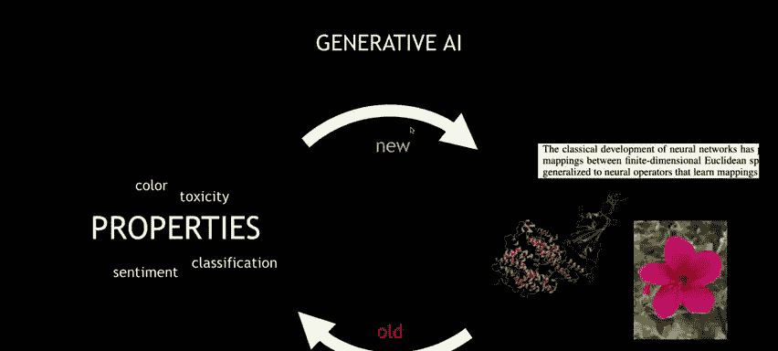

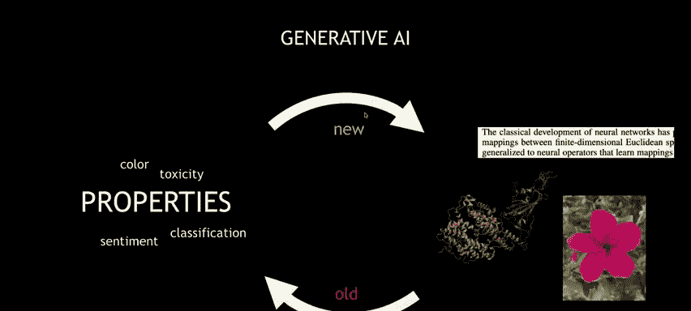

You know these language models came about was to focus more on being able to discriminate within given samples in an accurate way。

 but of course with enough compute it turns out that generative AI is possible right it's really the process of going from specification that is low dimensional。

 meaning a simple prompt or a simple wish list of what you want in a molecule to the actual molecule which is of course in a much larger set of possibilities that's a hard process so you're going from a simple specification to an output that is much more complex but with enough data and scale we are able to accomplish that now。

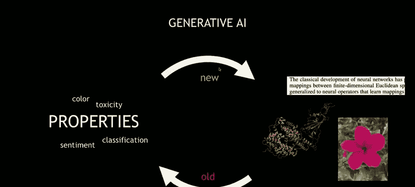

Of course just to again very quickly set the stage for language models。

 the idea is very simple right the way we train language models is to predict what the next word is given all this context so you just learn how to predict this well at scale what we call pre-training and then you give a little bit of human feedback what we call the alignment process which is done with reinforcement learning so it's RLHF and with that you make the models able to understand our prompts or our instruction so that they can respond in an appropriate way and at the same time of course try to make the model so not spit out hate speech or anything that is bad you know in many ways so you know the process itself is very simple right so it's all focused on getting as much data as possible in fact internet scale data。

😊，And then learning to predict the next word and then from just that very simple aspect of looking at what is the likelihood of different words that would appear given the current part of the sentence。

 you're learning the underlying meaning in certain way。

 like you understand how words appear in different context by learning this at scale。😊。

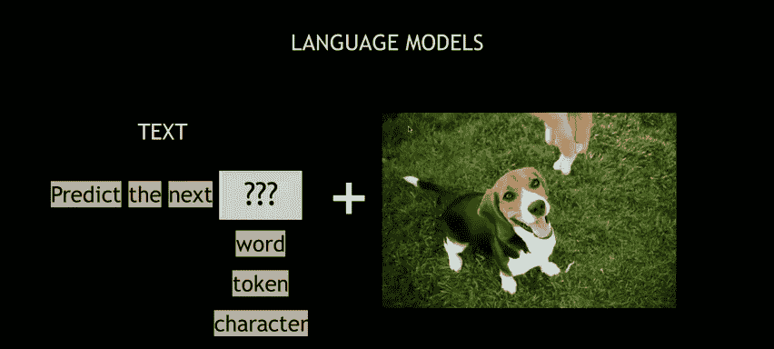

So of course language by itself is great for a number of applications。

 but not all of them and ultimately what language lacks by itself is embodiment right so you can learn how different pieces of text are related to one another or what is the underlying meaning of words。

 but words need to translate into actions when it interacts with the physical world。

 and that's where we need an agent or an embodied agent where you take like instructions in text or interact with text in a certain way。

 but ultimately convert them into actions。😊。

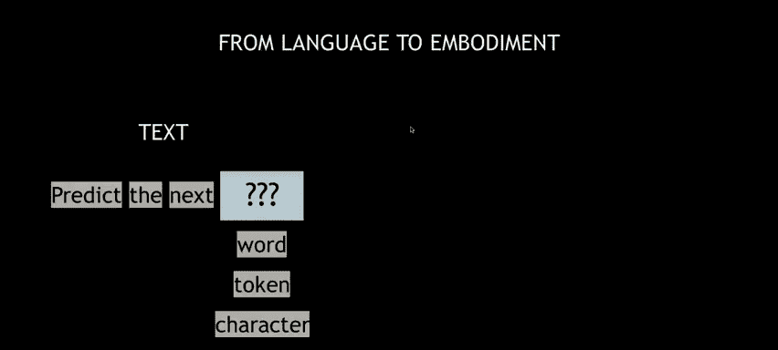

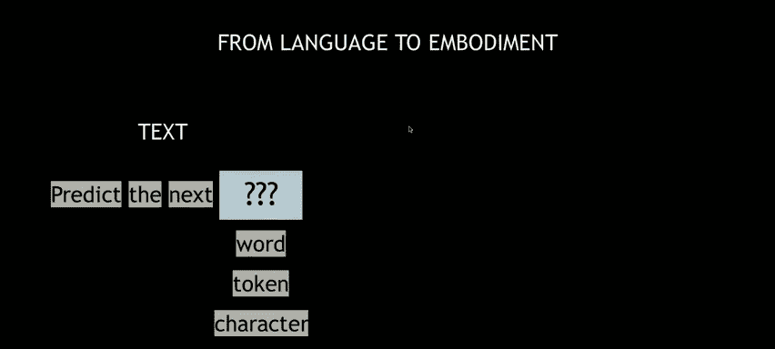

And so this is one of the early work we did at NVDdia where we in fact in collaborations with also many folks here at Stanford where the idea was to give instructions in text about what objects to pick in place so you see a mix of image and text as instructions and have this ability now for the robot to execute a whole range of different tasks right so text is a nice way to provide now the ability for robots to be generalists。

 meaning not just be trained to do one specific kind of task or pick only one specific set of objects but now in a zero short way generalized to new ones。

😊。

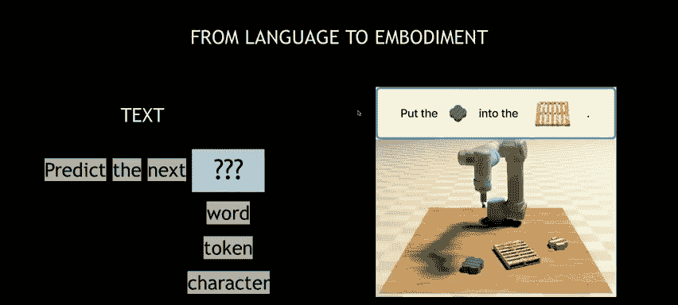

And it may not be just in the physical world it can also be in virtual worlds。

 the  Voyager work we did was to show how you can use language models to now continuously learn skills in a variety of environments including Minecraft so you can progressively learn skills from simple to complex and also use the skills you learned beforehand you know this is how we humans do right so we pick up certain topics and as a curriculum we go and tackle harder and harder problems and that's what we thought our agent to do to use language models as a way to come up with actions that you can execute in Minecraft but also decide what to do next and this is where it's different from standardly reinforcement learning you know when Alphago beat the world's best go champion about a decade ago that was very surprise。

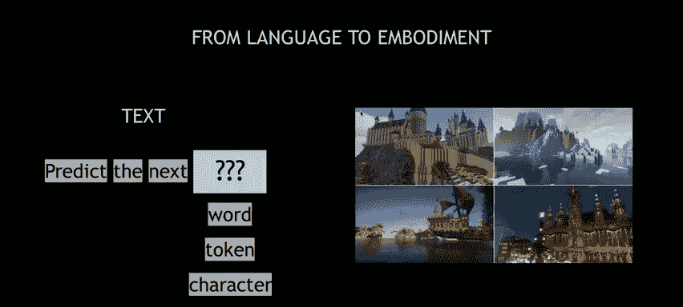

That AI could really be able to you know go through so many possible moves and pick out optimal moves that were better than the human。

 but then it was focused on just one game and one task so the goal was just to win right so that was already predefined whereas in Minecraft I don't know how many of you have played Minecraft it's about creativity。

😊，You don't just like focus on one thing right you can go build these castles that you're seeing I think somebody has even built a CPU and GPU in Minecraft so it's endless what you can do and that's where I think the promise of AI agencies so language models are not just in isolation but they can be used by these agents to continuously query and get help but ultimately those agents are figuring out how to。

😊，Continue to gather skills and solve increasingly harder problems in environments and the Minecraft is really a showcase of that。

 you can think of the same for software applications for all kinds of software programming and you're seeing that in a well。

 I think it just goes off to sleep if I。😊，Oh。Yeah， we'll see。Yeah。

 so you know the one thing that still lacks if you only do language models is the aspect of dealing with hallucinations。

 so these models currently are not grounded in facts， of course if you train on all of the internet。

Everything is mixed together right there are people telling jokes。

 poetry to software code to mathematical facts and now if you're asking language models to prove theorems you cannot expect it to be1 hundred% correct you know it can claim that this is the correct proof and you know many times GPT can be wrong and instead what we did in this project and that was one of the suggested reading that I had given was to now add with language models that ability to verify whether the statements the language models are making are correct or not and this one we don't need to build you know there's decades of work called formal verifiers or formal theorem provers and Lean is one of the leading ones you know there are many but there are for several reasons many mathematicians including Terry Tao whos one of the leading mathematicians they use leanan and there's a large community built。

😊，This formalization of math into Lame。So what that really means is if you go read a math paper and you look at all the proofs。

 you don't know if it's correct or not like you as an expert mathematician may go and try to be like okay this one's correct this one's correct but instead if you had a program that could certify that every step is correct then you kind of first of all you know don't need to worry about the correctness of proofs but ultimately the same concept is useful。

😊，In a wide variety of areas you know especially safety critical areas a lot of the control of let's say aircrafts or drones。

 rockets is done with the same notion of formal verification so every step of the program you have to certify to be correct otherwise it's just too unsafe to use programs without that correctness and we can do the same in terms of using lean but combine it together with language model so language models now propose ideas language model can say oh I think to prove this DCCD which is the greatest common denominator which again you don't need to know the specific notations in the proof steps language model can say oh this is what I think the next step in the proof phase and then lean as a verifier can certify whether the step is correct or not and so this way anything that is proven by the language model。

😊，Is now 100% accurate so there's no hallucination and you can do this in math because you can correctly verify and certify every step and in other areas not so much if you're talking about social beliefs or moral issues you know you cannot say okay this step in the logical reasoning is correct and that's why let me go to the next step but with math we can do that and that's where I think you know domainspec applications of language models can be done better right you can remove hallucinations in many areas and specifically if you can have verification like in math you can  hundred percent remove those hallucinations so I think that kind of logical reasoning is really important ultimately for AI to succeed in many of scientific domains。

😊。

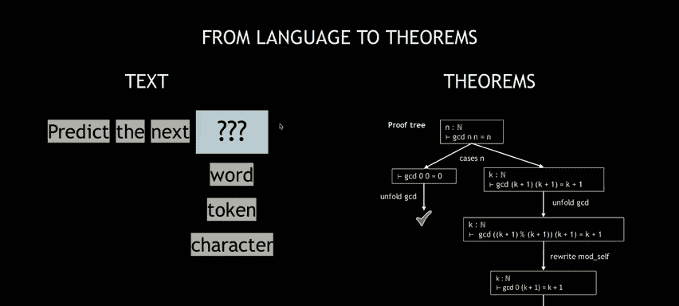

And so you so far I talked about how language models could be used in a range of different applications。

 but you can also change from language to other modalities， other kinds of data。

 and one of the such areas was using now genomic data instead of English language or any natural language。

😊。

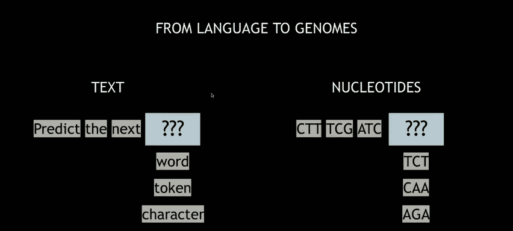

So what that entails is now you have sequences of nucleotides right， the ATGC。

 if you remember the DNA and then now you can give these sequences and again as the now genomic language model to learn to predict the next set of nucleotides in the sequence and what this does is learn the underlying intuition of what genes do。

 you know what is the functionality of different genes in the same way。

 what is the meaning of underlying words in natural language so it's the same analogy that holds，😊。

And again we do this at scale， we did the first genomic language model where we train it on more than 110 million genomic sequences of many known virus and bacteria。

 so this is the UK biobank it has the biggest collection of known mutations of viruses and bacteria。

 so everything from flu virus， you E coli coronavirus so everything you can think of we collected all of them and again the differences is if you're asking a biologists they're usually studying one specific virus right they're looking at flu。

 they're looking at oh how could it mutate the CDCs trying to come up with some best guesses of what would be the best mutations and then creating vaccines to target those mutations but now with the use of these large scale generative AI models。

 you can now look at how are all of these different virus and bacteria evolving。

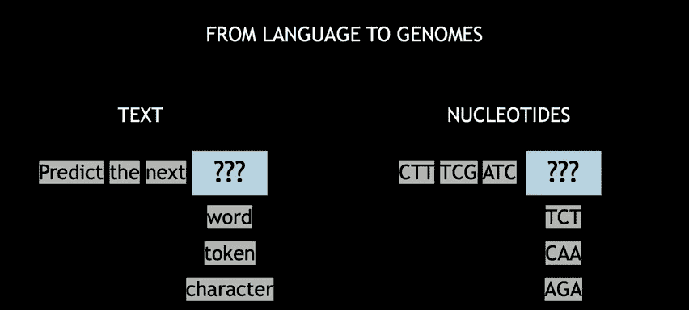

Over time because you're learning across all mutations you can figure out which ones are more likely to happen than others and hence coming up with a way to predict new variants of concern and that's what we did where we fine tune the model just to focus on coronavirus so during training we showed it the variants that appeared just in the first year of the pandemic which was alpha and beta variants right so the other ones hadn't it appeared but the language model trained on genomes accurately predicted the variants that emerge later like Delta and omicron so what the model is able to do is successfully learned the evolutionary dynamics of how viruses are likely to mutate and this is very helpful for us to get a hold on all the latest pandemics I mean we haven't had done the bird flu but I imagine thatll also do with。

question so that's amazing so was able to make vaccines in advance or is that the idea that you would have a vaccine before the very even appears Yeah exactly that's the idea I mean by the time we were training this already the Delta andomicn waves had just kind of passed right so for this pandemic it was a bit late but hopefully't do you can also start predicting what some of the characteristics are or is that beyond what you guys and precisely the next question right so you can now produce these genomic sequences but what is the impact I mean which ones are more concerning than others which one should be a certain set of base pairs might lead to a。

More lethal exactly exactly but how do you study that and to do that you know in this example what I'm showing you is how does the spike protein of the coronavirus which is in blue interact with the protein targets in the human body so you need to understand where is the binding strong and where is it weak so a strain is much more lethal or more concerning it tends to bind stronger and that's when it's more disruptive in the human body right so just by looking at the genomic sequence you cannot gather all the information of which variants should we be worried about on the other hand if you now go into the details of the biological process itself what does the virus to how does it go into the human body and bind with protein targets inside the body as well as other aspects to we studied we looked at how does it get transmitted in the respiratory aerool？

😊。

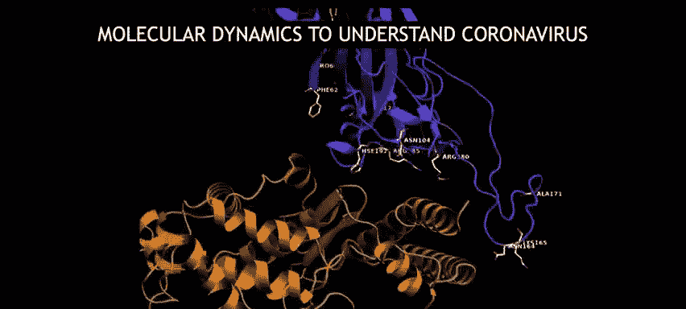

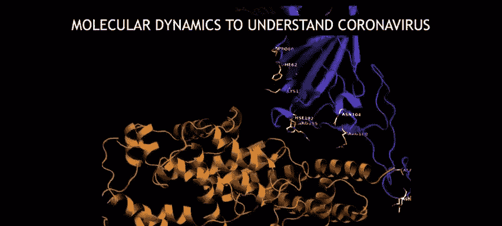

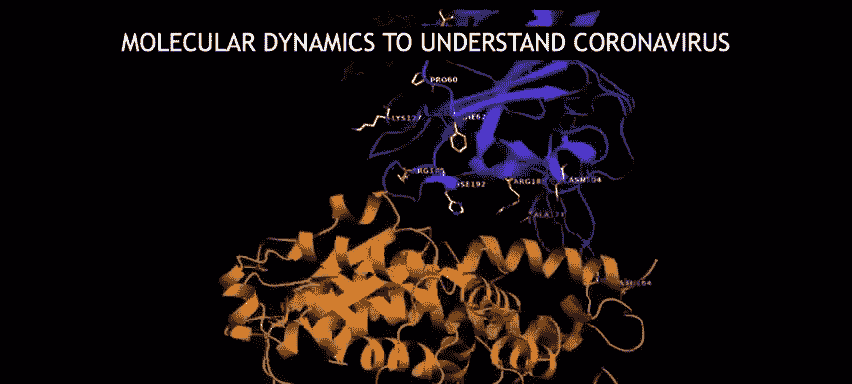

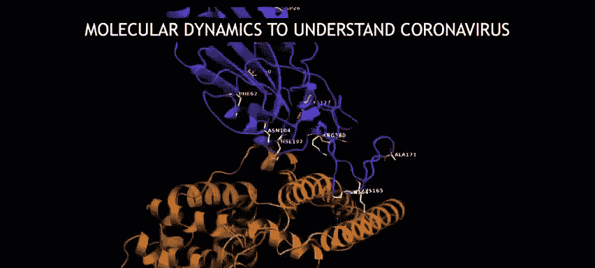

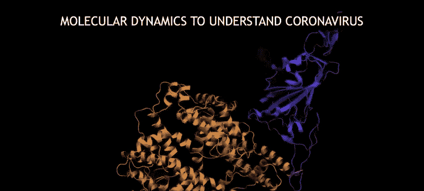

the molecules it binds within a respiratory aerosol that makes it infectious right you transmit through that and also how well does it replicate and what kind of factors help or hurt the replication process of this virus and so this is where to study all this。

😊。

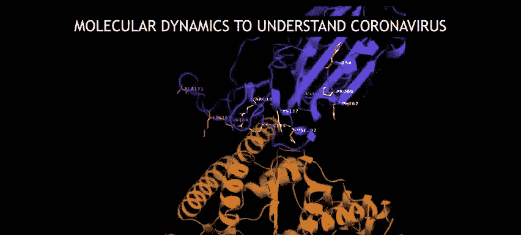

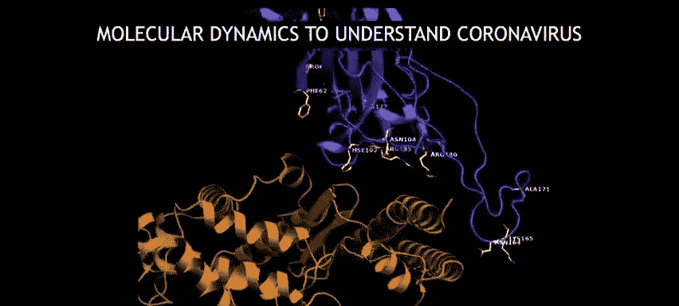

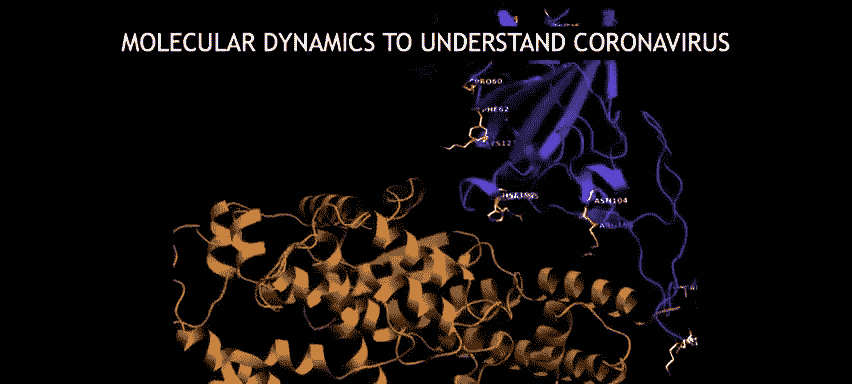

You cannot just look at discrete data or a sequence kind of data。

 you know I made this analogy that genomes are just like language。

 you know instead of the English language with 26 alphabets you have only four alphabets which is ATGC and you have that sequence and you learn a model in a similar architecture use transformers just as you did with language but now to study these kind of processes which is now in space and time。

 so in space you're looking at what are the binding which molecules bind with each other and also how does this molecular dynamics itself change over time。

And these kind of processes are just。You know abound in nature you can start from all the way at atomic and molecular level to planetary scales so in the second example of planetary scales you can think of what is the weather going to be tomorrow you know will there be storms will there be rain and for that。

😊。

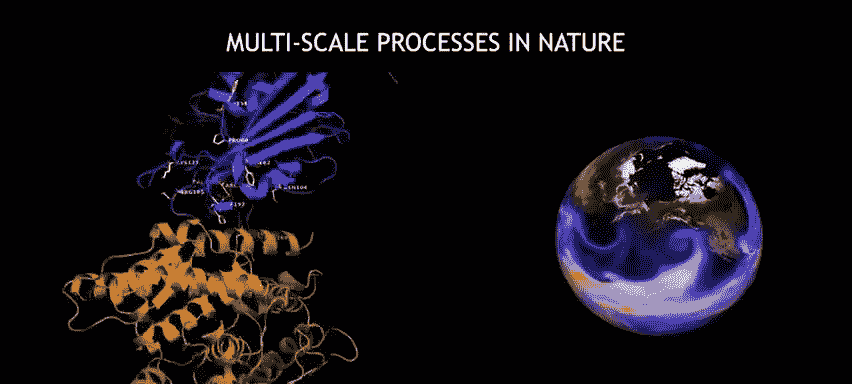

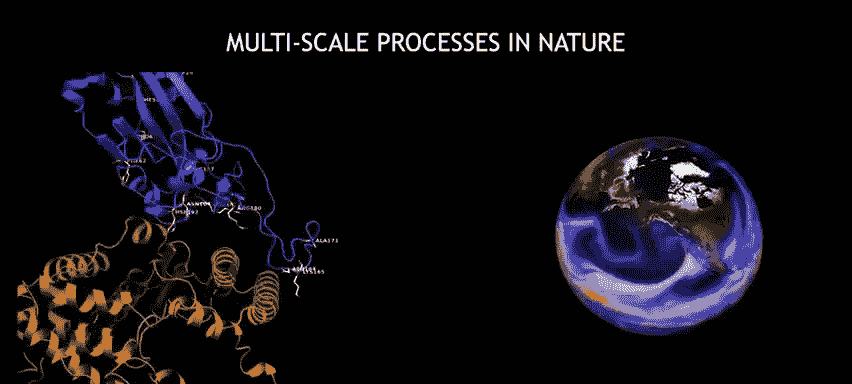

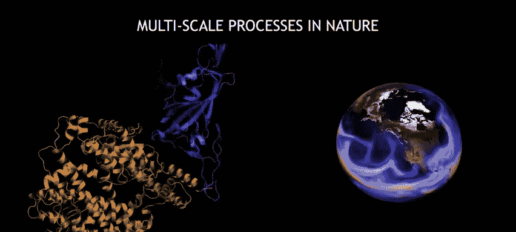

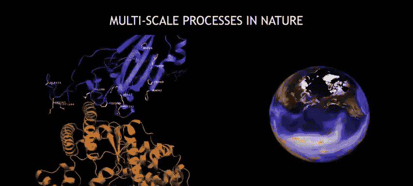

You're looking at processes that involve everything from you know what are the particles within a cloud that cause precipitation to these very large scale effects like atmospheric crs which are important for California because that's what causes storms in winter and they can be thousands of miles wide so you have from microscopic to macroscopic phenomena that are all interacting together to cause the weather on this planet and that's the aspect where you know just language models by themselves will not be enough right like language is a high-level description of certain phenomena just as math is a high-level description you know you can in fact describe these processes through mathematical equations so if you're looking at molecular dynamics you can use Newton's loss of motion to describe how the molecule will be stretching and moving。

😊。

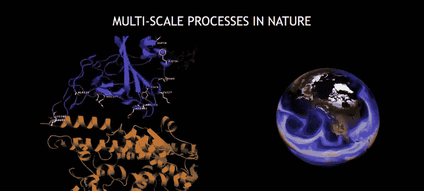

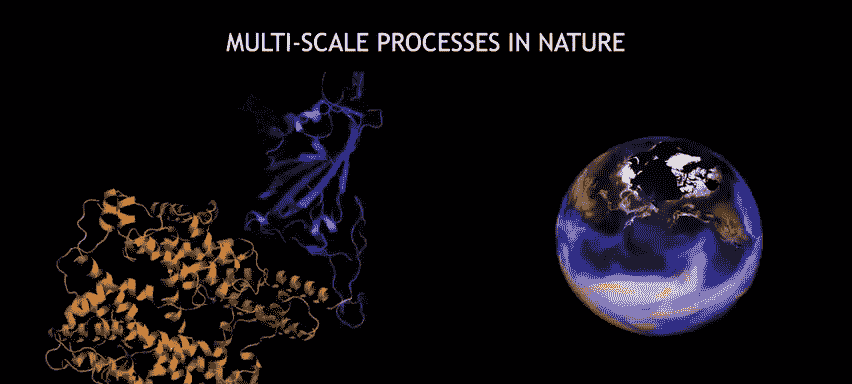

You can also go down to the quantum effects and use Schrodinger's equation and all of its approximations。

 so we you know we perfectly know the equations that describe these systems。

 but what's challenging is the ability to simulate it at scale。

 in fact to do that for quantum simulation you would be needing more than you know the computation would take more than the age of the universe even to simulate just a molecule with 100 atoms。

😊，So that's the bottleneck， right， So here its we are in a different regime compared to language models where with language。

 it's very difficult to。😊，Try to describe the rules。 know， there are too many exceptions。

 There's not just a mathematical equation to describe all of English text。RightOn the other hand。

 we have lots of data on the internet and we're learning from that， but on the other hand。

 if you want to try and learn these kind of physical phenomena， the data is limited。

 you know there's certainly some observational data you can go and look at these。😊。

virusrees and under a microscope try to look at what is happening with these protein interactions you can go of course with satellite data try to assess what is the kind of wind and other patterns happening in our atmosphere so you can get some amount of data but it's limited and now the question is is there still a notion of generative AI or large scale AI models even for scientific phenomena？

And the way we can do that is to incorporate this knowledge of mathematical equations。

So either we can use existing simulators to generate data or we can directly try to incorporate the knowledge of physical loss and equations into our models。

But the one challenge to do that is this requirement to capture really the fine scales。

So if you want to understand how clouds in our atmosphere move you need to get to these really fine scales and that's what makes these simulations very expensive if you did that with traditional numerical solvers so for instance if you have to you simulate clouds the resolution you need to get to is of the order of maybe 10 meters or so which is even within Stanford campus you need multiple grid points。

 lots of them and now think of doing that at a global scale。

 that's an extremely fine resolution image of the earth you need to do and you need to then also do that in time in very fine increments to get accurate simulations。

😊，And that's what makes this infeasible when you try to do it with traditional simulation methods。😊。

So what traditional simulations try to do is look at equations and try to directly solve them so they're not making use of any learning from data they're saying。

 okay let me try and solve these equations but to do that I can only take small steps and then I need to take a lot of such small steps which becomes too expensive。

😊，And also， if the area itself is large， I need large memory to make the grid fine enough to make this solvewar converge。

And this is where AI now has the potential， not only the potential now we have the evidence that it can speed up solving these kind of mathematical equations in a much faster way than possible before so the analogy is similar to what you see with computer vision before deep learning。

 people were hand engineer features right so if you had to classify a face there were certain features which were thought to be better exactly like try and look for the eye。

 so you could go and hand engineer every one of them but the tail is too long。

 you can't like try and do this for every variation of the phase， every angle。

 every lighting and same with in a way the numerical solvers you could try and hand engineer the features to try to make it converge but you don't know if those are the best features。

😊。

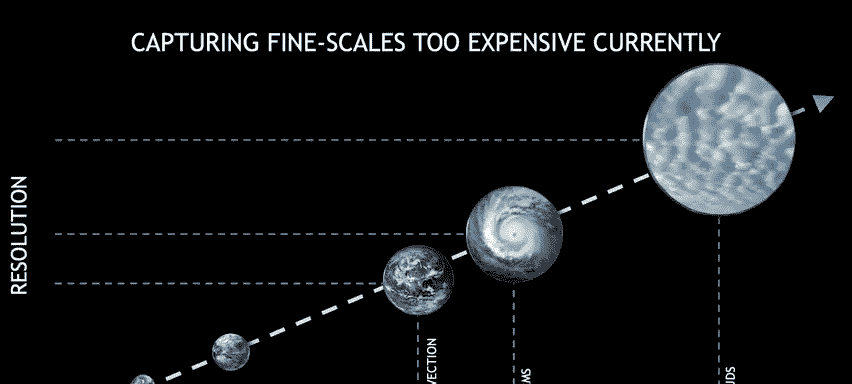

And even though women require a very fine grid， if we try to directly solve through all of these points。

 you could find a transformation to a。😊，nonlinear throw a nonlinear transformation to a latent space where the grid is much coarser and you get a speed up。

😊，And that's what we did with the use of these techniques called neural operators。

So neural operators are extending the notion of neural networks like transformers。

 but to now continuous spaces。😊，So if you think about now you know how I mentioned about clouds right。

 so you can try to model the cloud at a certain resolution， so on the right。

 if I choose my resolution to be two cores，😊，You know I get garbage right it's too blurry。

 it's not enough useful information to actually predict how the cloud is going to change over time and that's the challenge with a lot of the physics if you don't make your grid fine enough。

 you will not be able to accurately capture the prediction in terms of how the fluid is going to flow。

😊，And this is where it's also different from computer vision where it's more about visual appearance。

 you know if for me visually it looks good enough it's good。

 but that's not so true to get the correct physics in terms of accurately predicting what will happen to fluid flow like clouds so what we did with neural operators was not to worry about fixing the resolution to just one value instead think of how in graphics you have vector graphics and you have rastergraphs right this is the same analogy here in the ratographs you prefix what should be the resolution。

 what should be the number of pixel cells and if you go further zoom in it could just gets blurry because you haven't increased the number of pixel cellss。

😊，On the other hand with vector graphics you represent the data as shapes right you parameterized them as shapes and you can keep zooming in and you can still get sharp images。

 sharp graphics， and the neural operators do the same but instead you learn what those shapes should be。

 so you're always representing the output as functions that are continuous and so you can keep zooming in to any resolution and it can still give you valid answers。

😊，And so the neural operator learns the functions and save of you programming them from a neural net from the data so you can now give it data of fluid dynamics of various scenarios or you give it weather data。

 you give it data of how material stretches， so all of this you don't have to fix beforehand what should be the resolution。

 and in fact you can train it on data with multiple resolution。

And a neural net can fit any arbitrary function so you can make it arbitrarily exactly and you can so the main differences in text with transformers you're learning on discrete tokens so you fix what is the vocabulary of your language and you're giving a token for each part of the vocabulary right and that's how you get the tokens on the other hand here we are not definedying the tokens at one resolution instead we are saying these tokens could be infinitely defined into any resolution I want so we're giving that flexibility。

😊，And I won't get into the technical details here， but this is just saying that by doing so and capturing the final resolution。

 we can。😊，Get to the finer scale so on the right is a plot in terms of like how we are accurately predicting what happens at higher frequencies or finer resolutions。

 even though the model didn't see that during training。😊，So how do you define the function？

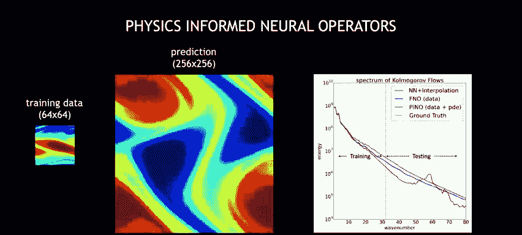

If it's like。Dedence on。So a function varies yeah and that's the beauty of it with these models you learn them from data you don't fix them beforehand so for instance if I fix the function to be just sine waves right like sinoids that's what the 4ier transform does but that's too limiting if my model is not sparse in terms of sine waves then I can't accurately represented like inferring the function Yes precisely it's learning the function itself from data what should be the function。

😊，And it's learning that through these nonlinear transformations in between just as any neural network does。

 just as transformer does， and because of that， it's trying to find shortcuts to solve these partial differential equations more efficiently compared to numerical solvers。

 which are already having a fixed path of how to solve it。😊，Yeah。

So can you sort of think about this as a dimensionality reduction functions instead of normal exactly so what standard neural networks do is do dimensionary reduction。

 but in a fixed resolution right you decide what the resolution is that training time and a test time you're forced to be at the same resolution。

 but now we'll remove that limitation and say the input and output can be given at any resolution and I can still learn a dimensionary reduction I think there was a question there numerical data compute costs give what iss different10 times100 times and a million times I that true So plasma my evolution it was a million times plasma my evolution in nuclear fusion and for weather prediction it was。

😊，Tens of thousands of times。 And so what really determines this is how hard is it called the solveware to。

😊，You know the need to get to the finer scales so something like plasma in a toma reactor can become extremely unstable right and what scientists need to do is make the grid very。

 very fine to try and understand when will the plasma suddenly escape confinement and become unstable cause disruptions and so the harder the simulation is think the gains will be much more you know something very simple like a pushing a ball maybe we won't get any speedup because it's so easy to directly just solve it in closed form you can tell me what that is right there I don't need this so think of cases where you need a very fine grid to solve because it's highly unstable or nonline the effects those fine scales have on the broader sense So earlier you spoke of how with regards to mathematical proofs there is this notion of using verified。

😊，To check the outputs say we're solving some system of PDEs using this neural operator how are the verifiers kind of extended to this That's great and that's I mean that to me is like a world where all of this comes together right so the theorem proveer is purely symbolic right now in a sense you're looking at what are the variables。

 you're formalizing those statements right and you're proving them step by step there's no numerical solutions So you're never making the variables into specific values and solving them on the other hand。

 this is purely numericals So right now if you give me navier strokes for fluid dynamics I'm just directly trying to solve it I'm not symbolically manipulating or making any kind of further modifications but one day there could be a neurosymic method right where you try to make valid transformations that make the equation simpler maybe not for navier strokeokes。

 but especially coupled equation。😊，lots of them you try to minimize it in a symbolic way。

 but you also try to numerically solve that better and right now the main bottleneck is these veryifiers like lean do not have a lot of good support for calculus or differential equations because。

😊，There are like areas like topology where it's purely symbolic right and so more of the energy is there。

 but one day that would be a way to bring in neurosymbolic approaches to this。😊。

So let's actually have everyone say their name， I think they're useful for and maybe some context yeah。

😊，I guess my question concretely， what's the difference between the inputs that go into a neuro operator which go into a classical machine learning at vision like a or higher resolutions but it's still otherwise it's the same thing so think of it as a video model right it's like SoOA or any video model you can give it space and time so it can be like a three dimensions in space and in time or two dimension in this example so it's the same approach as in a vision model the only addition is now the flexibility to directly input multiple resolutions both a training and testing time。

😊，So you have to change anything in terms of the standard layers you use to adapt the different shapes So the main change is to make it now flexible in terms of handling these inputs and outputs so in the middle layers you can still use a transformer you can still kind of make it into a coars or grid and use any of the standard approaches so think of it as mainly the input and output you need to make changes but looking at it in terms of the class of architectures you can take any of the existing architecture like a convolutional a transformer and extend it to now handling multiple resolutions that's essentially what these are doing so this is not a new architecture in itself but it's more now a superet of existing class of architectures。

Hi students studying follow methods and so just coming back to the computational gains you described earlier。

 you've mentioned that you've described the models that you're using talk a little bit more about the architecture so more like these large transformer based models or these results coming from regular know like fully connected networks and stuff like that so like I mentioned know in the general sense these neural operators are an extension of any neural network so you give me a neuralnet I can turn it into a neural operator meaning I can make now the layers of them be able to handle any resolution of input and output but of course among them which one is a good candidate right so in this example what we've done is use fourier neural operator so it has fourier layers but it also has non nonlinear layers like MLP like even attention layers you can add so it has a combination of that and the Fourier tends to be。

Veryry good for a lot of these applications， especially in fluids because you have interaction across multiple scales and that is better described in a fourier domain。

 but unlike a traditional method it's not purely based on Fourier transform right you have these nonlinearities in between and that's how we learn a more expressive basis than purely a Fourier basis could you talk a little about how you land on fourier how did you know if that was the architecture there's some fine along the way Yeah so this actually came from our discussions with my collaborators in applied math and those who've been using numerical solves and it turns out for fluid dynamics a popular solveware is a pseudopectral solveware where you go to the Fourier domain you make some steps or iterations。

 you come back to the standard domain and you go back and forth and we realize that in between you could add a lot of nonlinear layers you could also add nonlinear encoders and decoders。

And with that you make that expressive so in that sense a special case of that is still the numerical solver right so if those models just learn identity transformations then you go back to your original solveware which is a valid solution but you could do something much better than that and so we came at it while trying to preserve the properties that numerical solverss already have but extend the expressivity of those models but it also has a nice connection to transformers and others so it kind of meets both the traditional simulations and neural net in a nice way if that makes sense that's a quick。

😊，yesd and I'm curious about the mechanics of the specific network so when it outputs， for example。

 its next frame prediction does it plug that prediction back input to get the next frame or again we have multiple options you know that's called autoregressive if you plug it in and do one by one for something like whether model that's what it did but we've also had models where you can roll out in a latent space so you don't need to do that in observed domain we also have models where you directly output you know answers at any time step by also having like a four year or other kind of approaches that can do any resolution in time as well So again there are many different candidates and it depends on the use case what would be the most appropriate。

Great I know lots of questions to keep them coming so I wanted to just show some of the use cases of where we've used neural operators the weather model was one of the first complex domain I would say where we chose this so what makes weather challenging is you know first of all it's higher resolution this data is like 25 kilom spacing across the globe and we have historical data going back to four decades and it's not a lot of them about 50000 samples which is nothing compared to the language models of the world right so it's good amount but it's 10 stamp 50。

000 like initial condition to next time steps so pairs of data and how many so if it's every 25。😊。

How many how many grids thousand something in each like 000 odd like 1200 or something like or 1600 I forget you can do the math globally with so think of that as like the image it's you know for computer vision it's a fairly high resolution image but also we don't have a lot of samples the other thing that makes a challenging is also many channels right so unlike RGB for images you now have wind speed humidity you have different layers of the atmosphere so there are like more than 10 variables so you have this high dimensionional challenge of。

😊，You know coming up with the weather and when we started working on this in the late 2020s you we had come up with neural operators we wanted challenging use cases。

 you know the fluid dynamics was already considered challenging enough but we wanted to also touch something that you know directly impacts the real world but many people thought we were crazy this is decades of methods that are developed for forecasting weather and I do remember growing up and thinking you know one of the use cases for supercomputers was always told you know I was told that look at weather models。

 whether forecasting that needs a big supercomputer and so our question was you know how much can we do well with respect to using neural operators and a completely deep learning based method meaning I take my initial condition now and I use now a neural operator to predict the next you know the time step like the weather at the。

😊，say in six hour increments and we do this auto aggressively and we can give like two week forecasts based on these predictions and it turns out that it is much faster the first run of the model it was about 45。

000 times faster than what you can do with numerical models。

So literally what would take this big supercomputer based on CPUUs。

 you can run this on a local gaming PC so all you need is a consumer grade GPU and the model is open sourced to so you can download the model and run your own weather model we've open sourced it with permissive license and I think that to me is what shows the promise and the ability of these models to really miniaturize what is considered as very complex physical calculations and do pretty well this model is also running an EMWF so you can go get real-time weather forecasts so these are just some of the charts of what do different weather variables how are they predicted and it has predicted some of the hurricanes last year even better than the numerical models so it's not just being faster tens of thousands of times faster and the price of accuracy。

But you can get both accuracy and speed。So you know what are we doing。

 how is this possible right usually it's a tradeoff here we can do it because we are learning from data so when you're doing a numerical solver and the traditional weather forecasts。

 you assume there is navi strokes and you assume there's a certain res numbers so you're making all these modeling assumptions and you're not able to train all of that with the data itself you're not using the data to inform your modeling choices to a big extent。

 you know you can calibrate still a few parameters。

 but it's only few of them you're not adapting the bigger set of variables to the data that is available and this is what now neuralbased models allow us to do they can adapt to the data and many times these modeling errors are huge and that's why learning from data can help us get to better side does that mean that there's some other underlying physics that hasn't been written down that's driving the weather。

😊，Not navier strokeokes is it discovering some new physics is a more way of saying it that's a hard thing to say right because either navier Stokes itself is wrong again there are papers of all kinds of edge cases where Navier strokeokes may not be perfect but the likely answer is you don't know precisely what is the kind of specification in the sense of like what is there an all number here and how does Navier strokeokes interact off exactly temperature and it's also imperfect observations you're looking at satellite data that is irregular and in fact in the global south the predictions right now are much worse you can barely predict over the next three to four days compared to in the developed world where we can do up to twowe forecast as many sensors satellite much less satellite coverage so that is a big factor but what。

These models can enable us to do is further adapt to maybe even limited regional data you can have weather balloons or something low cost and further refine and learn from that data and so this gives the ability compared to standard models which are quite just to be clear it sounds like mainly you're learning more precise data not necessarily under not necessarily that。

😊，Physics is wrong or we're not decoupling the two effects， but if it's learning something。

 it's making predictions different than what the pure equations would have said。

Is that mainly because the data is different or is it possibly because there's other things going on driving the yeah it could be a combination of both and that's what we we currently haven't decoupled meaning it could be you just know you have partial observations so you' been precisely specified your numerical model and that's why it simulates it wrong or the equations that are being simulated itself or at all and I think in my view it's more of the former because these equations have been stress tested in all kinds of wind tunnels and it's mostly okay right but then if there are like all kinds of changes in Reynold's number everywhere in the planet and you don't know how to model that you can make big errors because of those modeling choices let's get a question。

嗯。ThatIn is。I'm from the MBA program so I'm thinking about the institutional take up of these technologies a lot of times in this class we discuss how things are extremely disruptive but as I look at this you're looking at a traditional weather forecasting institution that has been able to uptake the technology that's 45000 times better can you talk to me a little bit about how these technologies are maybe not as disruptive and how these improvements are taken up by existing channels without as much change or was there a lot of sort of internal shift in the community as this technology is taken up Now that' that's great and know I think I alluded to in the beginning a little how there was so much skepticism and in fact coincidentally just before we release the model there was even an opinion piece can deep learning be numerical weather models and kind of the conclusion was known and no there's so much needs to be done maybe years maybe even decades。

Before that happens， so I should say a lot of people traditionally who are you know who don't like the black box nature of machine learning were very skeptical right first of all that it would do a good job because you you have rare events like hurricanes right you don't expect to do well on hurricanes what machine learning tells us is to do well on typical events maybe whether like in here in Stanford every sunny but it turns out that you can capture those events as well pretty accurately and sometimes even better than traditional models it could predict things it had never seen before it could get predict a hurricane without having seen a hurricane so it did see some hurricanes right so it's able to do better on that and also we did some kind of even more drastic stress testing like being able to put like a big blob of heat near the equator which is almost unphysical because you can't just heat up just the ocean。

in some limited and by I think three or four degrees so we did these extreme tests which hopefully will never happen on this planet。

 but again what happened was something you expect it kind of like the heat dissipated into other areas of course it heated up other things。

 but it was behaving in a physically valid manner even though we were giving it such extreme conditions。

😊，And did you get much I guess it's being adopted there and to why its question tells us a little bit about the resistance and so to kind of complete that story we had this skepticism but we were like no we have the data anytime you give data to a machine learning person which is going try and do it rather than debate beforehand if it works or not and I think that to me was really the starting point and once we showed that you know it's quite competitive to numerical weather models。

 there were other groups which all again took up just as we do in computer vision or language it's never like one group you said suddenly see many a lot of activity in the whole area as well as know I was quite surprised to be honest like a traditional agency like ECMWF as well as NOAA which is I stand for you see ECMWF is the European Center for medium range weather forecasting and NOAA which is the North American atmospheric。

Administration administration thank you so both are using these models they're heavily working they're further you know training on their own data right and improving these models so I think I should say that I was a bit surprised how quickly they took this and employed it but I think once you show them definite proofs because we use the same metrics they did it wasn't just right like one specific variable like wind or temperature。

 but even extreme weather events like hurricanes typhoons。

 we documented a lot of the statistics of how well it works and we talked to them a lot so you know this was done in collaboration with scientists in weather and climate community and that also I think matters to ensure we do the right thing。

😊，Yeah。Yes， so I was wondering whether these neural operators should be viewed as accelerators for existing algorithms or are they an entirely different class of algorithms or maybe。

Do they have like the same computational complexity or are they just generally faster So compared to numerical solverss。

 they're generally faster because the numerical solveware think of it as a special case of architecture within this class right and if you correctly you know chosen your architecture and trained it well。

 you expect it to be faster and better and that's what we see in many areas it's only the question is what is the level of speedup right and the general rule of Tmbas if you have like numerical solves that require a very fine grid and the phenomena is more nonlinear and unstable。

😊，We tend to get even better speedups with these models。

I'm a PhD student in science department how does your model compared to say other models like Gcast from Deep yeah so graphcast was one of the models that followed based on what we do right so graph is one way to think about again like looking at the relationship between neighboring grid points and you can do that in a hierarchical manner and so what we did was to like look at it like treat the world as a sphere and then look at you know if I did Fourier transform on the sphere right its spherical basis and learn the coefficients in that basis and combine them with nonlinear layers so we're going to release an updated architecture where you can think of it as a hybrid that is both graph based like it has local connections but it also has global information that still treats the geometry as a sphere so I don't know。

If I had that here I don't have it in this set of slides but we can show the benefit of treating the world as a sphere and not a flat earth not a rectangle is if you make very long rollouts so if you now not just try to predict weather for one or two weeks but do that for years right so you need this for climate predictions very long-term predictions the model with thepherical geometry tends to be much more stable compared to treating the world as a rectangle because at some point the predictions are no longer consistent right because it's not。

😊，Constraining it to be on the sphere and it tends to blow up and become unstable and that's I think the other just high level idea to think about when applying it to scientific domains it's usually not one objective function even if I tell you the loss function is predict the weather in the next six hours and make that accurate that's usually not good enough right with the weather model you also want the ability to go longer term you want it to be able to do extreme weather which is rare events so that's the difficulty in a lot of scientific domains the many multiple objectives and sometimes you can't even define it as a loss function so try to incorporate more of the domain knowledge and constraints to make the model well behaved but for question just looking at the time here also so I don't know if you have more I can also I'm happy to take questions that's a more fun thing and I can then quickly wrap up after I just have。

😊，few more slides just kind of unifying this notion， so I'm not going to introduce much of new ideas。

 so happy it is how are yeah。😊，I'm a CS undergrad， I think like you mentioned a lot of these like different objective functions for different models。

 I just want to get like a land like the current weather modeling landscape whether。

whether there's like a bunch of different like mixture of models for this specific use case or this specific climate or like you know something in the desert is a desert model like what does that look like right now I mean right now it's a global model right it's learning like across the globe which we treat it as a sphere it's learning the dependencies so we' are not again doing specialized models for different say geographies or different conditions it's implicitly determined by all the variables you know we have like variables that describe the temperature right that describe humidity pressure so you know you know implicitly what's a rainforest and a desert but we are not doing anything further explicitly。

Yeah。Yeah on that same kind of thing you have multiple models have you are you thinking about on certification can you validate them using one and maybe an adversarial model to kind of challenge it a bit Yeah so this was the next thing talking about uncertainties so there's different kinds of uncertainties but it turns out especially for extreme weather like hurricanes the kind of uncertainty that matters is what are my current condition so if you slightly change the path of your。

Current hurricane prediction right， the hurricane is still here you know in the Gulf of Mexico and then whether it's going to hit Florida or make landfall。

 how do you predict that early on as early as you could predict the better but of course if you start early on here as you see from the Gulf of Mexico you slightly per a bit the predictions can change vastly because this is what we call chaotic phenomena know if you've seen the butterfly effect either the movie or heard about it right very tiny changes can have big effects and that's the other challenge with us right compared to standard vision models where you have lots of robustness here this can be quite delicate based on making even small changes but what we care about are these uncertainties so not just give me a path of where the hurricane is likely to be。

😊，But the sensitivity， if I now slightly perturb my current condition。

 how much is it going to change and that's what will help me determine what is the probability it'll hit Florida and based on that I can take action you know I can be like oh should there be an evacuation you know should we like plan for certain reinforcement of certain kind and that's where these models are much better than traditional weather models because I think you'll be surprised if you look at the traditional weather models can you guess how many ensemble members meaning how many such perturbations are done to determine sensitivity。

😊，Iant to take a guess？How what is done today right in the actual ECMWF for these？😊，嗯。嗯。

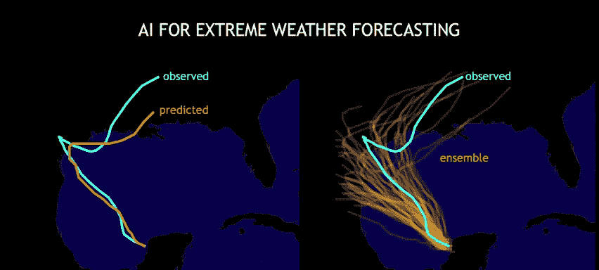

If they call you 10，50。So it's not a lot right if you if you ask about standard deviation of 50 numbers right。

 just 50 samples， it's not really good and of course if you do that do so few is it expensive it's that expensive because each one requires this big supercomputer。

😊，You know all governments have limited resources and we have and whereas with these now models being so cheap you can run them in a single GPU now you can do thousands or even millions of samples right so you can get to the right statistical bounds as needed that's no longer a constraint that you have to limit to just having 50 scenario runs and when it comes to climate models in fact it's really bad many of the climate predictions you see is a single run。

😊，But what is climate， climate is like saying what happens in decades right so you cannot just do one run and say what's going to happen you need lots of runs and this is where bringing down the cost has an impact in making that uncertainty quantification much more and the extreme values may be more important in the region and that's why the extreme weather this is so important if you don't have enough of the spread you miss the extreme events you can you can't even predict that there'll be an extreme event we've shown this not only for hurricanes but also heat waves and all kinds of extreme events that you can capture it once you increase the number of ensemble members right if your hand is in this freezer and the oven and on average it's fine but you exactly you need to kind of have the spread howeverever question。

I'm studying economics I'm really fascinated obviously by what you were talking about if both like the work you're doing on genomics and viral and bacterial mutation prediction my dad is a virologist so this is all like really crazy to think about I'm wondering your perspective coming both from industry and academia how do you see academics viewing this new technology do you feel like there's an openness to it or is there kind of like old guard new guard attention or they embracing it how is that looking Yeah I mean it's similar to what I mentioned about weather models right but its it's funny I think biologists are a lot more open than physicists but that's changing fast but I think maybe because biology there's even less of rigid rigidity of I know the model you know no one really knows right Im sure you can posesit something at the level of molecules what the forces are but try to get all the way to anything that is at the human level or clinical level。

Theres so many levels of uncertainty and it's clear that the more data we can get at all these different levels of experimentation right the better we can be in terms of prediction and so there's been a lot of interesting uses in fact not this genomic model but some of the other techniques we've done in speeding up quantum chemistry as well as the binding process it's been used in a drug that is now getting to clinical trial in a startup that I helped advise and help start that venture so many you know this is now kind of really going into the real world as we speak and I don't think academics are any more debating whether to use its the question is how to use it in a way that still satisfyises some of the requirements you have for traditional methods in fear if we have certain checks and balances to say that traditional simulations are doing well。

 we want AI to。More than satisfy it， right， If it fails those， then it's not good。

 So you still want that， but do better than what's been done before。Yeah。

How much does the quality of data that's put into the models matter and how do you ensure？

Like the quality of it across the world Yeah no that's a great question and in a way were in a better world than language models right language models here' just beholden to whatever is on the internet you try your best to curate and you've seen over time models that have done better data curation even small models have got into very good result including the Microsoft P model the P series and so data quality certainly matters。

 but here we're talking about curated data in lots of ways right so the biobank for the genomic data know these are scientists carefully curating it even the protein folding you know were successful because it's scientists over decades carefully creating that database。

 the weather data all the historical data that is taken from the satellites but further what we call re-analysis so it's further using the models of physics to complete the grid and make remove the certain biases because。

Satellites are not uniform coverage so we are in and of course any kind other simulation like fluid dynamics and so you can generate from existing numerical solvers so we are in a better world because even though it's smaller data it's very carefully curated。

 cleaned up data having experimental validations right for the weather models all of this data has been carefully checked with actual real world predictions right so your any change you're making there is requires a lot of thought and。

😊，And so we are in this better world with small data， but much higher quality data。

And we also have lots of physics in different ways that we can use and be creative about it。Yeah。

Now I'm a senior majoring in political science， I'm curious like as we see the next generation of like G5。

 G6， like what do you think are going to be the next type of like frontier problems that we're going to be able to solve that like we current aren't aren't able to Well agents right so it's very clear they're doing agents and there's also some online chatter about a new model and how that's able to do more reasoning and Qstar。

Well， the GP2 the L they call it G2 Yeah I thought that was kind of a joke but it does solve some of the problems like a math andmp period problem it was able to solve that none of the previous models were able to do I will see I'm not skeptic Jan was Len was saying that they were just memorizing some of the I mean Ya Len is skeptical and many times is correct I'm not I'm just you know repeating the gossip without making a don't disagree the two trends that the agent and then reasoning and stuff I don't know about GT2 and you can you know right now it's no longer about a lot of additional data but really this repeated interaction and alignment right so you can try to reinforce the model to do better on certain tasks by looking at repeated interaction and giving a reward function。

😊，You want to solve the like math Olympia problem in the very end that has a lot of steps。

 so it's no longer just trying to make one step of your interaction to be good but do it over a much longer and that's computationally very expensive but open AI has computes so we're coming back to this question about data and theory because it's very fundamental to everything you're doing and we talked about a little bit before we came down so Rich Sutton has this bitter lesson simple idea that more and more data and Andrea Kapathy and we were talking about how Tesla is getting rid of hundreds of thousands or millions of lines of code replacingre it with machine learning and I think you and I were talking about in language models they used to have rules of grammar that we're very important Chris Manning and others had and now it's just statistical so that's all in one big one direction there but it's more complicated than that because you're showing that if you。

Some theory and some you know sometimes put some constraints on it then you can work with much smaller amounts of data and get reasoning。

 Can you say a little bit more about that is is there a broad arc which is more and more data and less theory or what's going in the other direction and how should we think about those tradeoff so I would say that you know you need to be very creative and nuanced in terms of adding theory or structure into the models right so it cannot be done in a very rigid way that limits the expressivity of the model or the ability of the model to really learn better features based on data so you know the question thing is if you have enough data always go with data it should never be at the expense of data you impose some structure and that's where I think a lot of the previous failures were because in language yes you can try to do a syntax tree but it's not always perfect right but we especially on the internet people use language in all kinds of chrommmatically bad ways。

So you don't have a rule that is perfectly met and also if you impose this the optimization landscape can become much harder so even if it's perfectly correct for a certain domain。

 you cannot learn it because you' impose a condition that is too harsh and same with our models the thing is we have the flexibility it's similar to a transformer but put into now a continuous domain so it can learn anything if it's given enough data you don't need to add any further structure but because the data is limited adding the structure that kind of aids the data it's complementary to the data and still can learn well I think that's why it's a little bit more of an art and you have to be careful so most of the time we just start with data in fact in the examples of whether we only use data the only nature of physics was assuming it's a sphere and making that constraint right we never kind of carefully went and try to do a conservation law of physics。

😊，that you know where the temperature， how does that move we never although it's a little bit when youre describing satellite data。

 I guess they're using some physics to fill in some of the gaps and smooth things so even maybe in curating the data exactly but it's implicit we are not explicitly saying we should always explicitly imposing that is the hard part because optimization gets harder if you say no if when you get the data there's some kind of data point that just doesn't make any sense that does your model try to smooth that over or is it try to。

I mean as with any deep learning if it's only one data point it usually tends to get ignored right if it's enough data points it tries to pick up the structure and that's why if you think about hurricanes it's quite anomalous right you have this hard and cold air like mixing in a weird way that's not normal condition。

 but there's still enough of those signatures even if it's a few of them。😊。

It's interesting and different enough that it picks it up because the model has the flexibility we are not constraining the model to be rigid enough only to have like smooth air flow we are allowing you to capture that and the other thing when you're talking about the。

😊，DNA， the viruses and the protein folding， I mean。

 there's really several different theories there about predicting the next word。

 but also then going from the sequence to the structure of the protein and how that folds and ultimately to its function function and each of those steps you're kind of chaining them together to get is that that sort of relates to the agentic wall with them。

 but having a bunch of these systems connected together that each feed。

To the next one exactly is that what we're going to be seeing more and more exactly And in fact。

 that's what we did in the followup work to that where now you can give reward function instead of the human feedback for language models you can ask a human thumbs up or thumbs down did it produce something that you liked or not and that's how you do our LH and now instead the reward function here is does it bind well give me something for instance based on molecular binding simulation is having a certain binding functionality or does it fold well we don't want disordered proteins that we want ones with good structure So all of this you can give us reward functions and you can do reinforcement learning or what we also call direct preference optimization which was actually developed here at Stanford So these techniques we can now use and we can change both models that produce discrete sequences with models that have predictions in the continuous real like binding for instance and bring all that。

As AI models make it fast， but also have the ability to differentiate through that and come up with ultimately good functional proteins。

 which is what is a huge impact in real work。😊，Let me just like you know。

I just maybe there are use cases so this is carbon dioxide storage I won't get into the details other than to say you can simulate if I pump carbon dioxide to this underground wells how do I measure the pressure buildup how do I predict how the carbon dioxide where it's going to go over several decades will it stay within the well or will it just diffuse off and go back to that atmosphere in which case we don't want to be doing this right so it's helping us plan for a net zero future and again work done with collaboration here at Stanford with Sally Benson's growth I know I keep coming back to Stanford in many of these works which is great a a lot of great collaborators here and yeah so many domains know material deformation nuclear fusion had mentioned earlier this is like in the tokamak know how do I predict how the plasma is going to evolve there is it going to be concentrated will it try？

😊，To escape， I can look at the camera data as well as the magnet hydroddynamic simulations imaging。😊。

So you know imaging you want to like look at an inverse problem you look at just waves that come out and at the sensor but what you want is what is inside the human body so these are inverse problems that you can do much faster so the other thing I just want to emphasize is not just trying to think about simulation or prediction but inverse design kind of generate better designs so if you ask dolly or any kind of image model to draw an aircraft or a drone it draw something but probably meaningless you can't go physically manufacture and do anything with it so here I've shown two examples one is a medical catheter that we design at celtic and the idea is in a standard medical catheter it's just a tube that draws fluids out of the human body but the bacteria tend to swim upstream near the wall because there is less velocity of the fluid and it tends to infect the human。

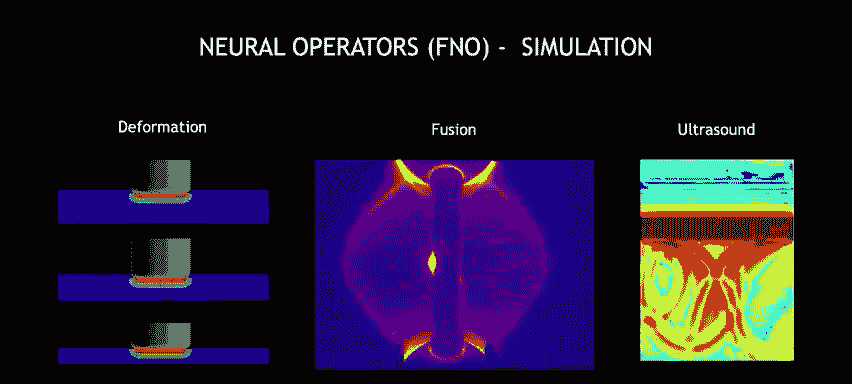

In fact， more than half a million cases of these healthcare related infections。

 the top one in a hospital so if you're long enough in a hospital unfortunately you tend to get infected and so we had a very simple idea which was to build these like riches or triangular shapes within the catheter very tiny something you can 3D print and optimize for the shape of it and what is the intuition with these triangular shapes。

 what you can create our vortic so you the fluid because of this like sharp shape it kind of becomes like a vortex and then the bacteria is not able to swim upstream because of that disruption and what you see is the 3D printed version of the catheter down below where the particles that are moving in the fluid flow means they're not able to swim against the fluid so they're not able to go into the human body and we measure like 1 hundredfold reduction in bacterial contamination and now it's in clinical study very fast amount of time。

AI proposed a design V 3D printed it just once and it worked right and to me that's the message I want to give like a lot of the experimentation could be potentially removed with the use of AI and of course there's always uncertainty something if you cannot model very well you would need the physical experimentation and you can further adapt your model based on that and make it progressively better so you can hopefully do less and less experiments in the lab and do it much faster with the use of AI and this is I mean this's early example of just a complete revolutions can happen where we don't just make these fantastical images of houses and bridges and catheters or whatever that are very pretty or creative but ones that actually work that don't fall down that have functionality you bring them to the physical world right and then you can print them you can create them and so start making the machines that actually work and the other quick example of that is optimizing for mask design。

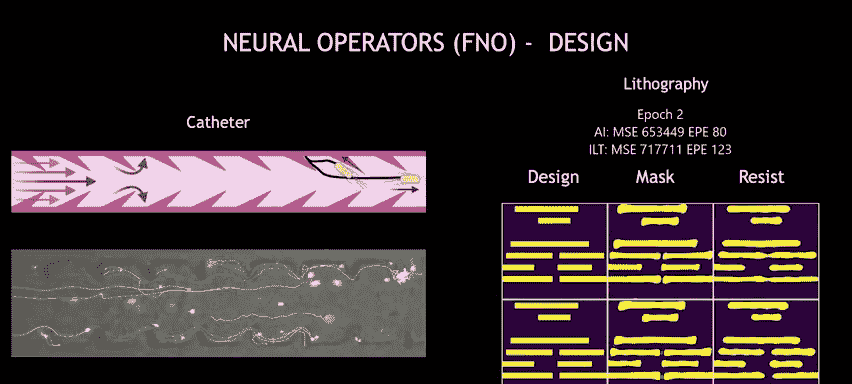

in lithography， which is in chip manufacturing again。

 very important part of especially the latest GPUs as you go to smaller scales。

 this you know aspect of physics， the diffraction effects become so critical that you do to get the right mask design won't get into it but again this is an inverse problem that can be done but where does all this lead right so far I talked about lots of use cases of science and mostly I talked about models that learns on specific data but specific domain but ultimately what we are thinking about now is a model that could one day understand all of science。

😊，In a way you could say chat GPT understands all of science because it has read all kinds of textbooks。

 if you ask a question in any domain of science， it does a decent job。

 if you ask it to design a molecule， it could even do some of it in fact we did that for some of the director capture it does some suggestions of linker molecules but on the other hand if you ask you to actually simulate and predict if the molecule is going to bind in a certain way or the weather model will or what would be the weather tomorrow it can't internally simulate the physics and if you look at models like so it learns some lots of videos but physics is almost an accident whatever video showed physics it kind of learns it but can you ground all of them with physics itself in a direct way and that's where now we've trained a roughly a GT twosd model which involves now training on multiple different kinds of physics flu。

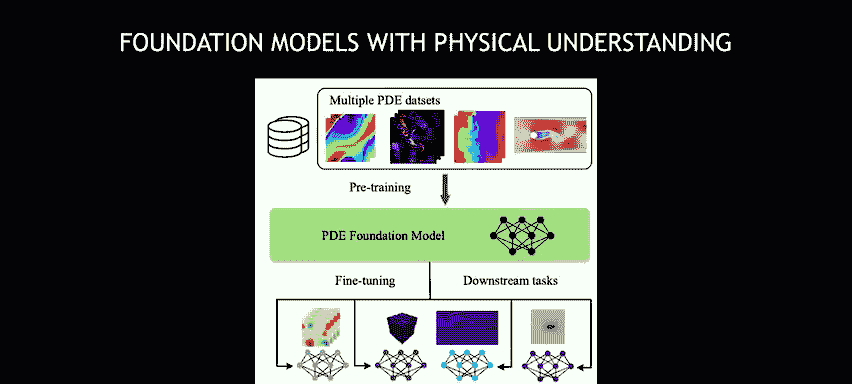

It's wave equations， material so think of like a model that now learns to simulate and design on many such phenomena and not just a simple kind of physics but one that could be even multi physicssics and if you're now thinking of an aircraft it can be both looking at aerodynamic but maybe you also don't want it to be having a lot of sound right and it's also the material stretching if it's high temperatures。

 you don't want the materials to stretch in the real world physics is not isolated into one equation it's lots of equations to describe something very complicated and whether it's one such example it's highly multi physicssics you know you're not just defining it with a very compact simple equation and so ultimately can we have a model that can learn over lots of such couple physical phenomena and get to a better physical foundation for all of AI so to me I think that that's an exciting future that is very exciting Thank you very much。

😊，Yeah。

