# 斯坦福大学《AI与民主｜ECON295 CS323  2024  AI and Democracy, Lawrence Lessig》中英（豆包 - P1 - GPT中英字幕课程资源 - BV1AE4ZecEQr

Ged to be able to have Larry Lessig with us today。 I hope you remember Larry as a little over 20 years ago。

 you invited me to come speak at your class with Jonathan Zit Train。

 which the time I considered a great favor and honor to me and so now I'm inviting you back which I also consider a favor and honor to me that you're joining me here at Stanford so thank you Larry as you may know is he's the Roy Furman professor of Law and leadershipadship at Harvard Law School。

 he's also been a professor here at Stanford was until about 2010。

2009 where among other things he founded Stanford Center for Internet and society still going strong and he's a founding member of so many other organizations like equalqu Citizens and Coning board member of Creative Commons I won't mention all of them he's a former candidate for president we'll be making an announcement later today and okay just had to check and he's got written more books that I can count lots of accolades。

 this is one of the ones I kind of like he's considered by the New York of。

Most important thinker on intellectual property in the Internet era。

 So Larry's going to talk to us a little bit about AI and democracy And the plan is for him first。

 he's going to do one of his。Patented presentations that if you haven't seen before I think you'll enjoy a lot and then we'll have a fireside chat and then open up to questions from all of you so welcome Larry and take it away thanks a lot。

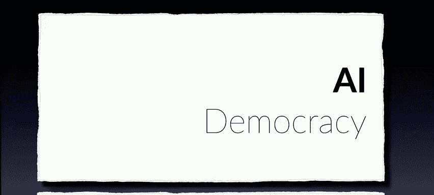

So。You'll all remember。The kind of。Democratic stroke。That afflicted our nation on January 6， 2021。

The important thing to recognize about this event is that those people believed。

That the election was stolen。And tell me what you would do if you believed the election was stolen。

What is the appropriate thing to do？They believed it， 70% of Republicans believed it。

And it wasn't like the smart Republicans didn't believe it。

 and the not so smart Republicans did believe it a majority of college educated。

Republicans believed the election was stolen。This was their perception and that perceptions reflected in this is a little bit more encouraging because obviously Republicans are just a portion of Americans and this is saying 32% of Americans believe the election was stolen January 2021 that graph is scary。

 this graph is even more scary。In the time since January 6， 2021。

There's been no change in the number of people who will say they believe the election was stolen。

We've had four years almost。Of debate and evidence and every single analysis you can make。

 those debates and analyses show overwhelmingly there's no evidence the election was stolen。

 none of the contest could have flipped the ultimate results。And yet the persistence of this view。

Is the reality of our time， I want to argue this is something new。Think about Richard Nixon。

Nixon was a president as popular among Republicans as Donald Trump was for the first chunk of his administration time in office。

 he was hated not as much as Donald Trump was by Democrats， independents of some way in the middle。

But then starting about six months before he ultimately resigned。

This is the pattern of support for Richard Nixon， and what's striking about that pattern， of course。

 is that he is facing a decline in all three categories， Democrats。

 Republicans independents at about the same rate。The whole country was watching the same story。

The story of the outbreak of Watergate and they reacted in the same way。By contrast。

 this is Donald Trump's approval rating。Over the whole of his administration。

No change in its support。Effectively， no change in the support， regardless of what happens。

Because people in this world are。In bubbles of reality and having their views affirmed and reinforced by media that feeds them exactly what they want to believe。

 this is the new normal and this truth should bother us indeed。

 I think we should develop a kind of paranoia。

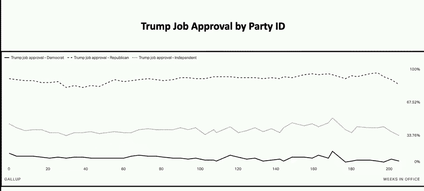

About it。Describe it as a particular kind of paranoia。 It's the paranoia of the hunted。

 So like the birds in Alfred Hitchcock's characterization or a modern version of this。

 we should think about。😊，The hunting in the sense of an intelligence。In a particular sense。

 out to get us。Because our perceptions， our collective perceptions。

 our collective misperceptions are not accidental。Not necessarily intended， but they are expected。

 maybe intended， the product of what I'm going to call the thing。All right， by the thing。

I'm going to talk about AI。

But you know， you can't talk about AI without gening a little bit to our future。Overlords。

 so I'm not going to say AI is necessarily terrible。

 Obviously it's the best technology man has ever created。

 It's also possibly a technology that ends mankind。

 So we don't have to pick between those two right now。

 but I want to think of AI in a little bit of a broader perspective。

 I want to recognize it as an intelligence。And as the term suggests。

 we distinguish between artificial and natural intelligence。😊，And we humans claim。

The kingdom of natural intelligence， presuming us to be above everybody else， everything else。

 whether that's true or not， and by artificial intelligence， we refer to the intelligence we make。

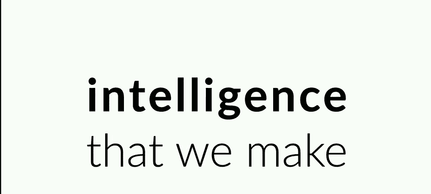

Okay， so here's the point we already have。And for a very long time now。

made artificial intelligence a central part of our existence。

 this is the great point that David Runman makes in his book The handover。

 I don't mean digital artificial intelligence， I mean analog， artificial intelligence。😊。

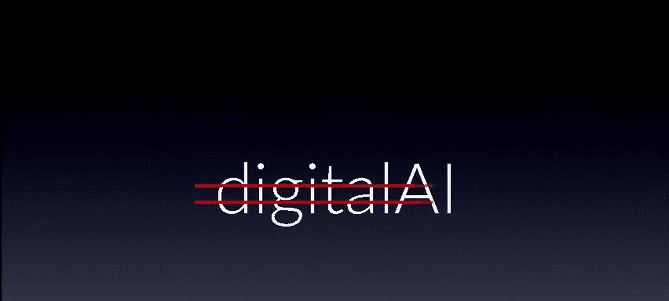

So think of any entity or institution。That has a purpose and that acts in the world instrumentally in light of that purpose。

😊。

I'm going to call that analog AI。

Instrumentally rational。In light of the facts in the world， so in this sense。

 democracy is an analog AI。

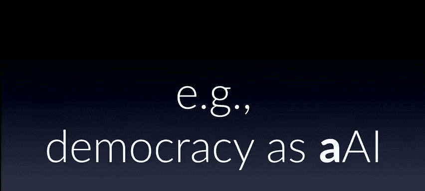

Has institutions， elections， parliaments constitutions for the purpose of some collective end。

 here's our aspiration for the we the people to form a more perfect union。

 the democracy is therefore an analog artificial intelligence devoted to a common good。

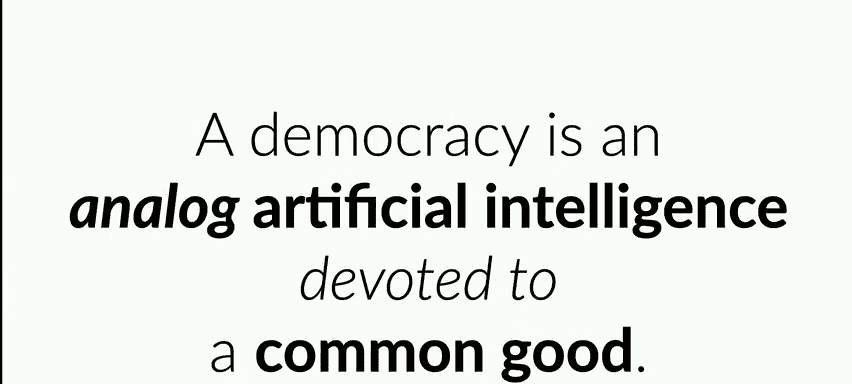

Or corporations are analog， artificial intelligences， institutions， boards management， finance。

 for the purpose of making money， at least as viewed today。

 the kind of absurd Fridmanesque view that the only purpose of the corporation is to maximize shareholder value regardless that is its objective function and it acts in the world to advance that objective function。

 these are AIs， they have purposes and objectives， sometimes complementing。

 so the purpose objective of a school bus company and school boards is complementing。

 sometimes competing。

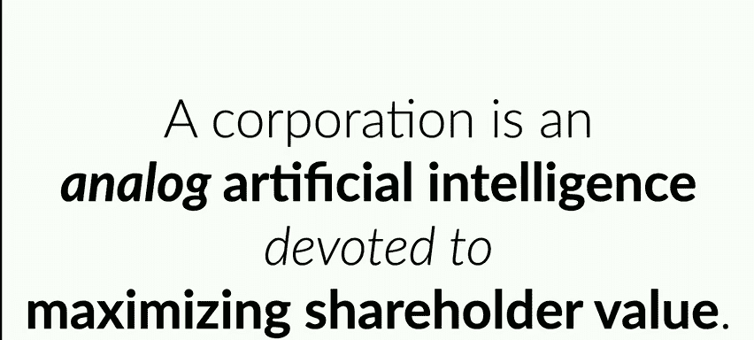

So the idea of a clean， healthy park and smoke stacks from a power plant are conflicting and when they conflict。

We play out in our mind a natural relationship in that conflict。

 so we imagine power plants next to a park spewing smoke into the park。

 Democrats then say small D Democrats then say we need a referendum to clean up the park to clean up the air and imagine they vote in that referendum wins and the smog is taken away。

 this is AIs competing and democracy AI winning it's a happy story。

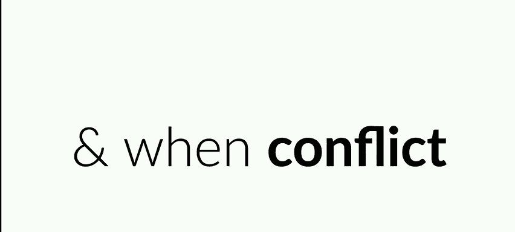

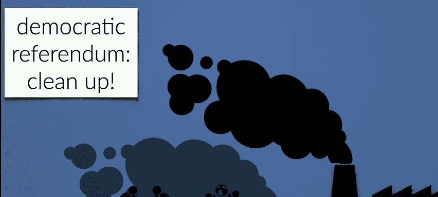

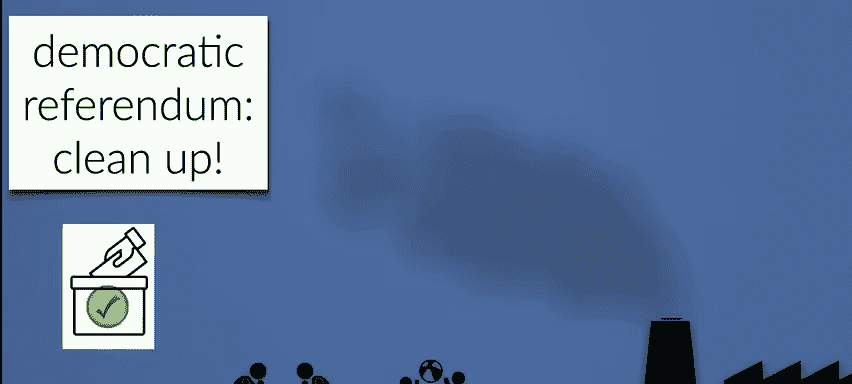

It's also a fantasy in the United States right now。

Because right now， corporations are actually more effective analog AIs。Then our government is。

In achieving their objectives， when their objectives conflict with the objectives of the government。

 so think about it like this across time as the X axis， instrumental rationality， the Y axis humans。

 you know pretty good， instrumentally rational better than cows， maybe not as good as ans。

 but the point is we are capable， instrumental rational entities。

 De is a necessary instrumentally rational entity， more instrumentally rational for certain purposes。

 Runsciman's point is if you want longter stable environments。

 you need a government to facilitate that humans on their own without that entity can't do it。

Corporations， I want to suggest， are even more instrumentally rational。

Then democracy and democracy then humans。Now each of these layers tries to aspire to control the layer above it。

So humans through elections try to control their democracy and democracies through regulations try to control their corporations。

But that aspiration is different from reality。The reality of control in the United States is corporations effectively control their democracy。

 that's the consequence of things like super PACs and the way in which money affects and drives results in politics。

And democracy structures itself to control effectively humans。

 corrupted representation systems like gerrymandered districts。So these relate to each other in。

Not the way the lower level hopes。

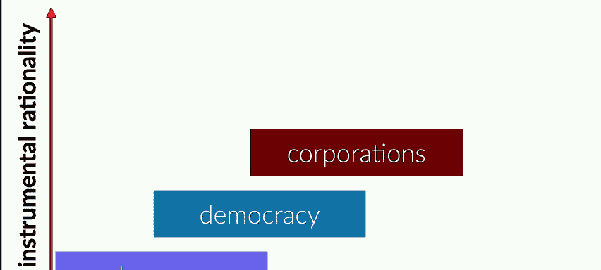

And if you think about the。Observation of the godfather of AI， Jeffrey Hinton。

 where he says there are very few examples of a more intelligent thing being controlled by a less intelligent thing。

Suggest a corollary， very few examples of a more instrumentally rational thing being controlled by a less instrumentally rational thing。

Okay， so these AIs I want to say are the analog AIs。

 then we think about digital A on top of that and once again you have an aspiration of control。

 the corporations trying to control the AI，But increasingly， the reality of the control。

I's not quite。As effective as the corporations might want。

 my favorite example of this was in September of 2017。

 it was revealed by Propublica that Facebook had a category of ads that you could buy targeting Jew haters。

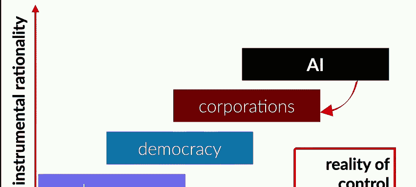

They were very embarrassed by this， and of course there's not a single human inside of Facebook but created the category Jew Hater。

The AI had determined Jew Haers would be a pretty good category to begin to offer ads for。

 they could be quite profitable if you offer ads to Jew Haers。

 so it just developed the category and started selling ads on the basis of it。Facebook said。

 we didn't do it， but that's the point。It was the AI that did it。

 they don't control the AI even if they aspire for the control。

 okay but the real difference here is just the magnitude of this massively more instrumentally rational thing。

 the magnitude of the difference because this digital AI will be more efficient at achieving its objective than are we and here we cue the paranoia because our perceptions are collective perceptions are collective mis perceptions are not accidental。

 they are expected， they are intended， they are the product of AI。

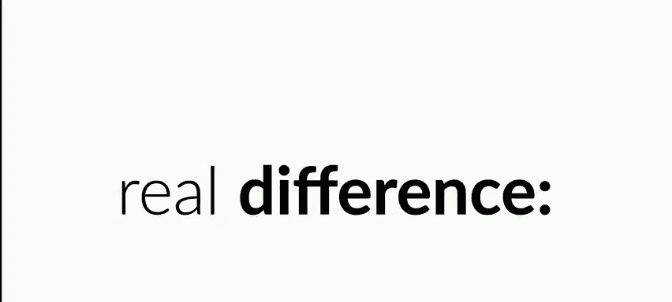

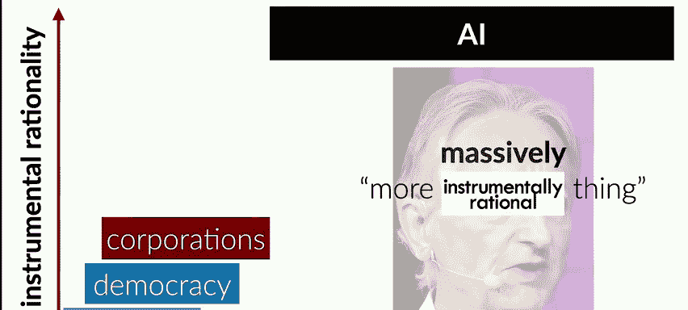

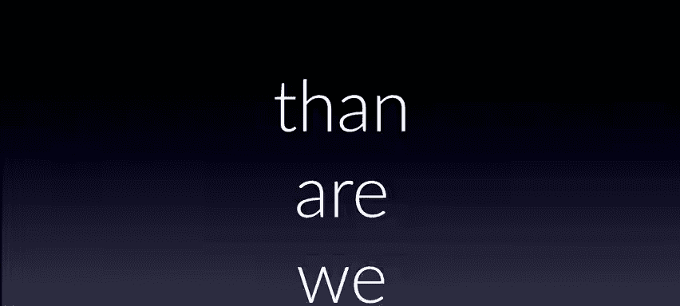

You can think of this as the AI perceptions machine， we are its targets。

So Tristan Harris described the first contact with AI。

 with digital AI being the contact we had through social media。

Tstan Harris was a student here and went to Google and then left Google to start the Center for Humane Technology。

 he was the driving force behind the social dilemma。

 which turns out to be the documentary that's been viewed by more humans than any documentary in the history of documentaries。

But at Google， he was focused on the science of attention。

I'mCed up by people like Professor Fogg from here， which is the using of AI to engineer attention。

 to overcome resistance。To increase engagement with these digital platforms， because engagement。

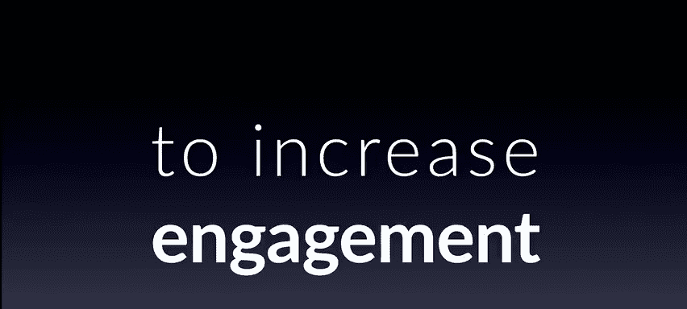

Is the business model？It is a kind of， as Tristan put its， brainin hacking。

I can think of brain hacking relative to body hacking。

 so body hacking would be the exploiting of food science， engineering， food。

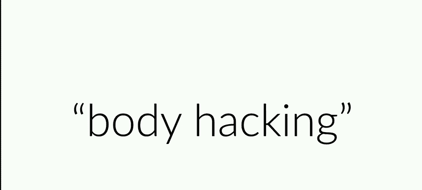

To exploit evolution to overcome a natural resistance so you can't stop eating so-called food。

 so as to sell food or sell， quotefo more effectively。

 processed food companies do that as a business， brain hacking is the same with attention。

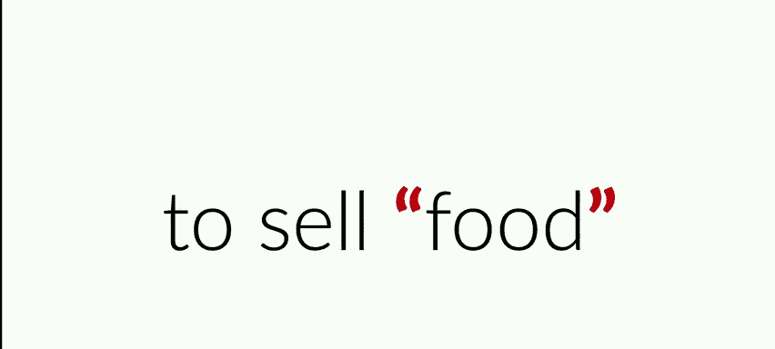

Exploiting evolution， the fact that we can't resist random rewards or we can't stop consuming bottomless pits of content with the aim to increase engagement to sell more ads now it just so happens。

We engage more。The more extreme， the more polarizinging， the more hate filled。The content。

 so that is what we are fed with the consequence。

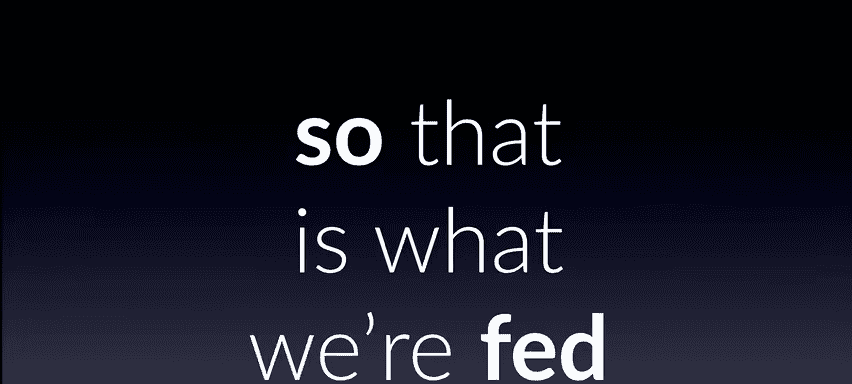

But we the people。Become polarized ignorance and angry and democracy is weakened in the process。

 they give us what we want， here's the critical point。

 they're not forcing something on us we don't want， we're getting what we want。

 but the point is what we want。

Produces。Reactions like this。K is， I want to say to recognize。

This is not because AI is so strong。It's because we are so weak。

So it's not AGI that we should be worried about today， maybe tomorrow， but not today。

It's the fact that way before we get AGI， the AIs are capable of overcoming。

What we otherwise would reflect upon the thing that we wanted。

Tristam is focused on the individual human weakness。

 I want to suggest the way it overwhelms collective human weakness。

Overwhelms the collective ability of us to decide what might be in the interest of the nation。

Because it turns out we're pretty weak in exercising that muscle， so not just the individual alone。

 but it is all of us surrounded by these metal heads， okay long before AGI it overwhelms us。

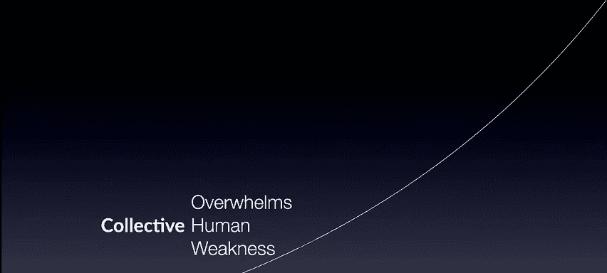

So that AI gets what it seeks， engagements。And we get what I want to say is a kind of democracy hack。

 and that was first contact。

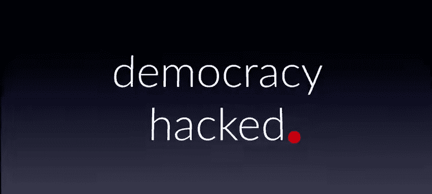

What will second contact produce？What's the nature of how AI engages in the current version of AI with election that we're about to enter into？

When AI is not just。Targeting insanely effectively， but creating and targeting insanely effectively。

How much more effective will it be in either suppressing the vote or radicalizing a portion of the vote or convincing people？

That in fact， their interest is not what they otherwise would have thought their interest to be。

And it raises the fundamental question， what can we do， what is to be done？Well， you know。

 when you face a flood， the first thing to do is to turn around and run away away， you want to move。

Democracy to higher ground to protected ground。To insulate democracy。

 to shelter democracy from the manipulative force of AI， from AI's harmful force。

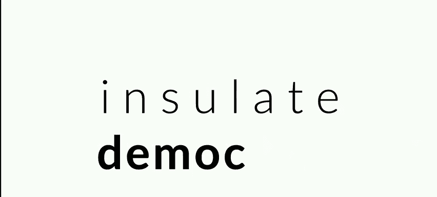

You want to find a way to tap into a democratic will that is not so easily perverted or distorted。

 either as the unintended consequence of a business model of engagement。

Or as the intended consequence of the Chinese or the Russians。

The law does this in the context of a jury， the deliberations of a jury are protected deliberations。

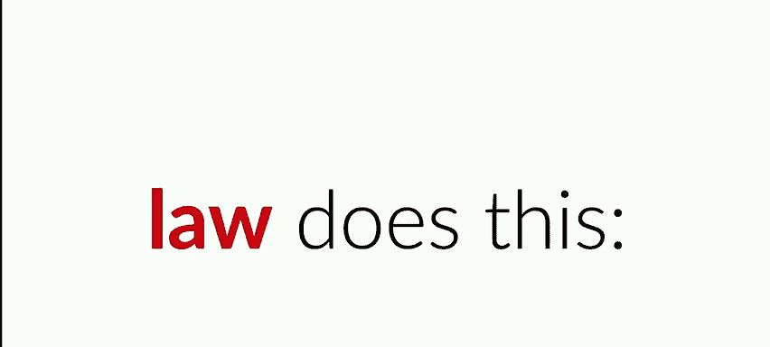

Not anything can be presented to do a jury， the judge decides what is within the realm of what evidence allows and they can't listen to anything beyond the evidence and then they deliberate together。

 that's what a jury is， democracy reformers or across the world are trying to do this increasingly with democracy and the core of this movement is something called the citizen Assemblies movement。

So citizen assemblies are random， representative， informed and deliberated bodies that are protected。

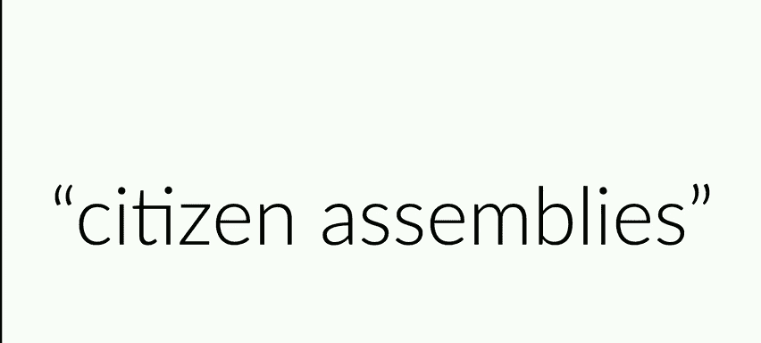

In the work that they do。From outside or manipulative influences that might undermine our confidence in the outcome here at Stanford。

 you have a welldeveloped institution of this practice through Jim Fishkin's a Center for Deliberative democracy and what he calls deliberative polling。

 citizen assemblies are more democratically connected in the sense that they're producing outcomes。

 they're not just producing attitudes， so Iceland used something like a citizen assemblymbly to craft a new constitution for starting with a thousand randomly selected Icelands who joined together to identify the values that a new constitution was to reflect。

 and then they had an election to select 25， 26 people who would sit on a drafting committee。

 500 people ran for that election， the country the size of buffalo， 500 people ran for that election。

 24 were selected， they drafted a constitution。

It was sent out to the public overwhelmingly， the public supported it more than two thirds supported every single element of that constitution then the parliament just ignored it because the parliament thought it was the sovereign。

 not the people， more a successful story was Ireland。

Ireland started around the time of the 2008 crisis， at the same time Iceland did what it did。

 a process of citizen assemblies。Ireland selects randomly 99 citizens and then has one politician type who presides。

They've addressed a series of issues that theceland the Ireland parliament could never have addressed effectively。

 for example abortion same-sex marriage， those are two issues that would be like the Texas legislature on those two issues。

 but both of them were overwhelmingly supported by the citizen assemblymbly in a progressive direction so samesex marriage was approved。

 abortion was deregulated， they then set those results out to the public and the public supported them and an even higher percentage than the citizen assemblymb has done France has begun to make this a central part of what presidents run on。

 so Macron ran promising he would have one on climate and there was one on climate and then he said he would have one an end of life and they had one an end of life。

These have 150 randomly selected people who serve for over nine months， seven sessions。

 basically once a month in Paris， of course it's pretty easy to get people to agree to come to Paris or something like that。

 but the point is it produced results that then drove the results。

 the decisions that the French government made and end of life not so successfully with climate。

 it's happening across Germany， the point here is that it's happening everywhere around the world and not so much here。

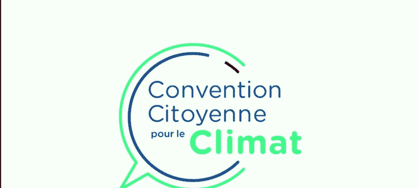

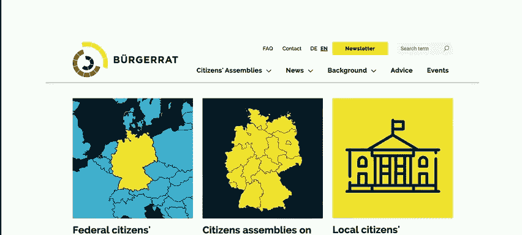

Which is weird。Because our Constitution basically builds into it。

A commitment to a very imperfect citizen assemblyly， the juries， for example。

 you can't be prosecuted for a federal crime unless a grand jury decides you should be prosecuted。

And a grand jury is just a random selection of people who sit together and decide whether you have lightly violated the law and then you can't be convicted unless a petit jury。

 the regular jury， 12 person jury decides to convict you that's a commitment of governmental power to a randomly selected group of people。

It doesn't seem to touch our lives much， I I think you were commenting you were sitting on a jury three times in your life。

 in Philadelphia in the beginning of the rep， the average juror， of course。

 a white male property owner， so smaller set of the population。

 but the average juror served on three juries a year。Three times a year。

 they made a decision about somebody's property or somebody's life or somebody's liberty。

 and so they rotated government power in a process that forced people to deliberate with people they didn't know。

 and they practice democracy in that way。Now， I think this movement is extraordinarily hopeful and exciting and。

I want to insist it's not just a good idea。I think it's kind of existential。

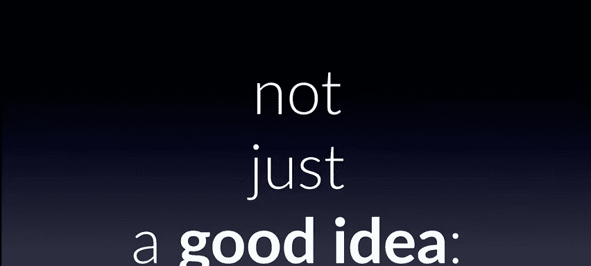

For democracy is a kind of security for democracy， a way of protecting us。

From a certain kind of hacking， a hacking that would steer us against a public will。

So it's a change not just to make democracy better。

I think as we think about the evolution of this technology， it's a change to let democracy survive。

 recognizing both the terrifying and exhilarating moment that we are in。

 that long before superintelligence， long before AGI AI threatens， a democracy like this。

 but that there's something we could do。

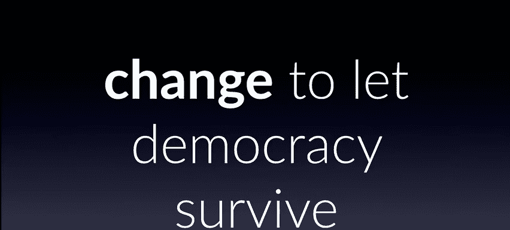

And while we still can。We should do that something we should know。

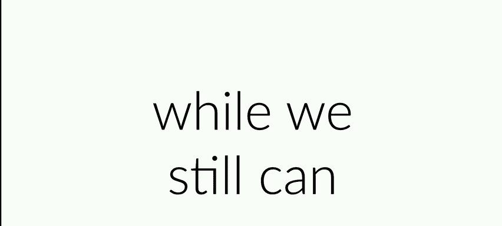

That we can't trust democracy just now。We should see that we still have time right now to build something different and we should act to make。

That difference happened。Now， not because。We know it will succeed。You know， quiteite frankly。

 I don't think it will succeed， I kind of think it's hopeless。But there's an attitude。

That we have to embrace。With respect to。Anything we love。

Once gave a lecture and a woman stood up at the end and she said，" professorssor。

 you've convinced me， it's hopeless， there's nothing I can do。And I thought， okay， that's a failure。

And at that point， I for some reason had an image of my then。

six year old son whos now your age basically， and I thought， what if a doctor came to me and said。

 your son has terminal brain cancer and there's nothing you can do。Would you do nothing。

Should just give up。And I realized that's what love means。The odds don't matter。

It's you do whatever you know you need to do to save the thing。That you love。

And that's what you need to think。When you think about the threats that we have to this democracy。

 if indeed， you can feel that love for this。Democracy。While there's still time。

While our robot overlord is still just a scifi fantasy， thanks very much。あ。Thank you， Larry。

 that was amazing， I feel sorry for the one last guest speaker we have after you。

 we can a unattainable standard for people， but I'm glad you guys all got to see Larry some really powerful ideas and an amazing presentation。

😊。

Today， earlier today， you and I were at a workshop for what we call the digitalist paperspers。

 which is audaciously inspired by the Federalist papers。

 but that the premises is that just as John Jay and Madison and Hamilton were trying to come up with some of the principles for governing society as technology was rapidly changing and democracy was。

Pretty precarious， we need to rethink those things for the 21st century and you wrote the essay that folks here have read on protected democracy and it was good that you touched on a lot of the themes there。

 one that you didn't talk that much about just now。

 but Id like why to give you a chance to talk a little bit about is the idea of vioccracy and that there are these moneyed interests and polarization that are making it hard to make any changes or get anything accomplished and could you flesh out that part of the so Francis Fuama about 20 years ago started talking about America as a vioccracy。

By which he meant， Viocraccy is any system where a small number of actors have the effective power to block the capacity of the entity to make a decision or to act。

Now， of course， the framers of our Constitution crafted America to be something like a viracy because there are many points in the process to getting a bill passed。

where entities can block that bill from being passed， so if the House doesn't pass a bill。

 it just doesn't become law period if the Senate doesn't pass a bill。

 it just doesn't become law if the president vetoes a bill it can be overridden by two thirdds of Congress so it can become law but requires a supermarity。

 the Supreme Court strikes a law down。This wasn't compelled at the beginning。

 but it's the way the courts had interpreted it， that's it， doesn't become law。

 so there were veto points。But what Fukiyama was arguing is that we've added to the institutions the Frrs have given us。

Many more veto points。So parties。Committees inside of Congress， they are veto points， the filibuster。

 as it has evolved。Don't believe the BS that it's the traditional filibuster we have right now。

 it's a brand new filibuster given to us by Mitch McConnell。

The filibuster basically means as little as 20% of America can block any bill from passing Congress。

 just total veto， not even overrdable。And the one that's most salient to me is the effect of super PAacCs or money in politics。

 so in 2010 the Koch brothers made it known。That if a Republican candidate acknowledge the truth of climate change。

He would be or she would be primary in the Republican primary and since 2010。

 you've seen a dramatic drop off among Republicans willing to even entertain the idea that climate change could be true because two brothers decided that they were going to spend their money to stop。

The possibility of climate change as a crosspartisan issue， I mean you don't remember this。

 but in 2008， there was a fierce debate between Mccain and Obama about who had the Better climate change plan。

 and both were pretty good， I don't know whether Mccain's was better or not， but the boy was。

 that was possible in 2008， two brothers made it impossible from 2010 on even to this day。

And so that's the characteristic of the vetocraccy。

The point about the connection to AI and the way the media works is that polarization exacerbates the capacity for this vetocracy to have an effect。

You can link an issue to the identity of a political party。

You can make this a liberal issue or a democratic issue。

 or you make it a Republican issue or a conservative issue。

 you make it impossible for the other side to embrace it。Without。

Becoming a traitor to their identity， so the extent to which politics becomes identity focused。

It makes it easier to find ways to block the capacity to get anything done。

It was really astonished as I was doing work to try to find the origin of the wordvioccracy。

 it's only appeared once before Fukuyama starts using it。

 but the most prominent deploy of the term today is the Chinese government。

Because the Chinese government has a very compelling critique of the American democracy。

 and it is all about the vioccracy of the American democracy， America can't do anything。

 and so they will you know put for example，20 years they've built。20000 miles of high speed rail。

 the United States government has built zero miles of high speed rail。 I mean any number of problems。

 So I'm not I mean， there's lots to complain about with China。 so don't get me wrong。

 I'm not saying let's become Chinese。 they regulate social media pretty effectively。

 So maybe that's pretty good。 But but my point is like their critique of us is true。

We've built a government that just can't tackle big issues to the extent they become polarized and every issue becomes polarized。

 I mean think about COVID。I remember， you know， in March of 2020。

 there was this amazing moment when everybody was willing to say， okay。

 let's just pause for a second， let's just deal with a crisis and there was no partisanship about like what it was and very quickly O in particular decided that there was a huge return to beginning to。

Trigger this kind of question of whether it's true， whether it's exaggerated。

 and you begin to see the whole system become driven by a need to create the us versus them there too。

Even when， you know， the consequence is not just， you know， whether a bill gets passed。

 it's whether people live or not。 So it's the pathology of it is deep and。

I'm not sure how we get out of that。Suppose Donald Trump wins in November no。

I'm not going to suppose that。Suppose the election doesn't go the way you want。

Would you be worried that the USS was too much of a viocracy then， or would you be happy about that？

嗯。Yeah， well， Donald Trump would do a lot to decrease the vetoccray of the American government。

He's already signaled。The 2025 project by Her is filled with astonishing。

Innovations hacks to get around the autoocracy of the American government。

And he would claim authorities that so far， no president has thought to claim or they probably fought to claim。

 but since the Civil War have not claimed effectively。

And then the question is whether the courts would resist。And this court is not demonstrated。

Commitment to principles that seem to be principles in this space。

 So there would be less photographyocracy。 So， so we had this， I think。

 really interesting conversation earlier today。I'm not against vetcracy completely because I think there was some wisdom in structuring the democracy as the rep as we originally did。

To avoid kind of passions running away， so it's fine to have some。

But there's such a thing as too much of a good thing。

 so like we get to a point we are right now and we can't address any serious issue， climate change。

Inequality， healthcare。Invest， I mean， pick the issue， can't deal any issue effectively。

 and just because you would break it to make authoritarianism easier doesn't。

horror that it has for ordinary democracycra enough and to address all those issues you need a common understanding of fact you wrote in your paper democracy requires a common understanding and a common set of facts to resolve questions rationally that was possible in the age of broadcast technology it's unimaginable today say more about that that's how you started your talk a little bit about the way that different groups have different perceptions of what truth is and the fragmentation I think there are two technologies we have to keep track of at the same time so one technology is broadcast technology so at the birth of the nation broadcasting was basically pamphlets but basically pamphlets are not what we mean by broadcasting you could print and distribute and everybody in the country could get access but it took four months to get information from one corner of the United States to the other part of the United States so it's not like ever was everybody listening to the same story at the same time Broing change。

that？And， especially during the Second World War， it became a central organizing technique for both the fascists and those fighting fascism。

 both Hitler and Gos but FDR too， using broadcast fires at Chad to unite the art。

That's what we're doing here， tens of millions of people are obviously listening right the second to this of quality not。

 okay， we tell ourselves that we academics， we sell 500 books when you've never sold just 500 books。

But the point is there is this。There's this period of time， Marcus priorryor at Princeton。

 if for allowed to mention Princeton here， has describeds a broadcast democracy。

 which he says is kind of the beginning of the 1960s to the middle of the 1980s and in that period of time。

Everybody's basically watching video presentation of the news。

One of three news stations that show the news at the same time。

 so you don't have a choice to like watch home shopping network while the news is on if you want to watch TV you're going to watch the news and TV is pretty compelling so you're watching the news and that regular diet。

Of down the middle news， created a certain republic。

 I don't mean to say it was unbiased or the understanding was complete or it was a golden age。

 I'm not saying it's a golden age at all。 I'm just saying it had a certain characteristic。

Wwhichch was the agenda was presented to the American public and the American public responded to the agenda and we accomplished an extraordinary amount in those 40。

 35 years， I mean you think of civil rights rose and became a huge issue that then was resolved with massive legislative changes。

The environment， Richard Nixon， the Vietnam War， these were really big issues the nation struggled with and kind of worked through them in ways that was progressive。

 so one technology is broadcasting and so you can say that we went from a non- broadcast era to a broadcast era and now we're going back to a non- broadcastad era。

We're not all watching the same three shows。We're all watching our own little channels。

 they might be polarized into sort of coherent political spaces。

 but it's not like anybody is consuming the same content。At the same time。In the same way。 Okay。

 so that's the first dimension。 The second dimension is。The legibility of the public。

So the weird coincidence is that broadcasting and polling。

 modern scientific polling are born basically at the same time。

The first dramatic appearance of the modern polling technique is 1936 election when everybody was convinced that Alf Landon was going to beat FDR overwhelmingly。

 the fact that you've probably never heard of the word Alf Landon means you know that didn't happen。

The reason people thought that was that the then prevalent technique for polling was basically straw polling。

 they literally digest， basically asked people to send in coupons that said who they were voting for。

 they collected millions of ballots， the millions of ballots went overwhelmingly for land so they said land' is clearly going to sweep。

But the population of people who got the lit that were asked to respond to the literary judges were registered owners of automobiles。

who in 1936 were not a random selection of Americans， so Gallup。

 who was a graduate of Northwestern journalism School or something。

 said I'm going to do a different technique， random representative sampling and he saidFDR is going overwhelmingly trounce Land。

 everybody said he was a joke it was a joke that was possible and of course that's what happened so with that event。

 the world all of a sudden realized there was a technique for understanding what the people thought at any particular time。

😊，But what's striking about learning how to read the people？In the middle of broadcast democracy。

Is that we learn how to read the people just at the moment that the people have something interesting to say。

Because they are all being educated by the same basic set of information and we can track their views on the basis of this。

Not comprehensive， but coherent set of information。And it convinced people。

 like there's a book by Ben Page and Robert Shapiro called The rationalal Public。

 it's kind of bizarre title of a book for us today， like who could think the public is rational。

 but what they did is they looked at the period basically a broadcast democracy and they could show how the American public responded rationally to the information they were given about policy issues。

And they concluded this is the nature of democracy。

 they were not sensitive to the contingency of the technological environment within which this reality was created。

 they just thought this was the nature of democracy。

 but what we've seen since the birth of cable news。

Cable television and therefore cable news and then the internet is that the multiplication of the number of outlets means that people watch whatever they want to watch and the only people who watch the news are the news junkies and the news junkies are the most partisan most politically engaged of the public and so the news plays to those people and that playing to the people drives polarization at the context of the news。

And at the same time， we are able to pull them， pull the public。

 and we increasingly see a crazy public through the polling。

So the scariest statistic I come across here is in 1998， P started asking the American people。

 do you have faith in Americans's political judgment？And two thirds of Americans said， yes。

 we have faith in American's political judgment。Today those numbers are reversed。

 two/ thirds say they don't have faith in American's political judgment， and part of the reason is。

We can read the people and we read the most extreme people because they're the ones that are most visible and most engaged and we look at the crazies and we say oh my gosh。

 why would we trust government to these crazy people and the consequence of that is this erosion in confidence in the democracy so in one sense we are like today is very much like 1880 or 1870 where there's plenty of like polarized and partisan press。

But the people were invisible in 1870 and 1880， they didn't matter to what policymakers did。

Today they're visible， they're legible。 So on January 6。

 there were many Republicans in Congress who thought， oh my gosh， thank God， that's over。

 That guy is gone。 We never have to worry about that guy Lindsey Graham on the Florida Senate said I'm off the train now it's finished no more Donald Trump and then they got the overnight polls that show that the base of the Republican Party was still deeply committed to Donald Trump and they're like what choice do we have we got to follow our people so these two things together。

 I think like produce this。Particular place where we don't have an easy capacity to imagine moving out of the consequences say。

 it sounds like you're saying it's a bad thing that the politicians are following what their voters want well if they're following what their voters want and their voters are being hijacked。

To consume and believe the most polarizing content， so connect the dots on that part。

 so how is AI under the internet？Polarizing， right？So if you if you。So if you are running。嗯。

A processed food company。You're deciding what kind of food are we going make you have your food scientists figure out what's the mix of salt。

 fat and sugar it's going be most addictive and you produce that and people consume your food。

 you might notice they become less healthy and you're like oh we don't like that craft for a period of time decided no more of this we're going to produce healthy foods healthy snacks and of course the public said we don't want that we want the cheetoos or we want know something so the market turned against them that executive was kicked out。

 they went back to their old ways of producing food so the point is the business model of selling fast food or processed food drove them to do things they knew were harmful for America but know that was their business in the media context。

When you've got engagement as the business model of social media。

Its objective is to figure out what's going to get you hooked and keep you glued to the screen。

 Is there a way to get？To have media be fun and engaging but also healthy。

 I mean can you have healthy food that tastes good can you have healthy you have media that one way we think about is system one and system two kind of inversky so I go to Twitter it's fun to get those like little hits of something exciting happening but there's also community notes。

 there's econ Twitter for those of you go to that you know that has like links to papers main VR and you know I don't know if I have a balanced diet but but there may be a way of getting getting it to be interesting but also。

Enlighting would be wonderful， would be amazing， haven't seen it yet with a lot of experimentation。

 a lot of people， it's not like give some hope here it's not my job to give you hope that's not my business here like but is there a job no。

 is there things we can do？Yes， okay， I mean that okay。

So one thing we can that you or your kids will do， I think I hope is to move a significant chunk of democratic decisions outside of easily manipulated decision makers。

 so that's the protected democracy move， but in the media term。

What we can do is to try to dismantle the most poisonous of these vetocraccy triggers。

 and the most poisonous viocracy trigger is。The role of money in American politics and you pick your issue and I'll tell you exactly why it's so ridiculous because of money and some of them it's not politically appropriate to talk about。

 but you know the reality is money is at behind a bunch。

 every one of these most significant ones and if we could find a way to deal with that。

We could begin to move governments away from a place where the politicians are like。

Responding to the perverse incentives that money creates。

 so money creates two different kinds of perverse incentives。 First。

 the super PAC money I already described with climate change like the super PAC money is the most polarizing。

Poisonous money in American politics， it has its effect not necessarily just by being spent but by being threatened。

 there's a great paper by。Blanking on their names， it's called the iceberg Theory of politicalitical Con。

Basically says that you know if you spend money， that can be just as effective as if you credibly threaten to spend money so all you have to do is to be able to threaten that you're going to spend against somebody and that has a disciplinating effect on them so that's the iceberg underneath the water is like this incredible effect。

Super PAC money is perverse in that way， but then there's even the small dollar money。So you know。

 if you are somebody like Marjorie Taylor Green or Matt Gates you raise most of your money through small dollarar contributions and the way you do that is you behave in a way that makes sure that you get to the top of everybody's Twitter feed or everybody's Instagram feed or you get on cable news。

 how do you do that you perfect clown show behavior that's how you do it in American politics today like the most sensible balanced serious members of Congress。

 you can't tell me who they are because they are invisible I want to focus on some of the technology platforms and some of the ways that。

LLMs and others are changing the way people get information。

 So Google search up we early table with Eugene Bullock one of。Your colleagues in law。

 my colgue at Stanford， who argued that the business model of search engines is speech and now that business model is changing as。

As LLNs are delivering a lot of。Summarized information。

 not even pointing people to the sources on the internet。

 how do you see those that as people start consuming more and more of their informations they likely will as they already are from。

LLMs and chatbots and maybe the search engine summarize what your answers are in some form。

How do you see the nature of that information being affected by？

Economic incentives versus what other I Yeah so I think it's serious。

 but we first have to recognize fundamental difference between push and pull content so one huge difference of the world today versus 1970 is you know people will like flip on Fox News and be consuming Fox News all day long in their house in background or their newsfe from Facebook probably nobody here uses Facebook but from Facebook or Instagram constantly pushing stuff at them that content is enormously consequential for developing people's attitudes about what we just Matt Jensow and Dcott have a paper that just came out about how they got people to turn off Facebook a random set of people to turn off Facebook for six weeks before the election and it made them may it the number a little wrong like 2。

6% less likely to vote for Trump if they turned it off which implies。

There's effect of watching Facebook or there was this is during the 2020 election yeah just before right so that's a percentage that Biden won by but so it would have been very significant yep right so。

So the point is that you've got the deployments in this context is about driving engagement。

 that nature of that engagement becomes different， if you've got poll media。

 so LLMs are pull media you want to sit down you want to ask a question。

 you're going to get an answer， I think we have to worry about what the incentives of the platform are。

 so we talked about this earlier today， the early days of Google was very pure。

 like Google was just giving you whatever website happened to have the most links given the nature of your query。

 and so in that sense it was just reporting the nature of the internet at the time was extremely clean。

 extremely valuable now what you get fed to you is a function both of what you want and what the advertisers who are buying your attention have succeeded in convincing the algorithm to feed you and so the incentive of advertising inside of the Google search engine。

 changes the nature of what it's going to feed you。

To drive you more to the incentive of whatever the advertisers are Well they separate out the paid ads and the organic content but then the ordering。

 even the ordering and the organic can be affected by the content of what the advertising pitching is I mean the ads are certainly at the top okay but the point is the same concern should exist in the content of LM Yeah well the Oms I think the concern is potentially a lot bigger because it all gets kind of mixed in and they have to figure out what they present and it is a challenge to their to their revenue model how they're going to right so we did so we talked about an example today so imagine ways。

AI is like giving you a choice and it can see there are two paths that you can take and they're roughly equivalent in length。

 but one of them passes by an advertiser of them and they send you via the advertiser。

 like we need to know what the underlying incentives of the AI is or are to be able to evaluate what the effect of that be。

So one more question and then I will open it up to。

 this is a really big question so in our office up just my office up just before we were talking about a world。

 we don't know how far away it is where AI can do most of the things that humans can do and that's going to have some big economic effects we're going to talk about some of them next week with Daniel Suskind but it also has some political implications because if people。

Don't have are no longer economically essential and they lose their economic bargaining power。

 it's likely to have effect on their political bargaining power and be interesting to hear some of your thoughts on。

What kind of challenges that face that creates for democracy if economic power is no longer dependent on labor？

Yeah， so the first consequence， as you observed earlier today， labor is by its nature decentralized。

Where people are， if you eliminate the need for labor then capital can be extremely centralized。

 and so the power of centralized capital becomes enormous relative to what it is today。

But in the way I think about this， we talked about this book earlier， Darren。

 Amedu and Simon Johnson's book Power and Pro， right and the thesis of power and Pro is that there's this。

Really weird period in history in America from roughly 1955 to 1975。Where there's a。

Almost perfect correlation between the rise in productivity and the rise of equality。

 so productivity goes up and equality goes up。And for all of history before that。

And all of history after that， there is no such connection。And so they ask。

 why is it during this weird period of time？There was this connection between the rise of productivity and the rise of。

Equality and the claim was because during that period of time， we had effective countervailing power。

 government power。through antitrust enforcement and redistribution of income and economic power through labor units and so this countervailing power was able to make sure that this extreme growth and wealth was distributed equally but the lesson of this is if you don't have that countervailing power and when you see an explosion of productivity。

 you're not going to see an explosion like equality or wealth for everybody。

 you're going to see a concentration of wealth in the very few and so we're right now at one of these moments we're going to see an explosion in this productivity and yet we have a government incapable of exercising these countervailing powers and more importantly the ideology of people like And Mark Andrea kind of dominate debate about this is that it would be a disaster for the government to stand to step in and do anything in the context of this growth in innovation and wealth because that would just destroy it。

K it or it would be the end of it so at the moment where we most dramatically need the capacity of government to do something to deal with the radical consequences of this explosion in wealth。

 we don't have a government to do it now if we did have a government。

It could be pretty good like you have these technologies that do all of our work。

Maybe we don't have to work as much， maybe we can like have a you UBI and a capacity to have lives that are much more meaningful and less and more balanced。

 like when did humanity ever decide that working 60 hours a week was like a good thing。

 like something we needed to do to be real as humans， but that's the basic world you live in now。

 we could live in a radically different world， if we could get that right。

But I don't see the capacity for getting it right right now。

 given well our shame on us if we mess that up， but let's open up to questions and comments about right over here。

Hello， thank you so much for your talk when say your name of。And I have a question about。

 I guess the role of centralization and decentralization yes。

 what I found striking about your analysis about news between the broadcast era and the current era is the role of decentralization rather centralization back then in the consolidation of news sources for people to engage in versus now everyone can kind of consume what they want to hear。

 do you think that there's an inherent tension between decentralization and I guess the ability of society to reach consensus on truth。

嗯。The critical part of the question that you I just want to emphasize is that you get to hear what you want to hear。

Yes， if you get to hear what you want to hear。The unintended consequence of that freedom is a growing gap between you and the rest of the world or you your type and the rest and the other types。

 I have an app on my phone called Read A Cross。I haven't opened it in a while。

 I don't know if it still works but but it it says it monitors what I read and then it suggests to me the things I should read to balance my reading so that I get a fair view of the world I hate that app I hate it because I don't want to waste my time reading this other junk I think I know what the truth is and so I want to read stuff that reinforce makes me feel good about my views right that convinces me I'm right that's what I want to do and so does everybody else like if you're not like that the good for you but you know you are 0。

001% of the world and so if that's the nature of humanity it's like you know the consequence of that ability to perfectly pick what you get to consume means we're gonna to have these bubbles and those bubbles are not going to be able to understand each other I mean I find it。

Just astonishing， I just don't understand people and their views like I feel like when I was your age。

 I understood them。Like when I was really young， I was a conservative Republican。

 and I'm not at all now， but I understood liberals， I understood why they thought what they did。

But I look at Republic Omaga now， I just don't understand what they're talking about。

 I just can't even get it。 And I think part of it is that we live in these。

Unnirs is of constant separation， and the most striking fact about that is。

If you ask the American public， the latest poll that sort of asked the American public。

 which political party？Is more protective of democracy。The average American will say。

 the majority of Americans will say the Republicans。Because the f。

Spin on what has happened to the former president is this is banana rep behavior this is basically the politician。

 the party in power is using their government power to persecute their political opponents it's the sort of thing that Third worldd nations do。

 not the United States they've so effectively so that view that the net of it is that we just think wow Democrats don't care about democracy it's only Republicans would do So I like what you said though you said not having a centralized source we more likely lead you to truth but more likely lead to a consensus about what the truth is that you said that intention what I noticed was I guess there was always this argument that decentralization would somehow lead to I guess a more accurate depiction of the truth。

 less vulnerability to bias so having a consensus about the truth is different than having the truth and you may have more divergence but that might be closer to the truth in some sense。

Is that part of what you're saying or maybe neither of them are I't know unfortunately yeah。

 I mean more likely that somebody knows the truth， it's just that not many people who are not everybody knows the truth through no consensus about it's a great distinction All let's go over here for a question that corner in the back。

啊，嗯。去。好。Hi Profesor thanks for coming to class today I was wondering I'm personally very frustrated by the lack of sensible social media regulation in the US but so I was pleasantly surprised to see some action over TikTok。

 despite the motivations being over national security and not just education and the well informing and well-being of people do you think in a in a less American dominant world there will be incentives for more social media regulation。

 for example， maybe more media regulation， more barriers to entry in terms of information quality and perhaps and more functional democracy？

Yeah， I mean， I think that， you know we like to。Criticize。

 I was praising Chinese before I'm going to praise them again in the context of social media regulations kind of striking to recognize。

 first of all， we're threatening to get rid of TikTok TikTok doesn't exist in China。

 the version of TikTok that exists in China is a very different platform and that platform effectively regulates access of young people to the content like amount of time that they can consume it。

 heavy regulation of gaming so the number of hours that you can play as a kid games online is restricted。

 shuts down after I think 10 o'clock or 10-30 or something like that at night and you know the whole society is organized around making sure that the online environment for kids is safe and productive and the content on Doeyyang。

 which is the equivalent of TikTok。You know once convinces people convinces kids they should become astronauts or like entrepreneurs like。

 you know， 13 year olds in America want to become social。

 whatever that word is media influencers media social influencers right。

 this is terrifying like but it's a product of this and what's striking to me is that。

It's almost unthinkable in the United States to say something like。Okay。

 let's just make it so you can't have access to the platform after 10 o'clock or that you can't be。

 as a kid， you can't be online for more than， you know I'm playing games for more than three hours a week or something like that。

 even though we you know increasingly recognize I think Jonathan hates work here is really powerful just how destructive it is。

 especially for people in the 12 to 15 year old range， especially girls， and so this is。

Another consequence of the incapacity of us to govern。

 and I felt that most dramatically in the early debate about getting rid of TikTok and you know after Francis Hoalgan。

 I had the honor of being her lawyer when she first became the Facebook whistleblower and when she testified in Congress in October 21。

 I guess， can't remember now， but earlier， I think it was after the election it must have been 21。

 yeah， she testified and there was this broad consensus on Capitol Hill that Capitol had to do something。

And Republicans， Marcia Blackburn， was like raving about the need to do something about it。

AOC gave her first Tiktk and her first Tiktok was criticizing the idea that you should regulate Tiktok。

 and her argument was it's not fair to regulate Tiktk until we have a privacy bill in the United States that's passed。

 And that was depressing both because I thought oh my God。

 she can't really think the issue is privacy。 She can't really think that's what the problem of Tiktk is。

 And number two， it signaled money had come into the Democratic Party to begin to split the Democratic Party about the question of whether to regulate here。

 So want to there's a little lot of politics and into some of the technology issues。 and so is the。

Is your perception that this is？It's more important for regulation now in the era of machine learning and social media than it would have been in the era of print newspapers or podcasts television and explain。

I mean would you have had these views 50 years ago and sharpen what's different now that requires more government intervention the difference is just the dose effect right you know you don't have to regulate newspapers because you read newspapers for 30 minutes in the day and that's the end of it it's not going to like create a worldview you're not constantly being inundated with the content like create a certain way of thinking about your body or thinking about politics or identity but you know when you have these feeds that are the business model is how to keep you focused like just like how to get you to eat as many buffalo wings as you can how to get you to spend constantly your time online that dose effect is hugely significant and so we keep referring to some of our car as you had earlier today but you mentioned government failure clearly there's can be market failure where they're not it's not working in response to social interest or break from but governments aren't。

Necessarily doing that either and you brought that up in our conversation earlier so help me understand why you have confidence that the government control of the social media wouldn't be just as。

Pernicious Well， I don't like the idea of the government control of social media。

 but I think the government can change the incentives of social media。 So for example。

 imagine an engagement tax， a quadratic engagement tax。

It said like one unit is one tax and then two units is two is four and three units is nine。

You know if the units are right and the numbers are right very quickly you make it so that the engagement business model no longer is profitable engagement per person or so at a certain point Romemer had something a little similar yeah yeah so at a certain point they say you know Eric get a life stop you know going through your Tiktk feed you've done it for two hours and we don't need you anymore like in fact if you were on here your value is less than your cost and so so that would be a change it doesn't require the government deciding some content is good or bad but I think the punchline for the Tiktok thing is Tiktok would not have happened but for the Gaza conflict。

You mean the regulation of TikTok TikTok let's get a few more questions and quickly we have a little over 10 minutes。

 so why don't we just go a couple right here next to each other first in the back and then you yes。

Thank you。 I wonder how much this conversation about engagement in social media is divorced from the actual AI that we're talking about in this class。

 Do you think that I mean there's been a completely new business model for how AI is deployed to our lives I never paid Google for its services。

 I've never paid Facebook engagement matter， I do pay for Gemini I pay for Claude I pay for Cha GBT and they provide a lot of use for me So I wonder in this dynamic I feel like you're conflating AI and social media。

 social media it clearly has bad ramifications for democracy but I wonder if there's a new business model that actually is aligning incentives Can you speak about that Well AI social media only works because of AI So you're right there's a new flavor of AI that's producing a different business model and the business model of GT or chatgBT or any of these is not advertising driven right now we don't know how it evolve Google wasn't advertising driven when it was。

IB either， but right now it's not advertising driven。 So there's not an engagement component to it。

 absolutely， but you can't。You know can't forget the fact that there still is legacy AI in your lives like what it decides to feed you as not a decision by some。

 you know intern but what about so but specifically to this question of I mean we talked about the revenue model as well and Michael Spence and Owen had a nice paper where he argued that different revenue models lead to different kinds of content being produced and to the extent you know is that a way to do this if the customers the customer instead of the product of using being the product is that something that's more likely to have the AI work in the interests of the consumer Yeah。

 absolutely， and if people naturally chose the subscription model for all of their content。

And that's what they wanted， I would be less concerned about the AI in that context because we'll be delivering something different。

 but if it's not that if it continues to be as social media is。

Engagement based driven by four year old AI， the AI that's figured out how to target you and to engage you like that。

 it still has a consequence even though it's not the sexy AI that you might be studying or to want to be deploying right so we get a question up here。

Soi， thank you for coming out。And my question is related to the concept of instrumental rationality and it's so related to the question that asked earlier you've kind of discussed this idea of incapacity to govern and the question I have is how much of this is a consequence of just you know polarization versus how our government was designed like we're designed to have a decentralized state where we need consensus and we need like you know a bunch of different people working together to get things done until。

I'm just unclear about how do we confront the challenges that you've described in a way that's consistent with you know the Constitution the systems that we've built around ourselves Yeah thank you so you're absolutely right。

 as I said at the founding， the design was a vetoccray of a certain kind。

But it wasn't as debilitating as the one we've evolved。

And the capacity of the United States to do things， whether you like the New dealal or not， you know。

 forget the new deal， like what happened from 1950。Through 1980 or even like 887。

 the last Tax act of Reagan was hugely significant government steps to deal with problems in society。

 whether it's the Voting Rights Act or the any number of these very significant piece of the legislation that the system was able to get over and actually do something about and whether you like it or not the point is they could do something about it。

 like I look at Europe and I see all of the regulation they've achieved whether GDPR or DSA or DMA。

 I don't like any of them， but I kind of admire the fact that they can do it。

 they have a capacity to do it， and my only point is you could get to a point where the Veocracy is so great it disables you from being able to act。

 even when there's an overwhelming compelling need to be acting。

 climate change I think is the easiest example of that。

 but there are many like every significant issue that I think we would identify as things the vast majority of Americans care about。

Are things that are blocked in exactly because of exactly this and it's not a partisan point。

 I mean the point is it's just structural， you can invoke and block in ways that are valuable to both sides in this political thing we don't have much time I want to have say two things let's have our remaining questions answered to B short and two they all have to have the letters A and I in the answer so let's go right over here。

Hi， Professor， thank you so much。I think you've said a lot of really interesting points about the role of money in tech and tech influencing government and I think I'm personally very skeptical that the US democracy has any real influence over governing these massive corporations that are modern day Goliath institutions so what do you think democracy means when it comes to the way corporations work right now because the tech leaders that are ruling the world or making the choices of what our consciousness is how intelligence is going to look how the labor market is going to look in 10 years they were not democratically elected so what is what is democracy even mean with the way that our economy is set up right now Yeah so the graph I gave you that sort the corporation sitting above the democracy is exactly that point you're exactly right and it's because I think theyve figured out how to hack democratic controls accountability and it's not so hard you know。

A little bit of money spread in the right way， a little kind of lobbying， revolving door。

 I mean look at the military the military is filled with people who like serve in the military and I have enormous respect for them and then like spin out into defense contractors where they're paid order of magnitude more and then they spin back to the military well you tell me how when they get back to the military they're going to be able to be independent and judge like do we need this new tank system or this new weapon system that's just a structural way in which they figure out how to hack us or hack the democracy so that it doesn't actually it's not actually capable of doing things that if Congress wanted to regulate AI right now do you think？

It would be feasible and then what about 10 years from now？

Our AI tech leaders and Congress had a disagreement about the future of the country。

 who would you bet on？Yeah， well right now， I think it's feasible， but it's just barely。

Depends on the way you frame it， but already， you probably haven't didn't see。

 but Ted Cruz has the classic antireulation op ed in the New York Times that sort of set up the Republican Party's position。

 which is，This is like the Internet and we all learn that you shouldn't regulate the internet that will kill the internet。

 so therefore we shouldn't be regulating AI， so we've already created a partisan valence around the question of regulation here。

 but it's certainly going to be easier to do something now than it would be in 10 years not to say it's possible it's just would be easier and it's exactly for the reasons that you've said。

 like these people。know Samam Altman is not just trying to be Steve Jobs。

 Sam Altman thinks of himself as Winston Churchill。

 he sort of thinks of himself at that kind of level of like significance to the history of humanity and that's a real threat to the capacity of democratic governance get some more questions right here in the back。

Hey there， thanks for your talk。My question is on tools。

 AI tools that purport to increase deliberation， I mean I'd say the takeaway from your talk is that we should talk to each other more。

There were systems like Pols open AI had this grant application last year。

 there was some the Taiwan system， for example， came out of that。

I'm wondering your thoughts on AI mediating this kind of deliberation， whether this is appropriate。

 whether it faces the same kinds of issues you've described previously。And so on， Yeah。

 I think there's enormous potential。To use AI to lower the cost of real deliberation we have a project where we've just purchased a really fantasticliberative deliberative platform called CAsm。

 which facilitates small group deliberation similar to what Jim Fkin has in his Center for deliberative democracy we're going to open source it and like invitenova developers from anywhere to take it and begin to integrate it into more of our lives because we think deliberation is the essential cure like that we're got to exercise the muscle of deliberation to get us towards back towards a democracy where people feel responsibility and connection to what their government is doing so I think it's an essential part and if we could make sure it happened。

 it would be curative I think and citizen assembly movement that I'm describing is born out of the same sense that。

You don't have to just imagine citizen assemblies of 500 people meeting in one place。

 imagine you could have these virtual deliberations of like millions of people meeting at the same time。

 the platform we have could have a million people deliberating at the same time in small groups so I I certainly think that's part of the that's part of the hope that's part of the strategy。

 how do we multiply and build that up， build that muscle up because the more people do it you know when you see citizen assemblies。

 you see people sitting in small the tables talking in small groups and they see the other side is not you know a lizard like know they have kids。

 they have dreams， they have hopes like they do it is the most curative technique for the kind of polarization that we've got and so I'm absolutely on board that's what we should there's some very creative stuff being done with AI enabled and mediated deliberation example that these digital papers there's I guess 12 of them in several of them。

Talk about specifically about Pols and other AI media one。

 so I'll see if I can make them available before the end of class they're all sort of in process right now。

 but Sandy Penland who just joined the Stanford faculty at the Digitalcon La is leading some of that left MI Yes yes we got Sandy to come on over so so that just happy yeah you didn't know that so and he's been doing work with Jose Ramon and others to。

To explore how this and also Audrey Tang from Taiwan is writing one of the papers as well。

 so she'll talk about that as well， so we' have time for one more real quick question let's go right up here front and've been a patient holding your hand up。

Im my comp PhD student here I have a comp podcast too I'm going ask like the one Devs advocate question here I mean is' it possible that we're kind of making much ado about nothing in terms of like AI hacking people I mean we kind of saw this like a you know boardroom coup。

我。还是。さで。regulate attack order or。So why。I don't think that it would necessarily possibly even do it intelligently and also I'm just curious I about the system too。

 like I agree you know， January 6 it's not a。That's not a great moment， or it was a bad moment。

 but this isn't work that people got arrested， the court， what's your question？

the whole AI you know hacking people it' possible that we're overstating is like just I'm coming away from this talk just you know like。

还有对。The end is near we're in this terrible period in history。

 and I fully agree that things are getting very crazy willing include。In terms of how AIs。

 like things have been crazy political for a while， 2016 was crazy。

 that Oconhn denied the election Russian was Russia， including Trump。

 but he kind of wasn't a war denied 2001 results but just in terms of AI impacting。

Sort of politics I just don't quite see that word're there yet that we we've lost our free will and the AI as doing this things and we've tried the information and its wrong but we're overstating some these things not quite there yet in terms of gave to that firsting is it possible we're overstating are we we're not it's just not true to say Al Gore challenged the 2000 results Al Gore gave in after the Supreme Court said what the Supreme Court did Donald Trump still doesn't give it to what the Supreme Court that didn't talk about AI Yeah but but the point is it's related because because certain kinds of candidates are possible。

Because of certain kinds of technologies。You know a candidate like Donald Trump。

 you don't want me to use his name， I get it， but the is about like Donald Trump。

 of course not the point is it is connected could not have been a candidate in broadcast media period because nobody would have taken them seriously put them on television it wouldn't have been interviewed。

 it would have been possible it's only when you begin to have these machine driven platforms of content that are rewarding crazy that you begin to see crazy rewarded。

 we are optimizing for we are selecting for look at Congress selecting for crazy and so I think to the extent that's a function not explained wholly but a function of the incentives the platforms create。

 we ought to be concerned about the incentives and those platforms create those incentives because of AI know it's an important point。

 not LLMs， it's not the AI that you're cool with today， but it's still AI， it's still as。

uch an AI issue as anything and it is having a significant dramatic effect and measurable and the consequences are real now you know we can shut our eyes to it and you know I think many people do because they don't see what we could do you characterize these two board members who I know very well it's not a true characterization of either Helentonner or Tasha Mcauli。

 the issues at openAI are real， they are serious issues and not just open AI I have a friend who's very close to one of the senior people at anthropic that guy says my children are not going to see high school because they're going to eliminate high school but because he's convinced。

They're not going to be able to control what they're doing like you know， so you know。

 when the people inside are jumping out， like the whole bunch of the safety team that just jumped from open AI and say they jump from an open AI because they just don't think that they have safety in place to protect against the catastrophic risk or the risk of the technology。

How do you have the confidence to doubt like based on what？

Based on the fact that it hasn't blown up in the last 2 million years。 Yeah， well。

 that's true Technology， mean， except for nuclear weapons。

 has not blown up the world in the last 2 million years。

But a lot of people who are pretty close to it who are pretty terrified about what it's doing and what its potential is in its lack of governance。

That I think we should take seriously。You should take seriously， I mean。

 I'm going to be long gone by the time it's a real problem。 All right， Well on that optimistic note。

