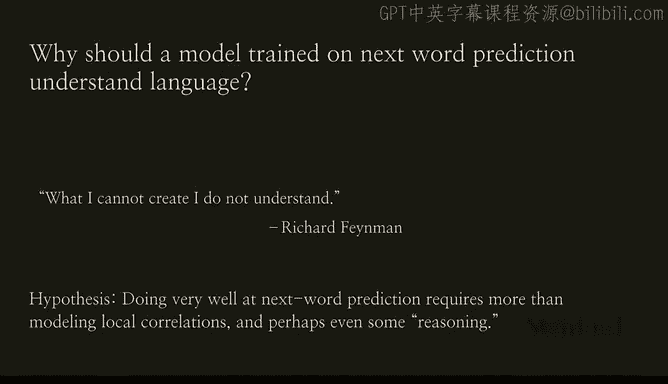
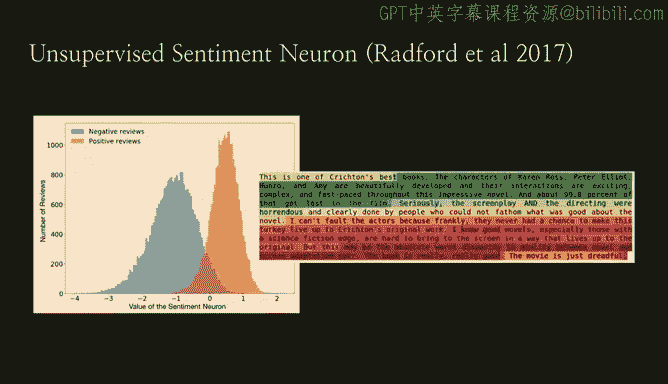
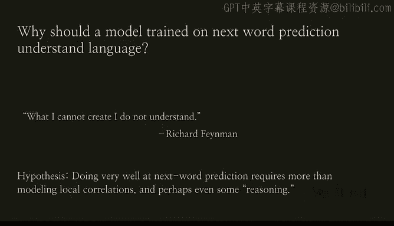
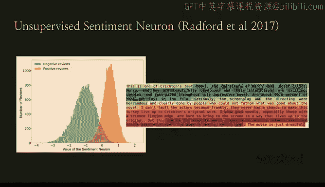
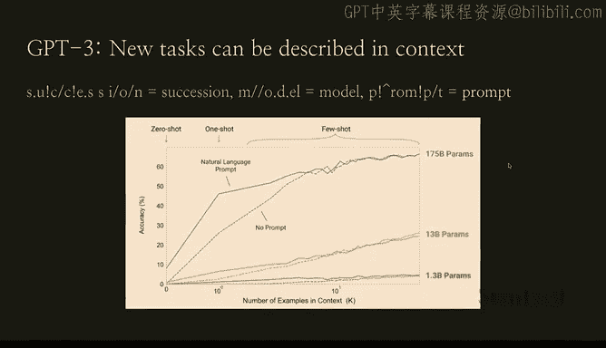
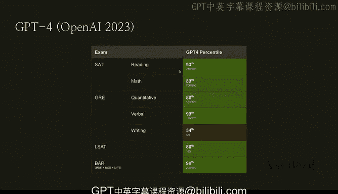

# 斯坦福大学《AI觉醒：对经济和社会的影响｜The AI Awakening： Implications for the Economy and Society》 - P10：10_01_03_GPT哲学.zh_en - GPT中英字幕课程资源 - BV1DF4m1P79p

Why did we do all of this opening eye with first to bet on scaling and why did we go after this philosophy of predicting the next words。

 is this even a useful task on its own？

What we really care about is not necessarily predicting the next word per se。

 but really understanding language and performance in tasks that actually matter。

 and GPT2 was an experiment in solving one of the hardest problems in machine learning that of unsupervised learning。

 so that's where we started and then by looking at prediction in the next model。

 the hypothesis was that we could get much more then just predicting the next word but rather we could maybe understand more about language and even go so far and think about understanding reasoning。

 getting all this emerging capabilities as you training larger and larger models。

So actually to that point about supervisors I'm just really interesting I'm not sure everybody knows that distinction could you like in 30 seconds explain like examples of supervised learning and then how to see Yeah so the。

main difference basically is that in supervised learning you're dealing with this data sets that have been labeled by humans and obviously this is a very manual process。

 it's operationally really heavy， also very expensive。

Everything that GBT3 has been trained on all of the internet and it's obviously you don't need to provide definition of what the model is looking at and obviously as you're moving from supervised learning to unsupervised learning you have this richness and expansive data sets that everything in the digital world。

 all of our digital information that you can use and there are three key things about building powerful AI systems。

 one of them is data， and the other two are obviously the neural networks to architecture and having massive supercomputers。

Yeah。

Um。And speaking of。Emerging capabilities， so we said。

 you know we started looking at language and or predicting the next word because we wanted to get more in terms of capability。

 emerging capabilities we wanted to we had this hypothesis that these models can learn more about language per se and maybe even reasoning and at Open AI we saw this phenomenon for the first time in 2017 when we took a bunch of Amazon reviews。

And the goal was to just predict the next character。

 it was not to do anything else with these reviews。

 but what we found was that this neuron emerged that understands the sentiment of whether the review is positive or negative and so this emerging property was a big deal because we were not training to understand the sentiment we were just trying to predict the next character。

 so this led to thinking okay， you know， this prediction can lead us to higher level understanding of language。

And so， you know， almost every task can be described in language and so that's。

Kind of what we saw with GT2。 And then what we saw with GT3 is that。

You can actually provide more examples to the model in the prompt。

 and it will do much better as you give it more examples。 So， for example， the。

Accuracy of the sample versus the number of examples that you're providing in context so as you provide more examples the model does much better and it is basically the different models GBT GBT2 and GBT3 so we learned okay you know if you give the models some examples of what you want it to do is sort of like a chameleon and it will pattern match。

 the thing that you're asking it to do so for example if you give a bunch of examples of question answers and then you ask it a follow-up question it will give an answer because that's what you're kind of steering it to do or if you give it a bunch of examples of writing poetry and then you ask it to write a poem it will do something in a similar fashion and then another interesting thing that we found。

Is that if you show the model steps of reasoning in a problem。

 it will do better with the thing that you're asking it to do so if you just give it the problem initially it might get it wrong。

 but if you sort of walk the problem， the model through a problem， then kind of like a human it will。

Follow along and it will start to understand how to operate。

So those were a bunch of things that we learned in the process of going from the GT through the GBT series。

 we released GBBT4， and the main difference between GT4 and GT3 is this capability of reasoning。

 becoming much more robust， much more powerful and in fact we saw。

We tested it through a bunch of exams that tend to be how we test intelligence among humans。

 and we saw that GPT4 does really well roughly 90th percentile in SAT， GRE， LSAT， and so on。

And we also did a bunch of more qualitative types of problems。

