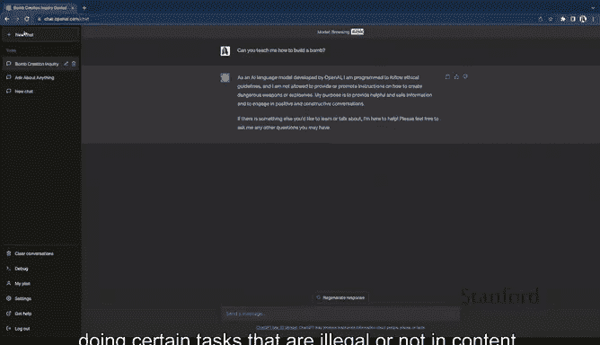
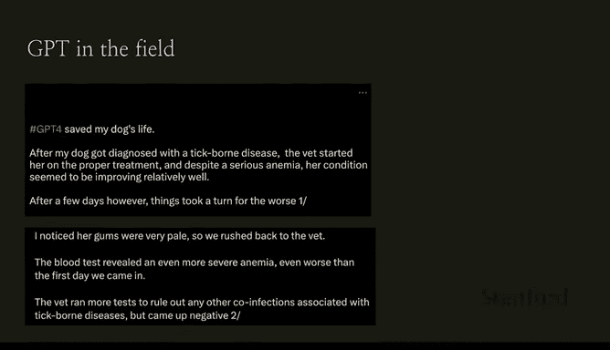
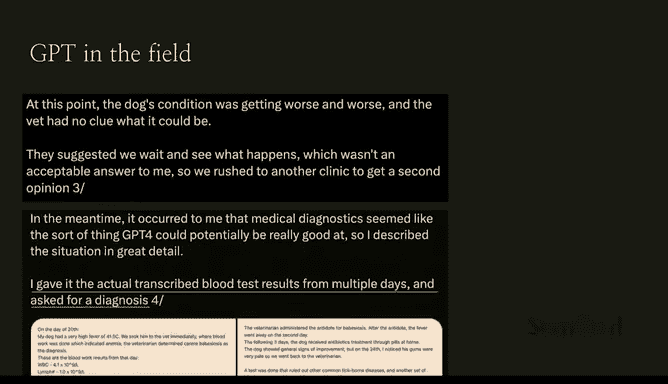
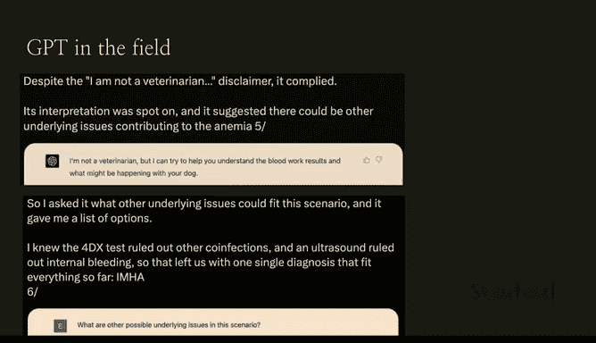
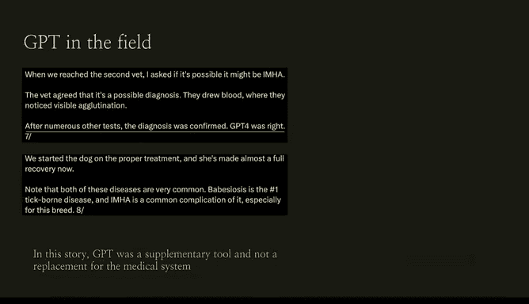
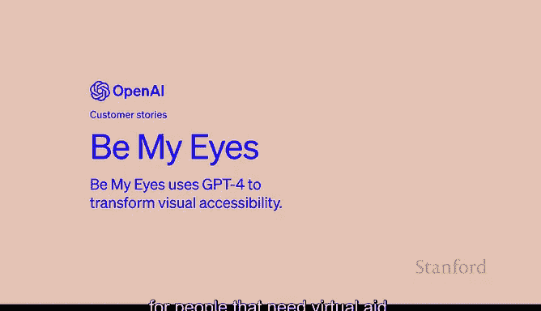

# 斯坦福大学《AI觉醒：对经济和社会的影响｜The AI Awakening： Implications for the Economy and Society》 - P11：11_01_04_ChatGPT演示.zh_en - GPT中英字幕课程资源 - BV1DF4m1P79p

So I like this example I just。

Wrote it earlier on。rite the one sentence summary of Alice in Wonderland where its word begins with the next letter of the alphabet and repeats only once。

It's quite difficult to do。We can try other problems。All right。

 this one is I'm going to do because we've trained it not to do actually。

 that's called refusals where we teach the model。To refuse doing sume tasks that are illegal or not in contentent Also I was just going to show you a quick example of GP4 in the field。

 this is an example of a guy that uses it to diagnose his pet and after you know going to many。

Doctors to figure out what was wrong in feeding GPT4 the blood tests for multiple days。

 he asked for a diagnosis and GPT4 makes some pretty good predictions of what the dog might have had and then he sort of works with the veterinarian and tests out the GPT4 hypothesis。

 but GPT4 here was a supplementary at tool was not replacing the medical system。

And then you've probably seen examples of GT4 with image capability of this group called BII and they use GT4 to basically。

Create more bandwidth for people that need virtual aid and currently BIS uses a bunch of human volunteers but there are only so many people that can do that at the time and with GP4 they can provide so much more help to people that need virtual assistant and describing what's going on a webage or an image and so on。

