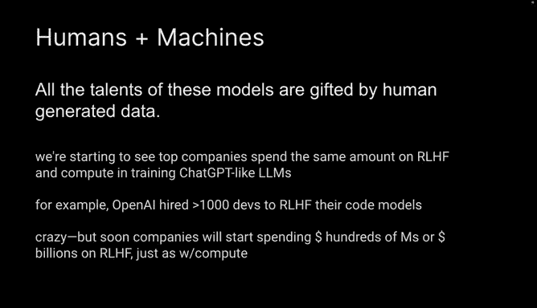
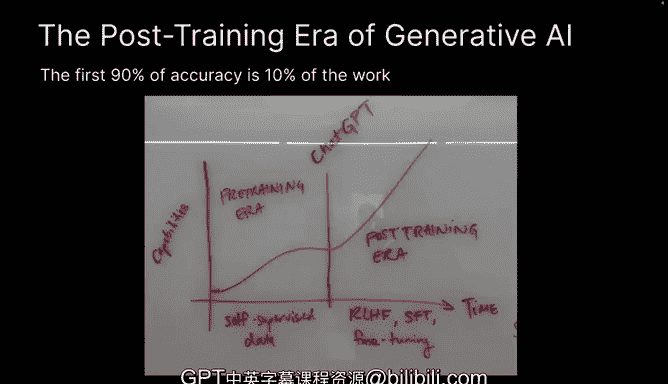

# 斯坦福大学《AI觉醒：对经济和社会的影响｜The AI Awakening： Implications for the Economy and Society》 - P13：13_01_02_数据的角色.zh_en - GPT中英字幕课程资源 - BV1DF4m1P79p

I added a few slides just on humans and machines to kind of stage the conversation a little bit。

 I think one of the things that。

Is I think kind of not well understood or sort of like the like。

 I think maybe people don't internalize very much is that all the talents of these models are gifted to them by human generated data The models themselves don't know anything or can't do anything。

 you know they just。Through seeing a huge amount of data。

 they're gifted these incredible powers and there's some set of powers that you get gifted just by reading the internet and reading all the books in the world。

 but that's sort of a limited set of powers versus all the powers that we're going to want these models to do So I'll talk about this in a second。

 but this is like this is a tweet that I tweeted that I think is sort of interesting it gets at this。

 which is that we basically are starting to see a lot of top companies spend you know same orders of magnitude on RLHF reinforcement learning with human feedback which is probably the primary way you would improve models via humans versus compute in training chat like LLms or basically these high quality models。

 So there was this news article about how opening I hired 1000 developers to RLHF。

 their code models you know and and it's kind of crazy that there would be you know you would think about these models is needing similar amounts of compute as human computation。

 but I actually think that's not so crazy。

Because broadly speaking， we're kind of entering what I like to call the post training era of Genative AI。

 you know， we were in this phase。For a very long time。

 which was the pretraining era of General AI which is basically we were finding ways to utilize all of this unsupervised data。

 you know all the data on the internet， all the data in all the data on the internet all the data in these books the data on Reddit etc and we got quite a bit of gain from all these models but as with anything nothing last forever once we once we sort of got to a certain level of performance off of all those models and then chattt PT sort kicked off this post-training era of AI which is really around how do you then chat what made Chatt so good was RHF in the first place we were able to use human feedback to get the model to actually respond to instructions and respond to questions from humans and basically follow instructions from humans and then now we're in this era where a lot of the gains in these models is going to be gained through a lot of human collaboration with the models so RHF reinforcement learning with human feedbacks SFT supervised fine tuning and sort of。

Spialized fine tuning and this is you know it's obviously hard to say where we'll be in five years。

 but this is definitely what we're seeing right now in the industry which is most of the model improvement today arises from some sort of human machine teaming to actually drive the improvement of the model and then my last thing on this is just sort of the biggest observation in AI is that the first 90% of accuracy is only 10% of the work and I think that is going to be true in geneative AI as well we've gotten obviously these incredibly powerful models but there's such a long way to go before I would trust a model to be my doctor and I think that the sort of frontier of getting from 90 to 99 is going to be a lot of work and is where humans are going to be deeply deeply involved。

