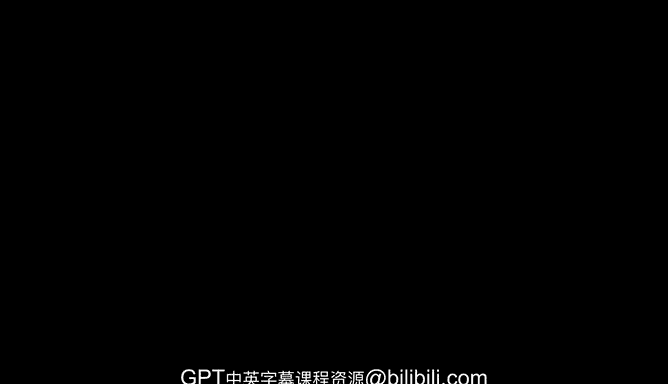

# 斯坦福大学《AI觉醒：对经济和社会的影响｜The AI Awakening： Implications for the Economy and Society》 - P15：15_01_04_未知的未知.zh_en - GPT中英字幕课程资源 - BV1DF4m1P79p

Betting on unknown unknowns。 I think there's sort of this funny trait in the world， which is that。

So maybe one way to look at it is that like at any one point nobody really can predict the future and if you wanted to accurately predict the future。

 you would sort of have to like implicit in your prediction of the future there would have to be some set of breakthroughs that are again impossible to predict so if you take AI for a second the recent breakthroughs in AI have certainly far exceeded most people's expectations because I think most people when predicting the future they look at the state of the field they're like well there's all these problems and like we don't have AI that can reason yet and。

 blah， blah and as a result you sort of live in this like grounded reality but you lose the ability to sort of understand these unknown unknowns that are going to happen that actually cause the field to progress quite dramatically and I've sort of witnessed this in real time in AI again what's happened in the past year with chattT or the past six months with chatttBT is entirely surprising。

 I think nobody in the field really expected this sort。

world to light up on fire but it is what happened and so you know I call this concept betting on unknown unknowns and and one of my observations that it only you know it only happens near the sort of frontiers of human tenacity and human creativity so when these two things sort of come together you have these situations where human nature sort of。

Constantly outpredicts what you might expect I made these sort of like I don't know if you because I've seen these memes of the like dim wit。

 midtwit and genius or whatnot， but like these memes are sort of I think are really good depictions of reality but one of them for example is sort of like oh what's to happen with AI will AI take over the world or we just going to get bog down in all the limitations of the field I think what's clearly happening is that no AI is going to take over the world same with Moore's law at any one point there's always people who are sort of saying oh Moore's law is over we're not going computation is not getting any better same thing I don't mean literally AI will take over the world I meant that AI as a technology will become ubiquitous in the world so this is sort of the cycle that often happens which is that this like okay you have this like past history this green line is the craziest set of wildly optimistic predictions I think there's like a lot of good examples of this but。

You know if you take like Elon Musk or Sam Altman or a lot of these folks。

 they often are representing the sort of like wildly optimistic path。

 then what actually happens is that for the most part we deviate pretty strongly from this wildly optimistic paths except for sometimes these like breakthroughs happen like the transformer or like ChattBG or you know the original advent of deep learning or the sort of like early 2010's advent of deep learning and those cause these like huge breakthroughs that cause you to sort almost catch up to the wildly optimistic view and you could either be sort of realistic i。

e。 track to like the bottom outcome and sort of sound smart or you could sort of be wildly optimistic sound crazy and then eventually be right。

