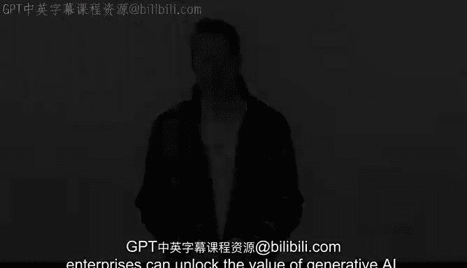

# 斯坦福大学《AI觉醒：对经济和社会的影响｜The AI Awakening： Implications for the Economy and Society》 - P16：16_02_01_宾杜·雷迪介绍.zh_en - GPT中英字幕课程资源 - BV1DF4m1P79p

Bindu Reddy is the chief executive officer and cofounder of Abacus。aiI。

 an endto end AI platform that enables realtime deep learning at scale for common enterprise use cases before starting Abacus。

AI， she was the general manager for AI Vers at Amazon Web Services。

 and her last company was acquired by Google Before that。

 Bindu was at Google where she was head of product for Google Apps， including Docs， spreadsheets。

 slides， sitesite， and blogger。

I'm excited for you to hear from Bindu on how enterprises can unlock the value of generative AI。

