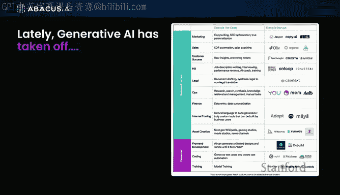

# 斯坦福大学《AI觉醒：对经济和社会的影响｜The AI Awakening： Implications for the Economy and Society》 - P17：17_02_02_生成式人工智能初创企业格局.zh_en - GPT中英字幕课程资源 - BV1DF4m1P79p

Unless you've been living under a rock， you've obviously heard of chat GT right？

 So quick obviously generative AI has been taking off。

 This is one of those infographics which show up on Twitter and everywhere else over the last six months。

 we've seen an almost a Cammbbririan explosion of these generative AI startups right everything from sales to legal to internal tooling has been automated or people are trying to automate this as on Twitter。

 the hypists like about two years ahead of like reality。

 So you should take this with a grain of salt but generally speaking you know to LLms today。

 and these are a large language models， as you probably know。

 are super delightful Great generation halluc inate pretty good at information retrieval and the big market is search。

 So today what I'm going to be focusing on is basically。😊。

How are L L Ms going to be useful in the business context， right？

 So avoacy AI is fundamentally a company which。Builds AI systems。

 applied AI systems for companies by creating an AI platform。

 Our vision when we first started the company was that AI not humans are going to build applied AI systems and that vision four years ago seem ridiculous。

 People laughed at us。 They were like， oh you know we have these people called data scientists。

 they're very highly paid individuals， we really need these data scientists to actually go build these AI systems but over time there's been a lot of invention。

 lots of cool stuff has happened some of it we you know we've actually also contributed that research and now everybody actually nods their head worry knowingly when I say AI not humans build AI systems and so。

😊，That's our vision， we think we're at the forefront of that revolution。

 but what are applied AI systems？😊，Before like just like a year ago there were like things like time series models。

 there were personalization systems， basically all of you have obviously used YouTube correct and so YouTube basically is run by this big personalization recommender algorithm so every time you watch a video the next video you're watching is personalized for you and without that recommend algorithm YouTube's traffic would go down by 85%。

😊，So this was kind of the bread and butter of applied AI。

 similarly if you talk to Dell computer or in fact， Amazon。com。

 they tell you Amazon wouldn't be Amazon without our time series forecasting models these time series forecasting models will be able to tell you exactly when a particular item will get bought。

😊，Well not maybe exactly， but in the in a range of like the next three months。

 how many kind of like USB connectors I will sell in Montana， right。

 but now the new applied AI system are LLMs and these LMs applied to kind of。😊。

Companies and that's kind of where that's kind of the you know service that we offer right now。

 So let's talk a little bit about where we are in the LLM space。

 So I don't know if all of you have seen this， but this gives you a good overview or an evolutionary tree of how LLMs have evolved and that evolution has been dramatic right from 2018 to 2023。

 which is just five years。 you've seen like this explosion of these LLMs。

 a lot of them are coming from big tech companies。 part of that is compute。

 you need like thousands of GPUus。 you've heard this already part of that is data you need a lot of data and then you need a lot of smart people right put all these three together you can create really great LLMs。

 and now of course we have GPT4 bard know and of course meta has released something called Lama So these LLMs basically have all started with the transformer architecture which was invented by people at Google。

😊。