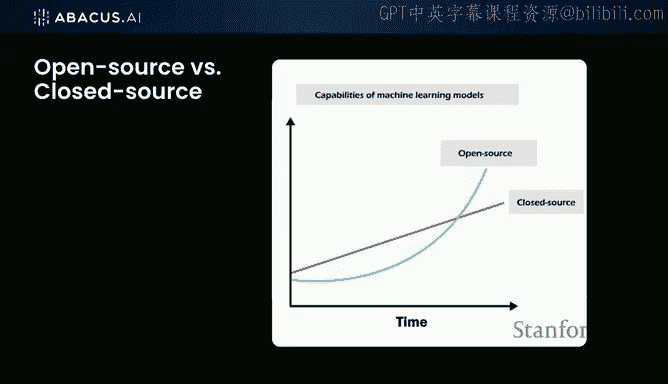
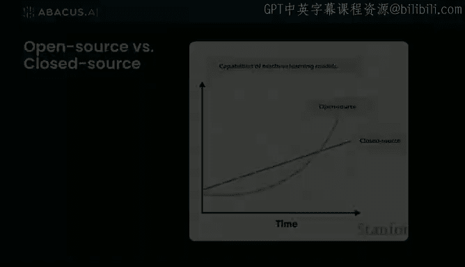
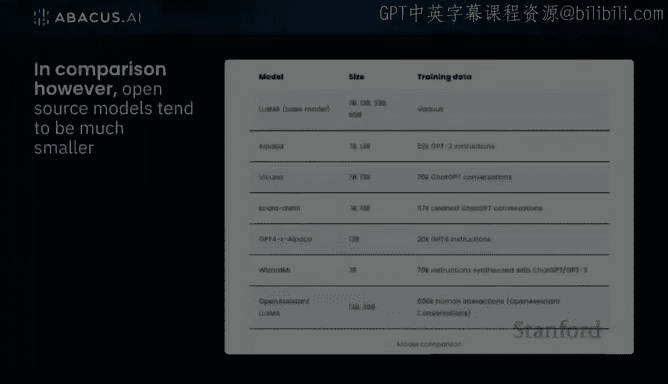
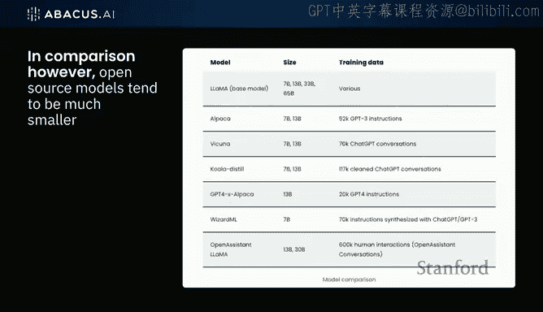
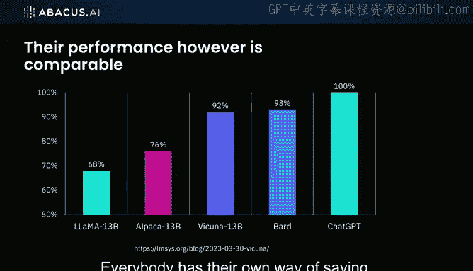
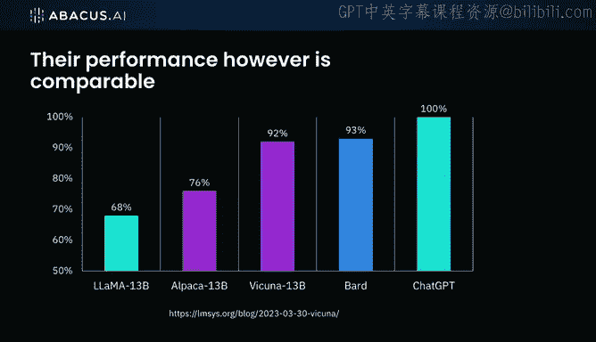
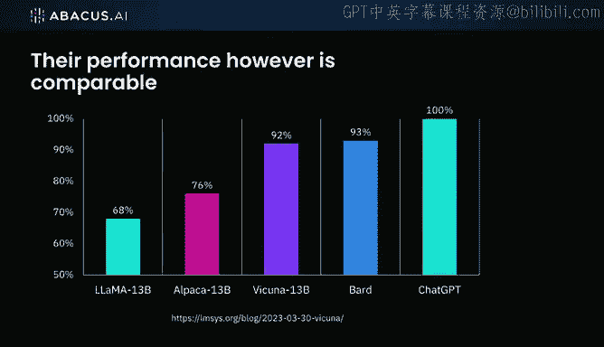

# 斯坦福大学《AI觉醒：对经济和社会的影响｜The AI Awakening： Implications for the Economy and Society》 - P18：18_02_03_开源与闭源.zh_en - GPT中英字幕课程资源 - BV1DF4m1P79p

What we've seen even over the in the last six months and I don't have the time access here kind of marked for a reason because I don't know how fast this is going to be。

 it could be in the next six months could be the next year or what have you what we're going to see is that these LLMs today the close source ones meaning where we can't actually see the source code when it comes to people like open AI or Google they've not released their LLMs are actually doing much better so we're somewhere here in the evolution of these LLMs but very soon and I'm hoping in the next year or so we're going to get to a place where we're going to see a lot more open source models and basically these LLMs become more or less a commodity of sorts。

 so everybody has access to an LLM which actually which performs quite well。😊。

So this is what you know we're kind of predicting for the future The other thing which I'm sure a lot of you may or may not have heard of is we now have the NLP Morriss law where basically every year model size increases by 10x this actually is a little old the picture is a little old but already in 2021 2022 we had a 1。

6 trillion parameters now G4 is rumor to be 10 we don't know for sure maybe it's I mean they released a paper it could be four or five whatever but it keeps going up and up and up I think actually we've kind of reached peak LLM size meaning going forward we may not need to build or we may not need to train such huge models of course Google right now at this moment is trying to train a really really large model at the end of the day we're seeing efficiencies at smaller models too so I'll get to that in a minute but if you look at a model which is like a 20 billion parameter model it's actually performing as well I mean may not be as well but like 6070% there right so people are coming up with ideas and tricks and techniques。

😊。

To basically see how you can actually decrease the size of the model。

 make training more efficient and that sort of thing the harder problem actually is data more than the size。

 usually what happens over time with all of these really large models is you can actually compress the information in smaller models。

 but you need more and more interesting data for it to like get better。😊。

So in comparison， so I just showed you all those large language models made by all these large companies which have a lot of money Now here we have on the other side of the equation。

 almost these open source models， thanks to Janan Lacoon and Me the open source actually really started taking off once they released the Lama base model which is four different models you can actually start playing around with a 7 billion parameter model as long as you have a big GPU So actually Stanford you know people did play around with Lama and came up with Alpaca the 71333 and 65 and the 65 billion model actually does really well。

 So part of this was strategy in terms of what Facebook did I think Zach and Jann Lacoon were caught a little bit unawares in terms of how effective these LLms were going to be。

 they were obviously building the AR we are you future realized at some point that they had gotten that wrong a little bit went back and said。

 oh wait， what are we going to do now we're gonna have to slow down open AI So what did they do to slow down open AI they released Lama。

 which。😊，It's a good strategy， by the way， right， because now we have a lot of others。

 including ours trying to compete with them， to some extent。

So Lama got released actually very recently， of course Alpaka literally in two weeks after that basically folks at Stanford here basically created training data using GT3 this is a very clever trick you can actually take open AI and ask it to you create training data for you so synthesized data for you and then use that synthesized data and trained and trained Lama on top of it to make Lama better right so it's really interesting where AI in some ways is literally already building AI right Vikua another one which just came out they use this data from this site called share GPT which is basically a bunch of like again。

 humans playing around with GP4 getting that data and then feeding that back into these smaller models so in some ways we're taking that intelligence from G4 and feeding that into these smaller models and making these models better。

😊，So this is the state of like open source models today they're all coming up and if you look at their performance Now take this with a grain of salt。

 the biggest problem we have today if you ask me is we don't really know how to benchmark these LLMs in a good way everybody is like has their own way of saying hey my model is better than you yours and there's all kinds of different benchmarks and this one is actually published by the Vikua people so big grain of salt there where basically they had a bunch of questions and then they said hey how well do these LLMs do on these questions they decided that whatever Chad GT was doing was the best and if you compare that you see that the open source models are in too bad what I will tell you from our own experimentation is if you have an AGI or an open question where you're like searching the whole web and you want to ask the question of this model if you say hey who's King of Egypt in the 16th century or whatever it want to answer it would want to do as well as let's say Chad GT or Bd but and this is where these smaller models will really shine。

😊。

In applied AI kind of flex situations， these smaller models actually really work well。

 and what do I mean by that？😊。

What I mean by that is that when you take corpusees， which are like our data。

 which is kind of close to your enterprise and start training those models。

 that's when they actually start doing a little bit better。

