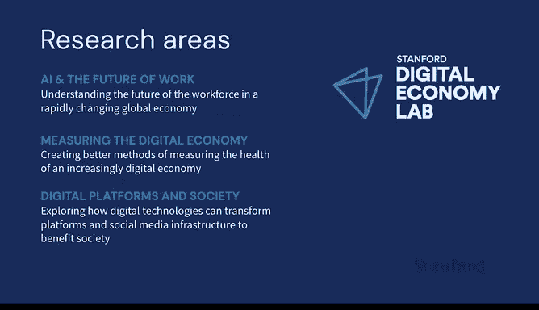

# 斯坦福大学《AI觉醒：对经济和社会的影响｜The AI Awakening： Implications for the Economy and Society》 - P1：01_01_02_课程介绍.zh_en - GPT中英字幕课程资源 - BV1DF4m1P79p

Hi， I'm Eric Bolson， I'm a professor at the Stanford Institute for Human Centered AI。

 and I'm the director of the Stanford Digital Economy Lab。

This is a remarkable time to be alive as AI transforms our economy and our society。

 That's why I'm so excited to bring you the dynamic world of generative AI in this course。

 I came to Stanford back in 2020 to launch the Stanford Digital Economy Lab。

 Our mission is to advance the collective understanding of the digital economy to build a tech- drivenven society that benefits everyone We bring together some of the smartest hardest working students。

 faculty and researchers on the planet to focus on three research areas。

 The first is AI and the future of work， which is really the major focus of this course today。

 The second is measuring the digital economy and the third is digital platforms and society。

 I named this course the AI awakening to reflect how after nearly 70 years of AI research since the term artificialific intelligence was first coined and has exploded into the public consciousness over the past year driven。

By breakthroughs ingenrative AI。Artificial intelligence is now reshaping our world。

 Its core capabilities are improving exponentially， and the exponents are big。

But our economic institutions， our organizations， our skills have struggled to keep pace with these rapid advances。

In this growing gap， we find not only some of our most pressing challenges for business and society。

 but also many of our most exciting opportunities。That's why we created this course。

 we want you to explore and help you understand how advances in AI can and will transform our economy and society in the coming years so that we will be well prepared to navigate these changes。

This course was originally developed for my graduate class at Stanford。

 I intentionally designed it to be jointly listed between economics， Econ 295， and Comp Science。

 CS323。It attracted more curious students from across the university than we had room for。

 including students from business and engineering as well。

Every session provoked interesting discussions and new insights。

 it would have been a waste not to make this knowledge more widely available。

That's why we are thrilled to offer you the opportunity to dive into the same material that's inspired so many of our Stanford students。

So what is this course all about Well this won't be your typical online class with lectures and homework Instead each session features a distinguished guest speaker at the forefront of AI economics。

 government or industry will explore topics ranging from the technical underpinnings of foundation models in large language models to work in employment。

 Model bias and explainplainability， AI's geopolitical implications and even envisioning a world Without work you'll get a chance to hear from researchers and industry leaders in technology and economics such as former Google CEO Eric Schmidt。

 Berkeley professorfeor Laura Tyson， scale AI foundunder Alex Wang， Open AI's Mira Mardi。

 and Anthropic co-founder Jack Clark to name just a few each one brings not only frontier knowledge but also a unique perspective。

I'm grateful they were so candid in sharing their insights we're going to meet a lot of fascinating people in this course I met many of them in my capacity as a researcher or as a writer and many of them became my friends。

 I hope you'll enjoy hearing from them as much as I did。

