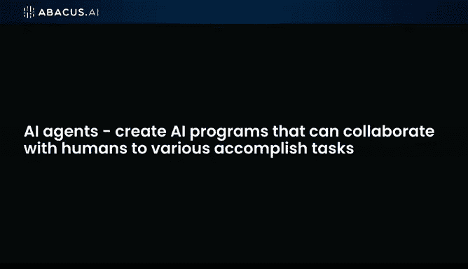
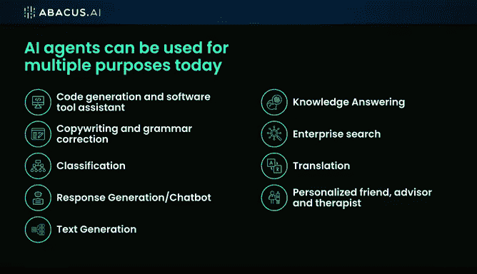

# 斯坦福大学《AI觉醒：对经济和社会的影响｜The AI Awakening： Implications for the Economy and Society》 - P20：20_02_05_人工智能代理.zh_en - GPT中英字幕课程资源 - BV1DF4m1P79p

What I'm more excited by is much more than even LLMs these things which you know we don't really know what they should be named。

 I think people are calling them AI agents so we are calling them AI agents right now and the idea here is basically to create 10 to AI programs which can do highle tasks by collaborating with humans so just imagine one of the tasks could be you know hey I have a bunch of data and I have a bunch of queries I need from the data so imagine I have like 10 tables。

 10 database tables and my question could be how many users signed up in the month of March and how many of them churnned out in the month of June what do you do today you have to ask that question you have to figure out what the SQL query for it is。

 you have to write the SQL query you have to go push that query into your database， get the results。

 come back you need a human in the loop and so on right？😊。

Instead， in the future and that future is now right now you can basically use an LLM to help you do all of that。

 So without needing a database administrator or a database query person。

 you can write an AI agent and that AI agent can actually collaborate with you to get you these answers some of the tasks that AI agents can do they can be personalized friends they can your advisor your therapist they can do cogeneration copywriting classification。

 enterprise search and so on。 some of these things the base LLM the chat G can do as well。

 This is not to say that you need an agent for every one of these things but today if I go to a chat GD it may not be good at classifying documents right you imagine if I had like 15 document one document is of type one document is like a claim insurance claim another document is a title。

 another document is something if I want to ask it hey classify this documents today I'm going to have to do a lot of work I'm going to have to write some programs to get there but by creating an AI agent you can actually get this done really quickly and。

😊，This is where we think applied AI will really use LLMs in the back end to get a lot of these jobs done Each agent think of it as almost as a role right whether it's like a data entry role or like a copywriter role see copywriting or grammar correction you basically want to have a human who's a copywriter fed up with an AI agent who's going to help him or her do copywriting。

😊。

