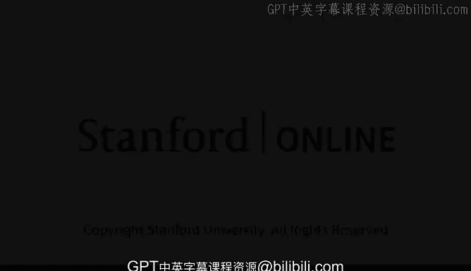

# 斯坦福大学《AI觉醒：对经济和社会的影响｜The AI Awakening： Implications for the Economy and Society》 - P21：21_02_01_劳拉·泰森介绍.zh_en - GPT中英字幕课程资源 - BV1DF4m1P79p

Laura Tyson is a distinguished professor at the Haas School of Business。

 the University of California Berkeley previously she was the dean of the London Business School and dean of the Haas School at Berkeley。

 she served in the Clinton administration as the chair of the Council of Economic Advisors and is the director of the National Economic Council。

 most importantly for us， Laura is a world leadingding expert on the economics of labor and the Is of Artific Intelligence and Autoation and that's exactly what she will speak to us about today。

