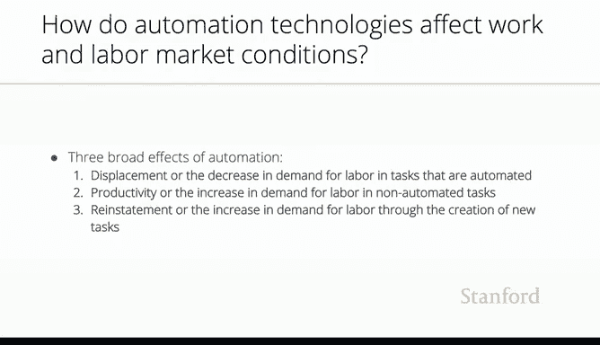

# 斯坦福大学《AI觉醒：对经济和社会的影响｜The AI Awakening： Implications for the Economy and Society》 - P22：22_02_02_过往自动化的经验教训.zh_en - GPT中英字幕课程资源 - BV1DF4m1P79p

A lot of what here is about looking back and saying are there lessons are there if we take AI as just a tool。

 it's a tool， it's a tool in a long toolkit of automation。

 the automation what does automation do it performs tasks previously performed by humans often more cheaply faster and better okay so that is what I think we need to understand the history of automation and its effects on labor that will give us some guides into the future。

 it'll give us some guides into the future and then my question which is also Eric's question and probably the same question that came up in Congress is not will AI and AI enabled intelligent tools create unemployment。

No， it's will they create quality jobs The history of automation suggests that automation is consistent with productivity gains。

 it's also consistent with full employment， I love John Mayern Keynes。

 a lot of things John Maern Keynes said were true。 technological unemployment。

 long term technological unemployment， not true， not true。

 there's no evidence of long-ter technological unemployment。 If you have automation。

 you're going to get productivity growth。 The productivity growth is going to go in employment growth。

 you're going to get new occupation and new jobs。But existing ones。

 many of them will be destroyed and changed， and there'll be a lot of transition costs。

 a lot of transition costs， where a job disappears is's not where a new job is going to be located。

Place it will differ。 Time will differ。 The old job may be destroyed。 quickly。

 the new job may take some time to generate。 So I just want to say that。

 I'm not talking about technological unemployment。 I'm talking about。The quality of jobs。

 that should be the challenge of our policymakers going forward。 And in doing that。

 I want to emphasize that automation does lead to displacement， significantplacement。

 the decrease in demand for labor in tasks that automated a productivity increase and therefore an increase in demand for labor in non-automated tasks。

 They're made that the technology complements them。

 and the productivity gains lead to an increase in demand and an increase in demand leads to an increase in demand for labor。

 And then therefore finally is the reinstatement or increase in demand through the creation of new jobs altogether。

 So David Otor， who is a very wellknown economist。 and you should read all of his work on the stuff or Darren Naimog。

 they really emphasize， look。The key thing here。Is is the pace of displacement？

Outpacing the pace of reinstatement， Okay， and unfortunately。

 there is evidence that that has been happening in the past several decades。

 So displaces happening faster。 People are losing their jobs。

 They're falling into less good jobs and the reinstatement of new jobs that are good jobs is going more slowly。

 So that's an important observation。

