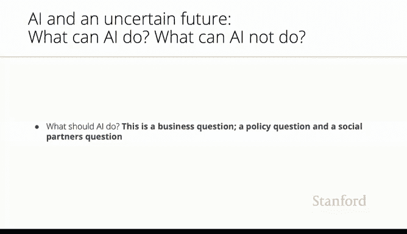

# 斯坦福大学《AI觉醒：对经济和社会的影响｜The AI Awakening： Implications for the Economy and Society》 - P25：25_02_05_人工智能的经济影响与未来.zh_en - GPT中英字幕课程资源 - BV1DF4m1P79p

There was a very interesting report by Goldman Sachs trying to get an estimate of the percentage of jobs that might be affected by。

Regenerative AI by the newest model， their estimate is 7% of current employment in the US could be affected。

63% could be complimented， that is the high skills you kind of get the technology and you work with it and 30% those low skilled essential service jobs will not be that much affected Okay the demand Manning Michigan and rock。

 I just want to point out a couple of these things because they say that first of all。

 they have a very tough definition of exposure to AI。

 They say it has to be the LLM has to decrease the time required to complete a task or a daily work activity but at least 50% while maintaining quality。

 So that's their measure of exposure。 It's a very nice tough measure。By their measure。

 19% of the workforce could have at least 50% of their tasks exposed。

What does that mean from from an employer employee point of view。

 do do you keep the worker with 50% of the tasks， Do you like you know cut the workforce by 50%。

 what do you do， The tasks are， some's going to be done by the machine。

 Some going to be done by the worker。 What are you going do Expsure spans all wage levels。

 This is different Okay， this really is all that stuff about automation in the past。

 You did not see higher education and higher income jobs facing automation， you did not see that。

 you see so those kinds of jobs being complimented by automation now。

They're subject to greater exposure to this new form of automation that's a very important point another important point is that exposure increases with entry barriers to jobs so here you go。

 you go get a law degree， you go get a business degree。

 you go get a sophisticated technology degree and then it turns out he the machine can do it better than you。

And that's that's new。 that's absolutely new。 So I just want to indicate we can talk about that some more。

 but it is very important。 So I do all that。 So i'm going to end with some。

Some just sort of reflections。I think we have to ask ourselves the question of。

Not just what AI can do， not just what AI cannot do， but what AI should do。

 what AI should do That is a social question that is a policy question。

 that's also a business question that's also a business question。

 but I think that we have to pose it that way and we have to realize that as David Otto would say we have agency。

 we humans have agency in how to use this technology we made it happen。

 we can make happen its uses so the agency thing is very important。

 I end with a couple with a number of things on good policy agenda which we can talk about there are a number of things which I learned from Germany there are a number of things which I've just thought about in terms of policy issues to try to deal with this but I will emphasize again the agency problem that David encouraged。

Just to think about， it is up to us， it is up to us to do it。

