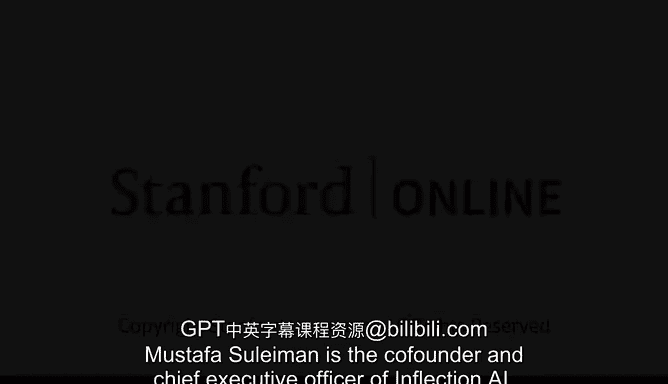

# 斯坦福大学《AI觉醒：对经济和社会的影响｜The AI Awakening： Implications for the Economy and Society》 - P27：27_03_01_穆斯塔法·苏莱曼介绍.zh_en - GPT中英字幕课程资源 - BV1DF4m1P79p

Mstafa Suiman is the cofounder and chief executive officer of Inflection AI an AI first company redefining the relationship between humans and computers。

 Before that he cofounded Deep Mind， which was bought by Google back in 2014 as head of Applied AI there he contributed to the team's major successes in AI research and applications for over 10 years including Alpha Fold and Alpha Go。

In our conversation， we will discuss navigating the potential for prosperity and even existential threats from this unprecedented technology acceleration。

