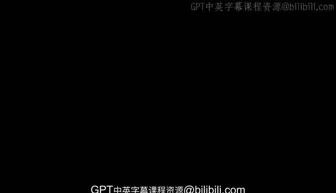

# 斯坦福大学《AI觉醒：对经济和社会的影响｜The AI Awakening： Implications for the Economy and Society》 - P29：29_03_03_合成媒体与合成生物学的风险.zh_en - GPT中英字幕课程资源 - BV1DF4m1P79p

Get specific and concrete what are some of the bad things that can happen with these tools Well so I think it's just going to it's going to accelerate the clash of ideologies that we already are you know sort of suffering right the polarization in our world is essentially a function of all of us believing that we're right in some way and you know in many respects we are right and you know it what these tools are likely to do is is really just like make it easier for us to be persuasive。

 make it easier for us to you know why is that bad Yeah。

 I mean in many in some respects it's not bad right but I think that if you can。

Really personalize you know the persuasion of like an argument that is designed to cause instability in society。

 designed to make us you know feel afraid of the other or to hate or blame other groups then you know which I think is almost certainly going to be the case then I think that makes it very difficult for us to find unity for us to be compassionate for us to concede to one another for us to want to feel justified in paying our taxes because we're actually you know taking care of the other people social media is maybe having some of those effects but but why did you say almost certainly or why do you think that's even more likely I mean couldn't one just as easily say you could have very persuasive arguments for people cooperating and being innovative and being better informed and these tools will help us be persuaded of those things。

 why do you think that it's likely that they'll be used for the poll？

I think they'll be used for both and that that's part of the challenge wherever there is a desire to have influence at scale。

 these tools will accelerate and enable that desire and many of those desires will be beneficial and constructive and you know as you say like look towards creating consensus but there will be enough that that aren't which is going to amplify the instability right。

How does that how does that math work I think you said most people were likely to use it good for good things and if it could be used that way and some people use it for bad things。

Why does it that net out to be a net negative Well I'm not necessarily saying that it's a net negative what I'm saying is that like you know。

 I think that if if you're very deliberate about amplifying a dark meme in the world。

'll be if you're very you know intent on trying to persuade the world of something that you know。

 is say untrue， any of the social media fears that we've had over the last like you know。

 five years or so，For sure， I think get amplified by the ability to produce you know an automated personalized persuasive synthetic content without really you know respect for the truth right and I think at the moment the way that that is limited is that we actually have a highly centralized internet right much as we sort of don't really like to。

Admit that people think that you know we have a very。

 very open you know and kind of freewheeling digital world。

 we actually have a highly moderated one right and I think that there are many reasons why that's a good thing the platforms do a good job of moderating for spam and other kinds of you know you know for example terrorist content and so on and that's going to become even more of a you know of a priority。

So。There's a risk of some really bad stuff being generated and we currently have a more centralized internet than most people realize and the same kinds of tools that are used to。

Limit spam or。Black male， ransomware。Imperfectly。Will be used。To prevent these negative types of。

Puasive models Yeah， and it depends over what time period you're really speculating on the the arrival of capabilities right in the next year or two。

 that's really the principal threat is the acceleration of the production of synthetic media。

But if your AI or you know or the synthetic biology tools that you're experimenting with as they become more powerful and as they become cheaper。

 the potential for them to have you know very， very rapid reach is going to grow right say a little bit about the synthetic biology and then you see that is another really big risk and obviously not obviously but they're intermixed with AI what's the scope of the danger from synthetic biology。

 you talk actually at one point about a presentation that you heard at some university and you can say which one where people were talking about。

The potential of synthetic biology to do harm， Yeah， that's right。Well。

I think it's going to be possible to synthetically engineer significant modifications to our food。

 to our chemistry， to ourselves and once those that knowledge and know how is very cheap and you know you can synthesize novel compounds either for known substances like a smallpox for example。

 which is a widely known you know compound like when many people know how to essentially engineer know is more or less public yeah and the know how for how to synthesize it is public and the tools to do that cost you know less than $20。

000 or so you can buy a desktop synthesizer there'll be one at the university for example。

 so you know and obviously that is many times more transmissible and lethal than COVID and。

So those are the kinds of risks if these things get continually cheaper if they drop by another order of magnitude and the complexity of their use goes down too。

 like if you could really just give a natural language instruction and you don't even have to have any training in biology to be able to use those materials that raises the potential for existential threats。

