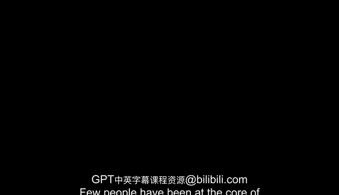

# 斯坦福大学《AI觉醒：对经济和社会的影响｜The AI Awakening： Implications for the Economy and Society》 - P2：02_01_03_埃里克·施密特介绍.zh_en - GPT中英字幕课程资源 - BV1DF4m1P79p

Few people have been at the core of Silicon Valley as long as Eric Schmidt or plays as big a role in shaping its impact。

Eric is a technologist， entrepreneur and philanthropist。

 he served as Google's chief executive officer and chairman from its early days in 2001 through 2011。

 and then later as executive chairman where he pioneered the company's transformation from a Silicon Valley startup to a global leader in technology。

In 2017， he cofounded Schmidt Futures， a philanthropic initiative that bets early on exceptional people making the world better。

 one of the most interesting things Eric is working on is something called the AI 2050 initiativeni under Schmidt Futures。

 it explores what the world could look like if we actually got everything right。

We'll talk to Eric about the opportunities and risks of AI。

