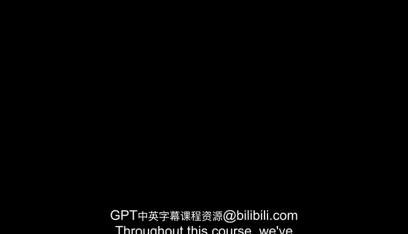

# 斯坦福大学《AI觉醒：对经济和社会的影响｜The AI Awakening： Implications for the Economy and Society》 - P36：36_03_01_课程总结.zh_en - GPT中英字幕课程资源 - BV1DF4m1P79p

Throughout this course， we've explored how advances in AI can and will transform our economy and society in the coming years。

 We hope you found these conversations valuable and that you now have a deeper appreciation for the profound implications of AI。

As you finish this course， I encourage you to reflect on the insights you've gained throughout this journey from the exploration of foundation models and large language models to the nuances of work and employment。

 bias and explainability， AI's geopolitical implications。

 and the possibility of a world without work。Take some time to reflect on what you've learned and how it applies to your organization and society in general。

I hope you'll continue exploring this ever evolving landscape and carry the knowledge and perspectives you've gained in your future endeavors。

Thank you for being part of this course。