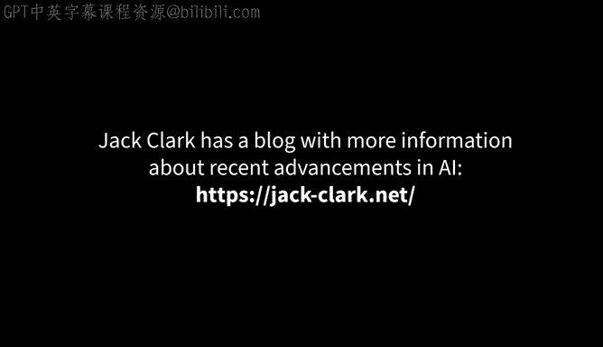

# 斯坦福大学《AI觉醒：对经济和社会的影响｜The AI Awakening： Implications for the Economy and Society》 - P4：04_01_01_杰克·克拉克介绍.zh_en - GPT中英字幕课程资源 - BV1DF4m1P79p

In this section we'll hear from Jack Clark， Jack is a cofounder of Anthropic an AI safetyty and research company。

 he was previously the policy director of OpenAI and before that he worked as the world's only neural network reporter at Bloomberg。

 Jack also runs a popular AI newsletter， Import AI and his co-chair of Sanford's AI Index where we've worked together for years。

I'm excited to talk to Jack about some of the recent breakthroughs in AI that underpin this course。

