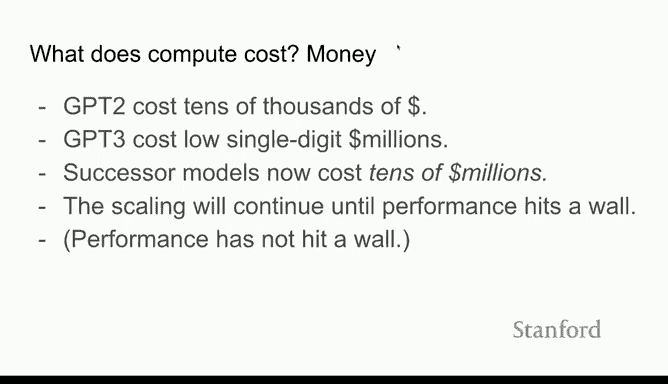

# 斯坦福大学《AI觉醒：对经济和社会的影响｜The AI Awakening： Implications for the Economy and Society》 - P5：05_01_02_近期人工智能突破.zh_en - GPT中英字幕课程资源 - BV1DF4m1P79p

Now let's just do some visual examples of AI progress because I think it's good to all get on the same page so you know top left here we have a paper from 2015 generating images from captions with attention if you look closely at the image you'll see that it's incredibly bad it's like a 32 by 32 pixelated smear if you look at the middle image which is a paper from 2020 Dfghan and you look at the free boys playing a soccer game on a green soccer field so these people if anyone's familiar with like Imistic art or Francis Bacon they look like that and then on the right you have this dli2 system from Open AI where they prompted it with something like two teddy bears like in a steampunk style playing of a chemistry set。

Is what it looks like， like like exactly what it looks like to an unnerving degree。

 And so it's important to keep in your mind that in 2015， this was the best thing ever。

 I was a journalist。 I went to Europe and I wrote an article about how good this paper was because it was mind blowing at the time and now were so much further beyond us。

Second thing is reinforcement learning， which is now being used to make things like chat GT better。

2013 Deepmind wows the world with these examples of AI systems that can play Atari and can play space invaders。

 2016 it wows the world again of a system that can beat the world's best go player Lisa Dole 2019 both open AI and Deep mindd work on strategy games。

 dota2 shown here and deepminded Starcraft and they be kind of clever gameplay systems that can now play as teams in a kind of continuous 3D battle space。

 Alpha doggf in 2020 a trained US Air Force pilot loses in a simulator to something trained using reinforcement learning and 2022 and VDA uses a reinforcement learning approach to make 13000 arithmetic units in the upcoming H 100 GPU and their 25% smaller。

 So they 25% kind of better in terms of chip efficiency so。

Space invaders 2013 to world's most advanced AI training chip in 2022。

 And I think it's just worth keeping that in your mind that the amount of progress here has been wild。

 And I'm going talk a little bit about why。So， you know， why is this。 Well， a few years ago。

 some colleagues of mine who are then opened the eye now at Tthropic did this work on something called scaling laws。

 Sc laws was asking the question of can we predict ahead of time how good AI systems will get if we put a certain amount of compute or data into them or you know the complexity of the system itself。

 like the number of parameters in the network and they discovered this very strange like power law kind of relationship where you have these smooth curves that go over multiple multiple kind of vast logarithmic scales of compute and data and parameters and then in the last few years。

People have done scaling laws analysis everywhere。 So it turns out you can do scaling laws for recommendation models。

 you can do scaling laws for video models， you can do scaling laws for fine tuning。

 you can do scaling laws for individual things like how good you can get at play and go。

 you can do scaling laws for multi-agent work and the significance here is for scaling laws。

 make it possible for people to train really expensive large scale systems because in some sense they derisk the process of training it。

 like it's one thing to say， give me $5 million。 Who knows what's going happen。

 And it's another thing to say give me $5 million， I predict will'll get a loss of X given the data set and compute you're going to give me the latter is why you're seeing you know startups like Anthropic exist companies like Open I continue to scale things like G4 academics being able to more predictably develop large scale models。

And what these scaling laws demand is just a huge amount of compute。

 So what you have here is a graph going from you know。

 over 50s to sort of the late 200s of the amount of compute used in training AI systems。

What it nets out to in practice is， you know， in 2019， GP2 cost you know。

 tens of thousands of dollars to train in 2020 GP3 via public estimates is said to have cost the low single digit millions to train。

This year and last year， systems were being trained but cost tens of millions of dollars next year you know you can probably expect hundreds of millions of dollar training rounds to happen。

 the scaling will continue until performance hits a wall。Keeps working。

 So we're going we're in for another like year or two of this。

 And that should try and sort of help you help this be real to。 You like。

 it theres a huge amount of money。 The money's increasing like every few years。

 and it's leading to systems of profound capabilities。

