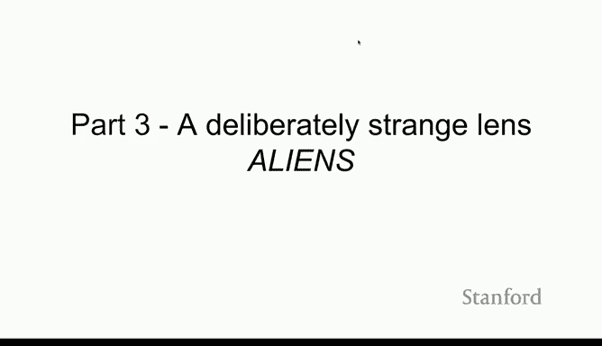

# 斯坦福大学《AI觉醒：对经济和社会的影响｜The AI Awakening： Implications for the Economy and Society》 - P6：06_01_03_人工智能与外星智能.zh_en - GPT中英字幕课程资源 - BV1DF4m1P79p

So here's my deliberately strange lens， aliens。 and I want to pitch you on this。

What I mean by this is that even though language models， which are very interesting。

 like chat G and G 4 and Clade， are just doing next token prediction。

 they're kind of doing something using different machine or even us。 Like， you know。

 humans in intelligence in general is trying to kind of approximate and predict some kind of complex function。

 You know， what's happening around us。 And language models are also trying to do this in the context of like a stream of text or a stream of information。

 And human brains like do this in one way。 And we do like reality prediction。

 using a certain set of prize and a certain set of things。

AI systems now， like language models are also doing like reality prediction in this somewhat limited domain。

 But using completely different prior， completely different technology。

 And I think when people see all of the strange ways in which language models fail。

 And I'll show this in my demo。 They're like thats odd。

 That's like a human wouldn't make that mistake。 It's like， of course。

 a human wouldn't make that mistake， It's not human， It's very different。

 And I think you should use for kind of alien lens because。

There's a tendency to look at these things as tools。

 And I think it's better to look at them as some new thing but we don't fully understand。

 And we can't fully interpret or explain the behavior of。A nice example here from Deep Mind， I think。

 is they did this experiment of training a reinforcement learning agent to control the plasma in a fusion reactor and the agent not only was able to control it better than any person。

 but it was able to like split the plasma into two donuts and then spin them around together。

 which is something no human had ever figured out how to do because we used reinforcement learning。

 relatively simple algorithm， but I'd sort of say this was like an alien intelligence doing some weird form of optimization that's very impressive。

 but in some senses kind of grown and grown through the training process rather than something we can mechanically you describe and write down。

So before I go into the demo， I just want to kind of close with this because I think it might be helpful。

It's really hard to understand， like new things。 And what I opened my talk with of these papers are papers about trying to use the new things to understand themselves。

 like the therapy chatbot example or trying to。Figure out new ways to diagnose the new things or understand their properties。

 And a challenge which everyone in AI is having right now， in which you'll here on this course。

 is that we have these amazing technologies， but they're kind of emergent。

 They're kind of unpredictable。 And we don't really have a full scientific method for explaining everything that they do。

 We're right at the part where we built the thing。 It does interesting stuff。

 And now we can analyze it。