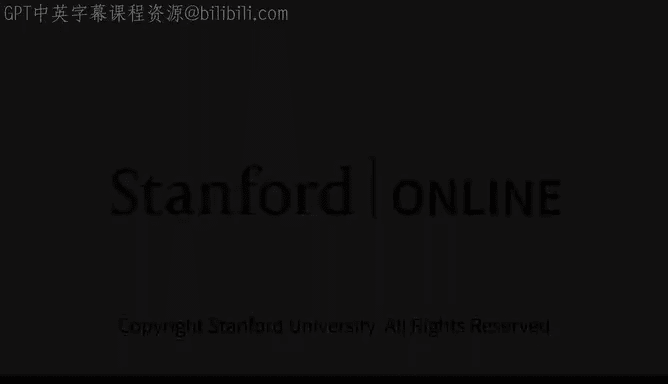

# 斯坦福大学《AI觉醒：对经济和社会的影响｜The AI Awakening： Implications for the Economy and Society》 - P8：08_01_01_米拉·穆拉蒂介绍.zh_en - GPT中英字幕课程资源 - BV1DF4m1P79p

Mira Midi is chief Technology officer of Open AI Open AI is an AI research and deployment company。

 Open AI's mission is to ensure that artificial general intelligence benefits all of humanity Mira joined Open AI back in 2018 later becoming its CTO leading the company's wellknown work on applications such as ChatGPT。

 Dolly and Codex。

MiIra is going to help us understand what generative AI models are and how they work。

