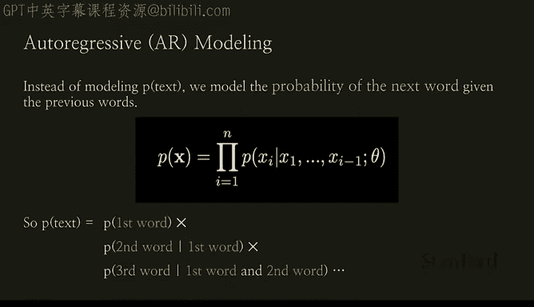
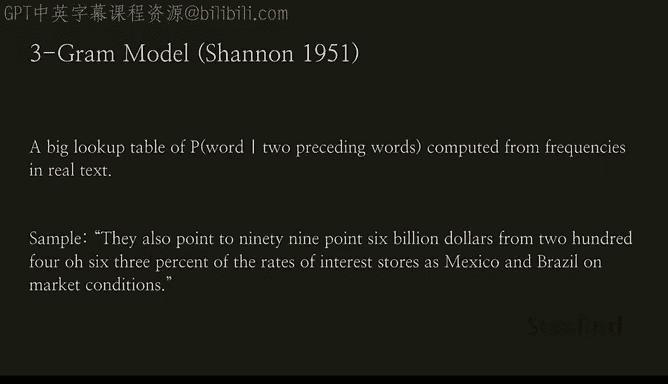
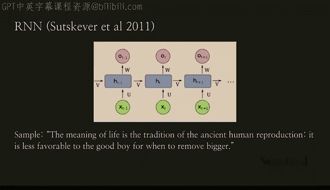
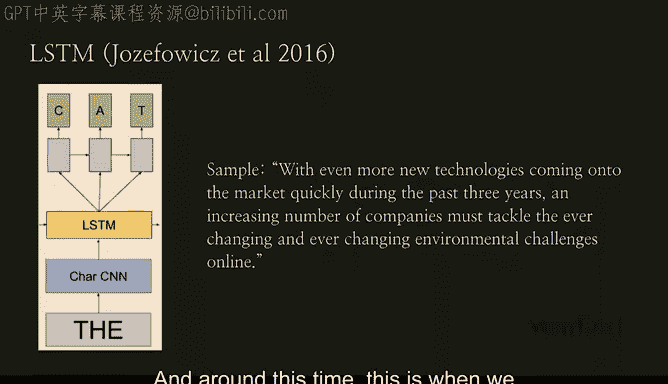
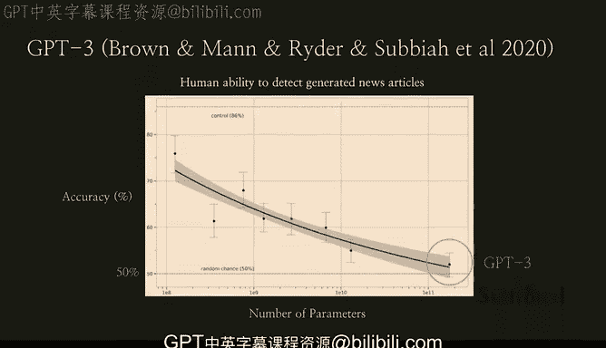

# 斯坦福大学《AI觉醒：对经济和社会的影响｜The AI Awakening： Implications for the Economy and Society》 - P9：09_01_02_什么是生成式人工智能.zh_en - GPT中英字幕课程资源 - BV1DF4m1P79p

So I'm sure all of you have seen the results in the past few months tragedyg borrow from Google B that is been powered by I core and you know we refer to them as generative AI technologies that talk all about text generative AI also includes images and the past few months and in the past year。

 actually we've seen systems like Dli or new journey of stability AI really captured the imagination of people and companies building on top of them so there's been a lot of talk about generative AI but you know what are these systems and how did we get here at the very core。

 you know we're giving the systems a ton of data and we want the samples to feel indistinguishable。

From the training data， so how does this work？At its core it's just really all probability distribution you learn by seeing a ton of examples of this data so here is just a very simple example of creating a data set and it's a bunch of numbers and you know you pick a random number from the data set and let's say it's 16 and so then you're thinking okay what else is in there and you know if you survey a bunch of people about it they'll say4 or 12 or whatever random numbers。

And as you see more of this data， the picture of the probability distribution becomes much more clear。

And so that's what a machine learning model really does。

 it is a lot of data and as it is more and more data。

 the picture of that probability distribution gets more distilled。

And then there is this concept that it can generate more data that it has never seen before。

In training and so that's what a generative model does so you know if I never saw the number four in the data set based on this I'd be able to generate the number four but the problem is much much harder with text there are 171476 words in the English language and so if you take this broad space the probability problem becomes much。

 much harder predicting a probability of a certain word let alone a certain sentence happening and so the real breakthrough is autoregressive models instead of modeling probability of all the text together you're taking into the probability of just the next words one way at a time given all the context of the previous words。

Sand。What we mean when we say author aggressiveive language models is really the probability of the big。

 even about previous words altogether。So there's been a lot of progress in autoregressive language models。

But this is not a new idea and in fact it goes back all the way to 1951 with Col Shannon you know where the initial idea was you know you had this big lookup table and you're looking at the probability of the next word given truth to see the words。

 but of course，If you're just looking at two preciving words。

 once you get to the next predicting the next sentence。

 you probably are losing a lot of context and so as you can see this sample here from 1951 doesn't really make a lot of sense。

Yeah。Yeah。And then going forward to 2011。We're using neural networks。

That are capable of taking much more information from earlier on and so if you look at the sample from 2011 many。

 many years later， this makes much sense but you know's not accurate。

And then as we move towards modeling machine learning。

 we're seeing better and better samples by capturing the long-term dependencies in sequential data and around this time this is when we start to experiment with scale in 2016 so you can see the samples are getting a little better but the real big difference was in 2018 when we saw the transformer architecture and this is significant because everything today is powered by it or the large language models and this is an example where you have a prompt and completion so you're not really starting from scratch you can already see beginning to make a lot more sense。

And then in 2019， we built GT2。And this was very significant because it was the first sample where the completion started to become really indistinguishable from human output so I will read this because this is so interesting so the prompt is very unlikely it's not something you easily find in a training data center in a shocking finding scientists discovered a herd of unicorns living in a remote previously unexplored valley in the Andes mountains even more surprising to the researchers was the fact that the unicorns spoke perfect English and the model continues the scientists named the population after their distinctive horn of its unicorn this four hornn silver white unicorns were previously unknown to science and it makes up this whole thing which is very coherent and。

Undistinguishable from human output。And then looking ahead at GbT3。

The significance of this model is that it's much， much largerer than GBbT2。

And we think with this increase in size， we see significant increase in capabilities。

 so this is a chart of human ability to detect generated news articles and as you can see here the number of parameters goes up we go from GBT2 to GBT3 and the accuracy of predicting and detecting generated news articles goes down significantly。

