# 斯坦福大学《AI觉醒｜ECON295 CS323  2024  The AI Awakening, Erik Brynjolfsson》中英（豆包 - P1 - GPT中英字幕课程资源 - BV1nWpJeBE3B

This is the AI awakekenning Econ 295 CS2 is it 32，3， so I hope you're in the right room。

 I hope I'm in the right room。 My name is Eric B Olsen。

 I'm the professor for this class and most importantly I really see this class as an exercise in co-creation so I'm looking forward to learning from all of you you're going to hear from a lot of amazing speakers and and I know a little bit about AI。

 but I think most of the knowledge is also going to come from you all from the readings you do from the work you do on the exercises so I really hope you'll take the time to do the readings every week。

 come to class prepare ask smart questions of the speakers。

 work on the assignments and the final projects and I think you'll have a great experience So let me actually start off with a question for all of you which is do you have the impression that。

😊，AI progress， tech progress is going a little faster these days and is it having a bigger impact on the economy and society。

 see well how does it raise hands， how many people get that impression？All right。

 most of you go so if so if you raise your hand， why do you think that's true。

 what do you think's going on， why is it possibly picking up and actually so one thing we'll do in class is everyone say their name when they speak and we'll eventually get to know most of you also we do have class participation that helps us well so is your name。

Yes， my so I guess just the buzz around large language models we didn't have public language models two years ago do now and buzz around it so there's a lot of hyp there there's evidence know Pw there's been some surveys that Ps done that's found that like I think 18% of people in the US workforce that you have used GT at work at least once Okay only 18% okay I guess I mean a little bit of a bubble here Yeah great。

People like Tyler， Texas with outsider bubbles， yeah but then there's all the media hyp that。

But the way you said it is sort of sounds like it's a phenomena of people learning about it and there's a buzz about it is there more to it than that euphor with like large a lot of large tech companies that are actually pursuing it barrier to so we all see that definitely I agree that's a big part of it。

But why？sorry I don't。Oh， this is going to be really easy。😊。

I would posit two big reasons are access to compute and access to infrastructure， especially because。

Especially before the chat2P era， people were trained language models。

 but the big problem with this is like。People weren't sure exactly how good the amount of data and the amount of like compute were throwing at these models would result like what the result of these like investments would be so I believe it's the fact that compute is getting better but there's also this sort of self fulfilling cycle where people are trying to like starting to realize that。

Oh， like using Mark compute and getting these like models to learn from all this like large scale data sets actually。

 you know。Allow us to create useful realroad systems and because of that。

 there's more investment in infrastructure。Okay， and so that additional compute and。

More spending on it， better processors allowing them to train bigger models and。Are they any better？

I mean， of course， they're definitely better than like eight years ago。 So to eight years ago。 Yeah。

 that that sounds kind of like faint praise to me。 Yeah， I mean， how about right behind you there。

 What do you think。Oh well。A a lot harder， Okay， I got to update my algorithm。

But I guess perhaps going back to your original question was which was you know。

 do you feel like AI is impacting us in the workforce more or technology general than it used to well sort of two questions you know there's the is the technology changing you know we're perceiving more of it there's something and then is it having a bigger impact so both but it sounds like maybe you're going for the second second question that。

I can't say exactly if it has a bigger impact， but I think there's a perception that it has a greater impact and I think perhaps in the past。

 technology has largely been focused on specific verticals or specific industries。

 but it feels like AI has the capacity of impacting broadly all industries and in that sense the perception of its impact feels a lot closer to a larger majority of people。

Yeah， yeah， and people， at least 18% of people are beginning to play play around with it a bit yeah how about here？

I would say that more recently us as consumers have been feeling the impact of AI a lot more。

 I raised the example of Cha ET because it's one of the first examples of AI kind of having this interface that you and I can just access for free before this it was locked behind you know and who knows where。

 I'm still curious I know this computer science AI students in here。Getting to the core technology。

 we've got more compute and it's better than it was eight years ago。

 I'd like to hear a little bit more about what's changing in the technology anybody you have something to say about that was what's your name？

I was going to say the perception that AI is changing the workforce and revolutionizing the economy is far greater than the reality estimates say they're only actually about like $3 billion in generative AI software revenues in 2023 and that's not including the benefit if you take out the benefit that like Google and Me got from using AI to improve their algorithms。

 like if you ask those people who work in the real world like people's jobs aren really fundamentally changing。

 so I think that there's tremendous potential in the future， but for today。

Hasn't really changed has't really moved the productivity numbers or whatever or the way businesses are working。

 but so how about my question about the technology though。

 who's got a little bit of technology right over here？

I guess there's a slight irony in the way in the adoption of LLM based or transform based knowledge language models and the fact that the transformer is an eight year old architecture。

 but I think AI as a field has been amenable of really fast iterations more so than almost any other other field。

 and the recent I guess。Influx of funding into the space has unlocked a much broader range of research of the technology。

 not only from the capabilities side， but also on the interpretability side。Just more。

 I guess interdisciplinary approaches to this one particular field Yeah great I think that that makes a lot of sense as well Any other comments on that yeah？

Yeah， so this is very interesting perspective in research and a lot of people and M research have heard of it。

 it's called like Richard Su the bitter lesson and basically the idea behind this is that a lot of the advances we see today in theI are due to the fact that we're just voting model second better leverage data and better learn from the data and better scale current compute we have and maybe like a lot of the more tangential like algorithmic advances aren't actually you know as useful as people like yeah so in terms of technology。

 we have seen like advances in model learning make sure experts diffusion models to decide a few so there are methods which are kind of giving us a greater ability to learn from these large data sets and leverage all this compute part of the reason why we are seeing these events。

How many people here have read the bitter lesson， Richard Sutton's thing yeah okay I'm going to add it to you read it's only a couple pages long。

 a few pages long and I think it should be called the wonderful lesson。

 actually not the bitter lesson， but his point is that maybe bitter for AI researchers sorry but his point is that AI researchers were coming up with all these new techniques and algorithms and ways of trying to capture knowledge and teach machines how to do tasks and it kind of work you could teach it know here's how to do play checkers or chess or more advanced things how to understand language。

 this is a verb， this is a noun。But the bitter lesson is that each time over you know progress ultimately came not so much just from that。

 but from more data and more compute and so take the example of language the reason that's gotten so good at language is that we've been able to throw a lot more compute a lot more power with a lot more words and just the machines have learned。

 we're going to show you a little while explain a little bit more about what machine learning and how that's different and the machines have learned how to understand it and you don't really need all that。

Syntax and grammar and other stuff that they were trying to teach the machines in order to get some pretty decent language understanding and I use the word understanding advisedly Chris Manning one of the giants of the field of NLP whose office is here he said it was okay for me to call it understanding so I'm going to go ahead and go with that so that's a bitter lesson maybe in a way that AI researchers we're just being overwhelmed by more compute more data。

 maybe it's a good lesson because you know that gives us a path and one of the things that a lot of these companies are doing is investing in that now they understand this lesson and so that is a path towards better progress。

Of course， there's a little bit of an oversimplification， some of each is important。

 and if I really to say three things that have driven this revolution， one is more compute。

One is a lot more data used to be like well you guys were。Little children。

 most of the world did not have a lot of digital data， photos， messages。

We're generally sent in analog form now they're pretty much all digitized and there's vastly more digital data。

 orders of magnitude， more digital data than it was in the 70s or 80s or even the 90s and that's the lifeblood so the compute the data and the third thing I want to keep on the list is better algorithms。

 more parameters， more advances in things like the transformer which is a big invention。

Some people think it may be one of the biggest inventions in history that allows us to manage this more effectively and it took a little while to realize how powerful it was it was not that didn't paper get that much attention when it was first published by this team at Google but very quickly people started realizing how powerful it was so is there a question someone had a hand okay yes sorry what's your name mine was going wait sorry sorry。

Hi， this was going towards a different part of the question and I guess less technical。

 but it was going back towards specifically the word impression and type of impression and I think so much of the impression of AI is that the。

The commercialization of these language models， for example。

 chatGBT where here you look at what is Jetmin I now has allowed so many other startups and companies to build upon the existing infrastructure and technology which is making it accessible and so interdisciplinary which is making the buzz experience so much more helpful across right I think so so we're building on all of that so there are a number of things that are happening here the technology。

 other people building on it and I do think that the underlying technological innovations are really important partly because of Richard Sutton's that are less and partly because of genuine improvements in algorithms and approaches and we're just beginning to see some impact in terms of people using it I've gone to Congress a bunch of times to talk to people about AI and I can tell you most of the time when I said oh I'm an economist I'm here talk about technology their eyes would start glazing over and they would kind of like you know politely listening and try and change the subject。

But now they're all like hanging on every word I show up and they've read all my papers in advance in the White House and Congress because they really see that this is beginning to have a big effect。

 the dollars may not be that big right now in terms of the productivity effect but everyone's betting that they will be and I'll show you some reasons why they think they're betting that that's a plausible bet to make。

 in fact I would go so far as to say that the impact the economic changes are lagging way behind the potential of the technology。

 so one way to think about that is if somehow something terrible happened and all tech progress just froze。

 all the technologists went on strike or there's a big earthquake or something that stopped tech progress in AI。

For the next five， 10， 20 years， maybe more， we would continue to have progress in business innovation and economic productivity growth as people figured out ways of implementing the stuff that's already been invented and that's available today and this needs to be implemented。

 yes your name。I had， I guess have question have comment about like your original question was like the risks or like if you know the technology is outpacing the economy society and you also talked about the importance of new data for training these models but it's a huge issue with the models that currently exist that we're kind of running out of data and it's being trained on AI generated data augmenting be that would be a really bit or lesson because if data is what drives it and within then we run out of data I know that some of my speakers are going to dive into that with more expertise so it's a really important question because the recent models have been trained almost all the data on the internet they've just scraped it all they've read or been trained on most of the words and books so where you're going to get the additional data if you're going to keep having more data。

 more compute well you' running into limits and there's a genuinely open question as to whether or not you can use synthetic data which seems a little crazy like you have a machine generate a sentence and then you trained it on that。

Sentence like how could that possibly work， but we'll hear from some speakers who say yeah。

 maybe maybe that is working in some context and you can see a few places where it clearly does work How many of you have heard of alpha zero。

So how was that trained？not。Who else， yes， over here。

It was trained through like self like basically well for a ches， it played against itself。 Yeah。

 not just just also vertical little。 Yeah， so that was synthetic data。

 It's the alpha Al go was trained on human played games。

 It had all those games that recorded what each person moved and said， oh， when you know。

 and this board position。 This is the move that was made。 And from that learned new rules。

 Alpha 0 was trained on as this name implies。Zero human data。But it knew the rules。

So it generated its own games and saw what would happen and it did that billions or trillions of times。

 And so when you have a welldefined set of rules， you can generate lots of data and learn from that and some people try to do that with physics engines like maybe for robotics or for for driving you know simulations。

 maybe you can generate some data or maybe you have a video of a professor lecturing to a class and then like they start giving a sense not from the。

Text or voice data， but maybe from the way people are interacting you know that oh you drop this pen so that says something maybe you can infer something about gravity from that or other things and those are also possibilities of generating data that wasn't recorded previously but it's an open question and how much you can do from synthetic data or other kinds and we'll see my suspicion is that there are certain problems that'll be very amenable to it。

Playing games， if you have well defined rules， other ones where it may be very difficult and they'll be working on that。

 but that's that's an open thing and one of the。Subtext of your question。Is that。

A lot of you go to the web today， a lot of the content is generated by LLMs like I'm on Twitter which I probably shouldn't be。

 but I just got I just logged in and I saw like a whole bunch of bots are following me and they're responding to me I can tell that they're bots because they're not that good。

 but somebody who scrapes Twitter is now going to get a bunch of。You know。

LLM generated data and use that to train the next one and I don't know that could get。

Dsfunctional did you want to to say I think risk social economic risk that I think we're all very aware of is like we all came into this class with expectations of policy applications or government applications or different companies that we could possibly launch with this technology but like the bottom line is we don't even know how it's going to malfunction that's really scary right there's some known unknowns that like we know there's some risks in all those areas and there's some unknown unknowns that like we haven't even imagined yet something unexpected and that's something we want to think about and after class I encourage you to stick around it's optional but from six to seven we're going to sit in a circle upstairs and I want to hear about everybody's like interest what they're hoping to get out of the class where they AI concerns concerns about AI and their hopes for AI we don't have time to do that right now during class but those who want to we're going do that afterwards that will help for team formation。

As well so there's clearly a lot of hype out there， a lot of unfounded claims。

 especially I think it gets worse the further away you get from Stanford that there's just people who aren't that familiar with the stuff and are just making stuff up but it happens around here as well。

 but there's also unquestionably something fundamental。

 something real going on with the technology one of the reasons that I came over from MIT to Stanford about four years ago is I wanted to be a little closer to where're a lot of the people who are inventing it。

 I think we're all very lucky to be here at this place at this time and so I very frequently ask AI researchers like it's one of the first questions I asked I talked to a new one were you surprised is this unexpected and almost invariably。

They say。Yes， I was surprised they did not expect this improvement and I'll show you a chart later that sort of summarizes that a bit。

 but there has been a genuine。inflection sea change in the capabilities and that in turn is going to trigger more and more economic changes over time。

 but what I see happening is a improving rate of technology， perhaps even exponential in some cases。

And not much change or improvement in our business institutions， our culture。

 our economic understanding， and so there's a gap that's growing there and in that gap is where most。

I think most or many of our challenges and opportunities in the coming decade lie。Part of my mission。

In life and with the digital economyomy lab and in this class is to close that gap。

 I know some people try to close the gap by stopping technology。

 i'm more focused on speeding up our understanding and i'm hoping that in this class we can do a little bit of that because ultimately。

The changes in society are going to depend on us being able to have that better understanding and understanding how economics has to be updated。

 how business processes and institutions need to be updated so like I said I think there's no more exciting time to be alive than now and no more exciting place to be than right here reveal preference I came here real preference you guys all came here as well。

So let me go through some of the content I wanted to cover for today's class and then we're going to go over the syllabus and the requirements and answer what questions you may have about all of that。

Try a little game next time you're hanging out with your roommates or meeting some new people or your in-laws or whatever and what I propose you to do is you ask them look at all of history。

 what were the most important things that happened in history big question I was just over in England and over there。

 people， some people think it's kings and queens and empires。

 some people think it's plagues and conquests。

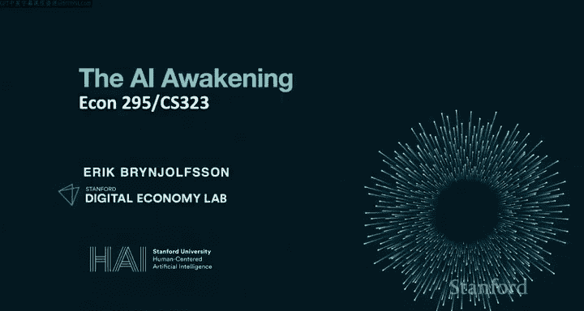

But when you really think about it， most of those things。Weren't that important， I mean。

 how can I say that well I'm an economist and one way to measure it is the living standards of the average person。

 most people on earth。They were living like a little bit above subsistence level。

 and then a century later。Kind of the same。Millennium later， kind of the same。

 the average life of the average person， despite all these。

Things happening in the history books didn't really change a whole lot。Until。Around 1775， 1776。

 what happened there？Well。American Revolution maybe I don't know。

 Adam Smith published the Wealth of Nations。Some people would say escape the poverty track or positives。

 but yeah， definitely， definitely， Well， how did they escape it？

This is still a highly debated topic the economic economic growth。

 but some people like De and others would say that there were certain institutions。

 British parliament and so forth， a lot of property rights exist that allowed all this innovation mentioned in Britain and those innovations build over elsewhere they still I have a much more simple answer。

The steam engine。New technology， I think all that stuff probably was important maybe it helped the discovery of the steam engine you could say why。

 why， why， but。James Watt？In Scotland made a big improvement in the steam engine。

 so it became started becoming really practically useful and they started adapting it to apply all things and because of some of the institutional changes you mentioned on then it sort of rippled and other inventions came along。

 but the steam engine essentially ignited。The industrial revolution。

And it allowed us to instead of having our own muscles or animal muscles use machines to move things around and to do important physical work and ever since then。

Living standards have grown at a compounded exponential rate of about a couple percent per year。

 so we are I don't know，30 or 50 times richer than our answers were a couple years ago the steam engine was the first。

GP。Anybody know what I'm referring to when I say GPT？I'm probably going to get it wrong， but yeah。

 go ahead。Yes， yes， exactly good， I'm glad that economists still get to use the word GPT for general purpose technology。

 not generative pretrain transformer。So a general purpose technology。S major was the first。

 but wasn't the last， there's others like。Electricity computers。

 GPTs have these three important characteristics， according to Tim Bresnihan and Manuel Trachenberg。

 they're pervasive that as they affect broad sectors of the economy。

 they're able to be improved over time and last but most importantly。

They able to spawn complementary innovation， so they triggered， you know。

 changes in transportation and factory work and other kinds of work。 so these GPSs。

Include artificial intelligence， it is a GPT， it ticks all of those boxes。As well， yeah， question。

One might assume that the internet was a GPT， but I would argue like it didn't create the same J curve of the productivity Jb yeah。

I donSo to be fair， there's not like a black and white line between this is a GPT and this isn't。

 I think there's great Asians and the internet did trigger a bunch of complementary innovations。

 it did trigger widespread productivity growth in the 90s and early 2000s and we're still benefiting in some ways perhaps that aren't measured。

 but probably not on the scale of electricity or the steam engine。That's probably， I。

These are continuous variables， not booles。So AI is a G， in fact， I would argue that。

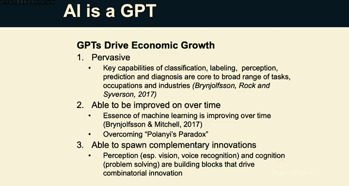

You know， to your point。They're GPDs of different magnitudes。

And it might arguably be the most general of all general purpose technologies because anyone know who this guy is？

Demis and he went over been to King's Cross at his offices because he has a little little slogan there for Deep Min he's the founder of Deep Mind or cofounder。

 Our goal is to solve intelligence and then use that to solve all the other problems in the world so very modest I'm sure when you guys start businesses you'll also have modest missions like that one but。

😊。

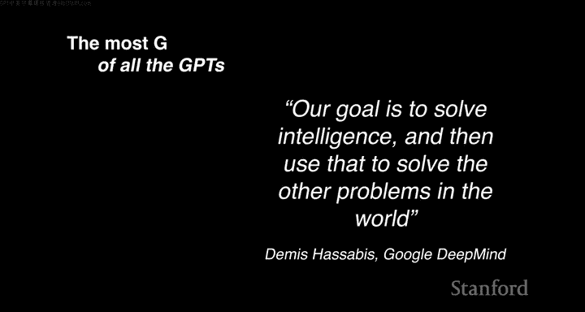

But you know there's some truth to it， you know， if you can solve intelligence， whatever that means。

 you're going to be able to address a lot of other problems in the environment in healthcare。

 poverty， more consumer goods， there's lots of things you can do with more intelligence so in that sense it is a very general general purpose technology。

 some people call it the ultimate invention because vents all the other ones potentially。

And that is what we're working on right now and there are metrics I'll show you some data that we're solving parts of intelligence in a way that we never did before。

 in fact here's one set of metrics， you guys all know about IageNe。

 Fee Fei Lee here in this building put together a data set of about 14 million images along with our collaborators and each of them were painstakingly labeled。

 that's a starfish， that's an antelope or is it a gazell you know and you had to be careful about labeling them all。

And then there were contests starting back in 2010 for machines to try to identify them。

 and I used to say that。Machines just aren't very good at image recognition in my book second Machine names I gave recognizing a face is something that people could do。

 but machines couldn't really do very well。Well， that was then。

Now we know that they're very good at image recognition and face recognition。

 in fact on many metrics they're better than humans。

 humans are better and some machines are better in others。

 and there's that steep inflection point there around 2012 Any know what happened in 2012？嗯。

Obviously don' know that。came out yeah。We're applied to ImageNeap and so Jeff Hinson and his team introduced deep learning techniques。

 these neural networks， lots of little layers in some of the future classes we'll read about them。

 and that turned out to be really effective at doing these tasks and the next year everybody。

Everybody started introducing them and we started having progress in that and if you go to the AI index。

There's a new report coming out in about 10 days， I'm a co author on that that has。

Hundreds of charts like this showing progress loss dimension fact， do I have it on my next one here。

 well let me do this one。Here's one that sort of summarizes some of the things there are lots and lots of these metrics that are improving and it's a little。

 this is not from the from。The AI index， but you know depending on the benchmark。

 you can say humans are able to do a certain level of performance and last year in this room in this class。

 Jack Clark gave a bunch of these charts and said one of the problems they were having is that every time someone made a benchmark。

Someone else would figure out a way to get a machine to beat that benchmark relatively quickly。

 so they're trying to come up with some more long lasting and robust。Benchmarks， yeah。

 my quick question on that bigger so I'm assuming the sort of0% points are just when the benchmark or data set Yeah。

 yeah， this is a yeah。

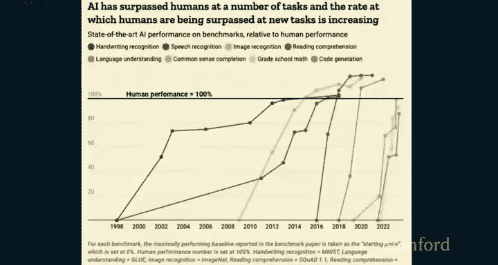

Exactly， that doesn' mean zero performance， like I think actually， if you go back。啊。

This is probably a better representation， but they're all normalized to be between those two numbers。

 yeah， kind of like a scale。So it's worth kind of categorizing a few different regimes。

When artificial intelligence was first。The field was first founded back in 1956 group of people got together at Dartmouth and coined it and started working on it。

 it was mostly focused on symbolic methods， people were working on neural networks but they were very very shallow because we' have much computational computational power it's like a single layer neural network and when I started working in AI I taught my first class not here but at Harvard extensionion school right after I graduated as an undergraduate in 1985 we were building expert systems。

 rule-based systems and they were painstakingly handcod so you would talk to an expert ask them their if then rules for diagnosing a fever or figuring out which wine to choose or whatever。

 you'd write them down and by chaining together a bunch of these if then rules。

 you could sometimes get pretty good answers on things but per Richard Sutton's bitter or lesson and it didn't really scale very well and it was filled with errors and it just it didn't really take off there was a bit of an AI bubble in the 80s people were very excited but。

It kind of fizzled and turned into an AI winter。But that's where machine learning came in。

 and as Rich Sutton was saying。A new approach some people call it software 2。

0 and the idea behind machine learning is instead of we humans telling the machine what to do。

 you guys have all coded at some point， you know that if you write code。

 you have to know exactly what you want it to do if you write a word wrong or a comma wrong the machine isn't gonna to do what you want but when machine learning you don't need to know exactly how to solve the problem instead what you do is you have a lot of data on inputs。

A lot of data on outputs and the machine learns the relationships between them。

 the statistical relationships between them， and you can get a lot of effective predictions that way。

 so what are some examples of machine learning I showed you a couple of what are some other examples of machine learning working in different contexts。

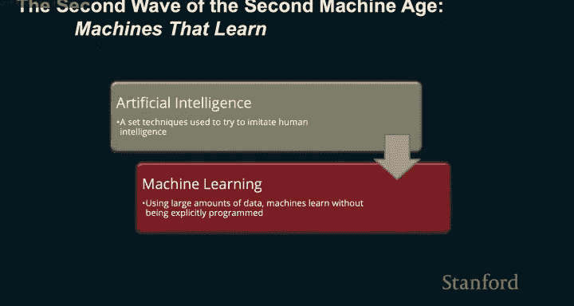

啊。Yeah， money laundering money laundering detecting money laundering or doing the money laundering likeunder anti money laundering。

 okay， we probably works it both ways， yeah yeah got to be careful you're giving away some information there what else？

😊。

Yeah spend a lot of time like back in the 90s trying to recognize like reading my handwriting would be really hard for a machine。

 a lot of humans too because people write the number three or two in different ways。

 but a neural network could gradually start learning if you tried to write down rules for that that would be a lot harder as well and there are yeah go ahead credit credit Yeah fact this is from earlier paper of mine with Andy McAfee but the key here is that if you have a lot of digital data on inputs X and a lot of digital data on outputs y if you have enough of that。

 there's a good chance a machine learning system can find the relationships and be able to make other predictions in sample and out of sample and right now there's kind of a gold rush going on to find more and more of these applications。

Every company I've talked to lots of them has a team going around。

 trying to figure out where else can we apply machine learning that we're not applying it today。

 where do we have。Data on inputs and data on outputs that we can do this kind of learning。

 this is one example， this is a robot。Weed killer， or some people would say it's a self guided robot that identifies unwanted species and destroys them with lasers。

 nothing wrong with that。But that's what it does， there's no fertilizer or insecticide or pesticide or whatever。

 it just identifies which species shouldn't be there using machine learning。

 image recognition and zaps them with the laser，Works automatically exactly how many hundreds it does per minute。

 but it's a lot。So that's machine learning， but now we're in a new era that's building on that and that is the era of generative AI or foundation models。

 large language models， and it's a little different than traditional machine learning with traditional machine learning you needed to label the data like Feifei and her team did。

 this is a cat， this is a dog， this is cancer， this is not cancer， this is the number three。

 this is not the number three， but the new generative AI is using。

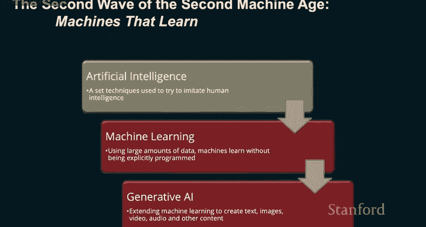

Unsupervised or people call it selfupvised learning， and that turns out to scale a lot better。

 So who here has a good explanation of how an LLM works and how is an LLM trained。

Anybody want to try？Yes， sorry your name？It's like a fill in the blank it an auto progressive closed pass and so you're just trying to predict the next token or word in sentence Jack and Joe went up the。

Wellhi。There's a lot of times there after you but just get me do that hundreds of billions of times and how is that any different than the supervised learning systems from earlier Well it's unsupervised in the sense that you don't need to have a human annotators。

😊，Why not whether a dog is in the picture or not why not why don't you need that the data is already there the data is already there so you take a book。

And you cover up one word like suppose it was a little nursery rhyme Jack and Jill went up and you cover up the word Hill and then you asked the system。

 okay based on these other words can you predict that covered up word and the neat thing about it is is pretty easy to just pick random words and cover them up and see if they can fill it in from the other data that doesn't require a human to say that's a gazell no that's antelope or whatever you have all this data。

 trillions of words wow I said earlier that more data lets you do more training well you've just got yourself a huge amount of data that you can do a huge amount of training on and if you have some architectures like the transformer model it turns out that this is weirdly bizarrely effective not only at predicting the next word but also。

Therefore， you can use it to generate text that says what is the most plausible next word？You know。

 and you could make a sentence and you can adjust whether you want to have the most plausible next word or a somewhat plausible next word or a somewhat implausible。

 but still possible next word。And you can start generating text and in order to we think about it to generate that next word or to to predict it。

 you have to kind of。It kind of I guess you should have to know something about the world or some understanding you can it's good to have a little bit of grammar that you know dogs bark。

 but maybe you know you need to know a little bit about。

Mammals and how many legs they have or maybe a little bit about chemistry or a little bit about geography。

 you if you drive north from San Francisco where do you get eventually you start to have to have some kind of parameters that keep track of all this information and it seems like。

These。Billions。Hundreds of billions of parameters are storing something about。

Language that helps it predict what that next word is and you could call that Chris Manning says you can call that kind of an understanding of what it is so that turned out to be a really powerful。

Th。Similar techniques can also be used for generating images。

 you can blur out parts of the images that you make them a little fuzzy and you see if they can fill it in and then it learns how to complete a horse's ears or eyes from missing parts。

And so on。 And that's that's basically what's going on。 And a big part of it is that you've got this。

Self supervised approach so now we've turbocharged your ability to learn from data and that's pretty good and so those of you who ever watched the movie。

I robot， you may remember the scene where Will Smith's character asks can a robot write a symphony。

 can a robot turn a canvas into a beautiful masterpiece so that movie was made about 20 years ago。

 it's supposed to be set in the far future， like in the 2030s， 2035， I think it was。And the robot。

Saaid said， no， I can't do that， you know can you do it。

 but clearly that wasn't something a robot would be able to do in 2035。

I think if they made the movie again today to be realistic， the robot would have to say yes。

So in that sense we're going a little faster than what the science fiction movies predicted at least on that dimension。

 maybe not as fast in terms of humanoid robots， but we'll talk about that in a later class as well。

 so there's a whole explosion of different companies doing these things we touch on this a little bit earlier but let's get into what are some of the strengths and weaknesses of generative AI。

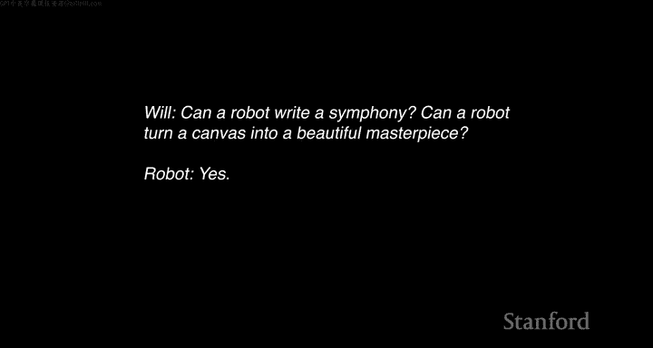

Yes， there Sam，Sample forward。What does that mean they need to see many， many examples？Yeah。

 so children can learn a language that many。You show a two year old a picture of an elephant。And。

The next day they know more or less what an elephant is， not so yeah， what else？

Yes， attributing a particular output to a particular sample from the training data is very difficult。

 which means that compensating people for the data that they contribute is quite difficult yeah。

 that's a big so now we're going to get to some of the economics of what the New York Times and Open AI are debating and lots of other people。

 how you all this data is going to training them， how do you compensate？

That said there are a bunch of things that they're churn out to be unexpectedly good at so here's a chart from a paper last year that Eric Corviitz and his team at Microsoft did I called Spks of AGI artificial general intelligence and the blue bars are 3。

5 GT3。5 and GT4 had just come out so they tested it and you can see in a lot of things it didn't improve a lot and some of them like the uniform bar exam and it went from about 10% to 90% what does that mean compared to a sample of test takers of the bar exam that' what you have to take to become a lawyer in America 3。

5 did better than about 10% of the humans。And G4 did it better than about 90% of the humans。

 so this ability to predict the next word also turns out to be very good for solving some practical tasks now taking the bar exam is not the same is actually being a lawyer there are other things involved so it's not like a one to one correspondence but it's a nice kind of concrete metric of that how much improvement do we expect to have well talk to people and there's there's some people who are very optimistic and so let me show you a chart that might be cause cause for optimism earlier I mentioned these three。

Categories， compute， data and parameters are the algorithms that were used。

And it turns out that there are these scaling laws that have been。Quite。

Accurate in predicting progress of LLMs so Dariomodi and others wrote this paper where they charted progress as you increase the amount of computer power and data set size and parameters and as you can see there's kind of like a straight line this is a logarithmic curve so it's a power law that。

When you increase compute data and parameters。In proportion。

 there's a predictable improvement in the ability to predict the next word and that ability to predict next word is correlated with a lot of these other performance metrics。

Now he doesn't know， I don't know nobody knows for sure what's going to happen is you extend this。

 but one of the reasons that Microsoft and Open AI are spending 100 billion。

 sounds like a superviillain comment， but to build a really big data center called Stargate is they think that it's probably going to help to have more and more compute applied to that and maybe they'll find a way to get more data as well so we're going to find out how much you can keep pushing this the one thing I would pay attention to though on the skeptic side is that。

These numbers in the bottom here when I first saw this chart， I was like， wow， that's like great。

 we're just going to keep marching down the curve， but these numbers down here。

Are pretty big or they're pretty big changes like that's 100 fold increase between each of those ticks。

If these models are costing on the order of 500 million billion， 100 fold， okay， 100 billion。

 another 00 fold after that， okay well now we're getting a little unrealistic。

 aren't we because the world GDP isn't going to be enough to buy that much compute power if all you do is just throw dollars at it。

Maybe they're going to have to come up with some other approaches。U。

That said there have been some predictions of you guys been to the site miraculous you guys know this site so go check it out it's kind of interesting it's got all sorts of predictions there there's a whole cluster of them around artificial intelligence in different milestones like when will AI get the math Olympiad or whatever so here's one that's kind of relevant to our conversation When will the first general AI system and then be devised tested and released and they have a few pages where they define a general AI system in terms of passing the Tring test being able to assemble things doing a bunch of other things it's a pretty hard definition actually if you read it。

And the thing that's striking to me was。A couple years ago the date was 2057 was the best estimate of these predictors that was when AI would reach that level and just talking to people I spoke to I speak to people all the time about this。

 that was kind of what the vibe I was getting from people at MIT。

 from people at Stanford from people in industry was really powerful general AI was like decades away and I as an economist。

 I didn't pay that much attention to general AI that could do most of the things that humans could do because I figured。

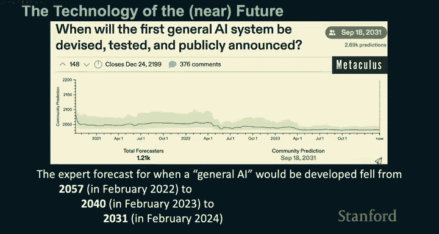

You know， somebody should be worrying about it， but I'm going to worry about things that are happening next five。

 10， 15 years。Well， as you can see， the dates got a lot closer over time。

 it's been coming down last year it was 2040 and a month or two ago it was 2031。

Why is it coming in that much well maybe these guys are wrong。

 who knows this is just predictions and what we're going to find out I guess。

 but I think that this progress in LLM's generative AI。

 unexpected progress is making people reevaluate what might be possible。

Is embodiment considered in these forecasts as part of the definition in general？

For this particular one， yes， and so I think let me to see， I think I actually grabbed。

So one of it is in here somewhere。Robotic the second bullet point so it can like assemble things so you can go there。

 there's some that are much more focused on it。 So it's this is a pretty ambitious for some level of embodiment。

 I think most people feel like the embodied part is going to be a lot slower than the cognitive part。

 but not everyone。 and I've I must have talked to。😊，Half a dozen。Companies。

 founders of humanoid robots， you guys have probably seen know Elon and others who are playing around with these things。

I'm'm a little skeptical， it's going to happen anytime soon。

 but it turns out that the LLM technology。It's not irrelevant。

 It has some use for robots as well as you build， you know， world models which is sort of related。

 you start being able to do a little better。 So we'll see。

 but I don't want to spend too much time on one particular set of predictions。

 The other thing I'll note is that。As Jan LeCun says， having a， you know。

 we may not get AGI anytime soon， but I would say you still can have significant transformative effect。

 you could have systems that are very powerful so I had dinner with Jan asking him about this quote and he said。

 he kind of thought LMs were a bit of a dead end actually he didn't think the scaling laws would continue。

So I said oh so we're going to kind of plateau and he said two interesting things first he said no there's other technologies that he's working on other approaches that he thinks will continue that curve building world models but secondly I said so you think that LLMs aren't going to be that economically valuable and he said oh no they're going to be worth trillions of dollars trillions of dollars of impact that's just not very interesting he's a scientist he's like you know thats that's。

Kind of interesting to business people but not to him as an economist I was like okay trillions of dollars that's interesting I'm interested so it's something else to consider that the ability of a model to do certain tasks could have big economic value even if it doesn't necessarily check the boxes for artificial general intelligence So there's some good news that's also some challenges I do think that these technologies will boost productivity。

 they'll make the economic pie a lot bigger， but there's no economic law。

 there's nothing in any textbook or theory or anything that says everyone has to benefit evenly。

That's just not。Fact， in fact， is's nothing that says that anyone has to benefit everyone has to benefit at all it's quite possible that some people would stagnate or even be made worse off and sad to say that's actually been true for a lot of people over the past decade or to living standards for people with high school education or less average wages have fallen even as the overall productivity have grown in the United States so you can have things go out of technical change isn't necessarily something that's completely even that affects everybody so's it's a challenge to not only have technology that creates prosperity but shared prosperity if the technology leads to a few super wealthy people living a few blocks from here perhaps and the rest of the country or the rest of the world not benefiting that may not be such a good outcome and that's a scenario that's possible as well so this guy Alan Tring had a approach towards artificial intelligence that really。

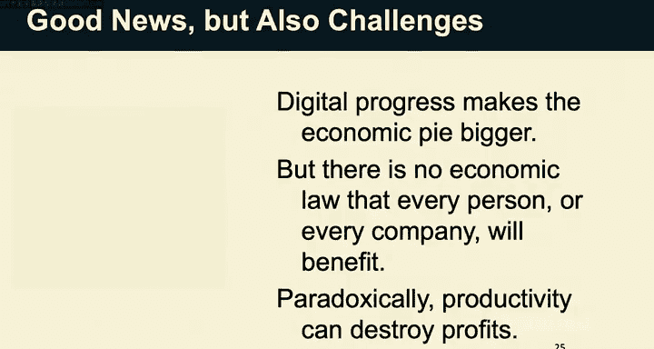

Captivated a lot of people when I first heard his idea of a Tring test， I was。

 I thought that was amazing。 You guys probably know the Turing test is this idea。

 can you make a machine。That is indistinguishable from a human that if you ask them both questions behind a curtain。

 you can't tell which one is the human and which one is the machine and more broadly the idea that AI means replicating humans as closely as possible When I first heard about that I was like。

 yeah， that's that's pretty good I like that that's a good definition Now I think it's。

Really dumb definition， I don't think it's a good measure of intelligence。

It's a little bit to me like if a magician can levitate a woman in front of all of us and we're like。

 wow， that's amazing， does that mean that gravity has been solved， that he's developed anti gravity？

We may maybe look like that but it's really not a very good test it just deterring test is kind of how well how gullible are we in being able to understand it and so I think you need other tests that are a little bit better but more fundamentally as an economist setting aside whether it's a good test of intelligence I think it's a really bad goal it's a goal that points a lot of research in the wrong direction to be more precise。

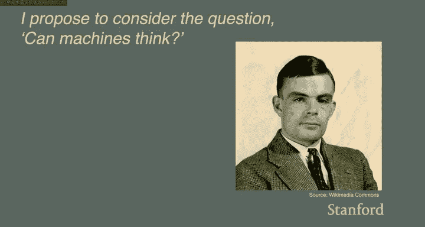

You can develop technologies that are substitutes or technologies that are complements a substitute。

Does the same thing， two things are substitutes if they can be one can replace the other。

 and the more substitute A you have， the lower the value， the lower the price of object B。

So if machines substitute for human labor， they drive down human labor。

 but you can also have compliments， a compliment is something that makes the other thing more valuable。

 my left shoe is a compliment for my right shoe， software is a compliment for hardware。

 a bottle cap is a compliment for the bottle， compliments make the other object more valuable。

For some reason， most of us， even me sometimes think of technology primarily as substitutes。

 we think how can this technology be used to do what a human is doing like Alan Turning？

The reality is that through most of history， most technologies have been compliments。

Most technologies have not driven down the value of human labor， they've increased it。

 remember I said earlier that the value that human labor is like。

50 times more valuable today than it was a couple hundred years ago。

 what you pay for an hour of labor is more now than the past。

 why would you pay more for labor now when you have all these machines well because you have all these machines。

 a person with a，Bulldozer is able to do more work。

 a person with a computer is able to do create more value。

 the machines are amplifying what humans could do。Through most of history。

Machines have mostly been compliments， have mostly amplified human labor， and looking forward。

 that's what we'd like to see machines do， at least for a while。

 is amplify and complement human labor。嗯。So。Let me well I'll just briefly mention this so this is Ni Nielsen who's a professor here at Stanford and his vision was a lot like Alan Trings I'm just putting this up to say that Alan Tring wasn't a lone person in fact it is the dominant view that human level intelligence meant going through each of the tasks that humans do and figuring out if a machine could do the same thing automate them so that's a vision that I think has energized a lot of technologists that energized a lot of business executives but again I think it's often a misguided one you can create value that way but not the main source of value so human like AI has been actually something people have been looking for。

For millennia， Dedalus was the mythological Greek。Inventor engineer and according to legend he made robots that could walk around and talk and were indistinguishable from humans I don't think he really did that that was just a story and then there was Carol Chock who came up coined the term robot a check playwright and this is a play that was popular I guess about actually almost exactly one century ago you guys have seen the Boston dynamicsy robots and the other ones and now we're seeing this generative AI do a lot of things that humans can do but let's just do a little bit of a thought experiment suppose you all go all the way back to Daedalus and he actually had succeeded but his goal was like Niils Niilson's to do all the tasks that humans were doing。

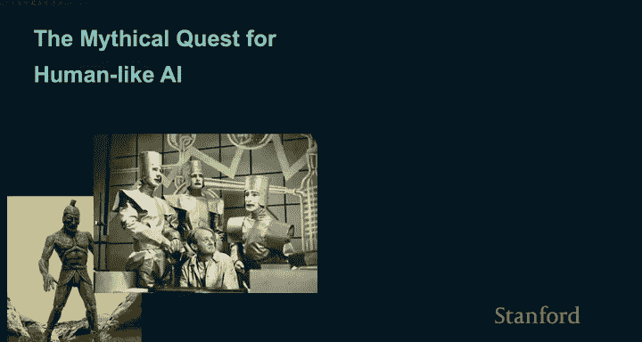

But I'm going to stipulate only the tasks that humans were doing nothing more。

 just replicate what humans were doing， make that list of tasks in the economy。

 the Greek economy from 2500 years ago， so what was that economy well you could automate a whole bunch of things you could make humanlike robots to do that and that meant。

Clay pots。All free， you could just like fill this room with clay pots。Tunnics。

 you'd all have these great great tunics， horse drawn carts， don't worry， break， be repaired。

 all set What if you got sick？We have robots burning incense for you。So you can see， okay。

Could be worse， but that's not really like a big boost in living standards。

 is it having like piles of clay pots and tunics and incense。

 most of our living standards since Duedalusus times have not come from taking labor out。

It's come from adding new products， new services new inventions。

 so we need to go beyond simply looking at the task we're doing today and thinking how can we get a machine to do them I'm not saying it's bad to you know the good news is those guys would they wouldn't have to work anymore you know so they live a life of leisure but they're really missing out you know they don't have jet planes or iPhones or mRNA vaccines or all the other cool stuff we have today。

Most of the stuff。Is new。Another way of saying it， and this is in my Turing trap article that you may have read before class。

 which is that productivity is defined as output divided by input。

And most economists operationalize that as GDP divided by ours worked。So if labor hours go to zero。

 mathematically what happens to productivity？So a hard math question here。Goes to infinity。

 All right， that's pretty good。 It's hard to get a lot better than infinity。

 so you've got infinite productivity。What happens to income， Well， if income labor hours are zero。

 then I don't know why you're paying any workers。 So labor income goes to zero。

 Maybe that's not so good。 There's a lot of。Production， a lot of wealth。

But the laborers aren't getting it。And if labor income goes to zero what happens to their political power Well。

 I'm not a political scientist， but I have a suspicion that it's going to be hard for them to have as much bargaining power when they really have no they're inessential to the economy or us to have that so so you can see that infinite productivity it sounds really good and it could be really good we get leisure we get lots of benefits but it's not to be all and end all even if you turn dial all the way to infinity so that's sort of a trap where you get into a world where the technology is concentrating wealth and power and it's not distributing it as much Now I want to stress that there's still lots of benefits to get leisure and maybe you can find a way to maintain widespread distribution you have to come up with some other way that's not based on labor income maybe you can find a way to maintain political power and that maybe a challenge that we have to think about more but it's a pretty different world than one where humans are。

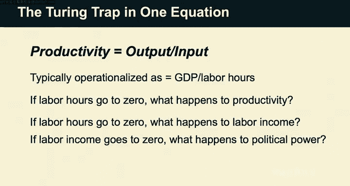

Necessary to production and therefore have some bargaining power and leverage。

 And so if we do get to this kind of a world， we need to think a little bit harder about how to work things。

 Let me talk a little bit about one of my papers will be dolving a little bit more deeply into some of the uses of the technology and how it changed things。

 So this is the。Call center that we looked at and in this case。

It was started by a group of people here at Stanford， Sebastian Thron， and Zade Enam。

 who's a grad student here。And they developed a system that looked at all the call centered transcripts。

And used。Self supervised learning systems to identify which ones led to good outcomes and which ones led to bad outcomes。

And from that， come up with an LLM that came up with good suggestions。

 but instead of trying to have a bot that answered all the questions。

They had the LLM give suggestions to humans。Like this one。

 and the human operators would talk to the customers。

And what we found was when we looked at the data didn't have to do any fancy statistics or anything we very quickly saw a benefit。

 the blue curve is shifted to the right there it's about 14% higher so the people who had access to the technology were able to answer questions about 14% more accurately faster solved problems more efficiently and this happened very quickly within about  four to five months。

 the red line there should have made the colors the same I just realized the red line is the people who had access to the technology and you can see they just very quickly started outperforming the people who didn't have access to technology or who got it a little bit later so this is a case where the productivity improvements were quite significant quite large in fact if you broke it into different groups。

 the least skilled least experienced workers had about a 35% predictive improvement the most skilled workers had close to a 0% improvement so it was one that kind of combined things it was basically learning from the successful call center operators。

And taking that tacit knowledge and making it available to the less experienced workers。

 and that's why youve got the lift on average， but also a leveling yeah。But question have for that。

 is that sustainable because there's a current argument that like he can technically just take all this knowledge。

 this go back to LLS and all these people are just out their jobs again。Well。

 so that's a great question and I happen to have a slide for that。What we found and what they found。

 I should say， is that。There are some problems that come up a lot like how do I change my password。

 I'm locked out of the system blah， blah， you wouldn't believe how many times people ask that question。

 I've asked that question Then there are some questions that were very rarely asked that only showed up once。

In the data set， some complicated tax question or something or something else that some other question and this kind of a Prato curve or power law we see those a lot these days is not just in call center。

 but most tasks。Which ones do you think the machine learning is better at？

Which one very common problems。 very common why， because。The bitter lesson。

You need data to train it when there's no examples。

 I think someone over here explained that machines。

 at least current technology is not very good at dealing with these one off cases， maybe someday。

But there's a natural division of labor， and since when a person calls in。

 you don't know what the question is going to be in advance。Arrows paradox， you know。

 you you have to find that out and then。Sometimes it turns out to be that the machine can help them and sometimes it can't now over time like one thing that's happening is that this that line is moving to the right and maybe we'll have more things to solve that maybe you can structure your questions in sexual way that you figure out which one's more common so there's things people are definitely working on that but in this case and in my experience。

A lot more cases than people realize you get a situation like this where there's a natural division of labor。

 there's other reasons why you may want to have a division of labor like that。

 but this is an important question。Self driving cars。

Not happening as fast because it turns out that these。Tale cases。

 these edge cases are just really hard to learn about and they're more， they're just a lot of them。

But well actually let me say a couple more things about the call center paper before I move on。

 I want to say a couple other important things， so it wasn't just more productivity。

 more performance， we also looked at the customers， they were happier。

 they had higher customer satisfaction if you look at net promoter scores。

 you could do sentiment analysis， what sentiment analysis， we looked at these millions of words。

 millions of transcripts and basically we looked at how many happy words there were and how many angry words there were。

With the people working with the call center with LLM tended to have better sentiment。

 they were happier on average and the operators were also happier on average。

 they were less likely to quit so all three groups， the stockholders and company， the customers。

The the employees， they all had measurable improvements in performance in this particular case。

And know the few years has's been since that studying experiments。

 like what are like some filled with John， wheret the longer term ist the case that late？

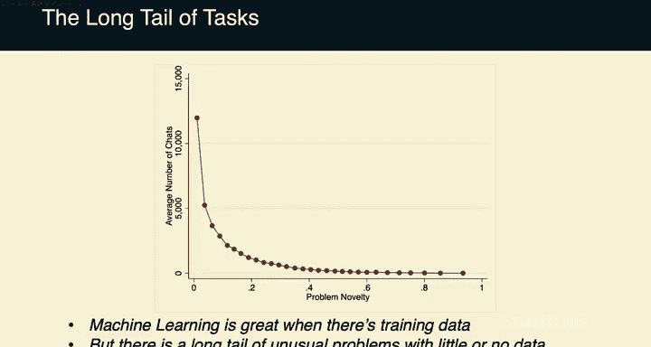

This augmentation is the way to go moving forward I think you know so let me jump ahead a little bit so I have a little bit of future let me kind get to that real quickly because I need to go faster anyway so there's a lot of other research some of which is in our syllabus about other cases a lot of them look like what I just described but the world is changing I'll just mention that a lot of tasks potentially could be affected one of the other readings you're going to look at is this paper Gs or Gs。

 Daniel Rock a former grad student of mine and some folks at open AI wrote this paper they looked at 18000 tasks in the US economy and for about 80% of the workforce whoops 80% of the workforce had at least some of their tasks at least 10% were going to be affected so it's affecting most workers to some extent especially high income workers but to your question。

I think this is a really interesting topic and hopefully we can kind of get into it in this class or maybe some of you in your research how many guys know about the six levels of self-driv it's on the chart here so you can cr。

You could have a car that totally runs itself， you could one where human and machine work together at the far right there。

 level five， the machine does everything。I think those six levels apply not just to self-driving。

 but to a lot of tasks， maybe even all tasks， but most tasks in the economy。

 I gave a TED talk about AI about a decade ago and Gary Casperrov after he was beaten by Deep blue。

 the machine was better than Deep blue， there was this period which I talked about in my TED Talk。

 where humans and machines working together could beat the best ch computer。

They called it freestyle chess or advanced chess， and as he pointed out。

Even if you't have the best computer or the best team， if they knew how to work together。

 they could beat deep blue， they could beat Gary Casb。I don't think that's true anymore。

 so this is progressed through these different levels and now chess at this point with alpha0 and other like that humans have little or nothing to add。

 they're just kind of an annoyance to the machine， okay？

Cars aren't there yet I have a Tesla and I do not trust it honestly I a couple times it on university a and almost rammed into somebodyLuckiily Im always like alert to grab it and they tell you you have to do that so it's been harder This is a picture of me and Andy Mccafee this is 2012 we rode in a self-driving car Google car all the way up Rote 101 up to San Francisco。

And back true when it got off the highway to go to do the Cloverleaf， a human driver。

 then it got back on the highway and one point， the cars came to a dead stop in front of us and it stopped。

I was like， oh， we're practically there。You know，Of course， you's got to work out a feudal things。

It took a lot longer， it's taking a lot longer， so I think going through these different levels is a really important question and here's a puzzle some of you guys might to work think about with me。

 which is。When。What kinds of problems can go quickly through those levels and which goes slowly。

 will we be staying in this middle category for a lot of problems or will we get to that level？

For most are all problems， I don't know， but it's an important question。

Let me skip ahead here because we are just about the time I want to spend a little bit of time on the syllabus。

 et ceter。And this is a good time if you have questions about the course you can ask me。

 so where's my syllabus， here it is。These are the basics。 you can just go online and read this。

 I'm not going to go through too much of it， but I will take a minute to talk about。

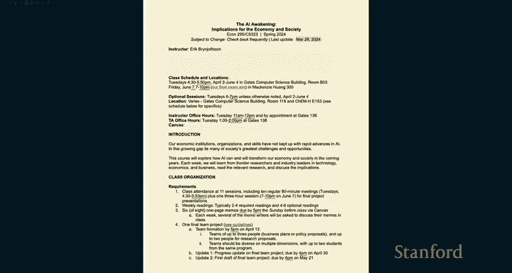

，Basics here let's see I'll be it with you so we have readings typically two to four required readings I really hope you'll do those readings that's how you're gonna learn I mean you can listen to me but hopefully you'll do the readings and then then when you come to class you're going to be able to get lots more out of the speaker a lot of the readings are written by the speaker and you'll be able to ask smart questions you can submit questions to me via Slido and then you can upvote the questions how many people here have worked with Slido before you guys know Slido。

No not everybody okay it's like this automated system you put you put the questions in and then everyone else gets to vote oh that's a really good question and then I can look at them and using my human judgment decide whether I want to ask the most popular question or the second most popular or none of them at all。

 but most of the time I do weight to my students and you're also going to have a chance to just raise your hand and ask questions but Slio can kind of aggregate the wisdom of the crowd here a little bit but that's going to work better if you do the readings carefully。

We have a team project where we have weekly assignments， and then we have a team project。

At MIT we had a whole semester you guys only have a quarter so it's a little faster。

 you guys are going to have to form teams by April 12th if you're going to be successful at doing that I encourage you to come after class today and get to hear from the other students in this class you know who you want to be teammates with after class next week we're going to have time for team formation where you get together there's a Google Doc where you can put down your topics。

At least half of you have already done that last time I checked things that you're interested in and then we have a couple of progress reports along the way in the two different things so and then we have a couple of sessions at the end of class on May。

 where is it。Does it say？There it is。June 5th is due where is June 4th and June 7th so June 4th we'll have the policy proposals or the research proposals June 7th will have the business plans so plan on coming June 7th is not a Tuesday if you check it out it's actually a Friday so plan on coming to class than between 7 and 10 pm and learning a little bit more there's the grading nice and neat 20% in each of those different categories。

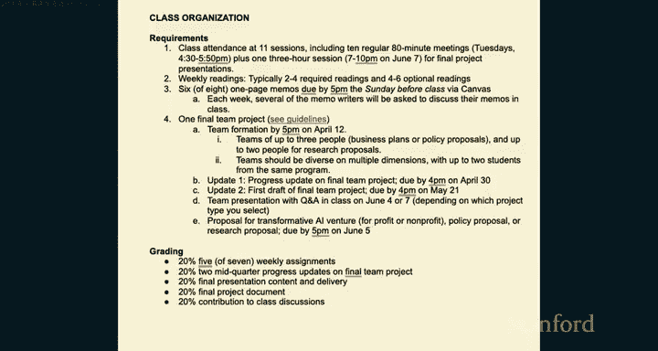

And here's the amazing lineup of speakers this class could only be taught。

One place on earth and that's here at Stanford and perhaps only this year 2024 so we're going to hear from some really great people and I hope you get the most out of it by asking them questions I've saved a couple of minutes for your questions about the course or anything else。

What else do you have questions about yes one course question。

 what's the minimum number of members on our team？

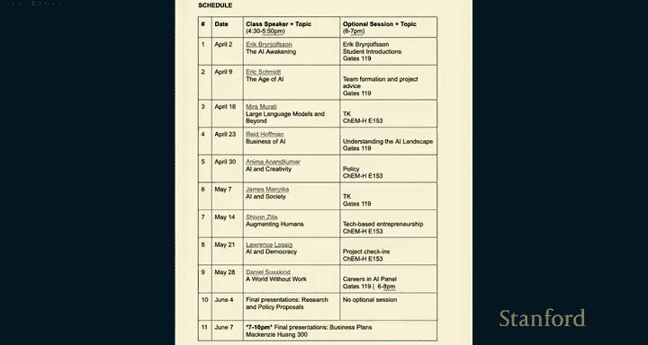

Minimum is one。In a couple of years， it may be zero。

But for now it's one yeah can't work you can work alone and I think particularly for the research proposals it may work simpler just work alone for business plans。

 maybe you want to have a team the teams need to be diverse on every dimension that I can think of so have people from different programs when we pick people for this course you guys know you're a very elite group because hundreds of people applied for this class and the Ts and I we went through and we got a diverse group to come to class people from different programs。

 computer science， economics， business engineering。

 a lot of different programs almost all of you are gra students there are a few incredibly smart undergraduates in here and there are you know diversity on lots of dimensions you'll see the teams I want to be diverse as well don't have everybody from the same program that's not gonna to work so try to find somebody where you learn speak having a diverse class makes it a little bit harder to teach and a little bit more you people have different backgrounds but NeNe I think it's a good experience it's something you can。

Do at Stanford is get people from these different programs， so I hope you get something out of it。

 you get the most out of it from the team that way and if you're very neurodiverse yourself。

 then you can be all by yourself and still have a diverse team。Yes。

How will the optional like discussion sections be structure？

So in the syllabus we have a topic for every single discussion session。

 our brilliant TAs are going to run some of them， we have other people who have volunteered to come into class to talk about them。

 they're completely optional， but if you want you can get more of them the one tonight I'm just going to join you and we're going to go around the room and introduce each other。

 the one next week also is you're going to be meeting each other for teams future ones have a topic like how to write a business plan。

 how to think about government policy topics like that and so we have some really interesting people coming in for those。

