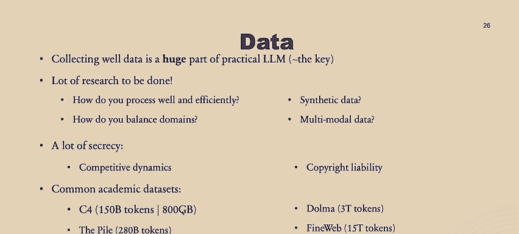
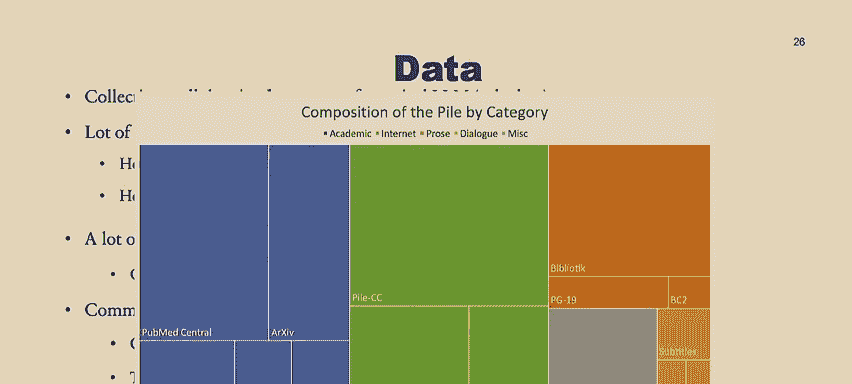
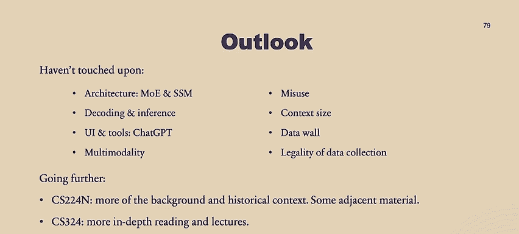

# 斯坦福大学《CS229机器学习：构建LLM｜Machine Learning I Building Large Language Models》中英字幕 - P1 - GPT中英字幕课程资源 - BV1YE421F7cV

So let's get started so I'll be talking about building LMs today。

 so I think a lot of you have heard of LMs before， but just as a quick recap LM standing for large language models basically all the chatbots that you've been hearing about recently so Chad GT from OpenI cloud from Antroic Gemini and Lama and other type of models like this and today we'll be talking about how do they actually work So it's going to be an overview because it's only one lecture and it's hard to compress everything but hopefully I'll touch a little bit about all the components that are needed to train some of these LMs also if you have questions please interrupt me and ask if you have a question most likely other people in the room or on Zoom have the same questions so please ask。

😊，Great， so what matters when training LLMs so there are few key components that matter one is the architecture so as you probably all know LMs are neural networks and when you think about neural networks you have to think about what architecture you're using and another component which is really important is a training loss and a training algorithm so how you actually train these models then it's data so what do you train these models on the evaluation which is how do you know whether you actually making progress towards the goal of LLMs and then the system component so that is like how do you actually make these models run on modern hardware which is really important because these models are really large so now more than ever systems is actually really an important topic for LMs。

😊，So those five components， you probably all know that LLMs and if you don't know LMs are all based on transformers。

 or at least some version of transformers， I'm actually not going to talk about the architecture today。

 one because I gave us here a lecture on transformers a few weeks ago and two because you can find so much information online on transformers。

 but I think there's much less information about the other four topics I really want to talk about those。

😊，Another thing to say is that most of academia actually focuses on architecture and training algorithm and losses as academics and I've done that for a big part of my career is simply we like thinking that this is like we make new architectures。

 new models and it seems like it's very important but in reality。

 honestly what matters in practice is mostly the three other topics so data evaluation and systems which is what most of industry actually focuses on so that's also one of the reason why I don't want to talk too much about architecture because really the rest is super important。

😊，Great so overview of the lecture I'll be talking about pretraining， so pretraining。

 you probably heard that word， this is the general word。

 this is kind of the classical language modeling paradigm where you basically train your language model to essentially model all of internet。

😊，And then there's a post training， which is a more recent paradigm。

 which is taking these large language models and making them essentially AI assistance。

 So this is more of a recent trend since Cha GT。So if you ever heard of GT3 or GPT2。

 that's really pretraining land， if you heard of ChaGPT which you probably have。

 this is really post training land， so I'll be talking about both， but I'll start with pretraining。

And specifically， I'll talk about what is the task of pre traininging LLMs and what is the laws that people actually use。

😊，So language modeling， this is a quick recap language models at a high level are simply models of probability distribution over sequences of tokens or of words。

 so it's basically some model of P of X1 to Excel where X1 is basically word1 and X is the last word in the sequence one the sentence。

😊，So very concretely， if you have a sentence like the mouse a their cheese。

 what the language moral gives you is simply a probability of this sentence being uttered by a human or being found online。

😊，So if you have another sentence like the the mouseuse， ate cheese。

 here there's grammatical mistakes， so the model know that this should have some syntactic knowledge。

 so it should know that this has less likelihood of appearing online。😊。

If you have another sentence like the cheese ate the mouse。

 then the model should hopefully know about the fact that usually cheese don't eat mouse so there's some semantic knowledge and this is less likely than the first sentence so this is basically at a high level what language models are。

One word that you probably have been hearing a lot in the news are generative models。

 So this is just something that can generate models that can generate sentences or can generate some data。

 The reason why we say language models are geneative models is that once you have a model of a distribution。

 you can simply sample from this model。 and then we can generate data so you can generate sentences using a language model。

So the type of models that people are all currently using are what we call autoaggressive language models and the key idea of autoaggressive language models is that you take this distribution over words and you basically decompose it into the distribution of the first word。

 multiply by the distribution or the likelihood of the distribution of the second word given the first word multiply by P of the third word given the first two words so there's no approximation here。

 this is just the chain rule probability which you hopefully you all know about really no approximation this is just one way of modeling a distribution。

So slightly more concisely you can write it as a product of Ps of the next word given everything which happened in the past so of the context so this is what we call autoaggressive language models again this is really not the only way of modeling distribution。

 this is just one way it has some benefits and some downsides one downside of autoaggressive language models is that when you actually sample from this autoaggressive language model you basically have a full loop which generates the next word then conditions on that next word and then regenerate an other word so basically if you have a longer sentence that you want to generate it takes more time to generate it so there are some downsides of this current paradigm but that's what we currently have so I'm going to talk about this one。

Great， so autoaggressive language models at a high level。

 what the task of autoaggressive language model is， is simply predicting the next word。

 as I just said。 So if we have a sentence like she likely prefers。

 one potential next word might be dogs。😊，And the way we do it is that we first tokenize。

 so you take these words or sub wordss， you tokenize them， and then you give an ID for each token。

 so here have one， two， three。Then you pass it through this black box as I already said。

 we're not going to talk about the architecture， you just pass pass it through a model and you then get a distribution。

 a probability distribution over the next word or over the next token。

And then you sample from this distribution， you get a new token and then you detokenize。

 so you get a new I， you get de tokenize。 And that's how you basically sample from a language model。

 One thing which is important to note is that the last two steps two steps are actually only needed during inference when you do training。

 you just need to predict the most likely token。 and you can just compare to the real token。

 which happen in practice。 And then you basically change the weights of your model to increase the probability of generating that token。

Great， so autoag neural language models， so to be slightly more specific still without talking about the architecture。

 the first thing we do is that we have all of these oh sorry yes the slide're predicting the probability of the next tokens this means that your final output factor has to be the same dimensionality as the number of tokens。

😊，Yes。How do you deal with like？W。Adding more weight to your own present or something。

Yeah so we're going to talk about tokenization actually later so you will get some sense of this。

 you basically can deal with adding new tokens。 I'm kind of exaggerating the methods for doing it。

 but essentially people don't do it so it's really important to think about how you tokenize your text and that's why we'll talk about that later but it's a very good point to notice that you basically the vocabulary size so the number of tokens that you have is essentially the output of your language model so it's actually pretty large。

😊，Okay， so auto aggressive neural language models。First thing you do is that you take every word every token。

 you embed them so you get some vector representationosation for each of these tokens。

 you pass them through some neural network as we said it's a transformer。

 then you get a reos for all the words in the context so it's basically representation of the entire sentence。

 you pass it through a linear layer as you just said to basically map it to the number so that the output。

 the number of outputs is a number of tokens， you then pass it through some softm and you basically get probability distribution over the next words given every word in the context。

And the laws that you use is basically it's essentially a task of classifying the next token。

 So it's a very simple kind of machine learning task。

 So you use a crossenttropy loss where you basically you look at the actual target that happened。

 which is a target distribution， which is a one hot encoding。

 which here in this case says saw the real word that happened is cat。

 So that's a one hot distribution over cat。 And here this is the actual you see my mouse。 oh yeah。

 this is the distribution that you generated and basically you do crossenttropy。

 which really just increases the probability of generating cat and decrease all the probability of generating all the other tokens。

 One thing to notice is that as you all know， again。

 this is just equivalent to maximizing the log the text log likelihood because you can just rewrite the max over the probability of this autoaggressive language modeling task as just being this minimum of I just added the log here and minus which is just the minimum of the。

😊，Which is cross entropy loss。 So basically minimizing the loss is the same thing as maximizing the likelihood of your text。

Any question， questions？Okay。Tokenize them。So this is one thing that people usually don't talk that much about。

 tokenizers are extremely important， so it's really important that you can of understand at least what they do at a high level So why do we need tokenizes in the first place first it's more general than words So one simple thing that you might think is oh。

 we're just going take every word that we all have。

 you just say every word is a token in its own but then what happens is if there's a typo in your word。

😊，Then you might not have any token associated with， this word with a typo。

 And then you don't know how to actually pass this word with a typo into a large language model。

 So what do you do next， And also， even if you think about words。

 words is a very like words are fine with like Latinbased languages。

 But if you think about language like Ti。 you won't have a simple way of tokenizing by spaces because there are no spaces between words。

 So really， tokens are much more general than words。First thing。

 second thing that you might think is that you might tokenize every sentence character by character。

 You might say A is one token。 B is another token。 That would actually work and probably very well。

 The issue is that then your sequence becomes super long。

 And as you probably remember from the lecture on transformers。

 the complexity grows quadraically with the length of sequences。

 So you really don't want to have a super long sequence。

 So tokenizes basically try to deal with those two problems and give common sub sequenceequences a certain token。

 And usually how you should think about is around an average every token is around  three，4 letters。

😊，And there are many algorithms for tokenization I'll just talk about one of them to give you a high level which is what we call byte pan coding which is actually pretty common。

 one of the two most common tokenizers and the way that you train a tokenizer is that first you start with a very large corpus of text and here I'm really not talking about training a large language model yet this is purely for the tokenization step so this is my large corpus of text with these five words then you associate every character in this corpus of text。

 different token so here I just split up every character with a different token and I just color coded all of those tokens。

And then what you do is that you go through your text and every time you see pairs of tokens that are very common。

 the most common pair of token， you just merge them。

 So here you see three times the tokens T and O next to each other。

 So you're just gonna say this is a new token。 and then you continue repeat that。

 So now you have T O to which happens three times to with an E that happens sorry two times in token which happens twice and then Ex which also happens twice。

 So this is if you were to train a tokenizer on this corpus of text which is very small。

 that's how you would finish with aken with like a train tokenizer in reality you do it on much larger corpus of text And this is the real tokenizer actually I think this is GT3 or GT and here you see how it would actually separate these words。

 So basically you see the same thing as what we gave in a previous example token becomes its own to。

kenSo tokenizer is actually split up into two tokens， token and Iizer。 So yeah。

 that's all about tokens。 Any question on that。Yeah， so actually， there's a step before tokenizers。

 which is what we call pretokenizers， which is exactly what you just said。

 So this is mostly in theory， there's no reason to deal with spaces and punctuation separately。

 You could just say every space gets its own token。 every punctuation at its own token。

 and you could just do all the merging。 The problem is that so there's an efficiency question。

 actually training these tokenizers takes a long time。

 So you're better because you have to consider every pair of token。

 So what you end up doing is say if there's a space。

 this is very like pretokens or very English specific。 you say if there's a space。

 we're not going to start looking at the token that came before and the token that came afterwards。

 So you're not merging in between spaces。 but this is just like like a computation optimization。

 you could theoretically just deal with it the same way as you deal with any other character。😊。

When you merge tokens toble the tokens that you merge away， it where do you keep。A smaller economy。

You actually keep the smaller tokens。 I mean， in reality， it doesn't matter much because。

Usually on large corpus of text， you will have actually everything。

 but you usually keep the small ones。 And the reason why you want to do that is because if in case there's。

 as we said before， you have some some grammatical mistakes or some typos。

 you still want to be able to represent these words by character。see yeah。Yes。こいでとです。

You need so I mean， say in this case， TOKEN is there only one occurrence or could do you need to？

Me multiple occurrence so they can take on different meanings。 Oh， I see what you say。

 No it's every token has its own unique I。 So usual this is a great question。 For example。

 if you think about bank， which could be bank for like money or bank like water。

 it will have the same token。 But the model will learn the transformer will learn that based on the words that are around it。

 it should associate that I'm saying I'm being very handway here。

 But associate that with with a reputation that is either more like the bank money side or the bank water side。

 But that's a transformer that does that。 It's not a tokenizer。Yes。Yeah。

 so you mentioned during decision keep the smaller like if you start with the you keep the and then you don to come。

kenThat' a great question you basically when you tokenize so that's after training of the tokenizer when you actually apply the tokenizer。

 you basically always choose the largest token that you can apply so if you can do token you will never do T。

 you will always do token。But there's actually so people don't really talk that much about tokenizers。

 but there's a lot of computational benefits or computational tricks that you can do for making these things faster。

 So I really don't think we and honestly， I think a lot of people think that we should just get away from tokens and just kind of tokenize character by character or bys by bytes。

 but as I said right now is this issue of like length， but maybe one day like in five or 10 years。

 we will have different architectures that don't scale quadraically with the length of the sequence and maybe we'll。

😊，Yeah， move away from tokens。 So you share with us the drawback Why do people want to move away from the token。

Yeah， so think。One good example is math。 If you think about math。 actually。

 numbers right now are not tokenized。 So for example。

 327 might have its own token which means that models when they see numbers。

 they don't see them the same way as we do。 and this is very annoying because I mean the reason why we can kind of generalize with math is because we can deal with every letter separately and we can then do composition where you know that basically if you add stuff。

 which is the same thing as adding every one separately plus like whatever the unit that you add So they can do that So then you have to do like special tokenization and like one of the big changes that G4 did is changed the way that they tokenize code。

 So for example， if you have code， you you have like often in Python these four spaces at the beginning。

 those were dealt with kind of strangely before and as a result like the model couldn't really understand how to deal with code So so tokenize actually matter a lot。

Okay， so I'll move on right now， but we can come back later on tokenizes。Great。

 so we talked about a task， the loss to tokenizer， let's talk a little bit about evaluation。😊。

So the way that LMs are usually evaluated is we call is using what we call perplexity at a high level it's basically just your validation loss the slight difference with perplexity is that we use something that is slightly more interpretable which is that we use the average per token loss and then you exponentiate it and the reason why you expentiate it is because you want I mean the loss has a log inside and like one humans are actually pretty bad at thinking in log space but two logs depend on the base of the log when you expentiate you basically have everything in the kind of the vocabulary size unit and the average per token is just so that your perplexity is independent of the length of your sequence so perplexity is just two to the power average of the loss of the sequence。

😊，So perplexity is between one and the length of the vocabulary of your tokenizer one it's simply well if you predict perfectly the thing which every word then every word will have basically product of ones so the best perplexity you can have is one if you really have no idea you basically predict with one divide by size of vocabulary and then you do simple math and you basically get perplexity of size of vocabulary so the intuition of perplexity is that it's basically the number of tokens that your model is kind of hesitating between so if your model is perfect it doesn't hesitate it know exactly the word if it really has no idea then it hesitateates between all of the vocabulary。

😊，So perplexity really improved。 That's perplexity on a standard data set between 2017 and 2023。

 It went from a kind of 70 tokens to less than 10 tokens over these five six years。

 So that means that the modelss were previously as dating between 70 words every time it was generating a word and now as dating between like less than 10 words。

 So that's much better。 perplexity is actually not used anymore more in academic benchmarking。

 mostly because it depends on the tokenizers that you use。

 it depends on the actual data that people are evaluating on。

 but it's still very important for development of LMs。 So when when you actually train your own LM。

 people will still really look at the perplexity。😊。

One common other way and now more common in academia of evaluating these LLMs is just by taking all the classical NLP benchmarks and I'll give you a few examples later and just kind of aggregating everything so collect as many automatically evaluable benchmarks and just evaluate it across all of them so one such or actually two such benchmarks of what we call helm which is from Stanford another one is the hugging face open LLM leader board which are probably two most common ones right now so just to give you an idea in helm all of these type of tasks which are mostly things that can be easily evaluated like question answering so think about many different question answering tasks and the benefit with question answering is that usually know what is the real answer so you can the way that you evaluate these models and I'll give you a concrete example in one second is that you can just look at how like。

😊，the language model is to generate the real answer compared to some other answers。

 And that's essentially at a high level how you value these models。

 So to give you a specific example， M ML U is probably the most common academic benchmark for LMs。

And this is just a collection of many question and answers in all of those domains。 For example。

 college， medicine， college physics， astronomy and these type of topics。

 And the questions are things like， So this is in astronomy。 What is true for type 1， a supernova。

 Then you give four different potential answers。 and you just ask the model which one is more likely。

 So are many different ways of doing it。 Either you can look at the likelihood of generating all these answers。

 or you can ask the model which one is the most likely。

 So there are different ways that you can prompt the model， But at the high level。

 you know which one is correct。 and there are three other mistakes， yes。😊。

Creating a like unconstrained text as an output， how do you evaluate a model？

It gives something that's semantically completely identical。

But it's not the exact token of this stage。Yeah， so that's a great question。

 I'll talk more about that later。 here in this case， we don't do unconstrained。

 So the way you will evaluate MML is basically either you you as the first question and then you look at the likelihood of the model generating A。

 the likelihood of the model generating B， C and D and you look at which one is the most likely or you can as the model out of ABC D。

 which one is the most likely and you look at whether the most likely next token is A B C OD。

 So you constrain the model to say it can only answer these four things。😊。

When you say constrain you constrain a prompt or do you mean of its whole probability distributionary outputs？

Only comparing。So in the second case I gave you， you would do exactly the actually you would do both。

 you would prompt the model saying ABC or D plus you would constrain to only look at these four tokens in the first case。

 you don't even need to generate anything。 So in the first case。

 you literally just look given it's a language model， it can give distribution over sentences。

 you just look at what is the likelihood of generating all of these words What is the likelihood of generating the second choice and you just look at whether the most likely sentence is actually the real answer。

😊，So you don't actually sample from it， you really just use P of X1 to XL， Does that make sense？

That being said， evaluation of open ended questions is something we're going to talk about later and is actually really important and really challenging。

😊，Yes， earlier mentioned like。metrics like complexityity are are not like usually used because it depends on like how you do an organization and some design choices。

 I was wondering if you could speak more to that。Oh， yeah。 So think about perplexity。

 I told you perplexity is between one and vocabulary size。

 So now I imagine that Chad GT uses a tokenizer that has like 10000 tokens。

 but Gemini from Google uses a tokenizer that had 100000 potential tokens。

 Then actually the Gemini one will will have like the upper bound of the perplexity that you can get is actually worse for Gemini than for Chad GT。

 Does that make sense。😊，So that's just an idea。 It's actually a little bit more complicated than that。

 but there's just like one first little little bit of where you can see that the tokenizer actually matters。

嗯。Great。Okay， so evaluation challenges。 there are many， I'll just talk about two really briefly One。

 as I told you， there are two ways of doing evaluation for these MML used actually there are many more than two。

 but I give you two examples。 and it happens that for a long time。

 even though that was a very classical benchmark that everyone used actually different different companies and different different organization we're actually using different ways of evaluating MMLu and as a result could you get completely different results for example。

 Lamas of 65B which was the first model of meta in the Lamma series had on helm 63。

7 accuracy but on this other benchmark had like 48。

8 So really the way that you evaluate and this is not even talking about prompting。

 this is really just kind of the way that you evaluate the models。 Proing is another issue。

 So really a lot of inconsistencies it's not as。😊，Easy as it looks first thing yeah sorry how can we make sure that all models are trained benchmark second thing。

 this is a great question chain test contamination this is something which I would say is really important in academia。

😊，given that the talk is mostly about training large language models for companies it's maybe not that important because they know what they trained on for us。

 we have no idea so far as it's a real problem So there are many different ways of trying to test whether the test set sorry whether the test set was actually in the training set。

 one kind of Q trick that people in the lab Te's lab have found is that what you can do is that given that most of the data set online or not randomized you can just look at in that language models what they do is just predict the next word。

 you can just look at the entire test set， what if you generate all the examples in order versus all the examples in a different order。

 and if it's more likely to generate the thing in order。

 given that is no real order there then it means that probably was in a training set。

 Does that make sense。So there are， that's like one of them， there are many other ways of doing it。

 chain test contamination， again， not that important for development。

 really important for academic benchmarking。Great， so there are many other challenges。

 but I'll move on for now。Great data。So data is another really big topic at a high level。

 people just say oh， you basically train large language modelss on all of internet。

 What does that even mean， So all people sometimes say all of clean Internet。

 which is even less defined。 So Internet is very dirty and really not representative of what we want in practice。

 if I download a random website right now， you would be shocked at what is in there it's definitely not your Wikipedia。

 So I'll go really briefly like what people do I can answer some questions， but I mean。

 data is on its own is a huge topic。 basically first what you do is download all of Internet。

 What that means is that you use a web crawlers that will go on every web page on Internet or every web page that is on Google and that is around 250 billion pages right now and that's around one petabyte of data。

😊，So this is actually a common call is one web crawler so people don' usually write their own web crawlrowers。

 what they do is that they use standard web crawlers and Common C is one of them that basically every month adds all the new websites that were added on internet that are found by Google and they put it in a basically a big data so that's on common Co you have around 250 billion pages right now so one E6 gigabytes of data。

Once you have this， so this is a random web page like literally random from this common C and what you see is I one it really doesn't look at type of things that you would usually see。

 but actually so this is an HTML page it's hard to see。

 but if you look through you will see some content， for example。

 here testing world is your ultimate source for the system X high performance server and then you have three dots so you don't even the sentence is not even finished。

 that's how a random internet looks like。😊，So， of course。

 it's not that useful if you just train a large language model to generate things like this。

 So what are some of the steps that are needed。First one， you extract the text from the HTML。

 So that's what I just tried to do by looking at basically the correct text。

 There are a lot of challenges through this。 For example。

 extracting math is actually very complicated， but pretty important for training large language models。

 or， for example， boiler plates。 A lot of your formss will have the same type of headers。

 the same type of photos。 You don't want to repeat all of this in your data。

Then you will filter undesirable content。 So not say for work， harmful content PI。

 So usually every company has basically is a blacklist of websites that they don't want to train the models on that blacklist is very long and you basically say if it comes from there。

 we don't train on this。 There are other ways of doing these things is that you can train a small model for classifying what is PI removing these things it's hard。

 every point here that I'm going to show you is like of hard amount of work。

 by which youre gonna go go quickly through it。 So filter and desirable content。

 second or fourth is the deapplication。 As I said， you might have things like headers and photos in firms that are always the same。

 you want to remove that。 Another thing that you might have is a lot of URLs that are different but actually show the same website and you might also have a lot of like paragraphs that come from。

😊，Like common books that are basically deuplicated100 times or 10000 times on Internet。

 So you you have to deupate， also very challenging because you have to do that at scale。

Once you do digital application， you will do some heuristic filtering。

 you will try to remove low quality documents。 The way you do that are things like rulesbased filtering。

 For example， if you see that there are some outlier tokens。

 if the distribution of tokens in the website is very different than the usual distribution of tokens。

 there's probably some outlier。 if you see that the length of the words in this website。

 it's super long， there's something strange going on on that website。

 If you see that the website has only three words， maybe is it worth training on it， maybe not。

 if it has like 10 million words， maybe there's something also wrong going on that page。

 So a lot of rules like this， yes。😊，Thoses are out undesirable content from our data instead of kind of。

Pitting in it is like a supervised moss。Can we out just like。

Here's this like hate speech website let's actively try to。But actually they penalize。

Well do exactly that， but not at this step。 That's where the post training will come from。

 pre training。The idea is just to say。I want to model kind of how humans speak essentially。

 and I want to remove all these like headers， photos and menus and things like this。

 But it's a very good like idea that you just had in that's exactly what we'll do later。Next step。

 model based filtering。 So once you filtered a lot of data what you will do that's actually a very cute trick。

 you will take all of Wikipedia and you will look at all the links that are linked through Wikipedia pages because probably if something is referenced by Wikipedia it's probably some high quality website and you will train a classifier to predict whether something comes from whether a document comes from one of these references from Wikipedia or whether it's from the random web and you will try to basically say I want more of the things that come from Wikipedia references does that make sense。

😊，So yeah， so you will train a machine learning model。

 usually also very simple models because you need to do that really at scale。

 And you just think about the 250 billion pages。Next one。

 you will try to classify your data into different different domains。 You will say okay。

 this is entertainment。 This is books， this is code。 this is like these type of domains。

 and then you will try to either up or down weight some of the domains for example。

 you might say you might see that actually if you train more on code。

 then actually your model becomes better on reasoning。

 So that's something that people usually say in a very hand wavy way if you train your model more code。

 actually it helps reasoning。 So you want to up the coding distribution because that helps for general language modeling skills。

 books is usually also another one that people usually up entertainment。

 they usually down weight So things like this。 Of course you want to do it So people used to do it maybe。

😊，Kind of heuristically， now there's entire pipelines that we'll talk about of how to do these things slightly more automatically。

And then at the end of training usually train after training on all of this data that we saw。

 usually train on very high quality data at the end of training your large language model where you decrease your learning rate and that basically means that you're kind of overfitting your model on a very high quality data。

 so usually what you do there is like Wikipedia you basically overfit on Wikipedia and you overfit on like human data that was collected。

😊，The other things like continual pretraining for getting longer context。

 I'm going to skip over all of these things， but I just to give you a sense of how hard it is when people just say。

 oh I'm going to train on internet， that's a lot of work。And really， we haven't figured it out yet。

So collecting well data is a huge part of practical large language model。

 Some might says actually the key， yes。about the data so basic questions so usually when you start with like the para of data after I go through or the typical amount of you have a million and then like how large it seems does it typically to go through all the data about So how is the question how large is the data after you filter？

for other stuff。 How large it seems do you need to go to like the， the order food stuff much。

How slow is it or how many people would you need or able to do this？Okay， that's a great question。

 I'm going to somewhat answer about the data， how large is the data set at the end of this slide for。

Number of people that work on it。That's a good question。 I'm actually not quite sure。

 but I would say。Yeah， I actually don't quite know。

 but I would say it's probably even bigger than a number of people that work on kind of the tuning of the pretraining of the model。

 So the data is bigger than kind of the modeling aspect。Yeah， I don't think I have a good sense。

 I would say probably in Lamass team， which have like 70 years people。

 I would say maybe 15 work on data yeah。All these things， you don't need that many people。

 You need a lot of computer also because for data， you need a lot of CPUs。嗯。So yeah。

 and I'll answer the second question at the end of this slide。

So as I just kind of alluded to really we haven't solved data at all for pretraining。

 so there's a lot of research that has to be done。 First。

 how do you process these things super efficiently second how do you balance kind of like all of these different domains can you do synthetic data generation that's actually a big one right now because we don't have we'll talk about that later。

 but we don't have enough data on the internet can you use multimodal data instead of just text data and how does that improve even your text performance。

There's a lot of secrecy because really this is the key of most of the pre-trained large language modelss。

 so for competitive dynamics， usually these companies don't talk about how they do the data collection and also there's a copyright liability issue they definitely don't want to tell you that they've trained on books even though they did because if not you can sue them。

😊，Common academic benchmarks。 So that will kind of answer what you asked。 It started。

 So those are the smaller ones。 the names are not that important。

 but it started from around 150 billion tokens， which around 800 GB of data。

 now it's around 15 trillion of15 trillion tokens， which is also the size of the models that are right now。

 the best models are probably trained on that amount of data。 So 15 trillion tokens。

 which is probably， I guess two order magnitude bigger than that。 So 80 E3 GB。

 So then would be around。😊。

100 to 1000 times filtering of the common crawl， if I'm not mistaken。So yeah。

 one very famous one is the pile So this is an academic benchmark。

 the pile and we can just look at what distribution of the data they have。

 It's things like archive pububmeded Central which is all the biology stuff here it's Wikipedia you see S exchange some Github and some books and things like this again。

 this is on the smaller side So this is if we look at here this is on 20080b。 So in reality。

 it's like 100 times bigger so you cannot have that much of Github on Wikipedia。😊。

In terms of close source models， just to give you an idea， Lama2， it was trained on2 trillion tokens。

 Lama 3，15 trillion tokens， which is currently the best model that we know on how much it was trained on。

 which is the same thing as this the best academic or the biggest academic benchmark。

 which is 15 trillion tokens， G4 we don't really know。

 but it's probably in the same word of magnitude or it's probably around that actually。

 it's probably around 13 from leaks if the leaks are true。嗯。Great。So scaling laws。

 any other questions on data before you go to scaling laws？😊，Sorry。

 I know I'm giving you a lot of information， but there's a lot in training in large language models。

Great scaling laws。So the idea is that what people saw around 2020 or at least for a long time。

 but they've been able to kind of theoretically show it or empirically show it since 2020 is that the more data you train your models on and the larger the models。

 the better the performance This is actually pretty different than what you've seen in this class in this class we teach you about overfitting overfitting doesn't happen with large language models larger models。

 the better performance it's something that really took a long time for the community who took this type of class to realize but for the exam overfitting exists。

😊，Okay， the idea of scaling loss is that if given that you know that more data and larger models will always give you better performance。

 can we predict how much better your performance will be if you increase the amount of data and the size of your model？

😊，And surprisingly it works。 So here you see three plots from a very famous paper called scaling loss from openaiI here you see on the X axis compute。

 So how much did you train like how much compute that you spend for training。

 and here you see test loss。 So this is essentially I mean someperplexity。

 but it's your validation loss。 So it's a log of the perplexity And if you put these two on log scale。

 then you see that the performance or like sorry the scaling law is linear。

 that means that if you increase your compute by a certain amount。

 you can say by how much your test loss will actually decrease same thing with data and same thing for parameters。

 if you increase the data set size your loss will decrease by an amount there is somewhat predictable。

 if you increase the number of parameters， it will the loss will decrease by amount which is somewhat predictable。

 This is really amazing。 very surprising。 I mean it looks。😊。

Innoculuous when you look at these type of plots， but that's crazy because it means that you can predict how well we're going to perform in two。

 three years depending on how much compute we will add， assuming that these things will hold。

 there's nothing theoretical about it。😊，Yes。1， what is the loss that they're using here perplexity So it's。

 it's， you know， I said perplexity was like two to the power of the law。 So this is the。

 the the power of the perplexity。Second。When you increase the number of parameters where you increase the terms of data set size of。

Time， doesn't that just。They have they increase your compute plate， so all of this just。No。

 this is a great question so the compute here is actually a factor of two things The data and the parameter What I'm showing here is that you can well actually we're going to talk about that in details。

 but basically if you increase the number of parameters you should increase the number of data that you have so you actually don't go multiple times through the same data set no one does epochs in a large at least not yet。

😊，Because we haven't still kind of enough data。 So yeah， this is all the same trend。

 which is increased compute decreased loss。😊，Yes。Re the numbers for the last two years are still holding It is still holding。

 I I don't have like good numbers to show you， but it is still holding surprisingly。Yes。

 is there no evidence like empirical evidence that you ever plate all？Eventually题を even respect。

No empirical evidence of plateauing anytime soon。Why we all't know well it happened。Probably， I mean。

 it doesn't need to because it's actually in log scale。 So it's not like as if it had to go。

 it had to plateau like mathematically， it could continue decreasing like this。 I mean。

 most people think that it will probably plateau at some point。 We don't know when。嗯。Okay， so that's。

 I will talk more about scaling loss now。So why are scaling loss is really cool。

 Imagine that I give you， you're very fortunate。 I give you 10000 GPs for this month。😊。

What model will you train， How do you even go about answering that question？ And， I mean。

 this is a hypothetical， but that's exactly what these companies are faced with。

The old pipeline which was basically tune high parameters on the big models。

 so let's say I have 30 days， I will train 30 models for one day each I will pick the best one and that will be the final model that I will use in production that means that the model that I actually used was only trained for one day。

The new pipeline is that you first find a scaling recipe so you find something that tells you。

 for example， oh， like one common thing is that if you increase the size of your model。

 you should decrease your learning rate so you find a scaling recipe so that you know if I increase the size of my model。

 here's what I should do with some high parameters。😊，Then you tune your high parameters。

On smaller models of different sizes， let's say I will say for three days of my 30 days。

 I will train many different models and I will do high parameter tuning on these small models。

 each of different sizes。 then I will fit a scaling law and try to extrapolate from the smaller models which one will be the best if I train it for much longer。

😊，So， if I train it for a larger model。And then I will train the final huge model for 27 days instead of just one day。

So the new pipeline is not train things or do high tuning on the real scale of the model that you're gonna use in practice。

 but do things on smaller ones at different scales。

 try to predict how well they will perform once you make them bigger。

 I I will give you a very concrete example right now， let's say transformers versus LSTMs。

 let's say you have these 10000 GPpUs， youre not sure which one you should be using。

 should I be using transformer based model and STM based model。

 What I will do is I will train transformers at different scales。

 So here you see different parameters on the x axis Y axis is my test laws。

 I will then train different LSTMs at different scales。 Once I have these points， I will see oh。

 it kind of fits a scaling law。 I will fit my scaling law， and then I will be able to predict。😊，Oh。

 if I had 10 times more compute， here's how well I would perform for the LSTM。

 It's actually slightly less linear for the LSTM。 but like you could probably try to predict where you would end up。

 And clearly， from this plot， you would see that transformers are better。😊。

One thing to notice when you read these type of scaling laws is that there are two things that are important。

 one is really your scaling rate which is kind of the slope of the slope on the scaling law。

 the other thing is your intercept。😊，Like， you could start worse。

 but actually become better over time。 It just happens that LTs are worse for both。

 But I could show you another one where things you can predict that actually， after a certain scale。

 you're better off using that type of model than others。

 So that's why scaling laws are actually really useful。😊，Any questions on that。Yeah， so are all。

How sensitive are these to small differences in？On one like transformer architecture versus。

You basically have to like fit your own curveb and basically say like， oh。

 scaling law is telling me this should be some like logar function。That for my。不是。Yeah， so usually。

 for example， if you're an academic and you want to now。

 at least that's like pretty recent and you want to propose a new like activation。

 that's exactly what you will do。 You will fit a scaling law。

 show another scaling law with the standard like I don't know Galu and you will say that it's better In reality。

 once you start thinking about it in scaling loss terms。

 you really realize that actually all the architecture differences that we can make like the small minor ones。

 All they do is maybe change a little bit the intercept。😊，But really。

 that doesn't matter because just train it for 10 hours longer or like wait for the next for the next computer GPUs。

 And these things are really secondary， which is exactly why I was telling you originally。

 People spent too much time on the architecture and losses。 In reality。

 these things don't matter as much。 Data， though， if you use good data。

 you will have much better scaling loss。 than if you use bad data。 So that really matters。

Another really cool thing you can do with scaling laws is that you can ask yourself how to optimally allocate training resources。

 should I train larger models because we thought that it's better when you train larger models。

 but we saw that it's also better when you use more data， so which one should I do。

 should I just train on more data a smaller model or should I train a larger model on less data？😊。

So Chinchilla is a very famous paper that first show this the way they did it I want to give you a little bit of a sense of what these spots are here you see training loss again on the x axis you see parameter parameterer differences as sorry parameter number of parameters so the size of the model and here all these curves are what we call isofls。

 which is that all the models on this curve have been trained with the same amount of compute。😊。

The way that you do that is that you train you change。

 So you vary the number of tokens that were trained on and the size of the models。

 but you vary in such a way that a total compute is constant。 Okay。

 so all these curves that you see with different columns have different amount of computes that were trained on。

 then you take the best one for each of those curves。

 Once you have the best one for each of those curves。 you can。Ask。

 you can plot how much flops it was and which curve were you on and how much parameters did you actually use for training that specific point。

 You put that on the on the log log scale again。 and now you fit a scaling log again。

 So now I have something which tells me if I want to train a model of 10 to the power 23 flops。

 Here's exactly the number of parameters that I should be using100100 B。

 and you can do the same thing with flops and tokens。So now you can predict。If。

 if I tell you exactly， I have one month of compute。What size of model should I be training。

 Fi this scaling law， And I tell you。of course that all looks beautiful in reality like theres like there's a lot of like small things of like should you be counting like embedding parameters。

 like there's a lot of complexities， but if you do things well， these things actually do hold。😊。

So the optimal number of parameters that Chinchilla paper have found is to use 20 tokens for every parameter that you train。

 so if you add one more parameter you should train your thing on your model on 20 more tokens。😊。

So one caveat here is that this is optimal training resources。

 So that is telling me if you have 10 to power 23 flps。 if you have like 100。

 I don't know how much that is 100 million or10no that was much less actually let's say I have $5 million to train my best model that gets the lowest loss。

 What would I train on In reality， these companies need to think about inference also if you have a smaller model they will spend less over time So actually。

 if you consider the inference cost， you have other papers that try to show that it's around 150 parameters sorry tokens per parameters because you prefer having a smaller model because over time。

 you're gonna you're gonna actually spend less money on inference of these models。

 So 150 to one that's around what the best models are trained on right now。

 at least the ones that are。That are used in practice， for in production。Great。

Any question on Chishaa。Great。Oh， sorry。How expensive is inference for these minds value？Actually。

 it's very expensive。 I will not talk about inference because that would be another entire lecture。

 but just think about Chad GT where they have， I don't know how much it is now。

 like 600 million people that used it like。😊，That's a lot。Yeah， so it's actually very expensive。

 There's a lot of optimization you can do for inference， though， and that's an entire other lecture。

 So I'm going to skip that this time。😊，But it's very interesting。Okay， two links as I said。

 there are many things that you can answer with scaling laws， I just try to give you two examples。

 but really there are many things what data do you use， what mixture， what data mixing。

 waiting you use the data mixtures， that's what we talked about before。

 what architecture you use whether you should make your models wider or deeper should you be paying for more GPUs or actually collecting more data。

 All these things are things you can try to answer with scaling laws。😊。

One thing I want to say is the bitter lesson if you ever heard of Richard Suden very famous blog post in 2019。

 what he realized which I think not enough people realize I didn't definitely did not realize at that time is that once you see these type of scaling laws。

 you know that the more compute you have the better models you will get。

 So with scale you will get better model and you also know by Mo's law or these type of variants of Moore's law that you will always have better compute。

 then the only thing that matters is just to have architectures that can leverage computation So what matters is basically systems data and less so the architecture。

 like the smaller architecture differences like your activation and things like this。

 So I think that's like one of the reasons why most of research focuses on some things that for industry matters less and I was one of those researchers for a large part of my career。

😊，So don't spend time over complicating， do the simple things， do it well， seal them。

 That's really what opening I taught us with chat GPT and we' all the GTs before。😊，Okay。

 I want to give you some back of the envelope computation， so I might be off by a few factors here。

 but I just want to give you a sense of how costy it is to train some of these models。

I'll give as an example， Lama 3400 B， which is currently the best open source model that you can get。

😊，It was trained on 15。6 tokens。 It has 405 billion parameters。

 so just now that you know what is like this optimal tokens per that's around 40。

 So that's a little bit more than chininchilla， but less than this like inference optimal。Model。

 a day1 for training optimality。Flops for this model。

 So one simple way to compute flops is six times the number of parameters times the number of data that you train on。

 So if you do the simple calculation here， it's 3。8 E25 flops The reason why this is important is that if you followed the little bit the news is's an executive order from Biden that basically says that once you have 1 E26 parameters sorry flops then you have special scrutiny on your models。

 So they went 2 x less than that。 So they really went right below this to not have special scrutiny So 38 might be off by a little bit。

 but it's definitely under the 1 E26。😊，Oh， so P is parameters。 n is data number of tokens。

 this is just an approximation approximation。没呀。Okay， compute。

 and we know that they train in on 160 H100s。And we know the throughput。 They， they set it， too。

So if you do the computation， it takes around 70 days， or 26 million GPU hours。

 at least that's with my backup the envelope computation。

 they actually said that they use 30 million instead of 26 million GPU hours。

 so maybe they had like some challenges， I don't really know。

 but if you follow the simple computation， it's around 70 days。😊，Cost， I mean。

 this is hard to to approximate， but I'm just gonna say it's kind of the rent like what if I were to rent H100s that many H100s for that many days。

 how much will I pay H 100， a lower bound on the renting cost of H 100 is around 2 hours $2 per hour So if you multiply this by 26 million hours you get 52 million。

 So they probably pay less than that， but not actually much less because all these。

All these services that actually rent GPUs， they don't make that much money。 So it's。

 it's probably slightly less， but not that much less。 Now， salary， I said 50 employees。

500 K per year。 say， Yeah， it's probably the right bullpark，25 million。

 So if you put all together around $75 million for training this sma model。

 and probably odd by like 10 million。 But， but that's kind of right ballpark。Carbon emitted。

 a lot of people might ask like also the cost is not the only thing that is important。

 So I did the computation。 It's around 4。4000 tons of CO2 equivalent。

 That is actually only 2000 return tickets from JFK to London。

 So right now carbon emitted is actually not I mean， it's huge， but it's not like meaningful。

Yet I think in maybe G 6， G 7， once you multiply this by 100。

 that might become a real issue Right now， it's still not， I think。

 an issue in a grand scheme of things。Next model， the way you should be thinking about these models is that every new generation。

 the number of flops essentially multiplies 10 X。 at least， that's what they try。

 If they have enough energy and if they can buy enough GPus。Great。

 any question on these back of the envelope math？No， O。So now we talked about pretraining。

 I wanted to also chat about systems because now we know compute is really important So there's a question of how do you optimize how do you optimize your compute。

 I will leave that for the end because I'm not sure how much time we will have。

 I think it's important， but hopefully I'll be able to talk about it later。

 It's slightly different than what we've been talking about right now。

 So I'll move on to posttraining for now。So the task of post training。

 the reason why we need to do post training is， as I told you before。It's to make AI assistance。

 So language modeling is not really the thing that you want when you have an AI assistant。

 For example， if you ask to G3， which is a purely language model， a pure language model。

 not not an aligned one。 if you ask your question like explain the moon landing to a six year old。

The completion that you would get is something like explain the theory of gravity to a six year old because what it learned is that on internet。

 if you have one question， you usually have maybe another bullet point of other similar questions。

 you don't usually have a question and an answer later。

 This is not what you want from an AI assistant。😊，So how do we do this alignment。

 which is this post training and making these models assistance。

So the goal of this alignment is to basically get LLMs。

 follow the instructions that are given by users and maybe some designer kind of desires。

 so think about moderation， you don't want the model like Open I definitely doesn't want their model to say stuff that is very toxic。

So here you see on the left hand side that when you ask a question it actually provides a real answer。

 so it's not like before the LLM and on the right hand side you see that it would if you ask to write a tweet describing how a certain part of the population are evil。

 it will say that it cannot do that。😊，So that's kind of this alignment。The background here is that。

Basically the data that you want for training some of these models is like we know what we want。

 which is just asking humans， this is a question， this is the answer that you want。

 but the thing is that it's very expensive to collect that data and it's hard to find it online In contrast pretraining data is not what you want but there's a lot of it。

 So what we will do or the main idea is simply take a pre-trained large language model。

 pretrain on all of internet and then you just fine tuned so you just change a little bit of weights on the type of data that you actually want and hopefully given you're already pretrain it on all of internet。

 it basically learns or knows how to speak in English and knows standard language syntax then you can really fine training with very little data。

😊，Okay， SFT， so supervised fine tuning is really exactly what I just said。

 which is the idea of fine tuning the large language model on basically the desired answers that are collected from humans。

😊，So why is it called supervised fine tuning， Because you basically want to do language modeling on the real answers。

 So language modeling is this like next word prediction。 And that's the fine tuning part。

 And then you want to do it on desired answers given by humans。 So that's why we call it supervised。

So how do we collect this data while I just said it you just ask humans to tell you this is a question。

 this is the answer that you would want from some of these models。

 so this is an example I can't read very well my computer but my kid needs to do a science now let's read this one Can you write a short introduction about the relevance of the term monoopsony and then it says monoopsony refers to a market structure blah blah blah。

 and that's a human and wrote that。So actually， this is open assistant， which was a way to collect。

Data online by humans。So this type of supervised fine tu alignment is really the key of ChadGPT。

 This is what made the big jump from GT3， which was mostly something that was known by AI researchers to Chad GPT。

 which became known by basically everyone。And。So the problem with human data is that it's very slow to collect and very expensive。

So one possible simple idea is to use LMs to scale data collection so that's exactly what we did with Alpaca one year ago what we did is that we asked humans so we use a data set of human question answers so there were 175 question answers here and we asked the best model at the time so Texvin03 to basically generate many more of these question and answers so we did is like this is what humans would write now write similar answers and similar questions and we collected 52000 LLM generated question answers and then what we did simply we took Lamma 7b。

 which was the best pre-train model at the time and we just fine- tuneuned this with supervised fineing as I told you and that's for how we got the Alpaca 7b model。

😊，And this is the type of data that we collected， so things like what does algorithm mean。

 an algorithm is a step by step set of instruction used to solve a problem or achieve a goal blah blah bh blah。

 so the data is not actually it's actually pretty good given it was LLM generated by LLMs from essentially two generations ago。

😊，嗯。So that really started at least for us kind of as an academic replication of ChGPT。

 now it really theres a big field of synthetic data generation of how to use LLMs to basically make development of LLMs faster and basically by decreasing the amount of human hours that you need。

😊，Quantity of data。So we talked about what type of data and how we collect it。

 One thing which is surprising with SFT is that you don't need that much data。

 So what this paper showed this is called Lima is that if you have if you skill the amount of data to use from supervised fine tuning from 2000 to 32000 It really doesn't help much。

 So here scaling laws definitely don't help。 So the intuition here is that all you learn is you learn how to format your desired answers。

 another way of saying it is that you pretrain models they essentially model the distribution of every user on internet。

 One that might write bullet points， another one that might answer question with an answer。

 So all you tell your model is like wait you should actually be optimizing more for this type of user than another one。

 So you not actually teaching you're not teaching anything to this SFT So supervised fine tuning All you do is you tell the model to kind of optimize one type of user。

😊，It saw already in a pretrained data set。So the knowledge is already in the pretraining LLM and you basically just specialize to one type of user。

Great， any question on S5？Yes， go。I know it's a big issue with synthetic data where if you keep generating data from the same distribution。

 eventually you're not learning a new distribution。

 you're essentially playing with it just bootstrapping that。

Surely you can't scale that for it right you can't keep going on and generating from the same distribution and hope to learn something new so are there it's an activity of research any thoughts that you have around how people are maybe thinking around this。

Better ways to bootstrap or to give up on this idea and realize that the chart shows you don't need that many so just get humans to generate 2000 really Yeah so that's a very good question so for the data stuff so I'm saying it's not that important for ST but there will be another thing we'll talk about right after where actually data does matter。

My intuition based on not that much empirical results is that you can still get。

 even though you use your LLMs， if you use purely LM generated text and you do that for like three。

 four generations of LMs， I agree with you that probably you won't improve much。But for me。

 what is important is how to use like human in the loop with LMs， not purely LMs， not purely humans。

 but maybe what you can do is just have the model generate some new text and just humans write a few edits。

 edits are much faster than writing the entire text。

 and I think that if you have that type of collaboration then from kind of an information theoretical point of view。

 you still get additional information， but you still much faster than if you use humans And I think that as a field will probably move towards these type of things。

 which is really just finding the examples that are important and asking humans it's kind of active learning just asking humans exactly when you need to get their inputs。

😊，Yes。same loss function， the same like general trading algorithm for the supervised maintaining bit that we do for the pre training。

 right because like the examples you showed， I think the important thing of the。

Good examples they're like super factly accurate， there's these more complex things。Yes。

 don't just same loss。 So that's why here， I didn maybe didn't emphasize enough。

 This is just language modeling。 fine tune all them with language model on the desired answers。

 So this is literally the same loss。 It will be different in two seconds。

 But the first step of SFT is literally the same loss where you just say， okay。

 I want to actually specialize on that type of data。

 So there's even a question of like what is pretraining。 What is posttraining because in reality。

 just like a different data that you use。 The reason why we usually call it posttraining is that the way we collect that data is very different。

Great， great questions。 Yes， maybe it's the same question。

 but why would these 2000 examples have such an overweighted influence？😊。

Yeah so that's why we also that's another reason why we call it post training is that we use different type of high parameters。

 So you know I told you basically at the end of pretrain。

 you essentially end up with a learning rate of zero and here you're going increase your learning rate to like1 e minus5。

1 e minus the yeah and so the weight that you give to them is actually different。😊，Now。Okay。

 second step or second part of this post training is what we call reinforcement learning from human feedback or all HF。

 some of you might have heard of that。 The idea is that SFT has a problem namely that you do behavioral cloning。

 which means that you just try to clone what the humans would say and that that has many issues。

 One of them is that you're bound by human abilities。 So if。Like humans actually。

Humans won't generate the things that they think is actually the best thing to generate。

 So if you ask me to write a book， I mean， I can definitely enjoy your book。

 I can probably say one book is better than another。

 but I'm definitely not going be as good as writing the book that I want to read So you're going to be bound by the human ability to generate things even though the humans might be better at distinguishing between things That's one issue issue number two。

 I find that actually pretty interesting is that it if you ever heard of the wordhouseation。

 So this is LM's generating a like false information。😊。

Halcination these people have hypothesized that that can come from the supervised fine tuning。

 even if you do supervised fine tuning on data that is correct and the reason why that is is that if given I told you that basically SFT is with very little data and it's with data that the model doesn't learn anything new。

 so what if the human gives an answer。That the model didn't know was true。From the model perspective。

 the human basically is telling the model generate this thing that seems plausible。

 but actually I have no idea if it's true or not。 So just to give you a very concrete example。

 if we go back to this monosony example， Can you writelah。

 blah blah about monopssony imagine that the human wrote a reference on this type of book。

 And that book might exist， that might be a correct reference。

 But what if the LM never saw this reference during pretraining。

 then it doesn't know that it's a correct reference。

 So really what you tell the model is to generate or make up some plausibly sounding reference。

 rather than actually tell the real reference that it saw during pretraining。

 So hallucination might be like might be caused by this SFT。 That's problem number two。

 Does that all make sense。😊，Great， problem number three。

 price generating the ideal answers is very pricey。

 And then comes back to your question of like humans writing the entire answer is actually pretty expensive。

😊，So that's where allHF comes in， the idea is that instead of cloning the behaviors of humans。

 we're going to maximize human preference and the way we're going to do that so the pipeline is that for a certain for every instruction。

 you're going to ask a model to generate two answers and usually use a pretty good model so usually you don't use an LLM here you use a SFT fine tune you use a fine tune LLM already to give like pretty good answers。

😊，And then you ask labelers which of these two answers was better， so select the preferred one。

 and then with different type of algorithms， we're going to talk about the algorithms。

 you just fine tune the model to generate more of the green thing than the right thing。

 so more of the good stuff。So another question is how and we're going to talk about that right now。😊。

So there are two ways that we're gonna talk about and two that are mainly using the community。

 The first one is simply the idea of using reinforcement learning。

 So hopefully you all know what reinforcement learning is now so when you think about using reinforcement learning one important question is like what is the reward that we're optimizing So in this case there are really two options that I could think about the first one you could just say I'm going to compare the output generated by some baseline。

 the output generated by my model and I'm just going to as a human to say which one is better and I'm going to use this as a reward。

 So if I'm better than the baseline this is a plus one。

 if not it's a minus one so now it's binary reward。

 the problem of binary reward is that it's very sparse and you don't get much information out of it like maybe you answer was slightly better maybe it was like way better and you don't really know from this how much better it was。

😊，So option2 is that you can train what we call a reward model which is simply a classifier so you use machine learning to classify how much better two outputs are from the from the perspective of the human so this is a little bit meta but what you basically do is that you train you take a reward model are which is just a large also a large a large classifier and you basically ask this reward model。

 you give it the input and the actual output that you have one of the two outputs and you exponentialiate that so that's the softmax slot that you all know about and now you divide by the exponentialoniated reward on the first example I'm sorry on the first output and this is on the second output and you basically train so the reason why you do that is that you train your model。

 you train this reward model to be able to classify how。😊，uchBe one output is to another one。

 So another slightlyyche less con way of seeing it is that your reward model will output some reward that will be used as the logics of your softm。

 So now if you have high logics in your softm， it means that highly likely this output is better。😊。

So that's what we call Bradley Terry model。The entire output， or is it going to？

So this takes the entire yeah， this takes the entire output at once。

 So it takes all the input and all the output， and it gives one number。Yes。我 what的逼。Sorry。

 the reward model， Where would a human be like， Oh I see okay， sorry， maybe I wasn't clear。

 you train this reward model to fit this green and red preference from humans。

 So basically you train a classifier to say whether the humans prefer red or green。

But instead of using the binary reward， which is what the human would tell you。

 you basically use the logicits of the softmax and the thing with the logicits is that logics are continuous。

 So now you know that if your reward model said it has high logics。

 then in some ways the human highly preferred this answer to some other answer。😊，Great。

 so as I just said， continuous information says better。 So that's what people use in practice。

 or at least used to use in practice。 I'll tell you about the other algorithm later。

 So what you do at the end is that you basically try to just use reinforcement learning that you know about now we know when you have a reward。

 What you sample through is the generation from your large language model。

 And then you just use some regular term。 So the reason why you do this regular term is for avoiding what we call over optimization。

 So this reward model might not be really represent like might not perfectly model human preferences。

 So you don't want to maximize this thing to essentially infinity。😊，And you do it using PPO。

 which is a common reinforcement learning algorithm。 One thing to note here。

 because it will be important for later is that when we use maximum likelihood。sorry。

 Now the large language models are actually a policy for your reinforcement learning。

 It's not maximizing maximum likelihood anymore， which means that you're not modeling any distribution anymore。

 And the reason why this is important is that models that went through this type of PPO actually don't give you likelihoods of text that are meaningful because what you optimize them to do is basically just optimize for generating the most likely thing。

 not optimize for modeling。 like all the answers that humans might say。

 Another way of saying that is that there's nothing that incentivizes here。

 The model to not give like a single possible generation。

 Nothing here says it's good if you have some distribution of some entropy。 if you haven't followed。

 it's not that important， but just good to know。Great。So PPO is exactly what Cha GPT did originally。

 So here is on their blog post。 when they have a step1， do supervised fine training。

 which now you all know about step 2， train a reward model on human preferences。 Step 3， do PPO。

 multiple steps， which is where you see this blue arrow。

 So you continue you train a model once for the PPO。 you collect new data。

 you continue And that's why and that's exactly what chat GT did。

 that was a big breakthrough between G3 and Cha GT。😊。

One thing to note is that PPO has many challenges。 reinforceinment learning is something thats super nice theoretically。

 In practice， anyone who ever worked with reinforcement learning knows it's such a mess。

 There's a lot of things like rollouts， out of loops clipping。 so many complications。 So it's messy。

 This is the idealized PPO use for L I setting。 So that's already much more complicated than this expectation we saw before。

 And in practice it's actually much more complicated。

 So we have one implementation of it that we have to do。 And I'm not going to go through it。

 but basically， you have like so much stuff that you have to think about when you implement that type of of PPO algorithm。

 So you have clipping everywhere。 you have a lot of complexities and things are not welldocued。😊。

All this to say that there was a new method that was proposed also from Sanford one year ago called DPO。

 which is essentially a simplification of PPO and the way what they did or the idea that they have is that instead of using reinforcement learning。

 you can just maximize the probability of generating the stuff that you like and minimizing the probability of the stuff that you don't like so if you think about the human preference。

 the red and green， maximize green， minimize red。😊。

So the loss is actually this one where what you see this is simply some log of the model。

 so this is the likelihood of a model generating the things that the human preferred given the inputs。

😊，And what you try to do is basically maximize the likelihood of generating the things that you like。

 minimize the likelihood of the things that you don't like。All the rest of the terms here。

 it's not too important。 actually really not that complicated to understand， but at the high level。

 it's really just maximizing the things you like minimizing the rest。

 and one thing to note which I was going to say just here is that actually all the rest is chosen。

 such that the global minima of PPO and a global minima of like this DO under some assumptions or essentially equivalent。

 So this is the right thing to do mathematically I'm not going go through the derivations。

 But that's the right thing to do it's pretty different with PPO in the sense that now with PPO。

 what you had to do is collect the human preferences。

 then training reward model with maximum likelihood。 then use reinforcement learning。

 Now all you do is basically maximum likelihood。 much simpler。

 Yes this is muchr start with I think it's a great question。 I don't really know。😊。

What I can tell you is that at Open AI， the people who did who did basically this sorry who did chat GT initially are the ones who actually wrote PPO and I think they were just like there are a lot of reinforcement learning people and I think that for them it was very intuitive so there's also some additional like potential benefits for example。

 yeah for example， if you use the reward model the cool thing here with reinforcement learning is that you can use unlabeled data with the reward model So here you can only use the label data for doing DO for PPO。

 you first train your reward model and then you can use unlabeled data where the reward model will basically label this unlabeled data So there's additional kind of potential they could be potential improvements in practice it' happens at the and on and I think just that a lot of people in this team were reinforcement learning experts。

Including the main author of PPO， Chawoman。So Mark Sim and PPO and it basically performs as well。

 so now this is the standard thing that people use， at least in the open source community。

 I believe it's actually the standard also in industry。😊，That's called DPO games。

 So those are all the papers on the left here。 this is on a summarization task。

 you see all I want to show you is that basically the pretrain models were okay and they improve of scale。

 if you do supervised fine tuning， you improve them a little bit more。

 if you do PPO or something with all HF with human feedback。

 you get performance that are oftentimes depending on a benchmark even better than humans。

 So this is the human reference summaries。😊，Same thing that done on a paper that we have Alpaca farm where we see the evaluation here is not too important。

 but basically you see pretrainin model， you jump to SFT， and then you jump to PPO。

 DPO and PPO DPO have the exact same performance。😊，So basically， all HF helps。

 That's kind of the conclusion。 And EO is simple。Data， the way that you collect that type of data。

First idea is just use humans as we already talked about。

 guidelines are very complicated for what humans should be labeling。 And it's really not that easy。

 And actually， if you ever do some of the labeling， you will see that it's extremely complicated。

 Like if I zoom into this。 here have a question。 tell me about self-driving cars and you read both self-driving cars or vehicles that are capable of detecting the surroundings bh selfdriving cars or cars that are equipped with sensors blah blah to navigate without the need for driver。

 And we both seem okay。 like which one is better。 It's actually hard to say at the glance。

 And as a result， the problem with humans is that you will start optimizing a lot of like high level features。

 For example， the second one is longer。 I can guarantee you that most humans will choose the second one。

 Even though I mean maybe the first one is better。 I don't know I haven't read it carefully。😊。

So challenges with humans， first， slow and expensive。Second， as I just mentioned。

 it's hard to focus on things that matter like correctness。

 and peoples usually look at things that don't matter as much like the form like length。

And as a result， so what I show here is that when you do RHF， the more you do of RHF。

 the longer the output of the models become， so if you've ever been annoyed at ChaGT answering you super long sentences。

 this is because of RHF。😊，Annotator distribution shift like the distribution of annotators that you use matters a lot and you have to think like what is even the humans that we want to represent in these models Another question is like crowdssourcecing ethics like usually these basically a lot of the labeling that is done like the people who do them are not paid well and they have to go through a lot of toxic data because you basically want the model to avoid saying the toxic data so crowdsourcecing ethics too。

😊，So many challenges with human data。 So what we did also last year is， again。

 the same thing as alpaca， just the idea of like， oh， well， now challenges with humans。

 Maybe we can just replace them with L LMs。 So what we did is simply replace。😊，Oh， I can see that。

 I'm just realizing that the slides are not centered。 Anyways。

 you replace a human preference with LM preferences。 So here on this figure。

 you see on the X axis the price that we paid for collecting human data。

 It's around 300 for $1000 examples。 And this is on mechanical tus。

 which are usually like cheaper than than maybe some of the other。

Companies that you could go through。 and on the Y axis。

 it's basically the agreement with other humans with the mode of other humans。

 And what you see is that actually as I told you before， labeling is really complicated。

 humans agree with themselves only around 66% of the time on a binary task and it's not that the humans are not good here because we were five main authors on this paper we try to label this data ourselves and we only had like say 67 or 68% accuracy even though we talk for like three hours of how we should be doing labeling really it's complicated。

 It's not an easy task and here I just showed many different models and basically you see that models are much cheaper and they can actually get higher agreement with the mode of humans than in humans themselves and the reason why is because humans have a lot of variant models have no variant so they might be a little bit more biased but have less violence So it works surprisingly well and now it's kind of the standard in open source community。

 I think even in an industry a lot。People use both humans and L LMs for improving the collection collection of all HIV data。

 And this is like， this is the paper from last year。 But honestly， now， it's more like。

That LM would be around this agreement and thiscourse。 So around， I would say。

50 x cheaper than humans and better agreement with than humans themselves。Okay。

 so that gets us to evaluation of post training。So that goes back to your initial question at the beginning of the lecture。

 how do we evaluate something like IGPT， the answers that ChGT could give？😊，Are basically unbounded。

And it's not that it's one right answer。 There are many answers that are just as good。

 So there are many challenges。 One， you can't use validation loss because one method might use PO。

 The other one might use DPO。 Validation loss is not comparable。 Second， you can't use sorry。

 perplexity。 That's the thing I told you before。 These models。 are not calibrated。

 They don't give distributions。 They， they just optimize for one thing。

 So you can't use perplexity for actually evaluating these type of models once they online。Sorry。

 one's your。Third， there's a large diversity of questions that human might ask to these models。

 generation open QA， like some question answering， some summarization and all of these things。

 so there's so many things you have to cover。😊，Then the tasks are really open ended。

 So it's very hard to automate。 So that's what you were alluding to before。

So the idea is that instead of trying to come up with really easily automated benchmarks is just we're going to ask questions that users actually ask to these models in practice。

 and we're just going to ask annotators to say between these two models which one is better like what's the better output。

 So basically do exact same thing as basically the data from allHF。

 but you use it now for evaluation Yes prediction。😊，So cant think about。

The optimal solution after doing PPO is basically one model that gives you essentially a delta like basically says that is only one sentence that is。

That could be generated for that question。 So now， if you use it on something that is slightly semantically differently。

 different， it would actually give a likelihood of 0 for that answer。So in reality。

 it's not that extreme because as you say it's still a distribution。

 but it just shows you that there's a fundamental issue with perity once these models are not LLMs anymore。

 they were not trained， at least with PPO they are not trained to do maximum likelihood anymore。

 they were trained to be par。😊，Okay， so probably the most common or like the most。Yeah。

 the most common benchmark code the most trusted one is what we call chatbot arena。

 which is basically go on internet， have random users on the internet blindly talk with two chatbots just ask many questions。

 see the two answers and rate which one is better and you do that over1 hundred of thousands of users and then you get the actual preferences and you get rankings of models so you can go right now on chatbot arena and actually interact with these models。

 one potential issue just to highlight is that while people who want to do these type of things are usually more like tech drivenrive or like tech savvy so a lot of the questions that you will ask are more like tech stuff discussing software errors。

 inquiries about AI tools and all these things。So another issue is cost and speed if you really want to use something like this for development process。

 it will be too costly because you will need to basically pay a lot of humans to do that。

So one simple idea is again， as we said many times just use ourM set of humans you probably know the drill at this point steps for every instruction generate outputs by some baseline and a model that you want to evaluate so imagine that I'm comparing an answer from ChadGT and from Miral and I'm just asking a model another model which one is better and I just basically average that out yeah I asked GPT4 which one is better I average that out over my entire distribution over my entire benchmark or data and that gives me a win rate so win probability for one model compared to another one and now you can rank models。

😊，And this is the Alpca Eval leader board。So the benefits of this is that actually we show we get 98% correlation with chatdbo arena。

 so very high correlation with humans。So this is， yeah。

 comparison with correlation with other benchmarks。

 and it takes less than  three minutes and less than $10 to work。 So it's pretty cheap。

There are downsides， though， one of them is spurus correlation。 So as we already saw before。

 LMs prefer this is one spurus correlation。 not many I'll just talk about one LMs prefer longer outputs。

 Actually humans also prefer longer outputs， but the problem or the issue once you use LLMs is that once there is bias you will continue optimizing that humans at some point I can guarantee you if I ask a simple question and you give me five pages of answers。

 I'll be like no I don't like that answer。 but LMs。

 if they have this bias and they were trained for that， they will continue prefer longer outputs。😊。

So here we see the preference just showing that like humans and models prefer longer outputs and here's another view of the initial Apaca Eval data benchmark when we asked when we rank G4 when we look at the run rate of G4 versus actually GT4 itself。

 if we use the standard G4 it gets 50% kind of by definition we're comparing GT4 versus G4 but if we ask G4 to becycl morevobo so we just say in the prompt Bvo both in your answers。

 then it gets a ring rate of 64。4% so really there's a huge variance and if we ask it to be concise it gets 20% so there's a huge variance depending on whether you ask it to be concise over ver boths that's very annoying so one possible solution which is what we did is just use some regression analysis I'm not going to go into details but basically use causal inference tools to control for length and right now。

Actually， length matters much less。 So if you ask it to be ver， you still get some gains。

 but much less。Great， so that's all about post training。 And now for the next8 minutes。

 I talk about systems or just answer questions， yes。😊，you。

Go back to your post training in terms of post training。

How did we tune those parameters using the small body of fine tuning data and have such big effect on the model you mentioned earlier that it's a different set of hyperparmeters are we changing just some of the weights。

 the later weights or all the weights what's actually happening Yeah yeah I kind of skim through all of this you change all the weights actually industry would change all the weights in open source land you might have heard of Laura which is going to change。

ItBa only some of the weights， or it actually to be more specific。

 it's going to add some differences to the output of every layer， but in literature show。

 you're going to just fine tune in all the weights。And。Also to say something else about the data。

 actually， this last step RHF， you're usually gonna collect a lot more data than with SF。

 So if FS50 is like 500，10000， maybe 50000 with RHF。

 I think you're gonna be more like the 1 million order of magnitude。

 it's still much less than pretraining though。 15 trillion tokens。

 mean is that's not even a drop you influence the weight lot。

 you have to think that how you do it you use I mean， as I said。

 the learning rate that you're gonna use is gonna be different。 But also you only do that。

 So just imagine if I train， even if I train on one sentence。 but over and over again， at some point。

 my model will only generate that sentence。 even if it was just one sentence instead of the 15 trillion tokens。

 So if you use a large enough learning rate and for enough time。

 you will basically overfit that sentence。 So the key thing to to remember is that。😊。

The data is not eye。 It's not as if you mix some post training data and some pretraining data。

 You do pretrain， and then you just start fine tuning on only on the post training。 So another way。

 maybe another perspective is that the post the pretrain is just an initialization of your model。

 And once you view it that way， that this is just initialization of weights。

Then there's nothing special。 Like， you don't need to remember that you trained a lot of data before。

 The only thing that matters is that you had an initialization。 And now I actually train a model。

 So maybe think about it that way。 like this there's a mark of property in some ways。

 It's just like you had your weights。 This is my initialization。 Now， I'm training that one。😊。

Does that kind of answer your question？快点说。You said something just now about it's almost the equivalentence of just rerunning the fine tuning data many times is it actually is that what actually happens in order to。

Do you have so much more preference？You I actually don't know right now how they do it in industry。

 When we did our packet， we had to do three e box。 so you did run it three times through it。

But I mean， even the number of times that you run it through， it's actually not important。

 the the only thing is is' kind of the effective learning rate that what matters yeah。Great。

So I think I have five minutes， right？嗯。Okay， I might try to give a high level overview。

 at least from one of the systems trick。Systems， as we said， for everyone。

 bottleneck is a sorry compute is a huge bottleneck。

 One question you might ask is why not buy more GPUus。 GPUs are expensive， but also as scarce。

 even if you have $10 million right now， you cannot buy the best GPUus。

 yeah there's also some physical limitations when you have when you have multiple GPUus。

 you have to communicate between them。 that takes time。 So just buying more GPUs is not that easy。

 So it's really important to think about how do you allocate resources and how do you optimize your pipeline。

 So system。😊，101 on GPUs， I'm sorry I'm going slightly faster。

 I hope that some of you at least can follow GPUs are basically optimized for throughput。

 CPUUs are optimized for latency， so GPUs， the way you have to think about it is that there's one command that is run on many。

 many cores at the same time on different type of data so this is how you see a GPU you see there are many different cores we call them streaming multiprocessses which is very different in the usual CPUU architecture。

 so just think high throughput parallelization for GPUs。😊。

GPUs are optimized for fast matrix multiplication。 So every time you you will do something on GPU。

 if you can do it with a matrix multiplication， it's going to be 10 times faster than with anything else。

 That is a little annoying because it means that we are kind of bottlenecked to doing anything with matrix multiplications。

😊，Another thing to note with GPUs is that compute has been improving faster than memory and communication。

 So right now GPUs usually are hard to keep like the data that you send set of GPUs is actually hard to keep up with the process so most of your GPUs are actually going to be idle if you just run normal code if you don't optimize your code so communication and this will continue over time。

😊，Another thing to know about GPUs is that it's a memory hierarchy。

 this is the same thing actually with CPUUs， but basically the closer you are to your cause。

 the less memory there is， but the faster things run， if you're further， more memory slower。😊，Okay。

 I'm gonna skip that。 Okay， actually， I'm gonna say I told you about this the fact of communication。

 the metric that people usually look at is model flop utilization。

 So what is the theoretical maximum that GPU could run at the more of flos that you could use per second sorry。

 the number of observed through per divide by this theoretical maximum， and in general。

 if you reach 50%， you're very happy Like Facebook and I looked at Lamma was at 45 for something like this。

 So that means that data doesn't come fast enough， even for these big companies。😊。

So one simple trick and that might be the only one I'm going to tell you about is low precision。😊。

One simple idea is that well， if I'm going put my floats in lower precision。

 then there's gonna be fewer bits that I have to send to my GPUus。 If there's fewer bits。

 it's faster communication， lower memory consumption， things are going go faster。

 and for deep learning， it just happens that decimal is not that important。

 So when you do matrix multiplication， when you do like for example。

 SGD there's already so much noise that if you update something by 0。01 or 0。

015 Who cares So basically instead of using 32 Bs per float， which is what people use to use or 64。

 for example， which is what you would use in other domains， you use 16 Bs for matrix multiplication。

 So for every float to use 16 bit。😊，And for training you have this type of like what we call automatic mixed precision。

 which is that some of the things are in 32 bits， others are in 60 in 16 bits generally the way you should be thinking about it is that your weights are stored of your model are stored in 32 bits but just before the computation you put everything in 16 bits like this you do computation super fast and at the end you update your weights in 32 bits and the reason why you do all the updates in 32 bits is just think that if your learning weight for example is very small。

 you still want to be able to like make a difference in your weights so all the computation is done in 16 bits but the weights are actually stored in 32 bit so that's like the standard weight that people are doing it。

😊，嗯。Okay， I'll actually talk just about this and then I'll skip all the rest。

 Opera fusion because I think this is actually pretty cool。 As I just said。

 communication is very slow。 And actually， every time you use a pitorrch line。

 it basically moves variable to global memory of your GPU。

 So when you have something like this X do cosine equal x1。 and then you do x1 do cosine。

 What is happening behind the scenes is that you take the x， which is data。

 you ship it to your actual process of your GPUus， you apply the cosine。

 you ship it back to the main memory of your GPU， and then you see the next sign。

 you ship it back to the computer to the GPU processor。

 you apply another cosine and you ship it back again。

 So another way to see that is that you go from your G。

 which is your global memory in your GPU and you ship it to compute， you ship it back for every line。

 This is a naive way of doing it。 This seems very wasteful。

 So the idea simple idea of operator fusion， is just communicate do all the computation。😊。

hip it backwards and this is exactly what fuse kernels are。

 So if you ever want to make your computations in Pytorch much faster， just apply torch。

t compile on your model This is going make your model around two times faster and what it does is simply that it rewrites your code like your pytorrch code basically in C plus plus in Ka to do the communication only once then do all the operations then ship it back。

😊，Okay I'm not going have time to talk about tiling， tiling is important， parallelization。

 parallelization is important and mixture of experts。

 mixture of experts is important Outlook there are many things we haven't talked talked about we haven't talked about architectures we definitely haven't talked about inference there are many other things that are important with LLMs。

 what is the UI that you use I mean arguably chatGT。

 the big novelty was just have a simple UI to use it， multimodorality。

 what are all the misuses you could have the fact that they might not be enough data on the internet to train all these models。

 legality of data collection， so many other things。

 if you are interested in all these topics I would suggest three classes。

 CS224N is probably the one that touches the least on LMs but it gives some background and historical context of all the LMs and gives kind of some adjacent material。

 CS324， I think it's called。😊，h just called large language models。

 more in depth reading and lectures on everything I talked about。 CS S 3，3，6。

 which is large language model from scratch。 You actually build your own LLM。

 It's an amazing class also given by my two supervisors， very heavy workload， to be careful。😊。

Great。

