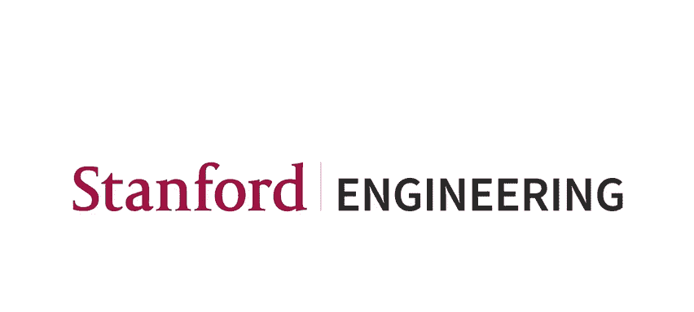
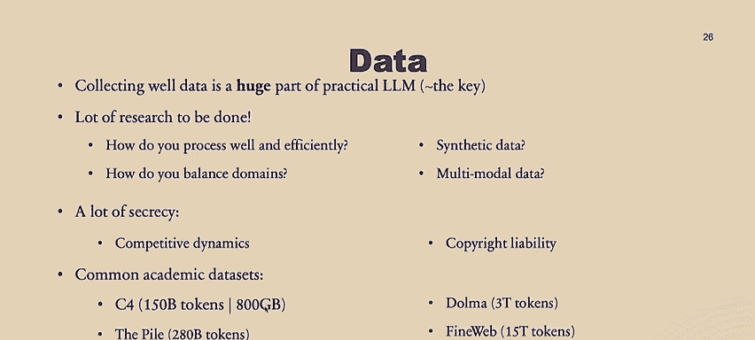
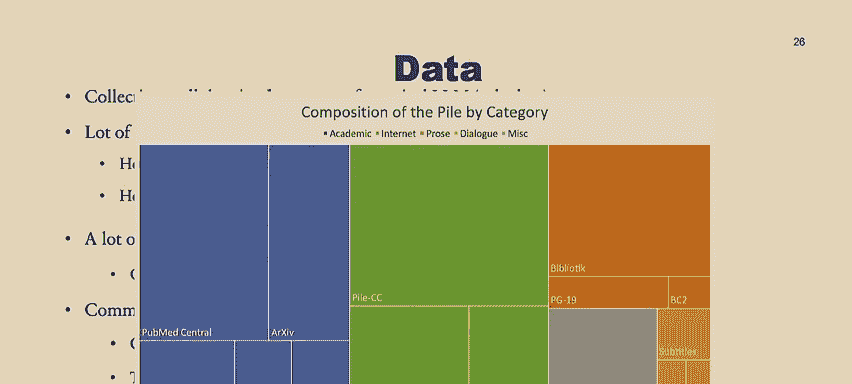
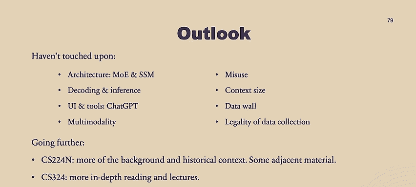

# 斯坦福大学《CS229机器学习：构建LLM》课程笔记 - P1 🧠

在本节课中，我们将要学习构建大型语言模型的核心概念。课程将分为预训练和后训练两大板块，涵盖模型架构、训练目标、数据、评估和系统等多个关键组件。我们将从基础的语言建模任务开始，逐步深入到如何将预训练模型转化为实用的AI助手。

## 预训练概述 📚

上一节我们介绍了课程的整体结构，本节中我们来看看预训练。预训练是经典的语言建模范式，其目标是训练模型来建模整个互联网的文本分布。

### 语言建模任务

语言模型本质上是对词元序列的概率分布进行建模。具体来说，它计算一个句子 `P(x1, x2, ..., xL)` 出现的概率，其中 `x1` 到 `xL` 是句子中的词元。

*   **语法与语义知识**：一个好的语言模型应具备语法和语义知识。例如，对于句子“the mouse ate the cheese”，模型应赋予其较高的概率；对于有语法错误的句子“the the mouse ate cheese”，应赋予较低概率；对于语义不合理的句子“the cheese ate the mouse”，也应赋予较低概率。
*   **生成模型**：由于语言模型定义了概率分布，我们可以从中采样以生成新的句子，因此它们也被称为生成模型。

目前主流模型采用**自回归语言模型**。其核心思想是利用概率链式法则，将序列的联合概率分解为一系列条件概率的乘积：

`P(x1, x2, ..., xL) = ∏ P(xi | x1, ..., xi-1)`

这等价于在给定所有上文词元的条件下，预测下一个词元。这种建模方式的一个缺点是生成长序列时需要逐步进行，耗时较长。

### 自回归神经语言模型

自回归语言模型的核心任务是**预测下一个词元**。其工作流程如下：

1.  **词元化**：将输入文本分割为词元（如子词），并为每个词元分配一个ID。
2.  **模型处理**：将词元ID序列输入神经网络（通常是Transformer）。
3.  **输出分布**：模型输出一个覆盖所有可能下一个词元的概率分布。
4.  **采样与去词元化**：在推理时，从这个分布中采样得到下一个词元ID，然后将其转换回文本。

在训练阶段，我们不需要采样。我们直接将模型预测的下一个词元概率分布与真实的词元（独热编码）进行比较，并使用交叉熵损失来更新模型权重，以增大生成真实词元的概率。

**损失函数**：训练目标是最小化交叉熵损失，这等价于最大化训练文本的对数似然。

`Loss = -log P(x_target | context)`

其中 `x_target` 是真实的下一个词元。

### 词元化

词元化是将文本转换为模型可处理单元的关键步骤。直接使用单词或字符作为词元存在一些问题：

*   **单词**：无法处理拼写错误或未见过的词，且不适用于无空格的语言（如中文）。
*   **字符**：会导致序列过长，增加计算复杂度（Transformer复杂度与序列长度呈平方关系）。

词元化的目标是找到常见的子序列作为词元，通常每个词元平均对应3-4个字母。

以下是训练词元器（以字节对编码BPE为例）的简化流程：

1.  从大型文本语料库开始，初始时将每个字符视为独立的词元。
2.  迭代地合并语料库中最常见的相邻词元对，形成新的词元。
3.  重复此过程，直到达到预设的词表大小。

应用训练好的词元器时，总是选择能匹配的最长词元。词元化对模型性能有重要影响，例如，数字和代码的特殊格式需要仔细处理。

### 评估

评估语言模型的常用指标是**困惑度**。困惑度可以理解为模型在预测下一个词元时“犹豫”的程度。

`Perplexity = 2^(average cross-entropy loss per token)`

*   **最佳情况**：完美预测，困惑度为1。
*   **最差情况**：完全随机猜测，困惑度等于词表大小。

困惑度在模型开发中非常有用，但由于依赖于词表大小和评估数据，在学术基准测试中已较少使用。

当前更常见的学术评估方法是**聚合多个自动化评测基准**，例如HELM和Hugging Face Open LLM Leaderboard。这些基准包含大量可自动评估的任务，如问答。

以**MMLU**（大规模多任务语言理解）基准为例：
*   它涵盖多个领域（如大学物理、医学）的选择题。
*   评估时，可以计算模型生成每个选项的似然，并选择似然最高的选项；或者约束模型只能输出选项字母，看其预测的下一个词元是否正确。

评估面临诸多挑战：
1.  **方法不一致**：不同的提示方式或评估方法会导致结果差异巨大。
2.  **测试集污染**：如果测试数据被意外包含在训练集中，会导致评估分数虚高。检测方法包括检查模型是否更倾向于按特定顺序生成测试样本。

## 数据 🌐

数据是训练大模型的关键。所谓“使用整个互联网”的数据，需要经过复杂的处理流程：

1.  **网络爬取**：使用Common Crawl等工具获取约2500亿个网页（约1PB数据）。原始网页（HTML）包含大量无关内容。
2.  **文本提取**：从HTML中提取纯文本，需要处理数学公式、去除页眉页脚等模板内容。
3.  **过滤不良内容**：根据黑名单或分类模型，移除有害、个人身份信息等内容。
4.  **去重**：删除重复或近乎重复的文档和段落。
5.  **启发式过滤**：基于规则（如文档长度、词元分布异常）过滤低质量文档。
6.  **基于模型的过滤**：训练分类器来区分高质量（如被维基百科引用的页面）和低质量文档。
7.  **领域分类与加权**：将数据按领域（如代码、书籍、娱乐）分类，并调整采样权重（例如，上采样代码数据可能提升模型推理能力）。
8.  **最终阶段高质量数据训练**：在训练末期，使用极高质量数据（如维基百科）进行低学习率的训练，以微调模型。

数据规模在不断扩大，从早期的约1500亿词元，发展到如今顶尖模型（如Llama 3）使用的约15万亿词元。数据收集和处理是高度机密且劳动密集型的工程。

## 缩放定律 📈

缩放定律描述了模型性能（损失）与计算量、数据量和模型大小之间的可预测关系。核心发现是：**更多的计算、更多的数据和更大的模型几乎总能带来更好的性能**。

在双对数坐标轴上，测试损失与计算量、数据量或参数数量呈线性关系。这意味着我们可以预测增加资源能带来多少性能提升。

缩放定律的实用价值在于**优化资源分配**：

*   **旧流程**：在目标规模上直接进行大量超参数调优，最终用于生产的模型训练时间很短。
*   **新流程**：
    1.  在小规模模型上寻找缩放规律（例如，模型变大时如何调整学习率）。
    2.  在不同规模的小模型上进行超参数调优。
    3.  拟合缩放定律曲线，预测大规模模型的性能。
    4.  将大部分计算资源用于训练最终选定的大规模模型。

**Chinchilla论文**回答了如何最优分配计算资源的问题：给定固定计算预算，应该用多大的模型训练多少数据？其结论是，**每个模型参数大约对应20个训练词元**时，能获得最佳性能（最低损失）。然而，考虑到推理成本，实际生产中可能采用更高的词元-参数比（如150:1），以使用更小的模型。

**苦涩的教训**：缩放定律和摩尔定律表明，计算能力会持续增长，模型性能将随之提升。因此，真正重要的是能够有效利用大规模计算的**架构、系统和数据**，而非微小的架构改进。

### 训练成本估算

以Llama 3 405B模型为例进行粗略估算：
*   **训练数据**：15万亿词元。
*   **参数量**：4050亿。
*   **计算量**：约3.8e25 FLOPs（公式：`~6 * 参数量 * 词元数`）。
*   **硬件与时间**：使用约16,000块H100 GPU，训练约70天（约2600万GPU小时）。
*   **经济成本**：仅GPU租赁成本约5200万美元，加上人力等，总成本约7500万美元。
*   **碳排放**：约4400吨CO₂当量，相当于2000次纽约至伦敦的往返航班。

## 后训练（对齐）🎯

预训练模型是通用的语言模型，但并非理想的AI助手。后训练（或称对齐）的目标是让模型遵循用户指令和设计者的期望（如安全性）。

### 监督微调

**监督微调**是后训练的第一步。其核心思想是在高质量的“指令-答案”对数据上，使用相同的语言建模损失对预训练模型进行微调。

*   **数据收集**：人工编写或由大模型生成指令和期望的回答。
*   **关键发现**：SFT所需数据量很少（几千到几万条），性能即接近饱和。因为模型主要学习的是“回答格式”，其知识已在预训练中获得。
*   **局限性**：
    1.  受限于人类生成答案的能力。
    2.  可能导致“幻觉”：如果人类提供的答案涉及模型预训练时未见过的信息，模型会学会生成“看似合理”但可能不真实的内容。

### 基于人类反馈的强化学习

为了克服SFT的局限，引入了**RLHF**。其思想不是克隆人类行为，而是最大化人类偏好。

**传统流程（PPO）**：
1.  **收集偏好数据**：对于每个指令，让模型生成多个回答，让人工标注者选择更好的一个。
2.  **训练奖励模型**：训练一个模型来预测人类偏好，为回答打分（连续值优于二元偏好）。
3.  **强化学习优化**：使用PPO等RL算法，优化语言模型（此时作为策略），使其生成能获得更高奖励模型分数的回答，同时加入正则项防止过度优化。

**直接偏好优化**：
DPO是一种更简单的方法，它绕过了训练奖励模型和复杂的RL步骤。其损失函数直接最大化偏好回答的似然，最小化非偏好回答的似然。理论上，在特定条件下，DPO与PPO的全局最优解相同，且实践表明两者效果相当，因此DPO因其简洁性而被广泛采用。

**数据收集的演进**：
*   **人工标注**：成本高、速度慢，且标注者可能过于关注长度等表面特征。
*   **AI标注**：使用大模型（如GPT-4）来替代人类进行偏好判断。研究表明，AI标注成本极低，且与人类标注结果的一致性甚至高于不同人类之间的一致性，现已成为一种标准实践。

### 后训练评估

评估对齐后的模型面临独特挑战：
1.  **无法使用困惑度**：因为RLHF/DPO优化后的模型不再校准为真正的概率分布。
2.  **答案开放多样**：没有唯一正确答案，自动化评估困难。

主流解决方案是**基于偏好的基准测试**：
*   **Chatbot Arena**：让真实用户在不知情的情况下与两个模型对话，并选择更优的回答，通过大量投票进行排名。但成本高，且用户群体可能有偏。
*   **AI作为评判员**：使用强大的大模型（如GPT-4）来评判两个模型输出的优劣，计算胜率。例如AlpacaEval基准，它与人类评判结果高度相关，且成本极低。需要注意控制大模型评判员自身存在的偏差（如对长答案的偏好）。

## 系统优化 ⚙️

计算是训练大模型的核心瓶颈。系统优化的目标是提高硬件利用率。

**GPU基础**：
*   **高吞吐并行**：GPU专为大规模并行计算设计。
*   **矩阵乘法优化**：GPU对矩阵运算有极致优化。
*   **内存与通信瓶颈**：计算速度的提升快于内存带宽和通信速度的提升，导致GPU经常因等待数据而闲置。

关键优化技术：
1.  **低精度计算**：
    *   使用16位浮点数进行矩阵计算，可以加速计算、减少通信和内存占用。
    *   通常采用混合精度训练：权重用32位存储以保证更新精度，前向和反向传播计算使用16位。
2.  **算子融合**：
    *   PyTorch等框架中，每个操作都可能涉及数据在GPU全局内存和计算核心间的搬运，效率低下。
    *   算子融合将多个连续操作合并为一个内核函数，只需一次数据搬运，大幅提升效率。使用`torch.compile`可以自动实现这一点。

## 总结 🎓

本节课我们一起学习了构建大型语言模型的核心全流程：

1.  **预训练**：我们探讨了自回归语言建模的基本任务、损失函数、关键的词元化步骤，以及如何利用整个互联网数据并遵循缩放定律来训练模型。
2.  **后训练与对齐**：我们了解了如何通过监督微调和基于人类/AI反馈的强化学习（RLHF/DPO），将基础语言模型转化为有用、无害的AI助手，并讨论了评估这些助手的挑战与方法。
3.  **系统考量**：我们简要触及了训练这些庞然大物所需的系统优化，如低精度计算和算子融合，以应对计算瓶颈。

除此之外，还有许多重要主题未在本课涵盖，例如模型架构细节、推理优化、多模态、数据合法性等，这些是未来深入探索的方向。