# 斯坦福大学《Transformers 和大语言模型｜CME295 Transformers & LLMs Autumn 2025》中英字幕 - P1：Lecture 1 - Transformer. - GPT中英字幕课程资源 - BV1WGsMzCERB

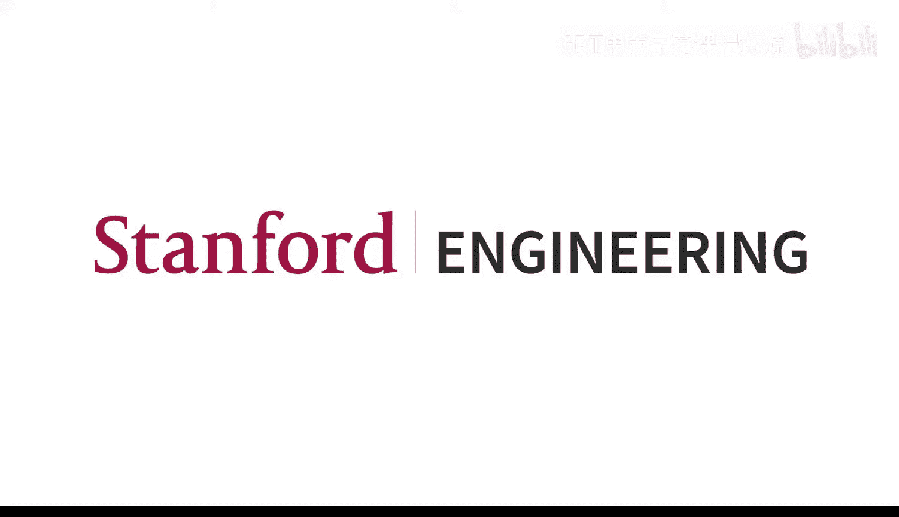

Cool， hellello everyone， and welcome to CME 295 transformformers and large language models。

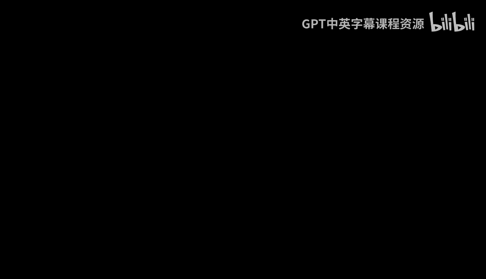

So my name is Apin and I will be teaching this class with Shervin， who's in the back。

And before I start， I'm just going to introduce ourselves。

so we're twin brothers and we actually had kind of a similar backgrounds。

 so we both went to a school in France called Soal Bari。And then we each went our way。

 so on my end I went to MIT and then Shevin went to Stanford to do the ICME master's program。

And after that， I guess our industry background is very similar as well。

 so I first went to Uber and then Shervin came to Uber as well and then Shervin left to Google and I went to Google and then very recently I joined Netflix and Shervin joined Netflix as well and we've been working on large language models。

So yeah， I guess we have like technical backgrounds and mostly oriented towards LLMs。Okay。

 so why are we doing this class？So since 2020， Shervin and I have been specializing in NLP and we've been giving this class in a format of a workshop that was done in a yearly basis。

 so in 2021， 2022， 2023， 2024， Chd GPT came in 2022。

 and suddenly there was a lot of interest for LLMSs。And so it's actually last spring。

That we started to offer this class as a Stanford course that is now called CME295。

And this is the second instance。よ你。 so what can you expect from this class？So first of all。

 LLMs are basically everywhere now and I guess our goal here is twofold。

 so the first one is to learn about the underlying mechanism that makes all this work and we're going to see the transformer which is the foundational architecture that makes all this work and then the second thing is to know how these LLMs are trained and where they are applied。

So in case you're still wondering if this class is with for you。

 I would say that this class is great for people who just in general have an interest in this field。

 either because you wanted to make it your career goal。

 if you want to be an research scientist or an N scientist。

Or if you want to develop like a personal project that relies on LLMs to some extent。

 to just like knowing the caveats， I guess what works， what doesn't。Or justie。

 if you're in a separate fields and you just want to know how this whole AI。

 GAI LLM thing works and how you can apply it to your domain。Okay， so now in terms of prerequisites。

I would say that at a very minimum， you should have some foundations in ML。

 like basically know how a model is strained， where a neural network is。

 and also some basics and linear algebra， so basically how matrices are multiplied， for instance。

But even if you have kind of a developing， I guess competency in these fields， I guess it's fine。

 we still be here to help you out， I guess this is like the ideal set of prerequiites。Cool。

 so still under logistics， so this class will be held every Friday from 330 to 520。

And it would be the health here。So this class is two units and you have the choice to either take it as a letter or a credit non credits。

So as you could tell from the setup， we're basically recording this class and if you cannot for some reason attend this time。

 this slot will make sure which you're going to make the recordings available either tonight。

 like every Friday night or on Saturday。So in terms of the grades。

 so what we're doing for this quarter is to have two exams。So one is the midterm。

 which will be happening。During our fifth instance， which is October 24th。

And then the second exam will be the final exam， which should be held like in the week of the December 8th。

 so the date is still TB。So we let you know。Co， so every time we have a lecture。

 we'll be posting the slides and the recordings on the website。And in case you're interested。

 we also have the syllabus in there so you can know a little bit what are the topics that we'll be talking about。

And the plastics book is the super study G Transformer LMSMSs。

 so we have a copy here in case you want to take a look。So yeah。

 I guess a lot of the concepts that we have in this class will actually be in the book。

 so I guess it's a helpful way to follow this as well。

And also we did some kind of very short condensed version of the whole class that we called the VIP cheat sheetets。

 so this one is available on GitHub in case you're interested and yeah we're also translated into a number of languages now。

 by the way， if your language is not there let us know and happy to work on that as well together。

Okay cool I think it's the last things on the logistics part， so in terms of announcements。

 we'll be posting things on canvas in case you have any questions， you can of course reach out to us。

 but there is also a tab on canvasva that's called Ed。I'm sure you're familiar。

 so yeah just click on that just post your question and then Shevin and I will be responding。

And yeah， I guess to reach out to us， you have this mailing list or just like you know。

 we're just two so just English。Cool， so on logistics do we have any questions so far and one thing I forgot to mention is that given that we're recording this class。

 I guess if you're asking a question， it may not be super clear for the viewer what your question was。

 so I'm going to make an effort to just repeat your question， it will sound weird。

 but yeah I try to not forget。But yeah， so yeah， any questions so far on the logistics？Yeahep。😊。

So the question is whether they're like coding parts in the exams so the answer is no。

 so the exams will purely focus on concepts that we see in class and actually it's not meant to you know trap you so I guess if you follow the class if you know you see the slides and like the concepts that we see should be fine。

Yeah。😊，Oh yeah question is if you're waitlist what do you do I think so by experience you know a lot of people will kind of finalize their schedule some people will drop some won't in case you're still waitlisted you know come talk to us。

 but I'm pretty confident you know it's going to be okay because I think the waitlist right now is like six。

So yeah， things should be fine。Yeah。They will be on the website and we'll make sure to also post the link on canvas。

Yeah， so the question was， where are the slides and they're on the website？Cool， yeah。

So question is on the weight of the exams， so yeah， there is no homework。So 50% is midterm。

 50% is final。And no grades， I mean， no weights are from that。And in particular， I mean。

 if this slot is conflicting with something， just keep in mind that we are recording this。

 so mean it's fine if you can attend theship yeah。Yes sorry。Oh。

 is' a question that the final is about just a second half of the class？

We've not we have not written the exam yet， but I think this is something we're thinking of， so yeah。

 the final is probably going to be the second half about the second half of the topics。Co， okay。

 long story shorts。50% midterm， 50% exam， final exam。And yeah， it's funless。好。So with that。

 I'm going to just slowly start the class， so another thing that I want to mention was every time we're talking about something。

We see that at the bottom of the slide there will be source it's mostly for so first to credits whatever we're quoing but also for you to kind of dig into those material a little bit more case you're interested because of course we have only like two hours per week and we only have nine or 10 weeks so there's nowhere near the you know enough time for us to cover everything。

And the second disclaimer is you will see that the field is full of abbreviations。

 so I myself was completely scared of them when I started it。But hopefully by the end of the class。

 you will have a mental mapping of what these abbrevisions mean respect to what they correspond to。

So yes， so if you have that mental mapping towards end of the class。

 then we'll know we did a good job。

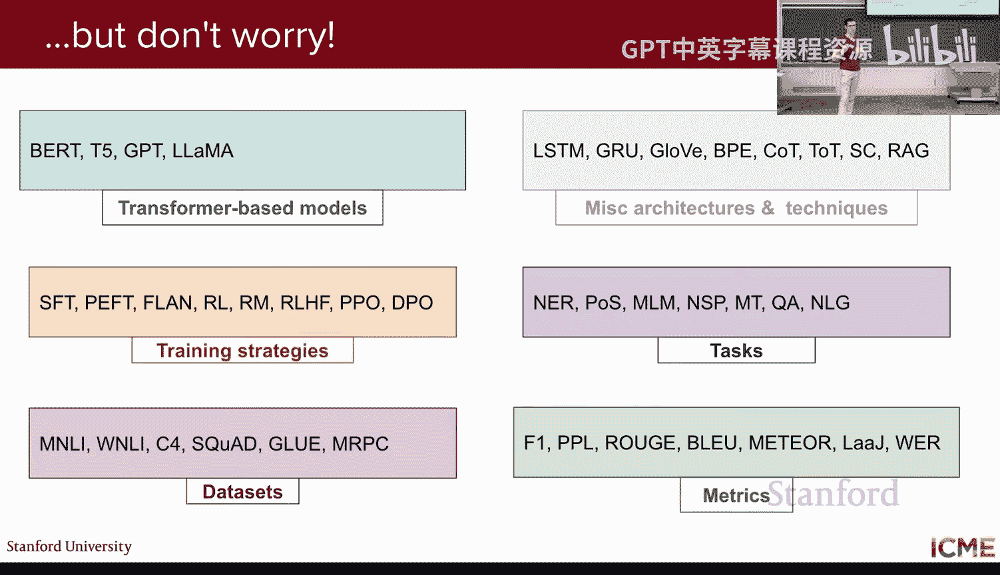

So with that。Let's start。And I guess we will start at the very high level because we just assume that。

 I guess we're starting from scratch and we're going to talk about NLP in general。

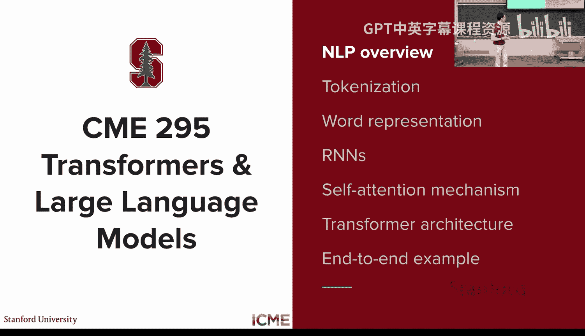

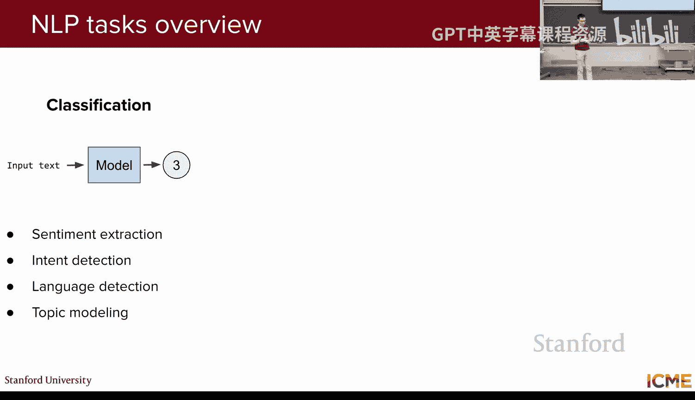

So NLP is going to be our first abbreviation， so NLP stands for natural language processing。

 and it is a field that is around like manipulating text， just completing things with text。

And at a very high level。Can basically classify NLP tasks into three buckets。

So the first bucket is what we call classification， so we have an input text as an input。

 and then what we want is to predict something。So one example is you have a movie review and you want to predict whether the sentiment is positive。

 negative or neutral， so that's one example you can also have intent detection just you know knowing what for instance the person want to do so let's suppose you say I want to create an alarm for tomorrow so the intent here is create an alarm。

So also to detect the language， so for instance， if you write a in French。

 you want to detect that that text is in French topic modeling。

The second category is what we call multi classification， so we still have a text that's input。

 but this time we predict more than one thing。So you have a number of tasks in that bucket as well。

 so one that is very popular is called named entity recognition AK NER。

So what that task does is given an input text， we want to basically label some specific words like for instance。

 identifying whether something is a location or a time and so on。

And then you have some other tasks as well that are a little bit more on the linguistic side。

 I think they're less trendy now， but I guess 10 years ago it was something that people would study a lot。

 so part of speech tagging which is about just figuring out which word is you noun a verb， etc。

 or some parsing related tasks or dependency or constituency parsing。And then the last bucket。

 which is very popular these days， is the generation buckets。So you' have the text as inputs。

 and you also have text as outputs。And here the length can be variable。

 meaning you don't know what the length of your outputex will be beforehand。

So here you have several tasks， so for instance you have machine translation。

 essentially something in English and I wanted to， let's say German。Question answering。

 so typically you know the chat GT Gemini that you're using， you know the assistant。

 so you ask a question and you have a response。And then you have like other tasks as well。

 like summarization， you want to summarize an article， let's say， or just generate something。

So something can be generate codes， generate the poem。Counc will be a lot of things。Good。

 so now what will we do？Is go through these tasks one by one to just illustrate what people typically handle with。

So we're going to start with the first bucket， which is the classification bucket。

And here we're going to illustrate this with the sentiment extraction task。

So let's suppose we have a sentence， thisstead bear is so cute， we want our model to predict。

 you know this to be a positive sentiment。But typically what you would use is data sets that are around sentiment extraction data sets。

 so I mentioned movie reviews， so this is I am DB critics， but you also have reviews about products。

 Amazon reviews or you know tweets， now I guess it's called X so X posts。

And the way you would evaluate such outputs would be by typically using traditional classification metrics。

So you have accuracy， which is， you how many what is the percentage of the observations that you correctly predicted？

But you also have two key metrics， which I'm just going to remind。

 I'm not sure if everyone knows about them， so one is precision。

Which is out of all the positive predictions that you made， which ones were correct？

And then the second one is recall。Out of all the true labels。

 how many of them did you correctly predict as being positive？

And you have this metric called the effluent score。

 which basically takes the harmonic mean of precision and recall to just give you one number。

So now you may wonder you know why do you need all these metrics。

 so the short answer is that sometimes you have tasks and data sets where your classes are very imbalanced。

So for instance， you can have 99% of your data that is a positive label and then only 1% of the data。

 which is negative。And so here， if you take like a metric like accuracy。

 you be very misleading because if you have a model that would predict everything as the majority class。

 then you will have a great classifier。But it's not the case。

 so that's why precision and recall really play a role。So that's sort the first one。Okay。

 so now let's move to the second category of NLP tasks， so this one is the multiclass category。

 so you have an input text and you predict multiple things。

And we're illustrating this with the NER task。Which， as I mentioned。

 is about identifying the category of given words。And so here， for instance。

 we want to identify ted bearer as being an entity。I guess for that。

 you would use classification metrics， but not at the sentence level。

 but more either at the token level or at the entity type level。AndBut by that， I mean。

 let's suppose you have a category， let's say location。

 and you want to know how well you're predicting words in that category。

 so you would typically aggregate these metrics as a function of that。好。Okay。

 let's go to the last category， which is， as I mentioned， the most popular one。

 so this one is text in， text out。So I'm illustrating this with the machine translation task。

 which is around translating a text from a source language to a target language so here you have the example with English to French。

 so cute Teedddy bear is reading Newson Pash Minon Li。So for that。

 I guess it's harder to get data sets because here you need to have pairs of text。

 so you have a very popular data set that's called WMT。

Which stands for workshop on machinech translation。

And that one contains a bunch of paired sequences in different languages， so for instance。

 you have the English French， English German coming from the European Parliament data set。

 for instance。Okay， so to evaluate those。To evaluate the performance of your model。

It's actually a lot more tricky。Because as you can imagine。

 you can have many different ways to translate something。

 I'm sure many of us in the room are bilingual trilingual。

 so yeah that's what is making it this hard。So in the past。

 people have used several rule based metrics to do that。So one that you may have heard is blue。

Blue stands for Bilingual Evaluation under studyy。And it is a measure of how well your translation stands with respect to a reference text。

Same story for Rouge， which is actually a suite of metrics。

But have captures that in a different way and you will see that the machine learning community is funny because blue。

 I'm not sure if you know French means blue， but Rouge means red so guess they try to kind of。

I had some fun in this， but the problem with this metrics is that you always need a reference text。

So you basically need labels。😡，And in practice， having labels is very cost expensive。

It takes a lot of time， a lot of money to get labels。

And we will see later in the class that with the progress that we have made in the LM space or that the community has made in the LM space。

 we can actually forego of these reference based metrics and go towards a more reference free。

Kind of metrics and we will see that later on。And then the last metric that I would say that people sometimes use is called perplexity and perplexity only looks at the probabilities that are output by the model。

 and it basically quantifies how surprised the model is by its outputs。So blue and rouge， the higher。

 the better complexity， the lower， the better。And I guess LLMs have been kind of a hot topic since 2022。

But actually the field goes way back way before that year， so in the 80s， we'll see it in a second。

 but there's a class of models that were actually kind of third of， even in the 80s and the 90s。

 we had LSTMs that we'll see also in a second。But the problem was during that time。

 we didn't have the internet， we didn't have a lot of computes。

And I guess this was one of the limiting factors which prevented these models from like the models from today from being trained。

And then more recently we've had several advances， so World2 VC was really one of the kind of pioneering work in just computing meaningful embeddings。

And we'll see it in a second， and then of course we had the transformformers。

 which were part of a paper that was published in 2017。

Which is basically at the foundation of the mouse that you see today。And then these models。

 they just were scaled up both by computes。But also in terms of like the data that was used to train them and you know that's how LLMs were dubbed and I guess these are more like the 2020s。

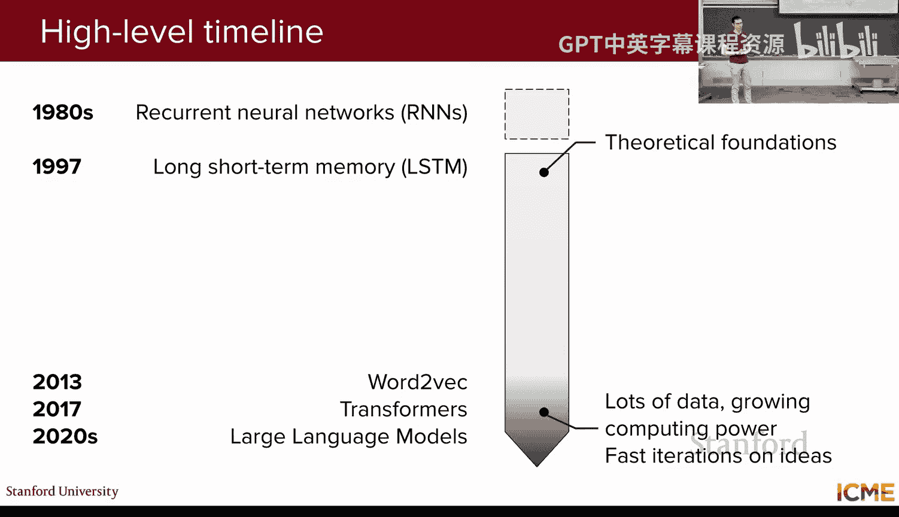

But yeah， as we see those。こう。Any questions on？I guess to high level。Aon Woods？

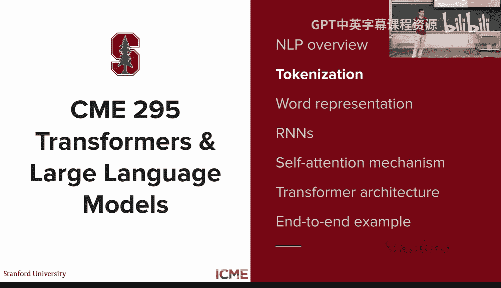

Cool。Heggs。The first question that I want to ask ourselves is。

What we want to do is to have a model that handles text。But models， they understand numbers。

 they don't really understand text。So we need to somehow do something with that text to make it more quantifiable。

 something that a model can understand。So if you look at a sentence， for instance。

 the cute teddy bear is reading。You first need to ask yourself， how can you cut this sentence？

Two pass2 model。So this part is called tokenization。

And what it entails is basically cutting the text respect to some arbitrary unit of text。

So there are several ways of doing this， I guess the first way is doing it completely arbitrarily。

So here， for instance， you would have a that would be one unit of text。

Cute would be another unit of text。Cananddy bear would be another one and so on。And by the way。

 the unit of tests is called a token。Which is why the method is called touckenization。嗯。

Another way would be to just separate by words。But I guess we would have， you know。

 always pros and cons， I guess。One of the goals that we want to achieve is for us to then be able to represent these tokens in a meaningful way。

So。One come with doing this at the word level is you will end up with words that look similar。

 but that are actually considered as different tokens。

And I guess the limitation here is you will need to compute embeddings for these similar yet different tokens。

And somehow make their embedding similar。So I'll give you an example。

So let's suppose I have the word there。And then you have another word pleuraloform bears。

So these two words， they are very similar， just one is singular， the other one is plural。

If we go ahead with the word level tokenization。Then。We will end up with just two different entities。

Which are basically， yeah， just considered as different。Same with run。

And then runs variations of verbs。So for that reason。

People have dug into a category of tokenizers that are called subward tokenizers。

Whi is around leveraging roots of words in order to find what are the common roots that we can find is in these words。

 so for instance， for bear and bears， you would have the bare particle that would be kind of shared。

And so I guess the pro is that you get to leverage the root of the words。

 but then the con here is that your sequence。Would be longer。And we will see why this is a con。

 I guess later on， I guess I can give you a preview so the complexity of these models。

Is also a function of the sequence length。So the more tokens you have to process。

The more time it would take for your model to run， because it needs to basically process all these tokens。

So that's one con， so Pro is it leverages the root of words con is it just makes your sequences longer。

Okay， you have a last category of kind of ways of organizingizing things。

 which is just going at the character level， just like taking all characters。So， here。

I guess you and I， when we write a don't know message， we typically have sometimes the misspellings。

And with the subward way of tokenizing things， you may not be able to recognize a word that has been misspelled。

 and this is something that the character level tokenizer can I guess take into consideration。

 but here the problem is you have a sequence length that's much， much longer。

 which will make your model， I guess， take much more time to process the sequence。

So that's one con and then the other con is， I guess。

 when you want to represent each of these tokens， I guess。

It's very hard to know what a representation of a letter really means。

Like what does the representation of the letter you mean？Its very hard。Cool。

 so I have just a quick recap， so word level is a super naive way。

 super simple way of I guess dividing your text into arbitrary units。

But then the problem is as we mentioned， we do not leverage the root of words and I did not mention this。

 but theres a term， whenever you cut something and then at inference time when you want to make a prediction。

 I guess one prerequisite that you have is that you need to have the token that you saw at training time。

 you need to have it in your training sets。And the problem is。Let's suppose at inference time。

 you cut your text into words and let's suppose you have not seen a word at training time。

You will need to mark it as a no。And so this thing is called OV out of vocabulary。So luckily。

 the subward level tokenizer mitigates that problem， so you have like a lower risk of OV。

 but still you can have。And as we mentioned， in terms of the pro。

 you leverage the roots of the words。And then a character level， you know。

 is's robust to our misspellings and our casing errors。

 but the problem is it makes computations just like much slower and your sequences would be like very。

 very long， which will also make your I guess inference time much higher。That sound good。

 I guess this is really the foundation of I guess how to handle things with text， but yeah。

 it doesn't make sense overall。

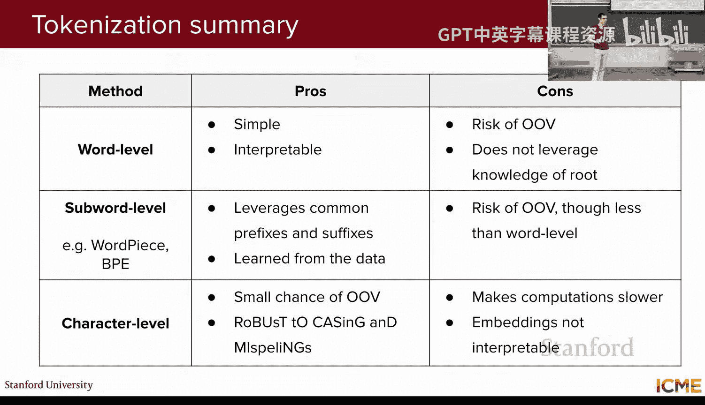

谢。こ？Okay， so now， okay， what we did is we took an input text。

What we did is we cut it into parts that are basically tokens。

So in order for our model to understand these tokens。

 we need to find a representation for each of them。So here we're going to take a look at this。

 so that's called word representation or more， I guess in a more correct way it should be token representation so want to find。

A way to represent each of these dos。

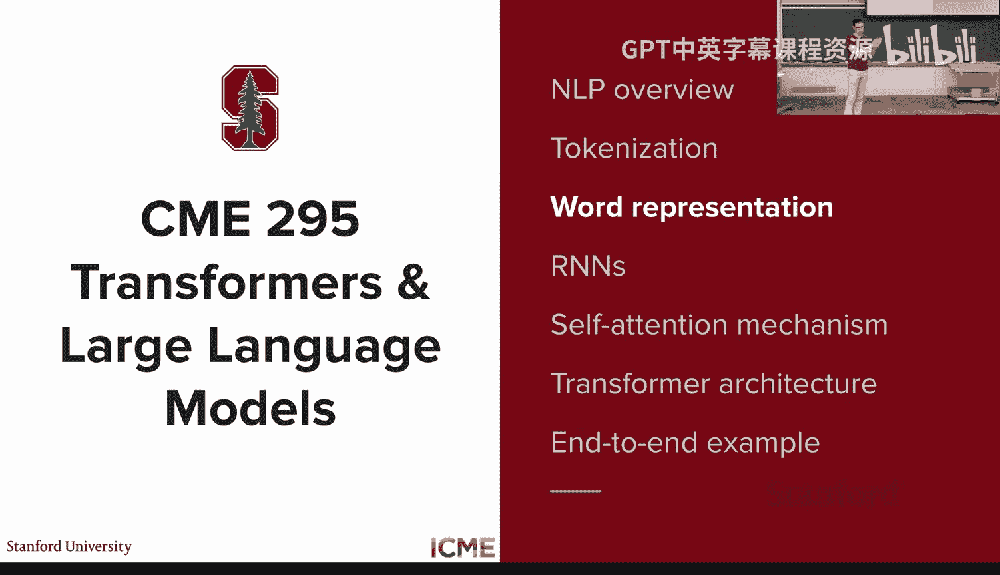

Yeah。So the simple and naive way to do this would be to just assign the one hot vector for each word or for each token。

 so for instance， let's suppose we have a vocabulary of three tokens。Book， soft and teddy bears。

We would have， let's say soft that is a 100 vector， tdy bear that is， let's say。

 a 010 vector and book that is， let's say a 001 vector。So this is called the one hs。

 including OHE with typically see。嗯。So cool， yeah， this is a way to represent of our dokens。

 but basically what people want to do is compare these tokens to basically see which ones are more similar to what other ones。

So a common similarity measure that people use is something called cosine similarity。

 I'm sure if you have heard of it， so you can think of it as just seeing what angle these vectors make in the n dimensional space。

And if， I guess they are pointing the right in the same direction， then maybe they're similar。

 maybe if they're orthogonal， maybe they're kind of independent and if they're completely opposite then maybe they're opposite that's basically the mental model we want to go into。

So the problem is。If you represent your tokens in a one hot fashion。

You will end up with all your vectors being orthogonal to one another。So that's the problem。

So ideally， what we want is for tokens that mean the same or similar to basically have a high similarity。

And for tokens that are not similar like like about different things to be more like orthooomy。

So here just for illustrative purposes， teddy bears are soft， so you want teddy bear and soft to be。

 I guess with a high similarity and let's say teddy bear and book which is kind of independent。

 you want them to be closer to zero。So that's what she wants。

That's what you have with 10 coding and that's what you want。Yeahep。Sorry。Oh。

 I see the question is why do you care about the norm？So。

I guess cosine similarity is actually normalized by the norms， so it's that product Oh。

 you mean why did I just put that product here instead of to？Oh I see。

 and your question is why do we not care about the norm？😡，Cool。

 I guess the viewers know the question， I guess these measures， they are all you know measures。

 there are all ways to try to capture these kind of similarity things。

 so I guess why do you not care about the norm。嗯。😊。

I guess it's how people have tried to kind of quantify that I guess you would need to see how your vectors are trained and whether the norm would be indicative of something。

I guess the best answer I can give you is I guess this is a measure this is not the perfect measure。

 yeah people may use also that product as a measure。

 but yeah I don't have like a great answer for you。But as long as you capture。

 I guess how these vectors they're pointing， I guess typically what you care about is the angle between them。

 but yeah， typically you don't really take into consideration the norm。ol any questions。

 any other questions？Y。业务。Yeah。Yes。It's a great question so question is around size of vocabulary and how that would inform the choice with respect to word subword and how that changes across languages's a great question so I would say it really depends first of all。

 on the task that you're trying to achieve if your task is just about one language you will just take that same language you would typically go with a subword tokenizer just because of the reasons that we mentioned here。

So I guess subwards is a nice trade off between being able to identify words by their roots。

 like leveraging that， but also running less into the OV risk。嗯。So in terms of the size。

I know that people they've， you know。Like try different things。

 I think typically for English you would target something on the order of tens of thousands of vocabulary size。

But you know， like nowadays， the models， there are multilingual， they are also bad codes。

 so you will see that the vocabulary size now is sometimes on the order of hundreds of thousands。

Okay， so with respect to Chinese， so I guess you have this you know difference in characters that you're using so for Latin。

 I guess it's the alphabet we're all accustomed to， but of course for the other ones。

 you'd have something similar but in I guess the target language character。So yeah。

 I would say order of magnitude2 tens of thousands for one language。

 hundreds of thousands if it's like multilingual。Yeah。

 these are the order of magnitude that you want to target for。好。Yeah。Great question。

 so a question is how do you get those embeddings， so it's actually the next slide。その辺痛かっです。Yeah。好。

Great， so okay， so now that we know that the oneH encoding is not a good way to represent tokens。

 what we want to do is to learn those embeddings from the data。

So I mentioned that there was this paper that came out in the 2010。

 so I think it was 2013 that was called word2vek。And the reason why it was so popular is because they showed a very intuitive and interpretable way of seeing these embeddings because they were saying something like okay。

 King is to queen， what this is to that like Paris is to France， what Berlin to Germany。

 so there was basically a way to make sense。Of Da biddings。

So now the question is how did they do that？So they had two ways of computing this emtdding。

 so one way was called continuous bag of words， the other one was called skipcrm。

 but they all rely on the same idea。Ws。Let's just leverage。Text that we have。And then try to predict。

Something that is part of the text based on， let's say， the context。So for instance。

 continues back of words。The goal is you take into consideration the words that are around given target words。

And your goal is to predict that target worth。And Sgramm is kind of the opposite。

 you go from a target word and you want to predict the words that are around it。

So I guess this task is commonly called a proxy task。Because at the end of the day， in this exercise。

 what we care about is not necessary to predict the next word。

 or at least not yet our goal is to learn。A representation of these words that are meaningful。

And so here the idea is if you have a model that somehow knows。How to predict， let's say。

 the next word。And it means that your model has some understanding of how language works。

Which is basically what you want， you basically want an embedding that is reflective of I guess what language is。

Which is you know， king and queen or you know， or similar， you know。

 Paris and France like this is a capital， you want to have these associations embedded in the representation。

Yes。And。Let's go through a very simple example of what that looks like。So here in our example。😡。

Let's suppose that our proxy task is about predicting the next word。So here。

 what we take is a very vanilla neural network model， which basically receives a vector of size V。

Has some multiplication and a biased term to get like a hidden state。

 and then another set of multiplications to get our final vector。

So here it's basically a very simple neural network。So the input is of size3。

 the hidden areas of size D， which is typically much smaller than the vocabulary。

 so vocabulary typically like tens of thousands or hundreds of thousands， so D is typically hundreds。

Like 768， for instance， is one example of the dimension。So it's much， much smaller。

So what we're trying to do is to learn the word representation through this proxy task and what we're going to do is try to consider。

The words。As inputs。And predict the next word。So let's go with the first word of the sequence。

 so by the way I use token and words inter AGP so let's suppose we have the word A。

And we want to predict the next word， which is the word cues。So what we do is we take the word A。

We take the one htz。Including representation。And we pass it through the network。So here。

 if you're familiar with neural networks， so here you have， I guess a multiplication between。

 I guess a matrix and this vector， so you have a hidden state representation。

 which is a vector of size D。So here， let's suppose its 0。21。9， so d equal 2。And then you have。

 guess another past year， and then you get after softm a set of probabilities， which are around。

Seeing what is the next word so in this example we have a vocabulary of size six。

So the first word is predicted with probability 0。2。Second word。4。And then the other words are all。1。

 is example。So let's suppose that we want to somehow be able to maximize our prediction to be the second word of the vocabulary。

 which is the 0。4。So we basically compare the prediction with I guess， 01000。

 which is the representation of the second word of the vocabulary。And then we do the backdrop。

 we update the weights。I'm not sure if everyone is familiar with that parts。But the idea here is。

Once you obtain a prediction， you compute loss， so typically cross entropy。

Which will determine how far off you are from the true answer。And based on that difference。

 you're going to update the weights in order to make your prediction closer。To the truth。Yeah。

So that's what you do， and then you repeat that process and suppose you take the wordcut。Which。

 as we said is the second word is the vocabulary， so the one hot。

includingncluding representation is 01000， so you go through that network。

 you have a hidden state like the vector is 0。8 and 0。4。

 you do that again and what you want to do is to predict the next token and here's Hedy bear。

And so you see now your model in this example is predicting the next word to be kind of like uniform。

 but you want to somehow maximize the probability for teddy bear。

 so you go by doing this again and again for all the words。And at the end of the day。

You obtain a model？That learns how to predict the next words， is basically the proxy task。

 and what you're going to do is to take the representation that the model learns， which is the。

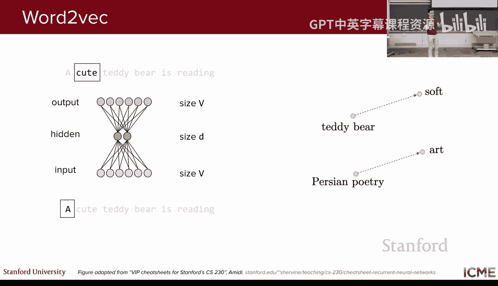

The green units。So what happens now is every time you have a word。You just represent that as one h。

Including representation and you just like multiply this with these weights。

 and then you obtain the green representation。And that's。Is your word representation？

Does that make sense，Yeah。Yeah， great question。Yes。

 great question to the question is about what does V correspond to and whys only6， so yes。

 in this example we only have six possible words。Wwhich is basically the vocabulary size。

 just like very kind of a tour example because in practice there's many more so I guess that's one of the challenges with language so you can technically have many variation of words。

 which is why if you take a word level way to divide your text into tokens。

 you can end up with the vocabulary that's like very big because you need to account for all the variations of given words。

And the other thing that I want to point out is。Let's suppose you have a vocabulary size of six and it's the six words that you saw at training time。

 but what happens is if at inference time you have a word that you have not seen。I dreamed that。

And so the answer for that is typically what people do is they。

Reserve spots for what they call an unknown token or out of vocabulary token。It is basically。

YouCan think of it as a bucket for everything that we were not able to identify。

So if let's suppose that in time you have token that you were not able to identify。

 they will all take that representation， which is the unknown token representation。

And it's by the way， something that I guess to。Word level tokenizer has kind of trouble to do because you will have a much bigger chance of having out of vocabulary tokens。

 word subward level will have a lower chance and then character level， I guess yeah。

 you don't have that problem。Does that answer your question？好。And yeah。Great， great question。

 So first question is when do you know when you're done？

So the thing with the proxy task is when you train your model。

 I guess your true objective is to not really learn， I mean， in this case。

 to learn how to predict the next word， your objective is to have meaningful representations。

But what you can do is to somehow track the loss function for the proxy test that you're pursuing。

 but then also taking into consideration that this is not necessarily your end goal so I guess one you very reasonable way of going about doing this is just to wait until your model converges so here what you do is you track the loss as a function of so there's this term epoch just how many times your model sees the training set and so you compare this different curves and when this converges。

 this is TPP like a good time to start the training process and like just see if that makes sense。

 depends on your adaptstream task of course。But that's one， Okay， so your second question sorry。

 can you repeat the second question？Yeah。行。Oh great question so so the question is how do you know when the generation stops I guess like otherwise it will stop it will never stop so yeah exactly so you have some spatial tokens typically you have end of sequence end of sequence so typically when you have the end of sequence token generated then it's when when it stops。

All right， so a second question was what informs the size of the hidden layer。

 I would say it's a trade off。Because you want the embedding to be rich enough that it can be informative for your downstream task。

 so for instance， if you want to somehow get an embedding of let's say your sentence and if you want to let's say do a very very specialized task super you know like with a lot of different outcomes maybe you want a vector that recaptures that so maybe you want a bigger vector but if you highlight like a very simple task。

 maybe a smaller vector make make sense。So I guess the size of your hidden dimension。

Also impacts the complexity of whatever you're running after because of course if you have longer vectors you'll have more computation so your inference would be probably more expensive et cetera。

 so I guess if there's a lot of factors so I guess just a recap one is how complicated your down desk is second one is how sensitive are you with like latency cost。

 all these things so it's really tradeoff。But out there。

 you would typically see embeddings of who of hundreds or thousands。Of course， you know these models。

 they've been growing， so number may change， but that's the order of my engine that you're looking at。

Right。This is indeed empirical yeah yeah， I guess you can also rely on like what others found and just go from that yeah it's 768 and yeah like these numbers are things that people typically take yeah。

Co。Yeah。Good question so the question is how can you distinguish words that are spelled the same but in different contexts so you're way ahead of me so this is basically the basics and we're going to tackle methods that can tackle these problems of just contextualizing the word in the sentence so yeah so we'll see that in a bit。

Yeah。こ。Not'm not on time， so I'll try to get moving。 so okay。

 so now what we did was see how we could learn representations of tokens。But。

I guess you may also want to get representations of sentences or pieces of text。

So one very naive way to do that with what we saw before。

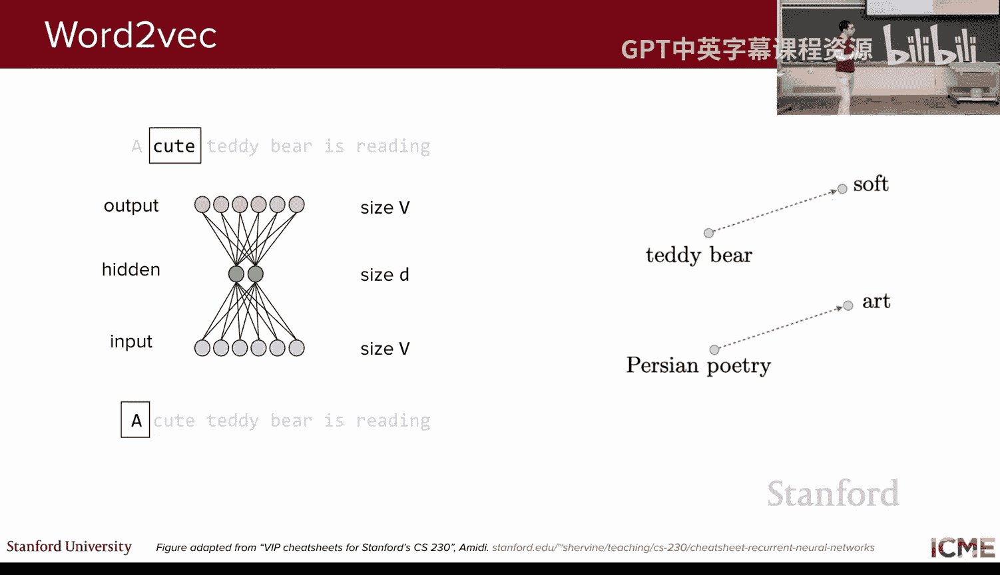

Is to take something like the average of words， let's say the word representations。

But the problem is you lose a lot of meaning， you lose the order， you lose， and I guess here。

 I think you pointed out very well， the representations that you learn are taken specific regardless of where they're at。

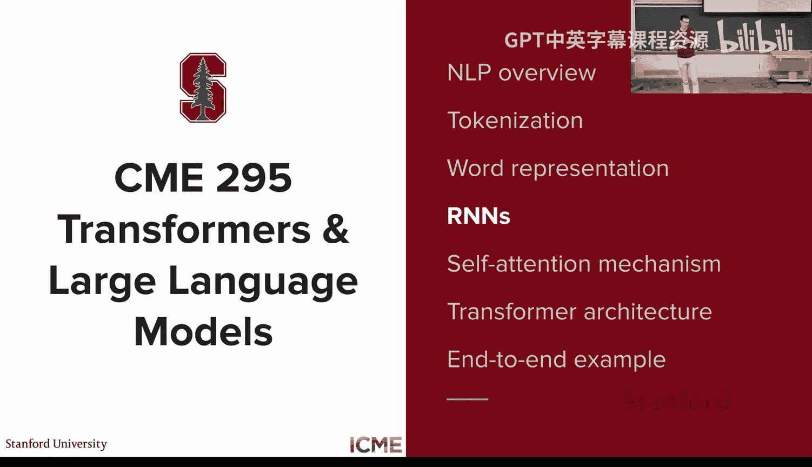

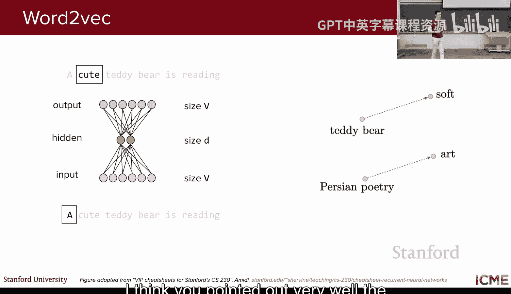

So that's why we have a class of models that aim at capturing the sequential nature of how text appears。

 so we're going to talk about RNNs， which stands for recurrent neural network。

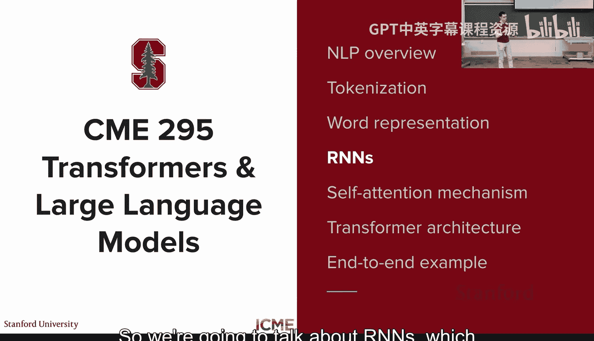

So what Rs do is instead of processing words one at a time。

What they do is they keep the hidden representation。Of the sentence so far。

And they consider tokens one at a time。So as I mentioned before。

 this technique was actually you introduced like a fair amount of time ago so in the '80s。

And what this model does is it takes into consideration the order at which words appeared or tokens appeared。

 and so in this example if you start the I guess， processing at the very beginning of the sentence。

 you have some dummy hidden state that is called a typically noted A or H。

 it's called a hidden state activation or even sometimes a context vector。

And you have some kind of a module that takes into account。

The hidden state so far and the word at time step T， so here time step one。

So here what it does is it takes in。The meaning of the sentence so far and takes into consideration the words that is happening now。

And it produces an output vector。That here can be used to know try to predict the next words。

 so for instance here we have the hiddend state and this representation of the word that then you have some matrix multiplications in this blue box and you have an output vector that you try to train on predicting the next words。

And then。You keep on doing that by。By keeping。These hidden states。

 keeping track of the hidden states。And so you repeat the process and I guess the way you would interpret these hidden states is it's a representation of the sequence process so far。

So the good thing with RNN is now the word order matters。

And you're also able to encode the sentence in a more natural way。So let's see roughly how it works。

 so we have the same favorite examples so cute tdy bear is reading， so you would have the token A。

 you find the one had the including vector， you pass it through your network。

 you compute the hidden state， you try to predict cute。But then you keep track of the hidden states。

And then you input that into another module， and then you also consider the next words。

 so you consider not only the word itself but also the hidden states of。

 I guess the sentence so far and you try to predict the next word again。And again and again。he。

So this is I。So。Ors were used for a bunch of tasks and just like mapping that take to the categoriess that we saw before。

For classification purposes。You can basically use the hidden states of。

The last word in your sentence， for instance， if you want to predict you the review。

 like the sentiment of a review， you would take basically the last last vector here and try to project it into the space of the predictions or the labels that you want to predict on。

 so for instance， if you want positive or negative， we basically project that vector into that space。

 you can do that here for multiclassification so you would basically have the representation of the token of interest and you would project that。

Or for generation。You would basically process the whole source text and then have。

Kind of the context vector， Aka activation vector， Aka hidden state at the end of your processing。

Which will then be used to decodedes。😡，The output prediction。

This is how you would use an RNN for like each of these tasks so the reason why。

You have not really heard of Ireland like like these days is because they had， you know。

 some pros with a lot of plantss。So one of the cons is that's the meaning of the sentence。

Is basically solely encapsulated into this hidden states。

So you have this problem of long range dependencies， which basically。

It impacts your ability to quote unquote， remember what the models saw in the past。

Whi is why you have another class of models that try to build on RNN。

 so this one is called LSTM's long short term memory。

 and the goal of that extension is to have a way to somehow keep track。

Of the things that are un importance to remember。On top of the hidden state that we talked about。

 so here you have A of T， which is your activation。

Like basically the sequence so far encode quoted in there。

 and then you have another quantity that you track that is called the cell states。

Let's go noted C here。So this architecture aims at， I guess， improving that piece。

 but I guess it was not perfect either。So yeah， so that was like the main。Issue of RNA based methods。

 which is that they have this issue of kind of forgetting what was in the past。

 so you will see in the literature that this phenomenon is called vanishing gradient。

And the reason why it's called that way， so I know we're kind of running out of time。

 but I'm going to just explain that part。So in order for you to predict， let's say， the last words。😡。

You're basically dependent on every hidden state that came before that。So far the goods。And so。

Whenever you want to update the weights of your model to match the prediction here with the actual prediction。

When you do the back propagation， you somehow need to take into account that the value here is basically not only a matter of this computation but also this computation or this computation that basically happen in a sequential manner。

Yes。So you have kind of this phenomenon of trying to， I guess， back propagate from time。

But the problem is。In practice， when you kind of write that down， so it's a very ugly formula。

 but when you write that down， it ends up being。A product of a bunch of quantities。That can。

 so if it's greater than one， then it's exploding， if it's less than one。

 it's vanishing because if you multiply a lot of things or less than one， it just goess to zero。

So I guess if you have something that you're trying to update。

That goes to zero you basically have trouble just like you know doing your updates so that's the high level intuition this is not the focus of this class which is why I'm not going to the detail of these ugly formulas but I hope you get the idea that for kind of remembering things from the past it's not doing a great job because of this sequential I guess characteristic。

Does that make sense？Okay， I hope the next thing will make it more sense。

 but before that I'll just recap what we saw so our goal is to represent text。

So we first started with representing words or tokens。

 which was what we tried to do with word2 vector。And we saw that it was a good way to leverage proxy test to learn this representation。

 but we had a bunch of limitations and one of them that you mentioned was that it was not aware of the context and also the word order didn't count。

And so you have this other class of methods that is able to take into consideration the words。

 but then they have some trouble keeping track of things when the sequence gets very long and you have this problem of vanishing gradients or longrangech dependencies。

 so whenever you see this term it's basically referring to that。

And also another thing that I have not mentioned， but the computations are very slow。

So when you went to train these models。A training time in order to predict this word。

You basically need to。Compute all the hidden states before。So when your sequence gets very long。

 gets like it just takes a very long time。So for all of these reasons， for for。

 I guess all these reasons， what reasons so for。The fact that。

The model has trouble remembering things from the past。

People have tried having more direct connections。Between something and the thing from the past。

And this is the idea behind。Attention。So what attention does is it tries to have a direct link。

Between what we're trying to predict。And something from the past。So in this example。

 let's suppose I'm trying to translate an English sentence into a French one。

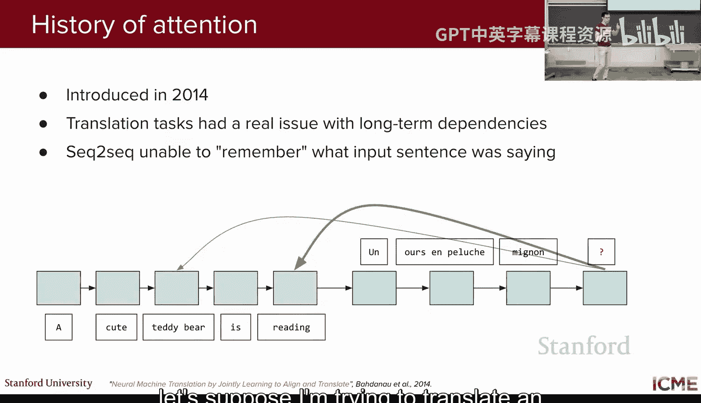

So here I guess the input sentence is given I'm you know computing the hidden states。

 you know I'm processing words one at a time， this is my traditional RN。

 so AQ teddy bear is reading so here I have a hidden state that I'm then decoding。

And you can imagine that。When one in two。Generates the next word of my translation。

It would be great if I knew。What word I'm trying to predict？Or in other words。

 it would be great if I could take a peek at a certain area of the input text。

So the idea behind the attention is to have a direct link。Between what you're trying to predict。

And things before。This is the idea behind attention and so it was introduced in 2014 and yeah again。

 this is trying to kind of solve for these long ranch dependencies issues。And so yeah。

 this example want to do that and。This concept is going to actually be key。For this class。

Because we're going to see that。The attention mechanism is the thing that is going to make everything。

 I mean， most of the things work。

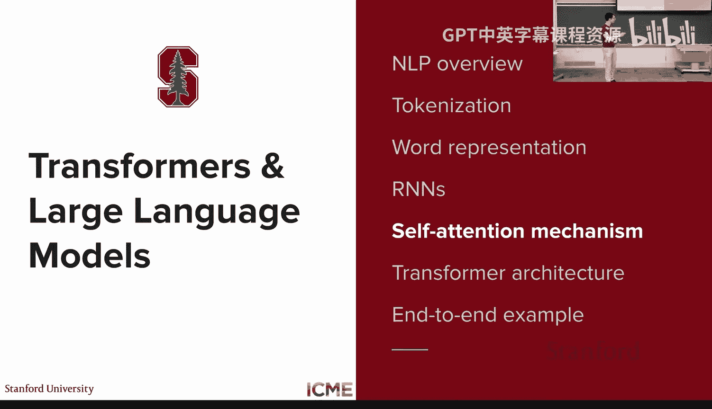

And this is actually the main principle that the transformer paper relies on。So the transformer。

 which is the core architecture that we will see in this class。

Has been introduced like or was introduced in 2017 in this paper named attentiontention is All You need so even from the title you can see that you know the authors wanted to just rely on that part。

 so what the authors tried to do was to move away from these sequential way of processing the text。

And instead， let the model just have direct connections with all。Parts of the text at once。

So that is called self attention。So they tried that on translation tasks and they just realized that。

 you know it was giving great results。So back to the example that we're still using。

 a cute teddy bear is reading here what we would say is that in order to compute。

The representation of the token Teeddy bear。We're going to look at all the other tokens in the sequence。

At' once。And directly with direct links。So I guess back to your question。

 here we would have a representation of teddy bear that would be unique。

To the context that it is part of。So back to your question about riverbank and robing a bank。

 like here the bank would have different representations。So this is the idea。😡。

I guess does the idea roughly make sense？And again， this is called the self attention mechanism。Pa。

 how am I doing on time？え。L， okay。Co so okay， so this is the idea。

So now I'm going to just introduce another。Set of ideas， which is more terminology。

 but is going to be very important。So when you want to express something。In terms of something else。

We use the words key， sorry， query， key and value， Q， K and V。So in this example。儿狗。Is to figure out。

What other tokens is the query tdy bear more similar to？So here the question is， okay。

 you have a query。And you want to see what other tokens are most similar。

And so what you're going to do is。To look at are the other tokens。Which are basically composed of。

Keys and values so you're going to compare the query to the key。

To quantify how similar your query is to the given key。And take the corresponding value。Yeah。

So we'll see that in this example， so let's suppose you want to express teddy bear in terms of everything else。

 what you're going to do is you're going to take the query teddy bear。And you're going to。

Compare that query with all the other keys。To see which elements is most similar？

And then weight to more similar ones and take their associated value。

So that's a very high level idea of guess how these things are。

 of course we're going to see exactly how they work， but that's the general idea。Yeah。Okay， cool。

 and speaking of quaian value， we will also see。That's one benefit of expressing things this way。

Is that we can express。Okay。Doing this self attention computation across the whole sequence in a matrix format。

And GPUs love matrices， so it's really like made for the hardware that we have。

And I guess what I mentioned here can be expressed in the form of softmax of the query and the key。

 which is basically a way to get。Some kinds of weights of which values will be more important。

 so for instance， if a value is more important you'll have bigger weights and another one would less important you'll have a smaller weight and you basically multiply that by the value。

So don't worry， we'll have a detailed example after so if it still feels very。

 you know high level fuzzy， don't worry， we'll have a detailed walkthrough。

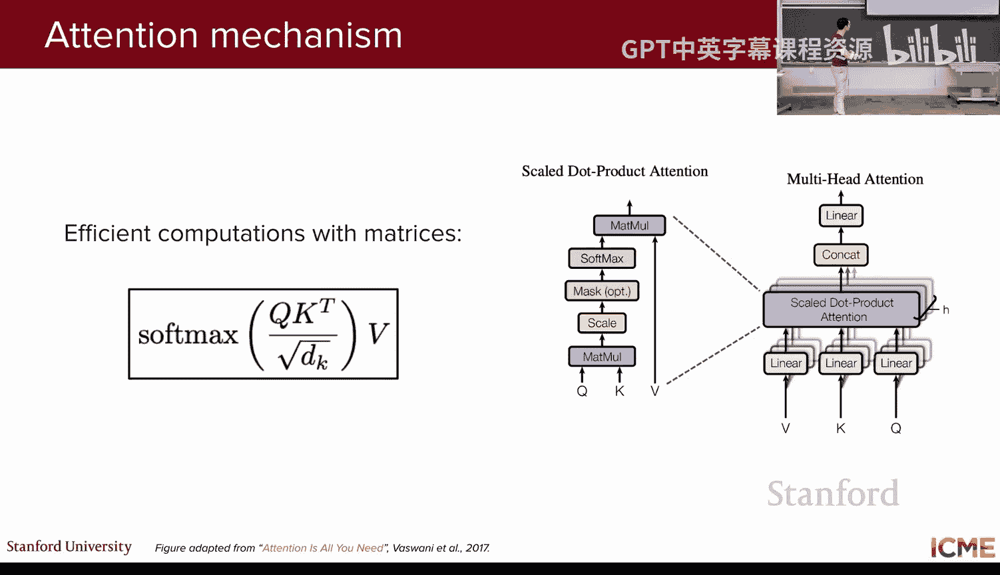

And yeah， so this is how it works， okay cool。

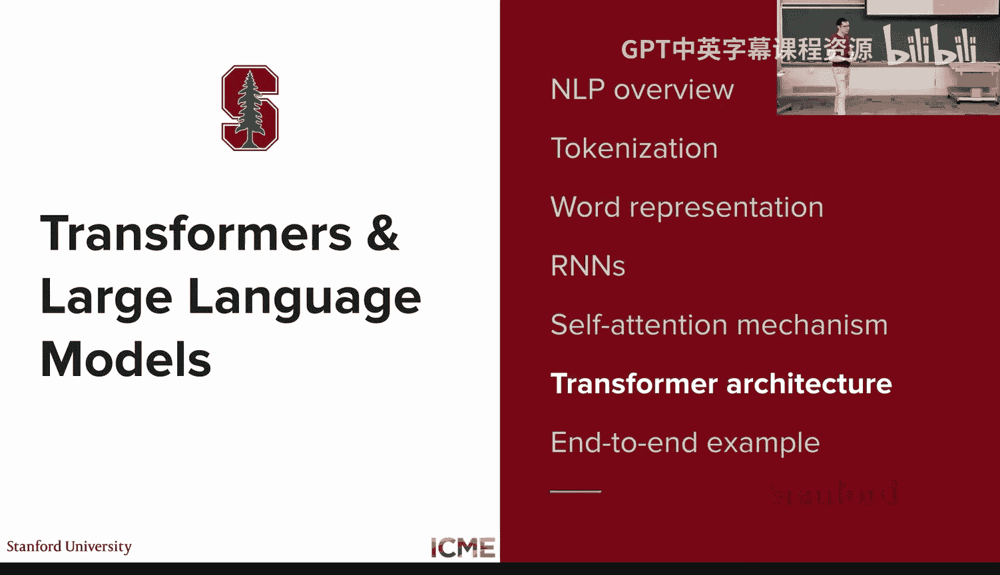

Any questions on？How self what self engine is。Yeah。

Great great question so the question is what is value。

 what is key I guess how do you get those what do they mean so first of all。

 I just want to say that these quantities they are learned。So you are not fixing them。

 but from an interpretation standpoint， you can interpret that the key is there for you to figure out which one is most similar to the query。

😡，And the value is the actual value。That is associated with that with that elements。

 So here you will have something like。You want to express this。In terms of all the values。

So the weights in your weighted average will be basically the dot product basically between the query and the key。

 and the value will be the actual vector that you will use。But again。

 these things are learned and there's something I've not mentioned， but you mentioned it correctly。

 so we're going to actually do projections。To obtain these quantities and these projections are actually learned by the model。

嗯。That goods。Okay， cool， so with that we have 15 minutes right to talk about the architecture。Okay。

 so。At a very high level。In order to make the self attention mechanism happen。

 the authors propose an architecture that is composed of two parts。Then encoder。

 which is on the left side。And a decoder， which is on the right side。

So the application that they have is translation。So what will go through the encoder is。

The input text in your source language。And what is going to go through the decoder is the target language that you're predicting。

So the high level idea。Is you're going to compute。Meaningful embeddings from your input text。😡。

By passing them through the encoder。And you want that self attention mechanism to apply。

Meaning you want to compute representations of each token as a function of others。And you do that。

By using a layer called the attention layer。 So multi head attention layer。

 But multi head is just doing this computation。You know。

 in different ways to just allow the model to learn different representations or different projections。

But the idea here is you're going to input。Your。Input text。And all the tokens in your input text。

Are going to attend to one another。So for， a teddy bear is reading， you are going to compute。

The representation of all the tokens in this text。MyK has a function of others。

And you're going to do that with the encoder， so here with the multihead attention。

 and then you have a feed forward layer， which is just to kind of let the model learn another kind of projection。

And what you're going to obtain at the end of your end process is。Rich representations of。

The tokens from the input sentence。The v of woods。But now your goal is to actually translate。

The input sentence， so what you're going to do？Is to start your translation。

Well let's suppose the beginning of sentence token through your first token。

And what you're going to do is。Use。All the representations from your input sentence。

In order to figure out what to predict next。So this， what I just said is the cross。

Cross attention layer， which is the one that is the second score。This one。Which basically you know。

 you see， I'm not sure if you see the arrows， but there are two arrows coming from the encoder。

 one arrow coming from the decoder， can anyone tell me what the error from the decoder stand like represents if query key value？

I guess there is one over three。383% chance。Once to try， is it king， okay？嗯。😊，Quing， okay。

 so the way to think about it is you're trying to ask yourself。

What are the words from the input that matter？Right。So basically， you want to know given your query。

What are dude？Elements from the inputs that matter。

 so here this arrow is indeed to query because this is the thing that you want。To figure out。

And the keys and values are actually coming from the encoder。

 which are basically coming from the inputs。Sequence。Oh。And then you have another attention layer。

 which is this one and that one is trying to。Figure out what other tokens of the output sentence that you're decoding is going to be useful to predict the next token。

So let's suppose you start decoding and you say New some Plish， which is in French。

 to predict the next word you want to basically figure out。Where are the tokens translated so far。

They are going to be useful。To predict the next word。

 So this is what this attention layer is about and it's called maskked。Because it only looks。

And the tokens translated so far。It does not look at token that were not translated because。

 of course， they were not translated。 So there's no way like on the right side of the。

Of the token that you're trying to predict。Cool， so at a very high level。

 you have this attention layer， which is present in the encoder， which is present in the decoder。

 but it has several， I guess use cases， so the attention layer here aims at computing embeddings from the input sentence。

As a function of themselves。And then the ones from the decoator， so the first one。

 the mask self attention there air aims。At expressing something as a function of。

Everything that has been decoded so far。And the second one， the cross layer。

 tries to express things as a function of what has been seen in the inputs。Yeah。So here， given that。

You are having direct links to different tokens。You don't have this sense of order。Because in an RN。

 you were basically expressing things， one at a time， so you had some sense of the word order。

 but here you don't have it because it's like a direct link。

Which is why you have position encodings which are there to inform on the position of the word in the sequence。

 so we're not going to dig into that today， but I just want to call that out。So at a very high level。

 and we're going to see this in a detailed example。

 what we do is in order to translate a sentence from source language to target language。

 we're first going to tokenize the text， so you know dividing into arbitrary units。

 we're going to learn and embedding for the tokens。So this is what the input and meing is about。

 then we're going to add some incoting with respect to the position。

 we're not going to talk about it today， but just good to note。

And then we go through the end quarter。Yeah。So the encoder tries to figure out how to express things as a function of other things from the input。

 so it does that。In the multihead attention layer。And then it goes through a Fi for neural network。

 which is just a way to just project the vectors to just like have some more degrees of freedom to learn things。

And then once you have these representation from the input。

 you're then going to start your translation。So you start with the BOS token and what we're trying to do is figure out what the next word is。

So you're going to see， okay， what are the words that were translated so far that are useful for the translation so this is what the masked multi head attention layer does。

And then you have another attention later， which is about expressing things as。

As a function of what was in the inputs， which is the cross attention layer over there。

 and then you have a fit for a neural network to again give some more degrees of freedom。

And at end of the day， you have a vector。That you then go through Softmax。

And it just is a way for you to guess what is the next words？So you can have a vector of size。

 vocabulary size。And you're going to use these values to determine what is your next word？Easy。

 right？Any questions on this？Yeah。All right， that's a great question。

 the question is what does head mean？So I guess I went too fast， I kind of ignore that part。

 but when you do。The attention， self attention computation。

You basically make queries interact with keys and then take the corresponding value。

But nothing prevents you from doing that several times。Yeah。So the term heads。

Is given to the projection matrices that you use to obtain the query key and value。

And when you have several heads， what you're doing is you're allowing your model to learn different projections。

So it's basically an additional degree of freedom for your model to learn different associations between your vectors。

So it's a great question， so typically it will be noted。Lowercase H number of heads。

And this is what this corresponds。Does that answer your question？酷。Very cool。诶。Okay。

 we have a lot to discuss， but。Here I have a slide Julie for this。

 so this is the multi heads that you are mentioning so we're basically running the self attention computation several times in parallel again with different projection matrices that the model learns。

So in case you have a computer vision background。It is similar to。

Having multiple filters in your convolution。So it's the same idea， but。Different here。

Great question so question is are the projections different so we're not typically not constraining things。

We're just letting the model learn， but in practice。

 it just tends to learn different ways of saying the something。so yeah， typically there's no cons。

 of course you have papers that dig into you know how about if you change this。

 but typically you don't have any costume。哭。Great， okay， we just mentioned one trick。

 another trick that transformer authors use， so it's called label smoothing。

Who has heard of labelbel Singing？Okay， so one new thing here is in NLT。

When you want to predict what comes next， there's speaking more than one weight。

Like when you say what a great day， what a great lecture， what a great book， what a great。

 there's always multiple choices like there's more than one way of filling that gap。

 so labels moving is a technique that tries to intuitively address that。

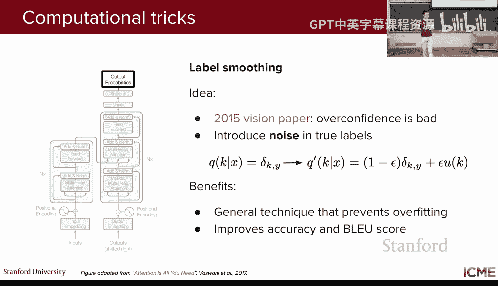

And what it does is instead of saying， predict this word， 100% is this one， there is no other words。

What it does is it says， okay， predict this word， but there's a chance it's not this word。

And in practice， what it does is it takes to one hard coding and instead of saying it's a 10。

00 that you need to predict， it says it's actually one minus epsilon and then epsilon over the minus1。

 I guess that you're trying to predict。So in practice， it's a method。

That tends to make your model be more unsure， I get to be less sure about this prediction because you always tell it。

 okay， try to predict this， but actually it's possible it's not the great value。

 but in practice the authors see that it tends to improve。Metrics like blue。

 which is a kind of proxy metric for translation tasks。嗯。So yeah。

 I think this method is like pretty general for NLP， so yeah， it's a good one to know。And with that。

 I think there's about 20 ish minutes left， so Sheve is going to walk you through an end to end example。

And with that view。

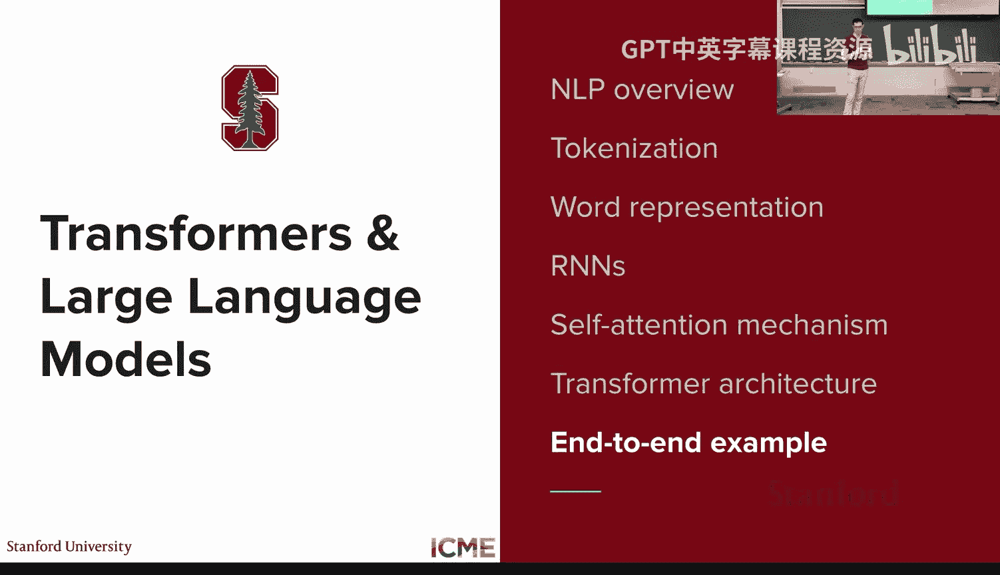

Yeahep。The you？So I guess here we can think of this as something。

 I guess some quantity it' not defined， so sum quantity。And yeah。

 the delta is like one h if you want。Something like this， yeah， it can also be a constantsance。Yeah。

Yeah。So question is is there a relation with explore and exploit， it's an interesting one。

So where would So mask give it for free Bay away？Right， but I guess it was thin， so I guess。

At the end of the day， what you're trying to do is to compare your prediction with respect to the label。

So I guess the question here is， do you want to compare with10，0，0 or do you want to compare with？

Something that is not 100 so I guess the software does not allow you to do that。Exactly， yes。

 so I'm not sure if this was super clear， but this is actually the label。

 So what we're trying to predict is not 10，0， but we change the label in a way that makes the model。

I guess predict something is less sure， I guess。

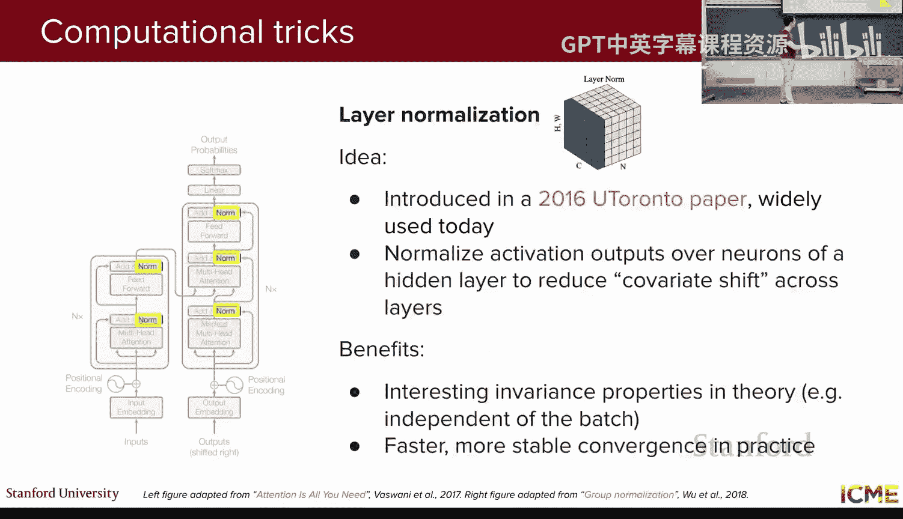

Cool， thanks and with that， yeah Charlotte。Okay， great， thank you I Shi and yes。

 we saw basically how the transformer worked and now we're going to piece it all together with one specific example。

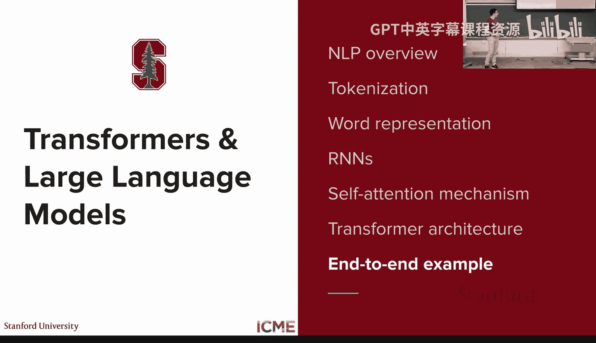

Okay great， so let's take our favorite example again。

 so acute teddy bear is reading and then it we'll go like all through each step。

So first we start with tokenization。So as we said， we can use any arbitrary decomposition to decompose this into tokens。

And then as someone mentioned， you know， you need to have some way to indicate like the start and the end of a sequence。

 so typically this is done with the B and EOS tokens， so you add them。Okay。

 so now let's focus on the composition of each token representation。

So you have its embedding that is learned。And then as as she mentioned。

In order to have an idea of what is the position of the words or the token。

 I should say as part of the sequence， you have some added information that is in the form of a position embedded buildingdding。

And here the original paper uses the convention of some signss and cosines that it adds additively to the representation。

 so it's like an elements wise edition。Okay， great。

 so now you have a position aware and bedding for your token。

And you repeat that for each of your toolkis。Okay， so now you can see。

All of these embeddings in the format of a matrix， which is of size D model。

 which is the size of your embeddings， and then the other dimension is the length of the sequence。

诶数字 big and。支。So on make sense so far， any questions on the inputs？Okay， great。

So now we will send this representation through the encoder。OkaySo as Ashin said。

 you have this concept of self attention and the way you perform self attention is that you take this input and project it on three spaces。

So you project it？To the space WQ， you get queries， you project the same embeddings in the space WK。

 you get keys， and you do the same for values， you get your values。And in WQ。

 WK and WV are learned by the model， they're basically projection matrices。So far some goods。Okay。

 so now with all of that in mind， you can apply the formula that E mentioned that is the self attention formula。

 which is softm of QK transpose over square root of Dk times V。

Which gives you another matrix out of all of this。Now let's pause for a second and look at how this competition is done in practice and what every step means。

So let's look at Q， you know， when you compute Q that basically you project your embeddings into that space。

 what you obtain， you obtain a matrix。Where each row represents a given query。

When you say k transpose， it's basically the same kind of matrix。

 but transposed where each column represents the key representation of each token。Now。

 let's mix them together with the。Matrix multiplication， So when you multiply each of them。

You see that each row represents the projection of the query over each key。Such debts。

When you take the。Like matrix multiplication and get the softms of all of this。

 you get the probability distribution of the projection of the query over keys for each query。

 like each line will have this。And yeah， I don't know if anyone asked the question regarding。

 you know why do we scale by square root of Dq DDK， so it could be DQ as well because。

Mattrix multiplication， like the dark product here enforces the fact that Dq equals decay。

And basicallyically what you see is that these dot products as the dimension of key and queries grows。

 it tend to grow as well， so you want to normalize these dot product and this is why you divide by square roots of the dimension of keys。

Okay， great， and then now you have your soft mask of all of these and then you multiply it with the matrix V。

And this is what I've seen explained as having the query projected on the space of keys and then multiplied by the corresponding value。

 so the value is the representation of the corresponding key that we project on。

So you end up with the weight sum of values for each query。Okay， great。Does that make sense so far？

Okay， awesome and someone asked， you know what is the multi head stuff so your are rights。

 it's not just single one one time that it's done is's actually done each times。

And what you obtain is like all of that is done in parallel。And at the end， you obtain H。😡。

Such matrices and you concatenate them with respect to the columns。And at the end of this。

 you have another projection matrix that you call WO。

That will project all of these back to the original dimension of embeddings。

So it's way for a network to basically have a dimension invari way toless you to go from like the original dimension back to the original one。

Any questions？Yes。😊，So the question is regarding H。

 is it possible to get the same result each time and then if you concatenate the same thing。

 you know will it be helpful， did I get the question mark？

So what makes it different so it's the magic of gradient descent so the network has an objective function at the end。

 it has degrees of freedom， its incentive is to beat the representation that would be helpful to learn the next word so it doesn't have an incentive to copy the same thing or do the same mechanism and this is why in practice you see the model converge towards building different representations that it can then concatenate and then project into something useful so what makes it such that you don't have the same thing nothing like you don't have any constraints。

 but the nature of the learning that you let the model have makes it do so in practice。

Any other questions？Yeah， and that is a great question， I mean it's like typically yeah。

 gradient descent does wonders。Okay， grades。So now that we have gone through the self attention layer。

 you have another component that is the FFM and I think there was a question just here regarding how to choose the dimension of the hidden layer with respect to the input and output so when I mentioned word to V typically you have a smaller dimension than the input an output but here actually the hidden layer is of a bigger dimension than input and output and the rationale for that is that you wants to have enough degrees of freedom for the model to learn useful representations so it's a way to complexify the features that you learn and just to。

Okay， great， and you don't have just one encoder module。

 you add actually n of them big N in the original paper。And at the end of all of this。

 you have an encode context to wear set of embedding。

And then each of these set of encoded embeddings will be those that will be fed to the N decoders。

 so you have like a stacked stacked succession of N encodes。

 you have a stack succession of N decoders and the last representation of the encoder is what you will feed。

To the cross attention of each decoder。嗯。So yeah， we're going to see that more in detail。

So how do we even start the decoding process so you start with the BOS token basically saying to the model。

 you know， hey， we need to predict the next word， you know， let's start。

So what happens to the BOS token at the very beginning。

 so you fit it to the decoder and then similarly as before for the encoder。

 you have a self attention layer。And as she mentioned， the self attention layer is causal。

So the attention will be done on the same token and the tokens that precede it so on on this first BOS token。

 you don't see a difference because it will just attend to itself。

 but when you have like other tokens that you want to thecode。

 you will have this difference in where you attend with respect to theequr。Okay。

 great goes through the self attention layer and then you have what I mentioned to be the cross attention that takes as keys and values these encoded embeddings as inputs。

And then the queries are those that come out of the self retention layer。系。Okay， great。

 and then once you do this cross attention， you have just like in the encoder。

 an FFN component that makes the representation rich， was there a question there？嗯。

And then at the very end， so you do that all of that n times and at the very end of the decoding process you have a linear projection and a soft max layer to turn the prediction of the next word into a probability distribution over the vocabulary。

Okay great， so we saw how to do that for the next word here and basically you do that again and again。

 so you have found your next token and then which is like1 hots basically encod of what you want and then you take that embedding and then put it back into the decoder and continue this process。

And when do you stop？It's a question for you all。When you hit the EOS都 get yeah。一食。😊，Yeah。Okay。

 great， and with this process it's basically how the authors of this original like landmark paper did smash translation。

 so this is typically the use case that was presented。 any questions？Okay awesome。And with that。

Thank you for your attention。ここ？Yeah。

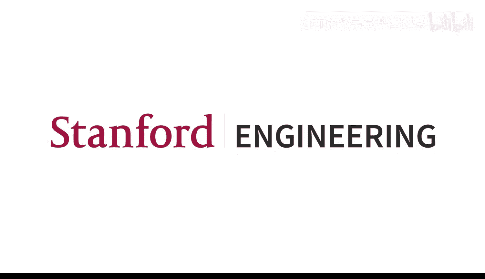