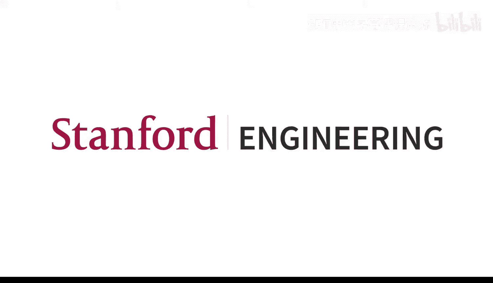
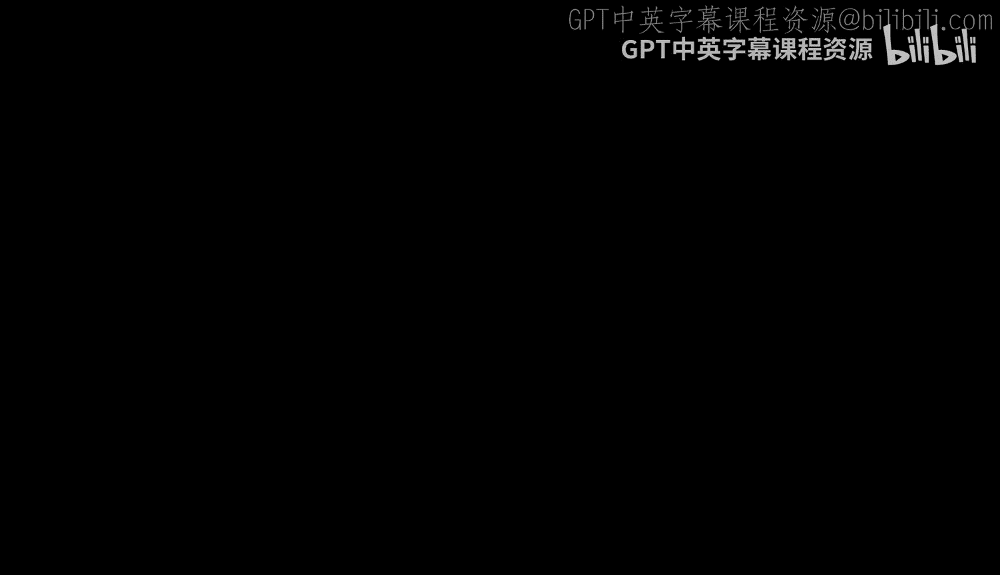
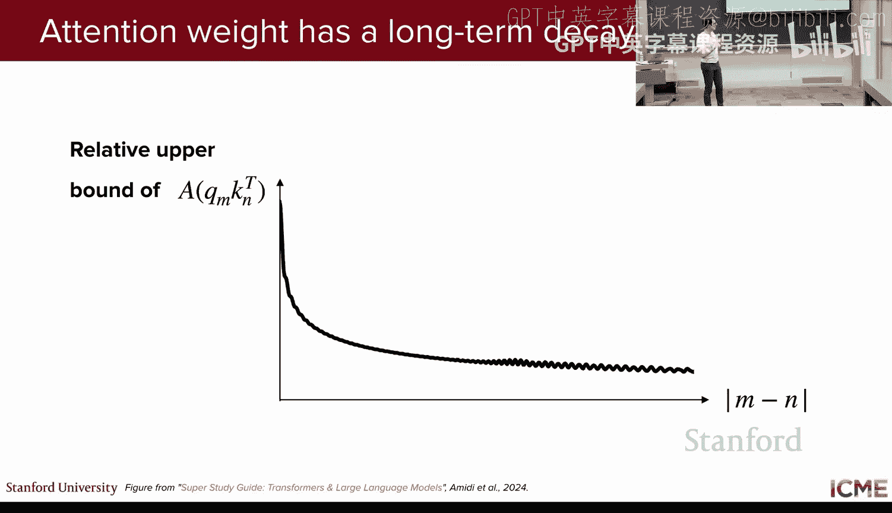
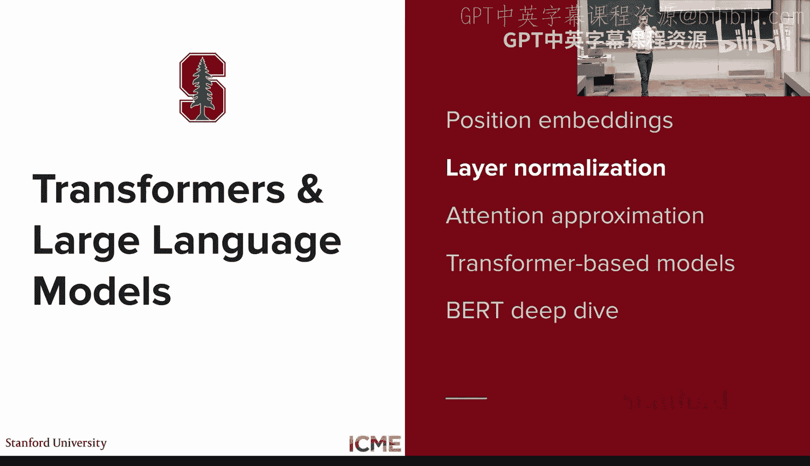
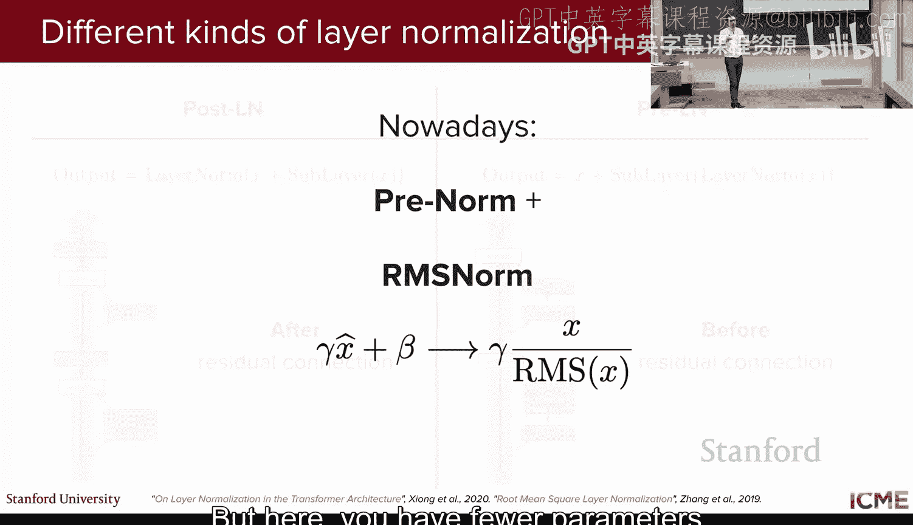
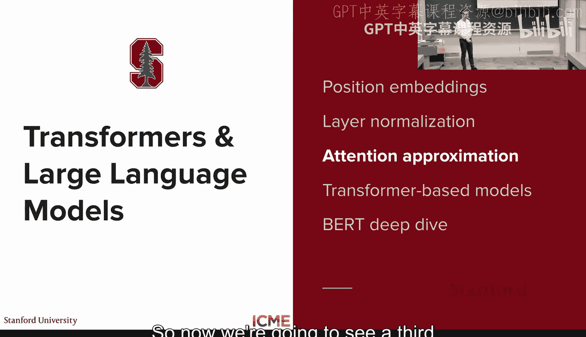
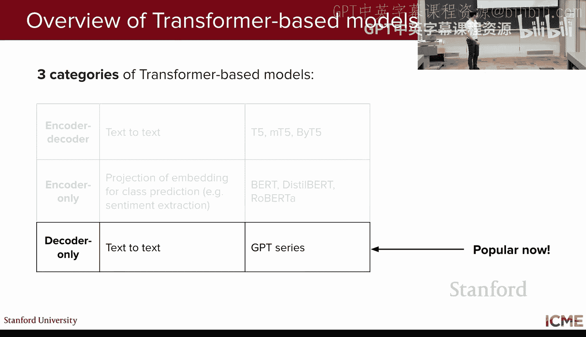

# 斯坦福大学《Transformers 和大语言模型｜CME295 Transformers & LLMs Autumn 2025》中英字幕 - P2：Lecture 2 - Transformer-Based Models & Tricks. - GPT中英字幕课程资源 - BV1WGsMzCERB

Cool， hello everyone， welcome to lecturec2 of CME 295。So before we start。

 I wanted to give you a heads up about two logistical things。So the first one is with Crvin。

 we reviewed the recording of lecture one。And we couldn't help but notice that the audio was suboptimal。

 so what we're doing for this lecture is to have another setup。

But then one issue is my voice will not be propagated in the room， so I guess I have one question。

 can everyone hear me very well， even from the back， okay cool？Great。

 so that's point number one point number two is about the final exam。

So the final exam right now has a placeholder dates for Wednesday， I think， December the 10th。

But just a heads up that we're trying to see if there's a way to move that to earlier in the week。

So we'll let you know when that's finalized， but for now， this is still TBbD。

But we'll make sure to let you know。 so with data sitess， let's go into today's topic。

But before we do that， as always， what we will do is we'll just quickly recap what we saw in the previous episodes。

So if you remember， lecture one was all about introducing the concept of self attention。

And if you remember， what self attention is is that each token。

Is attending to all other token in the sequence through this mechanism of attention。

 so you have these notations of queries， keys and values。

So here the idea is that the query is going to ask which other tokens are most similar to itself。

By comparing query and key。 And then once that's done。

 basically we will be taking the associated value。So we saw that the self attention mechanism can be expressed in with this formulas or softmax of query times key transpose over square root of DK times v。

So I hope this formula is familiar for you， so just know that this formula is highly optimized。

 you know these are like big matrix multiplications that our hardware is very capable of doing is very optimizing doing that。

And all of that to say that we also introduced the architecture of the transformer。

 which you can see on the right。So here if you remember。

 the transformer is composed of two main components。

 so the encoder on the left side and the decoder on the right side。

And the transformer was initially introduced in the context of machine translation。

So you can think of the left side as processing the input text in the source language， say English。

And the right side is responsible for decoding the translation in a target language， let's say。

 in French。And this multi head attention layer is where the self attention mechanism happens。And。

I remember there was a lot of questions regarding， you know， it's called multi head attention La。

 so there are several heads， what does that correspond to？So in the transformer paper。

 which is the attention design in paper， you have this figure。

Which actually represents each of these heights。And you can think of each head as an opportunity for the model。

To learn one way of projecting the input into being a query。A key or a value。

So just being a bit more clear， so for instance， for the query and the key。

 so this is like each heads， so the number of like these little boxes is basically the number of heads。

And to better visualize and understand what this means。嗯。I also wanted to show。

 I guess what is being shown in the paper， which is the way to interpret what each of these heads do。

 so we have this concept called attention map。Which basically。Tries to represent。The value of。

Each of these query dot product query。So in this example。

 what we're interested in is to see which other token is being most similar to token its。

And so what we do is we take a look at the quantities。The query。That is representing its。

Thatt product。All other keys。And we look at。What other keys are leading to a high value of the that product query times key？

And when you do that， basically what you see or what the paper sees is you have these two words。

 so application and law。Which are highlighted as being with a high attention weight。

 so attention weight here being theduct product of the query eats。

And the key for each of these tokens。And I guess there is also a way to interpret those。

And here you can see that the tokens that are being。Kind of highlighted our law and application。

 which basically makes sense because the token eats。Is referring to law？

So basically the model needs to kind of learn how to associate these words with what happened before。

 and it is also referring to application， which is also another way of kind of explaining why that is the case。

And so here what the authors chose to do was to show these values as a function of these different heads。

So for instance， on the left side， these are the kind of intensity for heads for let's say the first head。

 and then the second heads shows that the intensity is very high for La。

 so basically long story short。These heads may learn， I guess。

 different ways of figuring out what word matters。Great question so your question is when we're doing all these computations。

 are they going through different MLP， the answer is that we're going to have different projection matrices for each of them and so you can think of so we had this like detailed example that actually kind of went through that where。

Each head is going to have its own projection， and in parallel。

 you're going to have that computation that's going to happen。

So each head is going to have one result here。That is then going to be concatenated and then projected once again。

Win the output matrix。So yeah， long story short， it's highly parallelzed。

And it's basically just like projections， and here you have like some matrix multiplication and subms。

Does that make sense？꼭。Any other questions on this？Cool。

 so I guess this is just a way to illustrate the conversation we had for lecture 1。

 I know there was some questions about about。These attention heads， what they do。

 and I guess looking at the attention maps。Is one way of making sense of what they mean。ho？With that。

 I highly recommend that you read the transformformers's paper so attention is all you need。

 so it's a very dense paper， it's just a few pages long。

But I hope that what you've seen in lecture one， you'll be able to digest the content in a way that will kind of make sense to you。

9。So with that， we're going to start the actual meat of what we're going to discuss today。

So surprisingly。This transformer architecture， which was introduced in 2017。

Is actually an architecture that has kind of still stayed relevant along the gears。

 and there are a few components that have slightly changed and we're going to see which ones they are。

 so there are like some slight variations。But overall， today's models are we're going to see。

All more or less based on the initial transformer architecture。

So we're going to try to divide the class in two parts， so the first one is what I'm going to cover。

 which is what are the parts of the transformer that are important and that had some variation and in the second part。

 Sheing is going to talk about I guess the nomenclature of today's models and how they relate to the original transformer。

好。Okay， so let's start with the first important concept that's in this architecture。

 and this is the position embedding。So if you're a member。

Here we're letting tokens interact with all other tokens。In a direct fashion。

 so they have direct links。But。Hunry to things like RNANN。

 where you have a sequential dependency where you process each token one at a time。

Here you're basically losing this idea of a token being processed before another one。

So you kind of lose this information。So as a result of that， we need to somehow。Quant5。

Positions at sorry， tokens at each position。And try to inject that information。

When the transformer is processing the input。So how are we going to do that？

So the original transformer paper authors。They choose to have a dedicated embedding。

And when I say dedicated， what that means is each position has one embedding。

So position one has one embedding， position 2 has one embedding， et cetera， et cetera。

And what they chose to do is。To add that embedding。To the input token embedding。So for instance。

 if I say a cute teddy bear is reading。W which is position number one。

 will be represented by the token representing the token A。Plus。The embedding。

Representing the first position。Yeah。Its a great question so the question is are the position embeddings learned are static both both。

 as in the authors have tried both。And we're going to see what the second one is， but I guess。

I guess here， let's suppose that they are learned。So what does that mean？

That means that basically you need to learn。Embbeddings for each position。

And the problem with this approach is that you're very much dependent on what is in your training set。

So for instance， like here， if you have somehow a text that always has something that is happening at position number two。

Your learned embeddings will kind of have that bias kind of learned。So's like one limitation of that。

Second limitation is。You can only learn positions up to the max number of position that is in your training set。

So let's suppose your train your transformer on sequences that are up to， let's say。

 I don't know 512， let's say。You can only learn position em beddings up to that position， right？Yeah。

 so the question is I guess how do you parameterize that so I guess what you do is you have a kind of a placeholder of a position learnable position embedding。

 let's say between like position1 and 512。And basically， when you do your training。

You're just letting these weights be learned through the regular gradient descent of these things。

So yeah， so this is like the first method， but as I was mentioning。

 it has its limitations because you can only learn embeddings of positions up to the max position that is present in the training set。

So for instance， if you have at inference time， a position that is beyond the position that was in the training set。

 well， you have not learned that so you need to find a way to kind of infer the value。

 so that's the second limitation。but yeah， but on the pro side。

 I guess you're just letting your model learn。And we've seen that gradient descent does wonders when it comes to just learning from the data。

So yeah， and for these reasons。These methods。Was something that the authors said that was performing well？

Along with a second method， which is different。Which is the rounds？

Having an arbitrary formula for each dimension。Corresponding to a position embedded bedding。

And we're going to see that now。So first method was you have one embedding per position and you just learn that。

Second method is you have one embedding per position。

 but you're not going to learn that you're going to have something that is predetermined that you're going to use。

And。We're going to see that what the authors chose was a formulation using sine and cosine。

So it can feel kind of weird， why did they choose this， but we're going to see why that makes sense。

The idea here is for a given position， let's say M。Have a vector of size d model。

 so D needs to match the dimension of your token embeddings because of course you're adding them。

And what you're going to do is for every index， you're going to compute the corresponding value with respect to these formulas。

So what are these formulas， so it's basically s of something times M。

And we're going to see what that something means。And then the second one is cosine of something times M。

So who remembers trigonometry formulas？Cool， everyone。Before we go into that。

 let's just simplify the notations， let's just assume that this big quantity that you saw is actually something like omega。

 so let's suppose it' omega as a function of I times M。And you note mega I as being this quantity。

 so 10，000 to the power of minus2i over D model。Let's suppose you construct your embeddings to have this way。

Then。I guess I want us to think about why that would make sense。Because if you think about it。

What you want is。To represent positions。In a way that reflects the following fact。

Words that are close together are likely to be more relevant。

As opposed to words that are further together， right？

So if you have two words that are like just one position apart versus  10，000 position apart。

 what you want is that one that is one position apart is more similar than the other one。

So let's see if the formula makes sense， so let's suppose you have two position embeddings。

 so one at position M。And the other one at position N。

And let's suppose you compute all the values from this predetermined formula。Well， it turns out。

If you remember your trigonometry formulas。So cosine of a minusb。Is equal to cosine of a。

 cosine of B plus sine A， sine B。Right？Well。Turns out that if you express cosine of omega I。

F of M minus n。This is something that you obtain， it's just the identity that I mentioned。Well。

 it just turns out that this quantity。It's just one component。

That appears when you do the dot product of these two position embeddings。Right？

Because basically here， when you do that product of position M and position N。

 what you do is you take the first position， you multiply them， then you plus the second position。

 you multiply them， et cetera， et ceter， and then you come here it's sign of this。

Time sine of this plus cosine of this， times cosine of this， right？Which is just。Its quantity。

So at the end of the day。What you realize is that when you perform a dot product of these embeddings。

You end up with a sum of cosine。That are a function of the relative distance between M and N。Yep。

What do you mean by pairabbyte way？Exactly， yeah， so basically so the question is yeah。

 so the closer they are， the more similar they are。

 so that's the intuition that basically this way are formulating the embeddings is trying to approximate or trying to mimic。

So with that。You basically obtain a dot product that is just the function of M and N。

 the relative distance between them， actually。And just as a reminder。

 so why do I care about the dot products because if you're a member？In the embedding world。

 when we try to quantify the similarity between two embeddings。

 what we do is typically something that is involving the dot product of these two。

 so you typically have the cosine similarity， but cosine similarity is just dot product over the norm。

Of each embedding， so which is basically a do product。

RightSo that's why we care about the dot product and here we see greats。

 it's a function of the relative distance between the two。So in particular， again。

If you remember your trigonometry class？Cosine of 0 is。1。And do hire this number？

The lower the value of cosine of this number right of course it's periodic。

 so what I'm saying is not necessarily true past2 pi or sorry pi just goes the other way。

But I guess what I'm trying to say is for m equal to n。You have Visiki a sum。Of cosine of0。

And it is the value at which。This quantity is maximal。So when m is equal to n。D quantity is maxim。

 which means。Basically， if you're looking at the position itself， it's the most similar。

hiBa matches our intuition。And so now when you plot the values of the embeddings。

This is what you obtain。 so here in this graph on the y axis。

 I'm basically representing all the embeddings for each of the， let's say。50 positions。

And on the x axis， it's basically。Values along a given vector across several dimensions of a vector。

So if you take， let's say， the first row， you're looking at the first or number zero position。

 depending on how you index your vector。And you're looking at all the values of the position zero embedding。

And so you see that for low dimensions。This value kind of goes。Up and down very frequently。

 so it's more high frequency。And。When the dimension is high。It basically takes a lot of time。

For the value to go up and down， so it's basically more low for frequency。

So this relates to this omega I that I mentioned， this omega I。So omega I。Is。

Very high for low values of i， which is the dimension。And it's very low。For high values of I。

So this basically just determines how quickly your cosine and sine basically vary。哭。

So this is what the original authors。Have tried and basically what they said。

What they noted was that using this method leads to comparable results compared to the learned one。

But here we have a big advantage because it can extend to any。Sequence length。

 not just the sequence length that you saw at training time。

And this is one of the reasons why this may be something that is preferable。So yeah。

 this is the intuition and this is what the authors chose。Now， fast forward to 2025。

 guess you may ask me， are we still using that？And the answer is kind of。

 so we're still using this idea of we want。Far， I guess， tokens。

To be less similar than closer tokens。But we're not injecting the embedding like they did。

 and we're going to see why。Because if you remember？What you care about？Iase。

Determining how similar tokens are。In the self attention computation。

And where does the self attention computation happen？In the attention layer。But here， what did I say。

 I said let's compute these embeddings and let's add them here。But actually。

 what we want is to reflect this similarity in。The attention layer。Do you have a question？

So in this first method， yes， so the question is， is it added to the inerfeture， yes？Yes， just add。

 yeah， yeah。But the problem is we mostly want these， I guess。Intuition to hold true in the。

Multtihead attention layer。So this is。One of the reasons why people have tried different variations。

And in particular。Have these position embeddings intervene directly in the attention layer as opposed to the input？

Because basically when you do it at the inputs。Just here fair， okay。

 it's going to be roughly something that is going to go into this tension layer。

 but it's kind of indirect。So what we want is to。Directly。Kind of do something。

About the attention formula？That would， I guess， reflect the fact that we want closed tokens to be more similar compared to further tokens。

And the way we do that is if you're a member。The self attention layer is basically the softmax of QK transpose over square root of d times v。

So what we want？Is to add a little something inside that softmax。

Which is basically where you quantify how similar a token is to another token。

 you want to add a little something。To reflect the fact that some tokens。

They're supposed to be more similar compared to that token compared to others。

So there's a few methods that have trieds。To kind of have some variation of that。So。

For those of us who know like paper5， the T5 paper， which we're going to see a little bit later。

 they have tried these kind of relative position bias by learning，The bias term。

 which is in the formula above。So what they did was。

Let's suppose you have a given distance between the positions M and N。So their idea was。

 let's learn that。Let's basically bucket ties all M minus n into some buckets。

And let's just have the model learn these quantities that are then going to be injected in the softmax。

Yep。So question is， does that pose a problem that the bias is here with respect to the probability at the end because it has to sum to one。

 well， you can do whatever you want inside the softmax because the softmax is going to normalize it anyways。

So you can think of the bias as being something that is maybe more negative for things that are far apart compared to things that are closer together。

So T5 says， let's learn them。We have another method from guess this train short Teslon paper。

 which introduced this method called Alilibi。Alibas stands for Attention with Linear bias， I believe。

And what they did was。Say instead of learning those biases。

Let's actually have a deterministic formula， which is as a function of the difference。

 the right difference between those two positions。And they said that。

 so they kind of had some results， so you know all of these papers。

 they always kind of compare based on one another to kind of see which one is， I guess。

 more performance。But the reality is is that in two days's models。Most models actually use。Another。

Kind of position embedding methods。And we're going to see it now。So this method relies on rotating。

The query and the key vector。By some angle。And I guess can think of it as you have your query。

 you have your key， let's suppose， in the 2D space。

So what you're going to do is rotate your query by some angle that is a function of its position。

And you're going to。Rotate the key。Vectctor by some angle that is a function of its position n。And。

I guess how do you do that， by the way， I wasn't supposed to show this thing。

 so that's suppose you have a vector， by the way。And you want to rotate that vector。

Because I had the answer on the slide。Is how would you go about this， for people who just want to。

Kind of。Talk about this with intuition。So who here has done know， rotations in？In space， yep。嗯哼。😊。

Yeah， that's correct， yeah， much matrix multiplication and you're going to use a quantity that's called rotation matrix。

And the rotation matrix is expressed as follows， so it's basically a2 by 2 matrix in the 2D plane that has a cosine of this angle。

 minus sign of this angle， sign of this angle， cosine of this angle I'm looking at the time theres actually it's quite simple to just show that it works。

 but we may run out of time you want to you me too quickly show you that it's indeed a way to。

Rotate the vector。Okay。So here， as a reminder， what we're trying to show is that we can use a matrix multiplication to rotate a vector in 2D space。

So let's suppose we have the following vector。That is something that you can。

You can quantify with two dimensions， let's say x and y。

You can express your vector into this space with this， right？But。I guess this。If you note R。

The norm of the vector。And。Fe。😡，The angle respect to the x axis。You can also write V。As。R。With。

Vectctor cosine of phi。And sign a fight。sh。Right？So if you multiply the rotation matrix with this V。

What you're going to obtain is some multiplication of。

Cosine minus signine sine and cosine of these and that。And I will leave this exercise for you。

 but you can show that。Rotation。Times is v。Can be expressed as R。Of。Cosine of p plus phi。And sign。

Of feed+。So this is a quick proof， so I'll just kind of review you the multiplication of the rotation matrix and V。

But you will obtain this like trigonometric。Identities that will。Have， I guess。

 lead you to this formula。 It basically shows that if you multiply this matrix and this vector。

 you're basically rotating。The vector by this angle。一。So a question is why do you want to do this。

 it's a great question it my next slide this is just like a little intro so I guess here。😊。

Just going back to these methods。😡，What we want to do is to quantify the similarity between tokens and have closed tokens be more similar compared to tokens that are moreified。

So。The problem that we had with the previous methods was so in the first method。

This learned embedding， you always had this overfitting issue because basically when you learn these biases。

 it always depends on which training set you have， so maybe your data is in a way that let's say tokens that are close are kind of similar but in different way compared to what you see at inference time。

And these alibi methods。It didn't have that learnable component。

 but this was quite restrictive because it's a very simple formula after after all， right。

 just the relative difference between N and M。 So I guess people have tried different ways of coming up with something that kind of。

Tells you that， I guess， an embedding that reflects the fact that you want further positions to be less similar than closer ones。

So in this method， we're going back to the sine and cosine world from what the author had proposed。

And think about similarity from the lens of， I guess， cosine and sine functions。

So this is a little intro。And。Their method is called rope。I'm not sure if you've heard of it。

 so it stands for rottary Po and Beddings。And we're going to see that these methods。

 or why do we care about this method， so this method has two great things。So the first one。Is。

That if you rotate the query and the key。You will end up with a quantity that will be a function of the relative distance between the two。

That's going to be very nice， and that's why I wrote this thing on the blackboard。

 not sure if you can see， by the way but。We won't have time to go into the mathematical detail。

 but if you want to just express these things at home， this is just a foundation。

And so in particular。If you remember your。Attention formula La。

 so you have in a query times key transpose。So if you rotate the query by an angle M。😡。

And the key by an angle N。What you're going to end up is a formula that has the rotation matrix。

Of angle Theta and I guess， n minus M。And this is great because this is a function of the relative distance between these two positions。

Okay， so why do I talk about this in detail， well， it turns out that most models these days they use。

Rope。This is why it's important。And I would say another thing。

 it's maybe a little bit hard to get the intuition as to wildlifelife works。But hopefully。

 the explanation that I gave regarding the sine and cosine at the very beginning can help you just build that intuition。

And speaking of that。It turns out that。

The upper bound of the attention weight given by the query and the key。

Is such that we observe a long term decay。Meaning that as m minus M is large。

We do see the upper bound that gets kind of smaller and smaller。When you see this little。

Oscillations， it's not like perfect either， but we do have some mathematical。

I guess results as to just the upper bounds kind of decaying over the long term。Cool。

Any questions on this？一。Yeah。Exactly yeah， so the question is the relative distance is captured in the rotation matrix。

 and yes。Yes。Oh， yeah。It's a great question， so question is what is theta。

 so Theta is actually fixed， So do you remember this omega that I talked about here？😊，Here。

So it's basically some function of I and D， I actually kind of pass it quite quickly。

 but what I showed you is。In the 2D space。But here we're in D dimensionsional space。

 which is greater than two。So I kind of glass it very quickly。

 but the way you extend this method is by having this。2D space kind of by block。

But then the theta is a function of typically something that you fix， but a function of I。

Which is the dimension， you know， it's basically between1 and d d over two。

It's a function of that and it's a function of D as well。

 so it's typically you will see this data as being roughly equal to omega I just this one。

More or less， more or less。Sorry。Oh， so the question is。

 so that it has the same dimension as the latent dimension。 So well here。

You have a product of matrices。So you need to have like the dimensions match。

 so I guess your answer yeah。Does that make sense？I think that was a yes， Okay。

 so I spent a bunch of time on this because I think this is actually quite important。

A lot of models use this， and yeah， I guess the intuition is not super obvious。

So I hope this was helpful。Okay， so this was position embeddings。Yeah。哦 yeah。

Yeah so the question is about how do you obtain this curve。

 so this is actually a curve that I believe is shown mathematically because basically so it's kind of complicated we're not going to write down the formula but if you're interested so in this paper in the row farmer paper there's an appendix where they show mathematically that is upper bounded by some quantity and this is what this is showing。

Yeah。Great question。Cool， so position embeddings is one part of the transformer that has changed a little bit。

 and we've seen how that changed and why。So now we're going to see another component of the transformer。

That has also a little bit changed。And that component is the layer normalization。

So if you're a remember。The transformer architecture。You is composed again of encoder， decoder。

 and then you have the components inside。So you have these boxes that say add and norm。

So what do they mean， so basically here what we do。Is we take the input。😡。

As well as the output of this sublayer。We add them together。And then we normalize。

So this is a little trick that the authors do， and it is shown in practice to improve convergence。

And just make the conversion speak quicker。So the idea is as follows。If you have a vector。

Sometimes the components of the vector can be super large， sometimes they can be super small。

The idea here is to kind of normalize。The components of your vector。Within some ran。

 some normalized rangech。So the way you're going to do that is you're going to take your vector。

And then subtracted by the mean computed mean， which is basically the sum of its components。😡。

And normalize it by basic kidss standard deviation。

And what you're going to do is you're going to learn two quantities。

One gamma is going to be the riskcal factor。And then Beta， which is another factor。

 another term as well that you learn。And you're going to let these two quantities be learned by your model。

And so in practice， as I mentioned， so what this does is it helps。

With training stability and with convergence time。So this was a technique that was used in the original transformer paper。

I just want to call out that there has been some changes since then。

So we went from normalizing the input。Plus， the output of the supplier player。

To having sum of the inputs。And the subplay of the normalized。Inputs。So in other words。

 what we've done is to change where the normalization is located。So here in the。

The transformer paper， it was what we now call a postnome version。And nowadays。

 we use a prenm version。Which basically consists of having the layer norm right before the vector goes into the sublayer。

 and sublayer here can be either the attention layer or the FFN。But not only that。

 there is also another change， so nowadays people， they do not use layer norm。

 they use something else called RMS norm， RMS root mean square normalization。

Which is basically a variation of what you've seen before。So instead of computing this。😊，Basically。

 what people do is they just normalize x by the root mean square of the。Of the components of x。

And they learn gamma， only gamma。So why do they do that basically they show that the convergence properties。

 they're basically comparable， but here you have fewer parameters to learn。

 so it's basically quicker。

Yeahep。嗯嗯哼。Good question， so guess the question is what is the intuition behind normalizing so the intuition is that if you look at your model。

You have several layers。In some layers， you're vector。

Your activation to be more precise so do you know the vector that you see that goes from here to here is basically called the activation。

 sometimes the activation has extreme values in one part of its components。

 sometimes in another part。And。The model is typically having trouble in learning the weights。

In each of these layers， if these activations， they vary too much。

So the idea is to bring the values of the components of the activation to some range。

That is not too far off in some direction。So in case you're interested， there's this key word。

Internal covariate shift， is basically the term that is given to the phenomenon that I'm describing here。

So yeah， that's the intuition。一。Oh great great question。

 So question is what is the difference between this and batch normalization so batch normalization。😊。

Is normalization across the other dimension， which is the dimension of the batch。

So let's suppose you have a bunch of vectors。What you do is you normalize each component。

With respect to all the other components for the same dimension， but of the other vectors。

So you can think of it as just another way of normalizing。But that being said。

 when it comes to these like transformer based models， typically people use layer norm。

 probably because empirical key works better， but also because batch norm。

 you're basically also dependent on the batch。And it can introduce some， I guess。

 differences between training and an inference， so that's basically the reason why。公。Great。

 so we've seen position embeddings。 we've seen layer normalization。

 So now we're going to see a third important component of the transformer， which is the。😊。

Attention。And in particular， I guess there's something I've not really emphasized。

 but when you do self attention， you're basically letting every token interact with all other tokens。

So when you look at， let's say， a matrix that shows all the interactions。

So you have like n the sequence length and n the sequence length， you basically have o of n squared。

Complexxiity。She a that。Especially as n goes longer so people have tried to kind of approximate this you know O of n squared into something that is a little bit more tractable。

 but does not。Lose the performance。So there was this paper in 2020 that came out long former。

So what it did was just try different versions of the attention by restricting the window at which it operates。

So here， instead of letting each token interact with everyone。

Each token only interacts with its neighborhoods。Yep。

Again a great question so question is do you do that after the attention matrix computation。

 you mean the softmax right Softmax so you raise a great point which is if you do the softmax of everything why would you do this so in practice there is a bunch of implementations that does a clever so it's called like tiling a bunch of clever operations that do not involve this huge matrix operation that you see in the softmax？

I guess it's like I guess softms of QK transpose over， you're not going to compute the whole thing。

We're going to have a little bit like some cleverness in how you compute that， basically。Yeah。

 so the question is， can it be something that's comparable to convolutions and we're going to see that in a second？

But yeah， you have some， I guess similarities with the vision world。

 and we're going to see that in seconds。Go。So nowadays。When you have local attention like this。

Like this？People use the term sliding window attention， so when they use the term， they mean this。

Which is basically just restricting the attention to neighboring tokens。And nowadays。

 what people do is。In some layers， they will have local attention， in some others。

 they will have global attention。And they interleave these layers。So depending on the model。

 they typically try different combinations so there's not like a set recipe。

 but it's typically something that is used nowadays， so the window here， I mean。

 for illustrative purposes， the window is super small in my illustration。

 but I guess nowadays with sequence lengths that can be very big。

 you can think of this window as being all of several thousands。So it seems pretty sizable。

And just to give you another example， so back to the convolution。Comparison that you mentioned。

 so you have some architectures and here I'm going to take the example of a Miral that has this sliding window attention at every layer。

 but then when you think about it，The token here can attend up to the token here。

But then the token here can attend up to the token here， et cetera， et cetera。

So I guess if you think about it。It's kind of similar to the idea of the receptive field in computer vision。

 so I'm not sure if you're familiar or kind of from the computer vision world， but if you are，嗯。

What this means is。😡，Just taking what token and trying to think what are the tokens？

Has this token effectively interacted with。Whi is basically the question that。

People also sometimes ask。When they do convolution， they're like， okay， so this value。

What other values did it actually？So yeah， you can also think it this way。Okay。

 so first variation is instead of doing the full， you know， end by end attention。

 people sometimes do local attention。The second variation that is kind of orthogonal to all of this。

Is。To not have。One projection matrix per head。But to share projection matrices across heads。

So here the idea is。You have， let's say， H heads。The idea is you're going to have some number of projection matrices for the query。

But then what you're going to do is to group。The projection matrices for the key and the value。

That you're going to share across several heads。Now you may ask。

 why do you share projection matrices for the keys and the values， but not for the queries？

This is a question that you're wondering？Well， here。I guess people do things。

To just try out if something works or not， I guess here you can intuitively think that you know the query is basically wondering if something is similar to another thing。

 So I guess you can ask yourself this question in different ways， so it may make sense to kind of。Cプ。

That diversity。But one of the core reasons why we choose to group。

Projection matrices for the keys and the values are not to query。Is because。When you decode。

You perform tension between the current word and all the words before。So in other words。

Every time you generate a new word， you're going to attend that word to all the words before。

So the keys and the values they are going to come up a lot， right。

 So every time you want to decodete something， you need to kind of attend to all other things again and again。

 So we're going to see in。Think next lecture。There's something called a KV cash。

Which basically saves the values of。The keys and values。

And one thing that we want is for that cash to not become too big。

So if you share projection matrices across heads。Just allows you to save a little bit of space。

 a little bit of memory。That's the way。Does that roughly make sense？Okay， cool， so speaking of that。

 there are some variations as to， I guess， just how many projection matrices to share。

 so you have the extreme example where all H heads。

They all share the same projection matrices for V and K。And in that case。

 this method is called MQA multi query attention。You have the you know。

 in between case where you share。G， where G is the number of loop G。Projection matrices for V and K。

 and then you have groups of size， let's say， H over G。This one is called group query attention。GQA。

And then you have the case that you are very familiar with from the transformer。

 which is every head has its own。Query predictionion。Key projection and value projection matrices。

 and this is the standard multi head attention。Cool。

 so I'm going to just take like a pause to see if what I mentioned makes sense。

 I wanting to soon transition it to Shervin， but before I do。

 I just want to make sure that the way I discussed is kind of making sense roughly。yep。嗯哼。😊。

So the question is， do we apply this to self attention and across attention， I don't want to spoil。

The show， I'm going to talk about something later on。诶。

Where is my so if you take a look at the transformer architecture。We're going to see soon。

That what we care about most is what is in the decor because we actually forego of the encoder in nowadays models。

We have not seen this yet， but I'm just telling you。

 and so this typically comes into play for the masked self attention in the decor。

But this technique can be applied in all attention layers， but I guess what I'm telling you is。

Modern LLMs， they are decoder only models。Which basically only have the decoder part of the transformer。

We're going to see this in a second。Which is the mask self attention。

 So I'm not going to say too much because Shevin' is going to cover that。 but yeah。

 just a quick peek of。A photo。国一。Yeah。Great question so question is。

 when do you know which one you should use， I would say the choice is always driven by a few factors。

 one is how well it performs， second is how much do you care about things like latency costs。

And so it really depends how big is your model， how much you want to save on let's say compute。

 like you know how is your input length， like for instance if you have like a shorter input length。

 so here what we want to do is to avoid having to do all these things for the whole O n squared thing so I guess all of these come into play。

 so I would say it's not straightforward as to what the answer should be。

 but I would say a lot of recent models they tend to share。To share projection matrices， so TPK。

 I would say GQA is what you would see， but it's not necessarily the case for all models。Cool。

 we're running out of time， so I'm going to have Shervin here for the second part。Thank you。😊。

Okay greats。Thank you， Apin， so we're going to continue this lecture with some deeper dive into the kinds of models that we have in the transformer landscape。

And then we're going to do a deep dive into one specific architecture that is very useful for classification settings。

So。So first， we're going to come back to the architecture that we saw together last time。

 so this traditional encoder decoder architecture where you have both components。

And so you have the original transformer paper from 2017 that had this architecture。

 but also later on， you see more architectures that built on top of it。

So here we talk about the T5 family of models， so T5。

Is a paper that like it's an abbreviation of like multiple Ts。

 so the first one is transfer and then it's text to text transformers。So this is where the。

T5 naming comes from。And then it derived into multiple versions， so the T5 is like the vanilla paper。

 and then it had MTT5M stands for multilingual where there was some more work on the data it was traineded on as well as like the vocabulary that it was computed over。

And then you have a by T5， which is some sort of tokenizer free method of all of this where you forego of the effect of tokenizing。

 and instead of that you basically operate at the byte level， so like by is like byte。

 and basically you have a vocabulary size that is much smaller， so instead of having like a o of 30k。

 you have2 to the power of 8， so like a byte is8 bits。

And then you can represent every character in two bytes， so that's what they do。Okay great。

 and then one thing I want to mention regarding the T5 family is that the objective function changes a bit with what the original transformer did。

So the original Transer did next token prediction for the training task， but the T5 family。

 what they did is that they operated on the so called span corruption task。So basically。

 you would have your sentence as an input。To the encode。

And instead of putting everything to the encoder， you would leave blanks。

 and this is what we call span corruption。And then the span corruption could be one or multiple tokens missing。

So。If I want to give an example， so for example。My teddy bear is cute and reading。

 so you could have my teddy bear。Sun corrupted and an ease reading。

 so that could be one potential encoder inputs。And then you could have up to n。I mean。

 n is the parameterization of the number of spans that are corrupted。

 so you would have like n such tokens here。And then the T5 families calls them sententinel tokens。

 if you see sentinel tokens， they represent。A span of corrupted tokens。

So you have them here in the encoder， and then the decoderer's work is to find each of these spans in series。

 so you start with a token that denotes the first corrupted span and then you start the decoding process until it hits。

A prediction that predicts the next sentinel token。

Up to the n plus11 where the kind of tokens that are decoded between two consecutive sentinel tokens。

Corresponds to the corrupted spans that are recovered。Y。

 so like this parenthesesis is basically a shift from the next token prediction objective function。

 yep。Yeah so the question is， can you elaborate with the decoding process or what you said regarding reconstruction is exactly right。

 so you have sentinel tokens？That denotes some missing text。

 so what you want to decode is that missing text， so the decoder output will be exactly like each span reconstructed。

And then if you want to know how training works， you do a teacher forcing mechanism where you input everything in the decoder and then try to reconstruct everything at once。

Any other questions？The greats。And then now we're going to talk about another class of transformers where basically you have this encoder decoder structure where you just forget about the decoder and then just deal with the encoder。

So you might tell me， okay hey， you cannot do generation with this and then I would respond to you you yes that's exactly the points。

 so these encoder and so it has encoded representations that can be used for like tasks that might be more geared towards classification like sentiment extraction。

 token classification like all of these things that used to be done with specific language models。

 they can be done with encoder parts of the transformer。

And we're going to dive deeper a bit later into three key and coonly models， so Bs。

 which is like the central one， I would say in this landscape， and then two other architectures。

 distill Bt and Roberta that are investigating on axes of improvement。So it's going to be a good see。

So。Okay， great。And then there is one last class， so as Ish just mentioned。Like two days LLMs。

 they remove the encoder part altogether and then when you have no encoder。

 you don't have your encoded embeddings at the end of your stacked encoders that could be feds to the cross attention。

 so this module disappears altogether， so each decoder that is stacked just has mass self attention。

And an SSN as part of it。And yeah， that's basically something that has caught up since then because when you look at the popularity of each of these models。

 so you used to have these like transformer like architecture that was popular towards the beginning where the main hypothesis was that the encode part is very useful for like getting to the like decoders representation。

 but as time went， people realized that your compute budget could be best invested in the decoder only。

 and then you you hads，There has been more investment into the kind of task that is， I would say。

 easiest to scale up and generalize next word prediction as opposed to the task I just mentioned for T5。

 which might be kind of more bisp so you need to like corrupt things and then so it's more complex whereas next word prediction is。

I would say like the simplest thing you can do and it showed like it proved to be wonrous and well aligns with the task of being a helpful kind of chatbot。

 which is like two days applications， mainly。And then the decoder only architectures。

 so I'm not going to talk about them today， but it's going to be the central part of the next lectures when we're going to talk about LLMs more and more。

Okay， awesome， so now we can dive deep into you know， as promised。

 intoly architectures and which birds。

So first， we're going to start by seeing what does birth mean？So B。

 it's an acronym that denotes bidirectional encodes， representations from transformers。

 and we're going to see together how does each section of this acronym， what does it correspond to？

So let's just start with the encoder part， which is that the easiest to grasp。

 so as we said we just dropped the decoder， so like this encoder from transformformer is basically exactly what it means。

Now on the other part， so why do we talk about bidirectality？So it's a way。

So the paper's result is kind of remarkable because we are able from a given input to get like output representations that have attended to everything。

 for each token。And this is the case because since we only have the encoder。

We have this self attention layer that truly attends to every other token。

And this is in contrast with the masked self attention that you have where we said that the mask is making the attention mechanism causal。

 so every token can attend to itself。And to the tokens before it。And this is， by the way。

 something that the authors。Like discuss a lot in the paper saying that you know GPT came out， GPT。

 they're not truly bidirectional， and in these encodings that can be used for classification task。

 they truly are。Any questions？Yep。Yep， that's right， so the question is when you don't have the mask。

 each token can attend to each other， that's exactly right and then the mask is exactly there to prevent links from tokens to like those that kind of come after them。

Okay， great。So I just want to put this paper in context and the field of NLP was booming back then。

 so you had another landmark paper that's that same year， which was called ElLmo。

 so embeddings from language models。And I would say that the timing of that paper was a bit unfortunate because it truly had new insights of also building bidirectional representations。

 but it just turns out that it came the same year as a transformer like as the kind of transformer based like same line of work。

 so it got，A bit masked by it。So ElLmo， just to give the main lines。

 it was based on a bidirectional LSTM where you had multiple layers you stacked on top of each other。

 and basically you were able to build a bidirectional representation for each word。

Thanks to this architecture and so why didn't it get you know。

 why didn't it become as popular as birds， it's because you had the same downsides as the previous models where basically it's hard to scale because of this recurrence。

U。And I think a lot of you， when you think about Elmo and Bt。

 you don't think about these papers at first， because they are part of their characters in systeme Street。

And you know I grew up in a place where did not know about Sesame Street。

 so like for me Elma and Burirch is like a paper names。

 but it might be what represents to you at first， so I thought that was quite funny and then researchers。

 they are generally quite you playful， they have like they try to fit their acronyms into like themes so if you look at paper names you'll get。

Entertains。Okay， great。So to dive deeper into what I mentioned to be the goal of encoder only models。

 so you have your set of tokens as input， and the goal here is to perform tasks that might be focused on projecting some representation somewhere so typically classification tasks。

And here the。Like the way BRT works is very specific。

 so you have two kinds of tokens that you will see are kind of structural here。

So you have first the CLS token， which stands for classification。

And it's basically a placeholder token that is put at the beginning of the sequence。That will then。

 at the end of the whole attention and then projection and the whole encoder mechanism。

 be projected into an embedding that we can then use for classification。

So CLS is just some kind of placeholder that will carry the bidirectional information of your whole input。

And another token that might be useful to see is this Sep token， so it's like separator。

And then you will see very soon we're going to see the objective functions that it operates on。

 it aims at separating two sentences。呃Yeahep。So this is the very high level。

And then so one thing that is very interesting to see with this model is that you have this concept of multistage training。

 so you don't train the model in one shot， you do it in multiple stages。

So the first stage is aimed at being aligneds with the task of interest。

 and so this is what we call pre training。And this pretrain we will see in detail。

 is done with two objective functions that are respectively MLM and NSP。

 so MLM stands for maskked languageage model。And NSP is the next sentence prediction。

So massed language model， it's a way for the model to learn the internal structure of the inputs。

And then NSP， it might be seen as a way to see like if the ordering of sentences makes sense。

 so we're going to like to go like a bit deeper into each but。

It's a combination of objective function that authors assume to be helpful for learning general embeddings of high quality。

Okay， so the second thing that I want to mention is that once you have all of this。

 you have a further stage where you keep the embeddings that you have learned。

And then you attach to it some other network， like typically a linear projection。

 to then fine tune what like the embeddings that you have learned into some target task。

So this is what we call fine tuning。Yep。😊，So yeah， so the question is。

 do we still have just an encoder here because the next sentence prediction is you。

 could be seen as a deco task， so it's actually I'm going to go in detail the next sentence prediction task is actually us。

 putting two sentences one after the other， and predicting whether they are truly consecutive。

So it's a classification task。😊，Yeah， great points， and we're going to see that in detail very soon。

So before we see that in detail， I'm going to discuss the pros and cons that this method usually has。

So regarding on the pro side， like this pretraining mechanism can be done on like fairly unlabeled data。

 so you still have this like next sentence prediction task。

 but this is something that you control because you know which sentences follow each other so it's something that you you know it's kind of self-supervised。

And the masked language model task， we're going to see how it consists。

 but it's also something that is unsupervised， so this is a very interesting way to learn interesting embedding out of unlabeled data。

And then in practice is that we see that this unlabeled data leads to helpful representations being learned。

And then you need very little data to build on top of it， so a defined tuning stage。

You just start from these very nice embedding that you have learned and you just have a few weights to tune。

And then this usually leads to performance that exceeds state of the art back then。

And then regarding downsides， we have， of course， all the text generation kind of tasks that are out of reach because we don't have a decoder。

And also， we can see these two stage process and the fact that we need to further tune embeddings as something that can be over hurturdled。

So it might be when you compare this kind of methodology with respect to more traditional methods that can be one shot。

 this could be seen as a downside。Okay， great， and I have some names regarding variants here。

 we're going to dive deep into two of them a bit later on。Okay。

 so I want us to focus on the original transformer and we're going to go step by step into what happened to it and in how we get the B architecture。

So this is what we had in the original transformer paper that we saw last week。And what's B did？

I extract to encode part of it。And attach basically these new objective functions that I just mentioned alongside some new set of tricks when it comes to representing tokens。

So I think we're going to go。We're going to go through them one by one。So first of all。

 one interesting note is that it uses a specific tokenizer called Wordpiece。

 so you can see it as a tokenizer that learns on your training sets based on merge rules that maximize the likelihood。

So basically， you have some huge training set and you train a tokenizer that merges atomic tokens together to build your target vocabulary。

And there's some order of magnitudes I mentioned O of 30K， so it's typically you know。

 I think this is the size that they chose in this paper and in general。

 like vocabulary sizes in this sort of paper are in the order of magnitude of 10 to the power of four。

 10 to the power of five。Except for our two and free method that we saw like by T5。

 which is like this very。Restricted set of tokens like2 to the power of 8， which is like 256。

 you know apart from this specific case， you always have kind of disorder of magnitude。And。Okay。

 and basically we are going to make use of the tokens that I mentioned。Like at the beginning。

 so you have the sales list token that is going to carry the bidirectional representation of all your sequence。

And then you have sip tokens to separate the two sentences towards the next sentence prediction task。

And there is something that I haven't talked about just yet。

So I think maybe we can talk about it at the time of the deep dive。

 so basically in order to have this like masked language model task。

 so of course you need to mask some tokens so we're going to see the technique that is basically applying these sorts of mask and where and each at which frequency and we're going to see with respect to the output。

What is going to be our task based on the resulting representation？So I'm just going too lucky。

Ps quickly on it here， but we're going to come back very soon。Okay， great。

So one big piece of news regarding your input embeddings。Like what stays the same。

 so you still have this huge dictionary lookup of embeddings for each token that you're going to learn。

And you're going to additiveively add the positional encoding that we saw at last lecture。

 and Afin talked about earlier in this lecture， which can either be hard coded or learned。

I think the authors here just use a hard coded version here， but I'm not too sure。

 but it's roughly the same performance usually。But there is something new。

There is the introduction of a new kind of encoding called segments encoding。

That is going to still be additiveively added to tokens。

With the exception that we just have two possible encodings there。

 so you have segment A that represents the first sentence and then segment B that represents the second sentence。

And it's supposed to help with the NSP task to represent what could be features that can helpfully represent a sentence that precedes another one。

So at least that was the hypothesis。Emitted by the authors。

 we're going to see it has been challenged later on。

 but this is one of the key concepts that was introduced here。Any questions so far？y。Yeah。

 so quick principle of the question is what does segment encoding like do at all。

 so it's basically something that is learned so you have two indices。

 like two basically embeddings that you can learn， you just additiveively add them you know segment A for like tokens in the first part of the sentence and then segment B in the second part and you just learn you just learn it with gradient descent。

 so you do nothing with it。I think there was another question here。Yep。That's right。

 so the question is， is every token in the same sentence going to have the same segment encoding yes？

入。Okay， awesome。So I'm seeing， I might need to speed up a tiny bits。So yeah。

 the second thing that I want to highlight here is that we take the encoder parts of the transformer and you nothing new here。

 it's just like the same， we have selfat followed by these like FFN。

So this is where you're going to get your bidirectional nature of your encodings。And then basically。

 we're assuming that training both MLM and NSP on it is going to help us learn helpful projection matrices in this encode that can be suited for any classification task。

Okay， great， and I as promised， I talked about detailing more about what this MLM task was going to do。

When you look at the input， you're going to basically have your input sentence。And replace at random。

 some tokens。So it will be replaced either with the token mask， so it's in 80% of the time。

In 10% of the time the token selected for this MLM objective function are not going to be replaced at all。

 so we just say you know， it's the same token， just predict the same token。

And then 10% of the time it' going to be changed to some random other word。So at the end of it。

 you have this subset of tokens you're going to perform your MLM taskcon。

 and then this is how it's composed。Okay， great and so basically。

Intuition here is that when you want to predict when a token is， you need to know about its context。

 so you're going to force the model to learn about what surrounds it left and right。

 so this is the bidirectional property of this architecture put into action。Okay， great。

 and now we're going to talk about like the next sentence prediction task where basically the process here put is to select two sentences from a given corpus and then present them you know side by side in order 50% of the time and in some random order the other kind of part of the time and the goal is for some classification head on top of the CLS token to determine whether A and B are consecutive。

So that's all it does。And again， so the assumption is that it also helps learn some useful embeddings。

Okay great and here I'm going to present the notation that is used in the paper so the paper is something I recommend reading it's a very nice reads alongside the attention is all you need。

 I would say it's like a landmark paper， I think it has like a 170k citations。

 something really impressive。And basically what we called n in the original transformer paper is now called L。

H， that was called D model is the dimension of our embeddings。And a is the number of attention heads。

 which what's called a little H。So here I'm just showing these new notations for information。

 just to like give you the mapping， but of course together with Epine。

 we're going to stay consistent with the original notations we had， so just like for information。

And one interesting note is that you will see that the birdRT model。

 when you look at some repository of models such as hugging face。

 so usually it's given in several versions， so you will see sometimes the cased uncased。

 so these denote what kind of preprocessing was done to the data， whether you only have lowercase。

 words in there or whether casing matters， so based on your task of interest。

 it might be one thing you want to choose from。Okay， greats。

And I give some orders of magnitude from the paper on what values were chosen for each of these。

So if I remember correctly， I think the original transformer had 12 stacks encodes and decoders。

So I think it that some numbers here were kind of taken from there。And yeah。So yeah。

 our order of magnitude is 100 million parameters。Any questions so far？是。To greats。

And then now we're going to talk about。The fine tuning stage。Where the goal is to basically。

Take whatever we have learned at pre training stage。And then freeze those weights。

And instead of training again on the same weights， you have some classification。

 a linear layer that is put on top of either the CLS token or on top of tokens of interest。

 and you're going to learn about the linear embeddings there。

 you're going to have some classification task so you can either freeze all these like pretrain weights and just train on these small weights。

Or you can just retrain the whole thing， I think there's like a multiple classification schemes。

 and some of it will be influenced by your willingness to retrain a lot of the network and how different the classification task is with respect to the original pretraining task。

Okay， great， and then just to give some examples of what could be fine tuning tasks for tests of interest。

 you can have a sentiment extraction where you build a classification layer on top of the CLS token。

And we give some other example a question answering where basically you are given some inputs and the goal of the model is to detect。

Beginning and end expands of the response。 so it's basically some objective function that is at the token level。

Okay， great， so now I propose that we do some deep dive into one specific example。

 our favorite example， this tdy bear is so cute， let's just see how Bt works in practice。

So basically， what you would do in an uncased setting is take the sentence。Like pre processces it。

 like just put everything lowercase。Then you apply the wordpiece algorithm on whatever tokenization mechanism that your tokenizer has learned。

 so for example here you know apparently it had all these merge rules so this is kind of the tokens that appear in the vocabulary。

And then as I promised， we adds to CLS token at the beginning。And then we add the sep token。

And you also have these like bad tokens that are basically used to fill out the sequence until the end。

 because when you train， you train by batch and then batches are composed of matrices that have a fixed length。

诶 yep。So lets just have this deep dive a bit the same as like what we had in the transformer。

 deep dive last time， so you have the embeddings that are learned。

 so it's like some huge lookup table between the index of each token and a learned representation。

So you add to it the position embedding of the token。And something that's new here。

 the segment embedding， so exactly as we said， it's an embedding that is added to each token。

And this same embedding is added to the same tokens， so to all the tokens of the same segment A。

 and then some other embedding B is added to all the tokens of the segments B。Okay， great。

So now you have a similarity as a transformer， something that is position aware and context aware。

 so not context aware just yet， but segment aware here。Okay， grades。

And basically it goes through this encode architecture， and then at the end of it。

 for the case of sentiment extraction， we do not care about the embeddings that are corresponding to each token。

That is not the CS token。Because what we care about？

Is the output embedding of the CLS token where we plug？

A linear layer that will learn some classification task。So any question here？

So does' the fact that we drop all the。Output embeddings apart from the C tool can make sense。Yep。有。

Yeah so the question is what does this you know FFN is that right。

 what does this FFN correspond to so basically you have a map between the dimension of the output embedding and your task of interest it might be classification of you know either positive or negative。

 so you have some hidden layer with some with some length so you have like typically two matrices to learn the projection from one to that hidden layer and then the hidden layer to the output。

 and then you learn these weights in order to do the classification task based on the embeddings that it has learned here。

Yeah， great question， so that was the question I was waiting for。

 so the question is why do we throw away all these other output embeddings so we don't need them here。

So we are in the classification task， we have put as convention to operate on top of some token。

 like the CLS token， and then the magic of this token is that all these self-atten mechanisms that are in the encoder。

Has mixed the representation of each of the other tokens in that representation。

 such that the output embeddings they are context aware。

So basically it's an embedding that is geared towards classification。

 and this is what we say will be what we plug in to that linear layer。And so when I say， you。

 we throw all the other embeddings。It's actually something that we do for the case of classification。

 but if we do classification at the token level， then each of them may be used， so for example。

 when I say question answering， if you want to detect whether like a given token is the beginning of an answer beginning of end of an answer。

 you would typically have two FFNs that respectively predict the start and end of the answer and you would apply it on each of these embeddings。

Any other questions？Yep。So the question is what is query key and value for CLS。

 so it's going to be the same process as all the other tokens。

 so you learn here a representationbedding for the token CLS。It gets projected to query。

 it gets projected to key， gets projected to value， it does all its attention computation。

 and at the end you get this embedding that is basically you that has intended to all the other ones。

 so it's like the answer is it's the same as for the other tokens。So yeah。

 so just treat it as one token， could be any token， and it's the same。Okay， awesome。

 so I see we have five more minutes and I'm going to you quickly go through the end of it and you know one thing that was great with B and it was also great with Elmo is that you have embeddings that are contextual。

And here you can see that it's very easy to learn any classification tasks that you want based on these learn embeddings。

 so this is a flexibility that was greatly appreciated here。And it's widely used in the industry。

 so anything that comes with sentiment detection or like other classification related tasks。

It's very common to use a bird like model for its nowadays。

And I'm going to talk a bit about its limitations now， so as you see in the original paper。

 I think the context length was of size 512 so it's typically limited in this kind of early paper AShe has mentioned techniques。

 as to how we can further grow this context size without making the complexity go completely you know basically like high and then you have some approximation methods where you compute local attention and so on and then the use of districts helps you grow the size of the context while staying within reasonable computation requirement bound。

And I'm going to talk about。Two other limitations that we're going to see what other models tried to remedy。

So there is one where you know the latency could be seen as high you have a still 110 million parameters for a birth base with quite a lot。

 know is there a way to make this you know smaller and faster and then the second one is basically you have these two objective functions of MLM and NSP are those two truly helpful。

 is there any way we can simplify the pre-training process so we're going to see in a second how。

So first， regarding this second limitation that we had is basically。

Thiss basically sensitivity to cost。So who here has heard of distillation？Okay few people。

 so I just want to like flash this quote from Hinton， Vineys and Jeffine。

Which I think is very informative and kind of it's a good mindset to have to see that the distribution that is output by a given model。

Is actually super helpful to know what it has learned。

So the soft targets contain almost all the knowledge。

 so it's like some lecture from them that contain these codes。

 and I feel so basically they were at the origin of the concept of distillation later on and you quickly see in practice that basically learning the distribution of a model is more helpful that directly learning the hard labels。

So you have this concept of teacher and student models where basically the goal in thisill is going to be to map。

This output distribution of a smaller model directly to your more complex model rather than the hard labels。

And the objective function that you use for this to minimize this is the KL divergence。

Which basically he says？Inner worlds。That is described by the teacher， the teacher T。

How bad is it to model with the student S？So it basically kind of tries to assess how close the student distribution is going to be to the world' team。

And one interesting note that you will see here is that you find the cross entropy loss。

If your YC distribution is just a hard label， so if you have just a one at one position and then0 everywhere else。

 you have minus log of YS， which is very interesting。

And then when the distilled bard forks have done， so by the way， it's a very clean paper。

 it's like four pages， but super impactful， so it says that if you reduce the number of layers by 2。

You have a lot of gains and almost the same performance。

which is kind of very remarkable and they basically used disstillation as a way to retain that performance。

 so this has been like the key alongside the diminishing the number of layers。And last。

 I'm going to talk about Roberta。That studied the fact that removing the NSP objective function led to no decrease in performance almost。

 so they just dropped it and they added some tricks such as you dynamically doing the masking。

 so for example for a given piece of text at each epoC so every time you see the same kind of text you would change the masking and they also had some data strategy where they saw that the model was vastly undertrained。

So they increased the diversity and the size of the data lot。

 and they saw that kind of benchmark performance increased quite a bit on the same benchmark。

And it's it for today， thank you everyone， have a great weekend。

