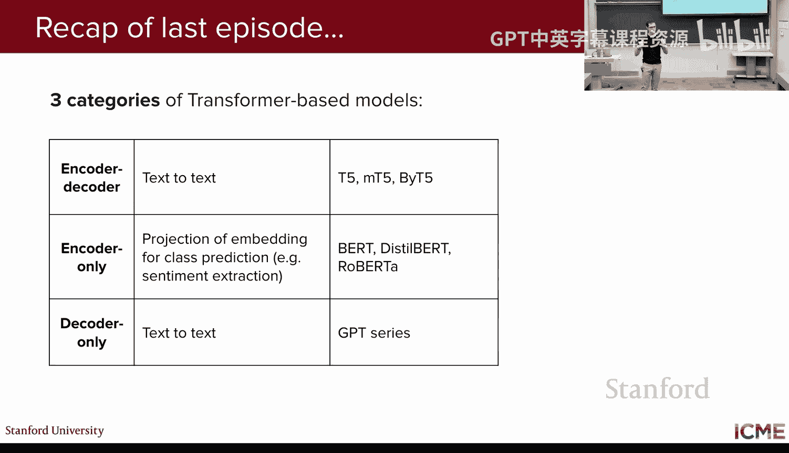
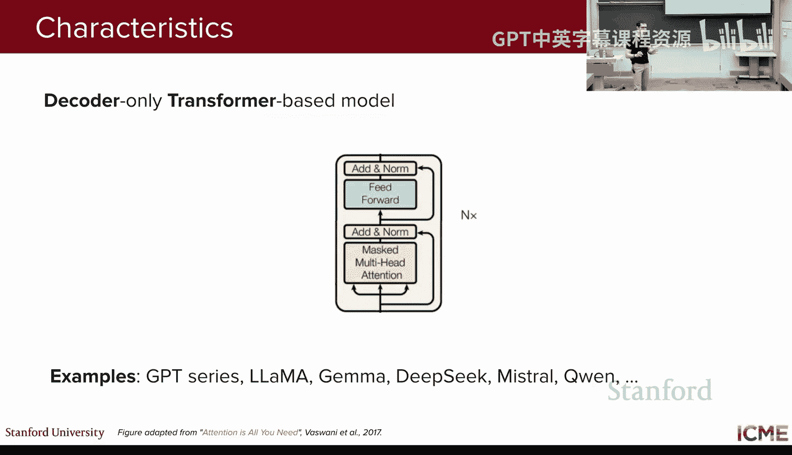
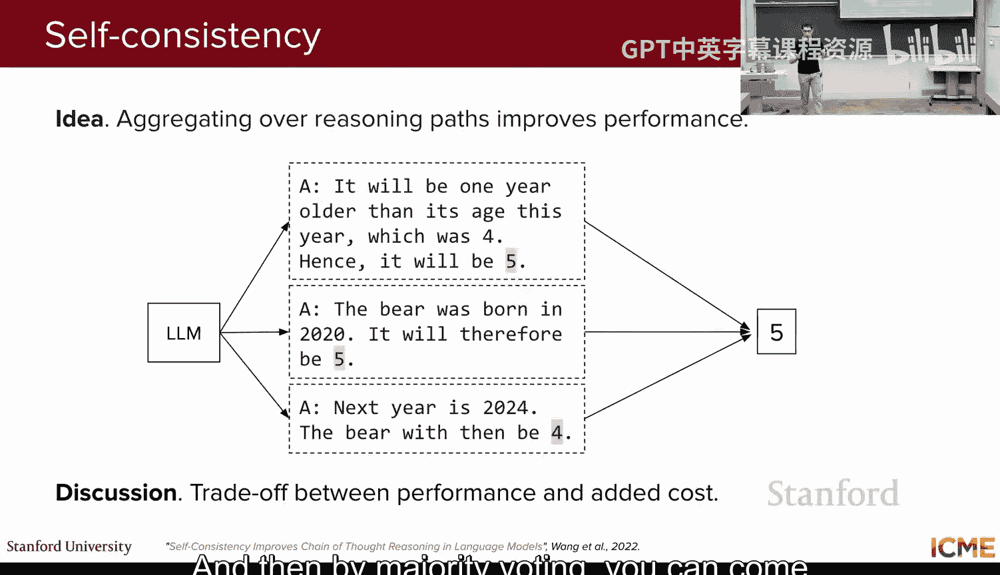
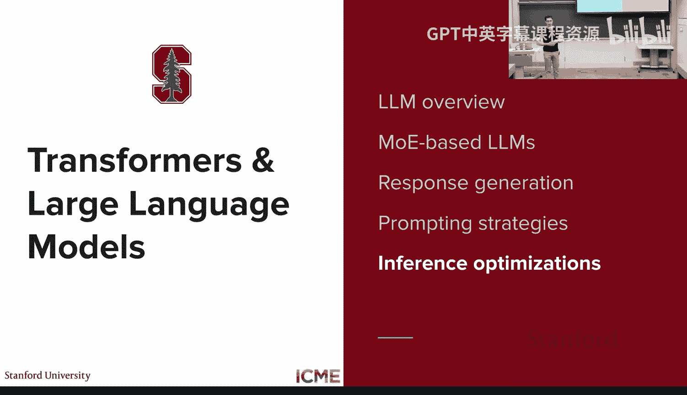

# 斯坦福大学《Transformers 和大语言模型｜CME295 Transformers & LLMs Autumn 2025》中英字幕 - P3：Lecture 3 - Tranformers & Large Language Models. - GPT中英字幕课程资源 - BV1WGsMzCERB

Cool。

Hello everyone， and welcome to lecture 3 of CME 295。

So today is a very exciting day because we're going to finally introduce large language models。

But I guess before we go into that， I'm just going to start traditionally with some announcements。

So some of you wanted to have the slides before the class。

 so just a heads up that in case you want to use the slides to do some annotations。

Theyre on the website right now， so feel free to get them and which Shevin will try to just on a regular basis every Thursday evening。

 have them publish on the website so that you can download them and updates。Cool， so with that。

 let's start and as usual we're going to recap last week's episodes。So if you remember。

 lecture one and lecture two were all about introducing the concept of self attention and linking them to the construct of the transformer。

And what we did last lecture was look at all the types of models that there are out there and how they were all based on the transformer。

So there are three categories， three main categories of models。

So the first one that we saw was encoder decoder model， which basically relies on the transformer。

 it has the encoder of the transformer， the decoder of the transformer。

 and typically the tasks there are input text， so text in， text out。

So we saw that one example was T5 and all the variations。

The second type of model is where we remove the decoder from the transformer and we obtain an encoder on lead model。

So we went deeper into B， which is the typical encoder only model。

And I guess we also saw that what BRT has is this nice property that its encoded embeddings are very meaningful and expressive of the inputs。

And so yeah， we saw like the example of classification， sentiment extraction。

 so what we did was in particular take into consideration the encoded embedding of the CLS token。

So I guess in real life， BRT is used to encode documents， to encode sentences。

 and we're going to see later in the class how these models are useful。And then last but not least。

 we have the third category of models， which is decoder only。

So we only keep the decoder part of the transformer。

 and so here we also do a little bit of a modification so we remove the cross attention because we don't need it anymore。

 we don't have an encoder， and these kinds of models are text in， text out。

And so GPT is a very good example of such models， and actually most models these days。

 they're only like they are decoder only。So these are the three main kinds of models that you can see out there。

So far so good for everyone。

Co， so with that， I'm going to introduce the term LLM， so LLM stands for large language model。

So what is a large language model？So first of all。A large language model is a language model。

 so a language model is a model that assigns probability to sequences of tokens。So in this case。

 our model always predicts the probability of the next token， so it's in that sense。

 a language model。But also a large language model is large so why is it large so we're going to see that these models they are actually scaled up in terms of size so first of all in terms of model size。

 so these days it's not uncommon to see models on the order of hundreds of billions of parameters。

But yeah typically， when we say LLM， we say at least on the order of a billion。😊，These models。

 they've also been trained on a huge amount of data， and hereby amount of data。

 we quantify that by the number of tokens that they were pretrained with。

And this is on the order of magnitude of hundreds of billions of tokens or even。Trillions of tokens。

So I think the biggest ones are like on the tens of tris of tokens， so it's like huge。Training sets。

And they're also large because they need a lot of computes。

 so typically you need a bunch of GPUs to make them work。

 although these days there's been a lot of optimizations to have them work on consumer based GPUs。

 so we're going to see that later on。But an LLM is large according to these categories。

So another that I want to point out is that all these terminologies， they're relatively new。

So I remember in 2018， 19 there was nothing like there was no real definition of anEm。

 I think no one actually talked about LLMs， in the beginning maybe people talked about LLMs。

 they included Bert。But BERT is an encoder only model that does not produce text。

 so with the current definition of an LLM， which right now has been pretty well established。

Birt would not be annam because it doesn't produce things。

So here we only consider language models that do text to text that are very large in size in terms of amount of data they've been trained on and in terms of compute。

Cool， and as we saw before， these models are decoder only。

 so here what we do is we remove the encoder， we only keep the mask self attention。

The feed forward neural network and then the addition and normalization。So we only keep this。

And this is the backbone of LLMs。And so I mentioned you know GT is kind of a good example。

 but it's not just stats you have plenty of other models， so you me have heard of Lama from Mera。

 Gema from Google， deepeps， Mial，quin， so on， like the list is long。I would say roughly， I mean。

 more than 90% of like modern day LLMs， they're all decoder only。

So I think that's something to keep in mind。哭。嗯。Okay so now you know how LLMs are made of。

 but there is something else that people these days also introduce to these models。

 and we're going to see that in a bit。

So I mentioned that these models are huge in size。Again。

 typically hundreds of billions of parameters。So it ticks。AL of computes。

To just compute one inference。Or also to train these models。But you may wonder。

 do you really need to have all these parameters be activated during a forward pass to make a simple prediction？

So I'm going to have a little metaphor。So let's suppose you enter in a room。And in the room。

 there is。A mathematician。A physicist。A chemist and a historian。So you come in this class。

 there's a bunch of people who are expert in what they do。And you have a math question。

That a question I have for you is。Who would you ask your question？Would you ask the mathematician。

 would you ask the chemist， would you ask everyone？Well， right now we ask everyone。

We ask all parameters of the model to be involved in the computation of the generation。

And so the idea here is。Even an input。Maybe it's not necessary to ask everyone to be involved in the computation。

 so the idea is let's actually just have a subset of the model。

 be involved in the computation of the next token。So I'm just introducing this idea of experts。

 so let's suppose we're introducing the following notation， so let's suppose we have n experts。

 so think of it as your mathematician， your chemist historian。Whatever， so these are your experts。

And the idea is given an input X。You're going to ask yourself。Who should be involved in the。

Generation of the outputs。So you're going to have， let's say。

 another network we're going to call it G like Yates。But it's also sometimes called router。

So let's suppose you have some gate that tells us which expert should be involved。In the inference。

So if we have that so let's suppose here the gate tells us okay。

 so tree expert number two is well suited to answer your question。

 so here the idea is that the input is just going to flow into that expert。But not the other experts。

So this has a name， it's called mixture of experts， so it's because denoted MOE。

 everyone talks about MOE， so these are mixture of experts and so the formula that you will see a lot is this one。

So the output y， which is denotted y hat， is the sum of the expert output。Wighted by sum quantity。

 which is the output of the gate。Which tells you how important the output of each expert is。Yeah。😊。

Great question， so a question is how do you train G， how do you train E。

 so typically you train them jointly。So we're going to see that maybe in a little later。

 but you can think of it as， you know， just training as usual， you do your forward pass。

 you compute the last and you back prop。And it's actually an interesting question because there is some challenges that come with training MOs that we're going to see in a second。

Yeah。question is what are these is， what is the architecture of these E。

 so let's suppose right now that there are just some network。We're not specifying them for now。

 but we're going to see to this in a second。 Let's suppose for now， it's like some network。滚。Okay。

 so I told you that， you know， what if we don't activate everyone， what if we activate a subset。

 but this formula actually。I guess assumes that we're actually considering all expert outputs。

So I just want to distinguish two kinds of MOs。So there's one kind that is called a dense MOE。

 so a dense MOE actually does not have any constraints on the number of experts that are involved。

So these weights， they can be anywhere between0 and 1。

 so think of them as a probability distribution。But it's just going to put more weight towards some experts compared to others。

So back to the example that I had so let's suppose I have a math question。

 so I'm going to ask the mathematician， the chemist， historian。

 so I'm probably going to add a higher weight to what the mathematician says compared to let's say the historian。

So this is the idea。But then。The interesting thing is when we constrain the number of experts that are activated because here。

 as we mentioned previously， what we're interested in is to not involve everyone is to make some savings in the amount of compute that we do。

 so there's a second kind of MOE that's called the sparse MOE。

And what it does is it only selects the Kote top K experts。So k can be equal to1。

 so one expert or even two， so it's a hyperparameter that you choose。And so here。

 the expression of the output becomes the sum over all the chosen experts of G of x times e of x。

So first some goods？Cool， and of course there's a lot more to it。

 so in case you are interested in learning more， feel free to go into the resources that are at the bottom of the slide。

So one thing that I will say is that we have a unit of measure of the amount of compute that these models produce for each pass。

 so you will see the term flops。So have you seen the term flaps out there？No， not really。

 so it stands for floating point operations。So it quantifies how many operations。

 like think of it as like additions， multiplications。Are involved in a forward pass say？

And it basically quantifies how compute heavy is your task。

So typically what we say is when we go through a sparse ME as opposed to a dense ME。

We have a lower amount of flaps。So this is the unit of measure that you will see。

But back to your question， so what are these experts？So if you remember， I mean， 10 minutes ago。

 we said that LLMs。They are decoder only models。So I have a question for you。

Let's suppose we wanted to put some MOEs in our LLM。Where would we put it？

So here I guess we have three choices， we have the mass self attention layer。

 we have the feed for neural network， and then we have this normalization。Question for you。

 I guess where would you put this？I guess where do you think？Is。

 I guess the most complex parts of the network， where is there a lot of operations？Fit forward， yes。

 yeah， great great answer， so it's indeed the fit forward neural network。😊。

And the reason for that is I think Shervin mentioned it， I think in lecture 1。

 so if you remember the fe for a neural network is a network such that you have the input which is your you know D dimensionional input vector。

 and then you have these being projected into let's say。

 DFF dimensional space and then it goes back to the D dimensional I guess space， so the DFF。

Is typically larger than your。Dimmenion of， I guess the inputs。When I say input is here。

 so it's typically larger。The amount of parameters that you have in that fit foreign neuralll network is something on the order of magnitude of D model times DFF。

Times 2 plus some bias， so its basically your order of magnitude。And。The attention layer。

 if you think about， if you remember， it's basically composed of the projection matrices。

What is the dimension of the prediction matrices， so it's de model times the dimension of keys。

 the dimension of queries， the dimension of values。And this dimension is typically much lower。

So think of it over hundreds。So your D model is CPK or over 100 or over 1000。

And then the projection here， the DFF is all over 1000 or over 10，000。Cool。

 so is everyone now convinced that this is a good way， good place to put the mixture of experts？Yeah。

Cool so。This is actually how it's done， so in modern day LLMs。

 this idea of not involving everyone in the computation of the next token prediction。

Is such that you would put the mixture of experts？Where the FFN is。Its basically here。

And typically you would have a sparse mixture of experts。

 meaning that so back to your question so these experts are actually fit for neural network。

 so you would have several networks that you can train。But you would only activate one。

So typically k would be equal to 1， it can be also equal to2， but it would only be a subset。

 so that's my point。Um。And this routing would be done at the token level。

So if you remember you the decoder， it basically takes something as input， so you a bunch of tokens。

And here， what I'm saying is that each token。Will be processed by an expert that may be different from the other token。

So the router here。Would takes？The representation of the token has inputs。

And figure out which expert should be best for this token to flow towards。Does this idea make sense？

So I have a little illustration later on that。Hopefully will help。

So now back to your question about how you train this model， like do you train the router separately。

 do you train the expert separately？So。One challenge that people have。

Is when they train these MOE based models？To make sure that all experts are， I guess， having a wait。

Are being used。Because it's very possible that you train your model。And that somehow， only。

 I don't know， one or two experts always get activated。And the other one， they always are inactive。

 they're never involved in the computation。So this problem is called routing collapse。

 so why is it called routing collapse is because the router。Always chooses some experts。

 but not others。So this is a challenge。And the way people try to mitigate this challenge。

Is by changing the last function。And adding it some extra term， which is written here。

So it's basically some hyperparmeter alpha。Times the number of experts。

Times the sum of quantities that depend on whether or not tokens went to a certain experts eye and then summed over all experts。

So it's not super important that you completely understand exactly how that formula works。

The only thing that I think you should take away from this slide。Is that this extra loss？

Allows these quantities。To converge more towards uniform distributions。

 so what are these quantities just as a reminder， so f of I is the fraction of tokens。

That are routed to expert I。And P ofI is the average routing probability for expert I。

So when I say that， all experts should be used。Kind of the same。

What I'm saying is I want this probability to be kind of uniform。Across experts。Yeahep。Yeah。

 so the question is， I guess when do you compute these quantities。

 so yeah like you can think of it as like regular training process。

 like you know you do some like mini batch， you kind of like go through that through like the model and then you compute all these quantities and then what you do is you do your back propagation based on that。

And I guess what I want you to remember is that this。Incentivizes。The probability， I guess。

The choice of the writer to be more uniform across experts， which。

Is something that mitigates this shrouding collapse phenomenon？Yeah。Yeah。

 so the question is can we use dropout of course you can always like bundle that with some other techniques so people have just kind of found this to be very helpful。

 so speaking of other techniques there is something that I've not talked about which is very similar to the dropout idea。

 so it's called noisy gating。Noisy gating is basically you have your。Your predictions from the gates。

 but then you add some noise to it。So basically it by a pure chance。

 it just allows other experts to be involved in the computation so it's also some other technique。

 there's a bunch of techniques， but yeah dropout is indeed quite useful for things like overfiing and the idea can be reused in different settings。

Yep。有。So the question is how can do you mean differentiable？So here。

 I guess how do you take the derivative， is that your your question， how is that。

 so can you explain a bit more what your concern is？So I guess to this question。

So the average routing probability。So that one is a function of the gate output， right？That's one。BI。

RightSo I guess your question is for FiI。For FI， okay I don't have a good answer on top of my head。

 but I think like people have some techniques and these days you know you just don't even have to do this by hand。

 you have like the builtin thing so maybe I can follow up with you for FI but for P of I do you see that this one is quite clean it's just the average of the probabilities from the gates。

Yeah， so basically the probability the output probability from the gate。

 you can think of it as just the vector being projected on a space of n where n corresponds to your number of experts。

And then it's gone through Softm， so your output is basically summing up to one。And。

Each of these dimensions， they represent the value corresponding to what expert I would be。

 I guess useful， like for instance， the first dimension would be for expert one。

 second dimension where for expert 2 and so on。So you just take the average of this and like this one。

 you can express it from all the parameters， so I think you should be fine with that one。Yeah。

So the question is if we increase the number of MOs， does it increase the number of model parameters。

 so it's a great question， so it's actually actually one of the ideas behind MOE based models。

 which is that you can scale the model。Without having to incur the costs of having significantly more compute at inference time。

So you can increase the people's say capacity， can increase the capacity of your model。

But you will still keep some， I guess。Like controlled the amount of active parameters and active parameters are the parameters that are used for a forward pass so yeah people just kind of used that so yeah it would just increase the number of parameters so that's why you see some MoOE based models that are even bigger than the ones that we kind of had like on the order of hundreds of billions we even have on the order of trillions。

Of parameters， so for instance， here， one reading I recommend is a switch transformer。

W scaled up to1。 something trillion parameters， so yes， definitely more。But that being said。

 so if you read the paper， you will also see that these models。

 there are more what they call sample efficient。So they take less time。

To be as good as what the model would have been。With a lower number of parameters。

So if you look at like if you draw the know training training curve as a function of like the training time。

 you see that these models they're typically more sample efficient。Sorry。Yeah， yeah， exactly。

 everything here is a trade off， everything here is trade off。Y go yeah。

So the question is each attention head will have a number of experts， so it's actually。

 regardless of the attention heads。So the attention heads are。

 you can think of them as being like independent you， something else。

And the number of experts is independent of that。Does that make sense？有。Right， right。All right， yeah。

 the question is whether every block will have a number it answer is yes。

 and typically those weights are not shared。So typically you actually we going to see an example。

 it can very well be that layer one， there is the expert number I three that was chosen。

 but layer two there is like expert number one and you know like it's all free， it's trainable。

So the question is we will decide where where the expert will go。

 so all of that is decided by the gates。Just this quantity？Everything is decided by the gate。

 which has trainable weights。So you can think of this as just some projection from the inputs x to an n dimensional space where n is the number of experts。

So the question is at what point where the inference is decided。

 so let's suppose we're at inference time。😊，I'mGo to walk you through how it works。

So you have your X。So you have this attention mechanism。

 so it interacts with all tokens from the past， given that it's decoder only。

 so it's like your masks。In gl here， and at the beginning of the Fi worldold neural network block。

The token is of course contextual， so it has the information from these other tokens because it's attended。

And what it does is it goes here。So x first goes into G。

G computes this probability distribution over all experts。

And given here that we are in a sparse MOE setting， we will only choose the top K。

 so let's suppose its top one， just the highest probability。

 and you will know which expert this one will be。And so as a result of that。

 you will only compute the。The output value of the expert that the input was frozen。

So can you elaborate on that actually？赢。At what point exactly。

 so it's after the self attention layer？Yeah。So the question is。

 do we have different classification for different head no？So there's only one router。

So I think I understand your question so your question is what do you do given that you have different attention computations going on in parallel with the heads。

 so if you remember the attention layer has these different heads。At the end of it。

 what it does is it concatenates all the results from each of these heads and then projects it once again in the D model space。

有。Yeah。嗯哼。😊，Yes。Yeah， so the question is we have different Gs so the only thing I can tell you is that the G is just layer specific。

 is layer specific it's trainable so it's basically going to learn how to process all these inputs so the G the only thing I can tell you for your question is is going to be layer specific so the G is going to be1G for let's say the first layer another G for the second layer and so on。

 and that one is going to be trained。꼭。Great， looking at the time。

 do you have any other questions here？Or goods。Perfect。

So now I just wanted to show you a cool thing that I believe the Miral team was showing in one of their papers。

 so what they were showing here was。For a given piece of text。

To show in which expert each token was routed。So as we noted before。

So experts are different from one layer to another， so I believe here it's yeah for layer zero。

 so it's like for one given layer。And we do see that。You know， roughly these tokens。

 I guess they leverage。Like a uniform amount of experts， more or less。

What you would not want to see is to have every token be the same color。But luckily， it is not。

But yeah， so that's one cool way of just representing how the routing is done is to just have your input text and just represent where each token in which expert each token went。

Cool。Okay， so what we just saw was。One way that modern day Ls。

Change their architecture to incorporate the fact that we may want to scale the model。

But not increase the computation complexity for one forward pass， and we saw that with MOs。

So you will see a lot of MOE based LLMs out there。And now what we will do is。

Knowing that we have an LLM， we're going to focus on。Don't worry。

We're going to focus on how a response is being generated。

So remember when I told you that these modern day LLMs。

 what they do is they take some text in and they have some text out。

So it's typically this task of next token prediction， so you have a token in。

 so let's say beginning of sentence， you go through your LLM and it just generates the next word or the next token。

 so A， and then you take A， and it goes to Teddy， and then Teddy， bear， E， etc， etc ceter。But so far。

 we have never really dug into exactly how we chose。The next token。

So what we're going to do right now is to see exactly how we're generating the next token。

So as you know here。Our LLM is just a decoder only architecture。

 so here what you have is a decoder with your input here and then your output there。

So let's suppose for a second。That we know everything that's happening in the middle。

And we're just obtaining。Outto probabilities。And are' going to look a little bit like this。

So given a token or some sequence of token as inputs， you have。

An output probability distribution that represents what the model thinks is the likelihood that there will be a next token。

 let's say that is equal to a， to airplane to fluffy， et。So this is what you have。

So now my question to you is。If we told you we have some sequences inputs and we want to choose the next token。

And if I told you that our model is giving out actually a probability distribution。

I guess how would you choose the next token？Based onです。Sorry。Great。

 the token with maximum probability。There's okay， great， so yes the first idea。

 let's just take the token with highest probability。😊，So。So it's a very natural approach。

 but I'm not sure if you've been using things like ChatGPT or Gemini every time you ask something。

It always responds something that is slightly different。

So if you always choose the token with the highest probability。Given that the computation here。

 we're going to see is all deterministic。What that means is you're always going to generate the same thing regardless of。

I guess with the same inputs。So that's one limitation， so it's not very diverse。

The second problem is。If you choose。The highest probability token。On an I guess， iterative basis。

You're locally optimal。But you're not necessarily globally optimal。So what does that mean。

 so I guess if you think about it？Our objective is for us to produce the sequence and output sequence of tokens that is。

 I guess of a high probability。But the problem is if you always choose the highest probability token。

 you will not necessarily obtain the highest probability sequence。

Are you convinced of this statement， by the way？So let me give you an example。

 so let's suppose you have the next token where one token is 0。8， the other one is 0。7。And then。

You choose to go with the 0。8， No actually it's not 0。7 because it has to sum to 1， so let's say 0。2。

So let's suppose if you go ahead with the sequence that starts with 08。

Let's suppose all other token probabilities are very low。

Basically you will have an output sequence that will have a lower probability than let's say the other path。

 which would， let's suppose have higher probability predictions in the later steps。

So we're going to see this in a second， but this is the idea。

 so if you choose the highest predicted probability， it's a good first idea。

 but it's locally optimal but not necessarily globally optimal。

And this is the reason why we have a second method。That is about keeping track。

Of the key most probable path。So I'm not sure if you've heard of beamse。

 so that's what beam search does。So here K is sometimes called the beam size or the beam width。

 So if you hear these terms， these are just。Names that are given to the number of paths that we keep track of。

And so this works as follows。So let's suppose we start our generation with the beginning of sentence token。

We want to figure out what the next token is， so that suppose we have here in this example。

 a very basic example like three tokens。And let's suppose the two highest pro tokens are A and Z。

So if we have k equal to 2， what we're going to do is to keep track of these two branches。

So it's the first iteration。The second iteration is we're going to look at all the probabilities of next token prediction for these two tokens。

And we're going to always。Save the two most pro path。And here， for instance。

 they's suppose if it's like the and then fluffy and then A and cute。

So back to what I was saying later earlier， so what I was saying was here。

 if you were choosing the path that went along the highest probability token path like the z。

It's very much possible that the highest。Probability token after there would be a much lower probability than the one after a。

And so this is what beamM searcharch tries to do， it tries to have a more globally optimal solution。

 so let's suppose we continue that and then at the end of the day we obtain I guess a number of potential I guess choices and the key potential choices and then we pick the one that is the kind of highest likely。

The sequence with the highest probability。So people， typically what they do is。

They take the sum of the logarithm of the probabilities of the token so what they say is they say okay so the lock probability of the sequence is the sum of the log probability of each next token prediction。

 so it's the lock probability of a。Knowing BOOS and then cute knowing BOS and A and so on and so forth。

But I just want to point out one limitation of this approach。Which is that。

The more you generate tokens。The lower。Your I guess， end sequence probability will be。

Because if you think about it， all these probabilities there are between0 and 1。

So think of it like in the kind of multiplied sense。

 so let's suppose you have the probability of the whole sequence。

Which is just the multiplication of the probability of the next token。

The more you add probabilities below like。Les than one。The more this quantity will， I guess。

 go towards zero。So I guess this method as is。Will prioritize sequences that are shorter。

And so for that reason， beamM search has some additional term that basically counteracts that effects。

 So something on the order of like，One over number of tokens to the power of something。

So in practice， there is some technique to make sure that things kind of work。Were a TV well。

But okay， let's suppose we figure out all these things。😊。

The problem is that we need to keep track of this most pro path。

 we need to do all this kind of saving， et cetera， and it just like requires a lot of computation。

And the other thing is。😊，We're still interested in the most probable path。

Which basically will lead to a sequence that is very that the Mao thinks is very likely。

But sometimes what you want is for your output to be more diverse or more creative。

So that's why beamM search is actually not something that people typically use。

People use VM searcharch for things like machine translation where you actually need to have something that is close to something being very likely。

But actually， people use a third method。And this method is called also the sampling method。

So I told you we have a probability distribution over tokens。Regarding what the next token should be？

And so what people do is they just sample the next token。Using the probability distribution。😡。

Does this make sense？So in this example， fluffy， gentle kind and let's say smart will have a higher probability of being drawn as opposed to。

 let's say airplane and wear that have a lower probability of occurring， nonzero probability。

 but they have a probability of occurring。讲。Any questions so far？Yep。Right。

 so the question is it's not for training it's for inference， yes correct。

 so this is you can think of it as response generation so let's suppose you have your model that is trained what you want is to generate an output so what would you do？

Yep。So I guess just to complete my answer， so during training what you would do is care about the output probabilities and then compare them with the actual label。

 which is most of the time like a hard label and yeah this is what you would compare so this one is。

 let's suppose you have an LLM that is trained， how would you generate a response？嗯。公。Everyone goods？

不见。Yeahep。Yeah， so the question is how do you do sampling in this situation。

 so I should actually my next slides？But I just want to make sure everyone was on the same page regarding just the intuition。

So highest probability is called greedy decoding is probably not something that we want。

Dm search is a little bit better， it's more something that is globally optimal。

 it's not globally optimal but more towards that， so it's better， but it lacks diversity。

 it lacks creativity， which is why what we want to do is actually sample。Each token。And。

I guess we have a few methods that also restrict。The kinds of tokens that we want to sample from。

 because I mentioned， you know， these very low probability tokens。They can still， again。

 theoretically be sampled， but it's not necessarily something that we want。

So what people do is they typically restrict the highest probability tokens and only sample from them。

So you may have heard of this term top K sampling。Who has heard of this term？Yeah， little bit。 okay。

 so what you do is you select the top。Highest probable sort the top k。

 highest probable tokens and you sample from them， so let's suppose if k is equal to4。

 you take the highest4 highest to probable and then you just sample with them and there's something else that is quite similar in idea which is called cup P。

So top P is that you limit yourself to the top to the highest probable tokens。

 such that their cumulative probability is more than a threshold。So again， it will do the same thing。

 it will select the highest pro tokens。But then there is a part that I still left out。

Which is how do you obtain these probabilities to start with？So if you remember。

Here I had mentioned that we just assume we have the probabilities。

We just have them and we want to choose what the next token is。

But now the question that I'm asking is now that we know what we will do with these probabilities。

 I guess one question is how do you obtain these probabilities to start with？So if you're a member。

These。Transformer based architecture basically computes an encoded representation of the input。

And what you have is。Some final layers at the very top of the figure， which aims at projecting。

The vector into the space of the vocabulary。Because what you want to do is to have a probability number for how probable it is for you to sample a given token。

So here what you would do is at the very top of the architecture， have your input。

 which is your encoded embedding of the token， go through a linear layer which basically projects your d model vector into space of dimension size of V。

And of course， what you want is probability， so you would have a softm layer。

Which basically converts everything to probabilities such that everything sums to one。

And in order to compute the probabilities。This is the formula that you would use。

 which is the softmax layer。So there is a。A hyperparameter that is quite important that I want to talk to you about。

Which is the temperature T。And so this is where it pops up。 So you have the probability of。

The next token being a given word， which is equal to the exponential of the input respect to that given word over temperature。

 and then you normalize that by the sum of all the other exponential of the quantity over T。

And now what we're going to see is what that T is used for or what that T actually does in practice。

So before we go into that， just one question， has anyone heard about temperatures when it comes to response generation？

Yeah。😊，Co so hopefully that will kind of give you a better idea of how the temperature kind of influences your output predictions。

So I guess the question that I want to ask you is what would be the impact of having a low temperature versus a high temperature？

So low temperature would correspond to diverse work。Yeah。Yeah。Ha anyway。

 So we'll come to that in a second。 So yeah， do you have a。

A lower temperature increase in temperature， so I guess back to your the explanation about like I guess lowering the temperature and what impact it will do to the so I guess like do you have a suggested response to that I guess like yeah lower temperature。

 let's suppose you have a lower temperature what happens。嗯哼。😊，Y， yeah， yeah， yeah， so I guess。

So the long story short is low temperature will create a spiky distribution and then high temperature will create a uniform distribution。

 but I guess so I think you had the right like intuition。

I'm going to maybe write this in more mathematical terms。So whoops， okay。

 let's suppose you have no your probability。Which is you know， the exponential of。X I over T。

Over the sun。Of。Exponential of Xj over T。So just mathematically， you can actually prove。

What is happening here， so let's suppose。You have the index of the highest X。So let's call that K。

So let's suppose what I do is I will。Factor by this quantity。 So actually here， I don't have space。

 So let's do here。 So it will be。A E of。K。Temperature。 And then here you have。The sum of over all J。

Of exponential of X J。Over t minus。X K over T。So what I did is I just multiplied the numerator and the denominator by exponential of xk over T。

 so I multiplied numerator and denominator， and of course they can out。

But then what I have here is x Y minus xk over T and here xj minus ak over T。So when。I is equal to k。

This term is zero。It's exactly zero， regardless of the temperature。And here。Xj minus8 xk。

Is always negative or zero？Right？So here。If I is equal to k。You have。0。Over T， so here it's one。😡。

And then you have one plus。I guess sum quantity， so j minus xk over t， which is going to be negative。

So t going to zero。So that one will be， I guess。Going to， let's say， minus infinity。

So exponential of minus infinities。Zero？So what you will end up with is something where。

For I equal to k， you will have a nonze probability。But then for I not equal to k。You will have。0ero。

Over something that is not equal to zero。Which is zero。So just mathematically。

 if you factor by exponential of xk over t。Where K is the index of the highest value。

 I guess the highest logat or the highest activation vector。Can actually show。

That for small temperature。Only the highest。So the index of the I guess highest value will be the one that will be I guess highest problem with the spike there。

 and then when you have a high temperature basically it will。

Look like a uniform distribution because all all these quantities。 So when t tends to plus infinity。

 D tends to 0。 So exponential of 0 is。Just E， sorry， not E1， it's one。

 so it's one over the number of J， so it's one， so just the uniform distribution across all the tokens of your vocabulary。

Yep。So the question is， how can I interpret a small？嗯哼。😊。

So the question is can I interpret that as a Gaussian， I think。

 so it's kind of tough because Gaussian you have like some continuous quantity as in the x axis。

 so here you have you have tokens so it's kind of discrete and it's not like something that you can order so just probably interpret that as small temperature is very spiky so you will really have a given set of tokens that are the highest problem that will appear more。

And if you have a high temperature， then。Basically， tokens。

 even the ones that were not there to be kind of the highest prob will actually have an adjusted probability that will be higher。

Yes， so you can think of it as like some kind of scaling in that sense， so long story short。

What I want to tell you is if you have a small temperature。It will encourage the next token to be。

Geared towards being the highest problem token。And then if you have a high temperature。

I guess the distribution of probabilities will be kind of closer to a uniform if you really increase that temperature by a lot。

 so your output will be more creative。You will have tokens that you would have not drawn that would be drawn。

And so what that means in practice， if you I don't know if you're with your favorite LLM。

And let's suppose you want to， I don't know， write something very creative。

So which one would you use， would you use a low temperature or high temperature？High temperature。

 yes， so if you want something that is more deterministic， more， I guess。

 closer to something that is very， I guess what you think would be a high quality。

 we use more of a lower temperature， so one not here。Is that if you have。

A strictly positive temperature。Every time。You run your model over inputs。

You will obtain different output。Right？So。Something I want to point out is nothing in the transformer architecture is probabilistic。

 everything is deterministic， the only thing that is not deterministic is how you sample the next token。

 it's the only thing that is not deterministic。So what will you do to have a deterministic output？

We have t equald to 0。T equal to zero， you know for sure that your output will be just one thing and nothing else。

Well。That's what is kind of the theoretical property， but in practice。

You have some stuff that is happening in the computation。

That introduces some non deterministic operations， so this varies much more advanced than the scope of this class。

 much more advanced of the scope of this class， I just want to call out that in practice t equal to zero may lead to different results because of this kind of practical piece。

 so what I recommend so there's a suggested reading yes you're completely optional。

So there is a very recent article around defeating nondeminism in LM inference。

So I recommend that you read it in case you're interested。 So the high level idea is。😊。

Our GPUs are hardware。When they reduce some of these operations。

Sometimes they are reducing numbers that are on really different scales。

So the order at which these operations are happening is actually quite important。

So the idea is if these operations， they happen in different order。It may lead to different results。

Even if in theory it should be exactly the same， in practice。

 it may not be the same and this article actually does a great job at just explaining the intuition。

So yeah， just if you're interested， completely optional。Who I know I'm kind of late。

 so I guess last thing that I want to say is。Let's suppose what you want to do is to generate an output in a very specific format。

 let's suppose J Jason format。So I guess a very naive approach would be to tell your LLM， well。

 please generate this in let's say Jason。And then it produces something。

 and then you kind of try to see if it's a valid JN， if it's not， you repeat。

 you just tell it to generate again until it does something well， so that's the first naive approach。

Well， there's a second approach。That is called guided decoding。

And what that does is during the generation process。It filters out what it calls invalid next tokens。

So here， let's suppose I want to generate this Json。

 I know for sure that my first token must be something that opens the you know the。

I forgot what the English word was for this， but you know it just opens the brackets， yeah。

 open the brackets so you can only have this。😊，And then you can only have the property name and so on and so forth。

And sometimes you can have more than one permitted next token in which case you would go back。

To our next token strategy。Yeah。So the question is how do you restrict the otherva token。

 so there's a bunch of papers that go into that， we will not cover this。

 but I can give you some pointers， just type finite state machine FSM， context grammar。

 so there's a bunch of papers that do that， we will not cover that here。Cool， and I think with that。

 we will go to the second part。Wch Germanman？Great。Thank you， E。

So now together we're going to look at different prompting strategies。

 so now that we know how responses are generated， we're going to see how to get responses and how to get great responses。

So let's go back to our favorite example about our cute teddy bear。

 so just I want to introduce one piece of vocabulary， so when you have some kind of input。

 you have the length of your inputs measured in number of tokens。

And you will see in the literature that it can have different names。

 so you can see it called context length， context size， window size。

 and I think the latest tools like if you code on you cursor or any other code assisted tool。

 I think they call it a more context length， but like all these terms are equivalent。

And they're not the same thing。Okay。So。Now I want to take some time to discuss what can be some orders of magnitude here。

 so like modern day LLMs， they tend to be in the order of magnitude of tens of thousands。

 hundreds of thousands or millions of input tokens as inputs。

 so this is the kind of input it can take。So sometimes you hear some new LLM boost some number and then that number of context length is exactly that。

 so it's like how much tokens can it accommodate in a single pass？Okay， great。

 and then yeah the models you have seen like maybe some like advertisement of these models so I think like Gemini and others they are in the million territory and you know does that mean it's all nice and pretty you know do if we have like more context length。

 is it going to solve everything？Actually not。There is a phenomenon that was recently dubbed as context ros in a paper from earlier this summer。

Where basically the authors are experimenting the capacity of the model to retrieve a piece of information in a test called needle in a haystack。

 so basically they ask some question and in larger and larger pieces of text， they bury the answer。

And they tried to look at the capacity of the model to surface that answer。

And then you can see that with respect to an increasing context length。

That ability to ground the information with the answer that is in the context decreases。

And yeah the paper I think is a very interesting one it controls with respect to what else is in the context。

 like there is a term of like distractors where they like put some noise and then they see distractors basically contribute in decreasing the retrieval capability。

 so also what is in your context matters so this is why in general when you have a retrieval problem where you want to use your LLM to solve it。

You have some good incentive to try to target as much as possible。

 the right piece of context for your LLM to see and predict on。Okay， great and yep。Yep， so the。Yeah。

 so the question is， is the context length exactly what is shown during self attention， yes？

So and then we're going to see， so I think we saw last time that sometimes there are like some tricks that are used for the like complexity of the self attention mechanism not to be n squared。

 so this is what is being used to like manage basically the complexity of the computations as the context length grows yeah but great call that that's exactly what is it about。

Okay， but any questions， any other questions？Okay， great。

So now let's define what do prompts usually look like？

So there is no formal theory on how to structure a given prompts。

 but is these are the main lines that are usually found in prompts presented to models to again distinguish a part that is like setting up the context where you like just put the setting。

 you know you make it clear to the model what's you know kind of，Qury you want to issue。

 then let's say if you have some tasks that you want the model to perform， you have instructions。

And then these instructions are like some sort of function that take as input something so you add some input and in order to get what you want out of the model's response。

 you may want to add some constraints out of it， so here we took our favorite example with a teddy bear。

 the context is you know。Like what is the teddy bear， basically what is the mood of the teddy bear。

 what do we want you know to do in order to like make our teddy bear happy。

 and then we give some input regarding where the story that we want to generate is and then we give some constraints。

If you want some other example in the LLMs that you query every day， so the context could be。

 you know， some sentence that says you are ChaGT， it is you know we are October 10th， it is 4。

44 pm so you set the setup。The instructions can be basically what the user queries alongside the input and then constraints might be things that you don't see as a user。

 but that might be present in the prompts given to the LLM such as safety instructions， for example。

 do not generate any contents that might lead to harm or things like this。

So every time you see an input being fed to an LLM。

 I think projection into these four dimensions can be a good mental model of seeing which pieces correspond to what goal in that structure。

Does that make sense？Great， so now that we know like what kind of mindset we might have for inputs to an LLM。

 let's see how we can get an LLM to do what we want。

And let's see how we can get an LLM to do what we want without tuning any weights。

We can do so with a concept called in context learning。

 where the learning is a bit of a term that is overloaded because you don't actually learn anything with respect to the weights of the LLM。

 but you can distill some knowledge inside of it， as part of the context。

 in order to do what you want。So you distinguish two main categories of in contextex learning。

 so there is one category that is very simple you know in mindset it's called zero shot。

 specifically you don't give，Anything other than input， your input query。

 you users ask the LLM to do what you want to do。And then there is another School of Though called a few shot learning。

 where you give examples of inputs and outputs to the LLM before asking the input that you're interested in。

So in the case of teddy bears and bedtime stories， so you might name your teddy bear。

 so maybe you have a teddy bear that's called teddy and you generated a story， so you put your query。

 you put the story that you want to generate and you give multiple such examples and let's say you have another teddy bear that's called。

You know，B， you know， and then you want to generate a story for Bob。

 so you put all of these examples and you ask the LLM to generate the story that you're interested in and then this is basically what we call a few shots setting。

Okay， great， so now。Generally， when you look at the performance of the given of the resulting task。

Giving examples tends to steer the LLM nicely into the task that you're interested in。

 just because you have like given an idea to the model of what you are looking for。

 and then it can use what it has learned during its training process to connect the dots and basically replicate。

And then， but of course you need to gather such examples， so this is costly。

 this will put some more tokens in the context window so you will need to like more compute。

But there is an interesting tradeoff here that we see in recent models。

 so they're gaining more and more reasoning capabilities。

 which is why I put the generally nuance in Italy here， so there are generally better few shots。

 but not always。Because these days with these like better models。

People have seen that with like basically making the instruction better。

 you could make the performance of in context learning on par or even better than if you provide examples because basically when you think of it when you provide examples you contrain your model into given sets of examples that are finite so when you are at inference time let's say you want to perform a task on a distribution of data that has not been seen。

 it is harder for the model to generalize because it will try to align on what it has seen in the context。

 whereas if you turn your instructions into something that is more reasoning base you explain how to do the task with natural language。

 it can use its reasoning abilities to actually do it and this is something that you see more and more these days so the literature on this I think is still。

In progress， but you have some papers like your plan and solve。That。

 I think came out recently and that showed， if you ask LLM to plan itself and then solve something。

 it can have very good performance。So yeah， this is an interesting。This is an interesting fact。Okay。

 great。😊，So now that we have seen basically the kinds of learning that we have。

 now we're going to see what we can do to improve the quality of the response。

So there is this concept called chain of Though where researchers have seen that if you force the model to come up with some rational to some answer before actually giving it。

 it would give higher performance。So this is what people call as chain of thought。

 it's basically what's led you to the answer。So here， for example， if you ask yourself。

 how old is this t bear？And if you force the model to respond directly with a number。

 it might not be able to do the connection as to exactly why the teddy bear is a given age。

 whereas when you give the kind of full chain of reasoning then it becomes clear as to what led to that response so I think this is the main mindset behind this technique and basically this is something that that can be used in in context learning。

 so if you give like few shot examples， you know how old was this teddy bear。

 you give some number and then you slightly change the query。

 and then based on the reasoning formatting and then the response the LLM can adjust the reasoning and the response accordingly and it will force the model to output some reasoning alongside the response which shows an improvements in in basically matrix。

Okay， great， and then yes， something else that I want to say。

 you let's say you are you want to do a task and you want to do it well。

 you know oftentimes you will always have some samples that do not work。

And then for them you want to have debugging ability and usually when you debug with LLMs。

 you don't debug like the old days， you don't look at weights at the intrinsics of the LLM。

 what you want is something more interpretable that comes out of it in terms of tokens and usually with these techniques。

 you can see the reasoning that the model had before outputting a given response and you can debug basically what went wrong。

So if you ask how old will the bear be next year and if in the chain of thought， it says， hey。

 we are in 2019。You know that somehow in your context， you know， oh， maybe I put the wrong dates。

 you know in there so you can like trace back to you can do some root ca very easily。

So it's also used for that and you know exactly in the same way as other techniques that increase the number of tokens。

 this is a tradeoff that you have to manage， that it will of course take more time to infer because you need to generate more tokens。

But typically we're fine with it。Any questions on COT？Okay， great。

 so now let's take it one step further。So I want to introduce， you know， even to make COT。

Even stronger， you can sample your model several times。

Look at the answers it generates and then do some majority voting to select the answer that was predicted most of the times by given LLM and this is what we call selfconency where basically you sample responses multiple times and then parse。

The actual answer， so basically you kind of factor out the whole reasoning and then try to target the answer and then by majority voting you can come up to an answer in a more robust way。

Yep。😊，Yeah， so the question is do you need to have some benchmark to know if it's better and yes absolutely I think the paper operates on top of all the arithmetic and then mathematical base once and I think one tangential question to yours is how can you locate the answer and then do majority voting on it so typically you can put into the context。

 some instruction that says put the actual answer last。

 so you can just like extract the last people I think use re space techniques。

 otherwise to extract the answer or you could even think of using some other LLM to extract the answer so there is always a way to kind of do it but to your point yes we need some benchmark and then ground truth labels to assert that this is indeed better。

Yeah， so the request here， so the question is is it going to be sent to the same request as example。

 so typically you sample it in parallel， so basically you ask your model exactly what Ash just mentioned。

 you sample from the probability distribution of BOS and whatever tokens you had the next token and you do that in several other kind of branches。

And you do that， all of that in parallel， and then you kind of passse the answer at the end of it。

So basically， the latency of this process is equal roughly to the maximum latency of either parallel generation because you can do all of this in parallel。

So none of these go into the context of each other， they're all done in parallelll。

 and then you get final answer。De great。嗯。All goods？Okay great。

 so now that we have seen a few prompting techniques。

 I want to cover together tricks that people have come up with at inference time to make the generation as efficient as possible。

And basically， yeah， so in modern day models you have a lot of parameters。

 you want to generate a lot of tokens， how do you do it the most efficiently possible。

 so I want to us。To divide this thought process into two parts so we're going to see what methods we can come up with that give us increased efficiency on an exact level so you exactly do the same computations as you are supposed to do but in a more efficient way and I put some hints as to what kind of techniques we're going to explore so let's try to look for techniques that avoid redundancies。

 let's to see what we could do to manage the memory in the best way。

 and also let's try to see if we can reformulate the equations inside the LLM in a way that could simplify the generation in practice。

Then there is a second category that we're going to explore as well that is going to focus on what kind of approximations it might be fine to do and get a high quality answer at a lesser cost。

 but you know to be approximate so we have you know what kind of。

Variations we could do on the architecture， is there something we could do on the embeddings to make them more efficient and then maybe on the token prediction side。

 is there something we could do to make it faster？Does this send goods？

So we have approximately 22 minutes， we're going to try to go through all of them here。Okay。

I grouped the categories of techniques into exact and approximate techniques。

But actually we're going to look at them in a grouped manner， first looking at the attention layer。

 seeing what kind of techniques we could have there。

 and then in a second part we're going to look at the output layer and then see what we can do at the level of token generation to make things as good as possible so let's start at the attention level。

So we have seen that for every token。You need the current token to attend to the previous ones。

 right？In this masked self attention。So let's say you generate your sequence， you are at given token。

 so let's say you know， you have generated acute teddy bear and then now you are at ease。

Now you have the query E。😡，You will compute the key representation and the value representation of E because of course you have to do it。

 it's your current token。But we want to have a way to reuse the past computations we had done to compute the key representation of the previous tokens and the value representation of the previous tokens。

Does that make sense as a goal， does everyone agree？Okay。And more precisely， basically。

 we want to find a way for the key and value matrices。To be saved。

 and I'm not underlining the Q parts here because of course。

 the query corresponding to the previous tokens。Are not going to be of interest for the present token。

 so it's like the key and value part。O。So there is like this concept of KVc where the goal is to store these key and value matrices somewhere。

嗯。And reuse them directly from the cache， so like what I just mentioned here。

 you know when you want to compute a given token， you would reuse the key and the value directly from the cache instead of computing it again。

So answer。So this is basically representation of what we just mentioned here。Y， does that make sense？

Okay， awesome。So what else could we do， oh yeah？Yeah great question so during training do we do KV caching。

 I would say during training you have this concept of teacher forcing where you put all your inputs and pass it all together at once。

 so this concept of caching doesn't even come up。Yeah， but great one， y， yep。Yep。Yeah， see。

 so the question was， you know， what is the point of all this， we want to just reuse like the。

Computations that were already done， and then your answer is yes， spot on。Any other questions？Okay。

 great， so now that we have seen you know that we could cache these quantities。

 so what else could we do？So is there something from last week's lecture that we could reuse。

 know maybe something that reduces the amount of cash， you， the key and value？

Do we have some techniques？Sparrse attention。Yeah， that could be， that could be， but not here。

 like let's say not you're attending to everyone。And you focus on the number of keys and values。

 is there a way to reduce this number， so just to recap we have here I'm operating in the context of multi head attention。

 which is you have your H heads， so you have H。Number of query projections， H key projection。

 H value projections， is there any technique from last week that we could reuse that we reduce this number？

Yeah， I heard it， yeah， group query attention， yeah， exactly。So we had these。You know。

 concept of grouping keys and values together where basically the general formulation is called group query attention where you group these and then the external values。

H and1 denote respectively the full multi head intention and then multi query attention。

And then in modern day LLMs， like a lot of papers， they use GQA with some group that is sensible value。

 so this is also something we can do。Okay， great。And now I'm going to go a little bit into the hardware side of things。

So if we were to store the cash for all these values in a naive way， you know at inference time。

 so let's say you receive， so let's say I'm an inference。Server。

 I receive queries from multiple users。And let's say I receive a query one and I receive a query two。

You， a naive way of storing the key and value matrices would be in reserving a portion of the memory at the beginning that correspond to the entire context length。

Because you don't know where you're going to stop， right。

 you' decoding because you stop your decoding when you hit the EOS token。

So you would have like this whole block of size context length。

Like maximum context length that could be reserved。

So one observation is that it leads to a lot of waste。

So let's say if your context length is of size like 2K， you have a 2k reserved for a given request。

 2k there， so at any given time， like let's say you want to get more requests you want to serve more request。

 your memory will very quickly not have enough space to accommodate。呃对。

Does these constraints or does this challenge make sense？Yeahep。😊，Okay。

 and then there is this paper that is called page attention and it defines several like quantities。

 so there is this like reserved quantity internal fragmentation and external fragmentation。

 internal fragmentation is basically the space that is being reserved by the model to complete the request。

And the reserve spot is the subset of it。That corresponds to tokens that were actually being used。

 So it's the kind of space that's actually used internal fragmentation， There is nothing in there。

 but this was reserved。An external fragmentation， it's the memory management system that doesn't necessarily put one block one after another。

 but has its own way of allocating memory blocks， so it might give some other gaps。

And they came up with a system that is called a page detention that is powering one inference。

Package called the VLLM。That solves this issue by mapping like the generation process by blocks of fixed size。

 So instead of。Allocating a whole portion of the memory to answer a given request。

 it breaks it down by smaller chunks。So I think the paper takes like a value of 164 blocks。

 So as you can see， let's say you are in your generation process and you have used a given row。

 you would just start using another row without。You know， wasting more space than that。

And then you have some dictionary that maps token position indices to basically their cache values。

 so there is like a smart way of managing it， and they show that it reduces fragmentation by quite a lot。

Yeah。Okay， great。Now let's do something else with this ky cash。 so we just saw that you know。

You have your internal representation of your token and you project it into query key and value。

And then key and value is actually something that is of a dimension that is like non negligible。

 and you need to store each copies of it in each transformer block。

So you have many of these vectors that you need to keep track of。

And is there a way to make that representation somehow more compact？

And this is a topic that Deepseig has tried to tackle in a concept called， I think it was called。

Multi latent attention。We're going to see， so you know let's look at the vanilla case， you know。

 if you are in multi head attention， then for a given representation of a token。

 you have H projection matrices that turn it into a key。Does everyone agree with that？

So the kind of set retention formula， you know you have a projection matrix。

 WK for keys that will project the token representation into some key and you have H heads。

You have H such projections and you have H such resulting embeddings that you need to store in your cache。

Because you have that for Gs， you have that for values。

That's a lot of res to store and these keys and values they are you know。Quite long as well。

 so let's see if we can like。Make it smaller。What multilant attention does is that it factorizes this projection matrix into an intermediary space that is of lower dimension than the space of keys。

You have a first transformation that reduces the dimension and then another one that decompresses it。

So this is the first。Operation kind of that they did in order to make the representation more compact。

But they did something else that is very smart。They said that the compression matrix。

Could be shared across keys and values。Which says， for a given token representation。

 the cache that you need to store for keys and for values is the same。

And then you would have still different matrices here for the decompression part to actually learn different representations for key and value。

 but one。Simplification here has been to share it for across keys and values。And even better。

 share it across the H heads， so instead of having H such embeddings， you have just one。

And then you do that for key， you do that for value， so at the end of it for every transformer block。

 you have a single representation or token。Does that make sense？So not only。

You have you know listings to store the deepse V2 paper also showed a performance improvement that it's kind of credited like some regularization consequence of doing so so it learns representations that are maybe more useful and shared cross keys and values。

 so apparently there is also。Performance benefits to it。 That is not just。Hardware based。Okay， great。

 so now we have seen some oh yet。Yeah， so the question is， do you tune the low rank dimension。

 so the dimension itself is a design choice it's fixed？So the question is。

 is it the same like lower dimension for everyone so the dimension size is fixed and is the same for everyone I think so but it's a design choice。

 you could have different ones。But I think in practice， it might be the same one。Any other questions？

Okay， great， so now we have less than 10 minutes， we are going to cover techniques that operate at the output token level。

And then starts with a concept called speculative decoding that is those very interesting methods。

That uses some smaller model to help the generation of a bigger model and then uses some scheme that makes the distribution outputs match the one of the target one。

So it uses a combination of tricks of using like a smaller model to generate things and engages it with some mathematical based properties to ensure we get a distribution that looks like the one of the big model。

So is here's the mindset of it。So let's just come back to our favorite example about teddy bears。

So what you do is that you ask a smaller model that the paper calls draft to generate next words。

 so you have like my teddy bear， what could be next words， so you have one pass。

 you you find token ease， you fit token is here again， you find cute and smart。

 since the LLM is small， this is typically done faster than with the big LLM。

And then once you have all of these， you put the tokens that are predicted by the smaller LLM。

All as inputs。To the targets LLM， that is like the bigger model， like the one that you use。

To generate probability distributions for each of them。

And then we're going to see that by having some rule on the output distribution of each of these tokens。

You can simulate。Distribution， a probability distribution of each token。

 of each next token that kind of looks like one of the target models。So here's。Basically how it goes。

嗯。So it looks at the probability of the。The token that the draft model has predicted。

 so if the probability of the draft model is bigger than the one of the draft model in the draft model's output distribution。

 then you just accept the token， otherwise you have some acceptance rejection mechanism that either accepts the token or rejects it。

And let's say everything is accepted and in a single pass。

 you are able to advance by way more tokens。And then if it fails。

 then basically you resume the process of generation from that could token onwards with some adjustments on the distribution。

So one question that you might ask from all of this， know。This looks like a recipe。

 why is that matching the target distribution？So if you start from the law of total probability and write each term with these quantities。

Then you will find the target distribution at the end。

 so it's an exercise that I encourage you to do and the paper that is attached to the slide here demonstrates it in like just a few lines so it's a very simple proof and I think it's a very。

 very interesting one。Does that make sense？Yeah， so I think it's， yeah， the question is。

 is that rejection something， y？So some of you might be familiar with it already。

Does that make sense？Yeah， and then one thing that I didn't say is that why did we even put the last token here。

 you know， we put all the draft tokens， but also the last one that was predicted。

 because by doing a single forward pass with all these draft tokens， you get for free。

 the probability distribution of the token that comes after that that you can then just sample from Q k plus one。

So just to give some summary of the rational。Doing a single pass is like as expensive as doing one pass at a time because at inference time。

 you are memory bounds， like in other words。Computations are not the limiting factor。

 it's basically the memory that will bottleneck your computation。

 so you want to do it on a smaller model and then on the big models you want to compute all of these probability distributions at once。

Does that make sense？Okay， great。And then I want to talk about one last technique that is called multi token prediction。

 it's the same， so by the way， this previous technique was called speculative decoding。

And then this one。Is basically doing the same？But so it's been exactly a different thing。

 but the draft model is embedded in the same model， which is very powerful。

 So basically it's a model that。Ittaes multiple heads on top of the representation of the last decoder。

And the process here is that at training time， it doesn't do next work prediction。

 it does multi work prediction。And at test time， the draft model is all your heads。

And your main model is just the first head so you have like all your draft tokens that you then feeds back to the first head and then do acceptance and rejection so the paper does it in a greedy way so doesn't do it with this formula because since the architecture and then objective function has changed。

 you don't have these next nice property of finding again the next token predictions distribution but you have like a slight variation of it and yeah so like the interesting notes out of the multi token prediction is the change in objective function and then second the the fact that the draft model and the target model are basically embedded in the same one。

So you don't have to like separate the two。And yeah， so you do remember these slides。

 we have explored techniques that can remedy each of these aspects。

 so yeah I highly recommend you taking a look at the associated papers as well。😊，And with that。

Thank you very much。

