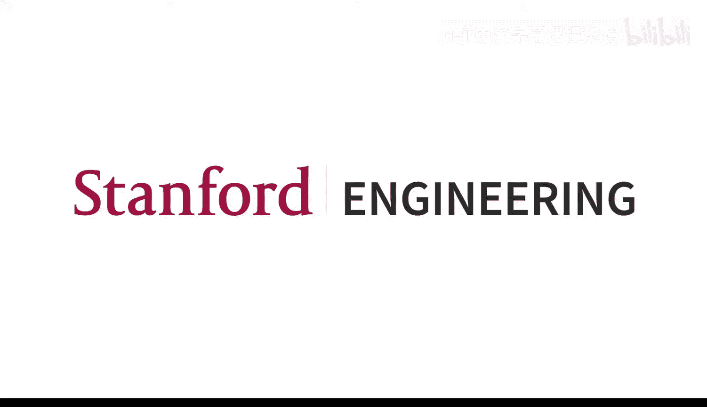
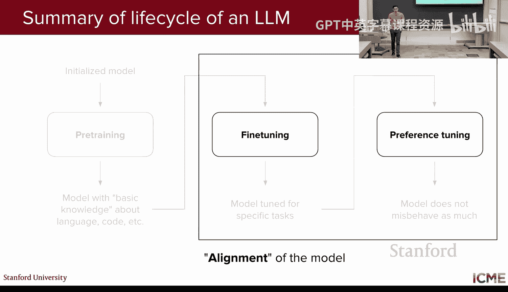
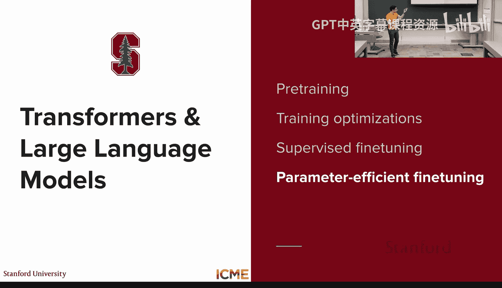
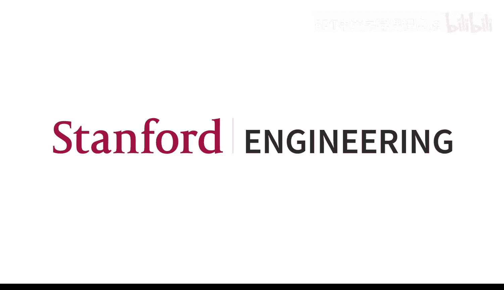

# 斯坦福大学《Transformers 和大语言模型｜CME295 Transformers & LLMs Autumn 2025》中英字幕 - P4：Lecture 4 - LLM Training. - GPT中英字幕课程资源 - BV1WGsMzCERB

Cool， hello everyone and welcome to lecturec4 of CME 295， so today is Friday， October the 17th。

Which means that the midterm is one week away， so before we start。

 I'm just going to go over some logistics to make sure we're all aligned on what to expect。

So the midterm will take place next week， same time， instead of an hour and 50 minutes。

 it will be an hour and 30 minutes， so it's 330 to5 in this classroom。So it's like business as usual。

In terms of topics。The midterm will be about lectures one， two， and three， which we had。

 and this one which is lecture4。So just to give you an overview of what you can expect in the midterm。

There is going to be some multi choice questions along with some free form questions。

 but they are mainly going to be about the things that we've seen in class。

So if you watched recordings or attend the lectures and just go through the slides and know the important formulas。

 I think you'll be fine。So I know that you may have questions until next week。

 so that's why after this lecture with Charveine we will be holding office hours。

 so feel free to come to us and ask us any questions and of course we'll be fully available between now and next week so in case you have any questions。

 feel free to ping us on Ed and yeah we'll make sure to respond。Cool。

 I also know that a number of you are auditing this class。

 so in case you're still interested to take the midterm for some reason。

 maybe because you have an upcoming interview just tell us so that we can just expect the number of like copies to print so we'll be printing this on Monday so just let us know over the weekend in case you're interested。

Cool， so that's for the midterm and then the second piece of news is the final。

So we said we were working on the dates， so we finally finalized the dates， which did not change。

So it's Wednesday， December the 10th。Okay， so a little bit late 7 pm to8， 30 pm。

 so it's a sla that we have， the location is different from this one， so it's in this room。

And the final will only cover the second part of the class， which is basically lectures five to nine。

Any questions on this？Yeah。Oh yeah， good question， so is it closed notes， yes， yeah， yes。

So a question is what is the format of the multiple choice so you'll have so we did not finish writing the exam。

 but it's going to be something like you have a question and you let's say you have like three。

 four possible answers and then you just choose the one that's correct， something like this。

And you'll also have some free form， like you'll have to just answer in your own words。Yeah。Yeah。

 thanks。 so question is， are we allowed to take anything， So it's closebook so like。Like， yeah。

 nothing just a pen。Yeah。question is no calculator， you will not need calculator。

 but speaking of the cheat sheet， as I'm not sure if we mentioned， I think we did。

 So there is a cheat sheet for this one which。😊，We cannot bring to the exam。

 but you can use for your just for just your studying， that's on the website， class website。

Sugge recommends looking at it。Cool， so super clear for everyone。Very cool， well， okay。As always。

 we'll be starting the class just recapping what we saw in the previous lecture。so if you a member。

We。Basically studied a new kind of architecture， which was called the mixture of experts。

 which is such that if you have an input， what you want is to not necessarily activate all the parameters。

And so you are in a setting where you have multiple experts and in the forward pass you only activate some of them so that's the sparse MOE。

 you also have the dense MOE which basically weights the outputs as a function of the output of the gate。

So we saw that this architecture was used in LLMs。And it was mainly used to be able to scale these LLMs without incurring an expensive cost at the inference time because you don't want to activate all the parameters。

Yeah。The second thing that we saw was just defining what an LLM was and in particular， how you could。

Decide on what the next token prediction is， so we saw three methods。

 first one was we called greedy decoding， which was always taking the highest probable token。

The second method we saw was beam search where we kept track of the K most probable sequences。

And then the third one was sampling。So we're not doing most probable。

 we're not keeping track of the highest parbable sequences。

 what we do is we sample the next token with respect to the distribution that we get as outputs and then we saw there's this hyperparameter that's called temperature that allows you to tweak how spiky you want your distribution to like versus nuts。

And we also saw some inference optimization techniques which are used in practice to avoid having a big cu at decoding time。

So I'm not going to just mention everything， but I would say TVVC， for instance。

 is an important method， so I just recommend just knowing what it is along with the other ones。

And with that。We're going to start lecture four。And actually。

 I was really looking forward to today because lecture one， we saw what self attention was。

 what a transformer was， second lecture we saw。Some of the tricks that people use today and some of the variations from the transformer。

 we introduced what an LLM was last lecture， and this lecture we're finally going to see how these LLMs are trained。

So today we're going to focus on LLM training。And the first thing that I'm going to say is if you've been in the ML field for。

 let's say， more than a few years now。You may have noticed that traditionally。If you had the task。

 what you would do is train a model specifically for that task。So let's suppose that 10 years ago。

 let's suppose we had a task which was around detecting spam。

You would train a model specifically to detect bands。So we will train on the training set。

 evaluate on the validation set， and then test on the test set。

If you had another use case I suppose sentiment extraction。

 you would train a model specifically for that。And so on and so forth。

But one could argue that these tasks。They're not completely destroyedjoined。

They are all involving just understanding the text。So one could argue we could。Find a way。

To somehow leverage the knowledge that we acquired during training for， let's say one task。

And reuse that for another task。So this method has a name， it's been around for some time。

 it's called transfer learning。So the goal of transfer learning is to not always start from scratch if you have a new task。

It's to start with some pretrain model and we're going to see what pretrain is。

And then tune it for your task。He said，" I'm starting from scratch。Well。

 it's basically the paradigm on which LLMs are trained， so the idea here is that all these tasks。

They involve understanding language。So what we're going to do is。

Have what we call a pre training stage， which involves training your LLM on vast amounts of data to just understand what language。

 what code is。And then have a second stage of quote， unquote tuning。

And we're going to see a little bit what that tuning is。But in that second stage。

 we're going to take our pretrain model and somehow find a way to tune the weights to adapt to a specific task。

So as an example， here we would pretrain a huge model and then for spa detection。

 we would somehow tune it for that sentiment structure， same， we would tune it for that and so on。

So this is just to take the example from before， and the idea here is in order to obtain these models。

We're not going to start from scratch。Thank。Cool， so okay。

 so now we're going to see what pre training is。So pre training is by far the most expensive。

 both in terms of compute cost， everything， part of the training。

So what it does is taking a huge amount of data and training your LLM to just predict the next token。

And here by data， what I mean is basically everything you can find。So it can be text in English。

 can be text in other languages， it can be even codes。Can be called in different languages。

 can be basically the whole internet。We're going to see some of the data sets that people use for that。

 but you can think of this as just training your model to。Try to predict anything that's written。

And as I mentioned， the objective here is to predict the next token。So if you remember。

 our LLM is a text to text model and most likely a decoder only model in more than 90% of the cases。

 so what it does is it takes。Some input text， and it tries to always predict the next token in an iterative basis。

So in terms of the data sets that are used， you will see the term common crawl a lot on papers。

 it's basically a data set composed of anything you can find on the internet。

So I think they have something like3 billion pages per month。So if you go on their website。

 they have a huge archive。So there's a bunch of other websites as well that you can find in there。

 so for instance Wi pay the articles， any like social media as well like Reddit I know there are a lot of reddit conversations in those data sets you have a lot of codes and of course you have a bunch of places for that。

 you have GiHub， you have stackoverflow all these like forums that talk about codes。

 so all of this is meant for your model to just understand the structure of the language and code。

And in terms of size， so it's measured in terms of tokens， number of tokens。

And one order of magnitude that I want you to remember is on the order of hundreds of billions or even trillions or even tens of trillions of tokens。

So I'll give you an example， so GPT3 was trained on 300 billion tokens and Francis Lama3。

 which was I believe published last year。We trained on 15 trillion tokens。

So these are huge data sets。So before we go further， I want to introduce two notations。

 and I think one of them I introduced it last lecture。

The reason why I want to talk to you about these notations is they're used everywhere to talk about how much compute some model needs。

So the first notation is flops。Which stands for F operations。

And what it is is it's a unit of computes。So the higher the flaps。

 the more operations are involved because by definition。

 flapps is the number of operations that involve。Floating point numbers， so floating point numbers。

 you can think of them as just like numbers with decimal points。So in terms of order of magnitudes。

Training in LLM is on the order of 10 to the power of 25 flops。And the way you obtain flaps。

 so usually it's like a complicated formula， but in your mind。

 you can think of it as something that is a function of the size of your data。

 so the number of tokens that you train it on and the number of parameters of your model。

So there's not like a universal formula because it also is a function of the architecture。

 so you can think of， for instance， MoOE based LLMs as requiring。

 let's say less compute because only some parts are activated compared to let's say dense LLMs。

But you can just think of it as it's a function of the number of tokens and parameters。

 it's like all of the product between the two more or less。

And then there's a second notation that I want to introduce， which is also flaps。But it's different？

So here FlP stands for floating point operations per second。So it's a measure of compute speeds。

So it's basically how fast can your hardware？Execcutute these operations。

And so you also have like some order of magnitudes here， but if you're into， let's say， GPUs。

You will see that in the description of GPUs， they always indicate flops。

 and we will see that in a second。But I just want to call out that flops here are usually all caps。

Although you may see some papers that use one for the other。Which is confusing。

So I just recommend just contextualizing this notation respect to the sentence that it is in。

 because sometimes people actually switch the tool， but this is the common notation。So first Wood。

Coach。Okay， so now we know that we have a pretraining step， we know it involves a lot of compute。

 we know it involves a lot of data， we know our model is large。

 so what people did was trying to see how the performance evolves。

As a function of model size and training size。And there is this one paper called Scing La for Ne Language Model that was published in 2020 that performed a bunch of experiments by varying these parameters。

 and what they found was the more compute you have。

 the better your model learns by predicting the next token。Same for data set size。

 so the more the bigger your training set， the better it is。And the bigger your model。

The better it is。So first on time， I think between 2019 and 2024。

You were seeing models that were larger and larger。

 just people just building things that were bigger and bigger。Because according to these experiments。

 the performance was just getting better。So something else that they noticed was bigger models tend to be more what they call sample efficient。

So what that means is for an equal amount of tokens that is processed。

You will have a better performance with a bigger model compared to a smaller one。

But then you can wonder， you， we don't have unlimited compute。Comp is expensive。

 it has a lot of drawbacks， so you have a fixed compute。And people also try to answer the question。

 given a certain amount of compute。How can you fix your training set size and your model size in a way that's more optimal？

Because here you need to decide how big is your model。

 so what they did is they fixed unit of compute， which is the color of this curve。And they tried。

Training models of different sizes with different training set size and what they saw was that there was always a sweet spot here。

Which followed some kind of relationship。And in particular。

 this is a table that summarizes quote unquote， the optimal set of number of parameters and training set size。

 which is sometimes called the chininch lala。And。What they realized was， if you have。

An amount of training set size that's about 20 times。The model size。

Then you're spending your compute in quote unquote， like an optimal way。And in particular。😊，GPT3。

 for instance。I think this was like 175 billion parameters if I remember correctly。

 but it's only trained on 300 billion tokens， so this one for instance。

 is according to this really undertrained quote unquote。I think there's a question。

So yeah the question is do they feed the neural architecture。

 so I think by now everyone agrees that LLMs are transformer based decoder only models。😊。

So everyone uses the same model。Yeah， so you can assume that when I say LLM here。

It basically means decoder only transformer based models。Yeah。

 question is architecture change does not play a big role。

 so that's what they say actually in their paper， they say the thing that changes the most is the amount of tokens on which you train and the size of your model。

Any other questions？Yep。Oh yeah good question so question is is there some kind of transfer learning between different versions of models so for a lot of these models they're actually closed source so they don't exactly reveal these things。

 but I guess it's an interesting question， one that I cannot answer in a general way so maybe I think is's the best answer I can give you but in any case when you look at some of these papers they always states how much it costs to train this and it's always in the order of millions is' always an expensive step regardless。

Cool，m just speaking of that， so pretraining has a lot of challenges， one of them is cost。

 so when I say millions of dollars it's minimum， I think it can even cost tens of millions of dollars or sometimes hundreds of millions of dollars。

 it takes a lot of time。And people have been mindful of the impact on in the environment。

 so they've also been including the ecological cast。

So the other challenge is that the pre training step is on data that is up to。

The time at which you portray your model on。So what that means is that the knowledge that you acquire。

From training on this data。Can only go up until the date。At which you cut your data sets。

So this state is called the knowledge Car date。And so what that means is your base model。

 your pretrained base model does has no way to know by itself。

Knowledge that occurred after this state。And speaking of that。

 a lot of papers they've tried to edit knowledge， inject knowledge is always tricky because there's not a clean way to change the weights in a way that does not penalize some part。

 so I guess what people want to do is inject knowledge but not regress in some other domains and this is a very hard problem。

And of course， you know， these models， they try to predict the next token。

 and there's this question of what if it just。Generate something that it has seen at training time。

 so what we call plagiarism， so there's always a risk。

So these are all the challenges I just want to illustrate when I said the knowledgege cut updates。

 so if you go on let's say the OpenA website or Google website to look at the model cards。

 you will always see， so I'm not sure if you can see from here。

 but there is always a line on knowledge cut update。

 which tells you on when the pretraining of this model was done。So here， for instance。

 GT5 was released a few weeks ago and here it says the knowledge card of date is September 30th。

So you can guess that they've done their pre training around that stage。Cool。

Any questions on the first part？Everyone goods？Perfect， so in this first part。

 we've seen that pre training was a crucial step of the LLM training process。

 and we've seen all these big numbers。And one could wonder， well。

 how can you train such a big model and such a big amount of data， like how do people do that？

So this is what we're going to see here。So just what I mentioned， so LLMs。

 you can think of them as decoder only transformer based models， so in order to train your model。

 you need that。You needs。A lot of data。But then if you look at your architecture。

You see that I love the operations。Involve matrix multiplications。

And I guess I have a question for you， what is the kind of hardware that loves matrix multi？GPUs。

 yes， so you also need GPUs， actually more than one。Yeah， you had a question？

Oh question is GP for inference， so this one we're going to focus on training。

 but requirements for GPUs， they differ a little bit between training and inference。

 but in this part we're solely focused on training。And speaking of GPUs。

 I guess it's not GPUs everywhere because for instance Google。

 they've developed their own hardware that's called TUs， but any non Google based models。

 they've most likely been trained on GPUs。Cool so in order to train your model what do you do so first of all you have your LLM which is now so this is this model。

 but now we're representing with a box just for simplicity。You initialize it。

 It's like a lot of parameters， so you can think of the scale as being somewhere around like billions to hundreds of billions of parameters。

 so a huge model。And what are the steps involved to train a model？Well。

 what you're trying to do is to tune the weights so that the model can learn how to generate the next token。

So you have one step called the forward pass where you have a bunch of data that you're trying to pass through the network。

And while we do that， I just want to call out things that are important to note that we need to somehow save in memory。

So when you do this forward pass， you have something that's called activations。

 which are basically the values at each layer。That are needed。In order to compute the loss。

So the last tells you how off you are compared to the label that you want to strain this on。

And so the amount of memory that you will use here is dependent on a lot of things。

 it's dependent on the mall size， which impacts the number of activations。

 is dependent on how big your batch of data is for training。

And it's dependent on how large your context length is。

 because if you remember here we have u of n squared。

Complexity because of this self attention operation where n is the sequence length。

 So we have all these parameters that come into play。😊，So once you do the forward pass。

 let's suppose you compute loss， you know how off you are compared to your label now the next step is to somehow tweak the weights。

In a way that minimizes the loss。So how do you do that。

 there' is this another pass called backwards pass。So what this pass does is quantify。

The direction where the loss is going to be minimized。It's called the gradient。

 you take the gradient of the loss with respect to each parameter。Well， gradients。

 they also need to be saved somewhere in memory。And then you have finally the weight update。

Which is where you know where the direction at which your loss is going to be minimized。

 so you apply that update to your weights。And you typically use optimizers out there like have you heard of Adam optimizer yeah。

 so Adam optimizer just a fancy version that has some additional quantities which keep track of which are basically a function of the gradient。

 so you have the first moment and the second moment which is。

Basically an average of the moving average of the gradient and。Squared gradients。

And all these quantities， so the first moment， the second moment。

You also need to somehow save them somewhere in memory。So it's a lot of things to save。Well。Okay。

 breaking news， memory is not unlimited， memory is limited。

 and so here what we have in front of us is the description of a GPU。I think yeah， H100。

 which is a very good GP， and you will see that in that description there is a line on GPU memory。😊。

So GPU memory is your amount of memory per GPU， it's 80 gig for this one，'s quite large。

 so it's in on the order of tens of gigabytes。So you need to store all these things in 80 gigabytes。

Which is not a lot。So。What are we doing， what will you be doing？

So I guess the idea is to leverage not one， but several GPUs。In order to somehow distribute the load。

Across CPUs， and in order to do that， you have several methods。Which we will see in a second。

So the first set of methods is called。Data parallelism。Also known as DP。

So what this set of methods does is it distributes。Data across GPUs。

So that this forward pass and backward pass， it can all be done kind of independently。

And so the idea here is to divide the patch of data across devices。And then。In order to do that。

 of course， you need to have a copy of the model per device。Because of course。

 you need to compute the activations， you need to compute all these things。But when you do that。

 you're able to reduce the memory that is linked to the batch size。

So that's called data parallellysis， yes。Question is how about grading update， Well。

 it's a great question。 So how what do you do when you have。Independent computations here and there。

 well， the gradients is just the average of the gradients for this thing。

 so you have some communication in between the GPUs that basically aggregate the gradient for the update。

So I have a question for you。Is。This the answer to everything。

 like if we just scale up like this for a no。A lot of GPUs is it great or was great or do we have like conns？

Oh yeah， gray point， so yeah you have to fit one model， so yeah this great point。

 so the second point that I will add is you have an additional cost。😊。

Which is called communication cost because you need to somehow communicate between your GPUs in order to aggregate some quantities。

So your training is going to be slower。It's good， you can scale up the memory。

 of course you need to fit a model on a device and we will see how you can do to do that。😊。

You will be incurring those communication costs， so it's not great。

So speaking of the memory and the fact that we want to， I guess。

 be able to at least store a model per device， so people have realized that there is actually a lot of duplication。

And。There's been a paper on wanting to deuplicate， dedlicate information。And this method is called0。

Zero redundancy optimization？And the idea is。That's。In on each GPU。You you store the same parameters。

 you store the same gradients， you store the same optimizer step states。

So the idea here is how about？We we partition those quantities across GPUs。

So the first variation is around。Sharing the optimizer states。

 so meaning we partition those states across the GPUs。So this reduces the memory by a lot。

We can also partition the gradients。And we can also partition the parameters。

So here we have no redundant information， things are just partitioned。

 well the problem is you're going to have even more communication costs。But at least it allows。

For us to decrease the memory loads on HP。So this is zero， so theres 01，02，0，3。

 and I guess the variation that you will choose will be a function of。How sensitive you are to。

 I guess， training time。And how big is your model？And whether this would be an actual problem or are you just fine with just storing everything？

So that's one set of methods， so this set of methods is again， data parallelism。

So it's basically you。Having。Independent sets of data that are handled by different GPUs。Well。

 you have another set of methods that's called model parallelism。

So model parallelism tries to parallelize the operation even within one batch。

So there's a bunch of methods I don't want to sound to like a catalog。

 so we're not going through them all by one by one。

But that would just call out a few that are worth noting。

So if you remember last lecture we talked about MOE based LLMs。

And how sequences were being sent to different experts。Well。

 there is a way to distribute that across GPUs via these expert parallelism techniques。

Which is having， let's say， one expert on a device， another one another device。

So that's one thing worth noting。Another one I will say。

 so tensor parallelism is when you have big matrix multiplications。

To somehow cut that in a way that decreases the memory required for that。Okay。

 and maybe the last one I will say is pipeline parallelism。It's when。

You consider a forward pass as involving several layers。

So you're going to say that one GPU is going to only be responsible for let's say layers one23。

 and then another one layers3， sorry425 sorry，4，5，6。And so on and so forth。

So you also have the kind of parallelism， but anyways。

 there's a bunch of techniques and the ones that I mentioned。

 they fall in the bucket of model parallelism。Makes sense。No need to know the details on there。

 but I think just like knowing that there are several methods and just a rough idea。

 I think is a good thing to have in mind。Co so what did we do so we realized that during the training process we had to save a lot of things in memory。

 so what we saw was techniques。That reduce。The burden of having memory per GPU。

 so we are trying to distribute that across GPUs， so we saw data parallelism and then the zero method that has some extra optimizations and we saw model parallel as well。

So now we're going to see another technique。That leverages the structure of the GPU。

And you may have heard of this techniques called F attention。

This was actually developed here at Stanford in 2022。

And in order for me to talk to you about this technique。

I want to tell you more about what GPU is composed of。So if you look under the hoods。Well。

 GPU is very complicated and I'm for sure not- I don't know everything either。

 but what I know is that we have two kinds of memories in a GPU。

So you have one kind of memory that's big， but relatively slow。That's in the HM。

And then another kind of memory that is fast， but much， much smaller。Which is on chip。

Next to where the compute happens， that's called the Era。So you have HM。An extra。

HPM has something around tens of gigabyte， so it's like the GP memory that you saw in the description。

Eram is much smaller， it's like something around like。Several like tens of megabytes， let's say。

 So it's much smaller， but then。It is like 10 times faster。

 so this one is a few terabytes per second， let's say。

 and the astrom is tens of terabytes per second。So it's like a noticeable difference in speed。

So what we want is to somehow leverage the strength of these kinds of memories in order to speed up the attention computation in an exact way。

So what do I mean by exact way， so what I mean is we're not making any approximations to the computation。

 what we're doing is we're just leveraging the strength of these components。

And sending the computation in a clever way。So。If you remember？

The self attention computation is done with this very important formula。

 so it's softms of queries and keys over some scaling factor times v。啊。

So this allows queries to interact with everyone else。So in matrix form。

 you can think of queries as being as having the number of rows equal to the sequence length and then columns to being the dimension of the query and then you're same for GN value。

 so you have these big matrix multiplications。So if， if you do this computation， the standards。

 the vanilla way。What you would do is store them。In the big。But slow。Memory component of the GPU。

So you would store it in the HM。So here is what you would do if you were to not do any optimization。

 so you would take those matrices from the big but slow。HBN？Perform the computation。

And then write it back to the HPM。And then you would read that result again from the HM。

 compute the soft Macax。And then write it back to the HPM。And then you would again load this plus。

The value matrix， multiply them， and then write them to the HPR。See。

 there's like a lot of read and writes。To the HPN， so it's a lot of data transfer。

Which actually becomes the bottleneck。So a GPU is very， very fast。

But then you spend a lot of time just loading your matrices from the memory。

The reason why you do that is because of the softftmax operation。

 so do you remember what the softmax does so it normalizes the quantities so that they sum to one。

But it's row dependent， meaning that each rule。Needs to sum up to one。So in a sense。

 you need that computation to happen first before you do your softmax。Like。

If you just like look at it like that， you would think， yeah， you need to do the whole thing first。

Well， turns out that you don't need to do everything。At once？

And this is the core idea behind flash attention。So what flashlash attention does is it tries to minimize the amount of read and write from and to the HPM。

And instead takes small blocks and it's called tiling， the method is called tiing。

 it takes small blocks， and it sends to the estrom。

So that it gets computed from end to end before being sent back to the HPM。Does that make sense？

So the idea is let's send small matrices into the asstr so that it does the whole full end to end computation and just send it back to the HM。

Because we want to minimize the amount of read and write from the HPM。So here's how you do it。

 so you remember the softmax computation with the query and the key and then the value， well。

 what you would do。Hes two cuts。Your matrices？And then proceeds step by step。

But then there's a cool trick that I want to talk to you about， which is that。

You don't need to compute the whole matrix inside a softmax。

In order to achieve the whole softmax computation。Because if you think about it。

 then's suppose you have a whole matrix and then you have like different let's say columns or like submatrices。

 S1 to SN。Well， softmax of this huge matrix。Is equal to this matrix where the softmax is taken respect to each of these submatrices。

Up to some scaling factor。So this is the core trick。And if you want to be convinced of it。

 just look at the surf maxax formalized like exponential of something over some quantity。

 which is shared across the row。So this scaling factor will just fix this with respect to that。

So with this in mind。What we will do is。定期？Each respective slices of these mattressrices。

Do the whole computation and then populate the corresponding。Entry in the output matrix。

So we will do that between， let's say， the first slice of the query and the first slice of the keys and the values。

And then we will repeat for the other slice until the end。

And then we will repeat for the other queries as well。Until the end。

So what the paper explains is how this scaling factor is being computed。

This one is some formula that I did not put on the slide。

 so it's not necessary for you to memorize the formula， it's just the idea。

And the idea is exactly this。知。So once you do that。You basically end up。

With only one rate from the HM。And these tile quantities are stored in the restaurant。

And then they're read from the SstrM， which is very fast and then computed and then back to the estrM。

 and then at the end in order to accumulate the results theyre being sent back to the HPM。

Just to make sure we're clear， so in green it's basically when it's red from the asstrM and then in blue it's from the HM。

 you have a question yeah。Yeah， the question is do you take the whole row or a portion of it so you can take a portion of it。

 but just for illustrative purposes here we take the this is just for illustrative purposes。

 you can think of your matrix as being completely you know like a grids and then you just like multiply accordingly but yeah this is just for illustrative purposes。

Yeah。Yeah。Yeah， so the question is are you comparing alpha and all these quantities on the fly or do you have some estimation so all of this is exact and they're computed in an iterative basis。

 so the way it works is when you populate the output。

 you will keep on having some extra quantity that will adjust for that。

Think of it as just some formula that works。So yeah， highly recommend looking at the paper。

 they actually explicit that quite a lot so the paper has flash attention fast and memory efficient。

 exactly attention with IO awareness， all of the links are in the slides， but yeah。

 highly recommend just looking at the exact formula in case you want to be convinced。😊，Cool。

 but the idea makes sense overall。Any questions on this？哭。Well， this was flash attention。

But there's actually another idea from the paper， so this was only the first idea。

 which was around making the attention computation。Faster。

The second idea is given that the attention computation is faster。Now。

 let's try to be smarter about the backward path。😡，Because when you compute in the backward space。

 when you compute the gradient of the loss with respect to a parameter。

The chain rule will surface some activations that you need to have in memory。Well， here。

 given that computing these activations is very fast。

One idea is to just not store activations from the forward pass or at least not store everything。

But instead， in the backwards pass， compute these activations again。So it's called recomputation。

So when you do the forward pass， you compute an activation to be able to compute the loss。

 but then instead of saving it to reuse it during the gradient，Updates。

You will just discard it and then recompute the activation during the backwards pass with this very fast technique。

And when you do that， it's actually quite remarkable， so you do more operations。

So Giga Fps is just a derivative of Flps， so it's the number of operations you're doing。

 so with flash attention you're doing more operations because you're actually recomputing things。

But then so you also see fewer read rights from the HM so here， for instance， it was 40。

3 in the standard way and then 4。0 it's like almost a 10 x reduction。

But then you see that the runtime is also smaller。So this is very remarkable because usually when you recompute things。

😊，You are saving memory， but at the expense of runtime， you're just taking longer。

 but here you're not only taking less amount of time， you're also saving memory。

 so you're basically having everything it the best of all wordss。

So this is what flash attention mentioneds， so you will see that there are some。

 I guess variants of flash extensions of flash engine 2， flash attention 3。

 and I would say that these are more adaptation of these methods to the current infar because each new GPU comes with new pros and cons or strength and weaknesses。

And I guess there's always a way to make these optimizations better。

 but yeah I would say flash attention is quite a common trick。

 and I think it's a very good thing to them。So does that make sense？Cool， I think that is a yes。Okay。

 cool。 Okay， so last thing， No， we have a few things that I want to talk to you about。 so you know。

 you have。Your LLM with a bunch of weights， these weights are all floating points。

So you can think of them as just being numbers with a bunch of numbers after the decimal。

One natural question you can ask yourself is， do you really need to know？

That much like precision after the decimal point to be able to do a good job。

 I guess put another way， can you just like cut your precision in some way？To save on memory。

 but then keep the same performance。So this is the idea behind quantization。😊。

So quantization is the process。Of converting the precision of a number from， let's say， one。

Setting to another。In order to better understand that。

 I think it's important to know how floating points， sorry， floating point numbers。

How they are included。So in practice。They are just a bunch of bits。

And here you have some bits that are responsible for， let's say， the exponent。

 some that are responsible for the Mantia， which is basically how granular your number is。

 and then one that is about the sign。So you have a bunch of representations of fluids。

 So the most common ones are in this table so you have。So single point precision， half precision。

 floating point。64， floating points brain F 16 that are each having different granularities for the three dimensions。

So if we take the first two rows， which are the two most common representations that you would see out there。

Floating point 16 is only represented on 16 bits。Compared to 32？

So it takes basically half the memory if you want to think about it this way。

But then it's less precise， meaning it's less graular。

 so I guess one idea that we could have is to somehow decrease the granularity of these weights and these numbers。

Hoping that it will not impact performance too much。

So another thing that I want to mention is back to that GPU description。

You see that there is also a bunch of information around the compute speed。

So I'm not sure if you can see very well on the can you see very on the slide so I'll read it the compute speed as a function of which kind of representation you're using。

 so here if you're using FP64 which is the super graular way of representing numbers。

 you only have 34terra flops of compute speed， but then if you're using let's say P32。

 which is half of it you can kind of double。Your compute speed and so on。

 you have all these like other numbers as well。So the idea is you can save on memory。

 it can also go faster。So with these in minds。I just want to touch on one last technique before giving it to Sheing。

 which is mixed precision training。So the idea behind mixed precision training。

Is to leverage different graularities of float representations。

Such that it will not hurt the performance too much。But allow you to save on memory。

And do things faster。So the idea behind mixed precision training is you have your models or you have your model。

You keep your weights。In high precision， so FP32。And all the operations that you do in the forward and backwards path。

 you're going to do it in a lower precision。So in this case， FP 16。But then the weight updates。

Will be done still in FP32。So the authors at the paper， when they did that。

 basically what they realized was the performance was not degraded too much。

But then you had a lot of savings on memory and then it was running faster。So now you may wonder。

 well， why are you keeping the。The weights are a high precision， but not the activations and so on。

So I can offer you just a bit of intuition。So whenever you perform a forward pass。

 you're performing that on a set of data。But the set of data can be noisy in itself。

So maybe all the decimal points after， so all the numbers after the decimal points may not be as useful。

So you can think of this update as being more like in which direction should the weights go to go to a more optimal state。

 so it doesn't require them to be super precise。But then it's much more important to keep your weights so the weights of the model in high precision。

In order to not accumulate errors due to concisation。There's one way of just think about it。

But the no story short is if you reduce。The granularity of some numbers。

Then you will have a lot of benefits and not a lot of disadvantages in terms of the performance。哭ol。

Yeah。That's a great question so the question is do you apply this technique to all weights of all layers or just to some of them。

 so there has been a lot of papers on that and the answer is theres some variations to it。

And so the answer is not necessarily。So I do have some pointers happy to share them with you。

 but some parts may be more important than others。So this strategy is a little bit like a high level idea。

 but there are always some variations from setup to setup。Yep。

So is's your question that people rely on the like relationship between compute and sorry not compute parameters and token from the chinincha paper。

 but it may be different from their setup which。May introduce something。

 is it basically your question？嗯。So the question is is there also an optimal precision to use。

 so I would say people use different things， there's not like a setway where everyone does something。

 but I would say that these scaling like this chinchella。I's actually something that some others。

 they try to reproduce for their own model。So actually， for instance， the Lama3 paper。

 there's a whole part around trying to have some relationship between。

 given a fixed amount of compute， what is the optimal number of tokens and then a number of parameters that is unique to their setup？

So what people do is they do this thing themselves on a small amount of training training set and on smaller models so that it doesn't cost them too much。

 they try to see what the relationship is for their setup。And then they extrapolate。

And I believe that's how Lama 3 so I think there's a model that so Lama 3 405 billion parameters。

 I think they had the whole section just justifying that they came up to this number with some experiments that they run so to your question I think it highly depends on the kind of model that someone is training and they'll probably。

Have this analysis， I guess， with respect to their own setup。Does that answer your question？Oh，こ。

그 good yeah。一。Yeah yeah， the question is is there something you can do about the ranch so there are several types of quantization well not go into details here but can give you like zero point quantization and appsM quantization which are different techniques that play with these ranges。

There's also like a quantization technique that Shervin will cover that also talks about that。

So yeah， stay tuned for this， but I think zero point quantization and appsmacks are ones that maybe you can look into for this。

Cool。So with that， I'm going to give it to Shervin。Thank you Ep。

 so now we have seen how pre training worked， we're going to see together the next stages of training。

So as we saw with Ain， pretraining was a way to build the intuition to the model about how language was constructed and about the main characteristics of what is contained the training data that is general enough。

 so this is why we had corpes that span huge corpora of text that are typically of the size of what you find on the internet。

 so typically very large and raw and conveying aspects of language。

So now you might want to ask yourself， how can we make such knowledge actually helpful？

So this is something that we're going to discuss。Just in a second。

But before we discuss about what could motivate further training。

 I want to come back to some very simple example that will。Surface， what could be such a need？

So let's take our favorite example about our teddy bear and let's say we have a very practical use case。

 so we have thoroughly loved our teddy bear， but now it has become a bit dirty so we need to wash it and you might want to ask your favorite telem。

If you can put it in the washer， so with the description that Afshin mentioned of LLM pretrain。

 I wanted to ask you all， what was your opinion about what could the output to this be？

So any guesses？行。Yes。Yeah excellent yeah so the answer the guess was maybe another question so I think that is a great guess that could definitely beat so here in the example we put some other sentence that could be likely but the gist is the same it has been trained on next token prediction not being an assistant or someone that is helpful to you。

 so this is why it will try to mimic what could be their pattern here and what could be potential likely next words。

So for example， the example we put here is something that relates to like how the teddy bear is composed of and because it's in the same domain as kind of teddy bear and then when you talk about washer。

 then maybe it has been trained on data that includes materials of teddy bears so that could be it。

 and I have a question with you all， are you happy with it？No， yeah， exactly。

 so this is why we're going to see what we can do with the model to make it helpful to you。

And this stage is called fine tuning， so we're going to see that it enables us to like in the case of general like the general case of LLMs to make the LLM helpful assistance。

 but also if you have a specific use case， you can also use this technique to tune the general representation of the language towards your task of interest。

But we're going to focus first on what is done for LLMs in general。

So first I want to define some terms， so model fine tuning is commonly known as SFT SFT is short for supervised fine tuning。

So the supervised part suggests that we need some labels and it's actually the case。

 so it's pairs of inputs and outputs that we provide the model to be trained on。

 and this is why it's called supervised and then fine tuning is the term that refers to refining the weights that have been already trained so you start from the pre-trained weights and you further train the model on additional data to get fine tune model。

嗯。And then one interesting note that I will tell you all is that the objective function。

 even though it's the same， will differ a bit from the pretraining task。

 so in the pretraining task you start with the BOS token beginning of sentence。

And you fit all your corpora of data trying to predict the next token。

 but here since you have this supervised fine tuning setup where you want the model to do something useful in cases of interest so let's say when I ask the model about washing my teddy bear so washing my teddy bear is actually an input that I give to the model it's fixed。

 I don't want the model to par what I say I want the model to be a helpful assistance to what I condition it on so in this setup。

 the input is not a location where you would predict the next token you would not do teacher forcing on it。

 but rather start from this input and then predict the next token onwards and then you're going to tune what the optimal distribution of next token can be based on this input。

So any questions on the overall idea of SFT before we dive in a bit deeper？Yep。

So the question is we don't put a loss over the input that's right。

 so you start from the input and you start predicting the next token and then the loss calculation starts from there。

Everything good。Okay。So what I what I was just telling you is that SFT can be done to tune your own task of interest。

 but also it's something that is being done at the。

One of the main stages of training LLMs as you use it every day。

 and then this transition from the model being a good representation of language to a useful assistance is a subcategory of SFT called instruction tuning。

So instruction tuning comes from the fact that we want the model to answer instructions。

So now I'm going to show with the graph what I was just mentioning regarding predicting the next word。

Okay， so actually just in a bit first we're going to look at the data so with A we saw that the composition of the data for pretraining was basically the whole internet where you had sources that were carrying knowledge such as Wikipedia and in general like masses of text of English that tells the model about how English and other languages work as well as coding。

And here it's slightly different for instruction tuning。

 we're going to look at data that presents to the model。

 how it can most helpfully respond to instructions。So you can divide these in several categories。

 so here we present some categories that could be helpful to users of LLMs， for example。

 story writing， you you're interested in writing a story。

 you give it a set of instructions and then you have a ground truth that is attached to it。

 other examples include a poem creation， list generation explanation and many more。

That are part of the data mixture of SFT。So basically you run all these supervised fine tuning training with the input that is given。

 and then you train the model on predicting the output。And I'm going now to show what it looks like。

 so let's say your instruction is here， so you ask your model to do something。

 so it could be formulated in a different way， but just to keep it short， I just said do X。

 and then the yellow part is where you start fitting your objective function on。Does this make sense？

The greats。So as I was mentioning， the data mixture includes instruction。Geared data， so for example。

 you had all of these kinds of tasks that users might ask for at inference time。

 so it's what I put under the category assistant dialogueos。And these days。

 since you have all these large models that already exist out there。

 and let's say you want to generate a new one。You don't necessarily have to start from scratch。

 so all of these that I mentioned were originally human written。

 so you had all these instructions that people gathered and you had expert linguists that had a set of instructions。

On how to write the best answer that was fluent， helpful and everything that was geared towards maximizing your happiness as a user。

But these days you can use these already trained LLMs to generate search data。

 so typically when you have a large model that is very performant you can fit its such instructions。

 sample some generated outputs and then have a human or some other LLM。

 review the quality so it's something that speeds up a bit the curation of such data sets。

 so I just wanted to emphasize on the fact that it's not only human generated these days。

 but you can have some assistance。And besides all of the categories that you care about。

 so typically。Math or how you write to proof， how things follow each other or codes。

 like high quality code bases。You also have other aspects that are very important when you release a product like this to the wider population that come under the umbrella of safety。

So you want your model to be helpful but also harmless。So you also have in the data mixture。

 oftentimes a subset that enforces the model's behavior not to repeat some of the harmful content it might have seen on its pretraining corpus。

 so it will include techniques that might reject some user prompts so you might have tested on your own the limits of an LLM today if you submit queries that might leads to something that is considered bad。

 it would just say， okay， sorry， I cannot answer this。And at this story， I cannot answer this。

I could be done via rex， but very rarely because it's not scalable and then people actually embeds。

This property as part of the model。So you have techniques that rejects user queries that are seen as harmful。

 or there is some other phenomenon such as hedging that nuance the output of the model in order to not make blanket statement as well。

 so you might have data sets that includes such flavors。And you can have many more。

 depending on the task of interest that you're dealing with。

 but what I'm listing here is what usually the LLMs out there that aim at being general assistants gather。

 they tend to be like general tasks。That they are being trained up。Any questions on the data？Yep。😊。

Yep， so the question is the story writing example doesn't precise what kind of poetry。

 the story should be about， so it might be ambiguous。

 how can it generalize so that that is a great point。

 so we rely on the model's knowledge that it has accumulated at pre-training time to be able to generalize beyond the examples that it has been fed。

So let's say now you have a story about you know poetry and from pretraining it knows about all kinds of poetry that exist out there。

 so you could imagine after fitting such an example at supervised fine tuning time that you could give more details to this prompt and then the model has the ability to generalize the generation of the story with respect to those other attributes。

 so you can have I think that the example that you mentioned is a great。Example of。

The the magical ability of LLMs to adapt to natural language and all of that has to do with the kind of distribution it has seen in the past and what we teach it。

 so I think the concept itself of writing stories is the key learning to the model that can then generalize。

Does that make sense， yeah， okay， great。I think there was another question here。Y。

 so the question is about the term of alignments， is this post training what is called as being aligned。

 so you are ahead of me in a few slides we're going to talk about it。Okay great questions。😊。

Any other question？Awesome。So and then just like Afin did it for the pretraining part。

 I'm going to give some orders of magnitude， so the same GPT3 and Lama3 papers that Afin referred some numbers from don't actually give their statistics in terms of token numbers for the instruction tuning side。

 but actually in number of examples。So you see you have about 13 k used by GPT3 and 10 million for Lamma 3。

And okay， so let's do some quick estimation， let's say each example is about 1000 token。

When you multiply that with the number of examples。

 you see that the size of the data sets used for SFT is several orders of magnitudes。

Lower than the one used for pre training。So the mental model that you need to have here is that pretrain is a lot of data you want to learn about general characteristics about language。

And an SFT is more exactly what's so someone was mentioning just now regarding alignment was aligning the goal of the model to being suited for your tasks。

 so typically very high quality data sets and much more like concise and precise in terms of number。

 so less order of magnitude。Okay， great， so now let's try this exercise again。

What do you think could be the answer to our instruction tunes now model to the same question？

Anyone wants to take a guess？You want to try again？Yeah， so the answer was， yes。

 you can put in the teddy bear in the washer except that you shouldn't put your teddy bear in the washer。

 you should handwash it。So it will give you the answer that is helpful to the user and indeed this time respond to the  query。

So which is pretty nice。So now we talked about all the things that are great about supervised fine tuning。

 now that I'm going to detail a bit more about what could make it hard or challenging and then motivate。

The optimization part that we're going to see afterwards。So first。

 we talked about it a bit when we have these data sets， these data mixtures for SFT training。

 we need high quality data。And when you say high quality data means oftentimes human involved in the loop。

 you may need to make sure it abides with all the rules and all the characteristics that the user will care about so typically it's highly involved。

 so originally these first models that were almost all human。

 but now you might have some mixture of human and generation。

And but one good thing about these things is that the data sets they are trained on are reused。

 so it's a work that you do once and you can complement with respect to time。

 but it's still very expensive in time and resources。So。

The second point I want to mention comes back to a point that someone just made regarding the distribution of your SFT dataset set and how we do align line with actual inference distribution so in the case of the story regarding a specific kind of poetry the distribution of prompts that precise the kind of poetry seems close enough for generalization to be made but you could think about examples that widely differ。

 so let's say you ask for a story that is in some movie plots and it differs from the stories that you might like see in textbooks so this could be slightly out of distribution and it could have trouble generalizing to that so prompt distribution is very important and aligning that prompt distribution with respect to the target task is of interest。

Yeah， great point， so the question is about， let's say you have SFT tuned your model and now you put a training inputs back to the model where you get the same story。

 so it has to do with the phenomenon that Efstein was mentioning regarding memorization。

So in practice， you will not see the same story most likely because the sampling that you're doing is with a non zero temperature。

 it will maybe have the same flavor， but not word for。Then the flavor of that story。

 if you have the exact same prompts might be the same。

 you know it depends on what it has seen at pretraining time， but yeah so the answer is that。

If I had to give a guess on that precise example， it might be the same flavor。

 but definitely not the same wording。Yeah， so and it might be a different story if the sampling goes through some other region of the space。

 you know stories are highly creative and the pre training corpora of like data mixture had。

Like all kinds of stories in there， so like the specific example of story is likely to generate different。

Different like outcomes。Yep， so the question is will how much the model wanders around depend on the temperature parameter and yes。

 so typically when you have a higher temperature you also so it's also called more creative and it's for that reason it might also。

Generate things that are less likely on its output distribution with respect to what it has learned。

 And this is exactly， you know， a case of something that we learn。 So yeah， the answer it yes。

So the question is， is there any way to tune that， so when you tune the temperature。

 you exactly do that？Yeah。Or were you thinking about something else？Yeah， so the question is。

 you know is there something else you could do to have like variations in the response。

 so for that I have a simple but hard solution， you would need more data in that category that。

We'll ground the model into seeing what kind of distribution we target with such queries。

 and I think that will be one way for the model to generalize more。Y。

 so I think like well be working on the data part。Was there another question？All goods？So yeah。

 so this is a very relevant question because it touches on the topic of generalization。

 so yeah so data mixture matters a lot and having points that are sparse enough in the distribution space to give the gist to the model of what it needs to learn rather than repeating the same story again and again will have a lot to do with generalization powers。

And then this is something we are going to see in a second， how do you evaluate such models。

 the feeling that you get as a user on how helpful model is tends to be subjective。

 so how can you put some number on it is going to be a key topic of interest。And then also very soon。

 we're going to see how to make the computations。Not that expensive。

So I've talked about training optimization techniques， but now when we're at defined tuning stage。

 maybe we can go one step further and see what simplification assumption we could make。Okay， awesome。

 now let's dive into one of these challenges， which was the evaluation part。

So people have decomposed what they care about in categories。

 so I'm listing here some dimensions that are evaluated against and that gives some quantitative number。

So you have a general language where this benchmark that is popular is generally one score that users that people report。

 it's MMNU。Which is massive multitask language understanding。

 so it has I think 50 or so tasks in there where the model is being evaluated against and you have some score that you can compare with。

 you have benchmarks on reasoning on math reasoning as well as code generation。

So here you have all sorts of acronyms and there is even way more。

 so a benchmark basically the setting up benchmark has been one area of research。

 so you always see more and more benchmark coming in because people tend to optimize for those that exist and then there are some gaps that might be filled by further ones。

And the GSM 8K stands for。诶。Grad schoolSo yeah grad school math8K stands for the number of examples。

Y， think so， or maybe G stands for something else， but it's like high school topics basically。

And one very interesting pattern that people have seen as these models came out and as they were evaluated against these benchmarks is that sometimes。

For a same kind of model， you see all of a sudden a spike in numbers with respect to some of these benchmarks without。

ACl explanation behind it。And there is this paper that I highly recommend taking a look。

 which explores the phenomenon of training on the test task。Not the test set， the test task。

 so when you have benchmarks regarding math reasoning， let's say。

It matters a lot if the model has been trained on data that relates to that kind of reasoning versus not。

And this is why when you type in those kinds of benchmarks。

 you will see that there are sets of so-called auxiliary training that can be used for a model to be trained on the same domain and in that way it enables the fact of comparing models with respect to that specific capability。

 what the paper tries to convey here is that if you want to compare models between each other。

You need to compare the training mixture sure it has been trained on and then ensure parity in terms of training on the test task。

 so you need to make sure that for example the two have been trained on the test task or not and if it's one and the other not。

 then it might not be a good thing to compare them it doesn't give you like the intrinsic value of the model。

So yeah， that's an interesting phenomenon here。Any questions？

Great so we can move on so one thing that I was mentioning here is that it's very hard to get a sense of how good the model is。

 even with respect to benchmarkchs course because oftentimes what happens is that as they come out。

People design data on the training side that resembles more what we try to solve on the benchmark side。

 so sometimes you end up with models that score great everywhere。

 but you as a user don't necessarily see added value to it。And you know it's not the fault of models。

 it's not the fault of the benchmarks， it's just that it's very hard to give a number that。

Conveys the value to you of the model， so this is why people have come up with other techniques to put a number on model evaluation and you might have heard of chattbot's arena。

Have any folks heard of it here？Yeah， so it's a website where models can be submitted。

And users come in and they ask their questions and they're presented responses from two models。

 and they're being asked to judge which one is better。

And then with some pairwise computations done on the website side。

 they come up with some ranking in the end that ranks model with respect to quote unquote。

 user preference。So it's a sort of。Number that that is being put on the vibe scene by the user and is it all perfect。

 actually no， so it suffers from several issues that are like another set of issues that are hard to deal with。

 so like among them when you have a new model that come in you have some noise at the beginning with respect to which other model it's being compared against。

And these first few steps actually influence quite a bit the actual ranking。

 which makes it kind of a brittle。Property？And there is a paper that actually shows that it's easily possible to rig such a leaderboard。

So I'm not sure if there is any evidence that it has been done in the past。

 but you can use any model if you ask the question， who are you？

It's just going to say who it is if you ask ChGPT， who are you it's going to say hey I'm ChGPT。

 I'm a helpful assistant and this paper observed on this very simple property that it was able to detect what model was being evaluated against and let's say you have an adversarial player it could rig the ranking just by selecting the right model so it's not foolproof。

And then on other aspects， so some of the benchmarks that evaluate these models。

 they're actually curated by。Experts that know very well about the target distribution of what a given prompt should give can so it has a set of guidelines that says clearly okay this is factual。

 this is non-factual so they're able to determine what is good versus bad and you as a user you might not know about it because let's just take the example of the teddy bear that you wanted to put in the washer。

 if I don't know that I need to hand wash my teddy bear and if I have a detailed response regarding you need to wash it with a machine wash cold。

And I could， as a user， find these pieces of advice helpful because they are actionable to me。

 but actually， are they factual， that is a whole other set of issues that you as a user wouldn't be able to tell on a lot of queries。

And another challenge that we have here is a user preference。

 so who here likes it when there are emojis in LLM responses？Yes， no。Yeah。

 yeah personally I do and I think there are like strong opinions and some people don't like it at all so they will down ranknk such responses but actually it's something that the user should be able to tell and choose and then the distribution of people who choose the best model with respect to the distribution of the wider population that is going to use this model。

 these models is going to be different oftentimes and I think the emoji case is a good example because I think generally emojis are popular in the wider population but I think domain experts might not like it as much so I think that the pet mismatch is one that you would see here。

And then the last one I would mention here is the safety side， so you as a user。

You don't really like it when a model rejects your prompt when you ask about something and it says。

 okay， hey sorry， I cannot answer it， so there will be a bias towards responses that actually respond to your query rather than respect some safety principle that might be eventually the intended product decision so there is also this kind of bias that pops up appear here。

And as I was mentioning evaluation is a hard problem。

 so you have all angle all these angles that you can explore and it's not one number that's going to tell you what you care about it's the combination of all of these and in the end it's tailored to what you actually need so you would need to。

See the strength and weaknesses of a given model to determine which one corresponds to your use case。

Okay， so I'm going to come back to one question about alignments here。

 so we're going to see at the next lecture。AFurther step into aligning the model to do what you want to do in a step called preference tuning and then the combination of fine tuning and preference tuning which comes after pretraining is what we call alignment of the model。

 so like these two steps are called alignment。And I want to call out one other thing。

 there is one step we didn't mention here that is called mid training that has been emerging very recently。

Wwhich consists in a step just after pretraining in aligning the kind of data that the model is being trained on to the tasks that you really care about。

 so it's the same pretraining objective， but aligning the kind of task and the kind of data sets to something that you care about。

And yeah， so it's an emerging trends， I have not mentioned it。

 but just so that you know mid training is something that you would have between pre training and fine training。

All goods？Okay great， so now we're going to tackle one aspect of the challenges that we had mentioned regarding fine tuning。

 which is。Computational expense， like the fact of being computationally expensive。

And we're going to look at it with one well known technique called Laurara。

 which is a technique to fine tune your weights at the fine tuning stage in an efficient manner。

So it's widely used， and it saves a lot of computes， so when you look at your weight matrices。

Instead of directly fine tuning the whole weight matrix。

The Laurara technique decomposes the fine tuning between the weights of the pretrained model。

And additional weights that it decomposes into a low rank multiplication。So in this formulation。

 the pretrained weights that you have is frozen， so this W0 is frozen。

 and then B and A are the matrices that you need to tune。So B&A are typically。

 so they have dimensions that will match the like number of rows and number of columns respectively for the number of rows of B。

 and number of columns of a， but then the dimension of the columns of B and then rows of A is R。

 which is the rank of these matrices。Which is typically taken very small。

So the dimensions of w is typically hundreds or thousands。

And the dimension of r is typically a to10 or o of 10。So as you can imagine。

 it results in much less ways to train。And then I will mention just other techniques to improve efficiency and then ease the fine tuning。

 some methods called a prefix tuning and adapters， so they are explained in the class textbook but we're not going to dive deep into them because they're like less commonly used。

 but just so that you know。Okay so let's walk through in detail how does LauraRA work。

 so you when you want to fine tune your model， so you have all these ways for which you have already learned a distribution at pretraining time。

 so one na way of operating fine tuning would be to directly iterate on these weights。

But what we're doing here， as we said， is to decompose this into the ways that we have already pre traineded on。

And this product of matrices。And what Lo says is that you can do a forward pass on both these terms and then add these quantities in the end。

And yeah， A and B is going to be characterization of your task of interest。

So let's say you have a model that to A was mentioning the kinds of tasks that you can maybe specialize your model on。

 for example span detection， so you would take your pretrain model。

 iniate this B in weights like in the weights of your model， fine tune on them。

 and then what you will have is that B are going to be specific to this task of span detection similarly for sentiment extraction and so on。

 so it's a very nice property that you can。Start from a base model。

 further tune your weights and then have your AN Ds that are task specific。

So I want to comment now on where were these you know matrices being learned。

 so in the original paper of Laura it mentioned training only on the attention matrices。

But later on people realized that it might not be the place where it has the most positive impact on performance and then there is a block that came out a few weeks ago that studies this into detail and then they realized that the fit forward blocks or actually those we are putting Laura is most beneficial。

 so today typically both these components carrying Laura mates， but the bulk of the。

Of the performance improvements is actually contained in the fit forward block。

And then I want to mention two interesting properties about LauraRA。

 so when you fine tune with LauraRA weights， you want to use a higher learning rate。

 so typically 10 times more is the guidance。And then one interesting fact is that it doesn't perform as well when you train it with larger batch size。

So I don't have a good theoretical explanation to give you for each of them。

 it's more empirical observations that have been emitted。

But to give the main lines behind the mindset shared from people who studied this phenomenon。

 the first one might be guided by the rank。Of the lower matrices that might be small and as a result。

 like given the regions of space that it needs to explore。

 you need a higher learning rate and then the second one。

 the hypothesis here is that the training the training。

Like dynamic of products of matrices is different than a full matrix。

 and this is where the increasing batch size phenomenon occurs， so it's basically the explanations。

 tentative explanations given there。So。Now we're going to explore an optimization of this。

 but before I dive deep into that part， does anyone have any questions on the lower part？Yeah。

 greatel the question is do you do grid search on the rank so you could， so it's a design choice。

 the rank are， typically people would have done it before you。

 so you have an idea of what rank could be well suited for your use case。

 so you could definitely do grid search or you could just speak popular value。

 I think a four is used commonly， you can just go with one of them。Yeah。

 and we are going to see that the reduction in number of parameters is so huge already that reducing you even more。

 maybe doesn't matter that much， like that initial reduction by orders of magnitude。Goes a long way。

 and then that is just a hyperparameter tuning and you can see a given rank in a given setup as being a design choice。

Okay， so we have two minutes and we're going to quickly cover quantized Laurara。

 so the techniques that Afstein mentioned just now regarding quantizing weights。

Reducing the memory footprint is something that we're going to see just here。

So when you look at these matrices， W0 and A and B。

What people have done in this paper is to quantize。

The weights of W0 into a format that is very smart。

And then compute and iterate on these matrices that are being learned A and B in full precision。

 which is in that case B F16。And then the quantization of these frozen weights is super smart。

 it's in a format called NF4， which assumes that the weights are distributed normally。

 and it splits the space into quantiles rather than buckets of fixed size。

 which puts about the same amount of number of values into each so kind of optimizes the bits that you use for encoding。

And what it does is that it does like a double quantization process， so it quants the weights。

And then in a second step， it quants the quantization constants that we didn't see at length here。

 but basically when you want to convert your full weights in and out of quantize state。

 you have constants that are generated and they propose to quantize these constants as well。

So this method generated 16 x VRA savings and then the double quantization method gave some extra savings。

 but not that much， but it's interesting to know。And then we are exactly on time。

 thank you for your time。

