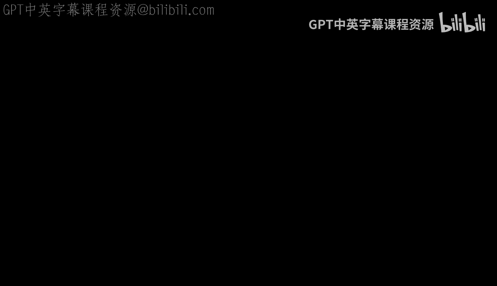
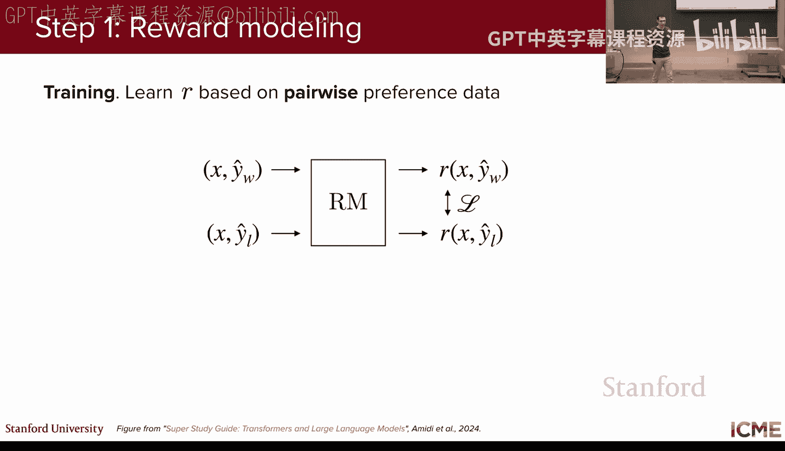
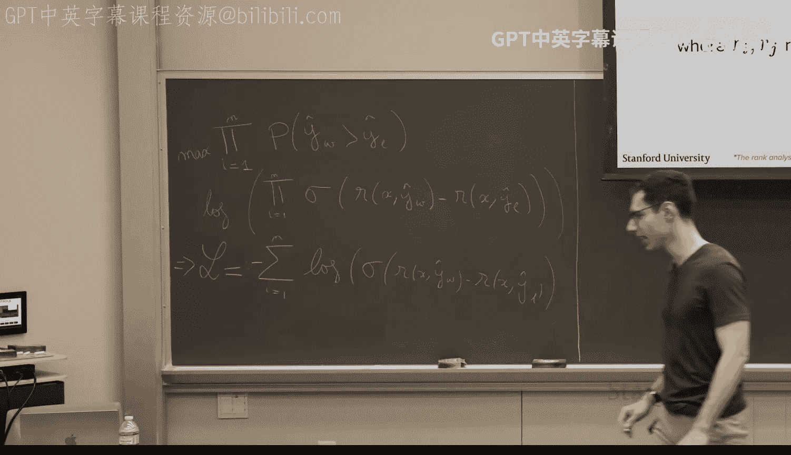

# 斯坦福大学《Transformers 和大语言模型｜CME295 Transformers & LLMs Autumn 2025》中英字幕 - P5：Lecture 5 - LLM tuning. - GPT中英字幕课程资源 - BV1WGsMzCERB

Ku。Hello， everyone。And welcome to lecture 5 of CME 295。So first of all。

 thank you all for taking the time to take the midterm last week。

 so I hope it was reasonable for you， so for those of you who are auditing。

 in case you are interested in taking the exam， just know that the exam and the solutions are both posted on the websites。

And so now you know a little bit how the exam looks like。

 so for the final we'll have the same format except that the content will be on lectures five。

 so this one up until night。So I'll go down that point。Cool。Great。

 so with that we're going to start the lecture， so today we're going to talk about LLM tuning。😊。

So as usual， we're just going to recap what we saw last time。So last time was already two weeks ago。

 but we talked about how to train an LLM。And in particular， we've looked at two important steps。

So the first one was called pre training。Where you're basically taking a model that has been initialized and you're trying to teach the model about language。

About codes。So you have this step that is very time consuming， expensive， compute heavy。

 that is happening on a lot of data。So we've seen training optimizations on how to make that happen。

 so we've seen techniques to parallelize that across GPUs。

 so we've seen data parallelism methods and in particular0， so the variant0，1，23。

 and we've also seen very quickly what model parallelism was in this case。So at the end of this step。

What you obtain is a model that knows about the structure of language， about codes。

 basically all the text that it has been fed。But what this model can do is only predict the next token。

So it's a great autocomp。😊，But it's not a helpful model yet。

Which is why you have a second step and we saw here it's typically called fine tuning or SFT for supervised fine tuning。

So here what we do is we take our pretrain model。And we train it for specific tasks。

So nowadays you have chat GPT and all these like chat assistant， so this can be one application。

 so transforming your model into an assistant。And so here the goal is to teach the model how to behave。

So the model already knows what language is， what code is， et cetera。

 and you're just trying to make it behave。Like the use case that you're trying to tune it for。

So typically here， what you have is a data set that is much smaller in scale。

But of much higher quality。And you're basically taking your model， your pretrain model。

And teaching it exactly which tokens to predict with the next token prediction task。

And we've seen Laurara， which is parameter efficient method， which does not tune all the weights。

But in a clever way， introduces low rank matrices that are the ones that are being tuneed。

And we had stopped there。So what we're going to see today is how to align the model to align with what we call human preferences。

And so here we're taking our model that has been fine June for a specific task。

And trying to align our model to make it more something that a human would like。

 or that some metric that we're defining would be more aligned with that。So as an example。

 let's suppose if you have an assistant at the end of step two。

So it's very much possible that your assistant is behaving the way you want， but not。

 let's say at the tone that you want， so it's not， let's say friendly or it's not safe。

 so you want to tune those aspects in that third step。Cool， so this step is called preference tuning。

And we're going to exactly see what that is。So here for context。

 let's suppose that we have an SFT model， and so by SFT model I mean a model that has gone through the pretrain stage and the fine tuning stage。

And so for instance， we may ask our model to suggest a new activity we could do with our teddy bear and here the model let's say response with。

 I would suggest you to not spend much time with your teddy bear at all。

So this is the response of an assistant， but it's not necessarily aligned with what we want。

So the idea here。Is to take these quote unquote bad output。And find。

An output or rewrite an output that we would want to have instead。

So this pair would be what we call a preference pair。So in other words， given this prompt。

 we have two responses。One that we want to see， which is this one， I'm going to read it in a second。

 and then the other one that we do not want to see。So for instance， in this example。

 the answer we want to see is， of course， the lib bears not only make awesome companions for a delightful sleep but also can also be great buddies for fun activities and just like suggest some activities。

Does the set up some goods？Yeah。So long story short。

 we want to align our model with human preferences。So。You may ask， you know。

 we have this fine tuning step already。 why would we want to have a third step？Well。

 during the second step， which is the fine tuning stage， if you a member。

 what we did was construct a very high quality data of the kinds of prompts on which we want our model to behave in a certain way。

So in order to compose such a data set。It's actually something that is very time consuming and very actually difficult。

Because the data set must be of very high quality。And in this case。

 what we're doing is not really teaching the model exactly what it should generate。

But rather telling the model what kind of output it should prefer。😡，So we're less in you know。

Please generate that kind of thing and more in you know I prefer this option kind of thing。

And so typically， I don't know if we ask you， write a poem， write a great poem。From scratch。

 it would typically be much more difficult to do rather than just showing you two poems。

 one bad poem and one great poem。And ask you to just say which one is better。

So in order to obtain the data sets， it's already much easier。

The second reason is so during the SFT stage， when we compose our data set of very high quality。

There is one aspect that we really try to get right， which is the distribution of prompt。

And what I mean by that is if we have too much of a given kind of prompt。

Our model will be more biased towards responding in that particular way。

So what people try to do is to be careful about the distribution of prompts that are in the SFT data。

And so here， let's say if our model misbehaves， if we were thinking about just adding one example in the SFT data sets。

Well， we would have to be very careful about which prompt we're adding and whether it's not going to bias the model like too much in that direction。

So that's the second reason， and then the third reason is what I mentioned which is the SFT data is typically very high quality so if you're looking at all the missteps that your model is doing and trying to put that in the SFT data。

 you're just have a hard time takes a lot of time。But one note here。

Is if your SFT data is misbehaving a lot。It may also be due to the fact that your SFT data has some problem。

So preference tuning is not the answer to everything。

 maybe it's better sometimes to just check your SFT data sets for some issues。That sound good， yep。

Yeah， so to do that in the preference tu stage。 Okay， so the question is we saw Laura for SFT。

 What is the equivalent for preference tu So we'll see that later in the in the lecture。

 But you can think of Laura as being。Some way to， I guess。

 reduce the number of parameters that you need to tune that is slightly different with the objective function that you're using to train your model。

 and here preference union， you can think of it more as a different objective function。

 but it may very well be something that you also use Lo for。So the two are not incompatible。

But it will become more clear， later on。But yeah， great question One last thing I will add here is another difference with the SFT stage is that preference tuning allows us to inject some negative。

Signal。Because SFT is all about teaching the model about what it should predict。

But it does not teach the model about what it should not predict。

And we will see that preference unit allows you to inject some negative signal。Cool。So two starts。

 of course， we need to have our preference pairs。And so we're going to look at this data collection step first。

So here's the setup。You have a prompt。Let's say write a poem and you have a given response。

 which is the poem that is being generated by the model。

You have a few ways to construct your preference data。

So either you start with kind of a pointwise mindset where you score each proposed poem with some kind of pointwise score。

 and here pointwise score means a score just relative to one observation。You could very well do that。

But I would say it's kind of hard。It's kind of tough as a human to say， okay， this one is't 0。9。

 this one is like a 0。2， it's not super clear exactly how you would scale that。

The second idea is for you to get two observations at the time and for you to say which one is better。

So this one is called pair wise Pre data。And it's much easier。And then the third one is list wise。

 which is you get a list of， let's say， n poems， and then you just rank which one is best。

 which one is worse， et cetera， et cetera。And I guess this one is easier than point wise because you don't have to specify。

 I guess how much better it is， but I guess it's still a bit more complicated。

And that's the reason why people typically use Parawise。So what they do is they collect。

Parawise preference data， meaning for each prompt， they have two possible answers。And then。

They just specify which one is better。And so that's the one we'll continue this lecture with。Okay。

 so now you may ask， okay， great Parawise preference data， but how do you get it？Well。

 here is the recipe。😊，So in order to generate a pair of responses， so first you need a prompt。

And we've seen， previously， I think it's in lecture probably three that what you could do。

Was to generate different answers if you have a temperature that's positive。

 So typically what people do is they put this prompt， let's say， twice into the model。

With a positive temperature， and then they can get two different answers。嗯。

The prompt is typically something where we wanted to follow the distribution of what the users typically ask。

 so the prompt X can be something that we obtain from the logs or from， let's say。

 a desired set of prompts。And then what we do。Is we have these two observations。

 so the first one is the prompt and the first response。

 the second one is the prompt and the second response。And what we do is we rate， we compare them。

So we can compare them with。Of course， human ratings。

But we can also compare them with some other metrics。So I'll just list a few。

 so we have LLM as a judge。Which you may have heard of。Which we have not seen yet。

 which we will see in a few lectures that is also typically used to just compare。

I guess how much better one observation is compared to another。We can also use some other metrics。

 rule base one， like blur， Rouge， et cetera， although it is not as used these days。And。

The simplest way to compare these two observations is to have a binary setting。Where you say， okay。

 is response1 better or worse than response2？But you could also think of a more nuanced scale。

Meaning， you can also say， okay， response one is much better， better， slightly better。

 slightly worse， worse， or much worse。So this is also something that you can do。

But there are some challenges with that approach。Because for instance。

 if you and not consider human ratings， a lot of tasks are a little bit subjective。

So in a lot of cases， actually what people do is。Having a pairwise preference data sets on the binary scale。

So only is it better or worse？Does that sound goods？Yeah， okay。

 so another way to obtain that data is。To have。To find in your logs。A response that you did not like。

To take that response and to rewrite it。Which is basically what we did here。

So here when we have the response here， what we did is take the response and rewrite。A good one。

So this is also what people do， but of course it is a bit more involved because you need to generate and I told you that generation was kind of costly and tough。

 but this is also possible。Does the data collection make sense？Yeah。Cool， okay。

 so now we have our preference data。And what we want is to align our model to prefer responses that were preferred by the rating and I guess down weight the responses that were not preferred。

And so in order to do that， we will see a method that's called RLHF， RLHF。

And we'll see that in more details in a second。But as the name indicates， RLHF relies on RL。

So I'm just going to start with some RL basics。So do we have any RL experts here？Yeah， no， okay。

 so no need to be an RL expert， so don't worry， we'll go really slowly on that。😊。

So in the ArL worlds。What people do is they have an agent。And here Im in agent in the URLL term。

Which interacts with an environment。So what does it do？It is at a given state。let's say time T。

It can take an action。At time tea。And it takes that action according to some policy。

The policy is typically noted pi。Pie of theta of the action， given the states。

So what that policy means。Is simply。Giving you the probability。😡。

A view taking an action given a state。Easy， right？And so given。That the agent takes some action。

It also receives some rewards。😡，So sometimes it's a good rewards， sometimes it's bad reward。

So what we're going to do is to leverage that mindset。For our preference tuning exercise。

So let's see together how we can transpose these quantities in the LLM world。So what is the agent？😡。

The agent is the LLM。😡，So in terms of the state that it is in。

So it's simply the input that it has so far。😡，So the action that it wants to do is to predict the next token。

 so it basically always wonders， okay， what is the next token given this input？

And this action or this next token is among the set of tokens that there are out there。

So if you want， the environment can be the set of tokens of your vocabulary。And in order to decide。

Which token should come next？The LLM determines that using the probability of next token。

Which is obtained by when you do your forward pass and when you look at the probability distribution as an output。

Which is basic KR policy。So our policy here is simply equal to the outputs of the LLM。

 given the input in order to determine the next token。So first some goods。

And now we're adding one additional thing。So I told you， you know。

 we're composing our preference data sets。 and we want to know which output is better than。

The other outputs。And so we're going to use that for a rewards。

We're going to somehow use that for a reward， and we will see how we would use that。

So I'm going to just recap that part， so we have our LLM take some inputs。

And then it wants to predict。The next token， it wants to take this action。So in order to do that。

 it uses the probability distribution that it outputs。And then。

The token that it predicts or the output that it generates。

Then receives some rewards that is going to feed back。Into tuning。The agent， and here's the LLM。

So the question is， wouldn't that be expensive if we do this for all pairs。

 why would that be expensive？嗯哼。😊，呃，养说。Yeah the question is what do you do in terms of how expensive that is。

 so yeah typically people take batches for instance， but I would not。

 so it is indeed expensive but we're going to see a little bit some order of magnitude and how that works。

 but you can think of this as being kind of a training procedure that could be seen as as expensive as some other training procedure。

 there' is nothing that makes these more expensive。

But we're going to see exactly- so I think there are some points that you're touching correctly。

 there are some parts that are added compared to the regular supervised。

 let's say supervised fine tunings setting， and we're going to see that in a second。

HSo the question is does the reward that you're getting from here。

 I guess powerful enough for the L andM to change， well you will see some expressions on the internet just characterizing this training procedure as you know。

 like it's nearly not as many signals as what you would get for SFT let's say because for SFT。

 you're literally always taking a partial input and making the LLM learn how to。

Generate the next token， but here you're only getting roughly one signal per completion。

 so yeah definitely it's more sparse and that's why you will see that RLHF is seen as more an approach that has sparse signals。

Yeah， yeah。Great question。 So the question is， do you apply reward for each token or for the whole thing。

 We're going to see this in more detail， but it's for the whole thing。For the whole thing。

 but we'll see that in just a second。や。So the AD and H Oh right。

 so the question is what is the AT and ST so just as a reminder。

 ST is the state that you're in and AD0 is the action you want to take。So in the context of an LLM。

The state that you're in for an LLM is the input that you have so far。

And then the action is which token you want to generate， given that input。Yep。 yeah， so first ses。

Okay perfect。So now that we know a little bit what a mental model could be for， I guess。

 LLM based RL。I just want to highlight once more that what we're trying to achieve。

Is learn how to align this policy。With。Rewards。So we want to learn Theta and Theta is the parameters of our LLM。

Such that paa Theta。Aligns with preferences。And that's where RLHF comes into play。

 so RLHF stands for reinforcement Learning from Human feedback。

And it is typically composed of two stages。So the first stage is you。

Figuring out how to distinguish good output from bad output。So here。

 all the preference pairs that you collected。Are actually used for you to learn what is good。

 what is bad。😡，So the input here is the concatenation of the prompt and the response。

And the output is a score。So you want to know given a prompt and a response。How good that is。

And then the second step is。The Rl step， the reinforcement learning step。

 and this is where you use the rewards。To align your model。With the preferences。

So here as input you have the prompt and what you somehow want to do is to be able to generate Y hatt that is more aligned with the rewards。

And by the way， I just want to call out one thing， so RLHF is reinforcement learning from human feedback。

The human feedback part。Refers to。The labels on which the reward model is traineded。

So if the preference pairs are based on human ratings。Then we're relying on human preferences。

 then we're in RLHF。Because you will see out there， there is also RL， let's say， AIF。

 reinforcement learning from AI feedback， and that one is relying on non human preferences。对嘅。Cool。

 okay， so now that we know what RHF is and we know that there are two steps。

We'll go through the first step naturally。So here the idea is we want to construct a model that knows which。

Output is good。Which output is bad？And of course， here。

 what we want is to not only consider the output， but also the inputs。

Because you need to somehow contextualize that answer。So let's go with our favorite example。

 so let's suppose you have the following prompt， suggest a new activity I could do with my teddy bear。

😊，So what you want？Is to have a reward model that here we note RM。😡。

That tells you that the answer that we rewrote into the good answer is good。

And we want to somehow have that model that tells us that the output that we constructed that we did not construct。

The output that we saw was bad。Ease bets。So we want to somehow have a model that takes in the prompts and the good response I say it's good。

And want to somehow have a model that takes the prompt and the bad response to says bad。

So now the question is， how do you construct such a model？Well， in order to do that。

We are using a formulation that's called the Bradley Terry formulation。

So that one is an important formula。We just stay here for a little bit， so what it says is。😊。

That the probability lessless you。To have an output Yi。Be better than an output Yj。😡。

Is equal to an exponential of sum score， which is a score with respect to I。

Over the exponential of that score with to I plus the exponential of sum score。Respect to Jay。

So that is called the Bradley Terrier formulation， and this is the formulation we will use to build our model。

So here it's also equal to sigma of R minus Rj。So who knows what Sigma is？Yes， exactly。

 so it's a sigmoid， so just as a reminder， sigmoid is one over 1 plus exponential of minus x。

So this is how the graph looks like， so when it's minus infinities， it tends towards0。

 and then when it's towards plus infinity， it tends towards  one。So in other words。

If I is better than J。😡，What we want is for the input to sigma to be as high as possible。😡。

Because you want the probability to be as close to one。So you want to somehow。Have。Are I be high？

If the output I is good。And somehow are J to be low， if the output is bad。So first of Woods。So here。

What we want to do is to somehow。Train a model that is able to output。Scores R and RJ。

Using this formulation。So this formulation involves two quantities because we have a pairwise data set。

So first of goods。Okay， so it will become more clear in a second。 So here for training。

 the idea here is。

You have some model that you initialize。😡，And you input on the one hand。Your prompt X and。

Youre winning outputs， so I'm saying winning， so it's Y hat W。You put it into the model。

It produces score R of x and y hat w。😡，And then you have a second output， so x and Yl， y hat L。

 which is the losing output。So you put it into the model and it has the second score。

And now you somehow want to have a loss function。That takes into account these two scores。そう。

Based on this formulation。Do you have some suggestion as to which last function to use？

So here our last function would be parawise。一。Yeah， so the proposed answer is a binary chenttropy。

 so can you explicit that a bit more？嗯哼。😊，Okay， so I guess in that case， what would it be。Yep。Yeah。

Yeah， yeah exactly so I guess yeahs a great great answer。

 so I guess your answer is having some negative log likelihoods of this quantity。

 which is so the cross entropy can be seen as kind of a special case of this。😊。

But just so that that we make sure that we get this part。嗯。So in our tool just。Get that formulation。

 which you mentions again。I guess。One idea that were couldn't have。Is given our data？

And given this formulation that we saw， the Bradley Terry one。To find。Prirameterters theta。

That maximize the probability of that data happening。😡，Which basically leads to what you mentioned。

So here I'm just going to write what that means so that just we can。Kin of be all aligned。

 so here it's。So let's suppose you have a preference。Data sets of， let's say。

 you winning example associated with losing example， so you have a bunch of tears like this。

So let's suppose that theses they happened。Independently of one another。So what you want is。

To find parameters that somehow maximize the probability of you seeing。Those examples。

RightSo here what that means is we want to somehow maximize。The product of， let's say， this。

N preference pairs， which is the probability of you know like some output W being better than some output L。

And we saw that。With the Bradley terriria formulation， so we have this formulation。

Whi is basically the product of。Why I want to end of this sigma of。This reward。

 which is basically a function of the input prompts and the outputs。Like this？

So what I'm doing here is to just reconstruct the la from first principles。

So whenever you see a product of probabilities， the first thing you need to think about is。Yes。

 log because this can become very small so it can cause instabilities。 So if you take the log。

If you want to maximize the product is's the same as maximizing the log of that。

 So if you take the log of that， So let's suppose I'm taking， let's say the log of that。

Let's say I'm taking the log of that。So it's basically equal to the sum。Of the lug。Of。Sigma of our。

Of the winning。Minus the one from the losing。So we want to maximize that。But people in ML。

 they like to minimize things。So， we're going to take。Like have a negative in front。

 so maximizing plus the sum of the log is the same as minimizing minus the sum of the log。

And so this。Will be our last function。Does that make sense？And this is exactly what you mentioned。

And。Typically， we write the expectation。And this is our last function。

So our last function is minus the expectation of log of sigma R and x and y hat w minus the reward of the losing。

Sounds good。So here the last function is pairwise。But the reward model。

 is it pairwise or is it pointwise？Like I guess do you need a pair to make a prediction or do you need just one？

Do you pair？Pair， well， that's the beauty of things。 You don't need a pair。

 so you're just training it pair wise， but it's actually point wise。

So I think that's one thing I kind of realize， you know。

 I look at this loss and you know this is a beautiful thing。 So you're training in a parawise way。

 but at the end of the day， you have a reward model that takes in。

One prompt and its outputs and just outputs one number。

And we saw that it will try to output a high score。

For winning examples and then a low score for losing examples。

So this is our reward model and I'm looking at the time I'm actually not on time。

 so I'll just move on。So typically here， what you would need is a set of data。

 which is typically under the tens of thousands or maybe even more。

And here the label would be the preference rating。The preference here should come from humans if we're talking about RLHF。

And in terms of model， well， you have a bunch of different choices。So as we know now。

 models that are decoder only that predict the next token。Are very popular。

 so you could very well take such an LLM and just have some classification heads at the end of your sentence that you're taking into consideration and then use that。

To predict the rewards。Or if you'll remember， we've also seen encoder only models in the beginning of the class。

 So for instance， B， you could typically also project。

The embedding of the CLS token could very well be an option。So typically what people do nowadays。

Is take the LLM route。Because everything is an L and these days， so it's like decoder only。

 you just put a classification head。And so people have also come up with benchmarks。

To evaluate how good you're doing。So just put a reference here， reward bench， case you're interested。

 is a pretty popular one。And。不讲。So at the end of this。

 you get a reward model that takes in a prompt and a given response。And gives you a score。Yeah。

Exactly， so the question is in some tests， the human preference would be something。

 but in another test it may be something else， so typically those rewards there with respect to a given dimension。

So they can be， let's say。Is the output useful？Or is the outputs arefriendly？Is the output safe。

 So all of that are different dimensions so they can be different reward models。

You can also have like some holistic score as well。But yeah。

 so you need to define a dimension across which you're actually。

Quantifying how good your response is。So the ones that I mentioned are the common ones that you would find。

Another that will say as well。While we're at it， so human ratings are very sensitive to the guidelines that you are also exposing。

 so we're not going to go into details here， but one important aspect of human preference data is to make sure that the guidelines you're telling your rate。

Are as objective as。It could get， I mean， sometimes you cannot have them be super objective。

 but you have the I guess the task of just making sure they're clear enough so that your human preferences。

 they're not noisy because they can be noisy， but that's also one challenge。Yeah。So the question is。

 is the reward here like a regression or a classification， So let's look at。

Add the loss function and here。So， well， it's kind of hard， I guess I will say。

Because the reward can be kind of something that can be interpreted as a score。

But we have a probabilistic formulation。So I'll probably frame that as a classification task because you have preference data。

 is it better worse， so it's like1 or0， but at the end。You use the rewards。So it's not， I guess。

 purely a classification task because at the end you have this。

 but one thing to note is that the scale that these rewards are at is typically something that is scaled itself。

So at inference time， you have some normalization procedure that normalizes that across your batch。

But yeah， I would probably characterize the formulation more as a probabilistic one， I would say。有。Y。

Yeah， so the question is do we normalize the score so there are many different methods to I guess normal things we typically do。

 we typically do normalize， so I guess if you're in a regression setting。

 you're trying to predict some score on a given scale which you're not doing here。

So it's kind of free form here。So yeah， so there is some rescaling that happens。Y。

 you had a question？Yeah， the question is can you tell us more about what the output of a reward model is。

 so we're going to see that a bit later， but you can think of you know goods outputs as being。

 let's say one。Bad outputpost as being a minus2， minus3。So it's basically on the continuous scale。

 if you wants。We're going to see an example in a little bit。 So hopefully this can。

 do you have a question， perfectf， We're going to see an example。 So hopefully this will be clear。😊。

5。嗯。So what we did is train a reward model。Now， the second step is to use that reward model。

To align our model。And by model， I mean the LLM。The LLM that went through the pre training stage and the SFT stage。

Is the model that we want to align with human preferences？

We're going to do that using reinforcement learning。

And we're going to do that using the reward model that we just constructed。So the reward model here。

Is the amount that we obtained in step1？And it allows us to distinguish。Good outputs and bad outputs。

So here is a general recipe of how you would align your model。So first you would take your prompts。😡。

As inputs。Your LLM will generate。A completion。So here a completion means like a full response from the model。

So by the way， completion， people use also the term rollout。So it generates a completion， a rollout。

 a full response。And that full response along with the prompt。Goes into the reward model。

So as we saw， the reward model right now knows if it's a good， if it's bad。

 let's say right now it's bad。😊，So in practice， it does not generate the thumbs down。

 it generates some scan of score。 So if you want like -2， let's suppose。So we take。

That reward into consideration。And then what we do is we tune the LLM。😡，With this information。

So it's more complicated than that and we'll see how we go about doing this。

 but this is the general idea。So just as a reminder。

The reward model is the model that we trained as step one。And it is a model that is frozen。😡。

We're not training the reward model， the reward model has been trained。😡。

The model that we're training is the LLM。😡，So I think that's an important point to note。And。Argo。Is。

To optimize for higher rewards。But then。Without going too far from。The initial model。

So I think optimizing for higher rewards， I think everyone agrees with me。Right。

But I just said a second statement， which is， but we don't want to go too far from the initial model。

So why would that be， like why would we want to not deviate too much？From the base model。

So one suggested answer is it will catastrophically forget what it has learned。

 Why would that be a problem？Great， yeah， I think it's a great way to put it so the suggested answer here is you have all this knowledge in your initial model which is pretrained and then instruction tuned or tuned and you don't want to move away too much。

 this is exactly it。😊，So that's one reason。What could be another reason。

 so definitely one it's a very， very good reason， what could be another reason。Yeahep。Yeah。

 so overfitting on that data。 So can you tell me more。Yeah， great point。

 so the second suggested answer is you can overfit on a data that is not super clean and I will go a bit more into detail on what that means。

😊，Yep， you want to add。Y， yeah， exactly。 so I guess your two points are I guess along the same lines which is the reward model can be noisy。

 so that's exactly it。 so it's a phenomenon that's called reward hacking。😊，Where。

If you are trying to optimize too much for the rewards。

You're basically assuming that the reward is exactly。Quantifying what you want。

 but it may not be the case because the reward model itself is imperfect。

So just to make sure that everyone gets the point， I' going to illustrate that with an example。

So let's suppose that。I'm giving a lecture。And。My objective is for the lecture to be as informative as possible。

So I can take the choice to have something that I can quantify to know if what I'm saying is informative。

 so let's suppose if my reward is how loud the claps are at the end of the lecture。

 if the clapping is very is a lot or not。The problem is。If I optimize too much。

For the volume of clapping at the end。It's maybe the case that。

I found out that you all like jokes and I start making jokes， and then you clap at the end。

My reward is maximized， but my objective is not fulfilled， which is make the lecture informative。

So in practice， this reward hacking phenomenon。Is something that leads your model to optimize too much。

😡，On a metric or a score that is imperfect。So it can very well maximize the rewards。

 but not fulfill what you want。And this is exactly what the idea behind reward hacking is。

So yeah and another reason by the way sos one reason is because your base model is already great。

 it knows a lot of things， second one is because the reward model is imperfect so you have this reward hacking phenomenon the third reason is also because you can have some training instabilities。

Anyways， we have a bunch of reasons why we don't want to deviate too much。And so in this setup。

 you typically have。More observations than in the reward model case。

 So you have typically at least 100 k observations。

And the label that you get here is from the reward model。And so you start。With。

The model that you obtain that after your SFT， so that's the one that you train。

And the last function will be。Something that will try for you to maximize the rewards。But also。

To not have you deviate too much from the base model。

 So we're going to see exactly how we can do that。But that's the idea of how our last function will look like。

 it will have these two parts。That's good。And as we saw。

 so we don't want it to deviate too much because of reward hiking and instability and so on。

So in order to do that。You may have heard a very popular algorithm。That's called PPO。

So PPO stands for Proximal policy optimization。So the reason why it's named。

Proximal is because we do not want。Our model to deviate too much。From the base model。

 and we're going to see how we do that。So this is roughly how our last function will look like。

So we'll have a part that is a reward model that we want to maximize。

And then some other parts that is around。Measuring how far。

The distribution of the policy that we're training。Ease。To the reference model or the base model。

 So here， the reference model would be。Your SFT model。So you have these two parts。

Does the formulation of the last roughly make sense so far？That makes sense。Who okay。

 kale divergence。 So I'm just talking about kale divergence。

 but I don't want to just assume you know what that is。 So the kale divergence。Is。Some measure。

 I don't want to say distance because distance has a lot of connotations to it。 It's not a distance。

 but is' some measure。Of how far two probability distributions are。

So you take a probability distribution， let's say P and another one probability distribution Q。

 and you compute this。Formula， which is the sum of P log of P over QI。

Just gives you a number of how distant or how far this two。Probity distributions are。

So you want to minimize。The last。So I guess you want to minimize。How far they are。嗯。

Does that make sense？That we're using this。Y， okay， so just one little question， okay。

Is the kL divergence positive or negative， or its like， what can you tell me about the KL divergence？

Have you seen the y。Is positive， why is it positive？Yeah， but why？So maybe we can come later。

 but great， great。 I think you know the result is here， but I guess I want to know why， yes。

Yes exactly so yeah if you use Jenen's inequality because when you look at this formula。

 I mean luck can take like positive and negative values it's not super clear。

 but yeah the way you prove that is always positive or equal to zero is with Jenens's inequality。😊。

And so yes。This quantity is equal to 0 if and if， P and Q are equal。Cool。So with that。

 we're going to go a little bit more in depth。Into。The last function。

 So I mentioned that the last function tries to maximize for rewards。

But also make it so that the model does not deviate too much。From the base model。Well。

 there's something that I've。Like， kind of。L a little bit about you。

 which is we don't want to maximize rewards。We actually want to maximize a quantity called advantage。

So what is the advantage？So you can think of the advantage as being。How much better？Ease。

Your outputs。Compared to what you would expect。So。People typically use advantage to make the whole process be。

 I guess， more stable， the training more stable。And。We estimate that advantage with。

A function called the value function， which we will see in a little bit。 Did you have a question， No。

 no question， So we have two quantities right， we have the reward that we saw previously how to compute。

 which is given a prompt given a completion。How good is this prompt and completion？

And then the value function is another estimation。But this estimation is not at the completion level。

 it's actually at the token level。So what we're doing here。

Is we're taking the prompt along with the partial。Generation as inputs。And we're trying to estimate。

What the reward would be？If we were to continue to generate the output following the policy。

So I'm just going to repeat this one more time because it's charge in meaning。

The value function is a token level estimation。Of the rewards that takes in partial inputs。

And predicts。They reward。So。If that predicts the reward。

 if you were to follow the policy in your generation。So this file function。

Is something you will see in papers as something that people have to train when they do PPO。

And it's typically because。People need to have this value function when they compute the advantage。

That I mention above？And these value function。Is typically trained jointly。With the policy。

So in other terms， you have your LLM。Which is initialized as the SFT model。

Which generates the prediction。So what you Tp do？Is also have some head， value head。😡，That also。

So this time is not a classification problem， it's a regression problem， you try to estimate。

The final reward， if you were to continue to generate according to policy。

So this is typically something that you also need to train jointly with the policy。And。

I am intentionally not going too much into detail as to exactly how that advantage is formulated。

 it is just beyond the scope of this class， but in case you're interested。

 I would highly recommend reading this paper which is mathematically involved about generalized advantage estimation method which people typically use for this。

So it's this high dimensional continuous control using generalized advantage estimation paper。

 if you're interested， just feel free to take a look。

But this is typically the method that people use。To estimate these advantages。

So now we're going to see in a second。Where those advantages are used？But just at a high level。

 does that make sense to everyone？What we're trying to achieve here。Yeah， so in other words。

What we want？Is to maximize the rewards， but not deviate too much from the base model。

But what we want is to actually。Find a way to。Make the rewards a bit more relative as to what you would actually expect。

So you want to compare the rewards that you're obtaining。With。

Kind of an average response if you want， like the idea is， okay， if you are having a great reward。

 what would be the reward kind of in the average case and you want to still maximize that。

And the reason why people use this reward minus baseline。

Is because it reduces the variance of these estimates。

 and it just makes the training just kind of go faster， typically。So that's why people use that part。

But in order to compute the advantage。What people use is a method called generalized Adv estimation。

 which you can think of it as like a big formula with some hyperparameters。

That is in the paper below。That's a general idea。Cool， so okay， looking at the time。

 so we're going to look at two typical variants of the PLs。The first one is called PPO clip。

So the idea here。Is to prevent the updates to our model from being too large。😡。

From one iteration to the next。So what you have is this last formulation。Which is。The minimum of。

The ratio and we're going to see what that is， times the advantage and some clipping of that ratio between two bands。

 which we're going to see in a second， times that advantage。So before we go into details。

I just want to call out a few things that may seem like。

It's confusing because it was confusing to me。😊，So first of all。

That formula is expressed as L is equal to。But it's actually not something we want to minimize。

 something that we want to maximize。So what people typically mean by L is loss。So yeah。

 just know that we want to maximize that， we don't want to minimize。

The second thing is we're introducing a term called R of theta。This is not the reward model。😡。

So typically people use R to say it' the reward， but here is's not the reward。

It's actually the ratio in the probabilities between our policy。

And the policy from the previous step。Which is denoted pi alt， pi Theta alt。So it quantifies。

How different your policy at the current stage？Is to your old policy。So here when we say olds。😡。

It's not。The SFT model， it's not the SFT model， it's the model at the previous iteration during the RL stage。

Because here what we want is for the policy to not have updates that are too white。So first of goods。

Yeah。What is A， A is our advantage。😡，So you can think of it as this complicated formula that's a function of the reward and the value function that just tells you how goods。

Your piece is basically。Okay， so this。Complicated formula。

 we're just going to see why it makes sense。So。If the advantage is positive。It means。

That we somehow want to reinforce whatever was generated。

And so here our objective function will look like this， so if a is positive。Then this L of clip。

We look like some linear function。As a function of R， because it's r times a。

So it's a linear function， it's a function of R。After one plus epsilon。It will just be flat。

So why do we want such a shape for our graph？Well， we need to think again about what R means。😡。

So if a is positive。Meaning it's something that we want to reinforce。

We typically want the probability of whatever happened。To be increased。So we want R。To be higher。

But we don't want it to be too， too high。😡，So that's why we have this clipping mechanism。

So that's why we have this skipping here， we want to， I guess。

 maximize L so we go towards increasing R， but we don't want to increase r too much。

So that's the rationale for this。But when A is negative。😡。

It means that somehow what we've done is something that we don't want to do as much。

So in order to maximize L， what we want is to actually。

Decrease the probability of just generating what we generated。So we want R to be。😡。

Smaller because it also increases L。But we don't want it to be much smaller。

 we don't want too big of an update。😡，Which is why we have this clip mechanism here。

So in other words。This super complicated formula。Can we just intuitively explain with what I just mentioned？

Which is。If you have positive advantages。You want to reinforce。The fact of generating this output。

 because this is something that。The model light， I mean by model， I mean the reward model。嗯。

But you don't want it to update it too much， which is why you have this skipping and same when the advantage is less than  zero。

I guess you want to down weight。The probability of this output from happening so you want to have a smaller R。

 which is your ratio between the policy or training with respect to the old one。

 but you don't want to be too small either。Again， to not make too big of an update。

Does this make sense？Does this roughly make sense？Okay， roughly makes it okay cool。

 just I would just。😊，Recommend just rereading this formula， just remembering what I mentioned。

 and hopefully。It would make a bit more sense， but yeah。

 happy to answer any questions if there are any。Yeah。Oh， yeah。Yeah。Yeah。

 so a question is what happens where it's not continuous。 It's the same as Relu， right。

 like you you would basically use the same methods。 So yeah， the same， same thing， yeah。

So great question， question is why are you using from the previous iteration and not the base model because actually we don't want just to not be too far from the base model。

 we also want our updates to be not too extreme from one iteration to another。

And this is to improve with stability of training。So this is just like another additional constraint we want。

question is are we considering the base， we will consider it and I will tell you exactly but in this formulation we are not in this formulation we are not。

 but in the formulation we are using typically for LLM based RL we are。😊，And we will see how。Yep。有。

Yeah， yeah yeah so the question is how do you quantify R like what is R， what does it mean。

 so it's typically the probability of a token happening with respect to the input so you can think of the probability distribution that you get at the output of your LM so you would use that。

Cool， so this is the first variant that the P PO paper mentions。 It's called。PPU clip。

So the second variant that we have is the one that uses KL divergence， which is called KL penalty。

And this one。Is a function of the ratio times the advantage minus。The K divergence between。

The old policy， which is the previous iteration and the current iteration。So you had a great point。

 which is why are we using the olds？In fact， old means previous oral iteration， but nowadays。

 people use the reference。So it's just a change because this paper has been published in 2017。

 where in 2025 LLMs they kind of came more into something that was popular in the 2020s。

 yeah there's just been this difference in what you put there。

 so yeah it's indeed the reference that you would typically put in a KI diveverrgence。

The other thing that I will say is that。Nowadays， when someone wants to train。A policy using PPO。

They would typically use decal divergence。😡，And they would also maybe mix it with clipping。

Cliping thing with the old iteration， they were basically mixed to two。

There are many different formulations of what the loss can be， so what I'm saying is not always true。

 but this is what people sometimes do， they sometimes mix the two。Cool。

So I talked to you about PPO and how it allowed you to maximize rewards， maximize advantages。

By not making your model deviate too much from the base model and also from the previous situation。

But the problem is that for PPU， you need a lot of models。So you need your policy。

 you need your LLM that you're training， you also need the value function which what I mentioned is used for the advantage estimation。

You also need the reward model。Of course。And then you need the base model。

 so the base model is frozen， just the SFT model， just to be able to compare with the current policy。

So it's a lot of models。So now the question that you may ask is。

 do you really need to have all these models to perform well？And the answer is maybe not。

 maybe but maybe not。😡，And nowadays， there is a bunch of other methods that are becoming more popular。

So you may have heard of GRPO in the context of reasoning models。

 so we will look at GRPO in more detail next week for lecture 6。

But just know that there are many variants， so PPO is just one。Algorithm that has been very popular。

 and even within PPO， there's been many variants。 and nowadays there are many other algorithms。

They are being used。Yeahep。And yeah， if you want to just。Anticipate next lecture。

 you can also take a look at this paper from the dipipse team。

 so dipseick math limits of mathematical reasoning in open language models that introduces the GRPO algorithm。

 but if you don't it's fine， we're going to talk about it。Next week。

So I also want to talk about some challenges when it comes to。RL based approaches。

So the first one is you need to have this two stage process。

You need to first train your reward model， and then you need to use the reward model to train your policy。

But the problem is you do step one， you do step two， and then you realize， oh， wait。

 step one has a problem。Then you need to redo everything。

 So there is like a bunch of dependencies that can really make your life harder。

And just the training recipe is not the simplest。So that's one downside。

The second downside is about the number of hyperparameters that you need to tune。

So we saw beta from the KL divergence formulation， so that's one we have Epsilon from the PPO Keep version。

That's another one， the generalized advantage estimation， we have not seen the formula。

 but there's I think at least two hyperpoameters that I can think of。Anyways。

 you have a bunch of them。So of course， you some hyperparameters perform better than others and if you need to retrain then well。

 you need to do everything again。Then you have some instability challenges。

 so you can constrain your iterations to not be too wide to kind of control for that。

 but sometimes it's not sufficient。So in terms of the metric that you can use to monitor the training。

What is a metric you would use？So we're trying to maximize rewards in some sense， so TPK。

 the metric that you would use to monitor your training would be the average rewards。

But this is not like a great， I mean， this is a way to you know monitor your training。

 but this is not like the best way necessarily。So at least when it came to pre training and SFT。

 you had these cross entropyillas that you were monitoring that was really telling you how your model was able to you know。

Just reproduce the behavior you're trying to make its outputs。But yes， so this is another challenge。

And then the other thing is。In the oral worlds。In order for you to know which completion you should not do and which completion you should do more。

😡，You need to have some diversity。Whenever you generate。So if during the oral training loop。

 every time you have a prompt， you generate something。

And then you retry and you generate something else that's too close。Well。

 it's not great because you're not exploring the set of possible completions。

So this is another challenge you need to have in mind。

 which is you need to force your model to do some exploration。To see， I guess， what can be good？

And then the last point is。😊，I mean， a lot of you were not familiar with RL I as notT。

And it's not super clear why we would necessarily need RL to do this stage。😡，Also。

 I will say one thing。So this RL based training， you will hear a lot the term on policy training。

I just want to tell you what that means。So what is different between this and SFT？Is during SFT。

 we had some prompt and some response that we wanted our model to generate， to mimic。But here。

 what we're doing is at each iteration。We're asking our model to generate an output。

And then we're using how good that output is to update our model。

So there is a core difference between the two。Because in here， what we're doing is。😡。

We're asking the model to generate something。Whereas for SFT， we're just using。

some data that is not necessarily generated by our model。So on policy training。

Refers to training that involves the model generating from its current policy。And optimizing on that。

And this is in contrast with off policy training， which is relying on generations that are not done。

By the model that you're training。Does this make sense？Yeah， so this is a term you will see a lot。

 which is why I'm telling you。And yeah， so PPO is an on policy。Agorithm。Yep。

So the question is why don't we do SFT on this preference data， well SFT。

 you tell the model you should generate this given the input。

 then you should generate this given the input。But you're not telling it about things you should not generate。

Like let's suppose you have something that you don't want to happen。

Unless you rewrite that into a perfect sentence， there is no way for you in the traditional SFT framework to tell your model to not generate that。

But that being said， it's a great prompt because later on， in let's say， 10 minutes。

 we will see a supervised way。Of doing what we did with RL。But yeah， it would be in about 10 minutes。

But apartpart from that， does that roughly make sense？Yeahep。Perfect， too。In the next few minutes。

 we will see a method that is actually used more often than not。

And this is for people who have a reward model， but that don't want to do RM。

So why do you not want to do RL because it's expensive， you need a lot of models。

 so to your points it's indeed expensive because you need all these like models。

And you know sometimes it's just too hard to tune that training。

 so you have these methods called best of N。Or B？And the idea here。

Is to leverage the reward model that you obtained。In order to choose the output that you will return to the user。

😡，So the idea here is。You have a prompt？And you tell your models， okay。

 you actually want to have several generations， so you generate， let's say， four times five times。

And what you do is you give a score to each。😡，Prompt completion。And you just return the best one。

 the top rated one。Which is why it's called best of n， so you have n completions。

 you rate all of them， and you just return the best one。So you have your prompt。

 so our favorite example suggest a new activity I could do with my teddy bear。

 you put it into your SFT model， so you're not training your SFT model its as is。

And you're just generating， let's suppose， three completions。The first one is a great answer。

 the second one is no don't spend time with the teddy bear which is not a good answer and then the third one I think is also a good one take your teddy bear to a picnic。

You put all of these into your reward model。😡，And this is where I wanted to respond to you。

 like what is an output of the reward model， so it would be a score like this。So for instance。

 the first one would be know pretty good completion so it's like 0。8。

 the second one is not good at all， let's say minus2 and the third one is like let's say so so so in between。

So the best n method would select the top。Rrated one。Which is the first one。And this is the one。

That you would return。Okay。So。What is one problem with this approach？

So the answer is if the model is bad， then its going to be bad， that's fair。

 but I guess if you make enough completions with let's say high enough temperature。

 you will have some diversity。So it's a fair point which can be a problem。

 but let's suppose it's indeed a problem， but let's suppose it's not a problem。

 what is another problem that you may have？入。Yes， yes。

 so the answer is you query the model many times which is indeed the problem， so you're at inference。

 what you want is to not spend a bunch of money on compute。

 but here what you're doing is complete your prompt multiple times。

And this is indeed the main challenge with this， so you indeed skip。The RL training。

 but you're basically pushing all the work to your inference to the inference stage。

And this is just making everything so super costly， so when can it be bad？If for instance。

 you're in a case where you need to serve your model to， let's say， a bunch of traffic。

 it may not make sense for you just。Just from a cost time point。

So I would say before taking that route， it may be good to just assess what would be your inference traffic。

 what would be your training cost， and kind of determine that from there。And yeah。

 I think that's pretty much it， do we have any questions on that part？Oh yeah。Yeah。

That sigmoid would be softmax， are you talking about this one？嗯。So in that algorithm。

 you're assuming that your reward model is strange。😡，So the best of N approach is you do this。

This training， so I guess the sigma here is pairwise because you trained your model in a pairwise fashion。

But in the best event case， what you do is you just。

Use your reward model to score n times and you just pick the highest one。嘅。Yeahep。Yeah。

 the question is， but what if all the responses are bad， this is definitely fair a fair concern。

 and this is indeed a concern， so your model needs to be at least a little good。Yeah， yeah， yeah。

 yeah， exactly， yeah。Yeahep。Yeah。It'Great question， do you have any constraint on the scale。

 well depending on how your scaling is done， you actually don't care about the scale。

As long as you take the best one， the highest one。If you think about it。

 let's suppose if you scale it with let's say with a normal score。

 the highest one will still stay the highest one。So in this case。

 you actually do not care about the scale。Yes， you also don't care about that。Y。

 but typically the scaling matters when it is coming into play in the loss function。

Which is the case for RL。And so that's where people use some scaling mechanism。

 that's the part that matters。Cool， and with that， I'm going to give it to Shervin。Thank you， have。

So for this last part， we're going to talk about DO。

But I'm not going to tell you what DPO means just yet。

 we're just going to first listen to the complaints we had in the RL world and then see what we could do about it and then how have folks remedied it。

So the first thing that I'm going to repeat from one what E covered is that in the URLL formulation of PPO。

 you have to carry during your loss optimization a bunch of model weights so when you look at these。

Last function you have- so first， the policy of the current model you have to optimize for。

The one of the old model or the reference model， and then you have your advantage which hides the reward model。

 as well as the value function that we discussed， so like all these four。Which is a lot。

And the second thing is that， let's say。You go with the approach of best of， you don't do RL。

 you just generate multiple times and then pick the best completion， as Epin mentioned。

 and so you have these latency and cost issues。And just for the sake of thoughts。

For a thought experiment， let's suppose we had infinite money， would it be still fine？

So let's suppose you generate all of these in parallel。

So you would still need to wait for the maximum time of like the generation of an answer to give you a resulting answer。

 and then if you look at the distribution of latency。

 usually it's some shape that is not centered on a single point。

And when you look at the probability distribution of the max of， let's say， n answers。

 it will tend to be shifted to the right。So let's suppose you have infinite money， infinite computes。

You still have to wait more than you would have on a single pass。Do these concerns make sense？

And okay， so there comes the question that someone was asking。

 why don't we do supervision all this time？And this is the route that DPO folks have explored。

 so DPO stands for direct preference optimization， so instead of doing this expensive two step process of first finding some reward model and then iterating on the model's weight。

 it optimizes a single loss function that directly optimizes for the model's weight。

And as you can see。😊，There is no reward involved anymore， so no are。

And you have a way to formulate what you care about as a function of your preference pairs。

So in that last function， all you have is a bunch of。Variables and in the sigmoid functions。

 but within the parenthesesis， you have the probability of a given completion to happen。

And you have this subtraction operation that compares。

The probability of the winning completion to happen versus the losing one。

 so as you can see it's a direct expression with respect to these prevent pairs。

 which is pretty nice。And。If you look at it a bit closer。

You will recognize what E seen just mentioned regarding Bradlet Ter formulation because you have this expected value of log of a sigmoid。

 and then within that sigmoid， you have a difference of terms。

Where you can recognize the equivalent of what you saw as a reward term。

So I know it's a lot to see at once， the formula is not super pretty。Yep， do you have any questions？

And then we're going to discuss in a bit what that beta is and also how we obtain this formula in the first place。

Okay， and one thing I will mention before going to that is that the paper is titledYour language model is secretly a reward model。

 and the reason for that is that the reward like placeholder that you could identify from this last function。

Is expressed as a function of your policy。So you don't have any Rs in there。

 but when you express the equivalent of a reward， you find the expression of your model directly。

 which is kind of pretty interesting insights。Okay。

 so but now let's think together about how we got there in the first place。

So you recall from a few slides ago the PPO objective that we had。

 so we wanted to maximize rewards and minimize the distance of the obtained policy with respect to the reference one。

 which is this tradeoff between maximizing rewards and kill the divergence term。

 and then you have this beta coefficient that appears there that controls how much you want to penalize going further from the base model。

And what this paper did is that it wrote down this formula and it solved what would be the optimal solution。

So it expressed the optimal policy pi star。And when you derive this expression。

 so you get it as a function of R， so that other term that was in the objective function。

And so like all these steps have no extra assumptions。

 it's just a bunch of derivations that was done。And what you can see here is like the Z term。

That stands for a partition function， and that just normalizes things。

 But it's not something that is new。 It's like a function of the other。

Of the terms that were redeemed there。So when you rearrange these terms。

 you can equivalently express R as a function of this pi star。

So it's just like a rearraning terms between these two expressions， nothing too fancy。And then。

The key part of what this paper did is recognize this term as some reward。

Express it as part of a Bradley Terry formulation。So remember you had this probability of a completion of a winning completion being bigger than losing completion。

 and you had the sigmoid of like the difference between the two R's。

 so basically they took this formulation again and they plugged in the expression they had obtained for the optimal reward。

 which we had seen was a function of the policy。So at the end of it， you plug in things。

You have no more rewards， just a function of the other parameters。

 so you have this beta and only the policy in there。

And the last step is the same one as Apin was mentioning。

 once you have this probability that you want to maximize。

 you can turn it into a loss function and this loss function is what this paper proposes to optimize in order to tune。

Policy waits in order to align it with this preference data。

So I simplified a lot the quite heavy steps of this paper into these few steps。Do they make sense？

And the beta that we see here is the same beta as we had seen in the PPO formulation。

 so typically taken around 0。1， if you want some order of magnitude。

 so beta is a hyperparameter and all you want to optimize for is the policy and then the preference pairs you have them as inputs。

Makes sense。Okay， great， so now let's compare what this method gives with respect to RLHF。

So RLHF is this two stage training process where your first fits。

A reward function and then use it in order to do the policy update steps。

So as Ashin was mentioning it， it's quite heavy， we were mentioning it just before you need a lot of models in memory and then training stability is the concern。

 you don't have direct supervision， you rely on the policy of the current model to generate the next updates。

 so there is a lot of complexity in it。And as opposed to that。

 this DU formulation gives a supervised way to think about preference tuning where you just take these preference pairs and you directly fit a loss function on them。

And yeah， and instead of four models， you just need two because you had this pi of theta and then a pi Ref。

 which was your base SFT model， and you don't need any other model copies。

So now you might want to ask if it's much easier， why is not everyone just simply using DPO。

 so it's not as easy in practice， there are some pros and cons to each method。

And the paper that is listed below gives a very interesting study of you like the benchmarking differences and the steps to get there。

 so just to get the main lines， overall PPO performs better than DO and one great thing about DPO which is like this supervision。

 this direct supervision comes at the cost of sometimes fitting。

 something that is not the exact distribution that the model has seen as training time。

So this paper talks about it a bit， if you train via SFT on the preference related data。

 you could get better performance， but this shift in distribution is a challenge intrinsic to DO。

Because one thing that the DPO method enables you to have is just to not worry about that reward modeling at all and just get some preference data set out there。

But the issue with doing so is exactly that distribution shift。

So you could either train like SFT on it or generate it yourself and then rate it。

 but that is yet another cost that you would need to pay。Okay， great。嗯。And。Yep。Any questions？So明。Yep。

So the question is you are optimizing the parameters with respect to the base model， so yes。

 but it's not the base model it's the current one。 you have a base model that will stay fixed in the iterations and it occurs in the last function and you're indeed updating parameters and it will be like the preference tuned one。

Yep， so you have like two weights， two set of weights， one frozen， one that you update。Yep。

Okay great。Any other questions？Yeah， so the question is， instead of the reference model。

 could you use another model， another large model， So I think that is。That's an interesting point。

I guess that would be a different algorithm。And you might lose a bit demean of what you're trying to do because this preference tuning stage is trying to align your responses to what you prefer。

And you want them to align with respect to what you had learned so far。

 So if you like start from a different model and then you preference tune like a different probability distribution。

 you might。Be doing things that。Might not make as much sense from a loss standpoint。

 but I guess know the direction， I mean， I cannot tell like。Blanket answer there。 you know。

 maybe it could give like interesting behavior， but my intuition would tell you。

That the point of all of this is to start from the last train checkpoint that you had and then further preference tune the distribution of your completions。

Right， so like the suggestion was， you know， if you change a reference model。

 that could be seen as another SFT version of your model， yeah， I guess so。

Okay great and now the favorite my favorite part of today so do you all remember the completions we had obtained on our favorite prompts so can I put my teddy bear in the washer so if you remember last episode we had said after instruction tuning the response was no it might get damaged try hand washing it instead。

So does anyone have any complaints regarding this answer？So I can give you a hint。Teddy bears。

 they indeed should be handwashed， so it's factually correct。

But let's suppose it's factually correct， what else do you not like？I mean。

 could you not like about this answer？Yeah， so the suggestion was its asking to try it instead。

 and I guess like a broader point is it's a bit too rough。

It doesnn't sound super friendly and then someone who asked this question might love teddy bear so that you might want to tell them about it in a gentle way。

And this is exactly what preference tuning stage is about， we don't want to learn new facts。

 we want to focus on existing distribution of completions。

And align what the model should return with respect to what the human prefers。So on this intuition。

 the preference tune's answer could be like a gentler one， it's better not to。

 your teddy bear could get hurt， gentle handwa is safer。

 so it's conveying the same points but in tone that sounds like much better to the ears of the person asks。

Okay great， any questions on the DPO part？Yep。Yeah the question is like what are the tradeoffs and then which one is used in practice。

 so I think it all depends on your computes budget on how much you wants to worry about performance versus babysitting your training process。

 a PPO like the RL part is very hard to tune right to give the highest results。

But you might get almost at that level with much less effort。

 so I guess if you want to get like a quick preference tuning that is shown to show good results。

 but maybe not the best results then DPO is your friend and if you're an expert at reinforcement learning you know what you're doing and you want every last bit of performance then PPO might be like a better way。

Okay， amazing and with that。😊，Thank you， everyone。

