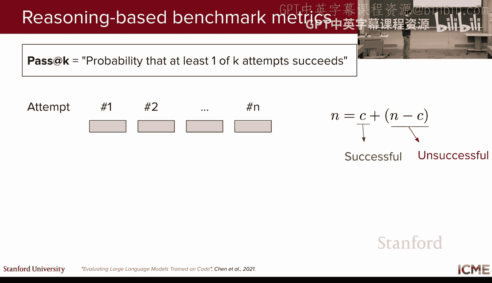
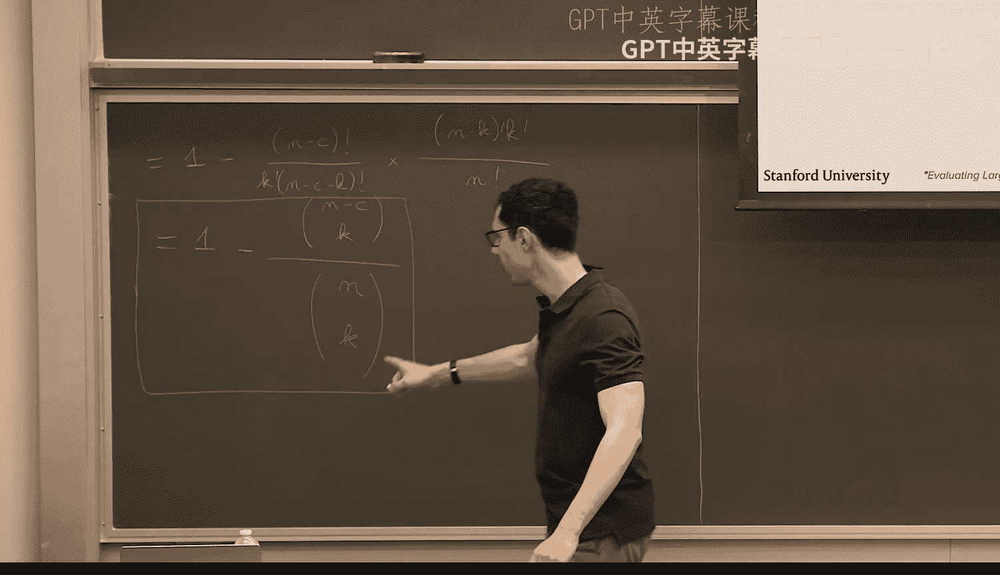
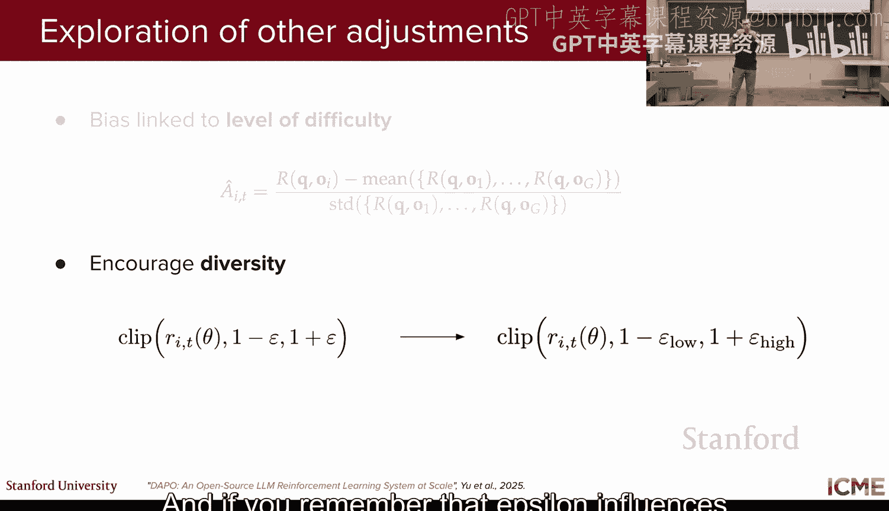
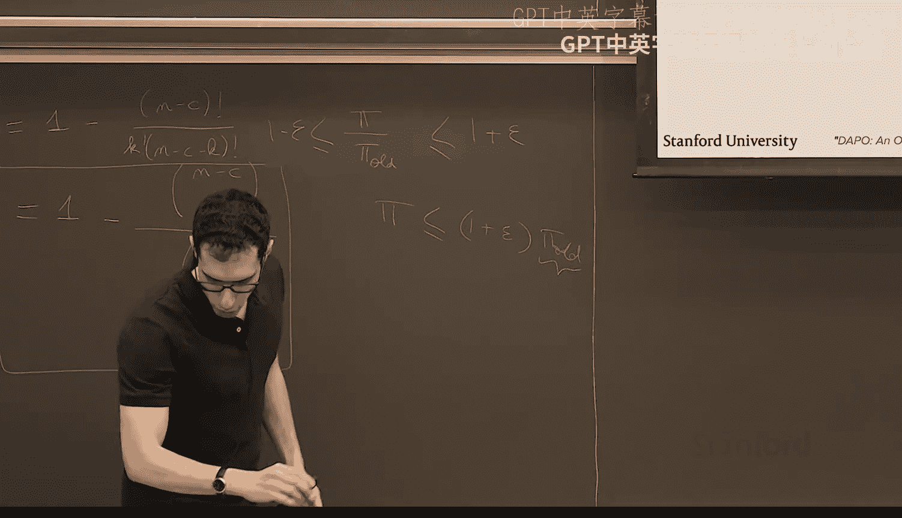
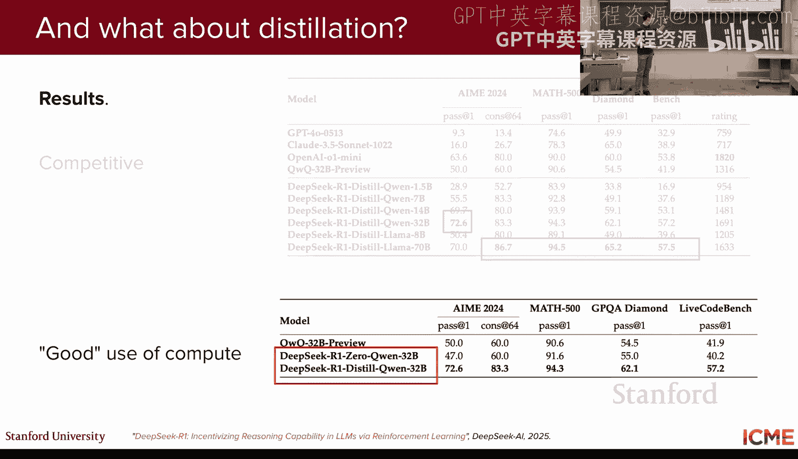
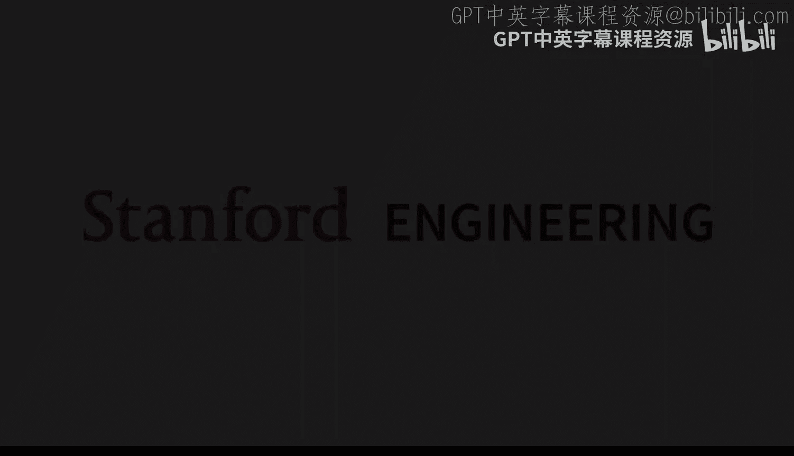

# 斯坦福大学《Transformers 和大语言模型｜CME295 Transformers & LLMs Autumn 2025》中英字幕 - P6：Lecture 6 - LLM Reasoning. - GPT中英字幕课程资源 - BV1WGsMzCERB

Hello everyone， and again， welcome to Lec 6 of CME 295。

So today is actually an exciting day because we're going to cover a topic that has been trending over the past year or so。

 which is。LLM reasoning。And it's actually a good segue compared to what we talked last time。

 which was preference tuning because a lot of the methods that we used in lecture  five are going to be the ones that we'll be using as kind of the foundations for this lecture。

So before we start， as usual， we're going to just cover quickly what we saw in the last lecture。

So if you remember， lecture four and lecture five， we're all about learning how we can train a model。

So in lecture 4， we saw the first part， which was the pre training part。

 which is the most compute intensive step。Where we basically teach the model， the structure of text。

 the structure of codes， and we do this very large， large scale training。

So at the end of this first step， which is the pretrain， we get a model that knows about code。

 that knows about language。But it only knows how to autocomplete a sequence。

And so that's why we also saw the second step， which was the fine tuning step where we take our pretrain model。

And we try to make it useful。So one use case that we saw was， for instance， an assistant。

 so we tried to tune it in a way that it can respond to questions。

And so here we have this work of preparing the SFT data， which is what we call the SFT data。

 which is a high quality created data set that we can use to teach our model on how to behave。

So at the end of this second step we have our model that is tuned for a specific task which can be responding to queries。

 and then last lecture we saw this third step。Which was the preference tuning step。

And here the goal is to align our model with human preferences。So we saw in particular RHF。

Which was a common method to do that。And we saw that there was two steps to it。

 so there was the first part。Learning to distinguish good from bad using human preference data。

And then there was this second step。Which was this RL stage， which is going to be useful today。

So in particular， if you remember， we had drawn a comparison between the RL setup that you may be familiar with outside of this class。

 where we have an agent that is interacting with，The environment。

And the way that it interacts with it is that given a state that it is in。It can take an action。

Following a policy。Which is nothing else than just the probability distribution over actions。So。

 given。Eates。Our agent can take an action following this policy。 And as the result of this。

 it receives some reward。And we saw last lecture that we have this nice comparison between the traditional RL setup and the LLM setup。

And so here our quote unquote， agent is just simply the LLM。

The environment that it interacts with is just a set of tokens that it can predict over。

So given an input that it has received so far。It can predict what the next token could be。

 which is the action。And it does that using the probability distribution。That is the result of。

 I guess， the LM prediction， and we saw that we can obtain human preferences。For each completion。

So you have a prompt， you have a completion， and you get those human preferences。

And this is the one that you then use。In order to tune the LLM。

Because here this step is about aligning the model with human preferences。

 and here the human preferences is encapsulated in the reward。

And so we saw that the last function during the RL stage is composed of two parts。

So the first part is this advantage maximization， and we saw that advantage was based。On the reward。

 and it has some baseline to just reduce the variance of the gradient。So we have that part。

 but we also saw。Another parts。Which was that we don't want our model to deviate too much。

From either the previous iteration， so we don't want the model to change too much from iteration to iteration。

But we also don't want our model to change too much compared to our initial model。

 like our base model。And heres the SFT model。And the reason why we don't want to change too much。

Is because our model has already learned a lot， it's already quite performant in what it does。

And what we want is to just align it with human preferences。

 which is not something for which we want the model to change completely。

And I think that was the part that I think was a little bit scary。

 which was the actual loss functions。So if you remember。

 the main algorithm that is typically used in the RLHF setting is PPU。

 which stands for proximal policy optimization。And there is this one variant that's called PPO clip。

Which is such that it clips。The updates？From one iteration to another。So here if you're member。

 R is actually not the reward， it is the ratio， and I know it's a confusing notation。

So it's the ratio between the current policy。And the old policy。

And the old policy here is the policy that is at the previous oral iteration。

So what we do is that we have a clipping mechanism。

Such that the ratio cannot go beyond some certain thresholds。

Such that we do not want to incentivize the model to make too big of an update。

And we saw another variant of PPO， which is called PPO KL penalty。And this variant。

Uses decay divergence。To penalize the model from changing too much。

So if you remember in the original PPO paper。We used the old。

Quote unquote Oldts version of the model， which is the one at the previous RL iteration。

 but in modern day RLHF training， these K divergenceencies CPK applied to the base model。

 which is the SFT model。So I guess long story short is。

We have these two PPO variants variants that were introduced in the original PPO paper。

But in modern day， our HF training。We typically have some。Combination。

 some mix of these two last functions。9。So up until now， we've seen what I want to call vanilla LLMs。

 which are LLMs that take something as an input， let's say， prompt。And just respond with some answer。

And so those vanilla LMs。😊，They have a lot of strength that we can enjoy。 So， first of all。

 we had seen that those LMs， they know a lot about structure of the text。

 They know a lot about codes。😊，So in particular， if you want to debug your code。

 I guess they are great to find where the error is， they are great to generate codes。

They're also great to generate I don't know essays or poems， they're really， really good at that。

But I do want to call out some witnesses。So the first， I guess。

 weakness that I want to call out in these vanilla LLMs。Is that they have quote unquotes。

 limited reasoning。So typically if you kind of have some sophisticated， let's say， math problem。

It will not really kind of come up with， I guess the solution because maybe it will get lost in the way。

 because up until now our model has been really trained to， I guess， given a prompt respond to it。

Using the kind of next token prediction， so I guess here there is not like really a big reason why it would be able to solve。

 I guess complicated problems。So guess that is one。So second weakness is that。

The LLM that we have has been pretrained on a huge amount of data。Which is static。

Meaning that the knowledge that the LLM has acquired。Is bound to the cutoff date。

 what we call the cutoff date。At which we cut and formed our protraining data。

So I know a few days ago we had an election， so if let's say we trained our LLM based on data before the election and let's say today we ask it。

 okay， who is the I don't know， elected official of let's say， X。

 it will not be able to answer us because it does not have access。To knowledge after that date。

So a third weakness is so far it's alt， no action， so you just prompt your LLM。

 but I guess if you want to， let's say I don't know。

 like place an order or I don't know do some action， you just cannot do it。

And then I guess the last weakness， which by the way， is not an exhaustive list。

 is contrary to traditional NLP models。LLMs degenes free form texts。

And it's hard to evaluate them in the framework that we， I mean， by we。

 the ML community has adopted up until a few years ago。So if you're familiar with it。

 let's suppose if you worked in the translation world。

 you would use rule based metrics like blue or for summarization Rouge。To evaluate your outputs。

 But then here， LLMs， they can really do more than just that。So it's very hard to evaluate them。

So what I want to say is that this is， let's say， a subset of all the weaknesses that Ls can have。

And the last three。Are going to be topics that we will cover in the next lecture and in the lecture8。

And as I mentioned before。The focus of today is reasoning。

 so we'll see how we can improve the way our LLM reasons。Cool。And again。

 this is a topic that's been very new and by new， I mean， roughly a year。

 so almost everything that we will see is either from 2024 or 2025。

And I guess we're lucky because now we have。Kind of enough hindsight to just know which piece is more important than other things。

And so the goal for today is going to be to know what reasoning models are。

And the second big goal is to know how they are trained。So hopefully at the end of this lecture。

If you have a good answer to these two questions， that means that we have done a good job。Okay。

 so let's start with reasoning models， where are they？Well。To answer this question， we first need to。

 I guess， define what reasoning is。And the bad news here is there's not commonly agreeds upon definition out there of what reasoning is。

 so I will try to define it。I guess to the best of my ability。😊，So here we define reasoning。

As the ability to solve a problem。And here by problem， we typically think more of math problems。

Or let's say coding problems。But hopefully， these abilities can also kind of spread to other fields as well。

And in order to solve this problem。We typically needs a multi step reasoning process。

Like a little bit like you， when you take an exam， when you have a question that's not trivial。

 you typically break that down into several steps and then kind of go through them and then come to the final answer。

 So I guess the idea is。Problems that are reasoning problems。 they would have some pattern of that。

So to illustrate this， let's just make sure we're all kind of thinking the same。

 so a non reasoning question would be something like what is the course code of Stans。

 transformers and LM+。So this one it's a knowledge thing， everyone knows it's CME 285。

But then as opposed to that， in contrast to that， a reasoning based question would be maybe a math question。

 so for instance， let's suppose we have a bear that was born in 2020。

How old is that there now in 2025， so that would be the kind of question that we're looking at。

Of course， this is super easy， you can think of like something that's much harder than that。

 and this would qualify。Cool。Okay， so now that we know a little bit what reasoning is。

Now we're going to look at how we can， I guess， obtain a model that can deal with these kinds of prompts。

So the core idea here is to leverage a concept we saw earlier in the class。

So I'm not sure if I remember， but back in lecture， maybe two or three。

We saw a technique called chainin of Thought。So who remembers what chain of that is？Yep。Yes。

 do you want to say what that is？Yeah， yeah， exactly。

 So the answer is you know thinking in steps be instead of just giving just a blanket answer。

 so great great answer。 So here just to illustrate， yep。😊，Yeah。Oh yeah。Great point。

 so the question is for some questions， you need to have some element of context。So for instance。

 here， you need for your LLM to know that this year， I don't know， today is November。

7eventh 2025 so yes great points so there are two parts of that so that specific question so typically LLMs they have something that we call preamble。

 so something that tells you about some context and typically the date is something that we put in the preamble so for this very specific case。

 the date would be an information that would already be I guess available to the LLM。

 but for some other problems you can very well have information or context that you do not have。

And in lecture seven， we will see how we can attach that and it's definitely something that will be very useful。

But for the sake of today。We will consider this more as being an extension of reasoning models as opposed to something that is foundational to how they work。

 but we'll respond to this part， I guess next lecture。Cool。

And so here we were about to illustrate what a China thought looked like。And so here。

 instead of having， as you mentioned， just a blanket answer。

 what we want is to explain also the reasoning。So the way Chefa did that was by having some in context learning examples。

That explicitly the reasoning。To encourage the model， to also do that before providing the answer。

So that's the rough。It's not a rough idea。 It's the idea behind Chafar。And here what we want to do。

Is to do that， but at a much larger scale。So I just want to build an intuition as to why this may help us。

So LLMs， they're basically trained with this next token prediction objective。

And so the way they respond to questions that we ask。Is typically to sound plausible。

In a way to maximize or optimize for the probability of the tokens that you want to generate to happen。

So if you have。A very hard problem that you're presenting to the LLM。

There are very few chances that that problem appears。In the training sets。

And so here the idea is to have the LLM。Decompose the problem into tractable ones。And then。

Rely on the patterns that it has seen。During training。To solve all these more tractable problems。

And then it's a little bit like you or when we were students， right， like when we give you a problem。

 you try to。Kind of link it back to something that you know。

 that you have seen a training time like doing your studying。

To solve them in order to find the answer。So I guess that's the intuition。

 I guess another reason that you can think of is when you let the LLM generate more tokens。

You're just giving it more compute if you think about it。😡，Because at each generation step。

 you have this whole forward path pass。And when you do that， more。You just give it more computes。

And we will see there is a term that is dubbed compute budgets。Which is。

 I guess the budget that you want your LLM to have to generate your response that we will see later on。

But yeah， so that also plays a role。So is everyone clear on the overall idea of what the prisoning model is？

Yeah。Okay， perfect， so just to make sure again that we're all clear on this。

 so up until now we had quote unquote vanilla LLMs。That had prompt some question as inputs。

And they were responding with something as outputs。And in our case。

What we want is given a question as input。We don't want to directly generate an answer。😡。

We first want to think。And here， I guess we think by first outputting a reasoning chain。

And then we provide the answer。So here， the LLM output is not just the answer。😡，It's the reasoning。😡。

Plus。The answer。And I guess yeah， I was saying that this topic has been very hot and trendy for the past year。

 so this is a little bit of a preview of the timeline of reasoning models。So reasoning itself。

I's a topic that has been studied for more than a year， but reasoning models。

Have started popping out？😡，Starting from Open AI's release of01 Preview。

 and this one was September of 2024。And then after that。

 you would basically have everyone just wondering how Open AI did it。

And so you had all these AI labs trying to kind of see what we can do to， I guess。

 increase the reasoning abilities of the model， so you would have everyone working on this。

And then you had Google's Gemininate 2。0 flash thinking that was， I think released in December。

And then starting in 2025。There was this dipyick R1 paper that was published in January。

Which made a lot of noise。Because what they were able to do was to match。Open eyes。

 reasoning ability performance。With a method that they were actually describing in their paper。

So that was the big moment， January 225。And then after that。

 all of these other models also had reasoning abilities added。

 so you had some models from XAI from Anthropic with clouds and then from other labs as well。

 also from。Mral， so this timeline is not exhaustive， but it's just to show you。

 I guess how recent these models are。And I guess one thing to have in mind is it basically started at the end of 2024。

Cool， so I know a lot of you， if not all of you are using LLMs every day as chatbots。

 like let's say TGPT or Gemini。And so I want you to know when the model that you're interacting with is a reasoning model。

So I have a question for you。I was having a discussion with Chad GPT the other day and I was wondering is this？

Using a reasoning model。I what do you think if you kind of stare at the screenshot？Yeah， wait。Right。

 exactly。 so the key word here is thinking， I treat they put it everywhere but。When。

These UI show you the thinking process。So what they do is actually so they don't show you actually the full reasoning process and we're going to see why。

But they tell you that they spend time thinking。And that time thinking is actually the time that is needed to produce the reasoning chain。

That can be， I guess， more or less something that takes time。And so for instance， for TGPT。

 you have this thinking that you can also change from standard to extended， et cetera。

 and you have this for other models as well。And in particular， the that use the quote unquote。

 thought summary that you see。Is not the raw reasoning chain， it's a summary of it。😡。

And the reason why they do that， I mean， I'm hypotheizing is one because the raw chain may not be something that is fully intelligible from human standpoint。

Second is because maybe you as a user， you don't want to read pages and pages。And then third。

 this is going to be what we see。If you have the reasoning chains， if you have the reasoning chain。

You can。Maybe train a model that you know is trained on these chain so it can basically mimic those abilities as well。

 so this may be the reason the reasons why you would typically not see the raw chain。

And when it comes to pricing， so we saw that the output of reasoning malls are not only the answer。

 but also the reasoning itself。And so you will see in， I guess。

 of these APIs that you're actually getting charged for it。

So you're not necessarily getting all the reasoning chain。But if you look at the dos。

 there is always， I guess a sentence or two， I guess that specifies that you're actually being charged for output tokens and those output tokens。

 they also include。Reasoning tokens。So I think that's also a good thing to know。嗯。And I guess。

From a user standpoint。This also gives an incentive to have。

The maximum reason ability for a minimum amount of reasoning token because you don't want to pay a lot。

Right。So we're going to see later on how we can deal with that。

 but this is just one thing that's good to note。Cool， so we talked about what reasoning was。

 or at least a tentative definition。We saw， I guess， the core idea behind reasoning models。

 So now we're going to talk about some of the benchmarks that people use to quantify reasoning abilities。

So the first one， as I previously mentioned， is about assessing the coding abilities。

And so here the goal is typically to solve a coding problem or to fix a bug。

So you typically have the following setup。So given a problem。You want to produce a solution。That's。

Is able to pass test cases。So if you have a solution that passes all test cases。

 then you have a solution that works。And this is our way of verifying that。

A response that was generated is actually a correct one。So that's for coding。

Okay so just giving you an overview of the kinds of benchmarks that are out there so we have human EV which is the screenshots here which I believe is a set of 10 something codingting problems that were human written。

 which is why it's called human E but you have then code forces which is coming from a website of competitive programming that some of you may know。

 and there is also Swbech which is I believe a set of problems that were derived from GitHub issues so these are like real practical problems。

 so you will see that these reasoning models。In the reports。They typically have results。

Along these benchmarks。So this is forco。Now for math。

The goal is to solve the problem and the way it works here is given a problem， you want the answer。

 and of course you're letting your model generate some reasoning。

And so here what you would do to verify that your solution works。Is byparsing the answer？Like。

Like so。And then comparing it with some ground truth。So here we can really know if。

The answer that your model is producing is true by comparing the two。So you will ask me， okay。

 how do you parse that so you can force your model and by force I mean in the prompt。

To output the answer in a way that can be passable， sometimes people they just put it in some box。

 in a box bracket， so there's a number of different ways to do that。

And this is how the problems look like， so you have some problem and then you can let your model generate some reasoning chain along with the answer。

 and then you have the answer here that you can compare to。

So I just want to add that the kinds of benchmarks that are out there。

Are based typically on problems that are actually not that trivial。

So a name that you will see a lot is aim。So I'm not sure if you're familiar with it。

 it's a math exam。To qualify for the US Math Olympias。

So there is a bunch of models that I guess quantify their performance based on that。

 there is also GSM 8K， which is a grade school kind of math problem。And。

I guess now your question may be okay， it's great， we have all these benchmarks。

 but what is the metric that you will use？To quantify that what you're doing is good or not。

And so there is one metric that you will see a lot。

And we're going to see that right now because it's not that obvious。

So that metric is called pass at K。So pass at K is by definition a metric。

That tries to estimate the probability。Theyre at least one of K attempts。S seedss。

So here what we're saying is let's suppose we're， I don't know， having some coding problem。

We tell our model to generate k answers。And pass at K is the probability that at least one of these k answers。

Paassesses。But this。Does that make sense？So by the way， why would you have pass at K。

 like why would that make sense？Okay， so it's not super trivial， so you may have use cases where。

You can afford to spend more time。To generate more answers。

If you know that you will get more chances to get it right？

Then you can spend more time to generate more answers so that can have the right one。

So in a problem like coding。The good thing is。You can check whether your answer is correct or not。

And so here the idea is。If you are in cases where you can afford to generate not just one answer。

 but multiple answers。Then it may be worth it to just spend more time。

 spend more compute to generate more answers if it means that the probability of getting it right in one of them is going to be higher。

So there is one technique that we saw last lecture that。E。K of familiar with this， best of N。

 do you remember？Yeah， roughly， okay， so best of N is this method that we saw last week。

 which was you generate n answers。And you use your reward model to score everything。

 and you take the best of all of them。So here you can think of it as being kind of the same。

Just that we do not have a reward model， we have a deterministic。

 verifiable way of checking whether something is correct。So it's very similar to that。And okay。

 so now we're going to spend just a few minutes just aligning our understanding on。

How we can estimate such a quantity。Yeah。That's a great question。

 so question is do you choose a particular temperature so I have a slide on that。

 so I'll just hold your question for a few slides。国。By the way， if there's any other questions。

 happy to， is there any other questions on this？Everyone is super clear， okay， cool。

 so what we want to do here is to estimate this probability。😊，But you may tell me， okay。

 just generate K attempts and just count the number of the attempts that are correct。

To estimate that。But the problem is if you only do these k times， your estimate can be very noisy。

Because by pure chance， I don't know， you may have one instance that has I't know three correct out of five and the other one one。

 so you want to have an estimate that doesn't have that much variance。

So what you do is you typically generate not k。But n answers。And out of these n answers。

You' are going to have。See of them that are going to be successful。

And then n minus C that are not going to be successful。And the question here that you ask yourself。

Is out of these n attempts？😡，You want to quantify。You're the probability of having at least one out of K attempts that is right。

 So the question here， if you have those n observations。If you were。To select， let's say， K。

What is the probability of having at least one of those k passing？That's the question。

So we're short on time， I'm going to actually derive that right now。

And the reason why I want to do that is because the answer is not necessarily trivial。

And I don't want you to be too surprised of how it looks like without kind of knowing where it comes from。

So we're going to derive that， so we want to derive the probability that at least one attempt out of k that we select out of these n samples。

Es correct。So in order to do that， I'm just going to。Write that down。So pass that K。

 so want the estimate for that。So it's going to be the probability。😡，That at least one。Attempts。

R ofK。Is correct。So if you've done some probability， there is like a very common trick。

 which is if you have a probability of at least one。

It's1 minus the probability of having all of them being incorrect。Do you all know that trick？Okay。

 so we're going to use that trick， so it's going to be one。Minus？The probability。Of having all。

K attempts。Incorrect。So fast the goods。Yeah， okay， so now were going to try to quantify this probability。

So what is the probability of you finding？An unsuccessful attempt among this end。

You have n minus c unsuccessful。You have n observations。Its going to be。N minus C。Over n。

So it's your first and successfuluccess attempt。So now what is the probability that you have another and sexual attempt？

Knowing this one。So you have n minus c minus1 other unsuccessful attemptss。Over。And minus1。

Because you already took one。And you continue that K times。N minus c minus k plus 1。

Over n minus k plus 1。Does everyone agree with me？So here we are quantifying the probability that if we take K。

Samples randomly among this end。That all K1s are incorrect。So here。

We compute this by computing the probability that the first attempt is incorrect。

And then the second one is incorrect knowing that the first one was incorrect and so on。

Which we have for which we have this formula。So if you sell it in probability class。

 it's basically the same as sampling without replacement。

And now the nice thing with this is that you can express that with a nice mathematical notation。

 so for people who know。So n choose k。Is equal to factorial n。Factorial K。Factctorial a minus K。

So this is by definition of what this quantity is about， so we're going to use that here。

So here we have。A series of products， so here we can express that as factorial over another factorial。

So here it's factorial n minus C。Over。Factctorial。N minus c minus k。And then this quantity。

 we can also express。Expressed that with factors。So it's factorial N。

And the numerator is factorial n minus k。Everyone agrees with the math here。I think that is yes。

And so here we're going to somehow。Ppped expression above up， so it's going to be equal to one。Mイus。

So。N minus E factorial over n。Minus C minus k factorial。And then K factorial。

And then here we're going to say it's this one。K factor， K factor。Over and factorial。

So here I did a trick。What I did was。I basically multiplied the numerator and the denominator by K factorial。

And so here I have one。Minus。So， this is。N minus C。Over。N so n minus sorry n minus c chooses k。Over。

And。Justcake。So this。This is our estimates。

Of pass at K。Does everyone agree？Yeah。Okay。So the reason why I derived it is because that this formula can be a little bit daunting to look at。

 but it's actually quite natural because it's only using some sampling without replacement considerations。

 and so you will see in papers that people have this pass atK metric， so if you were to compute it。

This would be the formula to use。Cool and special K of passt K is passt1。

And Pass1 is defined as the probability of a single attempt succeeding。

So this is something that is more something that you commonly know。

 so if suppose you have a model that produces an answer， what is the probability that is correct？

So if you replace K with one， you will see that this formula will simplify a lot and it will be just a proportion of successful attempts。

 which also makes sense just intuitively。W everyone clear with this？Yeah。Great。

 so now to your question， so what do you do with the temperature and you're exactly right？😊。

When you generate these solutions multiple times， something that will influence your results is how diverse the solutions that you will generate will be。

And this is something that you indeed。Use the temperature for。Now， okay。

 so what is the relationship between temperature and passatk？Do we want low temperature。

 do we want a high temperature or do we run something in between？Well。

 if you take a very low temperature。You know that your solutions will be。Goods。

 but they will not be diverse。So if you increase the number of samples that you generate。

 that quantity would not change。Which is seen with this graph with the t equal to 0。

 it doesn't change。But then when you have t equal to 0。2。

 now it increases because you have some diversity。But if you increase this temperature too much。

Then you will have the diversity that you want。But they will also harm the performance of your predictions because maybe the tokens that were not that likely would become likely。

And so here on the opposite side we have an t equals 1。2 here which is extreme in this example。

 which is not the best， so I guess to respond to you typical temperature choice will be something that is not too large。

 not too small， and I believe in this example is t equal to 0。

8 that I think produces the best results towards the bigger samples。

 but then here I guess it's not clear maybe 0。4。So that's why you will see that in papers。

People always specify the temperature that they choose。To produce the benchmark results。

So that's why it's good to have that in mind。Cool， so these are the main metrics that people use。

 but not the only ones。 there' is another one that you may see。Which is called consensus at K。

Which is。The answer that is coming from。The highest number of times that the answer appears among your generations。

And you can think of the self consistency technique as being very related to that。So yeah。

 so you may see that and then the other metrics that you will see in those benchmarks are typically the ones that you're familiar with。

Like accuracy， exact match， and so on。Cool， okay， I took a lot of time on this first part。

 I think I need to go a bit faster， but does that roughly make sense so far？Yeah， okay。

 so right now I hope you know where the reasoning model is。

So now we're going to go into the most interesting part of the lecture。

 which is how can we build such a reasoning model？So we know we want our reasoning model to produce a reasoning chain。

But right now we don't really know how to do that at scale。

And this is going to be the main focus in this part。So here the idea。😡。

Is to somehow incentivize the model to produce a chain of thought， a reasoning chain。

Before answering。So the problem with that is that reasoning chains writing。Its a very tough task。

 especially for， I guess long reasoning， long reasoning chains。And for that。

 let's suppose if we were to go look into our toolbox of the techniques we have learned so far。

 maybe we can think， okay， we can use SFT to do that。

But the problem with SFT is you need high quality data。

 and in particular you would need to write of these reasoning chains。

Let's suppose you do not have these reasoning chains， so how do you do that？

You typically write them from scratch， but that is very hard。So that's， I guess。

 one vote to not do SFT if we don't have any reasoning chains。

So the second reason here is or the second fact is that the way the model reasons。Maybe different。

From the way we reason。And for that。Maybe a human written reasoning may not be the best way to teach the model on how to reason。

So that's the second fact， which is going against having some human written reasoning chains as SFT data。

And then the third fact that I want to say is we just saw that these reasoning tasks。

They have a very natural。Rewards， which is actually verifiable。So for coding。

 you know if your thing works， if it passes some test cases， if it comps。And for math。

 you know if it works， if the answer is the same as your ground truth。So naturally。

 you do have a reward signal。So we saw there is a reward signal。

 SFT is not a great way to start from scratch。Well， what do you do？Well， let's try our then。

The good thing is last week， we saw how R works。In the case of LLMs， so I guess that's great timing。

😊，So how do we do do that？So just as a reminder。We want to teach our model to solve these more complicated problems。

And we also want to teach it。To reason before。So in order to do that， we first want to have a reward。

That checks whether the reasoning chain is there。So here you can do that by simply checking whether the model has produced。

A reasoning chain， and you can check that by checking the presence， let's say， of the think。

 start and end token。That you can instruct your model to use to insert its reasoning chain。

And then the second reward that you want to have。Is to check。

That the solution that it produced actually works。And so here， as we mentioned。

 this is something that you can actually do for the benchmarks that we care about， so for codes。

 you would check that it works for all cases， for math。

 you would just verify with respect to the answer being the same as the ground truth。

So we also have that。So in summary。We will run RL。And we will run RL using a reward that is a combination of checking whether the think tokens are here。

And that the end result is correct。And we saw that both of them who can do this easily。

 no need for a model。Cool， so let's suppose you do that， let's suppose you do RL on search words。

Well， the nice thing that you see is。If you plot the performance of the model with respect to one of those benchmarks that I mentioned。

 so here it's aim， so if you remember it's the math benchmark。You see that as you。

Perform your RL steps。😡，The performance of the model on those benchmarks， they actually increase。

 and they actually increase quite significantly。So the graph here is actually coming from the training of Gepy R1。

 actually R10 here， which we will see a little bit more in detail with Shervin how it actually works。

But you can see that if you incentivize the model to think。And produce the right answer。

It can actually learn quite meaningfully。Only with these two verifiable rewards。Cool。

 but now you may wonder， okay。Let's suppose I'm teaching my model to think。Well。

 not all prompts are equal， right， like there are some prompts that do not need the model to think too much。

As opposed to other prompts， which would need a little bit of thinking。So there has been a lot of。

 I guess， work happening in the community as to how to control the amount of thinking that the model does。

So you have things like dynamic budget that you will see out there。

 you know how can we make sure that the model does not overthink on overthink on questions that do not need too much thinking。

 so for this you can have something like a quick classifier let's say that runs on the prompt and tells you whether it's something that is kind of a high thinking kind of problem or a low thinking one。

But this is more of an open problem but this can be one solution。So the second one is。Those LLMs。

They have a limited context window。So when the LLM thinks？It needs to also be aware of how much。

Context length is left。You cannot think too much。Also because of that limitation。

So you need to also have that context awareness。So there has been some work to also force the model to either think more or stop。

So there is this term budget forcing。That I think was introduced in this paper， S1。

 so the idea here is。If you want your motto to continue thinking。

You're going to introduce some tokens midway to force it to think more。And such tokens are。

 for instance， weights。I think there is another solution。

 so treat it's a slide that I have not really talked about。

 so if you look at this reasoning chain sometimes the model will output something like oh wait wait wait I think I found something else and typically the model would go again on another kind of reasoning path。

And this can be one way。To incentivize your model， to think more。Or another term can be， okay。

 your time is up now my answer is， and it will force your model to respond。

And then if you think about it。嗯。Your model gives tokens in its reasoning chain。

Models may think on some other space， maybe not in the language space。

So there is also a line of work around having some continuous thoughts。

Basically having this thinking token actually not be tokens。

 but be hidden representations that can be more meaningful but also more compressed。

So you have a bunch of papers on this， so there's one that we linked。Which is actually from 2024。

 but I think even like a few days ago， I also saw another paper on that。

 so it's a very much active area of research。And。I guess just like that。

 I guess we saw that the way that we want to scale our model is with RL。

I guess is everyone convinced of that， they convince you well with those arguments or does anyone have any questions on this？

And I guess here I want you to take to have a takeaway which is。We want to use RL。

To incentivize our model， to think more。If we start from scratch。

 meaning we don't have reasoning chains。So is everyone good with this？Yeah。Yeah， kind of yeah， okay。

 so Ill take this as a guess。😊，So now we're going to see the algorithm that we use。

To perform that oral step。And you may have heard this acronym。A lots。

So this algorithm that we will see is called GRPU。And GRPU has been released in 2024。

And it has been kind of the Go to URL algorithm for all these reasoning tasks or for these reasoning training tasks。

So what is GRPU？😡，So GRPO stands for Group Reative Policy optimization。And。

It is an RL algorithm which very much like PPO， aims to do these two things we talked about。

So the first one is to maximize advantages。And if you remember。

 advantage is something that tells you whether what you're producing as an answer is better than what you would expect。

So。This is the first part and then the second part is that you do not want。To deviate too much。

From either the old model， which is the model at the previous R iteration。Or the base model。

Which is the model at SFT stage。So GRPO is also doing the same thing as PPO in that sense。

But then there is a key difference。And that difference lies in how it computes the advantage。

So if you remember。BP。Itstimated the advantage。By taking the rewards。

 which is at the completion level。So you know， you have your prompts。And you have a response。

 a full response。And then based on those two elements， you have a reward。

So what PPO did was take that into consideration along with something else that it was straining jointly。

A training time， which was called the value function。

And the value function objective was to try to predict what that reward was。

If we were to continue generating the tokens following the policy。And if I remember。

 the advantage here is actually in the case of PPO。

 was something that we obtained based on a very complex formula that we did not see actually。

 but that's called a generalized advantage estimation that is a method。

To estimate disadvantage advantage。And the big limitation with that was that you had to train a value function jointly with your policy。

So this was his big bottleneck。And in contrast to that。GPO says， well， we're not going to do that。😡。

We're going to take a completion。We're going to compute each reward。

And we're going to compare it with the average of rewards。Of completions for that same prompt。

So I'll give you an example。So let's suppose we have a math problem。So what we're saying here。

Is we're going to generate multiple completions for that same prompt。And for each prompt。

And completion， and the prompt is shared。 So for each completion。We're going to measure， I guess。

 a relative。A measure of the reward for that completion and all the other rewards of the other completions。

So this will give us an idea of how much better or how much worse is it from。

 I guess the rest of the group？And so this is going to be our advantage。

So the big benefit here is that we do not use value functions。We do not use that。

 The only thing we do is。We sample not just one， but multiple completions。

In order to compute the average of the rewards of the group。Does this make sense？Oh， yeah。

So what would you do instead？So the question is， why would you do that？Well。

 the traditional R algorithms， just for reference， they have been developed before all these LLMs became a thing。

So for instance， PPU was a method that I believe is from 2017。So these quantities。

 they may make a lot of sense in some setups， but maybe not in the language world。

 and I guess here the idea is let's try to think of something that tells you how good your completion is just in the relative sense。

But here， I guess what the authors want to do is to not have to have this very expensive joint model that they have to train。

And think of another relative way of doing that。So I think that's the high level intuition。

And I guess here the idea is。Let's just sample multiple times and see how one response is comparing to the others。

And then use that as some kind of baseline to。To put this reward into context。 So， for instance。

 you may have。A math problem that's kind of easy。And。If you have a high reward for that one。

Maybe it's because the problem was easy to start with。But if you have， let's say， very hard problem。

 if you have the correct answer， then you want to make sure you're incentivizing your model to up those tokens much more。

If you find a good solution， it's a good solution to a hard problem。

 so you want to somehow bake that in into your advantage。So that's kind of the intuition。

So GRPU was developed a year ago。And a year ago， LL Ms were everywhere。

 So this is also taking into consideration。I guess what LLMs are incentivized to do in some sense？

So yeah， I was thinking that way。Does that help？过过。Any other question on this？Well。

 don't worry if you have questions because we will have a walkthrough of exactly how it works。

So here we're going to go through the exact same thing。But illustrate it。So in the GRPO case。😡。

We're taking a query。And we're passing that through our policy model。

Which is our LLM that we're trying to train。And here， what we said was we want to generate not one。

But multiple completions。Let's suppose G G completions。And each of these query completions。

 so you have G such pairs。You pass them through the reward model。That gives you。G rewards。

And what you want is to compute the advantage which puts all these rewards into their context。

 so we saw it was basically the reward minus the average。

 but it's actually not exactly that so it's reward minus the average over the standard deviation of those rewards is how they defined it。

By the way， we will see that it may not be the best way to do it， but we'll see that in a second。

And we use those， those advantages to then tune our policy model。And。While we do that。

 we of course don't want to deviate too much from the reference model。

 so we have the scale divergence term as well over here。So that is GRPO。

And we're going to see right now exactly how this worked with PPO。So with PPU。If you remember。

You have your prompt， you have your query。You pass that through your policy model。

And you only have one。Compettion。And you pass your prompt and your completion， so despair。

 you pass it through the reward model。And this gives you a reward for that whole completion。Now。

 there is one thing we did not see last time， which is more of a implementation detail。

But we also have a kale divergence term。That is comparing the probability of each token with the probability of the token for from the reference model。

And from an implementation standpoint。We also typically incorporate that in the rewards。

So we have something like。A per token rewards were only the last。

Token has the reward of the whole completion。But then everyone has also a kale divergence term。

So that one is not super important here to have in mind。

 but it's just good to know that people implement it that way。So once you have。Those rewards。

You also have a value function。That this one is per token。This one tries to quantify the rewards。

If you were to continue generating the rest of the sequence following the policy。

And we saw there was this method that we're not going to see。

It' is called generalized advantage estimation that takes in those two quantities and computes the advantage。

Can think of it as some complicated formula。And you have your advantage that you use。

To tune the policy。And that's it。Which is complicated compared to this one。So GRPO， you use。

Advantages that are a result of this group computation。 But then P P U。

 you have an advantage that is a result of。Rewards and the value function。Which is per token。Yeah。

Cool。So what are the models at stake here？So here we have some models that we use that are quote unquote  frozen。

 that are not the ones that we train。So for GRPU， we have the reference model that we do the KA versionrgs on。

And then， we have。The reward model， which we trained in the past。And the same is the case for PPU。

Now， one thing to note。Is that in the reasoning case？

We' are actually not training a reward model because we know how to tell whether a solution is correct or not。

We actually have a verifiable reward， so in the reasoning case。

 we're actually not having any reward model at all it's the same for both。Now what is different？

Is the models that we track？So in the GRPO case。We only train the policy model。

Whereas in the PPO case， we train the policy model and the value function， the value model。

And this is the key difference。😡，Okay， so until now， we've seen only drawings and illustrations。

So let's see some math。😊，So you have the GPO loss function at the top and the PPO loss function at the bottom。

 they look scary。But we're going to see together some。Similarities and some differences。

So what is one similarity？😡，Both of them， they operate on the ratio。

Of the probability of the current policy and the probability of the old policy。

So that's the first point in common。The second point in common is that both of them。They try to keep。

The updates？Within some region。Like not too white。And we do that with the clipping mechanism that we saw last lecture。

So I recommend that you just like go through these charts that we saw together。

 you when the advantage is positive， how the loss looks like， and when the advantage is negative。

So the clipping function just allows you to not make updates that are too big， that are too white。

But now， okay， what is difference？So in the grRPO case。

Theal divergence is actually something that is explicitly parts。Of the objective function。

Whereas for the PPO case。D scale divergence is typically part of the advantage。

So this is more of a technical detail。Like a few minutes ago， I had mentioned that。

From an implementation standpoint， we typically incorporate the key divergence within the rewards that are considered in the advantage computation。

So that's one。One difference， and then the second difference is the way we compute advantages。

So we saw that GRPO， we typically。Compute rewards for each completions。

 and then we compare them with the other completions from the group。R for PPU， we use the rewards。

And the value marvels。So far so good。I think I have some other things I want to talk about。

 but before that I just want to kind of open the floor if anyone has any questions。

 this is very technical， by the way， it's very technical。

 probably the hardest part of the whole class。So it's completely normal to， I guess。

 take some time to digest that。And if no one has any questions。

 I actually see this as more of an alarm for myself because this is maybe， I don't know。😊。

So let me know if there's any。Any questions on this？And yeah。

Absolutely no problem to have any kind of questions。Is everything super clear？Super clear， okay。

 so just tell yourself that these algorithms。They're just there to tune your model in the RL stage。😡。

PPU is heavily used in the Pre tuning framework where you try to tune your model to align it with human preferences。

And GRPU is commonly used for this reasoning based training。

So I think if you tell yourself that then is something。

 and then the second thing you need to tell yourself is GRPO differs from PPO。In that。

 GRPU does not need a value function。It actually computes its advantages by comparing the rewards with respect to other。

Comples。And then a PPO， it takes in the reward， it takes in the value。

 and then compares the two to get the advantage。So if this is making sense。

 I think this is already a very good thing。So is this making sense？Yeah。Okay。Cool。

 I would also recommend to just rewatch the recording so we're recording this。

 this is very heavy and it can be technical， so you're just like rewatching it a few times。

 I think can help。So we have 11 minutes before giving it to Shervin。

 and what we're going to see now is some extensions of the GRPO work。That was done last year。

That people have done in the past few months， so this research is going back to early 2025。

 but it has gained enough traction for us to talk about it in this class。

So if you remember what I mentioned in the beginning of the lecture。

Reasoning tokens are being charged to you as a user， so you don't want。To pay a lot。

You don't want to pay too much。So you want your model to do what you want。

 but you do not want it to generate too much so that you're getting charged for it。

And also from the provider sides， I guess it's much better to be more efficient。

So there is an incentive to see what we can optimize from the output length perspective。

So if you see。The training of these models。One thing that you notice。

Is that as you train it's in the RL stage？The outputs。Increases in length。So here this graph shows。

As a function of the Rl step。The average length per response。

So you see like from an empirical perspective。That the answer that the LM is outputpoing is getting longer and longer。

This is mainly coming from the reasoning chain。That is being more and more sophisticated。

And when you compare this graph with respect to how the performance of the model improves。

You see that this increase here。In length。Is actually correlated with an increase in performance。

And you might say， okay， it's good。But then。There comes a stage over here。Where the performance。

 so it's on the left， the performance of your model。Tends to stabilize， stabilize。

But then your output length still continues increasing。

And so a lot of people have looked at these charts and they're like， okay。

 there is something going on。So here what we're going to do is to look at this phenomenon。

And see how people have tried to mitigate it。So little warning， this is also a little bit technical。

 so please bear with me， there is one formula that I will try to explain to the best that I can。

But there is some amount of math。So in order to understand what's happening。

We need to look at the GRPO loss。And the GRPO loss is the one that I just mentioned here。

Seems like a very complicated formula， but it's not really a complicated one。

 I'm going to just explain in plain terms what this means。So J of GRPO， J means objective function。

 So the objective function of GRPO。Is to maximize this quantity。

Whi is a function of how much your model changes with respect to the old one。

 so it's these ratios that you see in the slide， and you have this clipping mechanism that prevents your updates from being too white。

And then you have the k divergence on the rights， which prevents your model from being too far from the base model。

 the reference model。And then you have these summations here。

And the summations here that corresponds to you going through that process for all completions in your group。

Because remember， if you have a prompt， you sample it several times， you have several completions。

And then you do that for every token of your output。

So here the first summation is over the indices of your group。

 the second summation is over the indices。That are with respect to the token number in your sequence。

And so here， I guess， let's just kind of think for a second， okay， if we were to swap。

SoI'm not sure if you see what I did here， I just swapped the one over length of outputs number I。

 I just swapped it here。I'm going to explain why I did that。So if you look at this。😊。

This is a factor that is only a function of which output you're in。

So if you're in a very long output。This will be one over a very long output。

 it will be a small number。If it's a short output， it's going to be one over a short number。

 it's going to be a big number。RightAnd the term on the right， on the right of this。

Is token specific？So in other words， the contribution of a token with respect to the objective function。

Depends on the output that it is in。So if the token is in a。

Short sentence is going to have a higher weight， bigger weight than in a longer sentence。

Until now is everyone agreeing with me？Yeah。Okay， so with that being said。

 I'm just going to rephrase what I just said。😡，If you are in a short sentence。

Your weight will be bigger than if you're in the bigger sentence。Right？Now。

Let's try to think about this in terms of the advantage。If you are in the case of。

A token being in an output that is of advantage。 that is positive。That means that。

We would want to up。The probabilityb of this token happening again。

Much more for short sentences as opposed to longer ones。And at the same time。

You want when the advantage is negative， so it's not you want， it's just that this formulation。Makes。

Tokens that are in short outputs。Be down weighted even more。

Compared to when they're in the lung output。And so this。Is the problem？This is a bad incentive。

Because what you're telling your model is。If you have a short， bad sentence。

It is worse than if you have a long bad sentence。So that's the idea here。

 so I'm just going to just rephrase what we said until now。

 the fact of dividing by the length of the outputs。

Is incentivizing your model to down weight even more tokens， if the same tokens in a short output。

 it will be down weighted even more than if it's in a long output。So in other words。

What you're going to do is。To prefer longer bad outputs as opposed to shorter bad outputs。

And this is what people are hypothesizing that is making the output length。Bigger and bigger。

And we're going to see that in a second。So what people did。Was do something about this。

 So this one over length of O， people wanted to do something about it。

So there is one paper that came out in March， Depot。

Quite a popular paper now that actually equalizes these token level contributions。And so， here this。

Normalization factor is now common to alkens。And there is another paper that's called。

 so I think it's GRPO Dunn writes， but it's doctor GRPO， so I'm not sure how you pronounce it but。

That paper actually。Proposes to remove the factor altogether。And when you do that。

If you compare the GRPO versus the one that equalizes the token level contributions。

You see that if you plot reward as a function of output length。Your model will stop。

Increasing its length。Again and again。So if you actually look deeper。Samples that are correct。

Are actually having a length that is matching with the GRPO1， but for incorrect solutions。

Here the corrected policy is having an average length that's much lower than the ones from GRPU。

 so that's the bottom right chart。And that is actually making- so this adjustment is actually making the intendeds。

Conequence。So that's one very important， I think very important。

 one important modification that people typically apply。And I'm looking at the time。In one minute。

 I will just tell you about some other modifications that people do。So。

There is a modification with respect to the standard deviation。That is within the Adv formula。

That biases towards。In terms of the difficulty of the problem because。

If let's suppose you have a very hard problem。Most of your completions will be， let's say， failures。

And so your standard deviation will not be super large。So this can cause problems。And then。

There is another modification that people typically also consider， which is。

Having different epsilons。And if you remember that epsilon。Influences how much。

You're able to change the policy from one iteration to another。And the idea here。

Is that if the probability of your token is very low。😡。

It is kind of unfair to just give it a small epsilon to grow。Because this epsilon is multiplied。

 right， so I'm just going to write it down。And then it's going to be shering。Where is this？So。

So we actually want。The ratio of。Pie over pi all to be roughly， you know？In between those bounds。

 roughly。So。In other words， it's one plus epsilon times。Py of old， right？So if this one is very low。

You cannot really。Change your value too much。

And you don't want to have an epsilon that's too high because you don't want big probabilities to suddenly go to zero。

So you want to introduce an asymmetry between the lower and the upper bounds。Cool。So this was a lot。

Any questions on this？Okay， we're running short on time。

 we're going to have some time after the lecture in case you have any questions and with that I'm going to give it to Shervin。

Thank you， Fen。For covering all the hard parts， now it's going to be a bit easier because we're going to see how all of this comes together and in particular we're going to focus at the dipseick papers and exactly how they used all these techniques that E covered into building these reasoning models。

So what we saw at previous lectures， what quote unquotes， traditional LLMs。

So you started from a pretrained base model where you did next token prediction on a bunch of texts of the internet。

And then out of this， you proceeded to do your alignments， which was composed of SFT and then RL。

 so like not the reasoning style RL， but like the regular one。

 and then the SFT was like instruction tuning。And we're going to see how these newer models are being trained。

And I think the example of the Deepse R1 paper is a great one because they go into multiple stages first into showing how powerful can the RL stage be。

 if you apply the verifiable rewards that Afin mentioned。

 and then based on the observations of like the performance that you get out of it。

 how to devise full pipeline of getting a super powerful model that they call R1。So yeah。

 respectively， proof of concept and then a full reasoning model。Is it some goods？Okay， great。

 so now let's start with the recipe that deepse folks use for the R10 model。

So they first started with like。A pretrain model like train on next token prediction on the latest architectures with all the bells and whistles。

 so you recall from previous lectures we talked about a mixture of experts。

 so they have this and they reuse a trick called multi latent attention MLA that they had introduced in Deepse V2 and we had talked about it。

As well， you can see in their architecture， they use a pre normorm in their transformer blocks。

 so they have aypical base LLM， so they perform next token prediction on it。

And then this is where the fund starts。So instead of going ahead with an alignment strategy that consists of SFT。

They just starts with this pretrain model， just train on next token prediction。

 and that hasn't seen any supervision so far。And they apply the technique that Afin just mentioned。

On reasoning data。So they look at rewards and all they incentivize the model to do is to increase the rewards based on the outputs like input answer。

That the model gives as well as formatting。 So if you have your thoughts。

 think tokens that I've mentioned， then the reward on the formatting side would be given。

And the paper gives exactly the templates over which they trains。The model。

 so it's a very simple one， you had like the first sentences that set up the stage that say， hey。

 you're discussing with the user， you're an assistant。

And then the reward that I mentioned regarding formatting is explained in plain text。

 so it says whatever you want to think about， just do it， but put it into think boxes。

And then once you're ready to give your answer， you should wrap it under like an answer。Basically。

 yeah answer blocks。And what you see here in reds is what you replace by the sample prompts。

And then at the end， you give the opportunity to the model to respond。Does that make sense？

Good grades。And I'm going to show you again a graph that Apstein had showed， so it was done on R10。

 where they said that without any prior supervision。

 just having these as a reward increases scores on reasoning based benchmarks so this one I think is on aim is like math1 and you see that the。

Accuracy improves over time。And you might think， all is solved， it's great， no SFT。

 and we already have the best performance possible， well， not so easy。😊，Because the authors。

 when they looked at the reasoning chains， they saw some issues with it of two kinds。So first。

 when the model was thinking about was emitting these thing tokens。Sometimes it would mix languages。

And you had also syntax issues。And you could hypothesize that this might be the case because you haven't really seen any strong supervision just before that。

 and you give the opportunity to the model to optimize。Anything it wants。

But it doesn't really have like as a background， like a strong supervision signal to anchor on。

So this is one key challenge that we're going to see together how they try to resolve it。

Does the R10 process make sense？Okay， awesome。So now that we have seen what R10 tried to prove。

 the fact that with RL only you can get reasoning level performance。

 now we're going to see how to adjust the challenges that we have seen into a full pipeline。

So that one they call it R1。And they start from the same basis， so they start from a V3 base。

 which is the pretrained model that Deepsek had trained during their V3 paper。

 so it was the non reasoning version of this model。

So they start from it and then instead of starting directly to doing the oral stage that we have discussed。

 they try to align it in a way that will nicely like try to alleviate the issues we have seen。

 so it starts from what they called as cold start data。They generated。Like COTs。

And so during the R and0 stage， and these COTs sometimes had issues。

 so they used humans to rewrite some of these so that all these COTs are compliant when it comes to formatting。

 language consistency。And then they used these pairs， prompts， and then rewritten prompts。

As data to train SFT on it。So you know， and I think there was no number given on the number of samples given to that stage。

 but from the wording of the paper it could have been several orders of magnitude less than some of the other stages that we have seen。

 so potentially in the OF case。Of input output pairs。Okay， so now that we have this stage ready。

They continued with the RL stage that R10 would do。

 and then we're going to explore the reward function that they used。

 so not only we have this verifiable reward based on the response of the reasoning model output that we wanted to have but also we have the formatting reward。

And there is something new that they introduced as well to counter the effect of having poor readability in their thoughts。

There was something called a language consistency reward where they use a very simple like heuristic to assess whether the model indeed doesn't mix languages。

 so I believe it was the ratio of the tokens in the target language in the outputted chain。

 so they just put that in order to maximize the amount of correct language tokens。嗯。The greats。

After this first pass of RL， they continued on with SFT with a very interesting strategy。

 so they do it as like a larger scale than the Col Start1。

 and now they mix both reasoning and non-resoning data。

In order to make the model useful to the span of cases that you as a user might solicitate the model for。

And。Regarding non reasoning data， they recycled some of the data that was used for their non reasoning version of the model for V3。

So about 200 k pairs， and it covers the domains that we have mentioned during the instruction tuning lecture。

 so like a broad array of topics。And then what they did is that they added to its a lot of pairs that are directed towards reasoning。

So the ratio was 321， and then the reasoning ones were generating with a method called rejection sampling。

 so what they did is that they took some prompts covering these reasoning based fields。

And they used the model that had been trained so far to generate a response。

And then based on the output and with some judge， they would keep some answers and reject others。

 such that the resulting data sets would be a very high quality。

So this is what they call by rejection sampling。Yet just the fact of filtering out any answers that are not perfect。

And the reason why I guess they did it automatically with like some LLM judges and so on is like even the scale of the data。

 and these were heuristics that worked pretty nice on that。You had a question？O。So。

Once they were done with that， they went on to a last stage was one that might make you think about the ones that occur in non-reing model training pipelines。

So they mix this time not only reasoning data， but also non reasoning ones。So for the reasoning data。

 same kind of reward as we have seen。But on the non reasoning one。

 you try to align the model on characteristics that make an LLM a helpful assistant and a harmless one。

So you have these helpfulness and harmlessness components of that part of the reward and the harmlessness was a reward that was applied on the whole tokens that were outputted。

 so not just the output because you want the chain of thought in the think。

ASe of the answer to be harmless， indeed。And then the helpfulness one was more focused on what you saw at the user level。

Okay， great。And just to give some idea of the results they got， So first。

You notice that on on reasoning based benchmarks， you have two clusters of result that appear。

 you have all these nonreing based models that have some performance。

 and then the reasoning based ones have unsurprisingly reasoning a performance that is much higher。

And then the second thing that we observe out of these results is that R1 was pretty competitive with respect to closed source models that claim to be reasoning based。

 and it was a pretty interesting moments， as Ain had mentioned。

 to reproduce such like such a level of performance。Okay， great。

So I want to finish this lecture on an interesting note of you。

 let's say you don't have a 600 BMOE at your disposal。

 let's say you have a smaller model but you want to have the capabilities of this large reasoning model。

 know how would you go about it？So I just want to give you a reminder of how we had dealt with this topic a few lectures ago when we talked about distillation。

 so at that time we were just talking about pre-training and an instruction tuning where the data we were dealing with was fixed。

 so for example， for next token prediction， you know the text you want the model to fitton for SFT。

 you have fixed pairs， you know exactly what you want to learn。

And what you did was look for each next token prediction at the output probability distribution of a teacher model。

And on your student model， instead of fitting a hard label of the next token。

You fit it instead the whole probability distribution of the teacher model in order to distill。

The knowledge quote unquotes of that teacher model into the student model， you all remember that？Yep。

So now， how could you go ahead with this in this case， so here， as you have seen。

 we don't necessarily have。SFT pairs based on reasoning out of the box。

 so if you want to distill the knowledge of a teacher model here。

 the authors have gone through an interesting route that is still called distillation。

 but it's another flavor of it。So we use the teacher model here。

 R1 to generate some sampled responses and including thinking tokens。

So this is something that is done like offline。And then in a second stage。

 you run this SFT and fit a smaller model on your distilled model。

 which is typically like much less weights。Then the teacher won。

 so instead of fitting a probability distribution over the next token。

 you just fit the entire sequence， you just try to predict the same sequence of tokens that the teacher has outputted。

Does this framing of distillation here make sense？Yeah。Okay， awesome。

I'm going to conclude here by looking at the results so you can see that the results once again are very competitive with close source alternatives that claim to be like a smaller version of a reasoning model so for example01 mini you can see that the numbers here are competitive with respect to that。

And then you could also wonder， but why did you go through the trouble of just distilling when you could just do the same RL techniques？

Well， actually， the authors have seen that at a smaller size level。

Distilling the knowledge is more efficient in terms of performance than directly learning from scratch。

All goods。And with that， have a great weekend。

