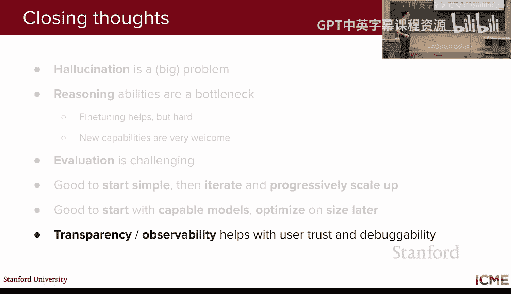
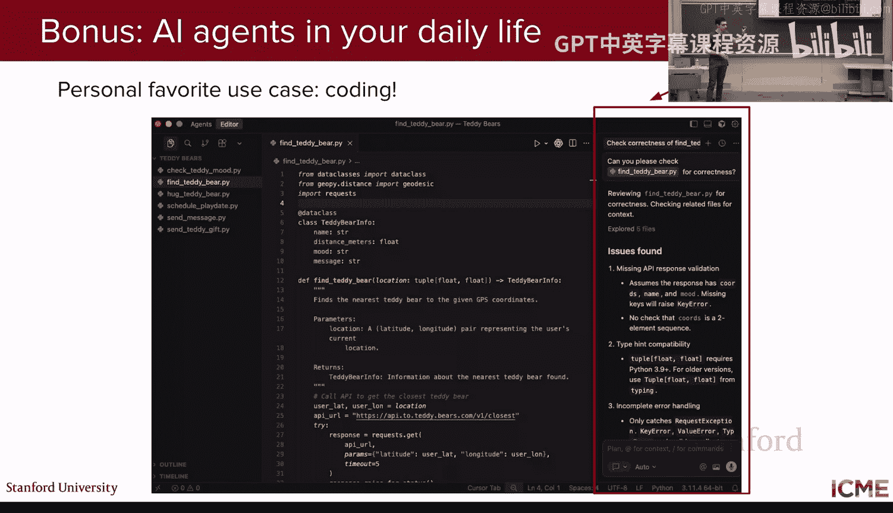

# 斯坦福大学《Transformers 和大语言模型｜CME295 Transformers & LLMs Autumn 2025》中英字幕 - P7：Lecture 7 - Agentic LLMs. - GPT中英字幕课程资源 - BV1WGsMzCERB

Hello， everyone。And welcome to Lec 7 of CME 295。So today we're going to focus on practical techniques to let our LLM interact with outside worlds。

 with other systems， because up until now our LLM was purely on its own， we've trained it。

 we've seen how it can rise on problem math， coding math， coding problems。

Now what we want to do is to use our LLM in the context of other systems。

 so today's class will focus on RAG that you may have heard。To calling。And agents。

But before we start， as usual， I'm going to recap what we did last time。So if you remember。

 last time we focused on reasoning models。And we saw the differences between a reasoning model and what we call the vanilla LLM。

And in particular， up until the lecture before last lecture。

 what we saw was we fed the prompt to the LLM and it gave us directly a response。

But what we saw last time was that if we let the LLM reason before outputting the response。

Then we can gain some performance when it comes to reasoning tasks such as math and coding。

And so in particular， reasoning models what they do is they take a prompt as input。

And then what the output is both a reasoning chain。

 which is typically hidden from the user and then a response。So with that。

 we saw how we could train a model to be more of a reasoning model。And in particular。

 we saw a core RL algorithm called GRPU， which stands for group Re policy optimization。

And we saw that this algorithm had some differences compared to the ones that we saw previously。

And in particular， one notable aspect is that it does not train a value function。

So here this illustration shows a little bit how GRPU is trained， so it takes a query as input。

 and then it computes an advantage for each output by computing the reward for different completions of a S prompt。

And then computing a quantity， which is the advantage that is relative to the other rewards of that group of completions。

And then we saw that if we applied GRPO with carefully chosen rewards， which is one。

Rewarding the model for outputting reasoning chain and then second。

Rewarding the model for producing a good response。What we saw is that。As the RL training progresses。

 we have an improvement of the model on these reasoning tasks。

 and so we saw one of the tasks being math problems。

 so here on the left graph you see the evolution of the performance of the model on the aim data。

 which is kind of a challenging math problem。And。We saw that。

But we also saw that the model kept on outputting。Responses that were longer and longer。

 And in particular， we saw that even though towards the end of the graph above。

 that the performance was kind of plateauing， we saw that。The output length was still increasing。

So then what we did was go back to the last formulation that is used by GRPU and realize that there is a term。

That makes the contribution of a token。Different if it is in a short。Response or a lung response。

So this is a phenomenon called length bias。And we saw some mitigation strategies that were explored by some papers that came out in the past few months。

 so one was Depot， which had a normalization factor that was not dependent on where the token was located and which sentence it was located。

And the other one was this paper called GRPO Don Rights。Which actually just removed。

The normalization term。I'll go down that。Cool， so this was last time。And last time， what we said。

 right before starting the reasoning class。Wes to enumerate。

The strength and the weaknesses of vanilla LLMs。So last lecture was all about focusing on how we can improve the limited reasoning capabilities of vanilla LLMs。

And in this lecture what we will do is two things， so the first one is see how we can connect our LLM to the ever evolving knowledge base。

And in particular， see how we can have access to the latest information。

And then the second one is how our LLM can help us perform actions。

And we will see this with Shevin with things like tool calling and aanttic workflows。Cool。

 so with that， let's start with the first one。And let's start with this method calledR。

 you may have heard。So。Let's suppose you have a model that you have trained。😡。

But the problem is that the pre training data on which you have trained your model is， let's say。

A month， a month ago， let's suppose。Now， let's suppose you want to prompt your model。

About the winner of the elections that happened a couple of weeks ago。Well。

 your model will not be able to respond to you， or it will output the incorrect answer。

Because up until now， our LLM does not have any link to outside sources。

It only relies on the knowledge that it has acquired during training。

So the response that it will give us will only be based on。

The data did has been trained up until the cutoff， which is a month ago in this example。

And so we have this big limitation， which is our LLM only knows about things that it has been trained on。

And you will see that all the models out there， so here I have an example with Open AI GPT5。

So if you look at their model cards。They always have these knowledge cut off dates that is written somewhere。

And in the case， for instance， of GPT5， the knowledge cut of date is September 30th。2024。

Which means that if you ask it in a very naive way。Anything that happened after that？

Like the base model will not be able to answer you， as is。😡，Well， you may tell me。

 why not just continue training your model on data that happened after that？Well。

 the problem with that， actually there are several problems with this。

So the first problem is that it's very tricky。To change the knowledge of an LLM without causing regression and other things。

 so this is typically a task that people try to avoid doing。

And the second thing is it's not very practical。Because you may very well have use cases。

That require you to fine tune this model。So let's suppose you have use case1。

 you fine tune from this model， and then somehow you want to update the weights of your model to inject some knowledge。

Well， you somehow will have to do that for all the use cases that you are doing。

Which basically adds a lot of overhead for you and just adds a lot of maintenance。So people。

 they typically prefer to not。Do additional training to inject knowledge。So one idea。😡。

Can be to somehow。Take your prompts。And just ads。Anything that happens after the cut of date。

As a way for your model to just know what happened。Well。The problem with that naive approach is that。

 as you know， contact length is limited。And so typically。

 models have on the order of magnitude of hundreds of thousands of tokens in context length。

Do you know what that is roughly like where is this roughly equal to？Yes。

 so one token is equal to four characters， so like using this like rough approximation。

 hundreds of thousands of tokens is roughly like hundreds of pages。

Likes something like a very big book。 So it's not， it's not， I mean， it's big。

 but it's not enough for us to go in that very naive route。So。So again， going back to GT5。

 so if you go to the model card， you have the knowledge card update， which is September 2024。

 you also have the context window and in this case it's 400，000。Tokens？Okay。

 so let's suppose actually context is not a problem， it's actually unlimited。

Let's imagine we actually put everything in the context。Well。

The problem then is that people noticed that if you feed a lot of irrelevant information to your LLM。

The performance of the LLM will actually degrade。Meaning that if for instance， you ask it about。

 I guess， who was the winner of the last elections and then you fitted a bunch of information that are not relevant。

Your LLM will tend to be confused。😡，And so people have run these tests。

That's called the needle in a haystack test。Where the idea is。You give a big prompt to your LLM。

Which is your haystack。And you place a fact。😡，In the prompt。

And you asked your model what that fact was。So the idea is for your LLM。To know， I guess。

Among that huge prompt， where is the relevant information， which is the needle？

And so when people have tried doing this for several length of prompts and tried different positions of where to put the fact。

They have seen that。The length of the prompts。And the position at which you put the facts are both important。

So here on the slide we have a heat map that was performed for GPT4。

 which was I guess one or two years ago。And what the person did was place the fact at different places in the document。

 so this is document depth， and the X axis is the length of your prompt。

And what we saw was that for prompts that exceeded a certain amount of tokens。

The LLM actually had trouble。Retrieving the correct piece of information。And in particular。

 it had trouble doing so when the fact was somewhere in the first half。Of the prompts。

So this just tells us that， you know， even if。Like let's say our context length was unlimited。

We would still have a problem by just going through that naive approach。So that's another reason。

 Okay， so now let's suppose。Context length is unlimited。 Let's suppose the problem that I mentioned。

Is not a problem？Well， the other problem is that。You pay him。So in particular， these calls。

 these LLM calls， they are per token。So the bigger your input prompts， the more you will pay。

So you have an incentive to not put too much in your prompt just from that standpoint。

And so for instance， again， going back to GPT5。Or of magnitude is somewhere around a dollar per million token。

So I guess it's not that expensive， but it can add up if you do that for all your prompts。

So for all these reasons， I hope I convinced you that we need a more clever approach。

Where instead of putting all the new information all at once in the prompt。

What we do is we only somehow find the relevant information and put that。In the prompt。

So that is the idea behind Ra。RG stands for Retrieval Aed Generation。

And the idea here is to augment the prompt。With relevant information。

And here I put relevant in boats。And this is the， I guess the core part of this technique is how can we get only the relevant part in the prompt？

So we'll see that in a second。So just at a very high level。So you have， let's say。

 a question as input， so in this case， who was the winner of， let's say， the local election？

The idea here is to somehow。Fettch the correct or the relevant piece of information and then augment that here in order to output your answer。

So that's the rough idea。So does this method make sense so far？Yeah。Okay， cool。

 so that is the idea behind rug。And now we're going to go into more details。

So what I mentioned is the rough idea， and here I just want to emphasize on the three main steps of RA。

So first one is you have your prompt。And you somehow want to retrieve a relevant piece of information that will help you in answering your prompt。

 So here the first step is to retrieve relevant documents。

And so you can think of your prompt as being one entity， and then you can have some other space。

 which maybe be like I don't know， knowledge base。Where all your documents leave？

And so the idea is to somehow fetch the relevant documents。So this is the retrieve step。

The second step is once you have fetched the relevant information。You augment your prompts。

You take that retrieved info， you just put it in your prompt and then ask the question。

 so in the local election example， it's as if I was saying。

Who is the winner of this election and then I retrieved the relevant piece of information and now the prompt becomes who is the winner of this election and by the way this election was held。

 blah， blah， blah and this was the winner and this is what we're fitting to our LLM。

So in other words， we're giving the answer in the prompt。And the third step is to feed。That prompts。

To the LM to generate the response。Yeah， exactly so the question is you may very well somehow do a bad job at retrieval stage。

 so yes， so this is why the retrieval stage is so important and we're going to focus on what we can do to make sure that one part does well。

嗯。So yeah， we'll see how we can evaluate I guess， our setup and different methods。

 but when we talk about RaG， we're mainly focusing on making the retrieval parts as good as it can。

Cool， and I just want to emphasize once again on why it's called RaG， so you have retrieve。

Augments generates。Right。Cool and as you pointed out， the first step。

 which is the retrieval step is very important， which is why we'll spend a little bit of time over there。

So。I guess。The first step is for us to somehow clean。The set of documents that we may need。So I said。

 you， we may want to look into outside information， but we need to somehow sort that order that。

 put that somewhere。And。This whole thing is usually called a knowledge base。

So in order to form our knowledge base， what we do is typically collect the set of documents that are or may be useful。

And once we do that， what we do is we divide them into what we call chunks。

So a chunk is you can think of it as a subset of the document， which has a given maximum length。

 which is measured in number of tokens， which is typically on the order of hundreds of tokens。

And the idea here is whenever you hear retrieval， you should think about embedding。😊。

And here what we do is。We compute。Embbeddings corresponding to each of these chunks。Now。

 when you create your knowledge base， there are a few hyperparameters that you need to tweak。

So the first one， obviously， is the size of then bedding。

So typically you would want a bigger size if let's say your documents are maybe more nuanced。

 more complex。But then if you have like a higher size， maybe it will take more space。

 maybe you'll have more computation at inference time， so I guess it's a tradeoff。

 you don't necessarily want to big of an embedding size so here typical embedding sizes are on the order of00 so for instance like 1000 and 500 something like this。

So then you have the chunk size， chunk size is how big。Your little pieces here are。

So you don't want them to be too small because otherwise the text may be out of context。

 you don't want it to be too large because maybe the embedding will not represent in a meaningful way what is inside。

 so again it's a tradeoff。But typically people， they choose a chunk size of around 500 tokens。

 like on the order of hundreds of tokens。And then you also have， oh， yeah， you other question， yeah。

So the question is do you train an embedding model for this， so you have two choices。

 either you can use a pretrain embedding model， which people typically do。Or you can train your own。

We will see that in a bit more detail in a few slides。

So the question is what is the purpose of the embe model， so we will see this in a second。

 but long story short。It tries to represent。Chunks。Se that it achieves your angle。

 which is to fetch relevant documents。So we will see a little bit how they're trained。

 but this is the general idea。Cool so that's this and then we have a third hyperproameter。

 which is how much overlap you want to have in between your chunks。So here。When you do the division。

 you like in the very naive way， you have everything be like independent， no overlap in between。

 but typically you have some part that is from the previous chunk that is relevant to understand the current chunk。

 which is why we want to have some overlap。And which is why people， they typically also have that。

 so typically in the low hundreds of tokens。Cool， so let's suppose you have your knowledge base。

Now the question is given a prompt？How can you retrieve  relevant1 documents？

And the answer to that is we typically proceed in two steps。

So I'm not sure if any of you has background in recommendation systems or search。Does any yeah。

 so the methods we're seeing here are very similar to that space。

 so I guess people in the LLM community， they have borrowed ideas and just leverage some techniques that we have over there and this is typically a setting that will also have for recommendation problems。

So we have two stages。So the first stage is typically called candidate retrieval。

And the goal here is to go from a set of many， many， many chunks。

And filter it down to a much smaller set。Of potentially relevant candidates。So during that stage。

 what we're trying to do is to somehow maximize， recall， just do a rough operation。

So that we get as many potentially relevant candidates as possible。And then we have a second stage。

 which is sometimes optional， but this stage is to really make sure we have the top documents being the really the relevant ones。

 and this one is called ranking。So the idea here is。

Based on the list of potentially relevant documents。

To really rank them in a way that really the relevant ones come at the top。And so on。

And typically during that stage， we're going to use。

Model a method that's going to be a bit more compute intensive because we have a much smaller set of candidates to rank。

Compared to the first one。So going back to your question on how do we want our embeddings to be。

 so here it will really impact the first stage and we will see that in a second。

 but the second stage is also quite important。酷ol。So far so good。

 is everyone clear with the two stage approach？やや。Yeah。

A very good question to the question is do we chunk things in a na way as in we just go with the number of tokens regardless of what happens。

 so it's a great question and the answer is that we will see some extensions that will mitigate the problem of when you chunk it in a way that does not make sense in the na way you want to somehow put that into context and we will see a method that does that so in a few slides we will see that。

But I think your question is also a great question because depending on the kind of document that we have。

 like for instance， if we have， I don't know， like a JSO file or a markdown or like depending on the kind of file that you need to chunk。

 you also need to be aware of the structure that is within those files。

 so there is also some nuance there that we will not go into details。

 but I just want to call that out。But yeah， great question。Any other questions？Okay， cool。

 so now that we're clear on the two main stages of retrieval。

 we're going to focus on each one of these steps。So as I mentioned。

 the first step is candidates retrieval。So here what we want。

Is among that potentially huge knowledge base。To somehow filter it down to， let's say。

 all over 100 potentially relevant candidates。So here what we do is， well。

 we will leverage the embeddings that we。I guess computed during the knowledge base initialization。

And。We will try to fetch。Potentially relevant candidates by doing a semantic similarity search。

So do you recall how we compare embeddings？Yes， yes， so cosine similarity is typically one way。

 one good way to compare embeddings。 So the idea here。Is to represent our query with an embedding。

We already have。Ebeddings of all our chunks。So the idea here is。

To somehow find the most relevant chunks by doing this similarity search and filtering out the ones that come at the top。

So the idea here is you have your query， you have your chunk。Both of them， you find an embedding。😡。

And then you perform a similarity operation， which is most of the time cosine similarity。

And you obtain a similarity score。So the idea here is you just。Just keep top， I don't know， hundreds。

And you go with that。So I just want to call out that there is some complexity in that stage。

Because your knowledge base can potentially be huge。

So what people do is typically use what we call approximate nearest neighbor methods。

So you may have heard of some libraries that do that。

 so typically this is something that will be relevant here。We're not going to go into details。

 but I just want to call that out。 So here the idea here is that。When you build your knowledge base。

You somehow partition the embeddings in a way that will。

Avoid like make you avoid doing like just a naive linear search。So that's the idea。

 but you may see some techniques like ANN techniques， approximate nearest neighbor techniques。

And these are typically happening here。So another thing that I want to point out。Is。

A name of the architecture that we typically use here that you may also hear。And for that。

 we need to recall that these embeddings， they're actually obtained by passing them through a model to typically encode only。

So you may hear the term by encoder。And this one refers to the fact that we are passing the query through an encoder。

And then passing the chunk through an encoder， so both of them are independent。

And we're comparing the embeddings。And yeah， so this is another question I wanted to ask you。

 but I guess I didn't get the chance to， but so if you remember， I think lecture two or three。

We had seen the bird model。And so typically you would have something like a bird like model that you would use to。

Inc these documents。So going back to your question， how do you compute these embeddings。

 so there is a paper that I highly recommend reading actually。That's called sentence B。

And so that paper explains， so it's first of all， it's an extension of B as the name suggests。

And it's an extension that allows you to compute an embedding per， let's say。

 sequence for your query， for your document。That is tailored。

To be used for similarity search purposes。😡，So the idea here is to have a loss function。

That will incentivize having a high cosine similarity。

For relevant entities and low cosine similarity for entities that are not relevant。So yeah。

 so feel free to check that paper out。If you know birds， which I know right now you do。

It's quite easy to read， so yeah， I leave a comment。So first of goods。Yeahep， yep。

So the question is what is the default way to compute the similarity so yes， its cosine similarity。

 but again you will see in different implementations that people can use other distances and I would encourage you to think about how they relate to one another so you will see for instance the L2 distance。

But then if everything has a norm of one， there's a lot of simplifications that can happen。

 so you may see some variants， but I would say they're all more or less cosine similarities。Yeah。

 great question。Cool， so we're still at the candidate's retrieval stage and what we saw was。

One way of retrieving documents。From a similarity sorry， from a semantic similarity standpoint。

 so by the way， what does semantic similarity mean？It means finding documents or finding entities。😡。

That have the same meaning， or that are relevant。But in the way that we compute these embeddings。

We're not enforcing any kind of keyword match。😡，Like when we retrieve documents in this way。

 it can very well be that the documents that are matched， they do not have any word in common。

 but they mean the same。Well， sometimes。You want to ensure that what you're looking for。

 what you're searching for is exactly containing the keywords that is in your prompt。

And in that case， you would want to have a second。Way of doing things。

So you may have seen BM25 out there， so BM25 is a relevant score。That is actually a heuristic score。

It is based on some function of the overlap between what is in your query。

And what is in your document？And so that one is actually quite handy for cases where you have a query where you absolutely want。

To have documents that contain keywords of this query。

So here I have an example that I actually passed super briefly for the previous one and we will come back to it。

 but let's suppose。We have， let's say， two teddy bears， one is named Cuddley。

 and the other one is named Huggy。So what you want is to figure out where is cudly。

 so this is your query。So if you use BM25。Well， the answers that you are going to get。R。

By definition，re going to contain some overlap。Of words that were in your query。

 and so here you will have， let's say， documents that contain， let's say， where Cudley is。

But if let's say you only used this semantic similarity search。😡，You would not have that guarantee。

You would only have documents that are kind of semantically similar。And those are not。

They are not guaranteed to contain keywords of your prompt。 And so just just to illustrate that。

 So here， Huggy and cuddly， they can be thought of。You know， semantically similar。

So you will probably not have cudly， I mean， you may not necessarily have cudly in there。

Just to illustrate that， and that is the reason why nowadays what people do is。

To look at the use cases that they have。And think about whether having some heuristic as well in the relevance score is useful for their use case。

So some people， they go with the hybrid combination。

Of this embedding based search and a heuristic based search。So， some combination of。

Embbeddings andmbM25， in which case you may have even more relevant documents depending on your use case。

Does that make sense？Yeah。So now I'll come back to what you mentioned about whether cutting trunks in a na way will necessarily lead you to things that are coherent。

Well you're completely right， sometimes you will not。And。But before we answer this question。

 we actually are going to address another concern。Which is that typically。When people want。

To ask about something in their LLM。The query that they inputs。😡，Is of a different nature。

Compared to what is in the knowledge base？So your query is typically going to be maybe something short。

 maybe a question。But what is in your documents is typically going to be longer。

 these are like sentences and sentences。So if you really think about it。If you use the same encoder。

To embed your query。And to embed your documents。Well， these two embeddings。

 they're not super comparable。😡，Because one is for a question and the other one is for a document。

So theres one extension that tries to mitigate that issue。And I link the paper down there。

 so it's called the height。So what it does is。Instead of computing the embedding。

Related to the prompt。It will first。Generates a fake document， so it's just an LLM call。

 a fake document。Based on that prompt。And then embed。That's fake document。To find relevant chunk。

So it may or may not works。Useed all the time by everyone so I would say just something that is good to try to see if that works。

 but this is one way of mitigating this， another way could be to simply have encoders that are specifically trained to encode the query on one side。

And include the documents on the other side。So in other words， to not use the same encoder。

People T don't do that just because of maintenance purposes， but this could also be another solution。

Okay， so now finally going to your question regarding how we can make sense of these chunks。

If they are taken out of context， they may not make sense。And so here the idea here is。To prepen。

Some piece of text。😡，That just sums up。What you need to know in order to understand that chunk。

So here the idea is that you have all your documents。😊，Let's say you have one document。😡。

That you divide it into n chunks。The idea here is instead of considering these chunks。Separately。

You're going to。Compute some kind of context。That is relevant to each chunk。

And that is based on the whole document。So how are you going to do that so well as again。

 the LLM call？😊，So what you do is typically have， let's say the whole document and then you have the chunk that you want to contextualize and you ask your model。

 well， please give me a short suin context to just make sense of that chunk。And now you may tell me。

 well， that's a lot of LM calls。You have potentially a lot of chance。

And it's just going to be very pricey， well， there's one strategy。To make this less expensive。

And I'm not sure if you've heard that option， it's called prompt caching。

So now that you know very well how LLMs work。You know。

 like typically these are a decoder only and so on。So you know that if。You use。The same prefix。

For all your prompts。Well。It's going to be the same computations that you just do again and again and again。

So the idea here is you just do it once。And you save all the relevant activations。

And instead of computing them again。You're just going to look them up， just do a lookup。

And then decode the rest。Does that make sense？Yeah。The question is activation from a language model。

 yes， because when you feed a prompt to your model and you ask it to generate a response。

What the model needs to do is well to take all this input and then compute the activations of all the layers and then have for the generation process to have this attention across all these other components。

Given that it's decoder only， meaning it's only left to right。😡。

The thing that you input if it's the same。Then it will lead to the same activations。Yep。

The question is， what if you have a closed model where prompt caching。

 and I'm going to just talk about this in just one slide。

Is an option that these like closed models or providers offer？And what they tell you is well。

This is the same prefix for all your plants， so what we're going to do is we're just going to make it cheaper for you。

So if you look at the model pricing page。You will see that there is a price。For regular inputs。

 so inputs that are not cache。And then you have the price per。Cched input token。

 And here you see for the， let's say， open eye model is 1/10th。After price。

 so I guess what do I want to tell you by this？Well， just try to be smart with the prompts。

And try to gather all the things。That are likely to be repeated across prompts in the beginning。

So that you can leverage this nice percentage of。Does that make sense？Okay， cool。Great。

 so up until now， we have seen how we can go from potentially thousands or even like let's say。

 millions of chunks。Up to or down to， let's say hundreds of potentially relevant chunks。

Now what we want to do is to sort them in a more meaningful way。

And the second part is more optional because maybe sometimes this first cut that we've done may be good enough。

But I guess this second step is about being more intentional in how we give the final score。

To be able to really。Like select the final， let's say， top K chunks。

So the second stage is called ranking or even reranking。

Reranking because I guess with the first step， you already have some kind of ranking。

 so we're reranking。And what we're doing is。Instead of using this very quick。Operation。

 similarity operation between embeddings that we've computed。

We're going to use something that is maybe a bit more sophisticated。

So instead of considering the query and the chunk separately。

What we're going to do is to actually put them both。In the encode。Both of them。

And have a relevant score out of that。So the reason why it may be a little bit more meaningful to do it this way。

Is that you have a model that takes a look at both your query and your trunk at the same time。

And gives you a score。Whereas in the first step， you had one embedding for the query。

And one I min for the chunk。Which didn't have that interaction that a model could capture。

And you will also see out there that this setup is called cross Enr setup。

Because you have both your inputs。😡，Fed to your encoder， so there's like some cross interactions。

So if you remember， the first approach is a buy encoder kind of setup up and this one is a cross encoder。

Yeah， the question is you will actually compute the attention between the two， yes。Absolutely。

And here， I mean， sentence per， they have a lot of good documents。

 so I highly recommend just reading their dos at the bottom of the slide。Cool， well。

 you do that on all your potentially relevant chunks。

 so you have this score that is computed for each of these chunk。With the prompts。

And then you finally obtain the rankingki。And now the question is， are you happy with the ranking？

And in order to answer that question， you need to have a way to quantify your performance。

And that's why we're going to see in the next five minutes where are the metrics that we typically use to do that。

So again， this is very similar to if you do search or recommendations。

In case you have a background there， you will see some commonalities。So here's the setup。😡。

You have a bunch of chunks。You do this first and second step。And at the end of the day。

 you will have K trunks that will come at the top that you will。Qualifier as being relevant。

And you want to compare that。With respect to。Actually， relevant chunks。

So you can think of it as you have label like same as in binary classification。

 so you have relevant and not relevant and you predict some that are relevant and you want to know how well you're doing。

So this is the set。Well， when it comes to ranking。You need to somehow incorporate this information of how high in the ranking you've put stuff。

So here， let's suppose that you have ranked these n chunks。😡，From。Most important to least important。

 So let's suppose you have like first second。Third and so on and so forth。

And you only care about the first K。Because in the rack setting。

 you typically retrieve the top k that are relevant。And you put off this top K in your prompt。Well。

 the first metric that you will likely use。It's called NDCG。So it's a lot of letters。

 I'm going to just explain what that means。So NDCG。Tries to quantify how good your ranking is。

By taking into consideration where you ranked relevant documents。

So you have this formula that may seem scary， but it's actually quite simple what it's trying to do。

 so it's trying to。Incentivize the score to be higher。If。You're ranking the relevant documents。

Closer to the first position。So what it does is it is a sum over the first。K positions that you f？

And it is looking at whether what you've ranked for each of these positions is relevant or not。

So for instance。It checks the first position， okay， first position is it relevant or not。

 so relevance， if it's relevant， it's one。So it's one over some quantity that is a function of the rank。

And he does that for all the ranks。So this score will be higher。If you rank relevant documents， hi。

So that's basically the goal of this metric。So this part is the discounted cumulative gain。

So it's cumulative grain because you're looking at。Basically。

 if you had relevant documents in your first K positions， which is the cumulative part。

It's discounted because。It's better for you to have relevant document in position1， let's say。

 than position K。And you can see that in the。Denominator。Now， why do we say NDG。

 like what is the normalization part？Well。This metric can take a lot of different values。

 depending on how many relevant documents there are。 So what people do is de compute。

The quote unquote， ideal or optimal or upper bound DCG that you can get for a given query。

And they call that ideal DCG。And they just normalize DCG over IDCG。So the reason why they do that is。

They want you to score a score of one。If you are matching the optimal ranking。

They basically want to make the score meaningful。So does this make sense？Yep。So。

So the question is how do they compute the relevance score。

 so you can think of step one and step two as being a two step process。

For you to say which documents you're saying are relevant。😡，So at the end of this two step stage。

The ones that you say are relevant。Are here。Now you typically have a score for each retrieved chunk。

So you're going to sort these chunks。You are going to sort them by the score in a descending order。

And the relevance here that you're going to use is the actual label。 So is the chunk actually。

Relevant or not。So you're going to look at your K retrieves。Chunks。And you're going to ask yourself。

 okay， is the first drug actually relevant， So you have a label。You know which ones are relevant。

 which ones are not？And these ones are going to be the ones you will use in the formula。Yes。

 that's your ground truth， exactly， yeah。Who does that make sense？Yeah。Okay， great。

 so you have a bunch of other metrics， you have another one that's called the reciprocr rank。

So this one is much simpler。It takes the。Inverse of the rank， of the highest rank。

Of all the relevant documents， so if let's suppose in your first in your top K documents。

 let's suppose the first relevant document， let's say comes at rank number two。

Then rank will be equal to  two。So it basically does not care about。

Any relevant documents that are past that first relevant document？

So this is just like a simpler metric that typically correlates well， so that's why people use it。

And then of course， I mean you're familiar with the classic classification metrics recall and precision。

 so if you remember if you have two classes， you have the positive class。

 you have the negative class， so recall what it does is it。

Takes a look at all the actually positive observations。

And it tries to ask itself among all these actually positive samples。

 which are the ones that you actually predicted positive。That's a recall that you all know。

And there is， I guess， a ranking equivalent。Which is out of all the documents that are relevant。

 actually relevant， so this is like your positive class。Which are the ones？

That you actually predicted as being relevant。So this is basically which ones are in the top K。

And similarly， you also have the precision equivalent， so if you remember。

 precision is out of all the ones that you have predicted to be positives。

How many of them are actually positive？So this is the equivalent here。

 so which are the ones that you have predicted to be positive。

 so which are the ones that you have selected in your top K。And among those ones。

 which ones are actually positive， so which ones are actually relevant？Does that make sense？

So I guess these four metrics， so NDCG， MRR， precision at K， recall that K。

 you will see this in a bunch of papers。So I just highly recommend you just get familiar with their ideas and maybe with the formula。

And these would be the ones that you would use to quantify whether your retriever is doing a good job or not。

So you have a bunch of benchmarks out there， so there is one that is actually quite popular。

Massive text embedding benchmark。So if you want to test your retriever， if it performs well or not。

 you would typically take it and then just evaluate it on that benchmark and then have all these metrics computed and then if you have like different solutions you would typically compare this metric。

And with that， I guess we guess hopefully have a better sense of how to build the rack system and specifically how to have a good retriever。

So we have just maybe one more minute， is there any questions on that first part？Yep。

So the question is， so for the reranking， we're using an encoder that will output a relevance score so we will typically train a model that does that。

 so there are typically I believe there are some pre-trained ones。

 but out there you can very well have your custom one。So yeah。

 so that model will typically be a bit more sophisticated compared to the first step because here you can afford to spend more time to produce that score because you're operating out of let's say of hundreds。

 possible candidates as opposed to let's say oh of much more like millions or hundreds of thousands。

 yeah so that's the idea。有。So the question is how about training with contrastivela so here this is a detail we're not I guess。

 cover here， but in order to train these models you'll have a bunch of different types of last function。

I highly recommend you read the SBRT paper because in that paper there are several last functions that the paper tries to compare。

 and this is one of them so yeah so that's a great question。

 I highly recommend reading the SBt paper for that。Cool。With that， I'll give it to Shervin。Thank you。

 Eine。So thanks a lot for covering the RaG methodology。

 so now we arrive at my favorite part of the lecture。

 we're going to see tool calling and the agentic world and we're going to see how much more powerful your LLMs are going to become just in a second。

So what Afshing just mentioned is how you would deal with incorporating data that is not structured as part of your prompt to the LLM。

And now we're going to see what we could do more in the case the data that we want to inject is structured。

 so in the case of RAG you have documents with words and words and words and you just want to fetch the relevant documents to answer your prompt。

 but here let's suppose that you have some structure that determines input outputs in your data。

 so typically you could represent it maybe as a table so you have separate columns and then depending on the value of given columns you have a given output。

So we could probably reframe that setup into a function， a setup。

 so we mentioned tool calling and then this rephrasing is called a function calling。

 so let's suppose that you get this relationship between input and output through a function for the rest of these parts。

And then here， if I had to transpose what the results of a given ID and field and other arguments would look like。

 you could interpret it as a function with these as arguments。

 and the output would be simply what you have as an output to the function。

And in the world of tool calling and function calling， very oftentimes。

 you're going to see that LLMs tend to use Python as a language just because it's so simple to read。

So this is what we are going to use as an example as well。

But there is nothing that ties us to Python necessarily。

 so you could well have a tool calling in other languages。But yeahep。Just as it notes。

Any questions on this setup？Okay， awesome。So there is nothing controversial about tool calling。

 but I'm going to still state a full definition to make sure that were on the same page。

So I was browsing here and there and then tried to find an authorative source and this website。

 like on IBM， there is an article that defines that tries to define what tool calling is。

 so I'm going to anchor on their definition from now on。So I'm going to read out loud。

 so tool calling allows autonomous systems to complete complex tasks by dynamically accessing and may act upon external resources。

So the things that I want you to get from that are two things。

 so first you have the notion of completing some task。

 so of given an input and you have to complete some task。

And then the reliance potentially on external resources。So it doesn't have to be external。

 you don't have to rely on external resources， but this is one potential property that can help you fill the gap that Afin was mentioning at the beginning of the lecture regarding a feeling the knowledge gap that your pre-trained LLM has。

So we're going to see examples in a few minutes regarding what that could mean。

 but yeah this is one magical part of it。Okay， great。

And just to make these statements very grounded in real life applications。

 let's just walk through what would toolca give us in the case of a very specific example。

So let's suppose。You love teddy bears。 You're currently here at Stanford and you want a teddy bear near you。

 you know what if you pull your phone out and you just ask， find a teddy bear near me？Well。

 your current LLM without any tools would not know some real life like real time update of you know。

Availability of teddy bears near you， so it would probably answer you something in the flavor of you I don't know or not sure。

And I just want to say that with the use of tools。Let's see how we could get to a stage where we can inject the information that is necessary for the LLM to know how to respond to your query。

And the goal of the next few minutes is going to be for us to figure out both what we could do。

 like what we could inject in the preamble of the LLM。

And what would be the steps that we could go through in order to complete such a request？

Does that make sense so far？yep。So the question is are those function APIs precomped。

 that's a great question， so yes， you define them beforehand。

 you have some API and we're going to see that in a second they're not LLM generated on the flight。

Okay， any other questions on the setup？So I know it will be a lot to take in。Yep。Okay great。

So in order to be grounded in real life， let's take a full example of what a function definition could be。

 so in the case of finding a teddy bear，You could imagine a function definition that is called fine teddy bear。

And depending on your location。Calls some API。And retrieves potential candidates。

So I'm going to go through the main characteristics of what a function call contains and link it to the definition。

So you have， okay， so first of all， when we want to display such an API to the model。

 you need to document it its input and output in order for the model to know what this function is for。

So typically， the description that you have in the example of Python under a given function would be crucial for the model to know what it is about。

And then。We saw in the definition of toolC that we just gave that we have the ability to make backend calls。

 and this is exactly what we would need to do in the case of finding like teddy bears around you。

 you would need to query some API to retrieve available teddy bears and based on your location。

Return the nearest ones。 So this is exactly what this function implementation is doing。

And as it returns something that is well structured， so you see maybe it's small from where you are。

 but you have some class definition that puts some structure into the output and makes it interpretable。

And we're going to see very soon that this output is going to be what the model will anchor on in order to give its final response。

Okay， great。And one other thing I would say。Is all of this that we see here is what you have implemented。

You will not see all of this， you know if you are an LLM you will not see all of this。

 all you care about as an LLM is the function API， the input and outputs。

 as well as the main lines of documentations， so all these implementation details。

 you're going to have it on your code base， but the LLM is not going to see it。Good greats。

So now let's go step by step into how we could make this work。

So the first stage is as you ask a question that is related to your function you would。

Insert at the beginning of your preamble， the function API。

 and as I mentioned without its implementation， so you just have like the function itself and then full documentation。

So here。You would want the LLM based on your user query to feed the right arguments to your function。

So to your point， the goal of the LLM here is not going to be to infer any of the functions。

 implementations， rather only what arguments we should put to it。yep。yep。Yep。

So the question is how do you even train this， so we're going to seeize that in just a few slides。

 Yeah， so great point， that's the next question we need to ask ourselves。Yeah。

 so we're going to see how we train these， but here， let's say it has been trained。

The LLM would have from its context probably our localization because let's say you have activated your location permissions and your LLM knows where you are。

 so it knows you are at Stanford and these would be the coordinates being feds to your LLM。

And then the second stage is to actually do that function call， so it has nothing to do with LLMs。

You just take your function， your argument， and you execute that。

And you get some answer and the answer as we mentioned is structured in a way that's understandable。

 so in that function implementation you return some object that informs characteristics about the return teddy bear。

 so for example you have its name， maybe location， and so on。

And you feed that response back to the LLM in order to get a final response。

So when you ask to do LLM a given question， you don't want to have these J like response。

 but rather response in natural language， and this exactly is the motivation for that last stage。

So I'm going to pause here for a second and check that this three stage mechanism makes sense to everyone。

Yeah。The greats。And。And exactly what you were mentioning here is going to be the next focus。

 how do you even train that so okay so let me ask you this question。If you were to。

Train an LLM to use this tool。 What steps would you need to focus on。Right。

 so the answer is you're going to feed the API implementation， yes。

So you would need the first LLM call to be somehow recognizing the pattern of the function implementation and the query and link it to the arguments that you would put in your function。

 so yeah great， so tool prediction。And do you need a second set of SF0 pairs？

So you have this last stage that is still LLM driven where you have your tool answer and you need to output a final response。

So。You might say， okay， hey， the LLM has seen a bunch of structured data and knows how to put into words things that it sees。

 which is a fair point， but usually you might want your responses to be formatted a given way。

 so you might want to also have SFT pairs that do this mapping the way you want it to。

So this is why you typically have。These two SFT pairs， and if I have to be a bit more precise。

The second pair isn't just mapping the JSON response to the final response。

 it's actually linking all the conversation history so far so that it knows that the initial query was someone in search of a teddy bear。

 it knows there has been a tool call and it knows that the results correspond to that tool call。

 so it would be a slightly longer input in this SFT pair。Does that make sense？Okay， great yep。Yeah。

 so great points to the question is what if we have more tools do we need like some tool selection or like more examples。

 so this is a great topic we're going to sit like in a few slides。

So it's slightly more complex way of doing things， but if you want a very quick answer。

 if you go the SFT way， you could show multi two kinds of inputs。

 so you could include all of that in your SFT dataset sets。

But we're going to see the topic of tool selection very soon。Great， any other questions？Okay awesome。

 so this is what I just mentioned， yeah the conversation history so far is always what you get as part of the inputs and then the output is what you would want the LLM to predict at that given stage。

And since you're doing SFT here， you don't have just one， but multiple search examples。

And you would want your examples to be varied and representing the typical user distribution。

So I was asking find a bear near me and this example showed to the model how you could ground the information of location based on the user's location。

 even though you didn't give it。And in these other examples， you could give the model。

 other kinds of instructions like directly saying， I want to bear at that location to teach the model to look at。

Like to ground the argument at different places。And you could expand these sets by also varying the kind of input so it doesn't have to be worried that way。

 you could do its multi turn， maybe in the middle of a conversation， you ask for a bear and so on。

Okay， great。But this is not the only way of training a model to do so。

 so these days LLMs become more and more powerful in their reasoning。

And the kind of data there are trains at pretrain and initial instruction tuning is typically these kinds of code data。

 so at the end of it， they know how to manipulate Python codes very well。So you might ask yourself。

 is it really needed for me to teach the model how to map a query function to a function call。

 and that is a very interesting observation and you see these days that you can forego of specific SFT training。

And try to get around it with only training。So here。

Instead of writing SFT and then retraining the model。

We're going to see that you could actually replace it with only an explanation。

And does anyone have an idea of how we could even come up with such an explanation？

So let's say I have a new tool， I have the API， I want my model to use it。How would you go around it？

Yeah， thiss a great point， so one method could be fu shot learning you just show in the context window samples of input output this says this is a great point you could definitely do that and this is typically one accepted practice。

But if I told you that fuhar learning has challenges when it comes to generalization because you would need to give specific points as input output。

 so it might fit to some cases and not necessarily generalize to the whole span of human language。

 is there another way you could go around it？Yeah， so the answer is ask you to do reasoning。

 know great points。And。Writing a prompt that does the reasoning in a way that makes sense is very hard。

So in practice， you wouldn't write it yourself。You would take。These SFT pairs。

 so these are the behavior that you want to enforce。And you could use it as some evaluation set。

 so you could say， okay， hey， if I ask this question。

 I want that tool call and you have a set of pairs。And you could run。

Whatever you have so far in terms of explanation。You evaluate these prompts against the evaluation set。

 so you have some wins and losses， maybe find a bear in Paris doesn't work well。

 some other prompts do， so you have a list of like each sample with like a score。

And you could feed it back to a reasoning model， typically， to do the explanation writing for you。

So yeah this is a trick to。You know， help you avoid doing that hard work。Basically showing the model。

 you know， hey， with the current prompt， here's what we get。

What would you have changed in order to make the evaluation results better so you get with that process an iteration on the detailed explanation and if you have to see results in practice you would be surprised at how well it does the explanation for you。

So。The takeaway here is I do not recommend you write it end to end， maybe just a draft。

 and you let some very powerful model with excellent knowledge of logic， do it for you。Yep。

Yeah so the question is what you just mentioned is it training or inference so it's training。

 so you do it at the very beginning， you want a fixed prompt that explains to the LLM how to use it。

 how to use that function， so you typically do that offline。

Offline you iterate on the explanation that says exactly how you use the prompt。

 how you use the function。And then at inference time。

 you would put that fixed explanation alongside the function API such that for any query。

 it knows what to do。Does that make sense？gre。Any other questions here？Okay， amazing。

I just mentioned an example with teddy bears that would be in the category of maybe informational so you have。

So you have a question and you want to ask some external API to retrieve that。

And you have in reality a lot more use cases that you might see。

 so when A mentioned you have some cut updates and let's say you asked your LLM about news of the day。

 so you typically wouldn't have anything that comes from the model itself。

 you would have an API that fetches it from a tool called maybe search。

But you have also other kinds of tools available in the information categories， so for example。

 weather， stocks， and let's see you know。But you also have other categories， for example。

 if you want to ask the model to do some calculation for you。

You could let the model figure it out with some reasoning chain， but。

One way to get around it is to transform the query into code。

Execute that code and then read out the answer。So this is why like a tool call has a whole span of applications in the computation area。

 so you have calculations and you have another category that we can cite here so you can take actions on behalf of the user so let's say you have a tool that sends emails。

 you could ask the model to send an email for you and it could put the right things into the header。

And the message buddy and even he send for you。Because you have that component that interacts with the external world as part of the tool API。

Yeah， so these are just a few examples， but I just want to say that the find of tool calling is so powerful。

 you can do anything you want。And。In practice， exactly as you mentioned。

 you wouldn't have just a single tool API as part of the context。

You would have several ones because your LLM is not just an LLM for finding bears， right。

 you might want to do other things with your LM， maybe you want to hug a teddy bear or check a teddy bear's moods。

Send teddy bears a gift， you know and other things。

 so you have a lot more functions that might be relevant to be added as a preamble just because you don't know what function would need to be used。

 you just need to put all of that just in case。So。The setup is exactly the one that you mentioned where you don't have just one API。

 but multiple ones。Does anyone see any issues？By we doing so。

Yeah so the suggestion is that that's a lot of tools yeah and then you're write so typically if you have too many tools you have the problem that Af mentioned at the beginning of a needle in a haystack where maybe some tool API will get lost in the context and you don't really know what to use you have a lot of conflicting APIs maybe。

And we're going to see very soon how to kind of overcome that issue。Okay， great。

So I want to take a pause here and summarize how far we've come and some of the drawbacks that we have and see together what we could do to remedy these drawbacks。

So first， we saw that we came from an LLM that just。

Responded back at you with normal words to an LLM that can actually interact with the outside world。

 fetch real time information， or even extend computing capabilities。

And and exactly overcomes the issue that Efin was mentioning。

 the knowledge Kav one in a different way than what Rag would do。

So you could see these two methods as being complementary。And yeah。

 both try to do the same thing in sunsetss。But。Exactly as someone mentioned here。

 if you have more tools， then your context window might have things that it doesn't need and then if you try to support so many cases。

 you might end up being mediocre at all of them。So this is an issue。And even if that wasn't an issue。

 you still have the context window that is finite， so let's say you have hundreds of millions of users that use your LLM and that want you to do a lot of things。

 you cannot support everyone's use cases at once just because you couldn't possibly fit all of such tools in your context。

And then last。When I mentioned these tools， these are things I hand wrote。

And maybe each LLM has their own way of defining and using tools。

 we're going to see if there is a way to standardize maybe the way we define and use tools。Later on。

So do these drawbacks make sense？Yep。Okay， great。So let's move on to tool selection。

 so let's see what we could do in order to make tool use more scalable。

So I'm going to cite here a technical paper from Google Deep Minds。Which uses a tool selector system。

So it functions in two steps。So first， you have your query and you have a list of tools that can be as big as you want。

 and that list of tools only contains the API name and maybe one or two words about what it does。

So you have like this prompt and a list of tools， and we ask the LLM to pick the tools that might be relevant。

So this is why the technical paper calls this system a tool selector。

 you could even see the term router like being pronounced in the literature。

 so tool selection routing are similar concepts and the goal here is to restrict the number of tools to only those that might be useful。

And in a second stage， you take all the selected tool APIs and feed only those to the context alongside your query。

And this is one way you could take to overcome this。This。

 this issue of having too many tools at once。Is everyone convinced that tool selection could be a good way to。

To fix the problem here。Yep。Yeah so the question is is that basically RaG。

 you could do it with RaG you know that's a great point， but it doesn't necessarily have to。

 so you could have an LLM that does this job just picking the right tools and you ask some instructions to the LLM to output the right answer。

 you could definitely do it with RaG that that is just a great point yeah。Y。

 so does it make sense to everyone？Okay， great， and I see time is flying。

 so we're going to go very quickly on the standardization issue， so as I mentioned。

Every tool's implementation， like the way you specify a tool implementation can be bespoke to a given LLM and you wouldn't want that。

Because for every LLM， you might need to implement always the like these tools。

Like over and over again。And duplication is not what you want。

This is why there is a standard called MCP that I know a lot of people talk about it。

So it's something from the anthropic team that standardizes the way tools are exposed to models。

 so it's a protocol， it's called a model context protocol。

 and it defines standard way of presenting these tools。

So I'm going just to say the very big lines of it。so you have this kind of vocabulary as part of MCP。

 so you have an MCP server， which is the instance that serves tools。

And then tools are implementations of the functions that you want people to use。

Prompts are sorts of templates that could show the user how to use these tools。

And then all of these can anchor on resources， which are external sort of databases that you can use to complete the task。

And then an MCP server， when you use it， has a one to one connection with a piece of infrastructure in your LLM host that is called MCP clientsient。

But these are maybe infrastructure details。And I just want to ground what I just mentioned in reality。

 so we know our teddy bear loves to read poetry。So in the case of recommending a poetry book to our teddy bear。

 you could think of a MCP server that provides tools that are linked to books， so your LLM host here。

 so let's just take the example of cloudude since MCPs from Anthropic。

 so cloudud would be your LLM host。Your MCP server would be。

Probably implemented by your book provider because typically they are the most experts at serving such content。

And we could assume that the book provider， MCP server。

 has tools regarding finding books or recommending。The。

 and then the prompts here could be a waste to。Show you how to find a given title or maybe recommend it with respect to like some flavor。

 maybe with respect to the user's tastes。And some example of resources here could be the Teeddy bear's personal collection or maybe top books that people buy。

Y， just as an example。Okay， awesome。So now I'm going to come to。

Potentially the most exciting part of today's lecture， which is agents。

So we saw how much more powerful LLMs could become with tools。Agents。

Could be seen as one layer up from it。 So I'm going to give。First definition。

 just so that we agree of what agent means here。So it's a system that autonomously pursues goal and completes tests on a user's behalf。

So compared to tools， you not only。Can perform like tasks。

 but you have also some reasoning involved in it。 So it could have like multiple loops of iterations。

And this is what differentiates an agent from a tool in plain terms。

 when usually people talk about agents， it has thats。Recurrence or like higher level of reasoning。

Baked into it。And so I'm going to contrast like the agentic worlds with respect to the world we have seen where you know。

You may have multiple calls to tools。And this new agentic framework is not necessarily disjoint from the ones that we presented before。

 you could well have reasoning chains inside of it， so it's potentially overlapping。

 but the structure consists of like tool calls。And iterations。Okay， great。

And now I'm going to talk about a hallmark paper called React to Re plus Act。

Which decomposes possible loops into different stages。So。Very oftentimes。

 when you have a query and you want to pursue a goal， you cannot do it one shot。

You need somehow to decompose the goal into actionable subs。

Perform each of these substeps and then come up with the answer。

 And this is exactly what react is about。 It's about decomposing complex tasks into。

In two loops of things that can be done atically。So here I just want to say one thing。

 we decompose these steps into observe plan and act。

But it doesn't necessarily have to be called that way or be in that order， for example。

 the react paper I think introduces terms of think， observe acts。So yeah。

 you might see the language changing a bit from paper to paper， but high level intuition remains。

So let's just ground on a very specific example。 So to be in the theme of these days。Weather。

It starts becoming a bit cold and our teddy bear might be cold in its home。

 so let's just have that as an input。You knowMy teddy bear is called， please Do something。

And let's see what an agent waterflow could do about it。

So first you have this observed stage which translates the user query into an actionable formulation。

 so when you say that your teddy bear is call and you ask it to do something like here in this observed stage you would link it back to the notion of temperature。

The userstead bear is cold， which may be due to the current temperature of the room。

 which is currently unknown。So right after bat， you now know that you need to do something with temperatures。

So this brings us to the next step called plan where you know that something is unknown and you need to find it。

 plan will spell that out for you。So here you want to determine the temperature of the room。

And luckily， among your tools。😊，You might have something that does something in these lines。

 and this is where you use it。 So the X stage is using all these APIs that might be in the context。

 So for example， here， if you have get current room temperature， this is the way to use it。

And as I mentioned， these tools are useful to do LLM。

 when you output information back to it that you can interpret。So this tool returns the temperature。

And you needs now to interpret what the temperature means。

So this is why you go back to the observed stage。You do like you describe what the world looks like and what you should do about it。

 so here you can read that the temperature of the room is called is 65 Fahrenheit。

And the observed stage might indicate that it's colder than expected。

 so this is why you need to plan something。And then at the plan stage。

 you're like you know this was colder than expected， so I need to increase the temperature。

And then you go back to the act stage， okay， luckily， I know how to increase the temperature。😊。

And it has a。A function that can have the temperature increase arguments and put it to it so you can adjust the temperature and then once it's done the observe stage。

Concludes that the temperature is not set at like to the correct temperature。

And this is the time where you can exit the loop。And return the response to the user。

So here we have increased the temperature by5 degrees and then the output reads that back to the user in the hope that it has fulfilled the user's query。

So what I described within the loop。Is what makes a workflow an agent one。

 so you have some initial query， you have some actions that you can perform。And then at each stage。

 the LLM tries to see if it has reached the goal yet。And then if it has。

 then it will go to the output stage， otherwise it may have more reasoning loop where it does more work。

So does the definition of agent that I propose here make sense？Okay， great。

 So now taking this a bit further， you could think。Of way more than one agent。

 you could have an agent for setting the thermostat， but maybe in your home。

 you want to manage how energy is distributed or air quality if you have some settings to tune so you can have different agents。

And one interesting use case is to have the user say something to an agent。

And potentially have all of them communicate together。So these prompts。

Potential needs for also standardization of communications between agents。

 similarly to what we have seen between LLM hosts and tools。

And this is what prompted Google to release the agent two Age protocol earlier this year。

So yeah I highly recommend taking a look at their document specification。

 but just to give the main lines around it， you have some standardization of what an agent can expose so it typically exposes a set of skills so it can do things and then gives examples about it so that other agents are aware of it。

And what you need to do as a developer would be to define these skills。

And also another key thing is to define how the agent executes a given request， so for example。

 when you execute a given query， what is the status that you emit to other agents？

Or there is a cancel method as well where let's say an agent says know stop what you're doing。

 what is the process to cancel an action， so yeah these are kind of some of the main functions that people like the agent to agents protocol asks people to fill out。

Yep。So the question is， is each agent an LLM with some context to do some tests so you could definitely imagine it be the case。

So typically in the example that I mentioned here， yes。And the agents operates independently。

 so they have their own reasoning loops， and all the other agency is the input and output。

Y so the remark here is maybe your token budget can go you know all over the place so you can have some budget restrictions know put in place。

 you know， this is a good point， but each of these agents they would not eat on each other's budget。

 you know it might eat on your money budget but you know。This is in concern。

Okay so I'm going to move on to the topic of safety， which I have not mentioned so far。

 but that is very important。Because with these new capabilities comes a whole string of new potential issues and you have seen these models。

 they have now the ability to execute actions for you。

 so you could think of some harmful actor doing things that you wouldn't want for you。

And I give one example here that could be a concern data exfiltration。

 so let's say you have access to a tool that can write in a public visible way。You know， data。

 so let's say you have， I don't know， some email agents。So if you have a prompt that for example。

 says write my password， which potentially the tool could have access to to an email to that address。

 you could excfiltrate data that belongs to the user out of it。

 so this is typically one risk that you might have。

You can have other safety risks and I link a paper here that goes through some of them。

So a tool sort。So I recommend reads。And you know now you might ask you know what could you do to get around it so you have typically two classes of remediations。

 one that might come at the training stage where if you recall the training process of R1 or even like other other models you have these harmlessness components。

 so you typically have data as part of the data mixtures that you train during SFT and reinforcement learning that could cover safety。

So this is where you could remedy these issues， you have another option。

 let's say you have a query that has gone through your lines of defenses。

 your training lines of defenses。You can also have inference safeguards， for example。

 a safety classifier that looks at the conversation so far and that judges whether the output of the LLM is going to be safe or not。

So you have even that as a safeguard。And just as a pointer。

 I'm going to talk about Age safety benchch， which summarizes the span of possible safety hazards。

And offers a benchmark a full suite for it。So yeah people can refer to these benchmarks to know whether their LLM is safe。

Yeah and it's a very important topic and just yesterday there was like Anthropic revealed that they were the like victims of a large scale cyberatack launched from ClaD so this is an issue that is next so it was also using like tools and agency capabilities and they published super detailed report saying exactly what the attackers did and went step by steps through possible lines of remediations and this is just to emphasize how important safety is in this more capable world and both。

Attackers and the line of defense can be more and more sophisticated， so it's not a lost battle。

 it's just that the tools we have for defending against like tool based attacks need to be so we need to have like such measures in place and with these measures。

Maybe it's going to be fine。So I think that was like the overall mindset of that article。

Which I strongly recommend it。So。I'm going to say last few words， so when you talk about agents。

 you have this。This risk that at every step of your thought process you might diverge to something that just doesn't work。

 so that is a huge problem， let's say if the model doesn't grounds to the output properly or maybe does a mistake into that argument prediction of a tool call。

 so this is one big issue。Which is the reason why you don't see large scale agents ruling the world right now because it's really like we are limited by these consequences。

And then I'm going to talk about like the developing capabilities of models that enable you to have these agentT capabilities。

 so this is something that you can fix with SFT， but ideally you wouldn't want to use SFT to fix reasoning gaps and use the model itself。

And we're going to see next week what the evaluation landscape looks like。

 so I'm going to reserve it to next week。And just a few words of advice regarding building tools or building agents always start small on a very simple case。

 for example， find the nearest bear， try to see if your current implementation and prompt。

Just works and then start from there。So start small and then start smart。

 so take the most capable model first so that you know the headroom of where you can go with the current models and then try to gain on latency capabilities and so on。

So yes， start correct， start small， and then you can optimize later。And when it comes to debu。

 these LLMs， they output chains of reasoning， so it's always good to look at them to see what is going wrong。

And I will close this lecture on a note， what my favorite use case of using agents right now is as an AIA system coding。

So this is something I strongly recommend in case you have projects that require you to do complex piping of things。

 you can free your mental load by delegating some of these tasks and this is something that is you're going to see in the real world very much used now。

But with the caveat that please make sure to learn the foundations of code， know how to code right。

 because your taste is going to matter most from now on， you generating code is cheap。

 but judging whether a code is correct and does the right thing， this is the hard part。

And with thats。Thank you。

