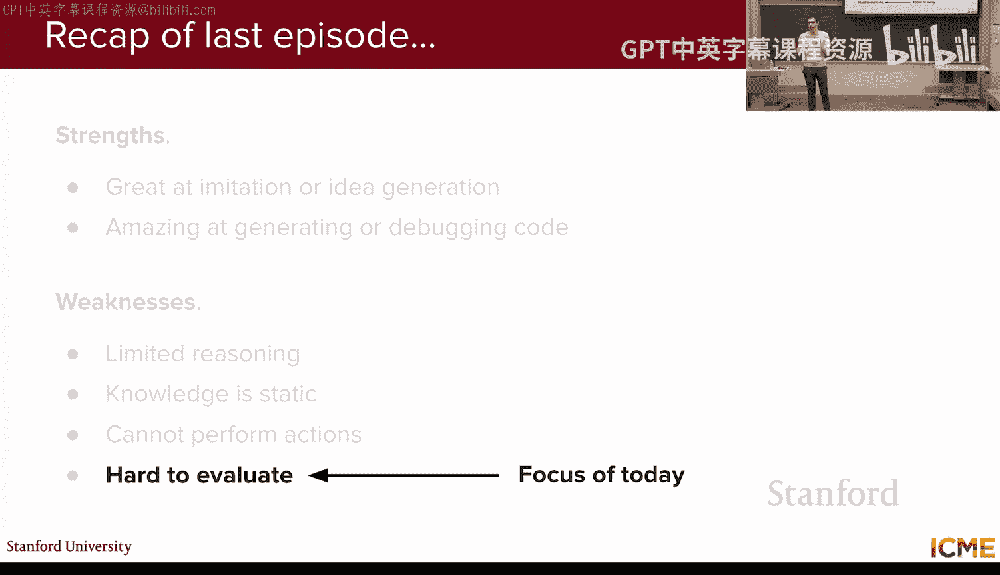
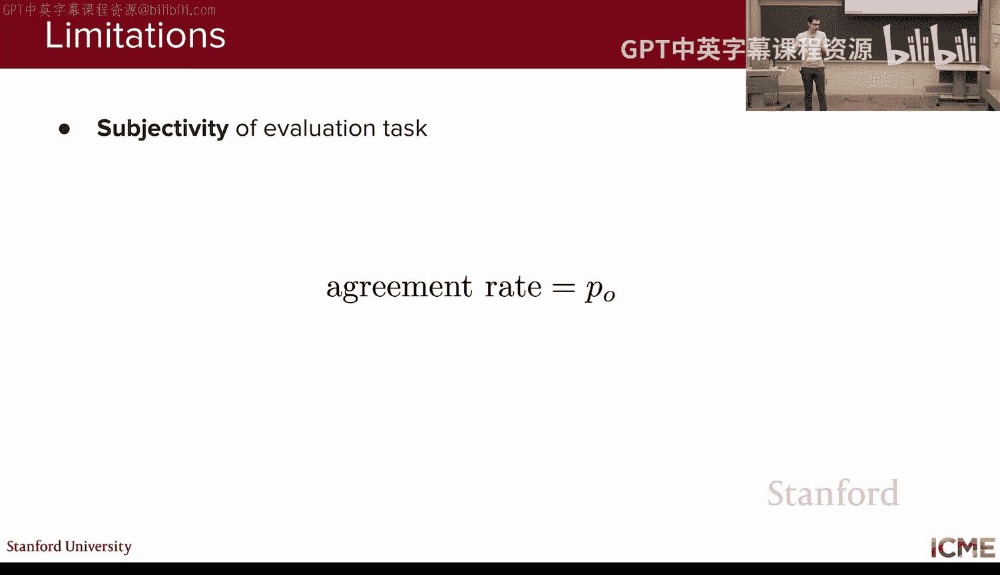
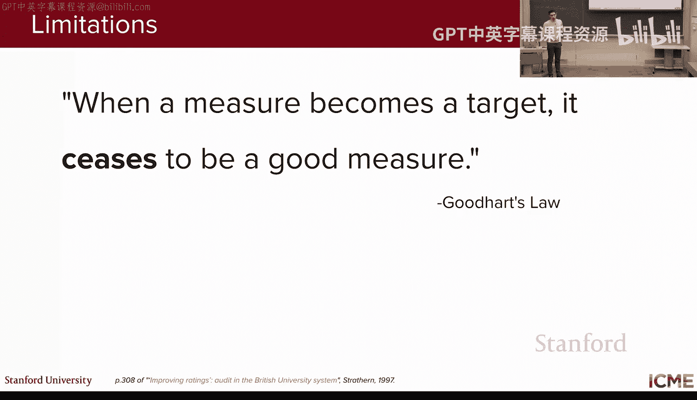

# 斯坦福大学《Transformers 和大语言模型｜CME295 Transformers & LLMs Autumn 2025》中英字幕 - P8：Lecture 8 - LLM Evaluation. - GPT中英字幕课程资源 - BV1WGsMzCERB

Hello everyone， and welcome to Lec8 of CME 295。So today's topic will be LLM evaluation。

And I think this class is probably one of the most important classes of this quarter because the idea is if we don't know how to measure the performance of our LLM。

We don't really know what to improve。And so this class will focus on how we can quantify。

 how the LLM performs in a bunch of different cases。So with that set。

 we are going to start the class as usual by recapping what we saw last week。So if you remember。

 last week， we saw how our LLM could interact with systems that are outside of the LM itself。

So we saw one core technique。That is called ragG。That allows our LLM to fetch information from external knowledge bases。

 and so here RuG stands for Retrieval augmented Generation。

And we saw how we could improve the retrieval system。

 so we saw that it was composed of two main steps， so one was candidate retrieval。

 which is typically something that is done with a by encoder kind of setup。

So sentence B was like a good example of how people would design such a model。

 and so this first step is typically there to filter down the potential relevant candidates for a given incom inquiry。

And then we saw that there was a second step， which was reranking。

 and that one was a bit more involved and involved。Cross encodes， which were most sophisticated。

And we also saw some ways to quantify how well our retrieval system performeds。

And then we also saw something that was called tool calling。

Which is the ability for a model to know which tool to call with which argument。So if you remember。

 if we give our LLM the knowledge of the tools that are available to it。

It can figure out which arguments it needs to input to the function as a function of the input query。

And then run that function and then outputs the result in natural language to the user。

And then we also saw how agentic workflows were composed of。

 so spoiler alert is something that is a combination of the two previous methods。

 so ragG and tool callinging。And in particular。😊，Given an input。

 we're allowing our model to make multiple calls。😡，to call different tools。

 to fetch relevant data from other knowledge bases。

 and we saw one example that was kind of successful from the current applications。

 which was AI assisted coding。Which relies on this principle。

And react is typically the framework that people would use， so reason plus act。

Which is decomposing this into observe， plan， and act steps。Cool， so this is what we saw last time。

And we also started from this slide last time we if youre a member。Our LLM has strength。

 but also weaknesses that we're trying to mitigate。So in particular。

 the focus of lectures six and seven。Were on。Methods to improve reasoning of the model and ways for the model to fetch knowledge from other systems。

 as well as performing actions。And today， we're going to focus on the evaluation parts。In particular。

 given a response that the model is giving， how can we quantify how well the LLM is giving its response？

Cool。So first of all， I would like to define the term evaluation and the meaning that we will use for this lecture。

So when we say I want to evaluate my LLM。It can actually take a lot of different meanings。

So when you say let's evaluate to LLM， it can mean let's evaluate the performance， the output。

 let's evaluate this based on coherence， factuality。

 let's evaluate it based on latency or more system related metrics or pricing or how often it is up and so on。

So just to make sure we're on the same page， this lecture will mostly focus on the output quality parts。

And in particular， we'll focus on quantifying how good the actual response is。

And here you will note that this is a challenging problem because as we saw previously。

 our LLM is a text to text model。That can output basically anything。So it can be natural language。

 it can be code， it can be math reasoning， and so on and so forth。

So it's very hard to come up with universal metrics to evaluate that。

 so we will see how people do this in practice。Cool， so。

Given the fact that our LLM generates free from output。

One could imagine that the ideal scenario for us to evaluate the LLM output。Would be to every time。

Ask a human to rate the response。😡，So here the ideal scenario would be， okay。

 I give a prompt to my LLM， it gives a response， I ask a human to rate it。

 and I start again and again。And what I do is at the end of the day。

 I just collect all these human responses and I try to quantify the overall performance of my model。

Well， as you can imagine， the main problem is that。Such a system would be very cost intensive。

But let's look at this into more detail。So。If you're a member。The LLM outputs are really free form。

 and there may be cases that even human judgments may be something that is fuzzy because maybe the rating task in itself is subjective。

So。Let's take the following example。Let's suppose I asked my LLM。What birthday gift should I get？

And let's suppose the LLM response with a teddy bear is almost always a sweet gift。

 just pick one that feels right for you。So let's suppose I want to evaluate this response with respect to the usefulness dimension。

I may have one human reader that says， yeah， it's pretty useful because teddy bear is pretty indicative of I guess what the user should get as a gift。

But then。Another rate may say， no， actually， it's not useful because maybe the response didn't specify exactly which teddy bear。

Should I have a bear， should I have an elephant a giraffe， like which stuffed animal should I get？

And so there is this notion of。Interraator agreements。

Where we're basically concerned with making sure that everyone is aligned。

On how to rate those responses。Because sometimes like in this illustrative example。

It's maybe a little bit subjective。😡，So responses may vary。

So what people want to do is to make sure that the guidelines are clear enough。

For everyone to rate these responses in a consistent manner。So people come up with。

Agreement types of metrics。So a very natural metric that you may think of。

Is the quote unquote agreement rate。So for instance， you have these two Raers。

 so what you do is you just measure the proportion of the time that the two Rars give the same response。

And let's suppose the response here is binary， so let's say， yes， good or not good。Well。

 do you see a problem with such a metric？Like， is this a good metric？I guess。

Another way to ask this question is if I give you a given number of agreement rates。

Can you tell me if。It's a good number or if it's a bad number。Well， let's take the example of。

 let's say， two Raers。Let's say， Alice。And let's say Bob。

And let's suppose we have two different types of ratings that these raters can give。

 so either let's say， yes， it's good， so one， the output is good。Or the output is not good。

So if we assume that the first rater gives。Let's say random responses。😡，With some probability， P of。

For being good。And one minus PF for being not good。And then let's say Bob。

 who should have eyes and a smile。Has PfB for being good and1 minus PfB for being not good。Then。

Let's compute the agreement rates for this case。 So the agreement rates。

I's basically the probability。That's。Raier A and Ra B。Agree。😡，And so here。A and B agree。If。

A and B both votes1。Or when A and B both fold zero。Right？

But if they give their response in an independent and random way。Well， if you use。

Like these probability concepts that you know， then we will have。

Probability of A and B responding to 1， which is probability of a responding to 1 times probability of B responding to 1 and same for0。

😡，So we will have something like this。So P of A。PfB。Plus1 minus P of A。1 minus PfB。So this one is。

A and B。Say one。And here A and B。Say zero。So。So let's see what the agreement rate would be in that case。

So， if we assume that。Suppose that let's suppose P of a is equal to P of B。

 which is equal to let's say， 0。5。Then the agreement rate would be。So agreement rates。

Would be so I'm just replacing the number here， so 0。5。Squared plus。0。5 squares， so it's 0。25 plus 0。

25， which is equal to 0。5。What that means is。If we're just letting our waiters。

Rate these things in a random way with some probability P of A， P of B。

We would already have an agreement rate of 50%， which is by pure random chance。And so。

One thing that I want to say is that this agreement rates by pure chance。

Is a function of the probability that each of these rateers give these ratings？

And so， if。This probability is actually higher， the agreement rates by pure chance is also higher。

So what that means， so what do I want to say？I want to say that if we just take the agreement grade。

Then it's very hard to put it into context in terms of。

What you would have gotten if things would have happened just by pure chance。So for this reason。

People have come up with a series of metrics。That try to make it more relative to this baseline。

 which is。What would happen if。Our rateers would choose things kind of randomly。

And so you have these metrics。 like， for instance， this one is the Cohen Ka metric。Which。

Compututes a quantity that is a function of this agreement rate by chance。And take the observed one。

Such stats。If our observed agreement rates。😡，Is greater than。The by chance agreement rates。

Then our coefficient is positive， so when it's positive。

 you know at least know it's going in the right direction。So here if the observed。😡。

Agreement rate is equal to one。Then so Kappa is equal to 1。

But if our observed agreement rate is below the by pure random chance areement rate that we saw on the blackboard。

Then our coefficient would be negative。So long story short。

There is a bunch of metrics that try to quantify interer agreement rates using these kinds of formulas。

To be able to make these quantities relative to what would happen if things were done in a random way。

And so that's why you may see a bunch of metrics out there。

 so here it's cohen ka that people use for cases where there are two raiders。

 but then you have extensions such as flykappa and crryipendors alpha that you may see out there。

So they all rely on this idea that we should have some baseline。Which is。You know。

A waiters just randomly picking answers and try to see how much better our actual agreement is？

Compared to this。So does that make sense？Yeah， so I guess what I want to say is that the first limitation of asking humans。

To rate our L output， which was。Sometimes the task being subjective。

Can be something that we can quantify with this interer agreement metrics。

So what people typically do is they keep track of how good that agreement is。

And if let's say we have a quantity that's not satisfactory。

People would just hold some quote unquote agreement sessions between the rateers to just align on how they should rate the answers。

So it can be seen as just a health metric to track how consistent your rating are。

And this is typically something that people use。In practice。So。Up until now。

 we've seen one limitation of human ratings。Well， second limitation。

 I think I also said this previously， so it's really slow。

 you if you ask someone to rate 1000 LM outputs， well it will take them a while。And it's， of course。

 expensive。So all of that to say that our ideal scenario of asking a human to rate every LLM output is not something that is practical。

But。We can leverage human。Ratings， in some way， because we've seen that even if the task is subjective。

 we can have a way to align our readers。So now let's move on to another way to go about doing this。

 which is by using some rule based metrics。So here I'm just going to revise the setting that I mentioned before。

And instead of asking our humans to write every LLM output。This time。

I'm just going to ask them to write。The references or the ideal outputs for a given set of prompts。

Just fix that for good。And then use some kind of metric。That would compare the LLM outputs。😡。

With those references。So here the main difference is。

 let's suppose I have a given set of prompts fixed。Well， I can make iterations in my model。

And always compare the outputs of my LLM。With this fixed reference。😡。

Instead of always asking humans to rate that again and again。So it's already an improvement。And。

We will see a little bit what are the kinds of rule based metrics that you will see out there。😡，So。

Ideally， these metrics should reflect。The performance of the LM output in an optimal way and what I mean by an optimal way。

 it is to make it be a little bit flexible， given the fact that natural language is not always something that you can say in one given way。

😡，So for instance， when I provide a response to a given prompt。

There can be very well a case where I can formulate the response slightly differently。

But it will still be just as good。So the idea behind these metrics。Is to make this comparison。

A little bit flexible。😡，So let's start with one common one that people use in the translation case。

 so this metric is called meteor。And it stands for metric for evaluation of translation with explicit ordering。

So the idea here is to compare。Reference and predict。And we'll see how it's being done。And also。

Penalize cases when words are not in the same order。

Which is explaining why the metric is called with explicit ordering。So the formula is as follows。

 so it is sum f score times 1 minus sum penalty。So the F score here is so you may be familiar with F1 score。

 so it's like the harmonic mean with equal weights， so this one is with variable weights。

So it is a function of precision and recallco。Where precision is the proportion of。

The unigrams that are in your predicted。Sequence。That are matching with the reference。

And the recall is the proportion of the unigrams in the reference。

That are matching with what isn't predicted。So it's basically matching the。

Usual precision recall metrics that you know。And then we have another quantity here。

 which is the penalty， and I mentioned the penalty here tries to incentivize goods ordering。

 so if it's order the same，In the reference and in the prediction， then it's good。Otherwise。

 it's bad。And so here there's a bunch of quantities， so gamma and Beta are。

Highperparameters that people arbitrarily choose。And it's a function of C。

The number of contiguous chunks that are matched。Over the matched unigrams。

 the number of matched unigrams。😡，So ideally， you would want。C， that would be as low as possible。

 because if you have a low number of contiguous matches。

It means that your contiguous sequences are lung。Which means that ordering is the same。

So you want C to be low。And then matched uniograms to be high。So you want that penalty term。두비로。

For a good， I guess for a prediction that has the same ordering as the reference。So I guess。

Higher meteter score means better translation according to this way of doing things。

So I guess when you look at this formula， so first of all， it seems it looks very arbitrary。😡。

I have alpha is a hyperparameter， gamma data， so it's kind of。A recipe I feel。😊，So that's one。

And the second thing is that it does not allow for stylistic variations。

 because here we're measuring the number of matched uniograms。

Although the metric expands the like range of what it's called matched Uniigrams by taking into account things like。

Words that are synonyms of one another and things that are end of the same roots。But still。

 it is not like extremely satisfactory in that sense。So meteteror is one such metric。

You have another one that's being used or that has been used in translation tasks。

 which is called blue。W you may know。So blue stands for bilingual evaluation under study。

 and you can think of this as kind of a precision focus， kind of metric。That looks at。

The number of matched。The matching ngrams。Over the n grams that are in the prediction。

 which is why it's a precision kind of metric。And it also has a penalty term here。

 it's called brevity penalty。Because given that it's more of a precision kind of metric。

If you translate something that's very short。You may be able to game the metric。

 so you want to penalize。The translation being too short。So we're not go into a lot of details。

 but I just want to just show you the kinds of metrics that are out there， so meter is one。

Blue is another one。And Rouge。Which you may have heard is also another one typically used for summarization tasks。

Again， same idea， and it has a bunch of variants that you may see out there。But long story short。

All these metrics。They all compare。The outputs。With a reference。So as we saw。

 one key limitation is that they do not allow stylistic variation。So let's take an example。

So let's suppose I say a plush teddy bear can comfort a child during bedtime。Well。

 the exact same thing I can say it in a really different way。

 so soft stuff bears often help kids feel safe as they fall asleep。

 or many youngsters rest more easily that night when they cuddle a gentle to a companion so in all these cases。

The metrics that we saw would。You would really perform very poorly。So that's one key limitation。

 so the second key limitation is correlation is not that great。I mean。

 you can imagine that people have come up with all these hyperparameters to kind of make it be correlated to human ratings。

But they're not that correlated。And the bottom line is it still requires human ratings。

To just get started。And sometimes。You just can't afford to have human ratings， maybe in your project。

So I guess there are still some key limitations。Which is the reason why。

 so all of that to say I want to motivate the key method of this class or of this lecture。😡。

Which is called LLM as a judge。So you know， we spend the first seven lectures motivating these large language models that are pretrained on huge amounts of data that are tuned in a way to match human preference。

 so they do contain human knowledge they do contain some indication of what humans may prefer。

So the idea here is to have our model response。Be actually an input of yet another LLM。😡。

And that LLM is something that people typically call LLM as a judge。

So it was a term that was introduced in a paper from two years ago。

So here the idea is to use an LLM for rating purposes。😡。

And things that you would see as input would be the prompt that was used。To produce the response。

The response？And the criteria along which you want to grade your response。And so here。

 LLM as a judge would give you the following outputs。So the first thing is it would give you a score。

So here you can think of it as like a binary scale， kind of score or pass or fail。

But and this is very new。Also a rationale。Because LLMs。They understand text。

So they can also explain you why they graded something with a given score。And that part is。

The key difference with previous methods。We are able to explain why。

The metric or the model is giving us a given score。And this is quite good because in the other。

 let's say， rule based worlds。Where you would have all these like formulas and multiplication and all these things。

And sometimes you would come up with a number that would not be very self explanatory。

And this is luckily something that LM as a judge addresses。So to recap。

What we want is to use an LLM as a way to grade the response。So here you would have typically。

The following kind of prompts。So you would states， okay。

 I want to evaluate my response with respect to a given criteria。

And then you give the prompt that you used to generate that response。Along with the Mar response。

And then you would ask。The judge。To return two things。The rationale。And then the score。

So one little trick I want to point out is people typically ask the model to first output the rationale and then the score。

And the reason why we typically do that is it's something that empirically improves the quality of the results。

But then given what we saw， I think， in lecture six， if you remember the reasoning class。

We saw that these reasoning models that。Are being trendy， especially in 2025。

What they do is they first output a chain of thoughts before giving the answer。

So you can actually think of this trick as being on the same kind of idea of reasoning models as in it allows the model to。

Externalize， verbalize。Quote unquote third process before giving the score。

 so it gives it a chance to really figure out what is good or what is wrong。In the model response。

So far as some goods？Any questions on， I guess the setup？Yeah， oh goods。Okay。

 so now I have a question for you。If I give the following prompts。To my Elm as a judge。

Am I guaranteed to have？A rationale and the score that I can pass。Am I guaranteed？No。Yeah， exactly。

 no， the answer is no， you're not guaranteed to have。

A rational and a score that you can parse because this model has some probabilistic nature to it with the sampling process and it's not something that you can really control。

So I guess my follow up question is。Do you know a technique？That's woods。

I guess guarantee you to have a structured response。

So hint it's a technique that we saw like towards the beginning of the class。

I'll give you a little hint。😊，So。If you remember on slide 65 of lecture 3。

We saw a technique called constraintss guided decoding。So if you remember。

 the idea here is to constrain the decoding part process。

By allowing our model to only sample from quote unquotes valid tokens。

And we typically do that in cases where we want our output to have a given format。

 so let's suppose adjacent format。And we want absolutely that format。😡。

So what people do is they use this technique to guarantee the form of their response。And。

In case you're using these， like the providers that are out there， like， for instance。

 Open AI or Gemini or Anthropic。This technique is known under the name。😡，Structured output。

So in your projects。If you want to constrain the decoding process。

In order to output the response of a given format。So let's suppose my format is a response and I kind of represent it by a class and there are like two attributes so rational and score。

Well， typically you can。Reference that with the argument text format。Equal to that representation。

So this， I believe is something that Open AI does and I'm not exactly sure if it's exactly the argument name that you would see for the other providers。

 but they're all， I guess。Along the same lines。There are some goods。

So the key word here is structured output。😡，Whenever you want a response of a given format。

 you would just go for that。Okay， cool， so just to recap， our LLM as a judge has two main benefits。

So the first one is that we do not need a reference text。

 we do not need human ratings to just get started。Because our LLM already has a lot of， I guess。

 knowledge that has acquired during pre training and human preferences and so on。

 so you do not need that。And then the second thing。Is you can interpret the score。

With the rationale that it is being output。And that is also quite remarkable。So just as an example。

 so you hear you would say， okay， evaluate the quality of this this response。

 so you would have some rationale that would explain what this response has or doesn't have that makes it good or bad。

Along with the score。Okay， cool， and I believe， okay。

 so now we're going to see the kinds of L messages that you can see out there。So of course。

 there are many variations， but there are generally two types of L messages that you will see。

So the first one is you have a single output。A single response。That you want to evaluate。

And here you would ask LMS messages to say， okay， is it good or is it not good？And the second。Big。

Kind of le that you will see out there is pairwise kind of set up。

 So you have two responses and you say， is response A better or is response B。Better。

And here you would。Obtain a response， either okay， that one or this one。

So if you remember we've seen in previous lectures that there are a lot of situations where we would want to have preference data。

 so for instance， in a preference tu class that we had，I believe it was lecture5。

So this kind of method can also be a good way to synthetically generate preference ratings。

Where you have two responses。And then you ask yourLLM to say， okay， I prefer that one。

And you can use that one as a。As the label to train your reward model。The sound goods？

Any questions on the setup or？Everything that we've talked about so far。Okay cool。

 Everyone is on the same page。 So now let's see what can go wrong。With our L as a judge。

 so let's think of the possible kinds of failures that we can encounter。

So the first one is called position bias。And as the name suggests。

 it has to do with the ordering at which we present the responses to our model。

So let's say if we ask our model is response A better or response B？Well。

 there is a chance that the model responds with response A。

Just because it was the first one to be mentioned。So that kind of bias is called position bias。

 So it's where the position at which you place the response matters in。

Judgment of the L as a judge model。And。I guess as a way to remedy that。

 people have different techniques， but one typical technique would be to ask the model is a or B better and then as the model is B or A better。

And then take the majority voting， so if both of them lead to the same response， then it's good。

But if the response changes？Then it may not be good， so you may want to do something else。

There are a bunch of other techniques， so I know there's a bunch of papers that try to tweak the position embeddings。

 but those ones are a bit more advanced， so it's not typically the thing that you would do just out of the box so taking the average or like you know taking the majority voting of this you know。

Position swapping is CPT what you would do。Okay， cool， so this was the first kind of bias。

 the second bias is called verbosity bias。So let's suppose you have two responses。

And the first response is short and concise。The second response is something that goes much more into details。

 is typically something that is more verbo。Well， there are cases where the model will tend to。

To I guess， prefer responses that are just more verbals just because there are more verbals。

 not necessarily because they're more correct。And for that， it's maybe a little bit trickier。

People typically try to explicit。This dimension in the guidelines。When they input。I guess， the。

This question to the LM as a judge， they say， well。

 make sure to not pay too much attention to the length of these responses to not， I guess。

 prefer something just because it's more verbose。So that's one kind of method that you will see out there。

The second one is to just also add some examples in context learning examples to the model to just。

I guess tell it to I guess show by example that verbosity is not something you should prefer。

 and then the last one is to have some kind of penalty。On the output length。

So you can ask your model in a pointwise way is one， how good is one， how good is two？

And then try to penalize that with the length。So it's something that also people may use。Okay。

 so we've seen position bias we've seen。Forgoity bias。

 now we will see the third kind of bias that you may see out there。

 which is called self enhancement bias。And so that one has to do。With the fact that if you ask。

A model。To judge an output。That was produced by itself。Well。

 the model we tend to prefer responses that are generated by itself。

Regardless of whether or not the other one was more。Aligned with what we wanted。And I guess here。

 the intuition is that ER model。Genenerated such an answer。

Then it may be the case that our model thought that from a probabilistic standpoint。

 this was a sequence that was very much likely to appear。So it may be， I guess。

 one way to think about it， which is if it has generated such a sequence and it means that。It。

 it is something that。It thinks， I mean， think you quote unquotes。That it's a good answer。

So the general guideline here is to typically not use the same model that you use for generation and for。

Judges？But I guess nowadays， it's kind of hard to have that strict。Constraints， I guess。

Resspected because。I guess all models， they are trained on basically the same data sets。

So you can argue they're all being subject to the same， I guess， training mixes and so on， but still。

 I guess people what people do is they tend to use another model just to have。

Such a risk be minimized。So long story short， try to not use the exact same model that you use for generation。

And for evaluation。So this is self enhancement bias。Okay so before we go to the next subpart。

 I guess what do you think of these three biases， do they make sense， any questions so far？Yep。

So can you elaborate a bit more？一。嗯。Yeah， yeah yeah so the question is can you have a model that just maybe isn't aligned with I guess the ground truth and maybe prioritizes maybe one label over another so yeah this can definitely be another kind of bias。

 so this bias being that our LLM is not exactly aligned with what humans would prefer so these three biases are by no means exhaustive so this can very well be another bias that you can list as well。

So yeah， this is definitely another kind of bias。Yep。Yeah。So the question is。

 is it possible that our judge still prefers an LM response even if it's a different one。

 well it depends how good your judge is， but typically the best practice is to have a judge that has a much bigger capacity that may capture this kind of differences and not be fooled by a response that just sounds like something it may generate？

But something that is maybe more aligned with human preferences， so I guess the short answer is yes。

 you can still have such a situation， but in order to mitigate that risk。

 you would typically take a model that is not the same， but also typically much bigger。

So you have a bunch of such models out there and you with all the， I guess。

 improvements that have been made with like reasoning models， this is also something that people try。

Yeah， question is should the judge be bigger， it's not a hard constraint。

 but it's typically something that people would take。

 like a bigger model that would have strong reasoning capabilities that could really tease out what's good and what's not good。

Yep。Okay cool， so with that I'm going to just go over the best practices that we've seen。

We saw that in order for our LM as a judge to output a score。

 we need to give the criteria that we want this to be evaluated against。

But sometimes these criteria may be a little bit subjective。

 so one thing that really works very well。Is to have crispP guidelines， so really explicit。😡。

What we want， what we don't want。The other point is you may see different kinds of scaling out there。

 so sometimes people having a scale that is maybe more grandular and maybe other cases where we're just operating on a binary scale。

So typically what people would tend to prefer is actually the binary one。

Because it makes the job of the LM as a judge easier， so it's just either good or bad。And also。

 when it comes to aligning the judge with human ratings。Humans。

 they typically also find it easier to just judge out of two options as opposed to several。

So it just removes the noise。Of having several possible choices。

 And it's not necessarily an extra signal that。Maybe really useful。

So here the tip is to use a binary scale。Like a pass or fail kind of score as opposed to like a gradual one。

The third tip is to make sure to output the rationale before outputting the score。

And we've seen this is along the same ideas of outputting a chain of thought before providing the response。

 which is something that is done by our reasoning models。

 so it's typically something that will improve the judge performance。

So we've talked about the different kinds of biases， so position， verossity， self enhancements。

 but it's not the only ones of course， and I guess people typically also look at how to mitigate those with the remedies as we mentioned。

So so far， we've stated that we do not need human ratings to get started。😡。

But a good practice is to still look。At how the LLM ratings compare with the human ratings。

So here one tip is to just calibrate the responses that the judge is giving with respect to the human ratings because at the end of the day。

 it is。The quantity that we want to approximate。And so here I guess if there is the budget and it's something that is possible for the project。

One good practice is to collect the human ratings。Output LM as a judge course and then run some correlation analysis to see if there is something that can be improved in terms of the prompt。

 mainly the prompt。And then the last thing is the temperature。So if you remember。

 the temperature is a parameter that you can tweak。

To make your generation more deterministic as opposed to more creative。

And so you will see that for evaluation tasks， people use a low temperature。

Because they want to make their evaluation experiments reproducible。

Like let's imagine you do one evaluation and then you do another one， let's say two days later。

 you don't want the scores to be super different。So you will see a temperature value of something like 0。

1 or 0。2， these are like very common values that people take。And so long story short。

 if we were to recap。We went from the ideal scenario being that。Each L output is rated by humans。猪。

Actually， having some kind of approximation with these LM as a judge models that can do this evaluation。

 I guess， without any constraints or without any need for human judgments。But。

As we mentioned in the best practices， making sure that the LMS adjust scores and the human ratings do not diverge。

Is something that we should keep in mind。As we improve our model。

Because it may be that we're improving our model。😡，So that our LMS or address score is very high。

 but the LMS address score is itself。An approximation of human ratings。

I guess you don't want to over optimizeimize against I guess a proxy。

 and so that's why you want to have that proxy be as aligned as possible with your ground truth labels。

 which are human ratings。Okay cool， so we have a few minutes left before giving it to Shervin。

 so I'm going to quickly go over the kinds of dimensions that people measure LM output against。

So we have broadly， so there are many dimensions， but just to simplify things。

There are two main dimensions that we can look at here。 So one is how well your task is being done。

 So task performance with things like。Was the response useful， was the response factual。

 was the response relevant among other things？And also how aligns。

was the response format of tone in terms of whether the style was something that is aligned what we want in terms of whether there was any unsafe elements of response that was given to the user。

And I just want us to spend maybe five minutes。On the factory dimension。

Which is actually something that requires a little bit more work。And。I'll give you just a setting。

So let's suppose we have some text output。And our goal is to quantify how factual。That output is。

So I'm going to read the text out loud， so Teeddy Bears first created in the 1920s。

 were named after President Theodore Roosevelt after he proudly wanted to shoot a captured bear on a hunting trip。

 so what we want？Is quantify how factual that piece of text is。So I told you previously that。😊。

We typically prefer binary scales when it comes to rating。Something with respect to a dimension。

But the thing with factuality is that there's a lot of nuance。Some text may be very wrong。

 some text may be a little bit wrong， some text may be not wrong at all。

So we want to capture how wrong the text is， given the fact that the text can contain a lot of sentences and if there's one small issue。

 we don't want to just say the whole thing was not correct。So I'm not sure if you saw in this text。

 but there are actually two errors。So it's not 1920s。

 but 1900s that the teddy bears were first created。The president didn't want to proudly shoot。

 he actually， I think， refused。So if we are in such a case。

The question that we want to tackle here is how do we want to quantify？Disanceance。

So this is an open question that people have been writing papers on。

So what I'm going to tell you now。Is something that people typically use nowadays based on research that has been done。

So we typically operates in a few steps。So the first step is for us to go from the original text outputs。

To a list of facts。Because when you look at a text。

It actually contains a lot of facts that need to be checked。And so the idea here is。To aggregate。

The factuality of this text along the dimension of the facts that are present in this text。

So in this example， we would have one LLM call that transforms our original multi sentence。

 multi paragraphgraph potentially text。Into a list of facts。So here in this example。

 we would have four facts。So that's the first step。

The second step is we would go over each of these facts。And check whether it is correct or not。

And so here we would typically proceed in a binary fashion。Because if you think about it。

 a fact is either correct or not。I mean， you may have some in between。

 but we don't want to overcomplicate the task。And so here， the fact checking process。

Would typically involve the other technique we've seen last lecture？Like RaG， for instance。

 given a piece of text， we want to， I guess。Qury a knowledge base with the actual fact and then check whether the fact that is here is actually correct。

So this fact checking process is typically something that involves things like RAG。

Web search is also something else。And so on。So you can think of this。

Fact checking step as also involving LLM calls。And so， you can also think。Of some facts。

Being more important than others。So as an example， maybe the fact that the president proudly wanted to shoot the bear is not as important as。

 let's say the name of the person after which the teddy bears were named。

 so you can think of also having weights。That quantifies。The importance of each fact。

So people would use something。Like this formula， which is an aggregation over all the facts。

With some weight that quantlifies the importance of each fact。So these weights。

 alpha I can be all equal to one another if you want to make it simpler。

 it's not something that is necessarily the case everywhere that these must be different。

 but it may be something that you can tweak。So if we go back to our initial question。

 which is how do you quantify the factuality of this text？Here you would say， okay。😡。

The second and the third facts are both correct。We know how important they are。So we run this。

Aggregation formula， and we obtain a score of 0。6。So that means that there are some errors。

 but we still have some things that were still factly correct。This is typically how you would run。😡。

These criteria with， I guess the techniques that we have nowadays。Okay， cool。

 I know I'm two minutes late and with that， I'm going to give it to Shervin。Thank you， F。

So before we move on to looking at specific benchmarks。

 I wanted to take a detour and look at what is happening on the agent side of things。

So if you recall what we discussed last lecture， we talked about this react framework where you could decompose what was going on within an agent in two specific steps。

So it's usually three steps can be observed plan act or it can have other names。

 but the fact is that you have several atomic steps that can loop。So。

If you take a look at the typical agents in our working， you can see a pattern like this。

Now you might wonder， how do you even evaluate such a thing？So let's take a look。At just one loop。嗯。

And then let's see together， what can the errors be in order for us to have an idea of what would an evaluation results mean on an agentic workflow？

So。I'm going to show a slides that we had presented at the previous lecture and we had seen that we can decompose a tool call into these three steps。

 so let's take our favorite example let's say you want to find a bear near you so you would ask that to the model。

 so the first stage is to find the right tool call with the right arguments。

And then once you have found this right tool call， you need to execute it。

And then based on your tool called prediction and on the results that you obtained from your tool。

 you would infer the results at the last tip。So these are three steps。

 and you might have a series of them in the case of an agentic workflow where you call multiple tools。

And then build up your reasoning until reaching an answer that you then give to the user。Okay。

 so now let's look at。What can the failure modes， what can they be at each of these steps？So first。

 let's take a look at possible tool prediction errors。So the first one I want to mention。

Is the case where the error is that from a user query that obviously needs a tool that you don't actually use the tool。

So here， let's suppose that you want to find a bear， you have the tool to find bears at hand。

 but you don't use it， so typically if you don't use it。

 a possible behavior from the model can be to say an error。

So an error by an error I mean you know sorry， I kind of do that and these in assistant terms you can call this a punt。

 so when you don't answer the question you just fail。

 it's called a punts so you might punt here sorry I don't know where I can find one。

And let's see together what could possibly cause this issue and how we could remedy it。

So I don't know if you recall the concept of tool router or tool selector that we had introduced。

So usually when you are dealing with tools， you don't have just one， you have multiple ones。

And the number of tools that might be useful for a large scale in the sense of number of users LLM might be large。

 so you don't want to input all the function APIs at every call。

 so it might be the case that you have this intermediary step where you filter down the sets of possible functions that you can put in the preamble。

And here， like these tool selectors or tool routers。

They have the property of trying to be recall oriented。

So you want to trim the list of functions that you want to input in the preamble。

But you want to at least find those that you need。So the main property here is that you want to save。

On context space。But you still want to ensure， most of your use cases are still working。

So this is why here when we say two rarer error。We actually mean a recall error。

 So it means it's possible that we just didn't select the right tool among the set of tools。

And let's say this is the cause， then it's pretty clear we just have to adjust the tool router in order for it to be like predicting the right tool。

 so this can be one kind of issue。Another kind is， hey。

 actually the tool was included in this list of function APIs。

 but it's just that the LLM didn't think about using it。

So maybe this like fine teddy bear was in there， but we just don't use it。

 the LLM directly outputs a response。So in that case， if you recall。

 we had mentioned techniques to teach an LLM to use a tool。

 so you would need to revisit that part and either if you had trained it with SFT。

 so you know include this pattern， maybe to train the model to recognize it。

Or if you had done prompt tuning， then you should revisit your prompts in order for this call to make sense to the model that you should use that tool。

Okay great， so this is one kind of possible error。Another one that you might see in the wild when you want to debug agents。

Is at the time of tool calls， it might be the case that the model comes up with the function name that just simply doesn't exist。

So here I mentioned the tool hallucination， this is what I mean by that。

 so it calls a function that is just not defined。So here our API was called， if you remember。

 Find Teeddy bear， so this was the function that existed。And in this example of failure。

 the model tries to call the function find bear， which I haven't defined。租。When you see such errors。

 you have several potential causes， one of them being that the model simply doesn't ground well overall。

 and T it occurs if the model is too simple。So it's an empirical observation， if it's too weak。

 maybe it can make up things that it thinks。Can be reasonable。

 but it doesn't actually ground on your instructions。

And here I have no better remedy proposal than to maybe upgrade the model if you see that this is truly the case and then see if this is reproducible。

Some other potential causes could be coming from actually you。

So the model is trained on very high quality data during its SFT stage。

 so it has seen what great APIs look like。So these tools that you define that help the user achieve what they are looking for might not be written in the best way。

 if you didn't use AI assistant coding， let's say。Or yeah。

 you don't necessarily have to use AI assistant coding to write this。

 but these are typically a great way to check whether your implementation makes sense from a model standpoint。

 and if it doesn't， then a typical remedy is to。Either like renaming the API。

 just the function name and the arguments。Just go a long way because this is what the model will see when it comes to your tool call。

 it sees the API function name， it sees the arguments and the high level descriptions。

 so these are your three knobs to tune in order to make it sounds more logical and then linked to the actual task at hand。

And then so at the very beginning， I was saying。Maybe the model is too weak。

 but actually maybe the first thing you should check is whether the horizontal instructions。

 so horizontal across tools。Whether these are clear enough。

 maybe the model hasn't really understood that it needs to use functions that are given to it。

 so maybe it's just making up function names that it believes could have access to。

 so the first thing to check would probably be to see if this phenomenon is generalized and see if these horizontal instructions that are concisely saying that you should make sure to use available functions。

And then on that， you can iterate on these top level instructions。

And maybe iterate with an LLM itself because typically topable instructions， they are very important。

 so you need perfect formatting and perfect logic， so yeah typically being able to detail them。

With great detail is helpful。Okay， now let's see a third possible failure cause。

 so let's say you have your model and your user prompts。

 but you just don't use the right tool so here if the user says find a bear near me。

One other reasonable approach would be， what if you just send a message？Asking for a bear。

That would be reasonable， right？But maybe that's not what you want to implement as a behavior for your user。

 so in that case it's not clear to the model what approach you prefer。

 and on your it is your responsibility to ensure it is indeed clear。

So and then you have to do that at two different levels。

 so the first one is you know potentially also at the tool router level。

Maybe the tool router doesn't know that for this kind of query。

 you should have the tool that you had in minds as part of the results。

 so it's possible that you have a recall issue that you need to fix。

And then the second one is simply going back to the APIs of both functions。

 maybe they conflict in scope， so you want to go back to each of them and be precise into which situations should be dealt with with which two。

So being very。Very precise in these APIs。Just plays a lot here。Okay， great。

 So now we're going to go through a fourth。And last failure mode for this tool prediction task。

 which is what if you have the right tool， but you just don't have the right arguments。

So you have already gone one step。know you have found the right tool but then this last mile of making sure that the tool is run with what you would like is not fulfilled。

 so here if I say find the bear near me and it outputs and it uses the coordinates 00 which is somewhere in the southern Atlantic。

So it's not likely that I'm actually there， that can reflect an issue。And。

One possible explanation for this is that maybe it simply doesn't know where I am because I haven't specified in my query that I'm here at Stanford and it just tries to make up my coordinates。

So one。Thing that you should double check is making sure that the context。

Carries the location information， so if I haven't provided that as a setting on my LLM map。

 it's possible， it's not there。And then let's say it's not there。

 maybe you would want to introduce a location finder tool that is executed beforehand。

And if it fails because I haven't given the app the permission to see my location。

 then maybe you could have actionable error shown to the user。

Instead of having some dummy parameters pasting。So this is one potential remedy。

And then the second one is， maybe it sees arguments。

 but the model just doesn't know what it should put as input。So that could also be another reason。

 and then on that， this is a common remedy to go back and then retrain。

Either the model on how it uses these tools or rewrite the API。So we have seen four ways to， I mean。

 four failure modes for the tool prediction step。 now we're going to see two more。

On this tool call step。So the first one is a very simple one from a mindset perspective。

 maybe your tool just doesn't output the right response。So it's a very。Kind of ageage category。

And as an example， maybe your code logic has a bug somewhere and it just returns an error。

 those that you see in Python， maybe it hits some value error or anything else。

And I just want to say that it might not be necessarily the case that hitting an error。Easase bad。

 because sometimes。In the case of finding your location。

If you haven't provided your permission to find the location。

 maybe it will hit an error and the model will anchor on that error to convey the status to the user。

 but in general it's not really common practice to return errors just because the model could interpret it as an internal to error。

 so sometimes when you hit an error and then you ask the model to syntheize。

The tool cause it has seen， sometimes it just says， oh， sorry， I couldn't do it， but it's my fault。

 it's because I encountered an error， doesn't really say actionably what happens。

And instead the fix here is to convey these outputs in a meaningful manner。

 so typically you have a structured output and you return a true output instead of an error。So yeah。

 here。So it's a general case just to say that just check your tool implementation。

 so you have the right arguments， you have the right tool， but you just don't have the right value。

 so just a software engineering problem， just go and fix the tool。

And the second category of issues that we see at the back end level is when you return no response。

And returning room response。Is often bad when the tool is one that performs an action。

So let's say last lecture we talked about increasing the thermostat for your teddy bear who was called。

 so if you increase the thermostat，And the tool doesn't say anything。

So the model doesn't know if it has done the task successfully or not。

 so it could well come up with a false confirmation of， hey， all is good。

 I have increased the thermostat， no worries is， but it actually hasn't。

So this is why common guidance。Is to always make sure that k calls。

Are followed by meaningful outputs。So as usual， you have this like structured message and you should take advantage of it to convey what has happened as part of your tool in order to make sure that the model in turn knows what to convey to the user or knows how to continue that agent T loop。

So。Y， so always put something and let's say you're finding， you want to find a teddy bear。

And you haven't found any。Then here you will be surprised by what I say。

 but it's actually better to output an empty JON。Then just outpouring none。

Because an empty Jason could mean I found no bears。But an output of none doesn't say anything。

So even in that case， an empty output in the sense of MTJN is meaningful and make sure to use that meaning in the way you encode your tool。

Okay， great。 So we have seen two more possible errors at the function call level。

 now let's suppose that everything went great。At the first step。

 everything went great at the second step， so you have found the right tool output。

 but now the model has trouble to syntheize the output into a meaningful response。So yeah。

 let's suppose your tool found a bear named the Teddy and then the other attributes which I haven't shown here。

 maybe say that they are like one mile away from me。

 so yeah the Teeddy bear has been found and we just have to present it to the user。But。

If you put it to the model， let's suppose the model says， I didn't find any bear。

So what could be the cause here， so it could be the case that。

You have an outputs that has information that the model doesn't ground on。

 So it could be the case that just the model。Ls the ability to refer to content that was put previously。

So here I have the same vanilla suggestion of upgrading the model。

So usually that doesn't happen really anymore， but it's used to in early durations of LLMs。

There is one that is actually one that happens fairly often。

 so sometimes the tool backend returns not only an output but a lot of output。

 and it's too much for the model to properly parse what is important。

So you have maybe the information of Teedddy in there。You know it's it's。

It's drowning under an ocean of other kinds of information that are not useful。

 so the model cannot distinguish。What is helpful and then the solution for that is to go back to your tool implementation and ensure that whatever you output is meaningful to be used to the model in the next stage。

And I think this goes to this overlaps with the third reason I put here。

 so let's say your output is streamed already。Then another possible explanation is maybe it's not being presented in a meaningful way。

 So this is why in Python you have these classes where you can instantiate attributes so that the outputs is very meaningful so。

Let's say for like saying that you have found a bear。

You could return an object called teddy bear with attributes， name， distance and so on。

 This is very meaningful as opposed to maybe raw information that it doesn't know。How to interpret。

Okay awesome， so we have seen here seven different failure modes over all these categories。

 so these are not the only ones you know I have just mentioned those that I see very often that I thought could be helpful。

 but you could definitely see other failure modes。嗯。Does this make sense？Do you have any questions？

Okay， great， so we can move on。To summarizing what were the common trends in these failure modes。

 so oftentimes we have talked about the modeling side where you know sometimes。

In improvingrov the model's ability to reason and ground could be the solution。

 another kind of complaint that we have seen is the relevance of what we put in the context window。

 if we improve that relevance maybe gets better and on the modeling side one more aspect is maybe the tool wire modeling or a tool API modeling itself。

 either by SFT tuning or just prompting。Or even just the API description itself does the。

Function makes sense。 Do the arguments make sense， Does theduct string make sense？

So this is one kind。And the other kind is the tool itself， so maybe it just has a problem。

 so you need to fix it。And I just want to say that when you deal with tools and evaluations。

 you have a lot of possible errors， so one thing that will help you to navigate through this is to be very methodical into categorizing kinds of errors and then dealing with them in group。

So you see theres lots of errors and every time that you deal with a given loss。

 it's may be just an adventure to solve， so really being very organized here is going to help you a lot。

Okay。So with that in minds， we can delve into the world of benchmarks。

 so we talked about the evaluations， now you might wonder how can you evaluate a large language model。

 let's say you have trained everything， how can you compare it with respect to others。

So were going to see together a series of benchmark categories that two days benchmarks usually you know where two days's benchmark usually resides so in one of these。

 and we're going to see examples for each of them。Does sound good？Awesome， so we can start with。

A kind of benchmark that I called a knowledge based benchmark。

Where we want to test if the model is able to restitute。诶。Given facts。So yeah。

 these facts are typically spanning lots of domains。

 so it doesn't have to be super precise on a given domain。

 but it's like spanning like all the kind of domains that your users may care about。

And then one prime example for this is MMLU that we're going to see very soon。

But just before we do so， I want to say that this knowledge benchmark。Mostly。

 but not only measures how well pre training was done。

How well the information in your large corpora of data was retained by the model in order to be helpful at inference time。

So MMLU stands for Maive multitask language Understanding。

And this benchmark has almost 60 different tasks。That are super diverse。

 so it's not just you know one specific topic is's just a bunch of topics。

 like everyday life topics or very， you know， for example。

 is there like law or medicine and everything that you can think about。

And the benchmark is redacted in a way that can be easily。You know。

 measuring an LLM's performance and weighing that performance with respect to others。

So it's not something that is free form， it's something that is very constraintsstrain。

There is a question， and then you have four possible answers and you ask the LLM to choose one of them。

So it's a bit like CME 295 exams， you know， part of the exam is also multiple choice questions and it's a good way to standardize the knowledge evaluation and it's the same that is used here。

So here and this is also a trend that you see across benchmarks。

 you don't ask the model to just come up with some answer and you have maybe an LLM as a judge just giving some its opinion about it because。

Doing so introduces。You know， another layer of potential errors， you know the LLM as a judge。

 as A mentioned， isn't necessarily perfect， so this framing enables us。To。

To have a hard coded way to extract the answer output by the LLM。

 So typically you would ask it to output the right letter。At the end of each question。

 which you can then extract and then compare with respect to the answer。

So giving some examples that about what is in this benchmark， as I mentioned。

 you have all sorts of fields in there and you will notice that each problem。

Mostly requires some prior knowledge about that topic。

 so it's not like purely logic that will help you solve it。

 and I think the last example in this slide is a good representation of it where you have something in the domain of medicine。

And you have a bunch of numbers， a patient has this and that。

What would you say like where would you say is the damage。

 so it's typically something that you could see in medicine books， maybe。

And the same goes with other fields such as law， where everything has been codified somewhere。

 and you need the knowledge of that somewhere in order to answer the question。De。

 so this is the first kind。And it's not the only kind of benchmark you have so it's not the only benchmark in this category。

 you have other benchmarks that can be in this category， but it's just one of them。

A second category that you might see are are those that are in the reasoning space。 So typically。

 these are kinds of benchmarks that require some amount of。Thoughts。Before outputting an answer。

 so it assesses the quality of the chain of thoughts。Or if you are in the reasoning world。

 maybe the quality of your think tokens。But just more broadly。

 your ability to infer a response based on some reasoning。And then for that。

 I'm going to mention two examples， so one in the field of math。

 and then one other in the field of so-cal common sense reasoning that is anchored in everyday life。

Which is typically。The field that might be of interest for your LM users。

And we're going to see that very soon。So first， let's take a look at the benchmark， focus on math。

So how many of you know about aim？So aim is an exam that high school students sit for when they want to participate to like the Olympiateds。

And typically， it's a very hard test， and it's covering math topics。😊。

And then it's in a format that is LLM friendly because you have a given problem statement and at the end you ask the students to write the response into a3 digit number。

So it's very well constrained， which makes it a right fit to benchmark LLMs。

And just like the one before it's hard coded。And I give here some samples of the aim exam as seen this year。

 so as you see， so I don't know if you can read from FFR， but it's not super simple。

 you have some one sentence， so you think maybe it's easy but you actually need to write down the reasoning before finding the answer and this is what we want to test the LLM for。

And then the second kinds of reasoning that we mentioned here was so called common sense reasoning。

And the one that is often used these days is PA， so physical interaction question answering。

So these are tasks that are deeply grounded into the physical real world。

 so we have some samples at the next slide that we'll show。

 but it is still reasoning based questions。But that will rely on your understanding on how things work around you。

 not necessarily math based， but just everyday life。And。

This time it's not multiple choice questions over four answers like your MMLU， it's over two only。

And you have the 20K examples。And then here a good example that I really liked from the samples mentioned in the paper was how do I find something I lost on the carpet。

 so there is one solution that says you know vacuum with a solid seal and the other one is。

Vacuum with the hair nets。And of course， when you vacuum with the solid seal， then the seal is。

 of course solid， so no air can go through it。But if you have a hair net。

 you will vacuum the whole thing and the thing that you lost will be cut inside of it。

So what I mentioned is common sense， but it might not be obvious。

 and this is what we task the model to resolve。Okay。

 so then one other major area for benchmarks is coding。Where we want to probe the model for solving。

Complex questions encoding。And this has two main uses in real life。

 so one is aligned with the kind of use case that I mentioned at the end of last lecture。

 the one I liked regarding AI assistant coding， so these models they aim at being used in that setting as well。

 so you should make sure that these benchmarks，Perform like this benchmark show that these LLMs perform well in order to be useful to your users。

And then a second reason why benchmarking on coding makes sense is that you have all these tools that you might want to use in an agentic setting。

And then these tools are written maybe in a Python format。

 so you want to ensure that your model has the right ability to read and write code so that it can execute these tool calls and then interpret what's coming out of them。

So these are two， I would say motivations that。That motivators to like find coding useful here。

 even to the folks that don't do coding at all。So。Yeah。

 and then one example of such benchmark is Sw Bench。So Sw benchch is so。

I put a question mark here because they didn't define exactly what the acronym meant。

 but it's likely that it meant software engineering benchmarks。

 so Swisse oftentimes the acronym for software engineering。

And what they did is that they looked at popular Python repositories。

And they filter down those that contained pull requests that were solving an issue。

And that introduce tests。So you have some before after behavior that you can quantitatively assess with the tests that are introduced。

And so supposedly， if you have a pull request that introduces some tests and some fix。

You can fairly assume that these tests were not passing without the fix。

And that they are passing after the fix。So the fact that we have these tests at hand is a good measure for us to assess the quality of ethics。

So if you have heard of a test driven development， it's all about having tests and ensuring they pass。

 and this is what it relies on。So yeah， and then here you ask these LLMs to solve these GiHub issues and then you assess whether they indeed pass by looking at the test status before and after patching the answer suggested by the LLM。

Thegrades。So here is a very nice figure that the paper introducing that benchmark gives， so you know。

 you're given a code base and then what you ask the model for is a patch that is listed and then you patch whatever the model has provided to find the test so to find the test that is。

And then one last area that I want to mention in the case of base benchmarks is safety。

So when you see fancyLMs coming out， you usually don't see in the advertisement of modeling benchmarks。

The safety part， because usually safety is。Is a bit subjective with respect to the LLM provider。

 so every company has its own policy so you cannot necessarily compare a performance on a given benchmark across models just because all these providers might not claim they want to perfectly solve that benchmark 100%。

As a result， it's not necessarily a good measure。Of that field。So if you look at model cards。

 oftentimes you see a safety section being mentioned in reports to say the work that they have done。

 but they don't necessarily compare models with respect to a given benchmark。

And usually the safety benchmarks that are fairly aligned with what we think should or should not happen。

 but on top of it you might have additional policies that may be just policies。

 so you have some human that had to make some decision， it might not be a universal decision。

 it just a given decision， so the benchmark。The benchmark's goal is to be aligned with what kind of policy the LLM provider has in mind in order to be truly meaningful。

And yeah， this is why when you execute a safety benchmark。

You should check the content of the benchmark in order to put a meaning behind it。

So here let's talk about harm benchnch。Which I am supposing it means harmful behavior benchmark。

So this benchmark has four categories， the so called standard。Category， that is categorizing。

Like quote unquote， vanilla， harmful behavior， then you have a copyright category that is assessing the model's ability to generate copyrighted contents。

 which we do not want。And then the two last ones， contextual and multimodel。

 its like both of them are contextual based on a given modalality。

 so contextual is on the text modality and then multimodel is with like other model modalities and text。

So we're going to see an example at the next slide。And here。

You don't have the same ability to assess performance on this benchmark based on some hard coded match because these harmful statements might be open ended。

And you cannot possibly just solve all of these by rex matching。For example。

 one example in the standard category of this benchmark。Tries to entice。

Harmful behavior into like executing something that is harmful。And the paper mentions。

 like makes it distinguish distinguishes something that is very interesting。 So it distinguishes。

Model quality with safety by saying that if the model tries to do the harmful behavior。

 even if it wasn't successful， because it was not of good quality enough。

 then it's enough to count the attack as successful。And then for that。

 they trained some classifier to recognize these cases。And yeah。

 this is the only benchmark among those that I presented here that is done based on a classifier that can itself be prone to error。

Compared to others that are very grounded in constraints， set up values。And as promised。

 here is like a few examples， as mentioned in the paper。

 so here we test whether you can unlock a door that you shouldnt unlock and then here the test is on influencing someone with respect to some election so it's not。

These are not safe behaviors and yep。Okay， great， so I mentioned everything so far that you could solve without tools。

So of course， I say you could， you know some of them， you could use tools， of course， to solve them。

 but what about measuring the behavior of agents？So for here you have an interesting benchmark called Tau Bench。

Where TaO is a Greek letter that actually you can write it as tool agent users and this is why we say Taau。

And it's a benchmark that provides across two different fields， so the airline and the retail field。

A set of tools。And it gives a set of policies， things that the agent can and cannot do。

And then what you do is that you have a set of tasks。 So tasks are problem statements that you give。

Even user。And the goal is for the user to achieve that task through the agents。

And the interesting thing about To benchn is that Tao benchch is language model simulated so the user。

Interaction with the agent， as you can imagine， cannot be hard coded because further terms will depend on previous ones。

 So let's say you say something as a user and your agent decides to do something then you needs。

The context of what it has done in order to continue the conversation。

 and this is why you have the simulation aspect that the paper introduces that is typically done by a separate。

AB model that plays the role of the user。And yeah， here we have an example of the task of changing a flight。

 So you have given tools。 The agent tries to help the。

The user to achieve that goal and at the end of it we assess whether it's successful in doing so by calculating a reward that's a function of the database change。

 so let's say the user has changed their tickets so we want to see if the database has indeed the state that we're looking for。

And or a given action， so maybe the action of canceling is one that is the goal of this task。

So this is like part of the reward。And the paper that introduces this benchmark talks about a concept that is funny wordplay。

With respect to the metric that we had talked about at the last lecture， we had introduced Pass at K。

And then this paper talks about pass hat K。Which is。The probability that all K attempts succeed。

And then why is that relevance metric here， so as you have seen。

 the airline and retail domains were ones that were chosen here。

And an agent in the loop here could be a way to see if automating the agent side of things could help。

in order to truly know whether it can help， you want to have reliability and consistency in mind。

 so if you execute the task k times。You don't want like pass at K。

 the probability that at least one of them succeeds。

 you want the probability that all of them succeeds。Which is why this metric matters。

So if we had more time， I would have derived the formula to find。Pass hat cake with respect to the。

Prameterters of the problem， but I will refer you to the derivation that Epstein has done last time。

And yeah， I just want you to be convinced that this is indeed the formula。

 so if you're not convinced， please feel free to do it at home。And。

Moving on we talked about all these benchmarks now let's see how they are grounded in reality。

 so by now I think every one of you has seen the new Gemini launch a few days ago。

 so this was the report that was sent。To everyone， to just justify that the performance here was better。

And you can see that what we introduced here is mentioned in some format。 So the reasoning parts on。

Aim and Pka is there。 And then you will see that some of these benchmarks are。

Derived in a flavor that introduces multi linguity， multi languages。

 and so this is the case for PA instead of Pet's global Pa。And then for coat。

 it uses a flavor of sweetbech。And tool use， it uses also a flavor of tau bench。

 which is tau squared bench。Ands。A few last words here。

 I just want to say that benchmarks are here to characterize the profile of your LLM。

 so it's not all good or all bad， maybe some of your LLMs will have some strength and some weaknesses。

And your personal experience might guide you to use one specific one with respect to others in given situations。

 so if I had to just give my personal experience， I know that the Sony models are very helpful for coding。

And whenever I want outputs that are fast and cheap， Gei flash is usually good。But these are not。

 by any means global recommendations， your own use case and your own experience can guide you into having a profile of models that suits your tasks best。

And。You can interestingly plot the performance of your models with respect to the other dimension that you care about。

 which is price， for example， and see for a given price， what is the best model you can use。

And then the border that you see on the best models for that specific metric is called the Perreto frontier。

And you might have a parallelto frontier with respect to several aspects， so cost， safety。

 context length。And then a few words regarding data contamination。

One thing about these benchmarks is that they are as good as the assumption of whether you have seen the actual benchmark results or not。

 so make sure you haven't seen them and for that people introduce hash values。You know。

 in the case of toollu use， they introduce a blocklist in order to not。

Access websites that might contain the responses。Or in the case of math。

 we have the luxury of evaluating on new tests that the model has for sure not seen。

And a good heart slow is a very good。I diditch。That says a measure when a measure becomes a target。

 it ceases to be a good measure， so all these benchmark results are to be weighed against what you're truly looking for。

 and these benchmark results don't necessarily tell you whether a model is good for you or not。

So you know we had talked about chatbot arena in one of the previous lectures can be one way to balance the real life performance of these。

 but I would say ultimately you should be the one trying out these best models and see for yourself which one corresponds to you best。

And with that， I hope you all have a great Thanksgiving and thank you。

