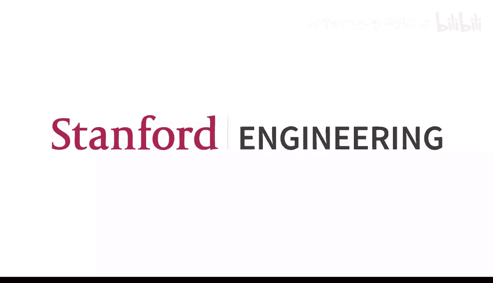
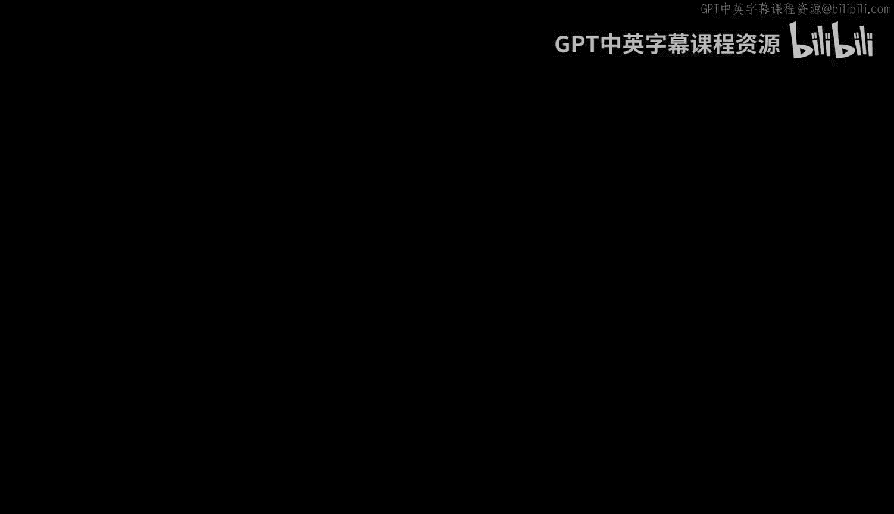
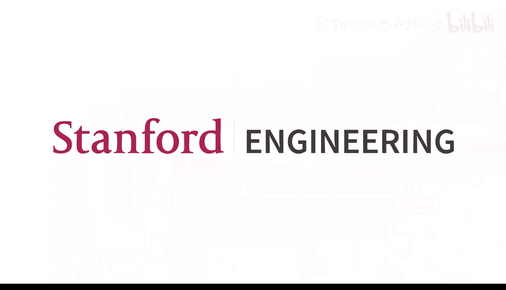

# 斯坦福大学《Transformers 和大语言模型｜CME295 Transformers & LLMs Autumn 2025》中英字幕 - P9：Lecture 9 - Recap & Current Trends. - GPT中英字幕课程资源 - BV1WGsMzCERB

Hello everyone， and welcome to Lec 9 of CME 295。So as you know。

 today is kind of a special day because we're having the last lecture of the entire course。

So the menu for today will be a little different compared to usual。

We're going to try to divide the lecture in three parts。

 so in the first part we're going to recap actually what we did in the entire class。

Just to see how different pieces kind of fit together。In the second part。

 we will look at some topics that are particularly trending in 2025 and what we think are going to be trending in the near future。

And then the third part will be more way for us to just conclude and next steps for all of you。

This it sound goods？Cool， so with that， we're going to start with the first part。

 which what I mentioned is about recapping what we did this entire quarter。

So nothing new here is just a way for us to piece everything together。

So if you remember a lot of weeks ago， I believe it's like maybe 10 weeks ago， we had lecture one。

 which was focused on understanding what transformers were。So at the very beginning of the class。

We didn't even know how we could process text， so I guess the first step that we saw was this tokenization step。

 which consists of dividing the input into atomic units。And so here the way we divide the text。

Is something that is arbitrary in some sense。 So we have different algorithms that allow us to do that。

And we saw that the most common tokenization algorithm is the subward level tokenizer。

And we saw that some of the advantages were that roots of words could be reused and leveraged。

 especially when it came to representing those tokens。And。Speaking of representation。

 once we were able to divide the input text into atomic units， AKA tokens。

The next step for us was to learn how to represent these embeddings。

So if you remember we saw some methods that were very popular back then。

 so one of them was called work to V。And the representation was learned from a proxy task。

 which was something like predicting the center word or predicting the context words。

But then we saw that these way of learning representations had some limitations。

 one of which was that these representations were not context aware。

 meaning that if a word is in a given sentence or in another sentence。

 then we'll both have the same like that word will have the same representation in both sentences。

And so for that reason， we saw some other methods that were popular in the 2010s， one of which was。

RNNs， if you remember， so RNAs had this recurrent structure。

 which processed tokens one at a time and kept an internal representation of the sequence so far。

But then we saw that a big limitation of this was this problem of long range dependency。

 and in particular the fact that tokens that were encoded far in the past were not quantities that were able to be kept。

 I guess as the sequence got longer。And this is the reason why we saw the central idea of this whole class。

 which is the idea of self attention where tokens can actually。Attend to one another。

 regardless of where they are placed。In the sequence， so you can think of this as a direct link。

And so this， for instance， is what we saw， we saw that there are like three main terminologies that people use。

 so query， key and value。So typically you want to know how similar a query is compared to the keys in the sequence。

 and you quantify that by taking some dot products that's kind of scaled and softmaxed。

And then you have the corresponding value that is taken， so at the end of the day。

 we obtain some kind of weighted average。Of all the tokens that are in the sequence。

And then you may also be familiar now with this formula。

 so softmax of QK transpose over square root of DK times v。

 so this is the matrix formulation of what I mentioned here which is able to process these computations in a very efficient way。

 and it's something that todays hardware is well equipped to do。

And then we finished the first lecture by going through the architecture that is the foundation of modern day LLMs。

 which is the transformer， and we saw that there are two notable parts in the transformer。

 so one was the encodeder in the left part of the the figure and then the right part is the decoder。

 and we saw how this was applied in the case of Trans。So at the end of the first lecture。

We saw what motivated us to end up with the transformer。

And we saw that Dr transformformer was working quite well in the case of translation。

 and so in the next lecture， what we saw was。What were the little improvements that people have made to this architecture since it was released。

 and if you remember it was in 2017 that it was published？

So one particular improvement that people have made is in the way we consider positions。

Because in the original transformer paper， positions were encoded。In an absolute way。

 as in each position has its own embedding。And this embedding was added to the token embedding。

But then if we think about it。Positions actually， we don't really care about the absolute position。

 we care about the relative position between tokens。And in particular。

 we care about how far tokens are in the self attention computation。

Which is why we saw this method that is now quite popular called rotary position embeddings， AK rope。

That is now quite used and it is a method that rotates。Qury and keys。

Both of which happen in the self attention computation。And so here。

What is quantified here is purely a function of the relative distance between two tokens。

 and not only that， it is something that is taken care of in the self attention layer。

 which is what we care about。So this was one big improvement。

 and then we saw some other improvements， especially when it came to how the multi head attention layer。

 multi head attention layer was composed of。And in particular。

 we saw that it was possible for us to have some groupings。Of the matrices that we learn。

 so we don't need to have one matrix， one projection matrix。Per head for， let's say， keys and values。

We can actually group them， so this is for instance， what is mentioned here。

 so group query attention。And then we also saw some other techniques that I have not represented here。

 like for instance， the normalization layer in the transformer， which here happens after each。

Sublayer， but I guess nowadays people have tried moving the normalization piece before the sublayer。

 so here it's the post norm。Version and then before the sublayer part is called the prenormal。Vers。

And then the last thing that we saw was that。From this transformer architecture。

 there were a lot of derived models that were based from that。 So we saw that if we only keep。

The encoder part。We could compute very meaningful embeddings。So remember。

 there was this kind of landmark paper on Enr only model， which is B。

Which was heavily used in the context of classification because it relied on the encoded embedding of the CLS token。

 so that was one。But then we also saw that there was a number of other kinds of models。

All more or less derived from the transformer， so you could only keep the encodeder。

 which was for birds， you could only keep the decoder， just for instance， for GT。

And you could also have both。Which is， for instance， the case of T5。

And one particular aspect of each of these models is that encoder only is not able in the way that we saw is not able to generate text。

But is's able to generate embeddings， which can be used for downstream tasks。

But then encoder decoder models like T5 or decoder only models like GT。They can be auto regressive。

And。Generate texts。The paradigm can be text in。Textouts。And with that。

 we then focused on what now everyone calls large language models。

 which are transformer based models， specifically text to text models。So， decoder only。

Transformer based models。And we saw that people have come up with a lot of new tricks now because you these models as the name indicates。

 people have scaled them up， but then one question was kind of kind of thrown。

 which is do you actually need？All these parameters to just do a forward pass。

So we saw one kind of variant， which was based on a mixture of experts。

So what mixture of experts are is instead of running everything through the whole entire model。

You're going to instead have a number of experts。That you're going to activate in a sparse way。

So for instance， for one input， you're going to just activate just a subset and then for another input you're going to activate another subset so that you don't need to do all the computations all the time。

And we saw that this mixture of experts， they were used in LLMs。

 in particular in the Fi for neural network layer。So here you would have experts as being different fit foreign neural networks。

 and you would have a gating mechanism that would reroute。To the correct fit for a neural network。

And then we also saw that some papers were also able to kind of produce some nice visualization in terms of。

 I guess which token gets routed to which experts， because this rerouting。

 we saw that it was done at the token level。And so one reason why it's done at the token level is to be able to。

 I guess， smartly put the experts on different pieces of hardware， different GPUs。

And then kind of parallellyze the computation a little bit more。And then we also saw that。These LLMs。

 they always are tasked with predicting the next token。And in order to predict the next token。

 we were interested in I guess how we were doing this。

 and so one particular method that people use is just sample。Sample from the output distribution。

 So you have， let's say， given an input， you have a distribution of probabilities of what the next。

Token would be that is output by the model and what you do is instead of let's say taking the highest probability。

 which is called the greedy decoding。Greedy kind of decoding， you actually sample。

So it introduces some randomness and allows the model to produce kind of a bigger variety of kinds of outputs。

 and we saw that you could adjust how。How much， I guess。

 variety you want in your outputs by tweaking a hyperparameter called temperature。

So very low temperature leads to very spiky distribution， so more deterministic outputs。

And higher temperatures are， I guess， a bit more random， a bit more creative。Okay。

 so until then we saw what LLMs were， how they were based on the transformer。

 how they connected to the architecture that we signed the first lecture。And then in lecture 4。

We saw how people actually trained。Those Lms。Because as I mentioned， these LLMs are large。

And so you cannot kind of naively fit them in your hardware。

 you need to be a little bit smart about it。So in particular。

 what people have kind of noticed in the early 2020s is that the bigger your model is。

The better your performance。So people just started building bigger and bigger models。

 so here in the illustration we saw that so on the Y axis is the testla， so the lower the better。

So we saw that the more compute。You use the better your tests。

Performance and same with increasing the data set size。

And same with increasing the number of parameters。But then， as you know， compute is not infinite。

So there was a natural question that came out of the community， which was， okay。

 if we give you a given budget， a given compute budget。Can you choose？I guess some quote unquote。

 optimal number of parameters and dataset set size on which you want to train your model。

And so we saw that there was this paper that was published in the early 2020s。

 which actually studied the relationship between。I guess if you vary the dataset set size and the size of your model。

And the performance on the test set。And then we saw that actually most models at the time were what we say undertrain because they were too big。

Compared to the data set that they were trained on， like the data set that they were trained on。

 it was not as big as they should have been。And so in particular。

 there was kind of a rule of thumb that came out of this。

 which was if you have a given number of parameters in your model。

You should at least train it on 20 times the number of parameters in terms of tokens。So for instance。

 if you have 100 billion parameter model， you should train it on at least2 trillion。Dcans。

Because the two trillion is 100 billion times 20。So that's kind of the rule of thumb that people have used。

And then as I mentioned previously， these models are huge。

 so people have tried to also make the computation more efficient。

And so there was this method that we saw， which is actually quite important called flash attention。

And flash attention is a method that leverages the strength。Of the underlying hardware。

And in particular， it looks at so GPUs， more particularly， it looks at the kinds of memories。

That a GPU has。So， it has a big。But slow memory and a small but fast memory。 So the HM and the eram。

Pspectively。And we saw that this method tries to minimize the number of reads and writes。

To the big and slow memory。To do HPM and so the way it was doing this was to divide the computation in a little bits。

That it would send to the eram， which is the small but fast memory。

So that it can do the N to end computation。And then send it back to where it was in order to do the full end to end computation。

So that method is an exact method， meaning that we're not doing any approximations to the results。

But it led to significant speedups。And in particular， there was this second idea from the paper。

 which is kind of an important one as well， which was that sometimes。

It's okay for you to not store results。😡，It's okay for you to just throw them out and then recompute when you need them again。

So there's this idea of recomputation using what I described， which led to faster runtime。

 even though we were doing more computations。So that was flash attention。

 and we also saw a number of other methods that were meant to， I guess， parallelize the computation。

 so we saw data parallelism。Which was this idea of not having all your data be processed on a single GPU。

 but instead divided into kind of multiple places。And then we had the second method。

 which was model parallelism。Where even for a given forward pass。

 you would actually involve multiple GPUs。So anyway， there were a lot of very interesting techniques。

 a lot of different ideas about how to train this model in an efficient way。And in particular。

 so what I described here is mostly important for the first step。Of the training process of an LM。

 which is called the pre training。Which is meant to teach the margo about the structure of language。

But a structure of codes。And in particular， this model was trained with huge amounts of data。

 so think about trillions of tokens or even tens of trillions of tokens。

And so that first step goes from an initialized model to a model that is able to autocomplete because it is trained with an objective of。

Predicting the next token。So at the end of this first stage。

 you have a model that knows how to autocomplete， but you have a model that is not very helpful。

Because it only knows how to complete things。So in order to have the model be useful for our use cases。

We had this second step， which is called the fine tuning step。

Where we teach the model on the kinds of input output pairs that we wanted to perform well。

So this is also called the SFT stage supervised fine tuning stage。And at the end of this second step。

 we have a model that not only knows the structure of text。And codes。

 but also is able to behave in the way you want。But so far， up until step number two。We have only。

Taught our model what to do。 We have not taught it， what to not do。

And this is why we had our third step， which was the preference tuning step。

Where we took our model that went to the pretraining stage， that went to the SFT stage。

 and now we want to inject some negative signal as well， as in I want you to prefer this。

Compared to these outputs。And。This third step uses preference data， so like the name suggests。

 so preference tu uses preference data， which is typically pairwise data where humans say， okay。

 I prefer this output compared to that output。And typically the model here is able to align the kind of output it produces with human preferences that could be along the dimension of usefulness。

 of safety， friendliness， tone， there's a bunch of different dimensions。

 but so that's what is happening in this third step。And in this third step。

It's actually in lecture 5 that we dug into what that。Third step was about。So if remember。

 we had drawn a parallel。Between。The way our LLM produces tokens。

And I guess what people in the reinforcement learning field。

 I guess consider how given policy is interacting with some environment and performing some action and being in some state。

And the reason why we drew that parallel was to be able to leverage some RL based techniques。

In order to train our model， so in this case we said our LLM is a little bit like a policy。

So given some states， which is the input it has received so far。It can perform the next action。

 and in this case it is to predict the next token。And this prediction is made in the environment of tokens。

And。When we predict completion， what we do is at the end of the day， we have some signals。

 some reward。Which can be the human preference。So this is the parallel we dreww with the orL worlds。

And with that in mind， we talked about rewards。But the problem is that rewards are only available for a limited set of data。

Which is why we saw how to model rewards。So we saw this formula。

 if you remember it's called the Bradley Terry Form。Which models？

How the probability of an output being better another one。Es as a function of， I guess。

 two scores like the score of output I and the score of output J。And we saw that reward models。

 they are typically trained by having this formulation in mind in a pairwise fashion。

So what this means is a reward model， you give it two output， you say this one is good。

 this one is bad， and then I want you to say this one is good。You train it in a pairwise fashion。

But then your model is actually predicting always two scores。

 it's always predicting the score RI for output I， Rj for output J。

 and so at inference time you're only giving it one output。So I think that's like one subtlety。

 like we train it in a pairwise way， but at inference time， we're kind of using it。

In an individual way， that makes sense。And so once we trained our reward model using this formulation。

 then we were able to use it to steer our LLM towards the direction that we care about。

So if you remember， the way we steer our LLM in the direction of human preferences is to give it a prompt。

So that it can produce。A completion。Aka or rollouts。Or in simpler terms， an answer。

And then we take this prompt， we take this answer， we put them both in the reward model that tells us how good the model response is。

And depending on what the reward model says， we can tune。

The weights of the LLM in a way that maximizes human or the reward that we saw。

 which is trained on human preferences。And the last function of this RL setup。

Is typically something that tries to maximize rewards。But also keep the model close。

To the base model， and here by base model， we mean the SFT model。

And the reason why we want that is because this reward is imperfect。

So we saw this phenomenon of reward hacking。Where your reward can be imperfect and the LLM can exploit its imperfect nature to tune it in a way that actually does not align with what you want it to be。

So you want the LLM to not be too far from the base model， which is actually already a good model。

 so it's a way to regularize that if you want。And you also want the。

Ittereration updates to not be too big either。😡，So you typically have these two constraints。

 you don't want it to deviate too much from the base model。

 but you don't want it to deviate too much from the previous。Oriteration。And then just as a reminder。

 I think this was lecture5， I think was the most technically challenging of the whole。Class。

 so completely fine if the first time you were like， you know， what's happening？

But hopefully now it should be a little bit more clear。Cool and then after lecture5 we're like okay。

 we've done a lot of hard work so the good thing is you know we're in 2025 and in the past 12 months or now 14 months。

😊，We've seen a lot of models that were being released with these reasoning capabilities。

And the way they were trained to exhibit these advanced reasoning capabilities was actually leveraging a lot of the techniques that we saw in lecture 5。

Just like oral based techniques。And in particular， what we want our LLM to do。Is two outputs。

A reasoning chain。Before producing the final answer。

And the reason why we wanted to do that is because people have seen that it improves the performance of the model。

 and so it's actually relying on this idea of chain of thoughts。

Which I believe we saw at lecture  three。Which is a prompting technique to have your model output the reasoning。

Before outputing the response。So long story short， up until lecture 6。

 our LLM was having a prompt as input。Directly outputting the outputs。But in lecture 7， we said。

Sorry， in lecture6， we said， well， let's have our LLM actually first output a reasoning chain that the user may or may not have access to before outputting the final answer。

So you want to teach the LM to do that so how do you do that well first before doing this I just want to show you this chart which we saw which is the performance of the model as we're teaching it to produce these reasoning chains。

 so people have typically measured the improvement in performance by comparing it to I guess certain benchmarks and this one is a popular one the aim。

Benchmark， which is the math。Mfe benchmark， and we saw that。As the training progresses。

 the accuracy number of， I guess what the LLM outputs is increasing。But back to what I was saying。

 the key technique。That we use to teach the model how to output these reasoning chains is。

Leveraging the RL techniques that we saw in lecture 5。And in particular。😊，Up until now， we saw。PPO。

 which was the main R algorithm that people were using。Up to maybe last year。And now， people are。

Kind of prioritizing GRPO as an algorithm in order to teach the model to be better at reasoning tasks。

And there are several reasons to that that I will explicit right now， so we saw this illustration。

That compared how GRPO was differing with PPO。And if you can see in the graph。

 there are a few things that are different。The first thing is that GPO does not rely on。A z model。

So who remembers what the value model is？Yeahep。Yes。

 exactly so the value function is trying to predict what the reward would be if you were to follow the policy of the LLN。

And I guess it's a way to have some baseline as to。How goods。

Some predictions are you want to make it more relative。

 so a value function is a way for us to make these rewards a little bit more relative to one another。

And so that's how PPU was doing this， so it was having a value model that was making these predictions。

 and then we had these generalized advantage estimation method that was combining the reward predictions。

With value function predictions in order to have what we call advantages。

So advantages is how goods your output is compared to some baseline。But then in contrast to that。

 GPO said， okay，3， we don't need。A value function because it's too expensive to train。

 to maintain what we're going to do instead。Is generate several completions。

And then have some formula that compares the rewards of completion， these completions。To one another。

So it's going to have some relative。Effect， in a sense that it will make things more relative。

And in doing so。You're actually not。Needed to maintain and train。A value function。

And that's like one big difference compared to PPO。And the second big difference。

 which is not represented in this illustration。Is that GRPO is typically an algorithm that people have used in the context of。

Teaching your model to be better at gring tasks。And so we saw that these kinds of problems。

Have a verifiable reward。Because when you complete a math problem。

You actually know the answer you need to get to。So you don't need to train a reward model to tell you how good your final answer is because you already know the answer。

And so we saw that GPO was in particular used in the context of when you actually don't even need reward model。

 when you actually have a verifiable reward。So at the end of the day， the only two models。

You need to keep。Are the policy model？And the reference model。

To be able to just compare how far you are from the reference model。Coook。

 I know this one was also a challenging class。I guess so far so glitz。

And this is also on on the final。 So， which is why I'm。

I'm taking things more slowly for the second part of the recap。So is everything good so far？Yeah。

Okay， perfect。 We also saw some extensions of GRPO。 So if you remember there was。

Some kind of bias that was a result of。The last function of GRPO。Having some normalization term。

That penalized。Tokens。That were in shorter outputs。So we saw that if you use JRP in。

Its original case in its original form。We saw that after a certain point。

The algorithm will incentivize your model to produce longer and longer answers。

 longer and longer incorrect answers。And the reason why it does that is because relative to short incorrect answers。

It penalizes less。Long， incorrect answers。And so this is the reason why there are some extensions that people have worked on this year。

 one of which was GRPO done rights， so we saw that they basically removed the normalization term。

And there was another method that we saw， it was called Depo， DAPPO。Which also had some variants。

And that's for reasoning models， and then lecture7， we had a model that we knew how to train it。

 we knew how to use it for reasoning tasks， how to train it to be better。

 but now we wanted the model to be useful and interacting with outside systems。

So we saw one technique that is kind of an essential technique called ragG。Short for retrieval。

 augmented generation。That is meant for you to be able to fetch relevant documents from some knowledge base。

😡，In order to answer。A question or answer a prompt。

And the reason why you want to do that is that the knowledge of your LLM。Is。Including U2。

The data that is up to the knowledge collects。Which is the max states。

Of what your LM has been trained on。And from a practical standpoint。I guess。

From what we see nowadays， you're typically not training your LLM daily or continuously。

 and so in cases where you need your LLM to know about things that happened recently or about things that happened that were not。

In your LM training data。You want your LLM to have access to such information。And so that's how rug。

Is very useful。So we saw that RAG depended very heavily on the way it retrieves data。

So we saw that the retrieval part was mainly composed of two steps。

So the first one was candidates retrieval。hich uses a buy encoder kind of setup。

Where you're basically doing some semantic search， so you're computing the embedding of the query。

 you have some precomputed embeddings of the documents in your knowledge base。

And you're taking the ones that maximize some similarity score， like let's say。

 some cosine similarity。So this first step is allowing you to retrieve。

I guess a filtered version of the potential documents。And then typically you have a second step。

 which is called ranking。Or reranking because the first step already gives you a ranking。

Which has typically a more sophisticated setup。So it's a cross encoder kind of setup where you have your query。

And your document that are both fed to some model and produces a more precise score。

And then you use this final score to rank the final results， and you typically choose the top。

 let's say， k。And then you add them to your prompts， so it's the augmented part。

 so retrieval is everything I mentioned so far。And then once you have the relevant documents。

 you add them in your prompt， which is the augmented part， and you generate the answer。

So the reason why I'm taking so much time on Ra is rag is such an important concept also。

If you were to have interviews or also maybe in the exam panels。

So I think it's an important concept to have in mind， the second one that we saw was two calling。

And tool calling is allowing your LLM。出。Leverage tools。The way it does that is in two steps。

The first step is for your model to know。Which API there is out there？

At the end of which your LLM says， okay， I want to use this API and I want to use it with these arguments。

And then you have an intermediary step， which is you just run your API with these arguments。

And then the second step is you feed。The results of this operation back to the LLM。

Which then produces a final answer。So that's how2 cuing works。If you say to your LM， okay。

 you can use this。Use this API， this is how your LM would leverage that。

And then we saw that modern day agentic workflows were leveraging both ragG and tool calling as key methods to perform actions。

And we saw an example， did example， which was such that you had some inputs。

And then your LLM has a series of different calls。In order to perform some action。

 and then at the end of it it retrieves， sorry it returns an answer。Cool， and then last lecture。

We saw how we could evaluate LLMs。Which is a much tougher thing to do now that LLMs can do a bunch of different things。

So。We first saw that there were some rule based metrics that people were using。

Before a lens came into play， metrics that you may have heard like Blue， Rouge， mirroror， and so on。

But the main limitation was that they were not。Considering how language could differ。

 but still be correct。And so this key idea that we saw was why not leverage LLMs to evaluate outputs？

And so there is this key idea of LLM as a judge where you receive as input the prompts。

The Mar response。😮，Along with the criteria that you want the response to be evaluated on。

And then you want your LM messages to output two things。The first one is a rationale。

For why a given score is outputs。Along with that score。So nowadays， LM as a judges。

 they are typically outputting a binary response either。Pass or fail。

 true or false just because it's easier。And we're also having the rationale B output before the score。

Because in practice， it's something that also improves the performance of the L as a judge。

 a little bit if you want like reasoning models do by outputting the reasoning chain before they output the answer。

But then we also saw that there were some biases that came with this approach。 We saw position bias。

 which is the way you present。Do elements to compare matters， So if you present something first。

 then maybe the LLM will just prioritize that first。So there was position bias。

 there was verbosity bias， which is。Your LLM just preferring longer outputs。

And self enhancement bias was another one where it prefers its own outputs。😊。

And then we also saw a number of benchmarks。That people use nowadays in order to say how great their LLM is。

 so if you see the releases that come out， there are typically a bunch of metrics across a number of different benchmarks that people know about。

 so that spans knowledge。The ability to reason coding。

 which is very important because a lot of applications are coding related。And then safety。

 and then this is not any。Extensively， so there's actually many more dimensions。嗯。So yeah。

 I think that's where we stopped。It was last lecture。And。

This is all you are expected to know for the final。😡，Everything after that。

Is not going to be part of the final。Any questions？On this so far。Cool。

 okay I'm expecting hundreds for everyone for the final， but yeah。😊，I would say what I went through。

Is going to be foundational for the final。 So I guess if you。Understood everything I said。

I think you're going to be ready for the final。Yeah， but if you have any questions， you know。

 Shervin and I are always here to， oh yeah， do you have a question？Yes。

 so the question is is the scope for the final of lecture 5 to lecture8， yes？

So for midterm it was lectures 1，2，3，4， and this one is 5，6，7，8， so I guess it's equal equal size。滚。

Okay， great。So with that set， we just finished recapping。This entire quarter worth of lectures。

 And now we're going to go to the second item of today's menu。

 which is looking at some trending topics。And so I'm going to start with the first one。

And I'm going to introduce it as follows。So if you remember。

 we saw that the transformer was a concept and an architecture that was first introduced in the context of machine translation。

So it performed greats。People said， okay， it performs great on machine translation。

 why not try it on other text tasks？So they tried it， performs greats。But now the question is。

Can you not use it for things other than texts？😡，It's a natural question， right？So。

In order to answer that question， I just want us to remind ourselves that this architecture is relying on this concept of self attention。

And this is what is making the transformer work so well。So。If we just。Recap what self attention is。

This illustration kind of does the job quite well。You have a query。

 and then you have a bunch of other elements。Which are represented by your keys and your values。

And you want to know which other elements are actually relevant。

In order to compute the embedding for that query。So right now we have only used tokens， text tokens。

But text tokens。They're actually vectors。So if you take those vectors。

And you actually represent something else some text。Like for instance， parts of an image。

The question is。웃때？Transformer。Based on that kind of input。Also perform well。And so here。

 the key question that I want to ask is。How can we adapt our transformer？To work on nontext input。

 And， for instance， here， we can think of image understanding input。 So you have some image。

 And so it's a traditional computer vision task where you want to know in which class this image belongs to。

So you want to know if。Having some transformer based architecture would work well in that situation。

Well， the answer to that is， well， first， in order to adapt it to this task。You would。Take。

Da quarter parts。Of the transformer， because in order to understand what is in an image。

You need to classify that image in some sense。So if you remember if there's one model in what we saw that was working very well for classification。

Was dirt。Because BRT is encoder only， it computes meaningful embeddings that can then be used for projection purposes or for classification purposes。

So it's a very natural choice。That here we would have。

 So here we would just keep the encoder part of the transformer and then。

Have the self attention mechanism come into play？And。

Compute meaningful embeddings that we could then project。For our relevant task。

And this is exactly what a group of researchers did back in 2020。

So have you heard of VIT vision transformformer？Yeah， no， yeah。

 so what I described here is exactly what they did。😊，So they took an image。They divided that image。😡。

Into patches。Those patches。Were represented by some vectors。And of course。

 you have some kind of position information that allows you to know where your patch is in the image。

And then you just put it through the transformer encoder， so the encoder part of the transformer。

And you compute the representation corresponding to the CLS class， very similar to birds。

And you would just project that representation。Over some classes of interest。

And then you would perform your。Your， I guess， computation like this。

So what that paper found was that if you train such a model。On a lot of image data。

 on a lot of image data， you then outperform these traditional convolutional neural network kind of methods。

And so those kind of。Remarkable。BecauseSo why is it remarkable？😡，Because in the vision case。

So there is this concept of inductive bias。Where you want to gear your model towards。

Looking at certain things。In order to deduce the results。So convolutional neural networks。

Are a kind of model that are。Designed in a way for you to look at the image。In some sliding way。

 you look at your image a little bit like you would look at it in practice as a human。😡。

And people had hypothesized that such a bias， such an inicive bias would actually make sense for something like a vision task。

So you contrast that with vision transformer。Which is actually letting all parts of the image。

Attend to one another。Which has， on the other side， very low inductive bias。

So what this paper showed was if you give your model enough data。

Then it will actually learn how to classify。I guess your images in these classes。

 so this was like kind of a remarkable result。So I think it was like pretty remarkable and a nice extension of everything we saw。

So with that in mind。I want us to just go through an end to end example of how you would process an image and go through that VIT so vision transformer in order to make your prediction。

 so here you would take like your favorite image that you would just split into patches。

 so here you can think of you predefining some fixed size patches。

So here I would say like three by three， let's say。

 and then each patch has some fixed number of pixels。And then what you do is for each patch。

You try to have some vector representation。So you can think of each patch as。So what is a patch。

 so it's composed of pixels？😡，So if each pixel has three values which correspond to red， green。

 and blue。Then you can find。A way to project those on some lower dimensional flattened space。

And you can learn how you would project that through some kind of linear layer。So。long story short。

You just find a way to。Asssoociate a vector to each of these patches。Which should you then represent。

Every single one of your inputs。And then you have， of course， special embedding for the CLS token。

 which you can also learn。And you add the position embedding。

So you do the same for all of your inputs。And then very similar to birds。

 just put that through your encoder， let everyone interact with everyone。

And then at the end of the day， what you care about is a representation of the input that is meaningful。

 so typically people take the encoded embedding of the CLS token。

So the reason why they take that is one because it's a convention， but the second one is this。

CS token， so theyre encoded in bedding。Is actually。

An embedding that has interacted with all other tokens。Through this self attention mechanism。

So it has seen everything。And then you would project。That's CS。

Token encoded embedding onto some class through a feed for a neural network in order to。

Predict your final class。So in this case， we know it's a picture of a teddy bear。

 so here we would want the model to classify this as a teddy bear。So first no goods。

Does that make sense？Cool， so now， okay， we know how to process。Image input right now。

So another question is， how would you have your LLM？Answer questions about your image。

Which is something that you can do actually nowadays， like if you open chargeGPT。

 you can input an image and ask it questions。So。You would have two kinds of inputs。

 so you would have an image which we saw we can find a way to represent。And then the texts。

 which you now know very well how to represent， like with tokens。So the way you would。

Allow the model， or let the model。Process of this。Is TPK as follows。

 so there are like a couple of methods， the first one is the most common one。

 which is you just feed everything as input。So the image token as input。Tex token that has inputs。

And you have some representation to have the model just know that these are image tokens。

 and this is like text token。And then you let it。Generate an answer in a decoder only fashion。

 auto aggressivegressive fashion， exactly like you would do it。

The first method and a lot of such models are designed that way。So there is for instance。

 a very popular open weight， I believe， vision language model， VLM， that's what they are called。

 a model called lava。And this is how they do it， so they have some encoder on the image parts that produces some tokens that are then concatenated with text tokens that are inputs into the LLM。

So that's one method。The second method， which is less common。Is to have the images。

 the input at the cross attention layer。So here what you would do is you have your text inputs。

And then your image inputs， you don't put it in the inputs。

 you actually let it interact with the text tokens。Within the cross attention layer。

And this is something that， for instance， Lama3 had represented in their paper。

This technique is typically less common， the first one is more common。

So I guess what I want to say is CME 295。Focused on the transformer， specifically in the case of。

Text to text problems。So text generation is all this class。But。

We also have the transformer that was used for non text applications。

 so here we saw image and understanding of vision understanding with VIT。

And then we will not have the time to see this now， but also for image generation tasks。

We can also have parts of the transformer be used in that architecture。

And so you may hear about diffusion transformer or。

Mmod diffusion transformer that actually rely on the self attention mechanism。

And this is actually not an exhaustive list， this is also something that has been used in other domains like recommendations。

 speech， and so on。So I guess what I want you to remember from this is that transformers。

Were like was an architecture that performed very well for machine translation tasks？

But then it proved to perform very well for other text related tasks。

And it was then reused in a bunch of other domains， which also proved to be quite successful。

So I would just encourage you after this class to also keep an open mind for non text related transformer applications。

And the ones that I mentioned here are maybe just a few first few pointers into the kind of papers that you can look at。

Cool， so here we said that Transformer was something that came from the text world that's also useful and used in other worlds。

Now I want to tell you about something else。That was， I guess， used and useful in the nontex world。

That may be useful in the text world。And I want to tell you about diffusion based LLMs。

So who has heard the term diffusion？Who knows about diffusion。Yeah。Cool。

 so we will see how we can apply that to LLM。 so this is a very trendy topic。

 I believe the first paper started in the early 2020s but。

I guess it's only now that people are starting to。Have this really work？

I just want to start with a motivation， which is that up until now。We have taken for granted。

The fact that our LLM is an autoregressive LLM。And by autoaggress， what do I mean by that？

So it takes some inputs。And what the LLM tries to do is to predict the next token。

So given everything so far， we predict the next token。We do that， and then we take that。

Token that we just predicted， along with everything that we have predicted so far。And then we again。

Predict the next token。We're predicted and we go again and again。

Up until finishing the sequence with that end of sequence token。Which makes the generation stop。

So this is a true auto aggressive generation， as in we take the input so far in order to predict the next token。

And then we repeat this process until the end。So， it's。Something that people now try to。

Kind of give it a name， which is like auto aggressivegress model kind of model。 So ARM。

 if you kind of see this。Notation， that's what it means。嗯。

The problem with that kind of paradigm is that inference time generation。

Is actually not something you can't parallelize。Because you always need。

What's before in order to predict the next one？But I just want to say that inference time generation is not paraizzable。

 but。Training is。Paralyizzable。So if you remember， the way we do training is we input all the tokens。

That we want our。Model to predict。 And then we。Let the model generate tokens。😡，Out of this。

 so basically in a decoder only setting， you have this causals mask。

Which lets your model not cheats if you want and not use the future ones。

So I just want to say that when I say that this paradigm is not paralyzable。

 I just want to emphasize on the fact that it's inference time that I'm saying， training time。

 you can actually paralyzze that quite well。So as I mentioned。

That's one of the reasons why people have tried to look at other paradigms。And in particular。

 so if you know about diffusion， you know that it works very well for the vision domain。

And so people have tried adapting。This paradigm for the tax generation case。

And so this is like a bunch of screenshots we took from announcement that happened this year。

 so for instance， earlier this year there was an experimental text diffusion model from Google that they presented during the IO event。

Whi was very impressive because it led to a lot of speedups and then we have some different startups。

 so inception is one of them that made headlines， I believe a couple of weeks ago or last week。

 no sorry a month ago that also are pursuing this route。

So all of that to say that this direction is a very trendy and hot direction that potentially has a lot of promise。

But the key issue with this。Is。That text is discrete。Whereas images are continuous。

And we're going to see why that distinction that I just made matters。

So I'm going to try to explain to you what diffusion is in two minutes。So。In the image world。

In order to generate an image。What people typically do is they start from noise。

And then they try to generate some image。now you may wonder， okay， why noise？Well。

 you cannot do something that's you know autoregressive because I guess like if you were to say。

 okay， let's predict the pixels one at a time， it's just not tractable because there are many pixel in an image and this is typically not how you produce an image。

 but some other reasons are that，Noise is just something that you can model very well with some very popular distribution。

 so Gaussian distribution if you know about it， it has very nice properties。

 also noise is very easy to sample so it's very easy to start with that。

Noise is also a way for you to introduce randomness because you don't necessarily want to always produce the same image。

 you want to have the， I guess choice of generating images that are slightly different from one another。

And just mathematically， it works quite well。And speaking of that。

 the goal is to learn some transformation that would allow you to go from noise。🤢。

To the targets image distribution。So all of what I said here is just。

Kind of reasons for me to tell you， okay， noise is actually a choice that is quite natural to start with in order to generate an image。

😡，And。To give you an analogy， let's suppose you're a sculpture， sculptor。

 so the person who does sculptures。So if you want to do a sculpture。

 you typically start with some rock。But then rocks are different from one another。

 they always have things that are unique to them。And。Still， you would。Focus on。What to remove？

In order to obtain。The end sculpture， so you can think of the rock as being your noise。

And your end result as being your targets。Data distribution。

So I just want to have this quote by Michelangelo so the sculpture is already complete within the marble block before I start my work。

 it is already there， I just have to chisel away the superprofluous material。

 the reason why I'm reading that is you can have a nice analogy between what Michelangelo said and。

The process of dennoing。The noise to get an image。So this is all just motivating how image generation is done。

 so you start from noise。And you want to generate an image。

So the way you do that for diffusion is to learn some transformation。

That would allow you to go from noise。To image。So you have two steps。

 I mean you have more than two steps， but we have these two main steps for diffussion models where you first want to start from clean images。

And you add noise gradually。😡，Until you obtain some very noisy image。And then from that。

What diffusion models try to do？Is to predict。The noise to remove。In order to obtain the image。

So it's a little bit like you're the sculpture person。And you have your rug。

 You just want to learn what pieces of rock you need to remove in order to obtain your final piece of art。

So this is what diffusion is。😡，So it works pretty well。Because noise， as I mentioned。

 is typically something that people draw。From a Gaussian distribution。

Gausian distributions are mathematically very well defined， have a lot of nice properties。

So that's why they work so well。But now the question is， how would you adapt this？To the text world。

 because in the text world。As you know， we're talking about tokens。Tokens are discretes。

So there's not this concept of adding noise。Can I have that？So what people have tried to。

To do was to find a text equivalent that would make sense。And this is what the current。

Research points to， which is that noise is to images。What the mask token is to text。

So mask is just a way for us to just not have the information coming from one part of the sequence。

And I just want to go through the revised two step process that we saw here for text。

So here for the forward process。Instead of noising your input。😡，You would just have more and more。

Inputs that would be masked。So that's the per process and at the end you would just obtain a sequence full of mass tokens。

So what you want to do is to learn。Some。Model that allows you to unmask。

These mass tokens in a way that reconstructs the original sentence。

So there's some math that goes into it obviously in a few minutes we will not have time to go into that。

I just want to emphasize on the key idea， which is。You want to do diffusion。

 but in a way that makes sense for text inputs。And the way it would make sense is to consider。

The noise for images as being mask tokens。For text input。Cool， and so with that in mind。

 you have a bunch of models that are being released these days。

 which are called masked diffusion models。MDM。So whenever you see MDM。

 now you know what kind of model we're talking about。So。Notations are still very。

Not very well defined， so it may change in the future。

 but one other term you will see out there is also DLLM， diffusion based。LLM。

And this is what it's doing。 So instead of。Predicting a token in an auto aggressivegressive fashion。

Like one at a time， what it does is that at inference time， it goes from a completely masked。

Input sequence。And he tries to predict。What tokens were behind these mass tokens？So of course。

 in a real life setting， you would have some prompts here。You would have some prompts。 So， of course。

 in order to predict。This answer， you would have some conditioning。So you would tell your model。

 okay， given this prompts， you're going to start with all these mass tokens， just try to。

Predict what the answer is。So in case you're having trouble with the intuition。

So I also had trouble in the beginning， you know， why would it make sense for。Texts。

To be solved in a diffusion manner， because typically when you write， you write one word at a time。

 So one helpful way to think about this。Ease。Let's suppose you want to write a speech。

So you would not directly write your speech in a linear way。You would first have。Like a rough plan。

 you say， okay， I'm going to talk about this in the first place。 second， third。

 you have some kind of drafts。And then you try to refine what is in each of these sections。

So you can think of diffusion as kind of working like this。So it tries to have a course to find。

Refinment of the outputs。So it can predict things that are after a certain token that has not been predicted。

You can think of this as being。Something that goes from a very drafty version。

To a very refined version。So that's what I think about this process， hopefully that's helpful。

And the key advantage here。Is that the decoluding is now done in much fewer forward passes。

Because previously， you had to do as many forward passes as there were tokens to predict。

But here for diffusion， you only need to do as many passes as there。

Steps in your diffusion process and the number of steps is something you can fix。

So the higher the step， the more high quality your output is。

 but it's typically much lower than the length of your outputs。So that is the core reason why。

This model is so much faster。Then the auto aggressivegressive one。And of course。

 we don't have that much time， but in case you're curious， in case you're interested after the final。

 once you're completely freed in terms of things to think of。

Just put some references that could be helpful， there's a paper that came out earlier this year called Lada。

Large language。Diffusion。Mel with masking， actually I don't remember the full acronym but。

It is actually going through the math and why the thing that I just mentioned works。

And then there's like a bunch of other papers that would also be helpful。

 so the links are at the bottom of the slide in case you're interested。

And I just want to go through two last things before giving it to Shervin。

So first on the advantages of this new paradigm。So the first one is the speed。So as we mentioned。

 it's going to be much faster than traditional autoaggress models。

 especially for outputs that are longer。And so some benchmarks they even say that it's something along the lines of 10x faster。

So for cases like coding。It can be very powerful because you may have to do several model calls and you as a user。

 you're just waiting for that code to happen and just having a lower latency makes a lot of difference。

The other thing is that the nature of this approach。He's actually considering。

The text as a whole in order to make the predictions。

And so there's a category of coding tasks that are called。Fill in the middle。

Which is about trying to figure out。You know， you have a bunch of codes。

And you want to know what's missing。In the middle and so fill in the middle and diffusion models are typically better formulated for these kinds of tasks because they can consider。

I guess input from multiple directions。And that's why this approach can be probably something that can be useful。

For some applications。So in terms of the current work， so these models， they look great。

 what I mentioned to you looks great。The performance was not on par with the current frontier models。

 at least for some time。But it's something that may change。So the papers that I mentioned。

 they are actually posting performance that is kind of catching up with the models that are auto aggressive。

So there is some promise in there。And then the other line of work is just to adapt。

All the techniques that people have come up with。Like for instance， reasoning chains。

 how do you adapt that for diffusion？Like， you know， Anon， you know。

 there are so many techniques that are intrinsically more。Better suited for auto aggressivegressive。

Kands of models that can be adapted for that。And that's what people are working on。

So long story short。What we saw was。That things we saw in this class。Could be used。In other domains。

 like， for instance， we saw the vision transformer。

That was boring the transformer for vision related tasks。

 but we also saw that things from other domains。Could also be used in the text world。

And that's what we saw with diffusionals。And so this is probably， of course。

 a subset of everything that's happening。And so with that。

 I think we're concluding our second item of our menu。And I'm going to just give it to Shervin。

Thank you， E。And with that， welcome to the last part of the season finale of CME 295。

 and as Efshin mentioneds， now is the time for some closing thoughts and see what we can get away from this class and the concepts that are neighboring to it。

So first， Afshin went through the concept of diffusion and images。

 and we saw some similarities we could draw with text。

Now we're going to see what kinds of inspirations have both modalities taken from each other。

 and we're going to see that actually like a lot of things can be reused。

So the first thing that I want to mention in terms of what has been reused is the architecture part。

So A've mentioned this diffusion concept that was born in the field of images。

 but that was taken for text and was able to yield lower latency like higher speedups。

 which is great when you're a user。So this was one example of a win。And then on the other direction。

 traditionally images have been dealing with convolutions， mostly as model architecture type。

But these papers saw that replacing convolutions with transformers was very good。

 even yielding better results， so all these latest diffusion based papers in the field of images。

Typically use transformers。And then here I am linking one of the papers that。

Avestein already briefly went through。But not only is it the architecture side that is the subject of pollination between these modalities。

 you could even think of other kinds of components like the inputs。And for this one。

 I want to mention。The example of deepse OCR。 So I don't know if you've heard of this paper。

 it just came out very recently。And contrary to what the name suggests。

 OCR stands for optical like recognition， character recognition。

 and it's usually a field that tries to convert some scanned image into text。

 but actually that paper doesn't boast some improvement on the OCR task itself。

 rather it showed that you could learn some function。That reconstructs。

Text tokens based on vision tokens。And not only on vision tokens， on very few vision tokens。

 so it showed that the representation power of patches of images as tokens was very strong and you have some researchers that bring some rationale to it like hey tokens are not the best tool anyway。

 and things in patches convey the meaning of text already with the example of emojis and so on。

 that you would otherwise need to represent with way more tokens in text。嗯。

And then another example I want to mention is even when you look inside the architectures。

Some of the tricks。Can be reused and adapted in each field。

 so here I'm mentioning the example of rope。which Epshin mentioned in the recap that was used in text to represent the relative position of tokens。

 and in the case of images or even multimodel setting where you have the presence of both text and image within the architecture。

 you're able to adapt that trick。By reformulating it in 2D。

 so here the figure shows how you can attribute row positions in the 2 degrees and how you could place text tokens such that relative computation of position still makes sense。

And you know， even beyond that。I would say that the ongoing research for transformers is very much alive and people are still figuring out all the details that we're working with today。

 and you see refinements all the time coming in terms of new。

 so it's something that is still developing。And。You can look at it from multiple angles。

 one is each of these design decisions that we've had， they are still being iterated on。

 so like I'm listing a few items here as an example， so one is the optimizer side。

 you might be familiar with the Adam Opr and its update role which has been popular for quite some time。

And it seems that state is being challenged with newer papers。

 so I referenced here the Kmi K2 paper that came out a few months ago that introduces a new kind of optimizer called Muon and the latest version of that neon clip seems to be a potential candidate for this optimizer to become like the new standard。

 so this field，Even。Like as basic as it can be is still developing。

But it's not only the optimizer side， you also have the topic of normalization where Afstein mentioned that the difference between the original transformer paper and what you see today in LLM papers。

You don't have the same kind of normalization anymore in the past you had posts norm。

 but now you have pre normorm， which brings the normalization earlier on in the layer。

But beyond that design choice of the location of normalization。

 you even have the type of normalization that changes， so the transformer paper used layer norm。

 but these days you might see other kinds of normalization techniques like RMS norm which uses less parameters and others。

 so the theory behind it is not sets just yet。So you have other kinds of parameters。

 A'vestein mentioned， grouped query attention paper， and you see these days in LLM papers。

Not a fixed design， rather every paper adopts their own technique。

 sometimes you see one kind of attention used as a given layer， but then it switches。

And different papers take different design decisions， so it's not set in stone。

Then you also have activation functions， so traditionally in deep learning。

 a lot of emphasis was put on RElu。Wwhich is very simple and used worked very well。

 but in the world of LLMs， the shift was towards relu like activation functions。

 but not exactly relu， so you had Gaussian error， linear units you had like other kinds and the research there is still ongoing so you still see。

You still see new activation functions coming in。Now and then。

And then you have also whether to take the design option of considering the LLM as an MOE。Or not？

And even the number of layers of your LLM and other hyperparameters， like number of heads。嗯。

Size of the number of units in the FFN， all of that is still a poor debate in terms of like design decisions。

 So it's not fixed。And then another area of research I want to mention is the data part。

 which is crucial， so the first LLMs， they enjoyed a relatively clean state of things because you could scrape the internet。

And I hope for a lot of data that was for sure， human generated。

So you could learn these patterns from quote unquote a high quality source。

 even though it's like not in high quality format when you look at typical internet data。

 but it was still。Generated by human。So these days the state has changed。

 you type anything you want in your favorite search browser。

 changes are the first results are 80% LLM generated， so are we doomed？Maybe nuts。

Because actually you see the development of more and more work in data curation。

 so in the past you would just scrape the whole internet and train next token prediction on it。

 but now you have more and more this work of curating data sets of interest and you have companies that work on it and you have the emergence of newer。

Fine tuning modes， so in the past you had pre training and then fine tuning。Now you have pretrain。

 mid training and fine tuning， and the mid training part trains still on a large corpus of data。

 but higher quality。So people are finding ways around it。

 and I would say the picture is not all grim， but it's just that we need to do more work in order to have meaningful data at hand。

And the paper that is linked。 and at the bottom of the slide is dealing with the phenomenon of。

What if you were training on LLM generated data and it's talking about a concept called model collapse？

And it says that。LLM generated a text is typically less diverse。

So the data distribution that you would see at training time changes and it leads to less meaningful learning at training time。

 which is why it's typically bad。And it motivates the need for more work on the data part。

Okay nice and then even taking a step back on the very architecture we've been using all along。

 is it the best one， it's not clear。So that itself is an area of research。

And future breakthroughs might come from redesigning this architecture。Okay。

 so in the past few years， a lot of the research that we have seen has been on improving benchmarks。

Even more each time， so you have a set of benchmarks， everyone tries to get the best results。

 so it's a natural trend because you want to have more and more powerful models that fulfill all your use cases。

But let's say we reach a point where all the use cases we care about are solved。Then what's？

So I think we're going to see the emergence of this second border of the Perreto frontier where。

We care most about making predictions from LLM。Cost effective and still very high quality。

So we see this emergence of smaller and smaller。LLMs， like。

I think it has been dubbed small language models， SLM， like in the literature。

And yeah typically you hear sometimes LLM providers say that they lose money even on the highest year plans。

 so I think it reflects the fact that you need to be smarter in the computes that you spend for serving LLM queries at test time。

 and I think this will motivate more and more this line of research in the coming years。

And then there is another area that we've not touched on at all in this class。

 which is the hardware part。So typically， the kind of device that you use to train these LLMs are GPUs。

 which are great at one thing， matrix multiply。But the thing is we've kept these kinds of architectures to train our models。

 even though the architecture doesn't only need。Matrix multiplies as a foundational。

Like atomic unit of computes， the self attention world and the transformer world has all these special needs。

 you know the QK transpose part we saw was actually very expensive。

 which has motivated papers such as flash attention to， as Efstein mentioned，Actually。

 forgo of some of the data for the sake of not doing too much movements on the memory side。

Even if it meant recomputing the same things afterwards。

 and then a lot of work has been on optimizing where the flow of memory within the GPU resided。

And this shows that maybe you need a more optimized hardware architecture in order to。

To solve these use cases。 so there is a recent paper that came out。

That actually encodes all of these operations as part of the hardware。

 so in the past the core operation that the GPU was great at is matrix multiply and based on it you try to build all of the input output that you want。

But here， this paper that came out， I think， in September。

Shows the proof of concept where you can all do all of these computations as a side effect of implementing input outputs with analog signals。

So you have all of these computations that are embedded as part of the hardware and based on pulses as input that simulates your array values。

These hardware architectures。Have some physical properties。

 like you could think of Kersshaf law in the field of， I think intensity， you can add them up。

And it uses properties like this to have what you need as inputs and just readouts。

The result as output。So when the paper simulated this kind of architecture。

 they observed without too much surprise。Quite a bit of improvement both on the latency and energy saving parts。

Both explained because you don't need to do the computations yourself。

 you just get them as a side effect of your hardware。

Now I want to take a step back and look at at our use cases of LLMs today and what could lie aheads。

 what could be the most exciting for you。So today we've seen that in just a few years。

I think it has become quite important to know how to use them if you want to speed up everything you do in your daily life。

 so a few lectures ago we talked about the coding case。

Where do you have all these AI assistant coding tools？Enable you to turn into code。

Some natural language prompts， so you just ask for something and it will help you do that test with a so called agent mode。

And this is。Just something that you would do as an engineer。 but even beyond that。

 other use cases are deeply impacted by it because you have a lot of problems that today can be。

Turned into a text to query or text to codes problem。

So you could think of even the visualization world， you could。

 so for example there was a launch from Google recently that showed that you could generate visualizations on the fly based on some principles。

 and this is already changing quite a bit，Picture of what you can do today。

Something else that I think is used by most people actually today when using these chatbots is。

General， like being a general assistant。 So you ask about common facts and all the facts that it has learned at training time becomes useful。

 It browsers the web。More efficiently than you and converts into natural language。

 the things that you care about。But then there are also other domains that were impacted by it。

 so you could think creativity where a lot of jobs such as marketing or others rely on getting something out of a blank page and usually if you start from a draft。

 it's much easier to get something done rather than just thinking of it from scratch。

 so it's used as an8 here。And also one use case that I've seen in class that I think is great that some of you do you know sometimes I talk about something or often talks about something and I see people ping typing on JeGPT related concepts。

 and I think it's very smart to do that because brainstorming。

The concepts that you learn is great for actually grasping the concepts of interest。

And getting that early feedback loop is very useful for learning。

 so I have a lot of hopes regarding how great of a time it is for you to learn as opposed to maybe actually seen a nice time maybe 10 years ago。

So yeah， keep doing that and I think it will be a growing use case。So looking forward。

So I said tomorrow on the slide， but actually two days ago， there was a launch that。

Went in the direction of what I was thinking about， which is。

Like all the agent things that we talked about。They are still very much confined into people that know about the field。

 like everyday people， they wouldn't typically use quote unquotes agentic workflows。

 so I think one field of development that we will see more and more is all these use cases being democratized so people can now create things that can be useful to them with easier mediums just natural language。

 no need to code。Moving forward to later， so all these AI assistant coding that I was mentioning。

 you could think of it as helping you browse the internet in a very natural fashion。

 so it seems right now when you just execute tasks。

You way too microscopic in what you do and this is typically what AI assistant could help you do。

 so there are like recent product launches that reflect these growing interests such as chatGptTs atla。

So I think it launched in October， I don't know if they released some public number。On usage。

 I suspect it's still tiid。Because you still have challenges when it comes to security。

 anyone could inject some bad prompt in there and maybe exfiltrate things from you。

But I'm sure the community will come up with more ways to get around it。

 so in the past you had HTTPS， for example， to say that the connection was secure。

 maybe tomorrow you'll have some certificate that we guarantee that a website is safe for AI assistant browsing。

And looking even at a higher level， maybe just browsing on your desktop or your mobile phone at the LLM level at the OS level might be。

Something that theLLM can help。So when we talked about agents， we mentioned how。

Non reliable it could be， because as you have more and more steps。

 the probability for a failure increases and stabilizing predictions is something of interest。

And even in the longer run， I think one test that we can have in mind as to how far we've come is whether the common use case of having a customer service that is served by AI is truly useful so I don't know about you but every time I have a problem and Im on the phone and I hear some AI assistant。

 maybe LLM powered robot and know quick， quick quick I want to human I don't want that。

And I think it shows how hard this space is， the space of problems is because human has way more dimensions of。

Of value that an LLM could bring。 So empathy， like groundedness。

 there are some things that you and I we perceive as things that make sense。

 even though they're not in our system prompt。 So I think there are higher problems to solve there。

And even moving forward。There are some key challenges that we have with the current architecture。

 so we saw during the class that you had to go through a training process that went to like fix some weights。

 but these weights are not changing afterwards， and we use tricks such as rags rag or tools to get around this issue but could we think of a system that learns continuously。

 I think that is an open question， then there is a topic of hallucinations。

 which I put into quotation marks， because I'm not sure if it's fair to say that the LLM hallucinate。

 just because we've trained the LLM to predict the next token by nature， not map。Statements to facts。

 So hallucinating is， in some sense， a core design choice of these LLM。Personalization。

 interpretability， safety， the list goes on。Now I want to briefly cover。

What you can like how you can exercise this muscle of staying up to date from now。

 so you have archive that usually contains all these great greatest and latest papers that you can take a look at。

 of course the venues like newips right now are great to highlight papers like some papers。

And then I highly encourage you be besides the papers looking at the associated code basis that the authors provide。

 so right now it's a common place to just provide the implementation of what you're proposing and I think it's very insightful to learn the concepts。

And there is a paper with code that existed in the past， and it has been replaced by hugging faces。

 trending papers， which I think is a good。Place to take a look at the latest methods。

And then on the social network side， Twitter or X has a lot of the latest that is often discussed。

 so you have a strong community there and if you have an account on that social media you have a lot of great people to follow to stay updated but also you have resources on YouTube which highlight on Yik Kiilcher。

 which I think was the first，YouTubber to cover the transformer paper back in 2017 in great detail。

 and I think some of these YouTubetubers， they're very good at talkingcking through like papers in great detail。

And another highlight is Andrewsh Kierpathy， who was at Stanford about 10 years ago and he's。

 I think one of the best educators out there， so I highly recommend his videos。

And you have a company blogs that are also great。And。

Like this study guide that we associated with the class。

 so we've had it for this year and what we'll try to do in the coming years is try to keep it updated at least on a yearly basis so you can consider this resource as maybe some companion。

And we've got the chance to collaborate with experts around the world to make it available in other languages in case you're interested。

And taking a step back， just want to say that Afion and I were very grateful to teach this class this quarter。

 thank you so much for coming here on Friday evening。

Which is quite telling because you know Friday evening is usually time for fun， not for lectures。

 And also now I think it's probably your last lecture of the whole quarter because next week is finals。

 So yeah， thank you for coming and for asking all these great questions。

 you were one of the reasons why this class was so great and interactive。

Also thank you to the folks who are watching online from home。

 I was one of you eight years ago I would almost never go to class。

 always watching lectures from home from a cozy place。

 I hope the lectures were entertaining and that you got something from it。嗯。And I couldn't conclude。

Without bringing our favorite teddy bear one last time。

 thanking you all for your attention and wishing you all the best。Thank you。

