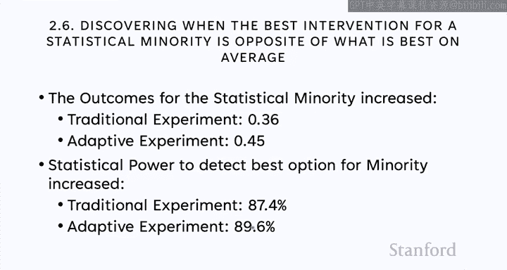
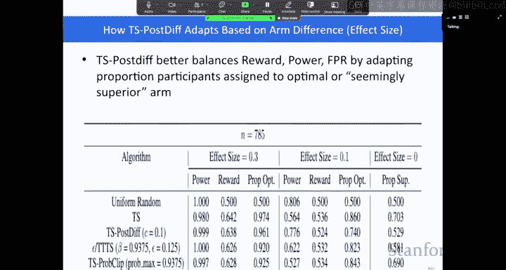

# 斯坦福大学《从人类偏好中学习的机器学习｜CS329H Machine Learning from Human Preferences》deepseek - P1 - GPT中英字幕课程资源 - BV1M7BiYQEen

So I put this huge thing up just to get people thinking ahead of time。

I want to give you a first a sense of the a problem right about human contract。

 what examples where we do these experiments I do have to say before I start the disclaimer I have to give aign from Sna andtebago in therybeion。

People tell me that I have to say this because otherwise they miss the first part my talk trying to guess where I'm from。

Now you all know I have a full attention if you want to read more about these papers。

 there are websites， papers， and I have a link to my research and title CC William search。

 which is basically oh you what I put in for1ure。And this URL TCC join I extended is our meaning list。

 you can join that and then you can listen in whenever if we have a lab meeting or a special meeting。

 we announce it and you can always pop by and listen it and we're trying to think of a global network of people involved in adaptive experiments。

So here my objectives is this talk。By in this talk。

 I wanted everyone to be able to have some kind of shareable message。

 right you could tell someone else what is interesting in a paragraph。

In a person you can tell person next to you， by email。

 you could send them a link to this talk and tell them why it's interesting or maybe a link to a Twitter post。

You want to have some kind of concrete information that comes out of this。

 like being able to explain how dataB experimentation can be used in a wide range of behavior change contexts。

Well， you have ideas for how you could contribute to helping someone win Nobel price for that experimentation。

I also want you all to have cl to do or could do what's one thing you could do before you saw this talk you want one trajectory after what you're going to do differently is going to have any impact。

Would you join a mail list reading a particular paper or share these slides with someone or get feedback。

 like the world should change in some way after we had spent an hour together and more。

So think what your hash sha share of a message and your tu could do。You'll be quized at the end。

 so this is overview the talk I gave yesterday。Fundamentally， what's the goal of our program。

 it's to coach behavior change。For example， how do we coach people to learn more effectively。

 like I just did are prompting you to have like a clear shareable message or to do how do we coach people to manage stress better？

How do we coach people to exercise， eat healthier？And let's not approach that。

Our approach is that we transform everyday technology touch pointss into intelligent interventions。

 and I'll say what that means， and how the out ofcom framework supports that and helps us win the X bright。

So there are three components this work。The first is adapt experimentation tools。

 to make experimentation easier and exploit。Because this gives us more effective interventions。

 for example， gives us better explanations of a concept。

Or giveive us message that will help someone actually do a stress better。

The second theme is personalized and contextualized interventions。

 and if papers are present theyll all work by anbacterhar and others in my lab。😊，And finally。

 a diverse temptation tissue of exercise science and practice。

Now that's what the actual full talk will be on the I'm going to abbreviate the first two parts just to give you a taste of an example or too so you can keep that in mind now dec behavior change can help solve many human problems。

Imagine if you could get me magic words， change any behavior。

What a behavior you wish you could start doing？Is it。Inducing yourself to people， exercising。

Connecting better， being less stress。Would it be you should stop doing it？

Is it that you just don't speak up when you know， you should？

Its it that you keep eating 10 snacks instead of two are you scrolling on Instagram other things way too much Nathan Lary on my patience works on that。

Also， behavior change in others， what behaviors you wish others would do more or less often different contexts。

And do you all see how this touches on every aspect of what we do？Change your behavior in looing。

Making bad decisions， exercise， eating， stress， happiness。And I'll focus in the example of Elcott。

 how technology can help us in behavior change in both education on health。

So the version we're looking for is。By 2034。How do we have on demand intelligent coaches that measurably help people think through many problems and change your behavior for good？

What have we done so far to get to that point？From 2012 to 2024， Vivena Foundation。

And this is through the a core framework。😊，Which helps us get tools for designing intelligent interventions。

An intelligent intervention， whether it's a text message you get sent or an app message or an explanation of a concept。

 is an intervention that changes a behavior。And it intelligently sense that it tries to come up with。

 what's the best thing to give you at this point in time？

But also true intelligence is about learning， it's constantly testing on ideas you can learn what is going to help you if someone tells you they built intelligence system and does involve learning and continuous learning。

I mean， I have lots of snake while I like to sell you。And to build intelligent interventions。

 we have to integrate multiple disciplines。So what examples of intelligence interventions we've been working on that can help towards this behavior change？

So what we do is we essentially take components of every experience and make them into add comps。

The Aqua framework takes a start use interface like a text message or a website and makes a microlo for intelligent intervention where you can keep testing our ideas。

 improving them over time。For example， text messages is one that a about the tri and others have been involved in。

 imagine a message of the day， but that's an out comp and what that means is we crowd so many ideas for those so we keep testing them out。

 use Llums， use people's input to generate ideas and messages and then be try and figure which of those is best for you when。

When do we emphasize， you know， get up and go for a walk right now， you've got to do it。

When you tell someone it's okay to feel kind of lazy。

 you can take a break for10 minutes about this later。The idea is we want to figure out as a coach。

 what we're going to say to the right moment in time。Think of emails as well。

Oneor of Pat students who describe our job as a faculty member has focused on emails you send people to get them to start homework early。

 but again， we tried dozens of options， trysource human beings and adopt through our limbs and try to figure out when do they work in different contexts。

 but do see we take something as boring as email and not an intelligent coach。

The other prompt is you take this subject line， the intro message。

 and generate multiple versions and test out what works well。😊。

So anything you touch every day could be an intelligent intervention。Of course。

 you can imagine explanations on websites。😊，Sadly， I will be embarrassed to say my website is not intelligent intervention you get the same thing that's been there for six months and you should shame me for it until I click that problem when you show up on my website。

 you should have an out pump， it should randomize you to different explanations it should let you say just if this was garbage here's a better explanation and it should be AB testing up to figure out which explanations are better on average and what works for you at this moment in time。

😊，Does that make sense how you want to make that piece of a website outcom？

We have actually done better job in other people's websites in 2013 when I was at B and Stanford。

 we had run Experence Khan Academy， where we would actually test some different explanations of concepts。

😊，Different messages and motivate students to work hardero。

And increasingly now we're doing it in LLLs。I want to see it for all the good elements are doing。

 Are't you all a bit frustrated。In an LLM， it's so easy to generate auto interversions。

 anything a conversation they can make dozens of versions of， and they don't do it。😊。

Why not APB testing LM components when you're going to charge EBT and it gives you an answer。

 it could test 10 versions of that answer to figure out what's going to actually help you。

They have recently seen some nice features， but those are just first steps。

 they could be a testing 200 times more than that。So does this give you all a sense of how everything you touch in the world could be an outer poem。

 it could be an intelligent intervention to test out different versions and changes over time。仏相がな。

Well understand what I'm saying。Okay， you have to be installed once you understand。

 So I wrote this in the chat， but I'm unclear about how you're going to have sufficient statistical power for these。

 These are small exchanges。 The impact on， let's say click rate is going to be very small。

 So you're going to need to send the email to  tens of thousands of people。Yes， how does that work。

 Like， I understand if you're a portal。You've got all the users， but for everybody else out there。

 you're saying send an email， this is not a major spam to 100，000 users。

 you're not going to have statistical power。That that's a great point。

 so I'll reiterate the question， so if we want to make this approach to ubiquitous。

 how can we make this possible because you won't have enough data right to do this so I'll say two things。

😊，One is that。We take this approach in settings like education mental health where we actually built collaborations to do this at scale。

 so if you do have 500 of00 even 200 people， you can't apply this approach。Right。

 but the second thing I would say is this。 This is exactly what we're doing next。

 So one of our papers you can read on website says called EBscribe by Mohi eraa。

 that's about qualitative EV testing。😊，What if you actually could take the best features of APB testing？

And use them qualitatively， even if I want to send an email to one person。

 how can I actually gather feedback to understand different options。

It's also connected to something I would call a source E experiment。Tell me something。

 when you write an email， could it make sense user adescribe tool to make different versions and then try and think through in your head how these would come together。

😊，So you get no data， it's all in your head， but the process of AB test will be he out alternatives and think about the impact。

And that's actually what I want to do a lot more work in。Yes。

 I guess conceptual AB testing is this physical rather than qualitative。

I wonder if there's a name question where。ブラスト。嗯。That is exactly one point the word EB testing means something to everyone and I'm trying to come and tell you all this thing here that you call a chair is now going to be something we fly on。

Okay， so that's a good point， so his exercise， everyone， his own contributes Obama。

Here's how you can contribute to a across those Nobel， Okay。

 come up with a different word for those AB tests that are actually qualitative to。

Qulicivity comparisons。Super AB comparisons， that's your exercise for homework， okay？

And then I can take it and you can charge me if I havent make money off of it。For now。

 I'm going to call them a qualitative APp comparison。All right。

 so now in terms of intelligent interventions， right。

 here's a process and I want to get your thinking。😊。

How could this process work even if you do not have quantitative data？So here the elements， right。

 you take it out of pump like one of those messages we just saw。And you now think part one。

How do I make it easy to generate options for example， if I'm writing an email。

 how generate alternatives using both LMs and crossrowordads from human beings。And then。

Explore that space of options， come up with better and better ideas。Part two。

 now how do I exploit the evaluation of these options， what might be more less promising。

 but also how do I exploit execution？When I mean by execution。

 I mean actually using adult experiments to give people what looks better。

Since the great reinforced learning human judgment。So a very concrete example would be。

 let's say we have two versions of an email right， I can ask you what's the problem to email is that email B。

If you tell me， actually you can ask you in the red。

 what's it bubble tea that's let me show you're an actually maleed， okay， just make it。

The two emails hidden in my hearts， what's your poverty is bettermin B？嗯。

What are you know nothing else 5050 right， well look at that， you think it's a 50% chance。

 so why don't we a with 50% probability？What do we have faster to keep me tested now she unfortunately knows more than you and she says there's a 70% chance is weaponmin B。

 So what should we do assign that to 70% of people？Does that make sense？

Well pick on these other one is like， no if there's a 70% chance。

 you should give everyone at 100% time。That's actually what we all do。We are our guns， right。

 When I write an email， I send the email 100% time。 I'm seeing。

 I'm 100% sure that is the best email I could have sent you。 I did no randomization。😊，So you see。

 we live in a terrible world， like Daniel Kaman said。

 we're binary creatures living in a probabilistic world。

 we either give someone something 100% time like I'm here to give you one version of this presentation。

 100% time。😊，What we give them 5050， we don't have these in betweens。An adaptive AB experiment says。

 let's randomize with weighted randomization proportion to our belief。

So if you think like she does is a 70% chance is Beckmin B， why don't you give to 70% of people？

I give you to 30% of people。Then you get more data and this data can be quantitative or it can be qualitative as well。

 you might just see people react negatively and say730 is too high， I think it's actually like 2080。

😊，So the idea here is let's kind of start rethinking the world to not just give 100 or versus zero is one best thing and not just give 5050。

 which is EB testing and we have no idea， let's actually give things proportion to probability we think that there's going to have the best out。

Does that make sense， everyone？At least conceptually。

 do you all get the idea that we could actually start assigning items for actions， emails， texts。

 things we see。Proportionateally probability， we think that they're the best。

 where best has to be defined。How do you decide the complexity of， how。

 of the model that you're using to weigh your different versions against。 Like， for example。

 with the K Academy example， like， yeah， which L M response is the best one。

To elicit a particular action， I presume you have to build some kind of probabilistic model in the background for your estimate of the beliefs of the student。

嗯。But there are many ways of doing that and many different ways to plan subsequent actions and。

I guess is that something that happens real time or is that something that happens once before and then you implement a system that just runs or and what's the process of even figuring out what are the relevant components of your model Excel questions and I have the answer you can always answer in anything that's with answering。

Towards， it depends。Those are fantastic questions， those are questions we're going to spend the next 25 years working on。

What is the model you're using to set publicbilities， I will give you one model today。

So a two arm case， A and B， binary outcomes， and I will show you that that model actually isn't even good enough。

But you know what， first next you might say I want to do qualitative baby testing and they say I'm going to set those public by a crowdsource mixture of experts。

 I'm going to get the best marketing people in the world and we're going to ask them questions about1 meals。

 theyre can all give us weights so I'm going to combine that。Then when we send it out。

 I'm going to send them the data of what happens and get the marked people to update the beliefs that's an alternative method I don't know if many papers have done that I'm sure five have but fight is basically none。

😊，We need a lot more work on getting human beings to set those possibilities。

But I will give you examples of how we've done that using statistical models。

 again I want to say that's good， that's fine right but I think we can do a lot more innovative interesting work and most importantly like said。

How do we give these techniques to8 billion people， 8 billion people are not going to run AVT。

 I love them， I'll run them， you will too， 8 billion people will send emails and text messages。

 they may with the right tools that we built， randomize them a bit。Yeah。Oh。

So I want to make sure I'm like understanding your intention Yes so what's my intention so far I we think about statistics and AB testing formally。

 but like in reality we just write one email yes and so you're that we should explore this in betweentwe space where we don't necessarily have formal statistical power we have all these other signals about like how did the person reply to this email or what how do you feel when you send a versus B and like all these other policiesxies that like qualitatively give you the answer about like what you think is the best to send but like in reality like we're just like sending one email and so like you're trying to push us to think like this kind of I have never said it so well myself good thing we're recording。

What's your intention today， Joseph？It is to get us the threethink the way we're making decisions to bring some elements of AB testing together。

To help us think about the signals we get， about what might be better or worse and help us to start to actually randomize。

 right with weight randomization or something where we don't just have 50，50 or 0100。

 we have something in between。And I think anything that moves us towards that is progress anything that makes me realize that when I send an email to someone iss worth having two versions。

 even if I don't send it， I feel the habit of A testing of qualitative A testing is progress。

 why because we're introducing a problem to solve a problem。😊，Just like the person。

 I why I'm quo you all by what you're wearing in the white song for what you said。Just as they said。

 how do you choose those probabil， good， now you have a problem to solve the fact that you're worrying about that is going to give me a lot of confidence。

I will say what we have done， which I think is really good and can be a lot better and is a big research program。

Is work on those models that are quantitative。To use Bayesian methods and Sang Chong is working with us on this。

 to use basically ways of taking AV testing data from a quantitative perspective and estimating what are those probabil。

 we've done that。But I think that's not enough。Now' getting over price saying let's say chemistry。

 economics or something， but it won't actually help those other billions of people who just want to make better decisions that's where the quality of work will help the crowdsource approaches and here's one way of saying it。

嗯。When I our models basically tell you what our probability is。

 I'll give you an example as sooner rather later I hope， but let's say you have。

 do I have a good example one second。ok。Let's say this is an experiment， right。

 and I'll tell you what it's about just。This is an advertisement。

 Go and have check these slides out and read it， we have 80 papers and I know you're not supposed to do this。

 but I try to put a question that once a slide。😊，So check out ABscribe。

 right which I'm going to walk you through now， and'm going to tell you an example of an experiment Use stress。

 and I'm going to explain how you could use that for quantitative estimates。

 but how I think we can actually do qualitative instead。😊。

And this paper also is about general explanations， you will cross those explanations of people and then do these adaptive AP tests to figure which ones helpful。

If haven't got your question， you don't hesitate to just type it into the final CCM Williams talk。

 I'll have that open on my phone here。All right， so what is ABscribe doing here Can people tell from this graphic？

This is a tool that out ofquiframe enables。Imagine you're writing email right， for example。

 email does tell students when you've got a test come。But you know what？

Stress can actually help you perform better。 It may not actually hurt your performance。

 So what do we do is let's actually select pieces of this email and make them an out of co。

 So start thinking green， that's an outcome co。 That's an Navy test。😊。

This other one that's also not of co， so you define out what are the things you're going to experiment with。

Now you can use an a set。Where you could actually call El and say。

 give me a different version of this message about stress that will work well for someone who's very scientific。

😊，Give me a vision that will actually work well for someone who believes someone who does yoga all the time。

 okay， I do yoga， nothing against it， okay？😊，Give you different versions unless let's experiment。

 so then the aBscribe is that you choose a piece， and make an out comp。To A B tests。

And then you generate visual LM， but then this is the thought AB test I'm talking about。

 because you can then actually look at these versions and toggle back and forth between them。😡。

For this part， you have another a of comp below and you think， how do these things come together？

So I might use this when I'm writing to email this。

I think which of these combinations would look if I'm trying to say。

Don't wait before your big presentation， stress can actually help you。

But then I use the same three of options when I'm writing。When writing to someone else。

 Does that make sense to everyone how basically you're doing this thought AB test。

For thought it comparison。By having the other prompts， that define options。

Thinking through different versions， getting Ellan to help you and then traversing them。

 does that make sense everyone？😊，Okay so now this I think is the future and I'm not sad he got a job I'm happy for him。

 but I think we had so much more to do on this okay。

 and any one of you you can publish really high quality papers in this area by just building on this。

So what's an example of using this， what does it get you？Well， here's this paper。

 this is a paper of Moherras from Angela Zvalta from Kai 2023。

We talked about magic words right and you probably thought that's the yes but tell me something what could I see at you in three minutes if you're a first year programming student that will increase your performance and test by 4%。

😡，I even know if the answer to the test question， I could tell you in three minutes would help you。

 okay， you'd forget it。But here's what we did。We took research in psychology by actually people in yours department in Stanch。

Andum。I'm sorry think I'm sorry， I forgot any。And we then map this starttic。

We came with six different elements of this in the Arab crop， we vary the text。

 we show people instructions， a video of me saying it or not。😊。

Liinked to the paper for those who are scientific。Auth them to explain what they thought they'd learned。

Had them write a no to themselves and the core message that we traversed in many ways was。😡。

When you're stressed， it can actually help you perform better on a test。 It doesn't have to hurt you。

That message on its own， what you'll think about it did。That message on so is the control group。

 okay， so the average grade there was 76%。But when we went through many other options。

 when we elaborated on it， like helping them think， well， when you're stressed。

You might think of it thestruct， but it can actually help you put more resources in。

 make you pay more attention。So join the exam， when you're stressed。

You don't have to worry about it it might actually be helping you perform better。

So those examples are be， right？Make sense， everyone。No， here's a payoff。

When you explore these options， you will find options that are actually will boost grades。

 so here's what you see on average， about 80% compared to 75。😊，Well that's， I 80% coming to 6676。

2 or something。That three minute message。Which I'm not even sure they read carefully。

 also grades by 4%。From Bta A minus。So do you all see something payoff you get？

When you actually run these many experiments， I think we run like six experiments in a couple of months where traditional research might take。

 you know， a couple of years to run mapping experiments with 200 people。Nothingy pill。Now。

 let's ask a question。Should we just start giving this message to everyone。

 every class of Stanford at Berkeley and everywhere？

What's it probability that this particular vest will work in your population and will be the best thing you could do？

It's not a hundred0， right， nothing in life is a00。😊。

So you could imagine that if you took this message。

 you would then actually aBscribe and use the L to come with different versions。

 Use crowdscing and come many versions。😊，And then think yourself， well。

 what's a public he's going to work for people my setting？Does that make sense， everyone？

And you could randomize them that way qualitatively or quantitatively and get more data。😊。

Now let me give one point to circle back。We have data here， right。

 Like I could look at this data and Sng or Mi or Tong。

 Tong Li and Fred Hutch Soong might start Sp students。

 they could help with few under some prior assumptions。

 What the probability is that this will replicate in a particular setting。😊，And that would be like。

 let's say，80% and 8%。 Okay， there's a 9% charge for this message is better。y everyone。

But here's an interesting idea。What if instead of just using this statisticalco model？

And just mapping it over with to say， what if we actually give that data to someone， for example。

 if session in a class？😊，Let's see if we get a dig them and says here's what the results showed from this class。

 here's what the class was like and then we can say， well， that's helpful。😊，My best judgment。

 wrong as it may be， is that there's a 76% chance that this is the best message I can show my students。

😊，So do you all see now how we take pointed of data and we don't just blindly compute the probabilities based on a particular model。

 we then give that data to someone， we might get our model probilities。

 but we get a human judgment as well。Now then we can combine a human judgment who's looked at the data with actually the particular data brainery or whatever model we use。

😊，Does it make sense to， everyone？对这个是。They didn't about things properly formal but it's not very subjective。

Delegate way I don't know how you think about this。That may be a good way to。のは connect next。

When you say that， do you mean it sounds subjective， yes， don' specifically't thisly。

Because there's a sort of framing of the invasion way of thinking that's about sort individual estimates of probabilities。

That sort drive so much。I guess the framing I'm hearing from you good well I think so yes。

 but I'll say two things I almost never have one belief， okay。

 I have a Asian combination of beliefs okay。We can do this statistical model and you might say or let's say。

 okay， you might she might say， in my class， we're doing straight up statistics。

 I will not enter my beliefs in here， compute the probability based on the past experiment。

And we can do that for her。But then you might say， well。

 I want to see her model on this data but I'm going to add my own opinion。But then， you know。

 person the yellow and green shirt might say， I'm going to do what they did。

 but I'm going to crowdsource ideas from students themselves。

So the idea is these are all tools in your toolkit that you could do and even though to be totally honest。

 what I'm pushing on right now is the more formalized statistical version because that's what we've done more of and to be honest it's hard to convince my stapat students do these kind of things a human extraction student is much more open that's when I'm pushing on to help Susansani Theo Alan Asperru get their Nobelped okay but I think what will help more people is actually these more subjective methods again what I think of what I love about math I love pure math is beautiful the time is something how much that comedy fields medalists of change of how people be healthy and exercise more。

😊，The really exciting part is taking math and bring into human destruction by designing experiences。

 interventions， to combine math， and that's where you have to start to do what they said part what depends in a one price。

 one of the students said part high dimensional intuition， so here's a lovely anecdote。😊。

You come into G school， I would say， so if you want to work on things that are beautiful。

 mathematically， great prove， easy paper to publish， but may or may not relate the real world。😊。

Well if you want to work at things that are messy， confusing， hard to formalize。

 but really help people solve problems。😊，And the student said。

 but you'd always know which one proteintu should move towards because have this high dimensional intuition。

 we may not all have it， but we at least need to try to take mathematical concepts and combine them with human behavior。

😊，Such as by crowdsourcing opinions for people， that's a well definedfin process。

 everyone here gives me a probability and I wait it， I can reproduce it， I can change it。

 I can evaluate it。And to be honest， remember， what are we doing every day， when you saw me outside。

 you just service on your mind， you were not being formal about that at all。

 you're being a human being， that's like's now let's make you slightly more of a formal reasoner by using things like it described an adaptive test。

😡，So the general thing makes sense then is a case people want to skim。I think it。

People are notoriously bad。Being。I guess quantifying probably。Yes， have the premise of this class。We。

 we actually are engaging sensitive human feedback， but like trying to do things。

 I think are low effort for people。 I wonder how important it is that the signal probability。

Given that， I guess I don't trust probably that need anything that's a great question versus other like apartment signals or other kinds of。

Lower。Yeah， I think those are great empirical questions be those are good hypotheses right。

 about how to pursue， I think those sound really interesting to pursue in our。😊，中。Ronnie。

 youve got some great questions in here someone could also put Ronnie questions into this talk。 Okay。

 I've come back to a bit。We have shown cases where actually， oh yes， okay。

 now'll show your case where de from uniform randomum can increase power I think people are getting a sense of what a quantitative adapt test is right let me let you all just read that for3 secondsd。

😊，Well I write an answer。So you all can read that， that's your homework and see if that makes sense to you。

Okay。So let me move on for a second。Here's the formulation， okay。Of EV testing。

 this is what more people think formally。 Let me just lay it all out。

So this is what's called a Mountyban algorithm， it's the most fundamental form reinforcement learning。

And you can think of this as randomized probability matching。

 So what I said to you before about whats see probability that a is thatmin B and you give in to 70。

30。Tmmp the sampling basically sum for those claims the sample of those probabilities so also called postior sampling now I want to focus on the most simple form of this because I think everyone thinks we've got this and we have not got this right。

Think of a Beta Bnoi Bayesian model。So you've got two arms， for example。Explanation A versus B。

And what's your reward？Someone says one， I like the explanation or zero I don't someone clicks on your paper after seeing the explanation or zero they don't。

 someone buys a product after explaining what it's about or zero they don't。

You you have a set of actions， right？Give her a water outcome， which is。1，0。

And if a policy or a policy learning algorithm， I talked a sampling， which would assign 35%， 65%。

 what if probability is actually the best option。And so this setting actually is really nice and simple。

Basically， you put a beta distribution。On the probability that someone's going to say， yes。

 I like this。 So you have a beta distribution for arm A。On北是不是发 B。And here's a nice prior。

 let's do beta 1 and 1， what is beta 1 and1？Any agree。

What is the beta 11 distribution if I have a beta 11 distribution， it's like I saw one success。

 one failure so far。What is the probability of someone saying they like an explanation？It's uniform。

So beta 11 is uniform distribution， it's saying I've seen know this this so far。

 so maybe a 20% chance people will thumb up this explanation or 40% or 8% they're all equally likely me。

Do you have a beta distribution on arm 1 and beta on arm2。

But now it his Bayesian inference and he's a conjugate， so what's beautiful about this。

 how simple it is， how interpretable it is。Now the reward is a benoi right。

 drawn with the parameter from that bit distribution， so let's be very concrete。Beta 11， beta 11。

32 arms let's say that we give five people arm one and three of them said， hey。

 that was great and two said I didn't like it。Now， what's a big distribution。

Our beta distribution is now beta 1 plus 3 comma beta 1 plus 2。So we have beta with one plus three。

 four successes。And one plus two， three failures。So we don't have a uniform distribution anymore on the probability And people think it's helpful。

 We have one that's now skewed a bit higher。 It probably looks。I'm not going to try and draw another。

 I'm not good that if somebody looks a bit like this。

Let's say that actually for arm2 we gave it to five people and five of them were like hey this is great and zero said I didn't like it now we have a beta of one plus five comma one plus zero so now again we get a s right we now it's like I think probably people like that is high。

😊，But we're so pretty uncertain， right， it could actually be that there's only a 01 probability people would like this thing。

 it's just that we got a sample that biased us。Now， of course， if you had beta of。Six。

 if you have beta of  six and 1。Versus beta of 60 and 10。

 then you would get a much more peak on the probability of it being high Does that make sense everyone。

 because now you have more observations， you have the same mean。

 I think can someone do the math quickly。😊，60 and 10， right， What'll see our distribution。

You can up with your allowed。What's the mean of a distribution where it's beta 60 and 10 or beta 6 and 1。

 what's the mean of that？They agree they' the same。The variant should be smaller。Exactly。

 so I think the mean should be like 60 over 70， right，6 over 7。 So the mean is 6 over 7。

 So it's kind of saying my best guess is that the。😊，The beauty of someone saying。

 I like this thing is six over seven。But now in the beta， like you said。

 beta 6 and 1 is going to be like this， but beta 16 and 10 will be like really peaked。C confidence。

So does that give everyone a sense of at least how you could use a be distribution it represents？

For A and RMB， the probability that people will think is helpful。

And what's really nice is how intuitive this is every sound you get is a successor failure。

 you can just update the data promises。Now this example is lovely because it's super simple。

 everyone can see it， I understand it。And it's a great test drawn for all these algorithmdos。

It's also a great test John for this qualitative kind of work。😊。

Now does anyone here know what Thompson something does to basically get an estimate of the probability that is B B。

 let's pretend you have beta six and 1， farm A and you have beta3 and3， farm and B。

But what on sum we would do is it would sample， draw from beta 1， 6 and 1， you get 0。5。

Draw from beta 3 and 3， you get 0。4。And then assign the arm that has the highest expected reward。

Well， if your beta from R 6 and1 is 0。5， then you're expecting that you have 0。

5 chance people thumbs it up。But your beta from R andB is 3 and3。And then you get 0。4。

 then there's only a 。4 chance。 people are going to thumbs it up。So what gives you highest for what？

2米。So Trump and something will pull army。So it makes sense to everyone。

 you have the data distribution， six and one， three and three， you sample each。

 and you can choose the arm that gives the highest reward under those parameterss。

And if you want to know the probability empiricalerkely， just do it 10，000 times。Right。😊。

Draw and you get 05。4 R1 R， then you get 0。6 and 0。3 RA， then you get 02 and。8 RMB。

 so you can just get 10，000 samples and you can actually compute， well what's you call ability。

 R is that an RMB。Does it make sense to everyone？How do you go from the beta distributions to what's the probability of the arm being better according this algorithm？

Iag 80%， positive8 B B or 70%。And so on makes sense， everyone。

I really think we need to do 10 to 15 years of research just with this。

It's super simple and it's not solved。😡，When it's not solve。

 what I mean to say is the inference is actually not trivial and I think there are a lot of mistakes people are making when they use these adaptive experiments and don't realize it。

Cool， so again， everyone's clear what how this works， how the sampling work here。

 and what's the online model。And so now you can imagine that if you have beta 10 1。

 you've got 50 50 assignments right， because there's equal chance of these being good。😊。

You could also use manual assignment human judgment and now actually we see something pretty interesting right。

 suppose that she said there's a 7% chance of a vitamin B。

 couldn't one of us actually after the question about formalizing it。

 couldn't we then back out her 7030 into betas？😊，You could actually say， well。

 you could even ask a person， you could even ask someone right， you could say tell me something。

 she thinks it's a same person chance is Bethmin B。

Could you represent that as fictional success and failures？😊，And you might say， well， yes。

 I guess you expect something like that。 if I imagined， I'd seen。

10 observations before in A and 1 in B。And of those， I think， you know。

 it was successes in aid two were failures。And indeed B， you know， it was five or six， five feelings。

 so now this is super interesting right because we can actually formalize these properties that are so slippery。

😊，And I think there's a great k it to be written simply on not。😊。

Let's understand how people could express imp poverty something is B and B。

And then try and map that to data distributions and kind of help people understand which of those assumptions。

 much what they're seeing。Like how do we actually help people formalize their beliefs about whether A is better B？

By actually helping them understand how those can map to data distributions。I when say people。

 you could do it with half 10 participants who are like people in this class， okay。

 who know what a beta is， but have 10 participants who actually don't。😊。

And can we give them interactive explorers or tools that help inform his intuitions？

Another question is could we then find a way of weighting people's approaches For example， you know。

 sorrys quite my shirts， but yellow and green shirts。

 this is black shirt right yellow green might say you know what black shirt。

 you know way more than I do about what emails people gonna respond to so I'm going get my estimates。

 but I want you to wait my success and failures one10 of black shirts。😊。

Like you might say arm1 is a beta， I think eight successes， two failures， arm2。

 arm A is going to be five and five， and then Blackhe says well actually think arm1 is nine successes。

 one failure， arm B is going to be you know， two successes， eight failures。

 and you say do not wait to equally equally。Wait his 10 times mine。

With his basis his success is 10 times mine， and now that's a way of combining expertise and offices。

 you have something to say， but who want to wait his more highly。そ。

So this is where we actually now are doing a adapt experiments。

 we assign 5050 using human judgment like we just talked about waiting red shirts and green shirts。

 sorry yellow and green and black shirts。😊，Or using a statistical model。Then as we get data。

 we can actually evaluate 50 people got A， people got B。😊。

For maybe even smaller with both quantitative and qualitative metrics。And then we might' say， well。

 A has a9 chance being Bethin D。But then we don't stop there。

 this is what makes it cost experimenting in the railway we won't just stop there。

 we keep adding new ideas。And so over time， we can actually keep it up in propertiesbil。

 does that make sense to everyone how this approach versus quantifyfire beliefs and keep adding new ideas on the fly。

This still sound like a saysam measure requires a lot of trust and effort on the behalf of users。

 I could also imagine that if I say I'm very confident about something。

 I can try to ske in onely adversarally。Fantastic， that other paper is out of chi papers other of people in your area。

 fantastic when we're gathering experts so I'll see's a question。😊，In this paper。

Actually let me try something on the fly title。Eliciting beliefs from people to get better decision making。

 even when some parties want to sway the vote。Ubstract in this paper， we investigate。

Ways of gathering feedback from different people to try and come to a group consensus such as which emails well send out at a company。

We investigate policies ABC， which are ways of combining input from different people。

We investigated weighting schemes F and Y。And we sure how。If someone。

Believes they're right and will use that to s the majority。

 This scheme will suffer from bias in this way。To tackle that introduces other approach。

And that's a great one， that applies everything going to lunch。

Deciding where we're going to like have your retreat this year。

's and companies would love that kind of thing。There's a great job。 Who knows what the hippo is。

R Ronpo hippo， highest paid person's opinion。 Ron introduce to determine is fantastic。

 How do most decisions get made by the highest paid person's opinion。 Don't trust the hippo。

 Your paper on this topic could be a way of getting input from people and trying to defend against the hippo swaying people's beliefs。

😊，So。我这。I haven't seen mentioned， but like I'm wondering what your thoughts on it are actually do ay tests for all the papers that I write amazing we should write a paper not for Kai All this stuff you all do every everything could be a k paper if it's well done or rigorous it could be。

 we have to show that right you will get rejection Kai is right on your own but we can sure to make it a goodi paper comment I'm not sure。

😊，What it is yes， it wouldn't be very helpful to me to wait for humans to do the feedback on the test because that would involve like sending the papers waiting for the feedback like sending the next paper It's just really like So then like thing heard you mention much is like can you use the language model help you quickly like you know refine your prior basically because like he can ask it to take on the role of a certain I would I'm trying for this one of my gra students to work on that I would love to write a paper and I think it's a quick easy highly impactful paper someone in your university Rob Willer has a paper and using Ls to the human behavior that would be a great paper to write And I think there's like 200 papers that me are not top in the next 10 years。

 Yes， let's do it。How that's talk that。Using our lenss to simulate human behavior is a fantastic idea to get priors to all of these things。

Okay。So I think you all get a sense of basically some people say Ascribe， you stress and。

You can read all with the others。 I just want to dgggle something in front of you。

 So you're aware of this。P slide and contextualized interventions。

 which I will not talk about too much today， but I want you all to be aware of。

Theres a lot of work by Asha Naa。So paper 2。1 is a small steps SMS is a you can sign up for it now。

 it sends you message every day to manage stress and be happier。

And then I just publish a paper on design prompt that people reflect so you can actually ask yourself questions to manage stressful situation so you yourself are personalizing and contextualizing advice to your scenario。

He's got a nice paper CSC of on stories and messages。

 we give you stories about what people are going through。

 whether it's handling stress or applying for an internship。

 and you're then able to actually abstract that away to your setting。

This is a paper this year on how you can use an LLM when LM will actually work with you to figure out how to adapt a story that we've written to your context。

😊，And then a nice paper， 2。5 on how you El as a thought partner？So if you procrastinate。

 this will actually help you come with messages to send yourself when you're procrastinating and has a particular prompt engineering and interface to get people to actually come with best message to the L them。

😊，I'll put that one in front of you all let me just entice you all because just look at the screen。

 really carefully it's going fast。😊，21。2。2。Next。😊，2。3， the messages。The result， example of a message。

The results。24。How do you contextualize the story with LMs。

You would share some context with what you're going through andll actually general story for you from that。

And then we actually found this， I was shocked， it actually outperformed just a human story。25。

Aams the thought partner。So here's the interface， you can just go to time and see Spark paper or sparkar demo。

And you can actually type in what's going on with you， what you' procrastinating。Grant deadlines。

 talking to someone， exercising， you type it in。 utility alum， you know， to informal direct。For me。

 you want a Trinadian response， you want an North American response， because I can tell you， Triads。

 Trinadian。How many friends， colleagues and parents who not talk to the same North Americans talk to you。

Much harsher。And then it was actually generate a message for you down here。

 you can actually edit the prompt。😊，ToCha your message。

 I want a already tough turn notdding way of saying this。And he also generate more messages。

 Does that make sense， People just at least as a tease of what the en could look like。

And I want to say all this stuff at open air and soa hiring。

 I think they're only missing the boat and you all can eat them for lunch。

 It's the interfaces on Els at matter。 This kind of interface is night and day。😊。

Don't just give people al good albums， tell them how to use it。

 give them ways of interacting the alarm， tell them what to say。

 give them custom prompts like this interface is kind of makes all the world of difference because you know what most visit people are saying now。

I haven't seen a case for AI really matters。Where is the business value。

So thatcom divided 100 billion plus， make some news cases like this that will actually show people what it's helping using psychology and HCI。

 that's going to matter。Okay， now here's back to Addafi's experimentmentation， Okay。

 especially I think Ronnie' be interested in this one。Okay， so。What's going on this graph？

How can you use adaptive experiments to discover when the best intervention for statistical minor is the opposite of what's best on average？

So did you all see what's happening in this graph？You can choose your own setting。

 but I'll give you an example， this is part what we want the X price for。😊。

Imagine students get messages and the outcome of the reward is， do you generate a question。

 are you going to generate a question about what you're learning in online course？

So how me get you generate more questions。Well， one self focused message in blue might be generate a question because it help you spotgs your knowledge。

Another in red might be genetor questions， so your peers might learn more from it。Now。

 if you look at this data set， right， you'd say， well， look at that on average。

The red message is giving you more people journey questions than the group。

But what's wrong with that， what are we missing？This is a day broken up by people who have low accuracy。

Because they got the last problem wrong。With hi accuracyy， because you got last from right。

I now hierarchies for people are 80% the theatre。If a of people are getting lost phone， right。

 it's a hypo accuracy。30% get it wrong， and so what's actually happening。

 how is actually taking just the average， actually discriminating against a statistical minority？

Could someone say that。Luchi and Hoie， how are we actually discriminating here？Well。

 so since like 20% of the data。You have them more so focused。呃。

Chrisions like so if you want to look at 20% and then 80% of the data giving the other one。

 you combine them like the weighting is far more towards the higher accuracy So then like in the serve overall results that be reflected more because of that 0。

 a versus 0。2 exactlyact 20% of people， the blue message is better than red and substantially better。

But for 8% people red is button in blue， so when you combine it， they get washed out。

And so you would actually end up as a policy saying， let's keep everyone read。

And you'll actually be hurting people who getting worse of it and what's worse you hurting a statistical minority？

Another question， do you think this is a bigger or smaller problem if you don't run experiments and you just use your intuitions or qualitative data？

I think it's bigger。If after class three， I given two ways to explain concepts and three of you came up and said。

  hey， I like the red way。I'd be like， yeah， I'll give red to everyone。

But because I didn't keep experimenting， I would actually have messy chance to discover is a subset。

 and we're doing this constantly， experiments are just a microcosm a very well defined one of what we're actually doing every day。

😊，So here's example of how we would actually want to run this experiment and how we do when we use contextual bonds。

So you sign 5050， right， but actually do it separately for the low accuracy and hi accuracy groups。

So then what happens over time is as we see what's working。

We would actually start helping the hi accuracy group。

They be a 70% chance that red is better than blue until they get at the same percent time。

But we're not so sure it's really low accuracy。 We might keep in 050， right， like 55，45。

 we're not sure。And that not being sure as good is we collect more data。To me she would be like。

 oh yeah， there's 8% Johnson red Beth and blue piucracy。But for low accuracy， this is 65，35。

So you'll see how this approach would allow us to keep collecting data over time。

 we don't stop experiment early， we adapt it so we might have able to discover。😊。

What's better for a subgroup？Make sense， everyone。So I want to ask you all。

 what scenario is where we decide option B is better option A because it seems better for most people。

might actually hurt your minority。And I will say when we use this algorithm。

It doesn't just lead to better outcomes for people in a small group。Like I think it's 20% better。

 It actually increases the statistical power to detect that effect。 And you all see why， right？

Because。We keep experimenting， so we might start giving more people less than one group because we're pretty sure。

 but because we're less sure we keep getting data so we actually get higher power to detect this difference we're more likely to figure out there actually is a difference。

Oh yeah， here it is， so the outcome to the minority in a traditional experiment uniform random， 0。36。

0。36 of people generate question basis percent。In depth experiment 0。45。

 plus substantially better to get better learning outcomes。

 statistical power detect the best option of minority increase from 87% 89。Doesn't look like a lot。

 but those are up and I think in terms of samples， that might be 50 less samples。

15 less samples to be equally conent is pretty good。 Even five less good， right。Those are people。

 five people who didn't have to be in your experiment， taking the same confidenced。

Good， so what do people take away from this so far？All right， now unfortunately。

 I did actually give you that whole first talk， but it looks like you all had a good time。😊。

But now I'm going to give everyone a one minute break。

 and then I'm going to actually talk about the algorithm work， new algorithms， new analyses。

So I' going to take a minutes and think whatever you want to think。If ignore me up요。

Let me give one thing away， this most important thing。Six years ago。

 I thought and I run experiments using toxin sampling。Today， I would not tell someone to use that。

Would you say more， we spend a lot of time talking？😊，Fortunately， there's the easy solution。

 what is epsilons of the sampling？😊，Epsilon of the time to Uniorandum。E someday time。

 do 5050 assignment and then do some sampling more exploration。You could there is my exploration。

I hear about in terms of this。Keep doing some multi traditionalial experimentation in order to reduce the biasess of thomson sampling。

It also guards against one， if the word changes， maybe exp A is great。

 but then people get fed up of it。Maybe exhibition is great for your majority population。

 but actually it's a minority that you're missing。😊，I mean。

 the exhibition is great for Santaford students this semester， but next semester it's not。😊。

So having somewhat of epsilon uniform random， epsilon nutritiontrition experimentation is really important。

And Epsilon of something says with probability Epsilon， do uniform randomol。If epsilon is 0。1。

 10% time you uniform random， if it's02， 10% time you do your uniform random。

Now is the second part of this。How do we optional analyze data from T sampling？

A lot of papers will do all kinds of fancy debiasing stuff in riskpro waiting， all kinds of things。

 I don't think these are working nearly as effective as people think they are。😊。

So one thing we've been developing， and I feel confident being actually tell people you can actually use this is an algorithm use test statistic。

So what that means in a sentence， and I'll show you more is when you do like a Z test for proportions。

 like is a proportion of people。Who。If you compare X A versus B and see who thumbs it up or not。

You do a Z test to say， is there a significant difference between these？

And so the Z test is designed for assumptions of uniformando。

But you know you're using Thompson sampling， or ideally， you're using Epilon Thompson sampling。

So how do we actually know unless data？😊，In a way that takes science account。

 that we were not collecting with uniform from random， but have sometimes sample it。

The algorithm used test statistic basically takes the Z test statistic and it regenerates it。

Using the algorithm to collect the data。So I'll show you more about that but basically it generates the data。

Under the nu hypothesis， using the algorithm you actually used and gets a different distribution to the testtistic。

 and you get a different cutoff value to doing your hypothesis test。Now， if you do that。

 the actually is not too bad at all。You get a fixed for positive rate whereas we've shown that even in a tour arm trial。

 often example we'll push your four positive rate to 13% compared to 5%。And your power， actually。

 is not bad。Uniform riding gives you better power in a tour arm trial， from something gives you 46%。

😊，But absence of sampling with this argument due test will you 66%。

Particular algorithm we use and developed， we think can do even better。

So key takeaway is I should say now we have some Intel people， you running instrument adaptively。

 use Epon tops and sampling。😊，Or use our version， which is called T S postif。

 which is adaptive Epsilon of sampling。And then use the algorithm and use test to the other people are developed。

 and we find this context unexend。I want to be sure I understand。 So yeah。

 you're saying that traditional Thompson sampling has a very specific trade off between its false positive and other。

 but like。You can kind of mess around with that a little bit and get other treatoffs。

That might be more fact for your setting。 More statistically sensitive。 If you good inference front。

 Yes， That's right。 like one is like Thompson sampling is like not even all the Pareto front necessarily。

 And then like。If you change the algorithm a bit like you can。

 you can kind of get like better uniformly。 Yes， so that thank you being precise and great job coming back。

 So one is that Tom sampling has some issues。 I mean characterize how big they are。 So I'll say that。

 Yes， the second is that using Epson Tom sampling ideally。Adaptive E of summary。

 which you're working on。Will give you better， statistically sensitive results。

 But the third is you also should modify the way you're doing your statistical test。

 That's the algorithm of tune analysis。So does this make sense。

 just make sure people know what's happening？Just read down and see if it makes sense。

This is the world we're living in right， so think about this arm difference of0。

 the probability P1p2 0。5 response rates to expression AOB or think of arm difference to 0。1。0。

453 people， let's say they like X A， 0。55 X B。And this wall Z test is what you used to compare me。

 So you're basically subtracting the sample mean。Por of people who set they like expression A from B。

 and then you get this standard there of the difference。

 which largely depends on the sample sizes and1 M2。Makes sense， everyone。

That's a very standard that we are doing the syna。Okay， now you can see this in the paper。

 but basically headom sampling actually face positive rates compared to from random。😊。

We did a bunch of other tests， which just details test based factors or cause an issue in quality weight also cause a problem。

And it pumps up in wall test， so you see argument use test controls force for the rate of 5% but power is 70%。

 which is not great power is probably detect difference when it exists。Fourse positive。

 there's no difference， but you set your test says the is。

This is a sense of why this happens in terms of sampling。😊，I give you all 20 seconds on that。

Basically when it's a random low and I mean it looks lower。

 you think that's a difference when there isn't actually。

So thats where we get force deposits a high end top sampling by they' 30% in time， not5% because。

Okay， this is important。 So I'll just go through it。

So what you see in the vertical axis is the sample estimate they mean right in reality they're both。

5 in reality。However， what happens is that if one looks worse by chance， right， arm P2。Well。

 then now she stop something from it， right。And you put all your samples up here。

 so what happens in the limit？Even with 800 participants。

 you are accurately saying that arm 1 has a mean 0。5 and you standard area is very tight。

 you're very con， right？😊，Most samples are there。 But look。

 you think it actually aren' too as already low mean。 youre not as confident， right。

But you're still going to have a false positive because you put so many participants in one arm that you now think there's a difference。

Does it make sense， everyone？That's one reason why when they random lows with an adaptive algorithm。

And something looks worse， you stop sampling and so you start to believe that there is a difference because you put all partss to one arm and you think there's difference one isn't。

Great。This also explain why you get lower power in a sentence， as Ronnie suddenly shut。

 if you're saying uniform random， right， you're going have like 400 people here 400 people here。

 but actually there is a difference and you estimate the means accurately。

 but actually you're not that confident because look' probably thetan errors here。😊。

Tohos you don't know is there actually difference or not， that's important having experiments。😊。

This also happens the Ba in France as well。Again， I let people look at this after they talk。

 But even when there's no difference in our means。The sound probability is going to be 0。8 or higher。

In 53% of the time， there's no difference in our means。

 a Thompson sampling will tell you that the probability of one arm better being 80% or higher is really。

 really high。Okay， so as if we spot about empirical exploring， right。

 this is the empirical work we do。ありがいで。Ex long readinging from again or just completely right now yes。

I just mean fundamental use solving us the。Yes。Would it be better in those I some it is not better。

Absentom something definitely it has better behavior for those say no difference it has a lower force possible and better power。

 exactly。But now here's what helps a lot。Is this algorithm tune analyses seeds， right？In a sentence。

 it allows you to control force positive to 5% of 13， but it also reaches power a lot。Yeah。

 I' going to get out of bit。But here's exactly what happens， okay。

 so this is the difference of zero right here。😊，This is on difference of 0。1 here。

Now on the uniform random， this wall Z test is distributed like this。And this is hypo assessing。

 right， what'sip probability if there's no difference that you get a wall tested to stick that's 1。

96 or bigger or minus 1。96 or smaller what'sip probabilityability？😊，The alpha is 0。50。05 is 5%。

 you set the false possible， you say I'm choosing 1。

96 if my tester to six is big or not reject the L is 5%。

 what's your power but your power is basically when the is arm difference 0。1。

 what's your probability。That you get a test to big than 1。96。 and this case， Paul is 80%。

With a sum size of 185。Now， what does some happening do for many reasons。

 but part of what I showed about how when it's lower， right， and you think it's with。

 but it's not actually。It's basically giving you extremely testistic。

 really big values because the arm differences are very separate。But that's actually not the reality。

 that's where you get 30%。But also， powers will lower， because， again。

It's reducing test statistic when there is a difference。

 because you actually don't put enough samples in the arm to tell。

So do you see how Tom sampling is actually reducing the。Signal from these two distributions。

 you can't tell apart when there's a difference when there's not。And so。

The algorithm use test does something very nice， which is it says， well， look。

 you've got the distribution on terms sampling。😊，That's your algorithm use test statistic。

So take the test statistic on informandum， generate underomic sampling， and then say， well。

 let's set the cutoff values to be higher。Let's set the cut of to give you 5%。

Makes sense to everyone and so now that's good so you can actually just adjust from 1。

96 in this case it goes to 2。6 and now you've got a 5% for positive rate。😊，But what's the problem？

Home is now look at your power。Its 17%。 That's because fundamentally。

 the data are not discriminating。What Epsilon Tmp sampling or adapttive Epson Tom Sam does is it will drive those distributions apart。

And so that's the takeaway I showed you before。Let me skip that。

 these are just some other results you can read later。😊，对。

So you actually need statistical sensitive of algorithms。And this is the paperwork on。

 I think may or may not be a quarter on that depending where you all are， I think so， Okay。

 so here's a key idea， right？😊，Let's investigate hybrid combinations of reward maxim bands like Tom samplingling with traditional uniform random。

So Epson top and sampling has a fixed probability， but I'm record quota Econ CSS Prosor Harvard。

 right？I don't think you want to be asking about epsilons。If I come to and ask you。

 what give in Epsilon for the experiments， 0。1。2， you can be like， Joseph。

 how am I supposed to know whether you do 10% or 20% you from random， how is that my business。

 aren't you supposed to be a statistician？You may know， but multiple awards。

So hey look we do establish， I think it's quite clever when a patients students given this idea。

 you can read about the paper there， okay？😊，ok。I give everyone in 10 seconds to skimnots。

Now you come， I tell you， like red shirts。What is a small difference to you。And Richard might say。

 but Joseph your 0。1 is small， if it's less than 0。1。

 then do tons of uniform random and get me good power and force positive rate。And so then me say。

 okay， well， here's what Epson is， Eppsson is the probability that the difference between arms is less。

1。😊，So that post zero probability， that's what's called TS positiveif。

If you posture your pop the arm difference between less than。1 is 8%， 8% uniform random。

If the published it the less 。1 is 5%， 5% uniform random。

So do you see how we get a very nice epsilon of 80% or 5%。

 but something un in terms of what's small to you？And of course， if it bubbles， he's low。

 we get more of the sampling。Does that make sense to everyone， this adaptive episode talk sampling？

TS positives says。I the probability。But the our differenceffer being。

Small than the prompt you specify。Is x then that x is epsilon。

 the probability arm difference is less than 。1 is 80% then epsilon is 8%。

If the poverty arm difference is less than 0。1 is 5%， then epsil is 5%。

 and that's how much uniform around than we do。Makes sense， everyone。And again。

 you can read the slides and so on。😊，같이 하겠데요。It gives a nice trade off across different sample sizes and different arm differences or f sizes。

On average， we do think it actually beats existing algorithms because it adapts。

Eppsilon of the sampling will put you 10% you from random if it's big or small， doesn't care。

This a more detail breakdown， which I think is a nice whip breaking up。

But here's the kind of key thing， okay？When you use adaptted apps and solving， Ts positiveer。

It would actually better trade off reward power and force positive rates and so now here's the what if you can finally say to people okay。

 you're running experiments。😊，Then use T S positive and the algorithm use test。

 because then you will get a fixed force4 to5%， not on sampling，50%。

 and even epsilonom sampling inflates this。😊，You get a fixed force rate and your power is actually pretty good。

 uniform around is 87% power， to 7046， Eppsilon Tom 70 66， but Tsport is 82。😊。

So now I think can actually tell people， tell me what's the small difference for you。

 where you want to trade off reward inference， and then actually we can use a good algorithm for that。

 and we can also give you a good algorithm and use test。😊，So that can makes sense to people。

 this is just a first step and what I hope is 10 years of research， well not 10， 50。

 but I won't mind up be around that long， I want。嗯。😊。

Have more statistically sensitive algorithms like talk sampling positive。

Which is an adaptive episode of sampling。And use algorithm tune analyses。

 such as this algorithm tune test statistic。Which will adjust the cutoffs。

Based on the actual algorithm used。Great， so let me just review there。

What do people take awayfulness？This is a vision of experimentation and coaching。

 we imperly explored challenges with the algorithms。😊，Giving yourself an algorithmgamatune test。

I more statistically sensitive of algorithms。啊说要他 talk。And they your takeaways。But again。

Coulding behavior change。The approach of technology touch points being intelligent interventions with out ofcom。

Give example of adapting experimentation tools like ABscribe and the use stress， positive stress。

 processing contextualizing and the future， this adaptive implementationation of service science and impact practice。

Okay so thanks so much and just think about what you ought to away from this。Okay。

